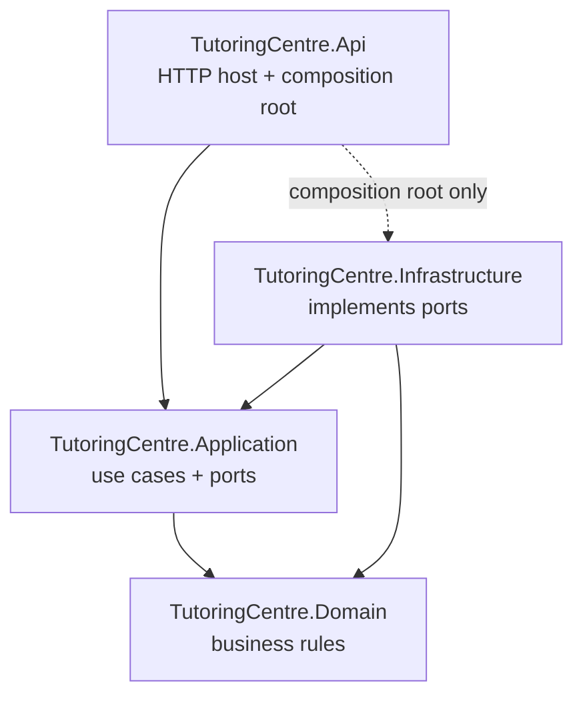

# Tutoring Centre Manager

[](https://github.com/youssef623/tutoring-centre/actions/workflows/ci.yml)

A multi-tenant management platform for Egyptian tutoring centres: students and parents, groups and schedules, attendance (manual and QR), fees and payments, and a WhatsApp assistant that answers parents' questions in Egyptian Arabic and English through the same authorized use cases as the staff web app. Built with ASP.NET Core (.NET 10) using Clean Architecture and a hand-written CQRS pipeline, PostgreSQL, and a React + TypeScript frontend.

**Live instance:** not yet deployed — no Azure subscription provisioned yet (see
[Deployment](docs/architecture/deployment.md) for exactly what is built versus still only designed). This
section will carry the public URL once that work lands. Once it does, the demo accounts are the same emails
as the local seed (`owner@nile.test`, `owner@maadi.test`, `teacher@both.test`, `secretary@nile.test`) — the
demo password is never written here; it lives only in the deployment's own secret store
(`docs/architecture/deployment.md`'s secrets inventory).

## Quick start

### Prerequisites

- .NET 10 SDK (the exact line is pinned in `global.json`)
- Node.js LTS (22.12 or later)
- Docker Desktop (running)
- Git

### Run locally

Run commands from the repository root unless a step says otherwise. Each step shows PowerShell first and bash/zsh second where they differ.

1. **Clone**

   ```bash
   git clone https://github.com/youssef623/tutoring-centre.git
   cd tutoring-centre
   ```

2. **Start PostgreSQL.** Create your local `.env` and set all three passwords in it — `POSTGRES_PASSWORD`,
   `TUTORING_OWNER_PASSWORD` and `TUTORING_APP_PASSWORD` (no `;` or spaces in any of them). On first start,
   `db/bootstrap-roles.sh` uses the latter two to create `tutoring_owner` (migrates) and `tutoring_app`
   (the app's own runtime login) — but only against an **empty** database volume. If you already have a
   `tutoring-centre_pgdata` volume from before this step existed, remove it first: `docker compose down -v`
   (see "To reset the database completely" below).

   ```powershell
   Copy-Item .env.example .env      # PowerShell
   ```

   ```bash
   cp .env.example .env             # bash/zsh
   ```

   ```bash
   docker compose up -d
   docker compose ps                # wait for (healthy)
   ```

3. **Give the API its two connection strings** (once per machine; stored outside the repository with
   user-secrets). `Postgres` is the runtime login the app always connects as; `PostgresMigrations` is the
   owner login, used only to apply migrations. Use the passwords you chose in `.env`.

   ```bash
   dotnet user-secrets set "ConnectionStrings:Postgres" "Host=localhost;Port=5432;Database=tutoring;Username=tutoring_app;Password=<TUTORING_APP_PASSWORD>" --project src/TutoringCentre.Api
   dotnet user-secrets set "ConnectionStrings:PostgresMigrations" "Host=localhost;Port=5432;Database=tutoring;Username=tutoring_owner;Password=<TUTORING_OWNER_PASSWORD>" --project src/TutoringCentre.Api
   ```

4. **Run the API** on https://localhost:7197 (HTTPS: the session and antiforgery cookies are `Secure` + `__Host-`,
   which a real browser only stores from an HTTPS origin)

   ```bash
   dotnet dev-certs https --trust   # once per machine
   dotnet run --project src/TutoringCentre.Api --launch-profile https
   ```

   Check: https://localhost:7197/health → `Healthy`; https://localhost:7197/health/ready → `Healthy` when the database is up.

5. **Seed the development database** (once per database; safe to run again — it skips what already exists).
   Choose your own password and set it with user-secrets; it is never written to this repository.

   ```bash
   dotnet user-secrets set "Seed:Password" "<your choice>" --project src/TutoringCentre.Api
   dotnet run --project src/TutoringCentre.Api -- seed
   ```

   This creates two demo centres and five staff accounts, all sharing the password you just set. In Development
   (and in the test suites) it also creates a third, empty centre, `giza-new` ("مركز الجيزة الجديد"), with one
   owner and nothing else: the full-setup journey builds a whole centre there from the UI. It is never created on a
   Production demo instance.

   | Email | Role | Centre(s) |
   |---|---|---|
   | `owner@nile.test` | Owner | Nile Tutoring Centre |
   | `owner@maadi.test` | Owner | Maadi Learning Hub |
   | `teacher@both.test` | Teacher | Nile Tutoring Centre, Maadi Learning Hub |
   | `secretary@nile.test` | Secretary | Nile Tutoring Centre |
   | `inactive@nile.test` | Secretary (inactive membership) | Nile Tutoring Centre |
   | `owner@giza.test` | Owner | مركز الجيزة الجديد (`giza-new`, Development and tests only, empty) |

   Each centre is also seeded with its own subjects — Nile Tutoring Centre gets رياضيات، فيزياء and كيمياء;
   Maadi Learning Hub gets Mathematics and Physics — visible from the app's Subjects page (below) once signed
   in, along with a set of demo students and the parents linked to them. Nile also gets two teachers, "كريم
   فتحي" (linked to `teacher@both.test`) and "منى السيد", and four groups — the linked teacher teaches exactly
   one of them; Maadi gets one teacher linked to the same account and two groups. The groups come with demo
   enrollments, and Nile's two-seat group "رياضيات - المجموعة ب" is left one seat short of full, ready to show
   what happens to the last seat. Every group also has a weekly schedule (six rules in Nile, two in Maadi, Monday
   to Thursday) that starts on the day you seed, so the Timetable always shows this week's sessions and the next
   three weeks'. In total: 5 subjects, 3 teachers, 6 groups, 18 students, 15 parents, 31 enrollments and 8 weekly
   rules with 32 sessions.

6. **Run the frontend** in a second terminal, then open http://localhost:5173 — signed out, this redirects to
   `/login`; sign in with any seeded email above and the password you chose in step 5. From the sidebar,
   **Subjects** lists, adds, renames, archives and restores a centre's subjects, in Arabic or English, scoped
   to whichever centre is currently selected. A secretary or owner also sees **Students**: register a student
   and either link a parent already known by phone or create a new one in one request; a student's own page
   edits their details, archives and restores them, and links, unlinks or sets the primary contact among up
   to four parents; a parent's own page edits their contact details and lists every child linked to them.
   **Teachers** lists the centre's teachers (an owner adds, edits, archives them and links one to a staff
   account; a secretary reads), and **Groups** lists the centre's groups with seats, filterable by subject and
   teacher, each with its own page (rename, capacity, teacher, archive). A group's **Roster** tab lists its
   students and seats; a secretary or owner enrolls a student found by search, transfers one to another group
   of the same subject, or withdraws one, and a full group refuses politely. A student's page lists their
   current and past groups and can enroll them from there. A teacher signed in as `teacher@both.test` sees only
   the groups they teach — a different set per selected centre — and their rosters, read-only. A group's
   **Schedule** tab lists its weekly sessions; a secretary or owner adds one ("Saturday 18:00 for 90 minutes",
   which fills the next four weeks) or ends one, and a time the group or its teacher is already busy is refused
   in words. **Timetable** shows a week of sessions in the centre's own time (Cairo), filterable by group and
   teacher; a secretary or owner cancels a single session or extends the schedule further ahead. An
   owner also sees **Staff** (add, change role, deactivate, reactivate), **Settings** (centre name, default
   language) and **Audit log** (filterable, infinite-scroll history of every change above); a new staff member
   is forced through a password change on first sign-in.

   ```bash
   cd frontend
   npm ci
   npm run dev
   ```

   What each demo account sees after signing in:

   | Account | Sees | Can change |
   |---|---|---|
   | `owner@nile.test` | Everything in Nile: subjects, students and parents, teachers, groups with rosters and schedules, the timetable, staff, settings and the audit log | Everything in Nile |
   | `owner@maadi.test` | The same for Maadi, and nothing of Nile | Everything in Maadi |
   | `secretary@nile.test` | Nile's subjects, students and parents, teachers (read-only), groups, rosters, schedules and the timetable; no Staff, Settings or Audit log | Subjects, students and parents, groups, enrollments and schedules; not teachers or staff |
   | `teacher@both.test` | After choosing a centre: its subjects, and only the groups it teaches there (one in Nile, two in Maadi) with their rosters (names only), schedules and sessions on the timetable; no Students, Teachers or Staff | Nothing |
   | `inactive@nile.test` | Cannot select Nile: the membership is inactive | Nothing |
   | `owner@giza.test` | An empty centre, ready to be set up from scratch (Development only) | Everything in that centre |

7. **Run the tests**

   ```bash
   dotnet test
   cd frontend
   npm run test:ci
   ```

   End-to-end journeys (real API, real PostgreSQL, a real Chromium browser) are separate: they start their
   own copies of the API and the frontend, so stop the ones from steps 4/6 first (or leave them running —
   Playwright reuses an already-running server locally). Supply the seed password from step 5 as
   `SEED_PASSWORD`, and raise the login budget the way CI does: sign-in is limited to ten attempts a minute per
   client address, and every local journey signs in from the same one, so a whole run (or two runs in a row) would
   otherwise hit "Too many attempts". The budget is read by the API Playwright starts, so stop your own API from
   step 4 first.

   ```powershell
   cd frontend
   $env:SEED_PASSWORD = "<the password you chose in step 5>"
   $env:Auth__LoginRateLimit__PermitLimit = "100"
   npm run test:e2e
   ```

   ```bash
   cd frontend
   SEED_PASSWORD="<the password you chose in step 5>" Auth__LoginRateLimit__PermitLimit=100 npm run test:e2e
   ```

   The journeys leave their own data behind (unique names per run), so walk a manual check on a freshly seeded
   database, not after a test run.

8. **Run the local production stack** (the real container image, behind a TLS-terminating reverse proxy —
   the same topology a deployed environment uses, before any cloud resource exists). Add
   `DEMO_SEED_PASSWORD` to your `.env` (any password; it only ever seeds this local stack), then:

   ```bash
   docker compose -f compose.yaml -f compose.prod.yaml up --build
   ```

   This builds the image, runs `migrate` and `seed` (with `Demo:Enabled=true`) as one-shot jobs, starts the
   app container with only its runtime connection string (never the owner connection), and puts Caddy in
   front of it on `https://localhost:8443`. Caddy's certificate is self-signed for `localhost`
   (`tls internal`); your browser will warn once — accept it to continue, or run
   `docker compose -f compose.yaml -f compose.prod.yaml exec caddy caddy trust` once to stop the warning.
   Sign in with any seeded email (step 5's table) and `DEMO_SEED_PASSWORD`. Restarting only the app container
   (`docker compose -f compose.yaml -f compose.prod.yaml restart app`) does not sign you out: the session's
   Data Protection keys live in PostgreSQL, not in the app's memory (Task 34.6).

To reset the database completely: `docker compose down -v` (deletes the `pgdata` volume).

## Architecture

Four projects; source-code dependencies point inward, enforced by architecture tests in CI.



- [ADR 0001 — Clean Architecture with four projects](docs/adr/0001-clean-architecture.md)
- [ADR 0002 — .NET backend and React frontend](docs/adr/0002-dotnet-react.md)
- [ADR 0005 — Encrypted cookie authentication over JWT](docs/adr/0005-cookie-authentication.md)
- [ADR 0006 — Tenant isolation as defense in depth](docs/adr/0006-tenant-isolation.md)
- [ADR 0007 — Code-defined permissions](docs/adr/0007-code-defined-permissions.md)
- [ADR 0008 — Audit log written in the command's own transaction](docs/adr/0008-audit-log-in-transaction.md)
- [ADR 0009 — Azure Container Apps and OIDC](docs/adr/0009-azure-container-apps-and-oidc.md)
- [ADR 0010 — Student aggregate and value objects](docs/adr/0010-student-aggregate-and-value-objects.md)
- [ADR 0011 — Pessimistic lock for enrollment capacity](docs/adr/0011-pessimistic-lock-for-enrollment-capacity.md)
- [ADR 0012 — Sessions as generated instants](docs/adr/0012-sessions-as-generated-instants.md)
- [Authentication: login, sessions, CSRF, revocation](docs/architecture/authentication.md)
- [Tenant isolation: the role model, and all four layers](docs/architecture/tenancy.md)
- [Authorization: the permission matrix, the pipeline step, and what the UI does](docs/architecture/authorization.md)
- [Academics: students, parents, teachers, groups and enrollments — the Domain model, storage, use cases, endpoints and screens](docs/architecture/academics.md)
- [Scheduling: weekly rules, generated sessions, double-booking constraints and daylight saving](docs/architecture/scheduling.md)
- [Audit: how a change becomes an audit row, atomically](docs/architecture/audit.md)
- [Deployment: topology, pipeline, secrets inventory, and what's not provisioned yet](docs/architecture/deployment.md)
- [Live verification checklist](docs/operations/live-verification.md) and [runbook](docs/operations/runbook.md)
- [Frontend decisions and conventions](frontend/README.md)

## Quality gates

Every pull request runs: backend build and all tests (including architecture tests), frontend lint, type-check, tests, i18n key-parity check and production build, nineteen Playwright end-to-end journeys against a real API and PostgreSQL (one of them sets up a whole centre from an empty one, in Arabic, through the UI alone), a production-image build and migration check, a deployed smoke test against a freshly built local production stack, CodeQL static analysis, and gitleaks secret scanning. Dependabot proposes dependency updates weekly. `main` is protected: nothing merges unless every check is green.

### Create today's attendance demo session

In Development, after migrating and seeding, run:

```powershell
dotnet run --project src/TutoringCentre.Api -- demo-session --centre nile-centre --group "<existing group name>" --in-minutes 10
```

Choose a group taught by the demo account. The command creates a 60-minute session through schedule
commands, rounds the start up to five minutes, and prints its ID and attendance API URL. Open
`/attendance` as `teacher@both.test`, or `/attendance/sessions/<printed session ID>`. Mark while Open.
Once the session starts, `secretary@nile.test` can correct a record with a reason; `owner@nile.test`
can inspect its audit entry. The group Attendance tab shows the resulting history.

`--in-minutes` defaults to 10. The helper refuses outside Development and between 23:00 and midnight
in the centre's zone. It retries teacher conflicts at later half-hour slots. The weekly rule is ended
after today, so later generated sessions remain cancelled history rather than future demo classes.
