# Tutoring Centre Manager — Current Repository Re-onboarding

This is a fresh account of the repository at the starting revision `ef486f9`, prepared on 27 October 2026. Source files, configuration, migrations, tests and documentation are evidence; old overview statements are not evidence of current behaviour. An implemented feature is not automatically a deployed or independently exercised feature. Test outcomes below distinguish those meanings.

The intended reader knows basic programming and needs to understand why one user action crosses several files. Read the execution examples with the corresponding source open. A path and line number identify the implementation, while the discussion explains ownership, mechanisms and consequences. The [file index](file-explanations/INDEX.md) covers the complete application inventory and links to per-file guides. The historical overview documents remain unchanged.

Contents: [Project](#1-project-overview) · [Stack](#2-technology-stack) · [Architecture](#3-architecture) · [File map](#4-folder-and-file-architecture) · [Startup](#5-startup--bootstrapping) · [Concepts](#6-concepts-and-patterns) · [Authentication](#7-authentication-and-authorization) · [Routing](#8-routing-and-middleware) · [Data](#9-data-layer) · [Use cases](#10-business-logic-and-services) · [Frontend](#11-frontend) · [Tests](#12-testing) · [Infrastructure](#13-infrastructure) · [Findings](#14-code-quality-findings) · [Learning path](#15-recommended-learning-path) · [Changes](#16-changes-since-v2) · [Glossary](#17-glossary-and-open-questions).

When this document discusses a language or framework mechanism, it explains the mechanism required to read the implementation. That is distinct from observing every internal instruction of the framework at runtime. Where the repository does not state a design motivation, the following convention applies: **The repository does not explicitly state why this approach was chosen. The following is an interpretation based on the implementation.** Interpretations must not be read as historical decisions by the author.

# 1. Project Overview

## 1.1 Product purpose and users

The README describes a management platform for Egyptian tutoring centres. Its intended scope includes students, parents, groups, schedules, attendance, fees, payments and a WhatsApp assistant. The implementation now supports substantial administrative and academic workflows. Attendance, payments and a WhatsApp delivery channel must not be inferred from that product description. The implementation reference is the registered endpoint groups in `src/TutoringCentre.Api/Program.cs`, the use cases in Application, and the rendered frontend routes.

A **centre** is the tenant: the customer whose records must remain isolated. A staff account can have memberships in multiple centres. Each membership carries its own role. The same person can therefore have different access depending on the centre selected for the session. The staff roles are Owner, Secretary and Teacher; the UI can call the Secretary an Assistant. The role names, permission keys and mapping are defined in `src/TutoringCentre.Domain/Identity/StaffRole.cs`, `Permissions.cs` and `RolePermissions.cs`. A parent contact record is academic data, not a parent login. These are separate concepts even when the word “parent” appears in the product vision.

The operator is another actor. Operator actions such as migrations, seed data and resetting a password run through process commands. They do not become public HTTP endpoints merely because they are implemented. The CLI branches in `Program.cs` separate `migrate`, `seed` and `reset-password` from starting the web server. Trusted process execution and staff HTTP authorization therefore have different entry conditions.

## 1.2 Current implementation state

The states below concern repository implementation. “Complete” means the described slice has implementation and supporting checks, not that the entire eventual product is finished. Actual execution results appear in the testing section.

| Feature | State | Implementation evidence and boundary |
| --- | --- | --- |
| Four backend projects with inward dependencies | Complete | The solution, project references, Application ports and architecture rules implement the layering. |
| Commands and queries through a common dispatcher | Complete | `Application/Common/Cqrs/Dispatcher.cs` validates, checks tenant scope and permission, then controls the transaction. |
| Staff login and encrypted cookie sessions | Complete | `Api/Auth/AuthEndpoints.cs`, `AuthenticationSetup.cs`, Infrastructure identity adapters and frontend login routes. |
| Centre selection | Complete | `SelectCentreAsync` dispatches the membership check before replacing the cookie. |
| First-login password change | Complete | Login prevents auto-selection when `MustChangePassword` is true; password change replaces the ticket without a selected centre. |
| Code-defined permission checks | Complete | Sixteen keys in `Domain/Identity/Permissions.cs`; `Dispatcher.CheckPermission` reads the current role mapping. |
| Tenant isolation | Complete for mapped tenant entities | Request marker, EF query convention, save guard, transaction-local PostgreSQL setting and forced RLS work together. This is not a claim that every future table is automatically safe without its migration. |
| Subject management | Implemented | Subject commands, read service, endpoints and frontend page. |
| Student and parent records | Implemented | Academic entities, registration and link operations, read services, endpoints and detail pages. |
| Teacher records and staff links | Implemented | Teacher entity and commands, staff-directory contract, teacher scope and frontend account dialog. |
| Groups | Implemented | Subject/teacher relationships, capacity, status and versioned edit operations. |
| Enrollment, withdrawal and transfer | Implemented | Enrollment handlers and group row locking; roster and student enrollment screens. |
| Weekly schedules and dated sessions | Implemented | Schedule rules, pure session generator, repository locks, exclusion constraints, schedule tab and timetable. |
| Audit history | Implemented | Save interceptor builds audit rows in the command transaction; read permission and audit page expose history. |
| Centre settings and staff lifecycle | Implemented | Dedicated endpoint groups, use cases and owner-facing pages. |
| English and Arabic interface | Implemented | Bundled resources, i18next setup, logical layout utilities and translation tests. A resource file is not proof of visual QA for every screen. |
| Production application image and local TLS stack | Implemented; local execution results reported separately | `Dockerfile`, `compose.prod.yaml`, `Caddyfile`, static SPA hosting and trusted forwarding. |
| Azure deployment | Design documented; live deployment unverified | README explicitly says no Azure subscription has been provisioned. Deployment ADRs and runbooks are plans and operational instructions. |
| Attendance, QR, money flows and WhatsApp bot | Outside the currently mapped feature set | They are intended scope; no corresponding registered feature group appears in the current composition root. |

## 1.3 Major user journeys

**Sign in and choose a centre.** The browser loads the SPA and the protected route asks for the current session. A signed-out result leads to the login form. Client validation checks input before the request. The HTTP wrapper obtains the request-side antiforgery token, sends the login request and processes the result. The API validates shape, verifies credentials, replaces the request actor and reads the current profile. A single active membership is selected automatically only when the account does not require a password change. Otherwise the browser goes through password change or centre selection. The cookie holds the authenticated ticket; the UI reads profile data from `/api/me`.

**Set up a centre.** An owner creates subjects and teacher records, optionally links teachers to staff accounts, and creates groups referring to those records. Students are registered with parent contacts. Enrollment puts students into groups. Weekly rules generate dated sessions, and the timetable presents those sessions in the centre's time zone. These steps cross different aggregates because the invariant for one record is not necessarily the invariant for a whole academic workflow. A group's capacity is enforced by a lock-and-count operation, while schedule overlap is enforced by database exclusion constraints.

**Work as a teacher.** The role mapping allows subject, group, enrollment and schedule reads. Teacher ownership narrows relevant reads to groups taught by the linked teacher in the selected centre. Permission and ownership answer different questions: the permission allows the capability; the ownership scope decides which records that capability can see. Hiding other navigation items improves usability, but the server's request checks and read scope remain the boundary.

**Review a change.** A successful command can produce both business changes and audit rows. The save interceptor participates in the same unit of work. A rollback must remove both; otherwise history could describe a change that never happened. Owners read audit history through a separately authorized query. The frontend renders structured audit fields instead of receiving raw database entities.

## 1.4 How to interpret evidence

There are three different levels of confidence. Source proves that a branch or mapping is present. A test definition proves that an intended behaviour has a regression specification. A test execution proves that the behaviour passed in the environment used for that run. The test section records the last level explicitly. Neither a passing local test nor a deployment document proves that a cloud instance is running.

The repository also contains historical semantic documentation and older overview files. Treat them as time-specific artifacts. The current code already contradicts several statements in those files, especially that Application is empty, that tenant isolation is only a plan, or that there is no production application image. The changes section records the corrected claims rather than rewriting those historical documents.

## 1.5 What the academic workflows actually mean

A subject is the classification used by a group. Its management flow includes creation, renaming, archive and restore. Archiving is a state transition rather than deleting every related record. The implementation refuses operations that would leave active groups depending on an archived subject. This means the visible archive button is only a request for a transition: the server must recheck current dependencies because another user can create or alter a group after the list was loaded. Subject uniqueness and version conflicts are separate outcomes from that dependency refusal.

A teacher record describes the academic teacher in one centre. Linking it to a staff account enables the ownership scope used when that staff user reads groups, rosters and schedules. Creating a teacher record does not automatically create an authenticated session, and having a Teacher membership does not automatically establish which academic teacher record owns a group. The account link makes that relationship explicit. Archive operations also consider active groups, because a group should not retain an invalid active teacher dependency.

A group combines a subject, teacher, name, status and capacity. Its detail screen provides distinct operations for changing those facts. A stale client version can be refused independently of the proposed value's domain validity. Capacity is not a stored enrollment total: the server counts active relationships when deciding whether another student fits. Changing capacity and archiving a group need the same count-aware lock protocol as enrollment, because concurrent requests can otherwise invalidate a decision made from an earlier count.

A student aggregate protects its own details and parent relationships. Registering a student can link an already-known parent or create a parent as part of the requested workflow. Parent contacts are shared academic records, so a correction to a parent's contact details is not a private copy inside one student's form. Linking, unlinking and choosing a primary contact have relationship invariants and persistence consequences. The unit of work's reconciliation exists because removing a link from the aggregate collection must become an explicit database deletion under the chosen restrictive relationship mapping.

Enrollment records connect students and groups while preserving history. Withdrawing ends a relationship. Transferring ends one relationship and creates another in the same transaction. Re-enrollment can create a new active relationship after an old one ended, while a partial unique index prevents two simultaneously active relationships for the same student/group. These are different from editing a student's current group identifier. The model is designed so historical enrollment can remain true after current placement changes.

Scheduling separates a recurring local rule from dated sessions. A rule such as Saturday at 18:00 carries calendar meaning in the centre's zone. A generated class session has definite start and end instants. Extending generation adds later occurrences; ending a rule changes its active range; cancelling one session is an exception for a dated occurrence. Those actions should not be conflated into deleting a recurrence and reconstructing history. The generator and persistence constraints have complementary responsibilities for daylight-saving interpretation and concurrent overlap prevention.

Owner administration also has several independent transitions. Creating staff can reuse an existing account or create a new account requiring password change. Changing a role affects the selected membership, not every centre. Deactivation removes that relationship's active access while retaining the account. Centre settings update the centre's supported administrative fields. Audit history gives an owner a structured account of policy-selected changes, with masked fields rather than an unfiltered request dump. None of these implemented flows establishes that the planned money, attendance or WhatsApp product areas are already complete.

# 2. Technology Stack

## 2.1 Reading versions correctly

`global.json` pins the SDK selection policy. `Directory.Build.props` supplies project-wide compiler settings, while `Directory.Packages.props` holds NuGet dependency versions. The frontend manifest specifies ranges; `frontend/package-lock.json` supplies resolved package versions. A version range is not an installed version, and the fact that a binary exists on the current machine does not change the repository's declared requirements.

| Technology | Version source | Where used | What it does in this project |
| --- | --- | --- | --- |
| .NET SDK | `10.0.401`, `rollForward: latestFeature`, `global.json` | Backend build | Selects a compatible compiler and SDK feature band. |
| C# and target framework | `net10.0`, `Directory.Build.props` | Four source projects and five test projects | Language, runtime, nullable analysis and common warnings policy. |
| ASP.NET Core | .NET 10 shared framework | Api | Minimal hosting, routing, cookies, authorization, antiforgery, rate limits and health endpoints. |
| Entity Framework Core | `10.0.13` | Infrastructure | Entity mapping, LINQ translation, change tracking, migrations and concurrency tokens. |
| Local dotnet-ef tool | `10.0.12`, `.config/dotnet-tools.json` | Migration tooling | Compares the current model with its snapshot; its patch version differs from the current runtime packages. |
| Npgsql EF provider | `10.0.3` | Infrastructure | PostgreSQL implementation of EF operations. |
| PostgreSQL | `postgres:17` image | Compose and disposable test databases | Constraints, transactions, row-level security and explicit locks. |
| Naming conventions | `EFCore.NamingConventions 10.0.1` | DbContext options | Converts model names to database naming conventions. |
| FluentValidation | `12.1.1` | Application and transport validation | Runs shape checks and produces field-keyed failures. |
| ASP.NET Core Identity EF | `10.0.13` | Infrastructure identity | User persistence, password hashing, lockout and security stamps. |
| Data Protection EF | `10.0.13` | Infrastructure registration | Persists cookie encryption key material through the database context. |
| ASP.NET OpenAPI and build exporter | `10.0.13` | Api build | Derives the machine-readable contract from endpoint metadata. |
| Serilog.AspNetCore | `10.0.0` | Api | Structured request and application logs. |
| OpenTelemetry hosting and OTLP exporter | `1.15.3` | Api telemetry | Optional tracing and metric export. |
| ASP.NET telemetry instrumentation | `1.16.0` | Api telemetry | Instruments incoming requests. |
| Npgsql telemetry | `10.0.1` | Infrastructure/Api telemetry wiring | Adds database activity instrumentation. |
| xUnit / runner | `2.9.3` / `4.0.0` | Backend tests | Test discovery, assertions and parameterized cases. |
| Testcontainers.PostgreSql | `4.15.0` | Integration tests | Creates disposable PostgreSQL instances through Docker. |
| Respawn | `7.0.0` | Database fixtures | Resets row data between tests. |
| NetArchTest.Rules | `1.3.2` | Architecture tests | Checks compiled dependency usage. |
| Microsoft.NET.Test.Sdk / coverlet | `18.10.1` / `10.1.0` | Test projects | Test host and coverage collector integration. |
| React / React DOM | Manifest `^19.2.8`; exact resolution in lockfile | Frontend | Declarative components and browser mounting. |
| TypeScript | Manifest `~6.0.2`; exact resolution in lockfile | Frontend and Node-side tooling | Static checking and compilation. |
| Vite | Manifest `^8.3.0` | Frontend | Development server, API proxy and production assets. |
| TanStack Query | Manifest `^5.104.1` | Frontend | Server-state cache, observers and mutation lifecycle. |
| TanStack Router | Manifest `^1.170.41` | Frontend | File route definitions, guards and typed navigation. |
| Orval | Manifest `^8.39.0` | Frontend tooling | Generates typed API functions and Query hooks. |
| React Hook Form / Zod | `^7.89.0` / `^4.6.5` | Forms | Input registration, validation and submit handling. |
| i18next / react-i18next | `^26.4.2` / `^17.0.15` | Frontend resources and components | Language selection and reactive translation. |
| Tailwind / Base UI | `^4.3.3` / `^1.8.0` | Styling and UI primitives | Utility classes and interactive accessible controls. |
| Vitest / Testing Library / MSW | `^5.0.3` / `^16.3.3` / `^2.15.0` | Frontend tests | Component execution, DOM assertions and HTTP interception. |
| Playwright | Manifest `^1.63.0` | E2E and smoke tooling | Real browser journeys across serving, API and persistence. |
| npm | Lockfile format and package scripts | Frontend and smoke | Reproducible package installation and command entry points. |
| Docker Compose / Caddy | Service configuration and image tags | Local production topology | Process isolation, TLS termination and reverse proxying. |
| GitHub Actions | Workflow action tags | `.github/workflows` | Builds, tests, contract drift checks and local container verification. |

The exact frontend resolution table and command results are retained with the frontend evidence. No production Node process is implied by this stack: the production browser assets are built in the image and served by the API. Node is used during development, testing and asset compilation.

## 2.2 Exact direct frontend resolutions

These versions are read from the committed lockfile, not guessed from semver ranges or copied from the older overview. The range and exact resolution intentionally occupy separate columns.

| Package | Manifest range | Locked version |
| --- | --- | --- |
| `@base-ui/react` | `^1.8.0` | `1.8.0` |
| `@fontsource-variable/geist` | `^5.3.0` | `5.3.0` |
| `@fontsource/ibm-plex-sans-arabic` | `^5.3.0` | `5.3.0` |
| `@hookform/resolvers` | `^5.9.1` | `5.9.1` |
| `@tailwindcss/vite` | `^4.3.3` | `4.3.3` |
| `@tanstack/react-query` | `^5.104.1` | `5.104.1` |
| `@tanstack/react-router` | `^1.170.41` | `1.170.41` |
| `class-variance-authority` | `^0.7.1` | `0.7.1` |
| `cn` | `^0.4.0` | `0.4.0` |
| `i18next` | `^26.4.2` | `26.4.2` |
| `i18next-icu` | `^2.4.4` | `2.4.4` |
| `intl-messageformat` | `^11.2.15` | `11.2.15` |
| `lucide-react` | `^1.49.0` | `1.49.0` |
| `next-themes` | `^0.4.6` | `0.4.6` |
| `react` | `^19.2.8` | `19.3.0` |
| `react-dom` | `^19.2.8` | `19.3.0` |
| `react-hook-form` | `^7.89.0` | `7.89.0` |
| `react-i18next` | `^17.0.15` | `17.0.15` |
| `shadcn` | `^4.21.1` | `4.21.1` |
| `sonner` | `^2.0.8` | `2.0.8` |
| `tailwindcss` | `^4.3.3` | `4.3.3` |
| `tw-animate-css` | `^1.4.0` | `1.4.0` |
| `zod` | `^4.6.5` | `4.6.5` |
| `@eslint/js` | `^10.0.1` | `10.0.1` |
| `@playwright/test` | `^1.63.0` | `1.63.0` |
| `@tanstack/router-plugin` | `^1.168.42` | `1.168.42` |
| `@testing-library/dom` | `^10.4.2` | `10.4.2` |
| `@testing-library/jest-dom` | `^7.0.1` | `7.0.1` |
| `@testing-library/react` | `^16.3.3` | `16.3.3` |
| `@types/node` | `^24.13.3` | `24.19.1` |
| `@types/react` | `^19.2.18` | `19.3.0` |
| `@types/react-dom` | `^19.2.7` | `19.3.0` |
| `@vitejs/plugin-react` | `^6.1.1` | `6.1.1` |
| `eslint` | `^10.10.0` | `10.11.0` |
| `eslint-plugin-react-hooks` | `^7.1.1` | `7.1.1` |
| `eslint-plugin-react-refresh` | `^0.5.6` | `0.5.7` |
| `globals` | `^17.12.0` | `17.13.0` |
| `jsdom` | `^30.1.1` | `30.1.1` |
| `msw` | `^2.15.0` | `2.15.0` |
| `orval` | `^8.39.0` | `8.39.0` |
| `prettier` | `^3.9.9` | `3.9.9` |
| `typescript` | `~6.0.2` | `6.0.3` |
| `typescript-eslint` | `^8.69.0` | `8.71.0` |
| `vite` | `^8.3.0` | `8.3.2` |
| `vitest` | `^5.0.3` | `5.0.3` |

# 3. Architecture

## 3.1 Compile-time boundaries versus runtime calls

The backend is one deployable process with four source projects. Domain owns business state and invariant methods. Application owns requests, handlers and ports. Infrastructure implements persistence, credential and other technical ports. Api is the HTTP edge and composition root. An interface being declared in Application allows a handler to call an Infrastructure object at runtime without compiling against that implementation.

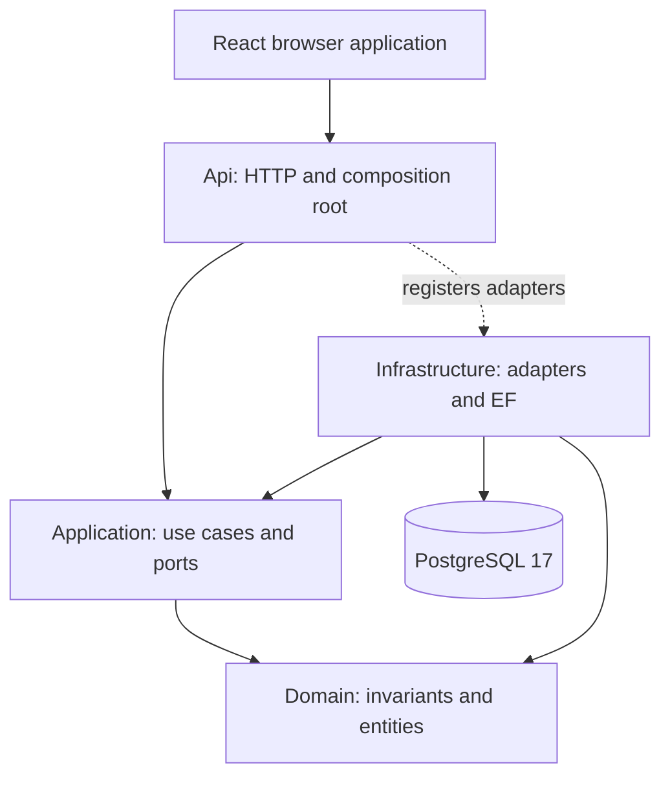

This is a **modular monolith**, not independently deployed services. Feature folders divide academics, identity, centres and audit inside the layers. Published contracts such as the staff directory and centre time-zone provider let one feature consume a narrow capability without copying persistence logic into another feature. Architecture tests inspect these boundaries; they are not merely a diagram in documentation.

## 3.2 Main command and data flow

The primary user-action path is a browser event, a frontend mutation, a generated API function, the shared transport wrapper, the HTTP pipeline, an endpoint, the dispatcher, a handler and one or more ports. Infrastructure translates those port calls into reads or tracked changes. The dispatcher owns the final save and commit. The result returns through HTTP mapping, the transport wrapper and cache invalidation to a component render.

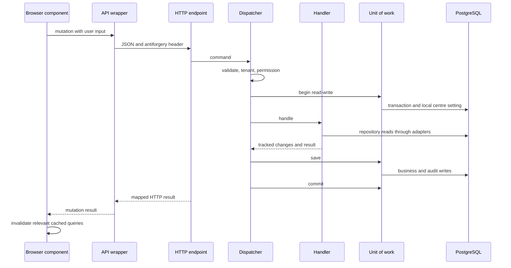

The drawing intentionally does not turn every read into a direct handler-to-database dependency. The runtime request passes through ports; the database arrows represent adapter work. A business failure returns a value and causes rollback. An unexpected exception causes rollback and propagates to the HTTP exception handler. Read-only queries have a separate pipeline and never perform the dispatcher's save.

## 3.3 Isolation is several guarantees

The selected centre is not accepted as an arbitrary trusted field from every request. Authentication supplies a staff actor, and centre selection checks the membership before issuing the session claim. Tenant-scoped requests require a centre before a transaction opens. EF adds centre predicates to mapped tenant entities. The save guard checks tracked writes. The transaction sets `app.current_centre`, and PostgreSQL policies enforce the same boundary even for allow-listed raw SQL. Composite foreign keys prevent a record in one centre from referring to a record in another centre.

These mechanisms protect different failure modes. A query filter alone does not protect direct SQL. RLS alone does not make a forged application actor trustworthy. A permission alone does not identify which tenant is active. A foreign key alone does not decide which staff role may read the row. The useful question before changing any one mechanism is therefore: which bypass remains covered by the other layers, and which guarantee would be lost?

# 4. Folder and File Architecture

## 4.1 Navigating by ownership

| Path | Type | Purpose | Depends on | Used by |
| --- | --- | --- | --- | --- |
| `src/TutoringCentre.Domain` | Source | Business state, value objects, errors and role catalogue | Language/runtime primitives | Application and Infrastructure |
| `src/TutoringCentre.Application` | Source | Use cases, DTOs, request markers and ports | Domain and selected abstractions | Api and Infrastructure |
| `src/TutoringCentre.Infrastructure` | Source | EF models, migrations, repositories, read services and Identity adapters | Application, Domain and persistence packages | Composition root and tests |
| `src/TutoringCentre.Api` | Source | Hosting, transport, auth, telemetry and operator commands | Application and composition registrations | HTTP clients and CLI |
| `tests/TutoringCentre.Domain.Tests` | Test | Pure invariant and value-object specifications | Domain | Test runner |
| `tests/TutoringCentre.Application.Tests` | Test | Handler and pipeline behaviour with fakes | Application and Domain | Test runner |
| `tests/TutoringCentre.Infrastructure.Tests` | Test | PostgreSQL constraints, scopes, races and persistence | Infrastructure and disposable database | Test runner |
| `tests/TutoringCentre.Api.Tests` | Test | HTTP, identity, permission and tenant probes | Api test hosts and database fixtures | Test runner |
| `tests/TutoringCentre.Architecture.Tests` | Test | Dependency, module and convention rules | Built assemblies and project metadata | Test runner |
| `frontend/src/routes` | Source | File routes, parameters, guards and route integration | Feature components and Query | Generated route tree |
| `frontend/src/features` | Source | Academic and administrative UI workflows | Generated client, shared controls and session helpers | Routes |
| `frontend/src/api` | Source/generated | Shared transport, error mapping, CSRF and generated contract client | Browser HTTP and OpenAPI | Feature hooks |
| `frontend/src/i18n` | Source/resources | Language setup and paired resources | i18next integrations | UI |
| `frontend/src/components` | Source | Shared controls, tables and copied primitives | React and UI packages | Features |
| `frontend/e2e` | Test | Complete browser journeys | Running browser, API and database | Playwright |
| `smoke` | Test/configuration | Browser checks against a production-style URL | Container stack or configured target | Smoke job |
| `database/demos` | Database/schema | Demonstrations of database isolation | SQL session roles and schema | Developer verification |
| `db/bootstrap-roles.sh` | Database/script | Creates distinct database roles and grants | PostgreSQL bootstrap environment | Initial database startup |
| `docs/adr` | Documentation | Decisions and alternatives | Implemented design evidence | Maintainers |
| `docs/architecture` | Documentation | Feature and infrastructure architecture | Current source | Maintainers |
| `docs/operations` | Documentation | Verification instructions and operational recovery | Deployment configuration | Operators |
| `.github` | CI/CD | Workflow jobs and dependency maintenance | Build/test entry points | GitHub runners |

The complete per-file table follows in the generated file map and [index](file-explanations/INDEX.md). It includes small declarations, generated artifacts, lockfiles and media rather than dropping them because they contain little business logic. Generated migrations, snapshots, API client code and route trees are important to understand even though they should not usually be edited manually.

## 4.2 How to follow one feature

Start with the route or endpoint, not with a similarly named entity. For enrollment, the endpoint binds the request and sends `EnrollStudentCommand`. The command's implemented interfaces reveal tenant and permission requirements. Its handler shows orchestration order. The repository port states required storage capabilities. The Infrastructure repository shows the `FOR UPDATE` load and subsequent count. The Domain group decides whether the count permits another student. The enrollment entity records the relationship. Finally, EF configuration and migrations state what survives outside the application process.

Reading only the frontend would miss the lock. Reading only the entity would miss the count. Reading only the migration would miss the permission requirement. Reading every layer in the same operation is how the architecture stops being a list of labels and becomes a concrete execution path.

## 4.3 Complete per-file architecture map

For each file, dependency entries below are literal import/project references and “Used by” describes the evidence level available. Imports may be unused. The linked guide contains the current source summary, declarations and line locations. Runtime consumers must be established by call sites and registration, not by an invented filename relationship.

| Path | Type | Purpose | Depends on | Used by |
| --- | --- | --- | --- | --- |
| [`.config/dotnet-tools.json`](file-explanations/.config/dotnet-tools.json.md) | configuration | JSON data with top-level keys `version`, `isRoot`, `tools`. Its consumers determine whether this is build configuration, a contract or a language resource. | No recognized import declaration | Tool convention or no unique name reference established |
| [`.dockerignore`](file-explanations/.dockerignore.md) | Docker/infrastructure | Current Docker/infrastructure file. The source excerpt and structural map below expose its content without inferring behaviour from its filename. | No recognized import declaration | Tool convention or no unique name reference established |
| [`.editorconfig`](file-explanations/.editorconfig.md) | configuration | Current configuration file. The source excerpt and structural map below expose its content without inferring behaviour from its filename. | No recognized import declaration | Tool convention or no unique name reference established |
| [`.env.example`](file-explanations/.env.example.md) | configuration | Current configuration file. The source excerpt and structural map below expose its content without inferring behaviour from its filename. | No recognized import declaration | Tool convention or no unique name reference established |
| [`.gitattributes`](file-explanations/.gitattributes.md) | configuration | Current configuration file. The source excerpt and structural map below expose its content without inferring behaviour from its filename. | No recognized import declaration | Tool convention or no unique name reference established |
| [`.github/dependabot.yml`](file-explanations/.github/dependabot.yml.md) | CI/CD | Current CI/CD file. The source excerpt and structural map below expose its content without inferring behaviour from its filename. | No recognized import declaration | Tool convention or no unique name reference established |
| [`.github/workflows/ci.yml`](file-explanations/.github/workflows/ci.yml.md) | CI/CD | Current CI/CD file. The source excerpt and structural map below expose its content without inferring behaviour from its filename. | No recognized import declaration | Tool convention or no unique name reference established |
| [`.github/workflows/codeql.yml`](file-explanations/.github/workflows/codeql.yml.md) | CI/CD | Current CI/CD file. The source excerpt and structural map below expose its content without inferring behaviour from its filename. | No recognized import declaration | Tool convention or no unique name reference established |
| [`.github/workflows/secret-scan.yml`](file-explanations/.github/workflows/secret-scan.yml.md) | CI/CD | Current CI/CD file. The source excerpt and structural map below expose its content without inferring behaviour from its filename. | No recognized import declaration | Tool convention or no unique name reference established |
| [`.gitignore`](file-explanations/.gitignore.md) | configuration | Current configuration file. The source excerpt and structural map below expose its content without inferring behaviour from its filename. | No recognized import declaration | Tool convention or no unique name reference established |
| [`.gitleaksignore`](file-explanations/.gitleaksignore.md) | configuration | Current configuration file. The source excerpt and structural map below expose its content without inferring behaviour from its filename. | No recognized import declaration | Tool convention or no unique name reference established |
| [`.semantic-manifest.json`](file-explanations/.semantic-manifest.json.md) | configuration | JSON data with top-level keys `version`, `last_full_generation`, `generated_by`, `docs`. Its consumers determine whether this is build configuration, a contract or a language resource. | No recognized import declaration | Tool convention or no unique name reference established |
| [`ARCHITECTURE.semantic.md`](file-explanations/ARCHITECTURE.semantic.md.md) | documentation | Documentation covering Architecture; Why this shape; The four projects; Why the Api → Infrastructure reference is dashed; Enforcement: fitness functions. Treat historical claims according to the revision described in the file. | No recognized import declaration | Tool convention or no unique name reference established |
| [`CLAUDE.md`](file-explanations/CLAUDE.md.md) | documentation | Documentation covering Instructions for Claude Code. Treat historical claims according to the revision described in the file. | No recognized import declaration | Tool convention or no unique name reference established |
| [`Caddyfile`](file-explanations/Caddyfile.md) | Docker/infrastructure | Current Docker/infrastructure file. The source excerpt and structural map below expose its content without inferring behaviour from its filename. | No recognized import declaration | Tool convention or no unique name reference established |
| [`Directory.Build.props`](file-explanations/Directory.Build.props.md) | configuration | Current configuration file. The source excerpt and structural map below expose its content without inferring behaviour from its filename. | No recognized import declaration | Tool convention or no unique name reference established |
| [`Directory.Packages.props`](file-explanations/Directory.Packages.props.md) | configuration | Current configuration file. The source excerpt and structural map below expose its content without inferring behaviour from its filename. | No recognized import declaration | Tool convention or no unique name reference established |
| [`Dockerfile`](file-explanations/Dockerfile.md) | Docker/infrastructure | Current Docker/infrastructure file. The source excerpt and structural map below expose its content without inferring behaviour from its filename. | No recognized import declaration | Tool convention or no unique name reference established |
| [`OVERVIEW.semantic.md`](file-explanations/OVERVIEW.semantic.md.md) | documentation | Documentation covering Tutoring Centre — Overview; Who this is for; Getting started; High-level structure; Reading guide. Treat historical claims according to the revision described in the file. | No recognized import declaration | Tool convention or no unique name reference established |
| [`README.md`](file-explanations/README.md.md) | documentation | Documentation covering Tutoring Centre Manager; Quick start; Prerequisites; Run locally; Architecture. Treat historical claims according to the revision described in the file. | No recognized import declaration | Tool convention or no unique name reference established |
| [`TutoringCentre.slnx`](file-explanations/TutoringCentre.slnx.md) | configuration | Current configuration file. The source excerpt and structural map below expose its content without inferring behaviour from its filename. | No recognized import declaration | Tool convention or no unique name reference established |
| [`api.http`](file-explanations/api.http.md) | other | Current other file. The source excerpt and structural map below expose its content without inferring behaviour from its filename. | No recognized import declaration | Tool convention or no unique name reference established |
| [`compose.prod.yaml`](file-explanations/compose.prod.yaml.md) | Docker/infrastructure | Current Docker/infrastructure file. The source excerpt and structural map below expose its content without inferring behaviour from its filename. | No recognized import declaration | Tool convention or no unique name reference established |
| [`compose.yaml`](file-explanations/compose.yaml.md) | Docker/infrastructure | Current Docker/infrastructure file. The source excerpt and structural map below expose its content without inferring behaviour from its filename. | No recognized import declaration | Tool convention or no unique name reference established |
| [`database/demos/week4-rls.sql`](file-explanations/database/demos/week4-rls.sql.md) | database/schema | Current database/schema file. The source excerpt and structural map below expose its content without inferring behaviour from its filename. | No recognized import declaration | Tool convention or no unique name reference established |
| [`db/bootstrap-roles.sh`](file-explanations/db/bootstrap-roles.sh.md) | database/schema | Current database/schema file. The source excerpt and structural map below expose its content without inferring behaviour from its filename. | No recognized import declaration | Tool convention or no unique name reference established |
| [`docs/PROJECT_OVERVIEW.md`](file-explanations/docs/PROJECT_OVERVIEW.md.md) | documentation | Documentation covering Tutoring Centre Manager — Project Overview; 1. Project Overview; 1.1 What the application is (and is not yet); 1.2 Implementation state, feature by feature; 1.3 What I ran and what I could not run. Treat historical claims according to the revision described in the file. | No recognized import declaration | Tool convention or no unique name reference established |
| [`docs/PROJECT_OVERVIEW2.md`](file-explanations/docs/PROJECT_OVERVIEW2.md.md) | documentation | Documentation covering Tutoring Centre Manager — Project Overview; 1. Project Overview; 1.1 What the application is (and is not yet); 1.2 Implementation state, feature by feature; 1.3 What I ran and what I could not run. Treat historical claims according to the revision described in the file. | No recognized import declaration | Tool convention or no unique name reference established |
| [`docs/PROJECT_OVERVIEW3.md`](file-explanations/docs/PROJECT_OVERVIEW3.md.md) | documentation | Documentation covering Tutoring Centre Manager — Current Repository Re-onboarding; 1. Project Overview; 1.1 Product purpose and users; 1.2 Current implementation state; 1.3 Major user journeys. Treat historical claims according to the revision described in the file. | No recognized import declaration | Tool convention or no unique name reference established |
| [`docs/adr/0001-clean-architecture.md`](file-explanations/docs/adr/0001-clean-architecture.md.md) | documentation | Documentation covering ADR 0001: Clean Architecture; Status; Context; Decision; Alternatives Considered. Treat historical claims according to the revision described in the file. | No recognized import declaration | Tool convention or no unique name reference established |
| [`docs/adr/0002-dotnet-react.md`](file-explanations/docs/adr/0002-dotnet-react.md.md) | documentation | Documentation covering ADR 0002: .NET backend and React frontend; Context; Decision; Alternatives considered; Consequences. Treat historical claims according to the revision described in the file. | No recognized import declaration | Tool convention or no unique name reference established |
| [`docs/adr/0003-custom-cqrs-dispatcher.md`](file-explanations/docs/adr/0003-custom-cqrs-dispatcher.md.md) | documentation | Documentation covering ADR 0003: Hand-written CQRS dispatcher; Context; Decision; Alternatives considered; Consequences. Treat historical claims according to the revision described in the file. | No recognized import declaration | Tool convention or no unique name reference established |
| [`docs/adr/0004-unit-of-work-port.md`](file-explanations/docs/adr/0004-unit-of-work-port.md.md) | documentation | Documentation covering ADR 0004: A thin unit-of-work port called only by the dispatcher; Context; Decision; Alternatives considered; Consequences. Treat historical claims according to the revision described in the file. | No recognized import declaration | Tool convention or no unique name reference established |
| [`docs/adr/0005-cookie-authentication.md`](file-explanations/docs/adr/0005-cookie-authentication.md.md) | documentation | Documentation covering ADR 0005: Encrypted cookie authentication over JWT; Context; Decision; Alternatives considered; Consequences. Treat historical claims according to the revision described in the file. | No recognized import declaration | Tool convention or no unique name reference established |
| [`docs/adr/0006-tenant-isolation.md`](file-explanations/docs/adr/0006-tenant-isolation.md.md) | documentation | Documentation covering ADR 0006: Tenant isolation as defense in depth; Context; Alternatives considered; Decision; Consequences. Treat historical claims according to the revision described in the file. | No recognized import declaration | Tool convention or no unique name reference established |
| [`docs/adr/0007-code-defined-permissions.md`](file-explanations/docs/adr/0007-code-defined-permissions.md.md) | documentation | Documentation covering ADR 0007: Code-defined permissions; Context; Alternatives considered; Decision; Consequences. Treat historical claims according to the revision described in the file. | No recognized import declaration | Tool convention or no unique name reference established |
| [`docs/adr/0008-audit-log-in-transaction.md`](file-explanations/docs/adr/0008-audit-log-in-transaction.md.md) | documentation | Documentation covering ADR 0008: Audit log written in the command's own transaction; Context; Alternatives considered; Decision; Consequences. Treat historical claims according to the revision described in the file. | No recognized import declaration | Tool convention or no unique name reference established |
| [`docs/adr/0009-azure-container-apps-and-oidc.md`](file-explanations/docs/adr/0009-azure-container-apps-and-oidc.md.md) | documentation | Documentation covering ADR 0009: Azure Container Apps and OIDC; Context; Alternatives considered; Decision; Consequences. Treat historical claims according to the revision described in the file. | No recognized import declaration | Tool convention or no unique name reference established |
| [`docs/adr/0010-student-aggregate-and-value-objects.md`](file-explanations/docs/adr/0010-student-aggregate-and-value-objects.md.md) | documentation | Documentation covering ADR 0010: Student aggregate and value objects; Context; Alternatives considered; For the value objects (`PhoneNumber`, `SearchText`); For the aggregate boundary (`Student`, `Parent`, `StudentParentLink`). Treat historical claims according to the revision described in the file. | No recognized import declaration | Tool convention or no unique name reference established |
| [`docs/adr/0011-pessimistic-lock-for-enrollment-capacity.md`](file-explanations/docs/adr/0011-pessimistic-lock-for-enrollment-capacity.md.md) | documentation | Documentation covering ADR 0011: Pessimistic lock for enrollment capacity; Context; Alternatives considered; Decision; Consequences. Treat historical claims according to the revision described in the file. | No recognized import declaration | Tool convention or no unique name reference established |
| [`docs/adr/0012-sessions-as-generated-instants.md`](file-explanations/docs/adr/0012-sessions-as-generated-instants.md.md) | documentation | Documentation covering ADR 0012: Sessions as generated instants; Context; Alternatives considered; Decision; Consequences. Treat historical claims according to the revision described in the file. | No recognized import declaration | Tool convention or no unique name reference established |
| [`docs/architecture/academics.md`](file-explanations/docs/architecture/academics.md.md) | documentation | Documentation covering Academics: students, parents, teachers, groups, enrollments and the schedule (Days 37–54); Module map (end of Month 3); Entities; Why `Parent` is a separate aggregate, not part of `Student`; Why `StudentParentLink` is not a separate aggregate. Treat historical claims according to the revision described in the file. | No recognized import declaration | Tool convention or no unique name reference established |
| [`docs/architecture/api-conventions.md`](file-explanations/docs/architecture/api-conventions.md.md) | documentation | Documentation covering API conventions; Error shape; Result → HTTP mapping; Exceptions; Strict JSON. Treat historical claims according to the revision described in the file. | No recognized import declaration | Tool convention or no unique name reference established |
| [`docs/architecture/audit.md`](file-explanations/docs/architecture/audit.md.md) | documentation | Documentation covering Audit log; The flow; The table; What is audited; What is not in this log. Treat historical claims according to the revision described in the file. | No recognized import declaration | Tool convention or no unique name reference established |
| [`docs/architecture/authentication.md`](file-explanations/docs/architecture/authentication.md.md) | documentation | Documentation covering Authentication; Login; A request that already carries a session; Centre selection; Password change and the first-login gate. Treat historical claims according to the revision described in the file. | No recognized import declaration | Tool convention or no unique name reference established |
| [`docs/architecture/authorization.md`](file-explanations/docs/architecture/authorization.md.md) | documentation | Documentation covering Authorization; The matrix; The marker and the pipeline step; What the UI does and does not do; Three different checks. Treat historical claims according to the revision described in the file. | No recognized import declaration | Tool convention or no unique name reference established |
| [`docs/architecture/deployment.md`](file-explanations/docs/architecture/deployment.md.md) | documentation | Documentation covering Deployment; Topology; The six-step deployment flow; Secrets inventory; The proxy network value. Treat historical claims according to the revision described in the file. | No recognized import declaration | Tool convention or no unique name reference established |
| [`docs/architecture/overview.md`](file-explanations/docs/architecture/overview.md.md) | documentation | Documentation covering Architecture overview; Failures: results vs exceptions; Request pipeline (end of Month 2); Request path: `CreateCentreCommand` (CLI → table); Request path: `GET /api/system/info` (HTTP → table). Treat historical claims according to the revision described in the file. | No recognized import declaration | Tool convention or no unique name reference established |
| [`docs/architecture/scheduling.md`](file-explanations/docs/architecture/scheduling.md.md) | documentation | Documentation covering Scheduling: rules, sessions and the session generator (Days 51–54); The time model in one paragraph; The two entities; The generator; The centre time-zone contract. Treat historical claims according to the revision described in the file. | No recognized import declaration | Tool convention or no unique name reference established |
| [`docs/architecture/tenancy.md`](file-explanations/docs/architecture/tenancy.md.md) | documentation | Documentation covering Tenant isolation; The role model (Day 19); Layer 1 *(Day 22)*; Layer 2 *(Day 20)*; Layer 3 *(Day 21)*. Treat historical claims according to the revision described in the file. | No recognized import declaration | Tool convention or no unique name reference established |
| [`docs/notes/pipeline-cases.md`](file-explanations/docs/notes/pipeline-cases.md.md) | documentation | Documentation covering Dispatcher pipeline cases (specification for DispatcherTests). Treat historical claims according to the revision described in the file. | No recognized import declaration | Tool convention or no unique name reference established |
| [`docs/onboarding-work/.gitignore`](file-explanations/docs/onboarding-work/.gitignore.md) | configuration | Current configuration file. The source excerpt and structural map below expose its content without inferring behaviour from its filename. | No recognized import declaration | Tool convention or no unique name reference established |
| [`docs/onboarding-work/README.md`](file-explanations/docs/onboarding-work/README.md.md) | documentation | Documentation covering Onboarding audit working record; Requested acceptance conditions; Baseline; Evidence files; Completed work and evidence limits. Treat historical claims according to the revision described in the file. | No recognized import declaration | Tool convention or no unique name reference established |
| [`docs/onboarding-work/assemble.py`](file-explanations/docs/onboarding-work/assemble.py.md) | script | Current script file. The source excerpt and structural map below expose its content without inferring behaviour from its filename. | No recognized import declaration | Tool convention or no unique name reference established |
| [`docs/onboarding-work/auth-depth.md`](file-explanations/docs/onboarding-work/auth-depth.md.md) | documentation | Documentation covering 6.80 Cookie tickets, browser policy and the persistent key ring; 6.81 Antiforgery token pairs, unsafe methods and one bounded retry; 6.82 Rate limits, account lockout and enumeration resistance; 6.83 Session revalidation, role freshness and the positive cache; 6.84 Identity users, centre memberships and account lifecycle. Treat historical claims according to the revision described in the file. | No recognized import declaration | Tool convention or no unique name reference established |
| [`docs/onboarding-work/auth-reference.md`](file-explanations/docs/onboarding-work/auth-reference.md.md) | documentation | Documentation covering 7.5 Authentication configuration as an executable contract; 7.6 Login trace with failure boundaries; 7.7 Session transitions, one at a time; 7.8 Threats, defenses and remaining limits. Treat historical claims according to the revision described in the file. | No recognized import declaration | Tool convention or no unique name reference established |
| [`docs/onboarding-work/auth-supplements.json`](file-explanations/docs/onboarding-work/auth-supplements.json.md) | configuration | JSON data with top-level keys `auth-cookie`, `auth-csrf`, `auth-rate`, `auth-revalidation`, `auth-identity`, `auth-authorization`. Its consumers determine whether this is build configuration, a contract or a language resource. | No recognized import declaration | Tool convention or no unique name reference established |
| [`docs/onboarding-work/backend-check-results.md`](file-explanations/docs/onboarding-work/backend-check-results.md.md) | documentation | Documentation covering Backend checks executed during the onboarding audit; Environment; Build; Tests; Other checks. Treat historical claims according to the revision described in the file. | No recognized import declaration | Tool convention or no unique name reference established |
| [`docs/onboarding-work/backend-fulltext-ledger.json`](file-explanations/docs/onboarding-work/backend-fulltext-ledger.json.md) | configuration | JSON data with top-level keys `src/TutoringCentre.Application/Academics/Enrollments/Commands/EnrollStudent/EnrollStudentCommand.cs`, `src/TutoringCentre.Application/Academics/Enrollments/Commands/EnrollStudent/EnrollStudentResult.cs`, `src/TutoringCentre.Application/Academics/Enrollments/Commands/EnrollStudent/EnrollStudentValidator.cs`, `src/TutoringCentre.Application/Academics/Enrollments/Commands/TransferEnrollment/TransferEnrollmentCommand.cs`, `src/TutoringCentre.Application/Academics/Enrollments/Commands/TransferEnrollment/TransferEnrollmentResult.cs`, `src/TutoringCentre.Application/Academics/Enrollments/Commands/TransferEnrollment/TransferEnrollmentValidator.cs`, `src/TutoringCentre.Application/Academics/Enrollments/Commands/WithdrawEnrollment/WithdrawEnrollmentCommand.cs`, `src/TutoringCentre.Application/Academics/Enrollments/Commands/WithdrawEnrollment/WithdrawEnrollmentHandler.cs`, `src/TutoringCentre.Application/Academics/Enrollments/Commands/WithdrawEnrollment/WithdrawEnrollmentValidator.cs`, `src/TutoringCentre.Application/Academics/Enrollments/EnrollmentErrors.cs`, `src/TutoringCentre.Application/Academics/Enrollments/IEnrollmentReadService.cs`, `src/TutoringCentre.Application/Academics/Enrollments/IEnrollmentRepository.cs`. Its consumers determine whether this is build configuration, a contract or a language resource. | No recognized import declaration | Tool convention or no unique name reference established |
| [`docs/onboarding-work/backend-purposes.json`](file-explanations/docs/onboarding-work/backend-purposes.json.md) | configuration | Declares `is`. The declaration map below identifies the current source locations; the overview explains the surrounding execution path. | No recognized import declaration | Tool convention or no unique name reference established |
| [`docs/onboarding-work/backend-read-ledger.md`](file-explanations/docs/onboarding-work/backend-read-ledger.md.md) | documentation | Documentation covering Backend full-text read ledger. Treat historical claims according to the revision described in the file. | No recognized import declaration | Tool convention or no unique name reference established |
| [`docs/onboarding-work/backend.md`](file-explanations/docs/onboarding-work/backend.md.md) | documentation | Documentation covering Backend teaching material for the current repository; 6.1 Clean Architecture, dependency inversion, and the composition root; 6.2 Dependency injection, lifetimes, and shared scope ownership; 6.3 CQRS and the current dispatcher pipeline; 6.4 Results, expected failures, and exception boundaries. Treat historical claims according to the revision described in the file. | No recognized import declaration | Tool convention or no unique name reference established |
| [`docs/onboarding-work/browser-check-results.md`](file-explanations/docs/onboarding-work/browser-check-results.md.md) | documentation | Documentation covering Browser journeys executed during the onboarding audit; Isolation and setup; Executed command and result; Cleanup and scope. Treat historical claims according to the revision described in the file. | No recognized import declaration | Tool convention or no unique name reference established |
| [`docs/onboarding-work/changes-since-v2.md`](file-explanations/docs/onboarding-work/changes-since-v2.md.md) | documentation | Documentation covering File-level changes since the v2 baseline. Treat historical claims according to the revision described in the file. | No recognized import declaration | Tool convention or no unique name reference established |
| [`docs/onboarding-work/depth-additions.json`](file-explanations/docs/onboarding-work/depth-additions.json.md) | configuration | Declares `before`. The declaration map below identifies the current source locations; the overview explains the surrounding execution path. | No recognized import declaration | Tool convention or no unique name reference established |
| [`docs/onboarding-work/depth-comparison.json`](file-explanations/docs/onboarding-work/depth-comparison.json.md) | configuration | JSON data with top-level keys . Its consumers determine whether this is build configuration, a contract or a language resource. | No recognized import declaration | Tool convention or no unique name reference established |
| [`docs/onboarding-work/depth_audit.py`](file-explanations/docs/onboarding-work/depth_audit.py.md) | script | Current script file. The source excerpt and structural map below expose its content without inferring behaviour from its filename. | No recognized import declaration | Tool convention or no unique name reference established |
| [`docs/onboarding-work/diagrams.json`](file-explanations/docs/onboarding-work/diagrams.json.md) | configuration | Declares `calls`. The declaration map below identifies the current source locations; the overview explains the surrounding execution path. | No recognized import declaration | Tool convention or no unique name reference established |
| [`docs/onboarding-work/enrich_frontend.py`](file-explanations/docs/onboarding-work/enrich_frontend.py.md) | script | Current script file. The source excerpt and structural map below expose its content without inferring behaviour from its filename. | No recognized import declaration | Tool convention or no unique name reference established |
| [`docs/onboarding-work/extend_backend_purposes.py`](file-explanations/docs/onboarding-work/extend_backend_purposes.py.md) | script | Current script file. The source excerpt and structural map below expose its content without inferring behaviour from its filename. | No recognized import declaration | Tool convention or no unique name reference established |
| [`docs/onboarding-work/feature-reference.md`](file-explanations/docs/onboarding-work/feature-reference.md.md) | documentation | Documentation covering 1.5 What the academic workflows actually mean. Treat historical claims according to the revision described in the file. | No recognized import declaration | Tool convention or no unique name reference established |
| [`docs/onboarding-work/file-guide-ledger.json`](file-explanations/docs/onboarding-work/file-guide-ledger.json.md) | configuration | JSON data with top-level keys . Its consumers determine whether this is build configuration, a contract or a language resource. | No recognized import declaration | Tool convention or no unique name reference established |
| [`docs/onboarding-work/file_guides.py`](file-explanations/docs/onboarding-work/file_guides.py.md) | script | Source summary (intent, not independent execution proof): (.*?) | No recognized import declaration | Tool convention or no unique name reference established |
| [`docs/onboarding-work/foundations.md`](file-explanations/docs/onboarding-work/foundations.md.md) | documentation | Documentation covering 6.17 Interfaces, abstraction, polymorphism, inheritance and composition; 6.18 Asynchronous work, tasks, cancellation and disposal; 6.19 Generics, records, nullability and pattern matching; 6.20 Exceptions, result values and guaranteed cleanup; 6.21 Attributes, reflection, scanning and generated code. Treat historical claims according to the revision described in the file. | No recognized import declaration | Tool convention or no unique name reference established |
| [`docs/onboarding-work/frontend-ledger.md`](file-explanations/docs/onboarding-work/frontend-ledger.md.md) | documentation | Documentation covering Frontend read ledger; frontend/.gitignore; frontend/.prettierignore; frontend/.prettierrc; frontend/components.json. Treat historical claims according to the revision described in the file. | No recognized import declaration | Tool convention or no unique name reference established |
| [`docs/onboarding-work/frontend.md`](file-explanations/docs/onboarding-work/frontend.md.md) | documentation | Documentation covering 6.40 React, component ownership, server state and the browser entry point; 6.41 OpenAPI, Orval and the contract-derived API client; 6.42 The fetch boundary, typed failures and CSRF recovery; 6.43 Sessions, route guards, first-login gates and permission-aware rendering; 6.44 React Hook Form, Zod and field-level server errors. Treat historical claims according to the revision described in the file. | No recognized import declaration | Tool convention or no unique name reference established |
| [`docs/onboarding-work/generated-model-guide-notes.json`](file-explanations/docs/onboarding-work/generated-model-guide-notes.json.md) | configuration | JSON data with top-level keys `src/TutoringCentre.Infrastructure/Persistence/Migrations/20261002222404_InitialPlatform.Designer.cs`, `src/TutoringCentre.Infrastructure/Persistence/Migrations/20261004112858_AddIdentityAndMemberships.Designer.cs`, `src/TutoringCentre.Infrastructure/Persistence/Migrations/20261005101209_AddRuntimeRoleGrants.Designer.cs`, `src/TutoringCentre.Infrastructure/Persistence/Migrations/20261008190450_AddSubjects.Designer.cs`, `src/TutoringCentre.Infrastructure/Persistence/Migrations/20261009092027_AddMembershipRowVersion.Designer.cs`, `src/TutoringCentre.Infrastructure/Persistence/Migrations/20261009210855_AddAuditLog.Designer.cs`, `src/TutoringCentre.Infrastructure/Persistence/Migrations/20261010052343_AddCentreRowVersion.Designer.cs`, `src/TutoringCentre.Infrastructure/Persistence/Migrations/20261010163013_AddDataProtectionKeys.Designer.cs`, `src/TutoringCentre.Infrastructure/Persistence/Migrations/20261012053358_AddStudentsAndParents.Designer.cs`, `src/TutoringCentre.Infrastructure/Persistence/Migrations/20261017042944_AddTeachers.Designer.cs`, `src/TutoringCentre.Infrastructure/Persistence/Migrations/20261018053631_AddGroups.Designer.cs`, `src/TutoringCentre.Infrastructure/Persistence/Migrations/20261023174541_AddEnrollments.Designer.cs`. Its consumers determine whether this is build configuration, a contract or a language resource. | No recognized import declaration | Tool convention or no unique name reference established |
| [`docs/onboarding-work/generated-model-inspection.md`](file-explanations/docs/onboarding-work/generated-model-inspection.md.md) | documentation | Documentation covering Full inspection of generated migration models; What the generated files mean; Current modeled storage; Important model-versus-migration distinctions. Treat historical claims according to the revision described in the file. | No recognized import declaration | Tool convention or no unique name reference established |
| [`docs/onboarding-work/generated-model-read-ledger.json`](file-explanations/docs/onboarding-work/generated-model-read-ledger.json.md) | configuration | JSON data with top-level keys `method`, `full_packet_inspection_completed`, `latest_designer_and_snapshot_entity_blocks_byte_identical`, `discrepancies`, `files`, `unique_block_count`, `packet_count`, `packet_files`. Its consumers determine whether this is build configuration, a contract or a language resource. | No recognized import declaration | Tool convention or no unique name reference established |
| [`docs/onboarding-work/inspect-tests.py`](file-explanations/docs/onboarding-work/inspect-tests.py.md) | script | Source summary (intent, not independent execution proof): (.*?) | No recognized import declaration | Tool convention or no unique name reference established |
| [`docs/onboarding-work/inventory-exclusions.json`](file-explanations/docs/onboarding-work/inventory-exclusions.json.md) | configuration | JSON data with top-level keys . Its consumers determine whether this is build configuration, a contract or a language resource. | No recognized import declaration | Tool convention or no unique name reference established |
| [`docs/onboarding-work/inventory.json`](file-explanations/docs/onboarding-work/inventory.json.md) | configuration | JSON data with top-level keys . Its consumers determine whether this is build configuration, a contract or a language resource. | No recognized import declaration | Tool convention or no unique name reference established |
| [`docs/onboarding-work/inventory.py`](file-explanations/docs/onboarding-work/inventory.py.md) | script | Current script file. The source excerpt and structural map below expose its content without inferring behaviour from its filename. | No recognized import declaration | Tool convention or no unique name reference established |
| [`docs/onboarding-work/logging-depth.md`](file-explanations/docs/onboarding-work/logging-depth.md.md) | documentation | Documentation covering 6.90 Structured logging, correlation references and redaction in the current request path. Treat historical claims according to the revision described in the file. | No recognized import declaration | Tool convention or no unique name reference established |
| [`docs/onboarding-work/mechanism-depth.json`](file-explanations/docs/onboarding-work/mechanism-depth.json.md) | configuration | Declares `belongs`, `because`, `reaches`, `and`, `while`, `from`, `view`, `seems`. The declaration map below identifies the current source locations; the overview explains the surrounding execution path. | No recognized import declaration | Tool convention or no unique name reference established |
| [`docs/onboarding-work/mermaid-results.json`](file-explanations/docs/onboarding-work/mermaid-results.json.md) | configuration | JSON data with top-level keys . Its consumers determine whether this is build configuration, a contract or a language resource. | No recognized import declaration | Tool convention or no unique name reference established |
| [`docs/onboarding-work/normalize_docs.py`](file-explanations/docs/onboarding-work/normalize_docs.py.md) | script | Current script file. The source excerpt and structural map below expose its content without inferring behaviour from its filename. | No recognized import declaration | Tool convention or no unique name reference established |
| [`docs/onboarding-work/opening.md`](file-explanations/docs/onboarding-work/opening.md.md) | documentation | Documentation covering Tutoring Centre Manager — Current Repository Re-onboarding; 1. Project Overview; 1.1 Product purpose and users; 1.2 Current implementation state; 1.3 Major user journeys. Treat historical claims according to the revision described in the file. | No recognized import declaration | Tool convention or no unique name reference established |
| [`docs/onboarding-work/read-generated-models.py`](file-explanations/docs/onboarding-work/read-generated-models.py.md) | script | Declares `in`. The declaration map below identifies the current source locations; the overview explains the surrounding execution path. | No recognized import declaration | Tool convention or no unique name reference established |
| [`docs/onboarding-work/read_backend_remaining.py`](file-explanations/docs/onboarding-work/read_backend_remaining.py.md) | script | Current script file. The source excerpt and structural map below expose its content without inferring behaviour from its filename. | No recognized import declaration | Tool convention or no unique name reference established |
| [`docs/onboarding-work/read_frontend.py`](file-explanations/docs/onboarding-work/read_frontend.py.md) | script | Current script file. The source excerpt and structural map below expose its content without inferring behaviour from its filename. | No recognized import declaration | Tool convention or no unique name reference established |
| [`docs/onboarding-work/reconcile_backend_ledger.py`](file-explanations/docs/onboarding-work/reconcile_backend_ledger.py.md) | script | Current script file. The source excerpt and structural map below expose its content without inferring behaviour from its filename. | No recognized import declaration | Tool convention or no unique name reference established |
| [`docs/onboarding-work/reference.md`](file-explanations/docs/onboarding-work/reference.md.md) | documentation | Documentation covering 7. Authentication and Authorization; 7.1 Credentials, tickets and browser state; 7.2 Login, selection and first-login change; 7.3 Revalidation and revocation; 7.4 Permission and ownership decisions. Treat historical claims according to the revision described in the file. | No recognized import declaration | Tool convention or no unique name reference established |
| [`docs/onboarding-work/session-results.md`](file-explanations/docs/onboarding-work/session-results.md.md) | documentation | Documentation covering the repository. Treat historical claims according to the revision described in the file. | No recognized import declaration | Tool convention or no unique name reference established |
| [`docs/onboarding-work/test-catalog.md`](file-explanations/docs/onboarding-work/test-catalog.md.md) | documentation | Documentation covering Backend test file catalogue; `tests/TutoringCentre.Api.Tests/Academics/EnrollmentCrossTenantTests.cs`; `tests/TutoringCentre.Api.Tests/Academics/EnrollmentEndpointTests.cs`; `tests/TutoringCentre.Api.Tests/Academics/EnrollmentTeacherScopeTests.cs`; `tests/TutoringCentre.Api.Tests/Academics/GroupCrossTenantTests.cs`. Treat historical claims according to the revision described in the file. | No recognized import declaration | Tool convention or no unique name reference established |
| [`docs/onboarding-work/tests-infra-read-ledger.json`](file-explanations/docs/onboarding-work/tests-infra-read-ledger.json.md) | configuration | JSON data with top-level keys . Its consumers determine whether this is build configuration, a contract or a language resource. | No recognized import declaration | Tool convention or no unique name reference established |
| [`docs/onboarding-work/tests-infra.md`](file-explanations/docs/onboarding-work/tests-infra.md.md) | documentation | Documentation covering Testing, infrastructure and operations: verified teaching material; 6.60 Testing as a hierarchy of different proofs; 6.61 Test doubles, call records and controllable time; 6.62 Real PostgreSQL fixtures, isolated databases and least privilege; 6.63 In-process HTTP tests and explicit endpoint inventories. Treat historical claims according to the revision described in the file. | No recognized import declaration | Tool convention or no unique name reference established |
| [`docs/onboarding-work/v2-benchmark.json`](file-explanations/docs/onboarding-work/v2-benchmark.json.md) | configuration | JSON data with top-level keys `lines`, `words`, `top_level_sections`, `h1_total`, `concept_count`, `fenced_blocks`, `mermaid_diagrams`, `concepts`. Its consumers determine whether this is build configuration, a contract or a language resource. | No recognized import declaration | Tool convention or no unique name reference established |
| [`docs/onboarding-work/validate-mermaid.mjs`](file-explanations/docs/onboarding-work/validate-mermaid.mjs.md) | script | Current script file. The source excerpt and structural map below expose its content without inferring behaviour from its filename. | import fs from 'node:fs';; import path from 'node:path';; import { fileURLToPath } from 'node:url';; import { JSDOM } from '../../frontend/node_modules/jsdom/lib/api.js'; | Tool convention or no unique name reference established |
| [`docs/onboarding-work/validate_docs.py`](file-explanations/docs/onboarding-work/validate_docs.py.md) | script | Current script file. The source excerpt and structural map below expose its content without inferring behaviour from its filename. | No recognized import declaration | Tool convention or no unique name reference established |
| [`docs/onboarding-work/validation-results.json`](file-explanations/docs/onboarding-work/validation-results.json.md) | configuration | JSON data with top-level keys `files_checked`, `links_checked`, `errors`, `v2`, `v3`, `historical_overviews_unchanged`, `concepts`. Its consumers determine whether this is build configuration, a contract or a language resource. | No recognized import declaration | Tool convention or no unique name reference established |
| [`docs/operations/live-verification.md`](file-explanations/docs/operations/live-verification.md.md) | documentation | Documentation covering Live verification; Checklist; An incidental finding: two independent lockout mechanisms; What was promoted to the smoke test. Treat historical claims according to the revision described in the file. | No recognized import declaration | Tool convention or no unique name reference established |
| [`docs/operations/month3-local-verification.md`](file-explanations/docs/operations/month3-local-verification.md.md) | documentation | Documentation covering Month 3 local verification checklist (Day 54); The instance; Automated checks (Claude Code); Checks that need your eyes; Result. Treat historical claims according to the revision described in the file. | No recognized import declaration | Tool convention or no unique name reference established |
| [`docs/operations/runbook.md`](file-explanations/docs/operations/runbook.md.md) | documentation | Documentation covering Runbook; 1. Deploy; 2. Roll back to the previous revision; confirm, then to return:; 1. Build an image from the previous commit without touching the working tree.. Treat historical claims according to the revision described in the file. | No recognized import declaration | Tool convention or no unique name reference established |
| [`frontend/.gitignore`](file-explanations/frontend/.gitignore.md) | configuration | Current configuration file. The source excerpt and structural map below expose its content without inferring behaviour from its filename. | No recognized import declaration | Tool convention or no unique name reference established |
| [`frontend/.prettierignore`](file-explanations/frontend/.prettierignore.md) | configuration | Current configuration file. The source excerpt and structural map below expose its content without inferring behaviour from its filename. | No recognized import declaration | Tool convention or no unique name reference established |
| [`frontend/.prettierrc`](file-explanations/frontend/.prettierrc.md) | configuration | Current configuration file. The source excerpt and structural map below expose its content without inferring behaviour from its filename. | No recognized import declaration | Tool convention or no unique name reference established |
| [`frontend/README.md`](file-explanations/frontend/README.md.md) | documentation | Documentation covering Frontend — Tutoring Centre Manager; Stack; Folder structure (end of Month 3); API contract used by the status page; Conventions. Treat historical claims according to the revision described in the file. | No recognized import declaration | Tool convention or no unique name reference established |
| [`frontend/components.json`](file-explanations/frontend/components.json.md) | configuration | JSON data with top-level keys `$schema`, `style`, `rsc`, `tsx`, `tailwind`, `iconLibrary`, `rtl`, `aliases`, `menuColor`, `menuAccent`, `registries`. Its consumers determine whether this is build configuration, a contract or a language resource. | No recognized import declaration | Tool convention or no unique name reference established |
| [`frontend/e2e/auth.spec.ts`](file-explanations/frontend/e2e/auth.spec.ts.md) | test | Declares `signIn`. The declaration map below identifies the current source locations; the overview explains the surrounding execution path. | import { type Page, expect, test } from "@playwright/test"; | Tool convention or no unique name reference established |
| [`frontend/e2e/enrollment.spec.ts`](file-explanations/frontend/e2e/enrollment.spec.ts.md) | test | Source comment (intent): Picks an option in a Base UI select inside `scope` by the trigger's label. | import { type Browser, type Locator, type Page, expect, test } from "@playwright/test"; | Tool convention or no unique name reference established |
| [`frontend/e2e/first-login.spec.ts`](file-explanations/frontend/e2e/first-login.spec.ts.md) | test | Declares `signIn`. The declaration map below identifies the current source locations; the overview explains the surrounding execution path. | import { type Page, expect, test } from "@playwright/test"; | Tool convention or no unique name reference established |
| [`frontend/e2e/full-centre-setup.spec.ts`](file-explanations/frontend/e2e/full-centre-setup.spec.ts.md) | test | Source comment (intent): The first Saturday strictly after today in Cairo, as "YYYY-MM-DD": the week after this one, always fully ahead. | import { type Locator, type Page, expect, test } from "@playwright/test"; | Tool convention or no unique name reference established |
| [`frontend/e2e/schedule.spec.ts`](file-explanations/frontend/e2e/schedule.spec.ts.md) | test | Source comment (intent): The first Saturday strictly after today in Cairo, as "YYYY-MM-DD": computed for each run, never a fixed date, and never today, so its 18:00 session is always in the future (cancellable) whatever time the suite runs. | import { type Browser, type Locator, type Page, expect, test } from "@playwright/test"; | Tool convention or no unique name reference established |
| [`frontend/e2e/staff-access.spec.ts`](file-explanations/frontend/e2e/staff-access.spec.ts.md) | test | Declares `signIn`. The declaration map below identifies the current source locations; the overview explains the surrounding execution path. | import { type Page, expect, test } from "@playwright/test"; | Tool convention or no unique name reference established |
| [`frontend/e2e/staff-audit.spec.ts`](file-explanations/frontend/e2e/staff-audit.spec.ts.md) | test | Source comment (intent): As the signed-in owner: a new staff member of this run's own, a Teacher by default. | import { type Page, expect, test } from "@playwright/test"; | frontend/src/features/staff/StaffList.tsx:187 |
| [`frontend/e2e/students.spec.ts`](file-explanations/frontend/e2e/students.spec.ts.md) | test | Source comment (intent): A unique, synthetic Egyptian mobile number per run — real-shaped, never a real person's. | import { type Page, expect, test } from "@playwright/test"; | Tool convention or no unique name reference established |
| [`frontend/e2e/subjects.spec.ts`](file-explanations/frontend/e2e/subjects.spec.ts.md) | test | Declares `signIn`. The declaration map below identifies the current source locations; the overview explains the surrounding execution path. | import { type Page, expect, test } from "@playwright/test"; | Tool convention or no unique name reference established |
| [`frontend/e2e/teachers-groups.spec.ts`](file-explanations/frontend/e2e/teachers-groups.spec.ts.md) | test | Source comment (intent): Picks an option in a Base UI select inside `scope` by the trigger's label. | import { type Browser, type Page, expect, test } from "@playwright/test"; | Tool convention or no unique name reference established |
| [`frontend/eslint.config.js`](file-explanations/frontend/eslint.config.js.md) | configuration | Source comment (intent): "]), { files: ["* | import js from "@eslint/js";; import globals from "globals";; import reactHooks from "eslint-plugin-react-hooks";; import reactRefresh from "eslint-plugin-react-refresh";; import tseslint from "typescript-eslint";; 1 more in guide | Tool convention or no unique name reference established |
| [`frontend/index.html`](file-explanations/frontend/index.html.md) | source | Current source file. The source excerpt and structural map below expose its content without inferring behaviour from its filename. | No recognized import declaration | Tool convention or no unique name reference established |
| [`frontend/openapi/TutoringCentre.Api.json`](file-explanations/frontend/openapi/TutoringCentre.Api.json.md) | configuration | JSON data with top-level keys `openapi`, `info`, `paths`, `components`, `tags`. Its consumers determine whether this is build configuration, a contract or a language resource. | No recognized import declaration | Tool convention or no unique name reference established |
| [`frontend/orval.config.ts`](file-explanations/frontend/orval.config.ts.md) | configuration | Current configuration file. The source excerpt and structural map below expose its content without inferring behaviour from its filename. | import { defineConfig } from "orval"; | Tool convention or no unique name reference established |
| [`frontend/package-lock.json`](file-explanations/frontend/package-lock.json.md) | lockfile | JSON data with top-level keys `name`, `version`, `lockfileVersion`, `requires`, `packages`. Its consumers determine whether this is build configuration, a contract or a language resource. | No recognized import declaration | Tool convention or no unique name reference established |
| [`frontend/package.json`](file-explanations/frontend/package.json.md) | configuration | JSON data with top-level keys `name`, `private`, `version`, `type`, `scripts`, `dependencies`, `devDependencies`. Its consumers determine whether this is build configuration, a contract or a language resource. | No recognized import declaration | Tool convention or no unique name reference established |
| [`frontend/playwright.config.ts`](file-explanations/frontend/playwright.config.ts.md) | configuration | Source comment (intent): Deviation from the Day 18 plan's literal text, reported per its own "report the difference" rule (Task 18.6): the plan calls for the API's plain-http launch profile. That breaks antiforgery — `AntiforgeryOptions.Cookie.SecurePolicy = Always` makes `GetAndStoreTokens`/`ValidateRequestAsync` hard-check `HttpContext.Request.IsHttps` on the request *the backend itself receives*, independent of "localhost is a trustworthy origin" (that exception covers the browser accepting a Secure cookie from http://localhost:5173, not whether Kestrel saw TLS). This is the same reason Day 16 moved dev to HTTPS rather than weakening that policy. E2E therefore uses the same "https" profile as normal development; the readiness probe below targets that profile's plain-http sibling binding purely to dodge the self-signed certificate during the Node-side health check (the API itself is still reached over HTTPS). | import { defineConfig, devices } from "@playwright/test"; | Tool convention or no unique name reference established |
| [`frontend/public/favicon.svg`](file-explanations/frontend/public/favicon.svg.md) | image/font/media | Current image/font/media file. The source excerpt and structural map below expose its content without inferring behaviour from its filename. | No recognized import declaration | Tool convention or no unique name reference established |
| [`frontend/public/icons.svg`](file-explanations/frontend/public/icons.svg.md) | image/font/media | Current image/font/media file. The source excerpt and structural map below expose its content without inferring behaviour from its filename. | No recognized import declaration | Tool convention or no unique name reference established |
| [`frontend/scripts/check-i18n-keys.mjs`](file-explanations/frontend/scripts/check-i18n-keys.mjs.md) | script | Declares `flattenKeys`, `loadNamespace`, `namespacesFor`. The declaration map below identifies the current source locations; the overview explains the surrounding execution path. | import { readFileSync, readdirSync } from "node:fs";; import { fileURLToPath } from "node:url";; import path from "node:path"; | Tool convention or no unique name reference established |
| [`frontend/src/api/apiFetch.test.ts`](file-explanations/frontend/src/api/apiFetch.test.ts.md) | test | Test/support source. Read its assertions and fixture setup together; test source is not evidence that the tests were executed. | import { http, HttpResponse } from "msw";; import { beforeEach, describe, expect, it, vi } from "vitest";; import problem400 from "./fixtures/problem-400.json";; import problem404 from "./fixtures/problem-404.json";; import { server } from "@/test/msw/server";; 1 more in guide | Tool convention or no unique name reference established |
| [`frontend/src/api/apiFetch.ts`](file-explanations/frontend/src/api/apiFetch.ts.md) | source | Source comment (intent): What apiFetch throws. It extends Error (so lint's only-throw-error is satisfied) and implements ApiError, so components and messageFor treat it as the plain ApiError interface. | import { getCsrfToken, refreshCsrfToken } from "./csrf";; import type { ApiError, ErrorKind } from "./errors";; import { isProblemDetails } from "./problemDetails"; | docs/onboarding-work/assemble.py:28; docs/onboarding-work/enrich_frontend.py:8; docs/onboarding-work/extend_backend_purposes.py:8 |
| [`frontend/src/api/csrf.ts`](file-explanations/frontend/src/api/csrf.ts.md) | source | Source comment (intent): The current CSRF token, fetched once (through the generated client) and cached in memory. | import { getAntiforgeryToken } from "./generated/tutoring-centre"; | frontend/src/api/apiFetch.ts:1; frontend/src/features/session/useSignOut.ts:3; frontend/src/routes/change-password.tsx:11 |
| [`frontend/src/api/errorMessages.test.ts`](file-explanations/frontend/src/api/errorMessages.test.ts.md) | test | Test/support source. Read its assertions and fixture setup together; test source is not evidence that the tests were executed. | import { afterEach, describe, expect, it } from "vitest";; import i18next from "@/i18n";; import { messageFor } from "./errorMessages";; import type { ApiError, ErrorKind } from "./errors"; | Tool convention or no unique name reference established |
| [`frontend/src/api/errorMessages.ts`](file-explanations/frontend/src/api/errorMessages.ts.md) | source | Source comment (intent): The one function every form and toast uses to turn an ApiError into user-facing text. | import i18next from "@/i18n";; import type { ApiError } from "./errors"; | docs/onboarding-work/extend_backend_purposes.py:36; docs/onboarding-work/file_guides.py:82; docs/onboarding-work/read-generated-models.py:36 |
| [`frontend/src/api/errors.ts`](file-explanations/frontend/src/api/errors.ts.md) | source | Source comment (intent): Mirrors the backend's ErrorKind (src/TutoringCentre.Domain/Common/ErrorKind.cs), plus "unexpected" for failures with no business meaning (500s, network errors, unparseable responses). | No recognized import declaration | frontend/src/api/apiFetch.test.ts:31; frontend/src/api/apiFetch.ts:2; frontend/src/api/errorMessages.test.ts:4 |
| [`frontend/src/api/fieldErrors.ts`](file-explanations/frontend/src/api/fieldErrors.ts.md) | source | Source comment (intent): True when errors.json has a message for this exact code (not just its kind or the generic fallback). | import i18next from "@/i18n";; import { messageFor } from "./errorMessages";; import type { ApiError } from "./errors"; | frontend/src/features/groups/CreateGroupDialog.tsx:9; frontend/src/features/groups/GroupEditDialogs.tsx:10; frontend/src/features/schedule/AddScheduleRuleDialog.tsx:7 |
| [`frontend/src/api/fixtures/problem-400.json`](file-explanations/frontend/src/api/fixtures/problem-400.json.md) | configuration | JSON data with top-level keys `title`, `status`, `code`, `traceId`, `correlationId`. Its consumers determine whether this is build configuration, a contract or a language resource. | No recognized import declaration | Tool convention or no unique name reference established |
| [`frontend/src/api/fixtures/problem-404.json`](file-explanations/frontend/src/api/fixtures/problem-404.json.md) | configuration | JSON data with top-level keys `title`, `status`, `detail`, `code`, `traceId`, `correlationId`. Its consumers determine whether this is build configuration, a contract or a language resource. | No recognized import declaration | Tool convention or no unique name reference established |
| [`frontend/src/api/generated/tutoring-centre.ts`](file-explanations/frontend/src/api/generated/tutoring-centre.ts.md) | generated | Source comment (intent): Generated by orval 🍺 Do not edit manually. TutoringCentre.Api &#124; v1 OpenAPI spec version: 1.0.0 | import { apiFetch } from '../apiFetch'; | db/bootstrap-roles.sh:46; frontend/e2e/auth.spec.ts:18; frontend/e2e/auth.spec.ts:50 |
| [`frontend/src/api/problemDetails.test.ts`](file-explanations/frontend/src/api/problemDetails.test.ts.md) | test | Test/support source. Read its assertions and fixture setup together; test source is not evidence that the tests were executed. | import { describe, expect, it } from "vitest";; import { isProblemDetails } from "./problemDetails"; | Tool convention or no unique name reference established |
| [`frontend/src/api/problemDetails.ts`](file-explanations/frontend/src/api/problemDetails.ts.md) | source | Source comment (intent): RFC 9457 Problem Details as produced by the API (Day 11), including the project's extensions. | No recognized import declaration | frontend/src/api/apiFetch.ts:3; frontend/src/api/problemDetails.test.ts:2 |
| [`frontend/src/api/showApiError.test.ts`](file-explanations/frontend/src/api/showApiError.test.ts.md) | test | Test/support source. Read its assertions and fixture setup together; test source is not evidence that the tests were executed. | import { beforeEach, describe, expect, it, vi } from "vitest";; import type { ApiError } from "./errors";; import { applyFieldErrors, showApiError } from "./showApiError"; | Tool convention or no unique name reference established |
| [`frontend/src/api/showApiError.ts`](file-explanations/frontend/src/api/showApiError.ts.md) | source | Source comment (intent): Shows a toast with the translated message; the correlation reference lets a user report an error that can be found in the logs. | import { toast } from "sonner";; import { messageFor } from "./errorMessages";; import type { ApiError } from "./errors"; | frontend/src/api/showApiError.test.ts:3; frontend/src/components/shared/useParentLookup.ts:3; frontend/src/features/groups/CreateGroupDialog.tsx:10 |
| [`frontend/src/app/queryClient.ts`](file-explanations/frontend/src/app/queryClient.ts.md) | source | Source comment (intent): Set once from main.tsx, after the router exists, so a session-expiry redirect can go through it. | import { MutationCache, QueryCache, QueryClient } from "@tanstack/react-query";; import { asApiError } from "@/api/apiFetch";; import { getLoginMutationKey } from "@/api/generated/tutoring-centre"; | frontend/src/api/generated/tutoring-centre.ts:832; frontend/src/features/enrollments/useEnrollmentMutations.ts:24; frontend/src/features/groups/CreateGroupDialog.tsx:47 |
| [`frontend/src/components/brand/HessaLogo.tsx`](file-explanations/frontend/src/components/brand/HessaLogo.tsx.md) | source | Source comment (intent): The Hessa (حصة) brand mark: a graduation cap on a rounded teal tile. Self-contained SVG with a locally-scoped gradient id so multiple instances never collide. | import { useId } from "react";; import { cn } from "cn"; | frontend/src/features/shell/AppShell.tsx:21; frontend/src/routes/change-password.tsx:16; frontend/src/routes/login.tsx:17 |
| [`frontend/src/components/shared/DataTable.tsx`](file-explanations/frontend/src/components/shared/DataTable.tsx.md) | source | Source comment (intent): The one list table: a table from 640px up, stacked cards below it (the `.data-table` rules in index.css), so a phone never scrolls sideways. Explicit roles keep the table semantics when the phone layout changes `display`. `className` carries the table's own minimum width for the desktop layout, e.g. `sm:min-w-[720px]`. | import type { ReactNode } from "react";; import { cn } from "cn"; | docs/onboarding-work/enrich_frontend.py:18; frontend/src/features/enrollments/RosterTable.tsx:6; frontend/src/features/enrollments/RosterTable.tsx:7 |
| [`frontend/src/components/shared/EmptyState.tsx`](file-explanations/frontend/src/components/shared/EmptyState.tsx.md) | source | Source comment (intent): A list's "nothing here" state: an icon, what is missing, what to do about it, and (optionally) the action that fixes it. The action is passed in already wrapped in `Can` by the caller, so a read-only session sees the explanation without a button it could not use. | import type { LucideIcon } from "lucide-react";; import type { ReactNode } from "react"; | frontend/src/features/groups/GroupsList.tsx:15; frontend/src/features/schedule/GroupScheduleTab.tsx:7; frontend/src/features/schedule/TimetablePage.tsx:7 |
| [`frontend/src/components/shared/FilterBar.tsx`](file-explanations/frontend/src/components/shared/FilterBar.tsx.md) | source | Source comment (intent): The bordered bar that holds a list's filters, the same on every list page; a search landmark named `label`. | import type { ReactNode } from "react"; | frontend/src/features/schedule/TimetablePage.tsx:8; frontend/src/routes/_authenticated/audit.tsx:10; frontend/src/routes/_authenticated/groups.index.tsx:15 |
| [`frontend/src/components/shared/LoadMoreButton.test.tsx`](file-explanations/frontend/src/components/shared/LoadMoreButton.test.tsx.md) | test | Test/support source. Read its assertions and fixture setup together; test source is not evidence that the tests were executed. | import { fireEvent, render, screen } from "@testing-library/react";; import { describe, expect, it, vi } from "vitest";; import { LoadMoreButton } from "./LoadMoreButton"; | Tool convention or no unique name reference established |
| [`frontend/src/components/shared/LoadMoreButton.tsx`](file-explanations/frontend/src/components/shared/LoadMoreButton.tsx.md) | source | Source comment (intent): The "load more" action for an infinite query over a cursor API (Day 41; Month 2's audit page has its own inline version). | import { useTranslation } from "react-i18next";; import { Button } from "@/components/ui/button"; | frontend/src/components/shared/LoadMoreButton.test.tsx:3; frontend/src/features/students/StudentsList.tsx:24 |
| [`frontend/src/components/shared/PageHeader.tsx`](file-explanations/frontend/src/components/shared/PageHeader.tsx.md) | source | Source comment (intent): Every page's heading: the title, one line saying what the page is for, and the page's primary action at the end of the same row (wrapping under the title on a phone). The action arrives already wrapped in `Can`. | import type { ReactNode } from "react"; | frontend/src/features/schedule/TimetablePage.tsx:9; frontend/src/routes/_authenticated/audit.tsx:11; frontend/src/routes/_authenticated/groups.index.tsx:16 |
| [`frontend/src/components/shared/ParentLookupField.tsx`](file-explanations/frontend/src/components/shared/ParentLookupField.tsx.md) | source | Source comment (intent): The phone input half of the parent lookup: a label, a left-to-right phone field, and whatever field error applies (a lookup-time `phone.invalid` takes priority over a submit-time error passed in from the form). It renders no panel of its own — what happens once a parent is found or not is each form's own layout (registration puts relationship between the phone and the branch; a dialog may differ), so that stays with the caller, which reads `lookup.found` after this field. | import { Loader2 } from "lucide-react";; import { Label } from "@/components/ui/label";; import { PhoneInput } from "@/components/shared/PhoneInput";; import type { useParentLookup } from "@/components/shared/useParentLookup"; | frontend/src/features/students/AddParentDialog.tsx:18; frontend/src/features/students/RegisterStudentForm.tsx:16 |
| [`frontend/src/components/shared/PhoneInput.test.tsx`](file-explanations/frontend/src/components/shared/PhoneInput.test.tsx.md) | test | Test/support source. Read its assertions and fixture setup together; test source is not evidence that the tests were executed. | import { render, screen } from "@testing-library/react";; import { describe, expect, it } from "vitest";; import { PhoneInput } from "./PhoneInput"; | Tool convention or no unique name reference established |
| [`frontend/src/components/shared/PhoneInput.tsx`](file-explanations/frontend/src/components/shared/PhoneInput.tsx.md) | source | Source comment (intent): A telephone input that is always left-to-right, even inside an Arabic form: a phone number has its own reading direction regardless of the surrounding page's, and without `dir="ltr"` the bidi algorithm reorders its digits and leading "+" in an RTL document. Carries no formatting or validation of its own beyond what the browser's own `type="tel"` offers — the server owns the real format (Day 41). | import { Input } from "@/components/ui/input"; | frontend/src/components/shared/ParentLookupField.tsx:3; frontend/src/components/shared/PhoneInput.test.tsx:3; frontend/src/features/parents/ParentEditDialog.tsx:23 |
| [`frontend/src/components/shared/PhoneText.test.tsx`](file-explanations/frontend/src/components/shared/PhoneText.test.tsx.md) | test | Test/support source. Read its assertions and fixture setup together; test source is not evidence that the tests were executed. | import { render, screen } from "@testing-library/react";; import { describe, expect, it } from "vitest";; import { PhoneText } from "./PhoneText"; | Tool convention or no unique name reference established |
| [`frontend/src/components/shared/PhoneText.tsx`](file-explanations/frontend/src/components/shared/PhoneText.tsx.md) | source | Source comment (intent): Renders a phone number isolated as left-to-right text (Day 41): without `dir="ltr"`, a value like "+201012345678" sitting inside Arabic text gets its leading "+" reordered to the wrong end by the bidi algorithm, because the surrounding paragraph's direction, not the number's own, decides how an undirected run of digits and punctuation is laid out. `asLink` renders a `tel:` link for a phone meant to be called directly (a parent's contact number); plain text otherwise (a value shown for reference only). | No recognized import declaration | frontend/src/components/shared/PhoneText.test.tsx:3; frontend/src/features/students/ParentsCard.tsx:35; frontend/src/features/students/StudentsList.tsx:25 |
| [`frontend/src/components/shared/SearchInput.test.tsx`](file-explanations/frontend/src/components/shared/SearchInput.test.tsx.md) | test | Test/support source. Read its assertions and fixture setup together; test source is not evidence that the tests were executed. | import { fireEvent, render, screen } from "@testing-library/react";; import { afterEach, beforeEach, describe, expect, it, vi } from "vitest";; import { SearchInput } from "./SearchInput"; | Tool convention or no unique name reference established |
| [`frontend/src/components/shared/SearchInput.tsx`](file-explanations/frontend/src/components/shared/SearchInput.tsx.md) | source | Source comment (intent): A search box controlled by a URL search parameter (Day 41): the caller owns `value` (read from the route's search) and `onChange` (navigates with the new term). Typing updates the visible text immediately but only calls `onChange` after `debounceMs` of no further typing, so the server is never asked once per keystroke. Clearing is immediate — a deliberate action, not something to debounce. | import { X } from "lucide-react";; import { useEffect, useRef, useState } from "react";; import { useTranslation } from "react-i18next";; import { Input } from "@/components/ui/input"; | frontend/src/components/shared/SearchInput.test.tsx:3; frontend/src/features/enrollments/StudentPicker.tsx:8; frontend/src/routes/_authenticated/students.index.tsx:4 |
| [`frontend/src/components/shared/StatTile.tsx`](file-explanations/frontend/src/components/shared/StatTile.tsx.md) | source | Source comment (intent): One summary figure above a list ("Active teachers: 4"). The value is a plain number rendered left-to-right with Western digits, the app's convention in both languages, so it never reorders inside Arabic text. | import type { LucideIcon } from "lucide-react"; | frontend/src/features/dashboard/DashboardOverview.tsx:7; frontend/src/features/groups/GroupsList.tsx:16; frontend/src/features/teachers/TeachersList.tsx:26 |
| [`frontend/src/components/shared/StatusBadge.test.tsx`](file-explanations/frontend/src/components/shared/StatusBadge.test.tsx.md) | test | Test/support source. Read its assertions and fixture setup together; test source is not evidence that the tests were executed. | import { render, screen } from "@testing-library/react";; import { describe, expect, it } from "vitest";; import { StatusBadge } from "./StatusBadge"; | Tool convention or no unique name reference established |
| [`frontend/src/components/shared/StatusBadge.tsx`](file-explanations/frontend/src/components/shared/StatusBadge.tsx.md) | source | Source comment (intent): Active/archived as label plus colour, shared across every list that carries this same two-state lifecycle (Day 41; Weeks 8 and 9 reuse it). Month 2's `SubjectStatusBadge`, if one exists under that name, is left as it is — this is a new, generic component, not a replacement. | import { useTranslation } from "react-i18next";; import { Badge } from "@/components/ui/badge"; | frontend/src/components/shared/StatusBadge.test.tsx:3; frontend/src/features/groups/GroupsList.tsx:17; frontend/src/features/students/StudentsList.tsx:26 |
| [`frontend/src/components/shared/useParentLookup.ts`](file-explanations/frontend/src/components/shared/useParentLookup.ts.md) | source | Source comment (intent): Owns the parent-lookup mutation and its result, independent of any single form: the registration form and the parents card's "Add parent" dialog each drive their own instance. A result is only ever read against the exact phone it was looked up for (`lookedUpPhoneRef`) — changing the field clears it immediately (`onPhoneChange`), and a response that resolves after the field has moved on to a different number (`latestPhoneRef` no longer matches) is discarded rather than applied, so a later, different number never reuses an earlier lookup's result. The lookup itself is a mutation (Day 42 rules), never a cached query, so the phone never sits in a query-cache key. | import { useRef, useState } from "react";; import { asApiError } from "@/api/apiFetch";; import { showApiError } from "@/api/showApiError";; import { useLookupParent, type ParentDto } from "@/api/generated/tutoring-centre"; | docs/onboarding-work/enrich_frontend.py:13; frontend/src/components/shared/ParentLookupField.tsx:4; frontend/src/features/students/AddParentDialog.tsx:19 |
| [`frontend/src/components/ui/alert-dialog.tsx`](file-explanations/frontend/src/components/ui/alert-dialog.tsx.md) | source | Declares `AlertDialog`, `AlertDialogTrigger`, `AlertDialogPortal`, `AlertDialogOverlay`, `AlertDialogContent`, `AlertDialogHeader`, `AlertDialogFooter`, `AlertDialogMedia`. The declaration map below identifies the current source locations; the overview explains the surrounding execution path. | import * as React from "react"; import { AlertDialog as AlertDialogPrimitive } from "@base-ui/react/alert-dialog"; import { cn } from "cn"; import { Button } from "@/components/ui/button" | frontend/src/features/enrollments/WithdrawEnrollmentDialog.tsx:4; frontend/src/features/enrollments/WithdrawEnrollmentDialog.tsx:5; frontend/src/features/enrollments/WithdrawEnrollmentDialog.tsx:6 |
| [`frontend/src/components/ui/alert.tsx`](file-explanations/frontend/src/components/ui/alert.tsx.md) | source | Declares `Alert`, `AlertTitle`, `AlertDescription`, `AlertAction`. The declaration map below identifies the current source locations; the overview explains the surrounding execution path. | import * as React from "react"; import { cva, type VariantProps } from "class-variance-authority"; import { cn } from "cn" | frontend/src/features/audit/AuditLog.tsx:8; frontend/src/features/dashboard/DashboardOverview.tsx:8; frontend/src/features/enrollments/EnrollInGroupDialog.tsx:8 |
| [`frontend/src/components/ui/badge-variants.ts`](file-explanations/frontend/src/components/ui/badge-variants.ts.md) | source | Current source file. The source excerpt and structural map below expose its content without inferring behaviour from its filename. | import { cva } from "class-variance-authority" | frontend/src/components/ui/badge.tsx:5 |
| [`frontend/src/components/ui/badge.tsx`](file-explanations/frontend/src/components/ui/badge.tsx.md) | source | Declares `Badge`. The declaration map below identifies the current source locations; the overview explains the surrounding execution path. | import { mergeProps } from "@base-ui/react/merge-props"; import { useRender } from "@base-ui/react/use-render"; import type { VariantProps } from "class-variance-authority"; import { cn } from "cn"; import { badgeVariants } from "./badge-variants" | frontend/src/components/shared/StatusBadge.tsx:2; frontend/src/features/audit/AuditLog.tsx:9; frontend/src/features/enrollments/SeatMeter.tsx:2 |
| [`frontend/src/components/ui/button-variants.ts`](file-explanations/frontend/src/components/ui/button-variants.ts.md) | source | Current source file. The source excerpt and structural map below expose its content without inferring behaviour from its filename. | import { cva } from "class-variance-authority" | frontend/src/components/ui/button.tsx:4; frontend/src/features/dashboard/DashboardOverview.tsx:10; frontend/src/features/session/RouteGuard.tsx:5 |
| [`frontend/src/components/ui/button.tsx`](file-explanations/frontend/src/components/ui/button.tsx.md) | source | Declares `Button`. The declaration map below identifies the current source locations; the overview explains the surrounding execution path. | import { Button as ButtonPrimitive } from "@base-ui/react/button"; import type { VariantProps } from "class-variance-authority"; import { cn } from "cn"; import { buttonVariants } from "./button-variants" | frontend/src/components/shared/LoadMoreButton.tsx:2; frontend/src/components/ui/alert-dialog.tsx:5; frontend/src/components/ui/dialog.tsx:5 |
| [`frontend/src/components/ui/card.tsx`](file-explanations/frontend/src/components/ui/card.tsx.md) | source | Declares `Card`, `CardHeader`, `CardTitle`, `CardDescription`, `CardAction`, `CardContent`, `CardFooter`. The declaration map below identifies the current source locations; the overview explains the surrounding execution path. | import * as React from "react"; import { cn } from "cn" | frontend/src/features/status/StatusCard.tsx:4; frontend/src/features/status/SystemInfoCard.tsx:8 |
| [`frontend/src/components/ui/dialog.tsx`](file-explanations/frontend/src/components/ui/dialog.tsx.md) | source | Declares `Dialog`, `DialogTrigger`, `DialogPortal`, `DialogClose`, `DialogOverlay`, `DialogContent`, `DialogHeader`, `DialogFooter`. The declaration map below identifies the current source locations; the overview explains the surrounding execution path. | import * as React from "react"; import { Dialog as DialogPrimitive } from "@base-ui/react/dialog"; import { cn } from "cn"; import { Button } from "@/components/ui/button"; import { XIcon } from "lucide-react"; 1 more in guide | frontend/src/features/enrollments/EnrollInGroupDialog.tsx:11; frontend/src/features/enrollments/EnrollInGroupDialog.tsx:12; frontend/src/features/enrollments/EnrollInGroupDialog.tsx:13 |
| [`frontend/src/components/ui/dropdown-menu.tsx`](file-explanations/frontend/src/components/ui/dropdown-menu.tsx.md) | source | Declares `DropdownMenu`, `DropdownMenuPortal`, `DropdownMenuTrigger`, `DropdownMenuContent`, `DropdownMenuGroup`, `DropdownMenuLabel`, `DropdownMenuItem`, `DropdownMenuSub`. The declaration map below identifies the current source locations; the overview explains the surrounding execution path. | import * as React from "react"; import { Menu as MenuPrimitive } from "@base-ui/react/menu"; import { cn } from "cn"; import { ChevronRightIcon, CheckIcon } from "lucide-react" | frontend/src/features/enrollments/EnrollmentRowMenu.tsx:5; frontend/src/features/enrollments/EnrollmentRowMenu.tsx:6; frontend/src/features/enrollments/EnrollmentRowMenu.tsx:7 |
| [`frontend/src/components/ui/input.tsx`](file-explanations/frontend/src/components/ui/input.tsx.md) | source | Declares `Input`. The declaration map below identifies the current source locations; the overview explains the surrounding execution path. | import * as React from "react"; import { Input as InputPrimitive } from "@base-ui/react/input"; import { cn } from "cn" | frontend/src/components/shared/PhoneInput.tsx:1; frontend/src/components/shared/SearchInput.tsx:4; frontend/src/features/groups/CreateGroupDialog.tsx:26 |
| [`frontend/src/components/ui/label.tsx`](file-explanations/frontend/src/components/ui/label.tsx.md) | source | Declares `Label`. The declaration map below identifies the current source locations; the overview explains the surrounding execution path. | import * as React from "react"; import { cn } from "cn" | frontend/src/components/shared/ParentLookupField.tsx:2; frontend/src/features/enrollments/EnrollInGroupDialog.tsx:18; frontend/src/features/groups/CreateGroupDialog.tsx:27 |
| [`frontend/src/components/ui/radio-group.tsx`](file-explanations/frontend/src/components/ui/radio-group.tsx.md) | source | Declares `RadioGroup`, `RadioGroupItem`. The declaration map below identifies the current source locations; the overview explains the surrounding execution path. | import { Radio as RadioPrimitive } from "@base-ui/react/radio"; import { RadioGroup as RadioGroupPrimitive } from "@base-ui/react/radio-group"; import { cn } from "cn" | frontend/src/components/ui/dropdown-menu.tsx:181; frontend/src/features/enrollments/GroupChoiceList.tsx:3 |
| [`frontend/src/components/ui/select.tsx`](file-explanations/frontend/src/components/ui/select.tsx.md) | source | Declares `SelectGroup`, `SelectValue`, `SelectTrigger`, `SelectContent`, `SelectLabel`, `SelectItem`, `SelectSeparator`, `SelectScrollUpButton`. The declaration map below identifies the current source locations; the overview explains the surrounding execution path. | import * as React from "react"; import { Select as SelectPrimitive } from "@base-ui/react/select"; import { cn } from "cn"; import { ChevronDownIcon, CheckIcon, ChevronUpIcon } from "lucide-react" | frontend/src/features/schedule/AddScheduleRuleDialog.tsx:21; frontend/src/features/schedule/TimetablePage.tsx:13; frontend/src/features/staff/ChangeRoleDialog.tsx:25 |
| [`frontend/src/components/ui/skeleton.tsx`](file-explanations/frontend/src/components/ui/skeleton.tsx.md) | source | Declares `Skeleton`. The declaration map below identifies the current source locations; the overview explains the surrounding execution path. | import { cn } from "cn" | frontend/src/features/audit/AuditLog.tsx:11; frontend/src/features/dashboard/DashboardOverview.tsx:11; frontend/src/features/enrollments/EnrollInGroupDialog.tsx:19 |
| [`frontend/src/components/ui/sonner.tsx`](file-explanations/frontend/src/components/ui/sonner.tsx.md) | source | Current source file. The source excerpt and structural map below expose its content without inferring behaviour from its filename. | import { useTheme } from "next-themes"; import { useTranslation } from "react-i18next"; import { Toaster as Sonner, type ToasterProps } from "sonner"; import { CircleCheckIcon, InfoIcon, TriangleAlertIcon, OctagonXIcon, Loader2Icon } from "lucide-react" | Tool convention or no unique name reference established |
| [`frontend/src/components/ui/switch.tsx`](file-explanations/frontend/src/components/ui/switch.tsx.md) | source | Declares `Switch`. The declaration map below identifies the current source locations; the overview explains the surrounding execution path. | import { Switch as SwitchPrimitive } from "@base-ui/react/switch"; import { cn } from "cn" | frontend/e2e/auth.spec.ts:44; frontend/e2e/subjects.spec.ts:96; frontend/e2e/teachers-groups.spec.ts:104 |
| [`frontend/src/components/ui/tabs.tsx`](file-explanations/frontend/src/components/ui/tabs.tsx.md) | source | Declares `Tabs`, `TabsList`, `TabsTrigger`, `TabsContent`. The declaration map below identifies the current source locations; the overview explains the surrounding execution path. | import { Tabs as TabsPrimitive } from "@base-ui/react/tabs"; import { cn } from "cn" | frontend/src/routes/_authenticated/groups.$groupId.tsx:43 |
| [`frontend/src/components/ui/tooltip.tsx`](file-explanations/frontend/src/components/ui/tooltip.tsx.md) | source | Declares `TooltipProvider`, `Tooltip`, `TooltipTrigger`, `TooltipContent`. The declaration map below identifies the current source locations; the overview explains the surrounding execution path. | import * as React from "react"; import { Tooltip as TooltipPrimitive } from "@base-ui/react/tooltip"; import { cn } from "cn" | frontend/src/features/enrollments/GroupRosterTab.tsx:10; frontend/src/features/schedule/GroupScheduleTab.tsx:11 |
| [`frontend/src/features/audit/AuditLog.tsx`](file-explanations/frontend/src/features/audit/AuditLog.tsx.md) | source | Declares `AuditFilters`, `AuditLog`, `AuditRow`. The declaration map below identifies the current source locations; the overview explains the surrounding execution path. | import { useInfiniteQuery } from "@tanstack/react-query";; import { Copy } from "lucide-react";; import { useState } from "react";; import { useTranslation } from "react-i18next";; import { asApiError } from "@/api/apiFetch";; 8 more in guide | frontend/src/routes/_authenticated/audit.tsx:3 |
| [`frontend/src/features/audit/auditFormatting.ts`](file-explanations/frontend/src/features/audit/auditFormatting.ts.md) | source | Source comment (intent): Fields whose before/after values are themselves translated vocabulary, not raw text — looked up as "value.<field>.<value>" in the "audit" namespace. | import type { TFunction } from "i18next"; | docs/onboarding-work/assemble.py:9; docs/onboarding-work/extend_backend_purposes.py:12; frontend/e2e/full-centre-setup.spec.ts:26 |
| [`frontend/src/features/auth/changePasswordSchema.ts`](file-explanations/frontend/src/features/auth/changePasswordSchema.ts.md) | source | Current source file. The source excerpt and structural map below expose its content without inferring behaviour from its filename. | import { z } from "zod"; | frontend/src/routes/change-password.tsx:15 |
| [`frontend/src/features/dashboard/DashboardOverview.test.tsx`](file-explanations/frontend/src/features/dashboard/DashboardOverview.test.tsx.md) | test | Test/support source. Read its assertions and fixture setup together; test source is not evidence that the tests were executed. | import { screen, within } from "@testing-library/react";; import { http, HttpResponse } from "msw";; import { beforeEach, describe, expect, it } from "vitest";; import { group, me, secretaryMe } from "@/features/enrollments/enrollmentTestData";; import { server } from "@/test/msw/server";; 1 more in guide | Tool convention or no unique name reference established |
| [`frontend/src/features/dashboard/DashboardOverview.tsx`](file-explanations/frontend/src/features/dashboard/DashboardOverview.tsx.md) | source | Source comment (intent): A group counts as "filling up" from this share of its seats taken; the same threshold as the seat meter's badge. | import { Link } from "@tanstack/react-router";; import { Armchair, ArrowRight, CircleSlash, GraduationCap, UserPlus, UsersRound } from "lucide-react";; import { useTranslation } from "react-i18next";; import { asApiError } from "@/api/apiFetch";; import { messageFor } from "@/api/errorMessages";; 9 more in guide | frontend/src/routes/_authenticated/index.tsx:4 |
| [`frontend/src/features/enrollments/EnrollInGroupDialog.tsx`](file-explanations/frontend/src/features/enrollments/EnrollInGroupDialog.tsx.md) | source | Source comment (intent): Enrolls one student from their own page: pick a subject, then one of its active groups with their seats. It calls the same enroll mutation as the roster tab (body `{ studentId }`, same invalidation, same outcomes): a 409 keeps the dialog open with its reason, a 404 closes it. | import { Loader2 } from "lucide-react";; import { useState } from "react";; import { useTranslation } from "react-i18next";; import { toast } from "sonner";; import { asApiError } from "@/api/apiFetch";; 10 more in guide | frontend/src/features/enrollments/StudentEnrollmentsCard.tsx:11 |
| [`frontend/src/features/enrollments/EnrollStudentDialog.test.tsx`](file-explanations/frontend/src/features/enrollments/EnrollStudentDialog.test.tsx.md) | test | Declares `openDialog`, `pickOmar`. The declaration map below identifies the current source locations; the overview explains the surrounding execution path. | import { fireEvent, screen, waitFor, within } from "@testing-library/react";; import { http, HttpResponse } from "msw";; import { afterEach, beforeEach, describe, expect, it } from "vitest";; import i18n from "@/i18n";; import { group, roster, secretaryMe, studentListItem } from "@/features/enrollments/enrollmentTestData";; 3 more in guide | Tool convention or no unique name reference established |
| [`frontend/src/features/enrollments/EnrollStudentDialog.tsx`](file-explanations/frontend/src/features/enrollments/EnrollStudentDialog.tsx.md) | source | Source comment (intent): Enrolls a student found by search into one group. The body is `{ studentId }` and nothing else. The roster and the seat meter change only after the server answers (no optimistic row). A 409 or 422 is an ordinary outcome: the dialog stays open with the reason, so the user can pick someone else or cancel; a 404 closes it. | import { Loader2 } from "lucide-react";; import { useState } from "react";; import { useTranslation } from "react-i18next";; import { toast } from "sonner";; import type { StudentListItemDto } from "@/api/generated/tutoring-centre";; 5 more in guide | frontend/src/features/enrollments/EnrollStudentDialog.test.tsx:12; frontend/src/features/enrollments/GroupRosterTab.tsx:12 |
| [`frontend/src/features/enrollments/EnrollmentRowMenu.tsx`](file-explanations/frontend/src/features/enrollments/EnrollmentRowMenu.tsx.md) | source | Source comment (intent): The per-enrollment actions, shared by the roster table and the student's enrollments card. | import { ArrowLeftRight, LogOut, MoreVertical } from "lucide-react";; import { useTranslation } from "react-i18next";; import { Button } from "@/components/ui/button"; | frontend/src/features/enrollments/GroupRosterTab.tsx:11; frontend/src/features/enrollments/StudentEnrollmentsCard.tsx:12 |
| [`frontend/src/features/enrollments/GroupChoiceList.tsx`](file-explanations/frontend/src/features/enrollments/GroupChoiceList.tsx.md) | source | Source comment (intent): A radio list of groups with their teacher and seats, used to choose a transfer target or a group to enroll in. Full groups, and groups the caller marks unavailable, are shown but disabled. The seat numbers are the server's and only advisory: the request is still re-checked, and a 409 is shown by the caller. | import { useTranslation } from "react-i18next";; import type { GroupDto } from "@/api/generated/tutoring-centre";; import { RadioGroup, RadioGroupItem } from "@/components/ui/radio-group";; import { SeatMeter } from "@/features/enrollments/SeatMeter"; | frontend/src/features/enrollments/EnrollInGroupDialog.tsx:21; frontend/src/features/enrollments/TransferDialog.tsx:20 |
| [`frontend/src/features/enrollments/GroupRosterTab.test.tsx`](file-explanations/frontend/src/features/enrollments/GroupRosterTab.test.tsx.md) | test | Test/support source. Read its assertions and fixture setup together; test source is not evidence that the tests were executed. | import { fireEvent, screen, waitFor, within } from "@testing-library/react";; import { http, HttpResponse } from "msw";; import { afterEach, beforeEach, describe, expect, it } from "vitest";; import i18n from "@/i18n";; import { group, roster, rosterEntry, secretaryMe, teacherMe } from "@/features/enrollments/enrollmentTestData";; 3 more in guide | Tool convention or no unique name reference established |
| [`frontend/src/features/enrollments/GroupRosterTab.tsx`](file-explanations/frontend/src/features/enrollments/GroupRosterTab.tsx.md) | source | Source comment (intent): One view, three permission levels: anyone with `enrollments.view` (including the group's own teacher) sees the roster; `enrollments.manage` adds the actions; `students.view` turns names into links. The view is never hidden, only the controls are gated. | import { UserPlus, UsersRound } from "lucide-react";; import { useMemo, useState } from "react";; import { useTranslation } from "react-i18next";; import { asApiError } from "@/api/apiFetch";; import { messageFor } from "@/api/errorMessages";; 15 more in guide | frontend/src/features/enrollments/GroupRosterTab.test.tsx:12; frontend/src/routes/_authenticated/groups.$groupId.tsx:45 |
| [`frontend/src/features/enrollments/RosterTable.tsx`](file-explanations/frontend/src/features/enrollments/RosterTable.tsx.md) | source | Source comment (intent): The students currently in a group. Names link to the student page only for sessions that may open it (`students.view`); a group's teacher sees plain names. The row menu column exists only when the caller passes one, which the roster tab does only inside `enrollments.manage`. No contact details: the API returns none. | import { Link } from "@tanstack/react-router";; import type { ReactNode } from "react";; import { useTranslation } from "react-i18next";; import type { RosterEntryDto } from "@/api/generated/tutoring-centre"; | frontend/src/features/enrollments/GroupRosterTab.tsx:13 |
| [`frontend/src/features/enrollments/SeatMeter.test.tsx`](file-explanations/frontend/src/features/enrollments/SeatMeter.test.tsx.md) | test | Test/support source. Read its assertions and fixture setup together; test source is not evidence that the tests were executed. | import { render, screen } from "@testing-library/react";; import { describe, expect, it } from "vitest";; import { SeatMeter } from "@/features/enrollments/SeatMeter"; | Tool convention or no unique name reference established |
| [`frontend/src/features/enrollments/SeatMeter.tsx`](file-explanations/frontend/src/features/enrollments/SeatMeter.tsx.md) | source | Source comment (intent): At or above this share of seats taken (and not yet full) a group is "almost full". | import { useTranslation } from "react-i18next";; import { Badge } from "@/components/ui/badge";; import { cn } from "cn"; | frontend/src/features/dashboard/DashboardOverview.tsx:12; frontend/src/features/enrollments/GroupChoiceList.tsx:4; frontend/src/features/enrollments/GroupRosterTab.tsx:14 |
| [`frontend/src/features/enrollments/StudentEnrollmentsCard.test.tsx`](file-explanations/frontend/src/features/enrollments/StudentEnrollmentsCard.test.tsx.md) | test | Declares `enrollment`. The declaration map below identifies the current source locations; the overview explains the surrounding execution path. | import { fireEvent, screen, waitFor, within } from "@testing-library/react";; import { http, HttpResponse } from "msw";; import { beforeEach, describe, expect, it } from "vitest";; import { group, me, secretaryMe } from "@/features/enrollments/enrollmentTestData";; import { groupFullProblem, problemDetails } from "@/test/msw/problemDetails";; 3 more in guide | docs/onboarding-work/extend_backend_purposes.py:9; docs/onboarding-work/reconcile_backend_ledger.py:17; frontend/e2e/enrollment.spec.ts:7 |
| [`frontend/src/features/enrollments/StudentEnrollmentsCard.tsx`](file-explanations/frontend/src/features/enrollments/StudentEnrollmentsCard.tsx.md) | source | Source comment (intent): A student's groups on their own page: active enrollments first with their actions, then ended ones, muted, with the end date and reason. The caller renders this only with `enrollments.view`, so without it no enrollment request is sent. Enroll, withdraw and transfer are the same components and mutation as the roster tab. | import { Link } from "@tanstack/react-router";; import { UserPlus } from "lucide-react";; import { useState } from "react";; import { useTranslation } from "react-i18next";; import { asApiError } from "@/api/apiFetch";; 11 more in guide | frontend/src/features/enrollments/StudentEnrollmentsCard.test.tsx:52; frontend/src/routes/_authenticated/students.$studentId.tsx:36 |
| [`frontend/src/features/enrollments/StudentPicker.tsx`](file-explanations/frontend/src/features/enrollments/StudentPicker.tsx.md) | source | Source comment (intent): A picker built from the existing students list query: a small page and the debounced search term, so the server's normalized Arabic search works here with no new endpoint. The search lives in local state, not the URL. Students already on the roster are shown but marked and cannot be picked. Keyboard: Tab from the search box into the list, arrows and Home/End to move, Enter or Space to pick. | import { keepPreviousData } from "@tanstack/react-query";; import { Check } from "lucide-react";; import { useId, useState, type KeyboardEvent } from "react";; import { useTranslation } from "react-i18next";; import { asApiError } from "@/api/apiFetch";; 6 more in guide | frontend/src/features/enrollments/EnrollStudentDialog.tsx:17 |
| [`frontend/src/features/enrollments/TransferDialog.test.tsx`](file-explanations/frontend/src/features/enrollments/TransferDialog.test.tsx.md) | test | Declares `openTransfer`. The declaration map below identifies the current source locations; the overview explains the surrounding execution path. | import { fireEvent, screen, waitFor, within } from "@testing-library/react";; import { http, HttpResponse } from "msw";; import { beforeEach, describe, expect, it } from "vitest";; import { group, roster, rosterEntry, secretaryMe } from "@/features/enrollments/enrollmentTestData";; import { groupFullProblem, problemDetails } from "@/test/msw/problemDetails";; 2 more in guide | Tool convention or no unique name reference established |
| [`frontend/src/features/enrollments/TransferDialog.tsx`](file-explanations/frontend/src/features/enrollments/TransferDialog.tsx.md) | source | Source comment (intent): Moves a student to another group of the same subject in one request, `{ targetGroupId, version }`; the client never withdraws and then enrolls. The list is advisory (other groups of this subject, minus this one and archived ones, full ones disabled); the server re-checks everything, including the subject, and its refusals are shown in the dialog after the lists have been refetched. | import { Loader2 } from "lucide-react";; import { useState } from "react";; import { useTranslation } from "react-i18next";; import { toast } from "sonner";; import { asApiError } from "@/api/apiFetch";; 9 more in guide | frontend/src/features/enrollments/GroupRosterTab.tsx:15; frontend/src/features/enrollments/StudentEnrollmentsCard.tsx:13; frontend/src/features/enrollments/TransferDialog.test.tsx:15 |
| [`frontend/src/features/enrollments/WithdrawEnrollmentDialog.tsx`](file-explanations/frontend/src/features/enrollments/WithdrawEnrollmentDialog.tsx.md) | source | Source comment (intent): Confirms a withdrawal, naming the student and the group. Withdraw, never delete: the student leaves the roster and the ended enrollment stays in their history. The body carries only the row's version. A stale version or an enrollment someone else already ended is a toast, after which the invalidated lists show the current state. | import { useTranslation } from "react-i18next";; import { toast } from "sonner";; import { enrollmentMessageFor } from "@/features/enrollments/enrollmentMessages";; import { useEnrollmentMutations } from "@/features/enrollments/useEnrollmentMutations"; | frontend/src/features/enrollments/GroupRosterTab.tsx:16; frontend/src/features/enrollments/StudentEnrollmentsCard.tsx:14; frontend/src/features/enrollments/TransferDialog.tsx:22 |
| [`frontend/src/features/enrollments/enrollmentMessages.ts`](file-explanations/frontend/src/features/enrollments/enrollmentMessages.ts.md) | source | Source comment (intent): Enrollment refusals are ordinary outcomes of a busy office (two secretaries, one last seat), so they get short, specific wording in the "enrollments" namespace; anything else falls back to the shared translated message. | import i18next from "@/i18n";; import { messageFor } from "@/api/errorMessages";; import type { ApiError } from "@/api/errors"; | frontend/src/features/enrollments/EnrollInGroupDialog.tsx:20; frontend/src/features/enrollments/EnrollStudentDialog.tsx:16; frontend/src/features/enrollments/TransferDialog.tsx:19 |
| [`frontend/src/features/enrollments/enrollmentTestData.ts`](file-explanations/frontend/src/features/enrollments/enrollmentTestData.ts.md) | source | Source comment (intent): What a group's own teacher holds: the roster is visible, nothing else about enrollments or students. | No recognized import declaration | docs/onboarding-work/extend_backend_purposes.py:9; frontend/e2e/enrollment.spec.ts:25; frontend/e2e/full-centre-setup.spec.ts:181 |
| [`frontend/src/features/enrollments/useEnrollmentMutations.ts`](file-explanations/frontend/src/features/enrollments/useEnrollmentMutations.ts.md) | source | Source comment (intent): The one definition of enroll, withdraw and transfer, shared by the roster tab and the student page. No optimistic updates: every operation waits for the server, then invalidates every query that shows any resource it touched — on success and on failure alike, because a refusal (a 409 for the last seat, a stale version) means what the browser shows is out of date. Callers get the outcome and decide how to present it. | import { useQueryClient } from "@tanstack/react-query";; import { asApiError } from "@/api/apiFetch";; import type { ApiError } from "@/api/errors";; import { refetchMeOnPermissionDenied } from "@/features/session/refetchMeOnPermissionDenied"; | docs/onboarding-work/enrich_frontend.py:15; frontend/src/features/enrollments/EnrollInGroupDialog.tsx:22; frontend/src/features/enrollments/EnrollStudentDialog.tsx:18 |
| [`frontend/src/features/groups/CreateGroupDialog.tsx`](file-explanations/frontend/src/features/groups/CreateGroupDialog.tsx.md) | source | Source comment (intent): Creates a group from exactly four fields. Subject and teacher are selects backed by their own lists (active entries only), never free text; a refusal about either (archived meanwhile, or unknown in this centre) lands under that select and refetches its list so the stale entry disappears. On success the new group's own page opens. | import { zodResolver } from "@hookform/resolvers/zod";; import { useQueryClient } from "@tanstack/react-query";; import { useNavigate } from "@tanstack/react-router";; import { Loader2 } from "lucide-react";; import { Controller, useForm } from "react-hook-form";; 12 more in guide | frontend/src/routes/_authenticated/groups.index.tsx:8 |
| [`frontend/src/features/groups/GroupEditDialogs.tsx`](file-explanations/frontend/src/features/groups/GroupEditDialogs.tsx.md) | source | Source comment (intent): Toast for anything not shown in the form; a stale version or a vanished group also closes and refetches. | import { zodResolver } from "@hookform/resolvers/zod";; import { useQueryClient } from "@tanstack/react-query";; import { Loader2 } from "lucide-react";; import type { ReactNode } from "react";; import { Controller, useForm, type FieldError } from "react-hook-form";; 11 more in guide | frontend/src/routes/_authenticated/groups.$groupId.tsx:44 |
| [`frontend/src/features/groups/GroupsList.tsx`](file-explanations/frontend/src/features/groups/GroupsList.tsx.md) | source | Source comment (intent): One list for every role: it renders whatever `GET /api/groups` returns, and the API has already scoped that to the actor (a teacher gets only their own groups). Nothing here asks who the user is; the only branch is on a permission — without `groups.manage` the empty state speaks to someone with assigned groups, not to someone who creates them. | import { Link } from "@tanstack/react-router";; import { Armchair, CircleSlash, Plus, UsersRound } from "lucide-react";; import { useTranslation } from "react-i18next";; import { asApiError } from "@/api/apiFetch";; import { messageFor } from "@/api/errorMessages";; 11 more in guide | frontend/src/routes/_authenticated/groups.index.tsx:9; tests/TutoringCentre.Api.Tests/Authorization/PermissionMatrixTests.cs:765 |
| [`frontend/src/features/groups/groupSchemas.ts`](file-explanations/frontend/src/features/groups/groupSchemas.ts.md) | source | Source comment (intent): Client-side convenience only — presence and ranges, nothing else; the server repeats every rule (Group.Create/Rename/ChangeCapacity, the handlers' subject and teacher checks, name uniqueness). Messages are translation keys in the "groups" namespace. Capacity is a number end to end, never sent as a string. | import { z } from "zod"; | frontend/src/features/groups/CreateGroupDialog.tsx:28; frontend/src/features/groups/GroupEditDialogs.tsx:32; frontend/src/features/groups/GroupEditDialogs.tsx:33 |
| [`frontend/src/features/groups/showGroupError.ts`](file-explanations/frontend/src/features/groups/showGroupError.ts.md) | source | Source comment (intent): Enrolment-related refusals with their own explanation in the "groups" namespace (they start occurring on Day 48, when enrolments exist), and the two that schedules add (Day 52: reassigning to a busy teacher, archiving a scheduled group); every other error falls back to the shared translated toast. | import { toast } from "sonner";; import i18next from "@/i18n";; import { showApiError } from "@/api/showApiError";; import type { ApiError } from "@/api/errors"; | frontend/src/features/groups/GroupEditDialogs.tsx:39; frontend/src/routes/_authenticated/groups.$groupId.tsx:48 |
| [`frontend/src/features/language/LanguageSwitcher.test.tsx`](file-explanations/frontend/src/features/language/LanguageSwitcher.test.tsx.md) | test | Test/support source. Read its assertions and fixture setup together; test source is not evidence that the tests were executed. | import { fireEvent, render, screen } from "@testing-library/react";; import { afterEach, describe, expect, it } from "vitest";; import i18n from "@/i18n";; import { LanguageSwitcher } from "./LanguageSwitcher"; | Tool convention or no unique name reference established |
| [`frontend/src/features/language/LanguageSwitcher.tsx`](file-explanations/frontend/src/features/language/LanguageSwitcher.tsx.md) | source | Source comment (intent): Toggles between Arabic and English. The i18n module (@/i18n) persists the choice and flips document direction. | import { useTranslation } from "react-i18next";; import { Button } from "@/components/ui/button"; | frontend/src/features/language/LanguageSwitcher.test.tsx:4; frontend/src/features/shell/AppShell.tsx:23; frontend/src/routes/change-password.tsx:17 |
| [`frontend/src/features/parents/ParentEditDialog.tsx`](file-explanations/frontend/src/features/parents/ParentEditDialog.tsx.md) | source | Source comment (intent): A changed phone is also the lookup key future registrations search by, and (from Month 4) the WhatsApp identity — this dialog says so in one sentence rather than letting the consequence be a surprise. On success every student detail query is invalidated, not just this parent's — a parent appears on each of their children's pages, and there is no per-child list of "which detail queries are mounted right now" to invalidate individually. Matched by query key prefix (every `useGetStudent` key is `[\`/api/students/${id}\`]`, distinct from the list query's exact `/api/students` key) rather than by enumerating student ids. | import { zodResolver } from "@hookform/resolvers/zod";; import { useQueryClient } from "@tanstack/react-query";; import { Loader2 } from "lucide-react";; import { Controller, useForm } from "react-hook-form";; import { useTranslation } from "react-i18next";; 10 more in guide | frontend/src/routes/_authenticated/parents.$parentId.tsx:23 |
| [`frontend/src/features/parents/updateParentSchema.ts`](file-explanations/frontend/src/features/parents/updateParentSchema.ts.md) | source | Source comment (intent): Client-side convenience only; the server repeats every rule (UpdateParentValidator, Parent.Update, PhoneNumber.Create). | import { z } from "zod"; | frontend/src/features/parents/ParentEditDialog.tsx:11 |
| [`frontend/src/features/schedule/AddScheduleRuleDialog.test.tsx`](file-explanations/frontend/src/features/schedule/AddScheduleRuleDialog.test.tsx.md) | test | Source comment (intent): Base UI selects commit a click only after a pointerdown on the same option (see test/selectOption.ts). | import { fireEvent, screen, waitFor, within } from "@testing-library/react";; import { http, HttpResponse } from "msw";; import { afterEach, beforeEach, describe, expect, it, vi } from "vitest";; import i18n from "@/i18n";; import { group, Now, secretaryMe } from "@/features/schedule/scheduleTestData";; 3 more in guide | Tool convention or no unique name reference established |
| [`frontend/src/features/schedule/AddScheduleRuleDialog.tsx`](file-explanations/frontend/src/features/schedule/AddScheduleRuleDialog.tsx.md) | source | Source comment (intent): Server field names the form shows under its own inputs; the start time's error goes under the time group. | import { zodResolver } from "@hookform/resolvers/zod";; import { Loader2 } from "lucide-react";; import { useState } from "react";; import { Controller, useForm, type FieldError } from "react-hook-form";; import { useTranslation } from "react-i18next";; 12 more in guide | frontend/src/features/schedule/AddScheduleRuleDialog.test.tsx:36; frontend/src/features/schedule/GroupScheduleTab.tsx:12 |
| [`frontend/src/features/schedule/CancelSessionDialog.tsx`](file-explanations/frontend/src/features/schedule/CancelSessionDialog.tsx.md) | source | Source comment (intent): Confirms cancelling one session, naming its group, date and time (in the centre's zone). Cancel, never delete: the session stays on the timetable, marked. The body carries only the session's version. A session that has started, that someone else cancelled first, or a stale version is a toast after which the timetable refetches. | import { useTranslation } from "react-i18next";; import { toast } from "sonner";; import type { TimetableSessionDto } from "@/api/generated/tutoring-centre";; import { formatTime } from "@/features/schedule/centreTime";; import { scheduleMessageFor } from "@/features/schedule/scheduleMessages";; 2 more in guide | frontend/src/features/schedule/TimetablePage.tsx:15 |
| [`frontend/src/features/schedule/EndScheduleRuleDialog.tsx`](file-explanations/frontend/src/features/schedule/EndScheduleRuleDialog.tsx.md) | source | Source comment (intent): Ends a weekly rule after a last date, which may not be before the day it took effect. Sessions after that date are cancelled by the server, never deleted, and the dialog says so. The body carries exactly `{ lastDate, version }`. A stale version, or a rule someone else ended first, is a toast after which the lists refetch. | import { Loader2 } from "lucide-react";; import { useState } from "react";; import { useTranslation } from "react-i18next";; import { toast } from "sonner";; import type { ScheduleRuleDto } from "@/api/generated/tutoring-centre";; 7 more in guide | frontend/src/features/schedule/GroupScheduleTab.tsx:14 |
| [`frontend/src/features/schedule/ExtendScheduleDialog.test.tsx`](file-explanations/frontend/src/features/schedule/ExtendScheduleDialog.test.tsx.md) | test | Declares `openDialog`. The declaration map below identifies the current source locations; the overview explains the surrounding execution path. | import { fireEvent, screen, within } from "@testing-library/react";; import { http, HttpResponse } from "msw";; import { afterEach, beforeEach, describe, expect, it, vi } from "vitest";; import i18n from "@/i18n";; import { group, Now, secretaryMe, teachers, timetable } from "@/features/schedule/scheduleTestData";; 3 more in guide | Tool convention or no unique name reference established |
| [`frontend/src/features/schedule/ExtendScheduleDialog.tsx`](file-explanations/frontend/src/features/schedule/ExtendScheduleDialog.tsx.md) | source | Source comment (intent): How far ahead the schedule may be extended (the server's ScheduleHorizon.MaxExtendDaysAhead). | import { Loader2 } from "lucide-react";; import { useState } from "react";; import { useTranslation } from "react-i18next";; import { toast } from "sonner";; import { Alert, AlertDescription } from "@/components/ui/alert";; 6 more in guide | frontend/src/features/schedule/ExtendScheduleDialog.test.tsx:16; frontend/src/features/schedule/TimetablePage.tsx:17; src/TutoringCentre.Application/Academics/Scheduling/Commands/ExtendSchedule/ExtendScheduleHandler.cs:31 |
| [`frontend/src/features/schedule/GroupScheduleTab.test.tsx`](file-explanations/frontend/src/features/schedule/GroupScheduleTab.test.tsx.md) | test | Test/support source. Read its assertions and fixture setup together; test source is not evidence that the tests were executed. | import { fireEvent, screen, waitFor, within } from "@testing-library/react";; import { http, HttpResponse } from "msw";; import { afterEach, beforeEach, describe, expect, it, vi } from "vitest";; import i18n from "@/i18n";; import { group, Now, rule, secretaryMe, teacherMe } from "@/features/schedule/scheduleTestData";; 3 more in guide | Tool convention or no unique name reference established |
| [`frontend/src/features/schedule/GroupScheduleTab.tsx`](file-explanations/frontend/src/features/schedule/GroupScheduleTab.tsx.md) | source | Source comment (intent): A group's weekly rules. Anyone with `schedule.view` (the group's own teacher included) reads them; `schedule.manage` adds the add and end actions. No role check: the controls follow the permission, and a teacher's 404 for another teacher's group is the page's "Group not found". "Today" is the centre's date. | import { CalendarClock, CalendarPlus } from "lucide-react";; import { useState } from "react";; import { useTranslation } from "react-i18next";; import { asApiError } from "@/api/apiFetch";; import { messageFor } from "@/api/errorMessages";; 16 more in guide | frontend/src/features/schedule/GroupScheduleTab.test.tsx:12; frontend/src/routes/_authenticated/groups.$groupId.tsx:47 |
| [`frontend/src/features/schedule/ScheduleRulesTable.tsx`](file-explanations/frontend/src/features/schedule/ScheduleRulesTable.tsx.md) | source | Source comment (intent): A group's weekly rules, ended ones included (muted, and labelled "Ended" in words). The action column exists only when the caller passes one, which the Schedule tab does only inside `schedule.manage`. | import type { ReactNode } from "react";; import { useTranslation } from "react-i18next";; import type { ScheduleRuleDto } from "@/api/generated/tutoring-centre";; import { Badge } from "@/components/ui/badge";; import { ruleState, sortRules, useRuleTimeRange, type RuleState } from "@/features/schedule/scheduleRules";; 1 more in guide | frontend/src/features/schedule/GroupScheduleTab.tsx:16 |
| [`frontend/src/features/schedule/SessionCard.tsx`](file-explanations/frontend/src/features/schedule/SessionCard.tsx.md) | source | Source comment (intent): One session: its time range in the centre's zone (left to right in both languages), the group (a link to its Schedule tab), subject, teacher and room. A cancelled session is never hidden: it stays in place, struck through and labelled "Cancelled" in words. `onCancel` is passed only for a future scheduled session, and only inside `schedule.manage`; the card itself makes no permission or role decision. | import { Link } from "@tanstack/react-router";; import { MapPin, MoreVertical, Presentation, XCircle } from "lucide-react";; import { useTranslation } from "react-i18next";; import type { TimetableSessionDto } from "@/api/generated/tutoring-centre";; import { Badge } from "@/components/ui/badge";; 4 more in guide | frontend/src/features/schedule/TimetableGrid.tsx:4 |
| [`frontend/src/features/schedule/TimetableGrid.tsx`](file-explanations/frontend/src/features/schedule/TimetableGrid.tsx.md) | source | Source comment (intent): The week, Saturday first: seven columns from `lg` up, one day after another below it. Columns follow the document's direction, so in Arabic Saturday is the rightmost. Sessions are placed by the server's `localDate` (the centre's calendar), never by the browser-local date of `startsAt`, and keep the server's order (by start). The grid has no role or permission logic: a teacher's grid is the same grid with fewer sessions. | import { useTranslation } from "react-i18next";; import type { TimetableSessionDto } from "@/api/generated/tutoring-centre";; import { Badge } from "@/components/ui/badge";; import { SessionCard } from "@/features/schedule/SessionCard";; import { formatCalendarDate, weekDates, weekdayOf } from "@/features/schedule/week";; 1 more in guide | frontend/src/features/schedule/TimetablePage.tsx:18 |
| [`frontend/src/features/schedule/TimetablePage.test.tsx`](file-explanations/frontend/src/features/schedule/TimetablePage.test.tsx.md) | test | Test/support source. Read its assertions and fixture setup together; test source is not evidence that the tests were executed. | import { fireEvent, screen, waitFor, within } from "@testing-library/react";; import { http, HttpResponse } from "msw";; import { afterEach, beforeEach, describe, expect, it, vi } from "vitest";; import i18n from "@/i18n";; import { group, Now, secretaryMe, session, teacherMe, teachers, timetable } from "@/features/schedule/scheduleTestData";; 2 more in guide | Tool convention or no unique name reference established |
| [`frontend/src/features/schedule/TimetablePage.tsx`](file-explanations/frontend/src/features/schedule/TimetablePage.tsx.md) | source | Source comment (intent): One week of sessions in the centre's time, the same page for every role: the server returns a teacher only their own sessions, so this page holds no role check. The week and both filters live in the URL. Every time is formatted from its UTC instant in the response's `timeZoneId`; "today" and the current week come from the centre's zone, never the browser's. Manage actions sit inside `schedule.manage`; the teacher filter (and its request to /api/teachers) exists only with `teachers.view`. | import { CalendarOff, CalendarSync } from "lucide-react";; import { useState } from "react";; import { useTranslation } from "react-i18next";; import { asApiError } from "@/api/apiFetch";; import { messageFor } from "@/api/errorMessages";; 21 more in guide | frontend/src/features/schedule/TimetablePage.test.tsx:9; frontend/src/routes/_authenticated/timetable.tsx:2 |
| [`frontend/src/features/schedule/WeekNavigator.tsx`](file-explanations/frontend/src/features/schedule/WeekNavigator.tsx.md) | source | Source comment (intent): Previous week, this week, next week, and the week's dates for the current language. The arrows point the way the page reads (mirrored in Arabic), and the label is announced when the week changes. | import { ChevronLeft, ChevronRight } from "lucide-react";; import { useTranslation } from "react-i18next";; import { Button } from "@/components/ui/button";; import { addDays, formatCalendarRange } from "@/features/schedule/week"; | frontend/src/features/schedule/TimetablePage.tsx:19 |
| [`frontend/src/features/schedule/centreTime.test.ts`](file-explanations/frontend/src/features/schedule/centreTime.test.ts.md) | test | Source comment (intent): The hour and minute an Arabic (or any) formatted time shows, read through Intl's own parts in the same zone. | import { describe, expect, it } from "vitest";; import { addMinutes, formatLocalTime, formatTime, formatTimeRange, todayIn } from "@/features/schedule/centreTime"; | Tool convention or no unique name reference established |
| [`frontend/src/features/schedule/centreTime.ts`](file-explanations/frontend/src/features/schedule/centreTime.ts.md) | source | Source comment (intent): The one place the frontend turns times into text for the schedule (Day 53). Every function takes the centre's IANA zone as an argument and never reads the browser's: a secretary abroad, or a laptop set to another zone, sees the centre's wall-clock time. `Intl` applies the zone's rules for each instant's own date, so 16:00Z in April's winter time and 15:00Z in May's summer time both read 18:00 in Cairo, exactly as the server generated them. No date library. | No recognized import declaration | frontend/src/features/schedule/CancelSessionDialog.tsx:14; frontend/src/features/schedule/EndScheduleRuleDialog.tsx:17; frontend/src/features/schedule/GroupScheduleTab.tsx:13 |
| [`frontend/src/features/schedule/scheduleMessages.ts`](file-explanations/frontend/src/features/schedule/scheduleMessages.ts.md) | source | Source comment (intent): Schedule refusals are ordinary outcomes of a busy office (a teacher already booked, a session someone else cancelled first), so they get short, specific wording in the "schedule" namespace; anything else falls back to the shared translated message. | import i18next from "@/i18n";; import { messageFor } from "@/api/errorMessages";; import type { ApiError } from "@/api/errors"; | frontend/src/features/schedule/AddScheduleRuleDialog.tsx:23; frontend/src/features/schedule/CancelSessionDialog.tsx:15; frontend/src/features/schedule/EndScheduleRuleDialog.tsx:18 |
| [`frontend/src/features/schedule/scheduleRules.ts`](file-explanations/frontend/src/features/schedule/scheduleRules.ts.md) | source | Source comment (intent): Where a rule stands on `today` (the centre's date): ended once its last date has passed, so a rule ended for next week still reads "Ends …". Dates compare as strings: "YYYY-MM-DD" sorts as it counts. | import { useTranslation } from "react-i18next";; import type { ScheduleRuleDto } from "@/api/generated/tutoring-centre";; import { addMinutes, formatLocalTimeRange, minutesOf } from "@/features/schedule/centreTime";; import { WeekdaysFromSaturday } from "@/features/schedule/week"; | frontend/src/features/schedule/GroupScheduleTab.tsx:15; frontend/src/features/schedule/ScheduleRulesTable.tsx:13 |
| [`frontend/src/features/schedule/scheduleSchemas.ts`](file-explanations/frontend/src/features/schedule/scheduleSchemas.ts.md) | source | Source comment (intent): Client-side convenience only; the server repeats every rule (ScheduleRule.Create, the validators, the handlers' date windows) and the database refuses any overlap. Ranges mirror the server's: a duration of 30–240 minutes in steps of 5, a start on a 5-minute boundary, a room of at most 40 characters. The time is collected the way it is shown (hour 1–12, minute, AM/PM) and sent as a 24-hour "HH:mm" local time: never an offset or an instant. Messages are translation keys in the "schedule" namespace. | import { z } from "zod";; import { isIsoDate, WeekdaysFromSaturday } from "@/features/schedule/week"; | frontend/src/features/schedule/AddScheduleRuleDialog.tsx:25; frontend/src/features/schedule/AddScheduleRuleDialog.tsx:26; frontend/src/features/schedule/AddScheduleRuleDialog.tsx:27 |
| [`frontend/src/features/schedule/scheduleTestData.ts`](file-explanations/frontend/src/features/schedule/scheduleTestData.ts.md) | source | Source comment (intent): Tuesday 20 April 2027, 10:00 in Cairo: the week of Saturday 24 April is "next", 17 April is "this week". | No recognized import declaration | docs/onboarding-work/extend_backend_purposes.py:16; frontend/e2e/full-centre-setup.spec.ts:67; frontend/e2e/schedule.spec.ts:42 |
| [`frontend/src/features/schedule/useDurationLabel.ts`](file-explanations/frontend/src/features/schedule/useDurationLabel.ts.md) | source | Source comment (intent): A length in minutes as people say it: "45 minutes", "1 hour 30 minutes", "2 hours". | import { useTranslation } from "react-i18next"; | frontend/src/features/schedule/AddScheduleRuleDialog.tsx:33 |
| [`frontend/src/features/schedule/useScheduleMutations.ts`](file-explanations/frontend/src/features/schedule/useScheduleMutations.ts.md) | source | Source comment (intent): The one definition of the four schedule writes, shared by the group's Schedule tab and the timetable. No optimistic updates: every write waits for the server, then invalidates what shows it — the group's rules and every timetable week (any of them may hold a session that changed) — on success and failure alike, because a refusal (a session someone else cancelled, a stale version) means what the browser shows is out of date. Callers get the outcome and decide how to present it. | import { useQueryClient } from "@tanstack/react-query";; import { asApiError } from "@/api/apiFetch";; import type { ApiError } from "@/api/errors";; import { refetchMeOnPermissionDenied } from "@/features/session/refetchMeOnPermissionDenied"; | docs/onboarding-work/enrich_frontend.py:17; frontend/src/features/schedule/AddScheduleRuleDialog.tsx:34; frontend/src/features/schedule/CancelSessionDialog.tsx:16 |
| [`frontend/src/features/schedule/week.test.ts`](file-explanations/frontend/src/features/schedule/week.test.ts.md) | test | Test/support source. Read its assertions and fixture setup together; test source is not evidence that the tests were executed. | import { describe, expect, it } from "vitest";; import { addDays, isIsoDate, startOfWeek, weekDates, weekdayOf } from "@/features/schedule/week"; | Tool convention or no unique name reference established |
| [`frontend/src/features/schedule/week.ts`](file-explanations/frontend/src/features/schedule/week.ts.md) | source | Source comment (intent): Pure calendar-date helpers for "YYYY-MM-DD" strings (Day 53). A calendar date has no time zone: these never read the browser's zone and never convert one. Arithmetic runs on `Date.UTC` day numbers, where every day is exactly 24 hours long, so no daylight-saving change can shift a date. Never `new Date("YYYY-MM-DD")`. | No recognized import declaration | frontend/src/features/schedule/AddScheduleRuleDialog.tsx:22; frontend/src/features/schedule/CancelSessionDialog.tsx:17; frontend/src/features/schedule/EndScheduleRuleDialog.tsx:20 |
| [`frontend/src/features/session/Can.tsx`](file-explanations/frontend/src/features/session/Can.tsx.md) | source | Source comment (intent): Renders its children only when the signed-in session holds the given permission. Hides for usability; never the security boundary. | import type { ReactNode } from "react";; import { useCan } from "./useCan";; import type { Permission } from "./permissions"; | frontend/src/features/dashboard/DashboardOverview.tsx:13; frontend/src/features/enrollments/GroupRosterTab.tsx:17; frontend/src/features/groups/GroupsList.tsx:22 |
| [`frontend/src/features/session/RouteGuard.tsx`](file-explanations/frontend/src/features/session/RouteGuard.tsx.md) | source | Source comment (intent): Route-level permission guard: renders its children only when the session holds the given permission, otherwise a translated "no access" state with a link back to the dashboard. Because the protected page's own data hooks live inside `children`, which never mounts when the permission is missing, no request for the protected data is ever issued — this is usability only, never the security boundary (the API is). | import { Link } from "@tanstack/react-router";; import { ShieldAlert } from "lucide-react";; import type { ReactNode } from "react";; import { useTranslation } from "react-i18next";; import { buttonVariants } from "@/components/ui/button-variants";; 2 more in guide | frontend/src/routes/_authenticated/audit.tsx:8; frontend/src/routes/_authenticated/groups.$groupId.tsx:52; frontend/src/routes/_authenticated/groups.index.tsx:12 |
| [`frontend/src/features/session/meQueryOptions.ts`](file-explanations/frontend/src/features/session/meQueryOptions.ts.md) | source | Source comment (intent): GET /api/me as "the current session, or none" rather than a request that can fail: a 401 means signed out and resolves to null, so a component reading this query never has to treat "no session" as an error state. Any other failure (network, 500) still throws and is a real query error. | import { queryOptions } from "@tanstack/react-query";; import { asApiError } from "@/api/apiFetch";; import { getGetMeQueryKey, getMe, type MeDto } from "@/api/generated/tutoring-centre"; | frontend/src/features/session/useSession.ts:2; frontend/src/routes/_authenticated.test.tsx:6; frontend/src/routes/_authenticated.tsx:5 |
| [`frontend/src/features/session/permissions.ts`](file-explanations/frontend/src/features/session/permissions.ts.md) | source | Source comment (intent): The closed set of permission keys (mirrors the backend's Domain-level `Permissions` catalogue, Day 28). | No recognized import declaration | frontend/src/features/session/Can.tsx:3; frontend/src/features/session/RouteGuard.tsx:7; frontend/src/features/session/useCan.ts:2 |
| [`frontend/src/features/session/refetchMeOnPermissionDenied.ts`](file-explanations/frontend/src/features/session/refetchMeOnPermissionDenied.ts.md) | source | Source comment (intent): After a 403 auth.permission_denied, refetches /api/me so the UI's permission-based hiding catches up with a role that changed server-side mid-session. | import type { QueryClient } from "@tanstack/react-query";; import { getGetMeQueryKey } from "@/api/generated/tutoring-centre";; import type { ApiError } from "@/api/errors"; | frontend/src/features/enrollments/useEnrollmentMutations.ts:13; frontend/src/features/groups/CreateGroupDialog.tsx:29; frontend/src/features/groups/GroupEditDialogs.tsx:40 |
| [`frontend/src/features/session/useCan.ts`](file-explanations/frontend/src/features/session/useCan.ts.md) | source | Source comment (intent): Whether the signed-in session's active role holds the given permission. Advice for the UI only: the dispatcher's permission step is the actual decision. | import { useSession } from "./useSession";; import type { Permission } from "./permissions"; | frontend/src/features/enrollments/GroupRosterTab.tsx:19; frontend/src/features/enrollments/StudentEnrollmentsCard.tsx:16; frontend/src/features/groups/GroupsList.tsx:24 |
| [`frontend/src/features/session/useCentreTimeZone.ts`](file-explanations/frontend/src/features/session/useCentreTimeZone.ts.md) | source | Source comment (intent): The active centre's IANA zone, from the signed-in session's membership (Day 53), or null before a centre is selected. Every role has it, unlike the centre settings, so any page can work out "today" in the centre's calendar. Never falls back to the browser's zone. | import { useSession } from "./useSession"; | frontend/src/features/schedule/GroupScheduleTab.tsx:20; frontend/src/features/schedule/TimetablePage.tsx:24 |
| [`frontend/src/features/session/useSession.test.ts`](file-explanations/frontend/src/features/session/useSession.test.ts.md) | test | Test/support source. Read its assertions and fixture setup together; test source is not evidence that the tests were executed. | import { waitFor } from "@testing-library/react";; import { http, HttpResponse } from "msw";; import { describe, expect, it } from "vitest";; import { server } from "@/test/msw/server";; import { renderHookWithQueryClient } from "@/test/render";; 1 more in guide | Tool convention or no unique name reference established |
| [`frontend/src/features/session/useSession.ts`](file-explanations/frontend/src/features/session/useSession.ts.md) | source | Source comment (intent): The signed-in session: `me` is the current user's profile, or null while signed out. | import { useQuery } from "@tanstack/react-query";; import { meQueryOptions } from "./meQueryOptions"; | frontend/src/features/session/useCan.ts:1; frontend/src/features/session/useCentreTimeZone.ts:1; frontend/src/features/session/useSession.test.ts:6 |
| [`frontend/src/features/session/useSignOut.ts`](file-explanations/frontend/src/features/session/useSignOut.ts.md) | source | Source comment (intent): Logs out, refreshes the CSRF token (bound to the now-signed-out user), clears every cached query, then returns to login. | import { useQueryClient } from "@tanstack/react-query";; import { useNavigate } from "@tanstack/react-router";; import { refreshCsrfToken } from "@/api/csrf";; import { useLogout } from "@/api/generated/tutoring-centre"; | frontend/src/features/shell/AppShell.tsx:27; frontend/src/routes/select-centre.tsx:29 |
| [`frontend/src/features/settings/settingsSchema.ts`](file-explanations/frontend/src/features/settings/settingsSchema.ts.md) | source | Source comment (intent): Client-side convenience only; the server repeats the rule (Centre.UpdateSettings). Messages are translation keys, resolved within the "settings" namespace. | import { z } from "zod";; import { SupportedLocale } from "@/api/generated/tutoring-centre"; | frontend/src/routes/_authenticated/settings.tsx:24 |
| [`frontend/src/features/shell/AppShell.tsx`](file-explanations/frontend/src/features/shell/AppShell.tsx.md) | source | Source comment (intent): The product's name and mark, linking home; the same lockup as the sign-in page, sized for the sidebar. | import { Dialog } from "@base-ui/react/dialog";; import { Menu } from "@base-ui/react/menu";; import { Link, useMatches } from "@tanstack/react-router";; import { cn } from "cn";; import type { ReactNode } from "react";; 10 more in guide | frontend/src/routes/_authenticated.tsx:4 |
| [`frontend/src/features/shell/routeStaticData.ts`](file-explanations/frontend/src/features/shell/routeStaticData.ts.md) | source | Source comment (intent): Per-route layout data read by the shell (Day 53). A route that needs more width than the reading-width column every other page uses — the timetable's seven day columns — sets `staticData: { layout: "wide" }`. | No recognized import declaration | Tool convention or no unique name reference established |
| [`frontend/src/features/staff/ChangeRoleDialog.tsx`](file-explanations/frontend/src/features/staff/ChangeRoleDialog.tsx.md) | source | Declares `ChangeRoleDialog`. The declaration map below identifies the current source locations; the overview explains the surrounding execution path. | import { useQueryClient } from "@tanstack/react-query";; import { Loader2 } from "lucide-react";; import { useState } from "react";; import { useTranslation } from "react-i18next";; import { toast } from "sonner";; 6 more in guide | frontend/src/routes/_authenticated/staff.tsx:5 |
| [`frontend/src/features/staff/StaffFormDialog.tsx`](file-explanations/frontend/src/features/staff/StaffFormDialog.tsx.md) | source | Source comment (intent): Create-member dialog, followed by the one-time password panel. The temporary password lives only in this component's own state (`revealed`), set directly from the mutation's resolved value — never read back from the mutation's own cached `data` — and is discarded the moment the dialog closes: nothing is retained in the query cache, the URL, storage, a toast or a log. | import { zodResolver } from "@hookform/resolvers/zod";; import { useQueryClient } from "@tanstack/react-query";; import { Check, Copy, Loader2 } from "lucide-react";; import { useState } from "react";; import { Controller, useForm } from "react-hook-form";; 11 more in guide | frontend/src/routes/_authenticated/staff.tsx:6 |
| [`frontend/src/features/staff/StaffList.tsx`](file-explanations/frontend/src/features/staff/StaffList.tsx.md) | source | Declares `StaffList`. The declaration map below identifies the current source locations; the overview explains the surrounding execution path. | import { useQueryClient } from "@tanstack/react-query";; import { MoreVertical } from "lucide-react";; import { useState } from "react";; import { useTranslation } from "react-i18next";; import { toast } from "sonner";; 9 more in guide | frontend/src/routes/_authenticated/staff.tsx:7; tests/TutoringCentre.Api.Tests/Authorization/PermissionMatrixTests.cs:208 |
| [`frontend/src/features/staff/staffSchema.ts`](file-explanations/frontend/src/features/staff/staffSchema.ts.md) | source | Source comment (intent): Client-side convenience only; the server repeats every rule (CreateStaffValidator). Messages are translation keys, resolved within the "staff" namespace — never hard-coded English. | import { z } from "zod";; import { StaffRole } from "@/api/generated/tutoring-centre"; | frontend/src/features/staff/StaffFormDialog.tsx:11 |
| [`frontend/src/features/status/DemoBanner.test.tsx`](file-explanations/frontend/src/features/status/DemoBanner.test.tsx.md) | test | Test/support source. Read its assertions and fixture setup together; test source is not evidence that the tests were executed. | import { screen, waitFor } from "@testing-library/react";; import { http, HttpResponse } from "msw";; import { describe, expect, it } from "vitest";; import { server } from "@/test/msw/server";; import { renderWithQueryClient } from "@/test/render";; 1 more in guide | Tool convention or no unique name reference established |
| [`frontend/src/features/status/DemoBanner.tsx`](file-explanations/frontend/src/features/status/DemoBanner.tsx.md) | source | Source comment (intent): Non-dismissible, driven by the server's `demoMode` flag (Task 35.7) so it can never be forgotten in a build — it shows on every route, including the login page, and renders nothing until the flag is known to be true. | import { useTranslation } from "react-i18next";; import { useGetSystemInfo } from "@/api/generated/tutoring-centre"; | frontend/src/features/status/DemoBanner.test.tsx:6; frontend/src/routes/__root.tsx:3 |
| [`frontend/src/features/status/StatusCard.test.tsx`](file-explanations/frontend/src/features/status/StatusCard.test.tsx.md) | test | Test/support source. Read its assertions and fixture setup together; test source is not evidence that the tests were executed. | import { fireEvent, screen } from "@testing-library/react";; import { http, HttpResponse } from "msw";; import { describe, expect, it } from "vitest";; import { server } from "@/test/msw/server";; import { renderWithQueryClient } from "@/test/render";; 1 more in guide | Tool convention or no unique name reference established |
| [`frontend/src/features/status/StatusCard.tsx`](file-explanations/frontend/src/features/status/StatusCard.tsx.md) | source | Declares `StatusCard`. The declaration map below identifies the current source locations; the overview explains the surrounding execution path. | import { useTranslation } from "react-i18next";; import { Alert, AlertDescription, AlertTitle } from "@/components/ui/alert";; import { Button } from "@/components/ui/button";; import { Card, CardContent, CardDescription, CardHeader, CardTitle } from "@/components/ui/card";; import { Skeleton } from "@/components/ui/skeleton";; 1 more in guide | frontend/src/features/status/StatusCard.test.tsx:6; frontend/src/routes/status.tsx:3 |
| [`frontend/src/features/status/SystemInfoCard.test.tsx`](file-explanations/frontend/src/features/status/SystemInfoCard.test.tsx.md) | test | Test/support source. Read its assertions and fixture setup together; test source is not evidence that the tests were executed. | import { screen } from "@testing-library/react";; import { http, HttpResponse } from "msw";; import { describe, expect, it } from "vitest";; import { server } from "@/test/msw/server";; import { renderWithQueryClient } from "@/test/render";; 1 more in guide | Tool convention or no unique name reference established |
| [`frontend/src/features/status/SystemInfoCard.tsx`](file-explanations/frontend/src/features/status/SystemInfoCard.tsx.md) | source | Source comment (intent): Version and migration status from GET /api/system/info through the generated client. | import { useTranslation } from "react-i18next";; import { messageFor } from "@/api/errorMessages";; import { asApiError } from "@/api/apiFetch";; import { useGetSystemInfo } from "@/api/generated/tutoring-centre";; import { Alert, AlertDescription, AlertTitle } from "@/components/ui/alert";; 5 more in guide | frontend/src/features/status/SystemInfoCard.test.tsx:6; frontend/src/routes/status.tsx:4 |
| [`frontend/src/features/status/api.ts`](file-explanations/frontend/src/features/status/api.ts.md) | source | Source comment (intent): Calls GET /health/ready (contract in frontend/README.md). 200 → healthy; 503 → unavailable (API up, database down). Any other status, or a network failure, throws: the API itself can't be trusted or reached. | No recognized import declaration | frontend/src/features/status/useReadiness.ts:2 |
| [`frontend/src/features/status/useReadiness.ts`](file-explanations/frontend/src/features/status/useReadiness.ts.md) | source | Source comment (intent): Server state for the status page: cached under ["health", "ready"] and polled every 15 seconds. | import { useQuery } from "@tanstack/react-query";; import { fetchReadiness } from "./api"; | frontend/src/features/status/StatusCard.tsx:6 |
| [`frontend/src/features/students/AddParentDialog.tsx`](file-explanations/frontend/src/features/students/AddParentDialog.tsx.md) | source | Source comment (intent): Found: link the existing parent directly. Not found: this dialog creates the parent, then links the new id — two requests, never presented as atomic (Day 42 rules; only registration's single transaction gets to say "one request"). If the link half fails after the parent now exists, the dialog remembers that id (`createdParentId`) and a retry only repeats the link, never a second create. | import { zodResolver } from "@hookform/resolvers/zod";; import { useQueryClient } from "@tanstack/react-query";; import { Loader2 } from "lucide-react";; import { useState } from "react";; import { Controller, useForm } from "react-hook-form";; 13 more in guide | frontend/src/features/students/ParentsCard.tsx:36 |
| [`frontend/src/features/students/ParentsCard.tsx`](file-explanations/frontend/src/features/students/ParentsCard.tsx.md) | source | Source comment (intent): Renders the aggregate's rules as affordances only — no Unlink on the only or the primary parent, no "Make primary" on the one already primary, no "Add parent" at four — while the server still enforces every one of them. A direct request that bypasses these (browser console, another client) still gets 422; this card only decides what's convenient to offer, never what's allowed. | import { useQueryClient } from "@tanstack/react-query";; import { Link } from "@tanstack/react-router";; import { MoreVertical, Plus } from "lucide-react";; import { useState } from "react";; import { useTranslation } from "react-i18next";; 8 more in guide | frontend/src/routes/_authenticated/students.$studentId.test.tsx:47; frontend/src/routes/_authenticated/students.$studentId.tsx:37 |
| [`frontend/src/features/students/RegisterStudentForm.tsx`](file-explanations/frontend/src/features/students/RegisterStudentForm.tsx.md) | source | Source comment (intent): The form the lookup prevents from registering a sibling's parent twice: the client never decides that a phone is valid or unique, it asks the server (via `lookup`) and renders whichever branch the answer picks. Section order follows the Day 42 contract exactly — student fields, then the parent's phone, relationship, and only then either the existing-parent panel or the new parent's name — because a reviewer checks the screen against that order, not just against the request it finally sends. | import { zodResolver } from "@hookform/resolvers/zod";; import { useQueryClient } from "@tanstack/react-query";; import { Link, useNavigate } from "@tanstack/react-router";; import { Loader2 } from "lucide-react";; import { Controller, useForm } from "react-hook-form";; 14 more in guide | frontend/src/routes/_authenticated/students.new.test.tsx:41; frontend/src/routes/_authenticated/students.new.tsx:3 |
| [`frontend/src/features/students/StudentEditDialog.tsx`](file-explanations/frontend/src/features/students/StudentEditDialog.tsx.md) | source | Source comment (intent): Prefilled from the student detail query's own data, not a copy kept in this component's state: `values` stays tied to `student` while the dialog is open, so closing and reopening (or a background refetch) always shows the latest loaded row, never a stale snapshot from the moment the dialog first mounted. | import { zodResolver } from "@hookform/resolvers/zod";; import { useQueryClient } from "@tanstack/react-query";; import { Loader2 } from "lucide-react";; import { Controller, useForm } from "react-hook-form";; import { useTranslation } from "react-i18next";; 9 more in guide | frontend/src/routes/_authenticated/students.$studentId.tsx:38 |
| [`frontend/src/features/students/StudentsList.tsx`](file-explanations/frontend/src/features/students/StudentsList.tsx.md) | source | Declares `StudentsList`, `StudentRow`. The declaration map below identifies the current source locations; the overview explains the surrounding execution path. | import { useInfiniteQuery } from "@tanstack/react-query";; import { Link } from "@tanstack/react-router";; import { useTranslation } from "react-i18next";; import { asApiError } from "@/api/apiFetch";; import { messageFor } from "@/api/errorMessages";; 10 more in guide | docs/onboarding-work/enrich_frontend.py:12; frontend/src/routes/_authenticated/students.index.tsx:8; tests/TutoringCentre.Api.Tests/Authorization/PermissionMatrixTests.cs:443 |
| [`frontend/src/features/students/addParentSchema.ts`](file-explanations/frontend/src/features/students/addParentSchema.ts.md) | source | Source comment (intent): Client-side convenience only; the server repeats every rule. Same shape and same validation keys as the registration form's parent half (CreateParentValidator mirrors RegisterStudentValidator's new-parent rules). | import { z } from "zod";; import { ParentRelationship } from "@/api/generated/tutoring-centre"; | frontend/src/features/students/AddParentDialog.tsx:21 |
| [`frontend/src/features/students/registerStudentSchema.ts`](file-explanations/frontend/src/features/students/registerStudentSchema.ts.md) | source | Source comment (intent): Client-side convenience only; the server repeats every rule (RegisterStudentValidator, Student.Register, Parent.Create, PhoneNumber.Create). Lengths mirror the server's own (Student.NameMaxLength = 120, Student.SchoolYearMaxLength = 40, Parent.NameMaxLength = 120, PhoneMaxRawLength = 30); shape only, never a phone-format rule — the server decides what a valid phone looks like. The parent's full name is intentionally not required here: whether it is needed at all depends on the lookup's result, which this schema has no way to know. The form checks that presence itself, right before submitting, once the lookup has resolved. | import { z } from "zod";; import { ParentRelationship } from "@/api/generated/tutoring-centre"; | frontend/src/features/students/RegisterStudentForm.tsx:19 |
| [`frontend/src/features/students/updateStudentSchema.ts`](file-explanations/frontend/src/features/students/updateStudentSchema.ts.md) | source | Source comment (intent): Client-side convenience only; the server repeats every rule (UpdateStudentValidator, Student.UpdateDetails, PhoneNumber.Create). Same lengths and same keys as the registration form's student fields, reused rather than duplicated — this is the same shape, just without the parent half. | import { z } from "zod"; | frontend/src/features/students/StudentEditDialog.tsx:16 |
| [`frontend/src/features/subjects/SubjectFormDialog.tsx`](file-explanations/frontend/src/features/subjects/SubjectFormDialog.tsx.md) | source | Declares `SubjectFormDialog`. The declaration map below identifies the current source locations; the overview explains the surrounding execution path. | import { zodResolver } from "@hookform/resolvers/zod";; import { useQueryClient } from "@tanstack/react-query";; import { Loader2 } from "lucide-react";; import { useEffect } from "react";; import { useForm } from "react-hook-form";; 9 more in guide | frontend/src/routes/_authenticated/subjects.tsx:5 |
| [`frontend/src/features/subjects/SubjectSelect.tsx`](file-explanations/frontend/src/features/subjects/SubjectSelect.tsx.md) | source | Source comment (intent): A select backed by the subjects list, offering active subjects only (Day 46). Never free text: the value is a subject ID, and the server still validates it (unknown, foreign or archived → a refusal shown by the caller under this select). With `allLabel`, a first "all" entry maps to null for use as a list filter. | import { Link } from "@tanstack/react-router";; import { useTranslation } from "react-i18next";; import { useListSubjects } from "@/api/generated/tutoring-centre";; import { Select, SelectContent, SelectItem, SelectTrigger, SelectValue } from "@/components/ui/select"; | frontend/src/features/enrollments/EnrollInGroupDialog.tsx:23; frontend/src/features/groups/CreateGroupDialog.tsx:30; frontend/src/routes/_authenticated/groups.index.tsx:13 |
| [`frontend/src/features/subjects/SubjectsList.tsx`](file-explanations/frontend/src/features/subjects/SubjectsList.tsx.md) | source | Declares `SubjectsList`. The declaration map below identifies the current source locations; the overview explains the surrounding execution path. | import { useQueryClient } from "@tanstack/react-query";; import { MoreVertical } from "lucide-react";; import { useState } from "react";; import { useTranslation } from "react-i18next";; import { toast } from "sonner";; 11 more in guide | docs/onboarding-work/enrich_frontend.py:14; frontend/src/routes/_authenticated/subjects.tsx:6; tests/TutoringCentre.Api.Tests/Authorization/PermissionMatrixTests.cs:101 |
| [`frontend/src/features/subjects/subjectSchema.test.ts`](file-explanations/frontend/src/features/subjects/subjectSchema.test.ts.md) | test | Test/support source. Read its assertions and fixture setup together; test source is not evidence that the tests were executed. | import { describe, expect, it } from "vitest";; import { subjectNameSchema } from "./subjectSchema"; | Tool convention or no unique name reference established |
| [`frontend/src/features/subjects/subjectSchema.ts`](file-explanations/frontend/src/features/subjects/subjectSchema.ts.md) | source | Source comment (intent): Client-side convenience only; the server repeats every rule (Subject.Create/Rename). Messages are translation keys, resolved within the "subjects" namespace — never hard-coded English. | import { z } from "zod"; | frontend/src/features/subjects/SubjectFormDialog.tsx:16; frontend/src/features/subjects/subjectSchema.test.ts:2 |
| [`frontend/src/features/teachers/TeacherAccountDialog.tsx`](file-explanations/frontend/src/features/teachers/TeacherAccountDialog.tsx.md) | source | Source comment (intent): The two refusals that are about the chosen account itself, shown under the select rather than as a toast. | import { useQueryClient } from "@tanstack/react-query";; import { Link } from "@tanstack/react-router";; import { Link2, Link2Off, Loader2, UserPlus } from "lucide-react";; import { useState } from "react";; import { useTranslation } from "react-i18next";; 12 more in guide | frontend/src/features/teachers/TeachersList.tsx:53 |
| [`frontend/src/features/teachers/TeacherFormDialog.tsx`](file-explanations/frontend/src/features/teachers/TeacherFormDialog.tsx.md) | source | Source comment (intent): Create and edit share one form: full name and an optional phone, nothing else. The account link is never a field here — it is its own dialog and its own request (PUT .../account), so editing details cannot touch it. | import { zodResolver } from "@hookform/resolvers/zod";; import { useQueryClient } from "@tanstack/react-query";; import { Loader2 } from "lucide-react";; import { Controller, useForm } from "react-hook-form";; import { useTranslation } from "react-i18next";; 10 more in guide | frontend/src/routes/_authenticated/teachers.tsx:11 |
| [`frontend/src/features/teachers/TeacherSelect.tsx`](file-explanations/frontend/src/features/teachers/TeacherSelect.tsx.md) | source | Source comment (intent): A select backed by the teachers list, offering active teachers only (Day 46). Calls `GET /api/teachers`, which needs `teachers.view`: a caller must render this only for a session holding it (behind `Can`), never rely on a 403 to hide it. The server still validates the chosen ID. With `allLabel`, a first "all" entry maps to null for use as a list filter. | import { Link } from "@tanstack/react-router";; import { useTranslation } from "react-i18next";; import { useListTeachers } from "@/api/generated/tutoring-centre";; import { Select, SelectContent, SelectItem, SelectTrigger, SelectValue } from "@/components/ui/select"; | frontend/src/features/groups/CreateGroupDialog.tsx:31; frontend/src/features/groups/GroupEditDialogs.tsx:41; frontend/src/features/schedule/TimetablePage.tsx:25 |
| [`frontend/src/features/teachers/TeachersList.tsx`](file-explanations/frontend/src/features/teachers/TeachersList.tsx.md) | source | Source comment (intent): The teacher directory: summary tiles, then the table. Every manage affordance (row menu, empty-state button) sits behind `teachers.manage`, so a secretary — who holds `teachers.view` only — gets the same page read-only. | import { useQueryClient } from "@tanstack/react-query";; import { Link2, MoreVertical, Plus, UserCheck, Users, UsersRound } from "lucide-react";; import { useMemo, useState } from "react";; import { useTranslation } from "react-i18next";; import { toast } from "sonner";; 17 more in guide | frontend/src/routes/_authenticated/teachers.tsx:12; tests/TutoringCentre.Api.Tests/Authorization/PermissionMatrixTests.cs:628 |
| [`frontend/src/features/teachers/eligibleStaff.ts`](file-explanations/frontend/src/features/teachers/eligibleStaff.ts.md) | source | Source comment (intent): The account picker's convenience filter (Task 46.2): staff rows that could plausibly be linked to a teacher record — active Teacher-role members not already linked to a teacher. This filters *data* (other people's memberships), never what the current session may see or do; that is decided by permissions alone. It is not the rule either: the server re-checks eligibility and its refusal is shown under the select. | import { MembershipStatus, StaffRole, type StaffMemberDto } from "@/api/generated/tutoring-centre"; | frontend/src/features/teachers/TeacherAccountDialog.tsx:17 |
| [`frontend/src/features/teachers/teacherSchema.ts`](file-explanations/frontend/src/features/teachers/teacherSchema.ts.md) | source | Source comment (intent): Client-side convenience only (presence and length); the server repeats every rule (Teacher.Create/ UpdateDetails, PhoneNumber.Create). Messages are translation keys in the "teachers" namespace. | import { z } from "zod"; | frontend/src/features/teachers/TeacherFormDialog.tsx:29 |
| [`frontend/src/i18n/index.ts`](file-explanations/frontend/src/i18n/index.ts.md) | source | Source comment (intent): The persisted choice, else the browser language, else English. Only the language preference ever goes into localStorage. | import i18next from "i18next";; import ICU from "i18next-icu";; import { initReactI18next } from "react-i18next";; import auditAr from "./locales/ar/audit.json";; import authAr from "./locales/ar/auth.json";; 28 more in guide | Tool convention or no unique name reference established |
| [`frontend/src/i18n/locales/ar/audit.json`](file-explanations/frontend/src/i18n/locales/ar/audit.json.md) | configuration | JSON data with top-level keys `page`, `filters`, `entityType`, `action`, `field`, `value`, `system`, `referenceLabel`, `copyReference`, `copied`, `loadMore`, `loading`. Its consumers determine whether this is build configuration, a contract or a language resource. | No recognized import declaration | Tool convention or no unique name reference established |
| [`frontend/src/i18n/locales/ar/auth.json`](file-explanations/frontend/src/i18n/locales/ar/auth.json.md) | configuration | JSON data with top-level keys `login`, `panel`, `validation`, `changePassword`, `errors`, `selectCentre`, `roles`. Its consumers determine whether this is build configuration, a contract or a language resource. | No recognized import declaration | Tool convention or no unique name reference established |
| [`frontend/src/i18n/locales/ar/common.json`](file-explanations/frontend/src/i18n/locales/ar/common.json.md) | configuration | JSON data with top-level keys `retry`, `close`, `loadMore`, `comingSoon`, `search`, `status`, `language`, `demoBanner`. Its consumers determine whether this is build configuration, a contract or a language resource. | No recognized import declaration | Tool convention or no unique name reference established |
| [`frontend/src/i18n/locales/ar/enrollments.json`](file-explanations/frontend/src/i18n/locales/ar/enrollments.json.md) | configuration | JSON data with top-level keys `seats`, `roster`, `actions`, `enrollDisabled`, `form`, `enrollDialog`, `picker`, `outcomes`, `toasts`, `withdrawDialog`, `transferDialog`, `studentCard`. Its consumers determine whether this is build configuration, a contract or a language resource. | No recognized import declaration | Tool convention or no unique name reference established |
| [`frontend/src/i18n/locales/ar/errors.json`](file-explanations/frontend/src/i18n/locales/ar/errors.json.md) | configuration | JSON data with top-level keys `byCode`, `byKind`, `generic`. Its consumers determine whether this is build configuration, a contract or a language resource. | No recognized import declaration | Tool convention or no unique name reference established |
| [`frontend/src/i18n/locales/ar/groups.json`](file-explanations/frontend/src/i18n/locales/ar/groups.json.md) | configuration | JSON data with top-level keys `page`, `filters`, `stats`, `columns`, `actions`, `loading`, `error`, `detailError`, `notFound`, `emptyState`, `detail`, `overview`. Its consumers determine whether this is build configuration, a contract or a language resource. | No recognized import declaration | Tool convention or no unique name reference established |
| [`frontend/src/i18n/locales/ar/parents.json`](file-explanations/frontend/src/i18n/locales/ar/parents.json.md) | configuration | JSON data with top-level keys `loading`, `error`, `detailError`, `notFound`, `card`, `children`, `relationship`, `actions`, `dialogs`, `form`, `toasts`, `validation`. Its consumers determine whether this is build configuration, a contract or a language resource. | No recognized import declaration | Tool convention or no unique name reference established |
| [`frontend/src/i18n/locales/ar/schedule.json`](file-explanations/frontend/src/i18n/locales/ar/schedule.json.md) | configuration | JSON data with top-level keys `weekdays`, `durations`, `timeZoneNote`, `rules`, `actions`, `addDisabled`, `addDialog`, `endDialog`, `cancelDialog`, `extendDialog`, `form`, `validation`. Its consumers determine whether this is build configuration, a contract or a language resource. | No recognized import declaration | Tool convention or no unique name reference established |
| [`frontend/src/i18n/locales/ar/settings.json`](file-explanations/frontend/src/i18n/locales/ar/settings.json.md) | configuration | JSON data with top-level keys `page`, `loading`, `error`, `form`, `toasts`, `validation`. Its consumers determine whether this is build configuration, a contract or a language resource. | No recognized import declaration | Tool convention or no unique name reference established |
| [`frontend/src/i18n/locales/ar/shell.json`](file-explanations/frontend/src/i18n/locales/ar/shell.json.md) | configuration | JSON data with top-level keys `nav`, `header`, `userMenu`, `noAccess`, `dashboard`. Its consumers determine whether this is build configuration, a contract or a language resource. | No recognized import declaration | Tool convention or no unique name reference established |
| [`frontend/src/i18n/locales/ar/staff.json`](file-explanations/frontend/src/i18n/locales/ar/staff.json.md) | configuration | JSON data with top-level keys `page`, `columns`, `status`, `you`, `loading`, `error`, `emptyState`, `actions`, `dialogs`, `form`, `confirmations`, `password`. Its consumers determine whether this is build configuration, a contract or a language resource. | No recognized import declaration | Tool convention or no unique name reference established |
| [`frontend/src/i18n/locales/ar/status.json`](file-explanations/frontend/src/i18n/locales/ar/status.json.md) | configuration | JSON data with top-level keys `readiness`, `systemInfo`. Its consumers determine whether this is build configuration, a contract or a language resource. | No recognized import declaration | Tool convention or no unique name reference established |
| [`frontend/src/i18n/locales/ar/students.json`](file-explanations/frontend/src/i18n/locales/ar/students.json.md) | configuration | JSON data with top-level keys `page`, `columns`, `actions`, `loading`, `error`, `detailError`, `notFound`, `emptyState`, `detail`, `parentsCard`, `addParent`, `archivedBanner`. Its consumers determine whether this is build configuration, a contract or a language resource. | No recognized import declaration | Tool convention or no unique name reference established |
| [`frontend/src/i18n/locales/ar/subjects.json`](file-explanations/frontend/src/i18n/locales/ar/subjects.json.md) | configuration | JSON data with top-level keys `page`, `columns`, `status`, `actions`, `dialogs`, `form`, `loading`, `error`, `emptyState`, `confirmations`, `toasts`, `validation`. Its consumers determine whether this is build configuration, a contract or a language resource. | No recognized import declaration | Tool convention or no unique name reference established |
| [`frontend/src/i18n/locales/ar/teachers.json`](file-explanations/frontend/src/i18n/locales/ar/teachers.json.md) | configuration | JSON data with top-level keys `page`, `stats`, `columns`, `actions`, `loading`, `error`, `emptyState`, `dialogs`, `form`, `account`, `confirmations`, `toasts`. Its consumers determine whether this is build configuration, a contract or a language resource. | No recognized import declaration | Tool convention or no unique name reference established |
| [`frontend/src/i18n/locales/en/audit.json`](file-explanations/frontend/src/i18n/locales/en/audit.json.md) | configuration | JSON data with top-level keys `page`, `filters`, `entityType`, `action`, `field`, `value`, `system`, `referenceLabel`, `copyReference`, `copied`, `loadMore`, `loading`. Its consumers determine whether this is build configuration, a contract or a language resource. | No recognized import declaration | Tool convention or no unique name reference established |
| [`frontend/src/i18n/locales/en/auth.json`](file-explanations/frontend/src/i18n/locales/en/auth.json.md) | configuration | JSON data with top-level keys `login`, `panel`, `validation`, `changePassword`, `errors`, `selectCentre`, `roles`. Its consumers determine whether this is build configuration, a contract or a language resource. | No recognized import declaration | Tool convention or no unique name reference established |
| [`frontend/src/i18n/locales/en/common.json`](file-explanations/frontend/src/i18n/locales/en/common.json.md) | configuration | JSON data with top-level keys `retry`, `close`, `loadMore`, `comingSoon`, `search`, `status`, `language`, `demoBanner`. Its consumers determine whether this is build configuration, a contract or a language resource. | No recognized import declaration | Tool convention or no unique name reference established |
| [`frontend/src/i18n/locales/en/enrollments.json`](file-explanations/frontend/src/i18n/locales/en/enrollments.json.md) | configuration | JSON data with top-level keys `seats`, `roster`, `actions`, `enrollDisabled`, `form`, `enrollDialog`, `picker`, `outcomes`, `toasts`, `withdrawDialog`, `transferDialog`, `studentCard`. Its consumers determine whether this is build configuration, a contract or a language resource. | No recognized import declaration | Tool convention or no unique name reference established |
| [`frontend/src/i18n/locales/en/errors.json`](file-explanations/frontend/src/i18n/locales/en/errors.json.md) | configuration | Declares `was`. The declaration map below identifies the current source locations; the overview explains the surrounding execution path. | No recognized import declaration | Tool convention or no unique name reference established |
| [`frontend/src/i18n/locales/en/groups.json`](file-explanations/frontend/src/i18n/locales/en/groups.json.md) | configuration | JSON data with top-level keys `page`, `filters`, `stats`, `columns`, `actions`, `loading`, `error`, `detailError`, `notFound`, `emptyState`, `detail`, `overview`. Its consumers determine whether this is build configuration, a contract or a language resource. | No recognized import declaration | Tool convention or no unique name reference established |
| [`frontend/src/i18n/locales/en/parents.json`](file-explanations/frontend/src/i18n/locales/en/parents.json.md) | configuration | JSON data with top-level keys `loading`, `error`, `detailError`, `notFound`, `card`, `children`, `relationship`, `actions`, `dialogs`, `form`, `toasts`, `validation`. Its consumers determine whether this is build configuration, a contract or a language resource. | No recognized import declaration | Tool convention or no unique name reference established |
| [`frontend/src/i18n/locales/en/schedule.json`](file-explanations/frontend/src/i18n/locales/en/schedule.json.md) | configuration | JSON data with top-level keys `weekdays`, `durations`, `timeZoneNote`, `rules`, `actions`, `addDisabled`, `addDialog`, `endDialog`, `cancelDialog`, `extendDialog`, `form`, `validation`. Its consumers determine whether this is build configuration, a contract or a language resource. | No recognized import declaration | Tool convention or no unique name reference established |
| [`frontend/src/i18n/locales/en/settings.json`](file-explanations/frontend/src/i18n/locales/en/settings.json.md) | configuration | JSON data with top-level keys `page`, `loading`, `error`, `form`, `toasts`, `validation`. Its consumers determine whether this is build configuration, a contract or a language resource. | No recognized import declaration | Tool convention or no unique name reference established |
| [`frontend/src/i18n/locales/en/shell.json`](file-explanations/frontend/src/i18n/locales/en/shell.json.md) | configuration | JSON data with top-level keys `nav`, `header`, `userMenu`, `noAccess`, `dashboard`. Its consumers determine whether this is build configuration, a contract or a language resource. | No recognized import declaration | Tool convention or no unique name reference established |
| [`frontend/src/i18n/locales/en/staff.json`](file-explanations/frontend/src/i18n/locales/en/staff.json.md) | configuration | JSON data with top-level keys `page`, `columns`, `status`, `you`, `loading`, `error`, `emptyState`, `actions`, `dialogs`, `form`, `confirmations`, `password`. Its consumers determine whether this is build configuration, a contract or a language resource. | No recognized import declaration | Tool convention or no unique name reference established |
| [`frontend/src/i18n/locales/en/status.json`](file-explanations/frontend/src/i18n/locales/en/status.json.md) | configuration | JSON data with top-level keys `readiness`, `systemInfo`. Its consumers determine whether this is build configuration, a contract or a language resource. | No recognized import declaration | Tool convention or no unique name reference established |
| [`frontend/src/i18n/locales/en/students.json`](file-explanations/frontend/src/i18n/locales/en/students.json.md) | configuration | JSON data with top-level keys `page`, `columns`, `actions`, `loading`, `error`, `detailError`, `notFound`, `emptyState`, `detail`, `parentsCard`, `addParent`, `archivedBanner`. Its consumers determine whether this is build configuration, a contract or a language resource. | No recognized import declaration | Tool convention or no unique name reference established |
| [`frontend/src/i18n/locales/en/subjects.json`](file-explanations/frontend/src/i18n/locales/en/subjects.json.md) | configuration | JSON data with top-level keys `page`, `columns`, `status`, `actions`, `dialogs`, `form`, `loading`, `error`, `emptyState`, `confirmations`, `toasts`, `validation`. Its consumers determine whether this is build configuration, a contract or a language resource. | No recognized import declaration | Tool convention or no unique name reference established |
| [`frontend/src/i18n/locales/en/teachers.json`](file-explanations/frontend/src/i18n/locales/en/teachers.json.md) | configuration | JSON data with top-level keys `page`, `stats`, `columns`, `actions`, `loading`, `error`, `emptyState`, `dialogs`, `form`, `account`, `confirmations`, `toasts`. Its consumers determine whether this is build configuration, a contract or a language resource. | No recognized import declaration | Tool convention or no unique name reference established |
| [`frontend/src/index.css`](file-explanations/frontend/src/index.css.md) | source | Current source file. The source excerpt and structural map below expose its content without inferring behaviour from its filename. | No recognized import declaration | Tool convention or no unique name reference established |
| [`frontend/src/lib/bidi.test.ts`](file-explanations/frontend/src/lib/bidi.test.ts.md) | test | Test/support source. Read its assertions and fixture setup together; test source is not evidence that the tests were executed. | import { describe, expect, it } from "vitest";; import { isolateLtr } from "@/lib/bidi"; | Tool convention or no unique name reference established |
| [`frontend/src/lib/bidi.ts`](file-explanations/frontend/src/lib/bidi.ts.md) | source | Source comment (intent): Wraps a left-to-right value (a correlation ID, say) in Unicode's left-to-right isolate (U+2066 … U+2069) before it is interpolated into a translated sentence. Without it, an ID that starts with digits is reordered against the Arabic label around it by the bidi algorithm; with it, the ID reads as one left-to-right run and the sentence keeps its own direction. Plain text, so it works inside any `t()` call; the audit page's `<span dir="ltr">` is the same idea for markup. | No recognized import declaration | frontend/src/features/audit/AuditLog.tsx:13; frontend/src/features/enrollments/GroupRosterTab.tsx:20; frontend/src/features/schedule/GroupScheduleTab.tsx:21 |
| [`frontend/src/lib/initials.ts`](file-explanations/frontend/src/lib/initials.ts.md) | source | Source comment (intent): First letter of up to the first two words, for avatar glyphs. Falls back to "?" for an empty name. | No recognized import declaration | frontend/src/features/shell/AppShell.tsx:28; frontend/src/features/teachers/TeachersList.tsx:54; frontend/src/routes/select-centre.tsx:30 |
| [`frontend/src/lib/utils.ts`](file-explanations/frontend/src/lib/utils.ts.md) | source | Current source file. The source excerpt and structural map below expose its content without inferring behaviour from its filename. | No recognized import declaration | Tool convention or no unique name reference established |
| [`frontend/src/main.tsx`](file-explanations/frontend/src/main.tsx.md) | source | Declares `Register`. The declaration map below identifies the current source locations; the overview explains the surrounding execution path. | import { StrictMode } from "react";; import { createRoot } from "react-dom/client";; import { QueryClientProvider } from "@tanstack/react-query";; import { RouterProvider, createRouter } from "@tanstack/react-router";; import { queryClient, setLoginRedirect } from "@/app/queryClient";; 1 more in guide | frontend/e2e/students.spec.ts:76; frontend/src/features/dashboard/DashboardOverview.test.tsx:52; frontend/src/routes/_authenticated/students.index.test.tsx:80 |
| [`frontend/src/routeTree.gen.ts`](file-explanations/frontend/src/routeTree.gen.ts.md) | generated | Declares `FileRoutesByFullPath`, `FileRoutesByTo`, `FileRoutesById`, `FileRouteTypes`, `RootRouteChildren`, `FileRoutesByPath`, `AuthenticatedGroupsRouteChildren`, `AuthenticatedStudentsRouteChildren`. The declaration map below identifies the current source locations; the overview explains the surrounding execution path. | import { Route as rootRouteImport } from './routes/__root'; import { Route as AuthenticatedRouteImport } from './routes/_authenticated'; import { Route as ChangePasswordRouteImport } from './routes/change-password'; import { Route as LoginRouteImport } from './routes/login'; import { Route as SelectCentreRouteImport } from './routes/select-centre'; 16 more in guide | frontend/src/main.tsx:6; frontend/src/test/renderRouter.tsx:5 |
| [`frontend/src/routes/__root.tsx`](file-explanations/frontend/src/routes/__root.tsx.md) | source | Source comment (intent): Available to every route's `beforeLoad`/`loader` (Day 17: the guard reads the session through it). | import type { QueryClient } from "@tanstack/react-query";; import { Outlet, createRootRouteWithContext } from "@tanstack/react-router";; import { DemoBanner } from "@/features/status/DemoBanner";; import { Toaster } from "@/components/ui/sonner"; | Tool convention or no unique name reference established |
| [`frontend/src/routes/_authenticated.test.tsx`](file-explanations/frontend/src/routes/_authenticated.test.tsx.md) | test | Declares `me`. The declaration map below identifies the current source locations; the overview explains the surrounding execution path. | import { fireEvent, screen, waitFor } from "@testing-library/react";; import { http, HttpResponse } from "msw";; import { describe, expect, it } from "vitest";; import { server } from "@/test/msw/server";; import { renderRouter } from "@/test/renderRouter";; 1 more in guide | Tool convention or no unique name reference established |
| [`frontend/src/routes/_authenticated.tsx`](file-explanations/frontend/src/routes/_authenticated.tsx.md) | source | Source comment (intent): Pathless layout: groups every protected page under one guard without adding a URL segment. This guard only decides what the UI shows; it is not a security boundary — the API is. A user who bypasses it still gets 401/403 from every endpoint, same as Day 16's fallback authorization policy. | import { Outlet, createFileRoute, redirect } from "@tanstack/react-router";; import { AppShell } from "@/features/shell/AppShell";; import { meQueryOptions } from "@/features/session/meQueryOptions";; import { useSession } from "@/features/session/useSession"; | Tool convention or no unique name reference established |
| [`frontend/src/routes/_authenticated/audit.test.tsx`](file-explanations/frontend/src/routes/_authenticated/audit.test.tsx.md) | test | Declares `entry`, `problem`. The declaration map below identifies the current source locations; the overview explains the surrounding execution path. | import { fireEvent, screen, waitFor, within } from "@testing-library/react";; import { http, HttpResponse } from "msw";; import { afterEach, beforeEach, describe, expect, it, vi } from "vitest";; import i18n from "@/i18n";; import { selectOption } from "@/test/selectOption";; 2 more in guide | docs/onboarding-work/assemble.py:24; docs/onboarding-work/file_guides.py:121; docs/onboarding-work/inspect-tests.py:21 |
| [`frontend/src/routes/_authenticated/audit.tsx`](file-explanations/frontend/src/routes/_authenticated/audit.tsx.md) | source | Declares `AuditSearch`, `AuditPage`, `AuditPageContent`. The declaration map below identifies the current source locations; the overview explains the surrounding execution path. | import { createFileRoute, useNavigate } from "@tanstack/react-router";; import { useTranslation } from "react-i18next";; import { AuditLog, type AuditFilters } from "@/features/audit/AuditLog";; import { AuditEntityTypes, type AuditEntityType } from "@/features/audit/auditFormatting";; import { Input } from "@/components/ui/input";; 6 more in guide | frontend/src/routes/_authenticated/audit.test.tsx:44 |
| [`frontend/src/routes/_authenticated/groups.$groupId.test.tsx`](file-explanations/frontend/src/routes/_authenticated/groups.$groupId.test.tsx.md) | test | Declares `me`, `group`, `problem`, `was`. The declaration map below identifies the current source locations; the overview explains the surrounding execution path. | import { fireEvent, screen, waitFor, within } from "@testing-library/react";; import { http, HttpResponse } from "msw";; import { afterEach, beforeEach, describe, expect, it } from "vitest";; import i18n from "@/i18n";; import { server } from "@/test/msw/server";; 1 more in guide | Tool convention or no unique name reference established |
| [`frontend/src/routes/_authenticated/groups.$groupId.tsx`](file-explanations/frontend/src/routes/_authenticated/groups.$groupId.tsx.md) | source | Source comment (intent): The one state for every reason a group is unavailable: an unknown ID, another centre's group, or — for a teacher — a group taught by someone else. The API answers all three with the same 404, and the page adds nothing that could tell them apart. | import { useQueryClient } from "@tanstack/react-query";; import { Link, createFileRoute, useNavigate } from "@tanstack/react-router";; import { useState } from "react";; import { useTranslation } from "react-i18next";; import { toast } from "sonner";; 18 more in guide | frontend/src/routes/_authenticated/groups.$groupId.test.tsx:66 |
| [`frontend/src/routes/_authenticated/groups.index.test.tsx`](file-explanations/frontend/src/routes/_authenticated/groups.index.test.tsx.md) | test | Declares `me`, `group`, `problem`. The declaration map below identifies the current source locations; the overview explains the surrounding execution path. | import { fireEvent, screen, waitFor, within } from "@testing-library/react";; import { http, HttpResponse } from "msw";; import { afterEach, beforeEach, describe, expect, it } from "vitest";; import i18n from "@/i18n";; import { server } from "@/test/msw/server";; 2 more in guide | Tool convention or no unique name reference established |
| [`frontend/src/routes/_authenticated/groups.index.tsx`](file-explanations/frontend/src/routes/_authenticated/groups.index.tsx.md) | source | Source comment (intent): One page for owners, secretaries and teachers: the API scopes the rows. The teacher filter is rendered only for a session with `teachers.view` — without it the select would call `GET /api/teachers` and get a 403 on every load — and the create button only with `groups.manage`. | import { createFileRoute, useNavigate } from "@tanstack/react-router";; import { Plus } from "lucide-react";; import { useState } from "react";; import { useTranslation } from "react-i18next";; import { Button } from "@/components/ui/button";; 11 more in guide | frontend/src/routes/_authenticated/groups.index.test.tsx:63 |
| [`frontend/src/routes/_authenticated/groups.tsx`](file-explanations/frontend/src/routes/_authenticated/groups.tsx.md) | source | Source comment (intent): Layout for "/groups" (list, `groups.index.tsx`) and "/groups/$groupId" (detail): by the flat-routing convention the detail route is a child of this file, so without this `Outlet` its content would never reach the screen. Same split as `students.tsx`. | import { Outlet, createFileRoute } from "@tanstack/react-router"; | Tool convention or no unique name reference established |
| [`frontend/src/routes/_authenticated/index.tsx`](file-explanations/frontend/src/routes/_authenticated/index.tsx.md) | source | Source comment (intent): The landing page after sign-in: shortcuts, then the centre's seats at a glance. Each part follows permissions. | import { createFileRoute } from "@tanstack/react-router";; import { useTranslation } from "react-i18next";; import { PageHeader } from "@/components/shared/PageHeader";; import { GroupsOverview, QuickActions } from "@/features/dashboard/DashboardOverview";; import { Can } from "@/features/session/Can";; 2 more in guide | Tool convention or no unique name reference established |
| [`frontend/src/routes/_authenticated/parents.$parentId.test.tsx`](file-explanations/frontend/src/routes/_authenticated/parents.$parentId.test.tsx.md) | test | Declares `parentDetail`, `problem`. The declaration map below identifies the current source locations; the overview explains the surrounding execution path. | import { fireEvent, screen, waitFor } from "@testing-library/react";; import { http, HttpResponse } from "msw";; import { afterEach, beforeEach, describe, expect, it } from "vitest";; import i18n from "@/i18n";; import { server } from "@/test/msw/server";; 1 more in guide | Tool convention or no unique name reference established |
| [`frontend/src/routes/_authenticated/parents.$parentId.tsx`](file-explanations/frontend/src/routes/_authenticated/parents.$parentId.tsx.md) | source | Source comment (intent): Also what a foreign parent id (another centre's) renders: the read service never reveals that it exists. | import { Link, createFileRoute } from "@tanstack/react-router";; import { SearchX } from "lucide-react";; import { useState } from "react";; import { useTranslation } from "react-i18next";; import { asApiError } from "@/api/apiFetch";; 14 more in guide | frontend/src/routes/_authenticated/parents.$parentId.test.tsx:44 |
| [`frontend/src/routes/_authenticated/settings.test.tsx`](file-explanations/frontend/src/routes/_authenticated/settings.test.tsx.md) | test | Declares `settings`, `problem`, `was`. The declaration map below identifies the current source locations; the overview explains the surrounding execution path. | import { fireEvent, screen, waitFor } from "@testing-library/react";; import { http, HttpResponse } from "msw";; import { afterEach, beforeEach, describe, expect, it } from "vitest";; import i18n from "@/i18n";; import { selectOption } from "@/test/selectOption";; 2 more in guide | docs/onboarding-work/extend_backend_purposes.py:8; frontend/e2e/staff-access.spec.ts:32; frontend/src/api/generated/tutoring-centre.ts:5827 |
| [`frontend/src/routes/_authenticated/settings.tsx`](file-explanations/frontend/src/routes/_authenticated/settings.tsx.md) | source | Declares `SettingsPage`, `SettingsPageContent`, `LocaleSelect`. The declaration map below identifies the current source locations; the overview explains the surrounding execution path. | import { zodResolver } from "@hookform/resolvers/zod";; import { useQueryClient } from "@tanstack/react-query";; import { createFileRoute } from "@tanstack/react-router";; import { Loader2 } from "lucide-react";; import { Controller, useForm } from "react-hook-form";; 17 more in guide | frontend/src/routes/_authenticated/settings.test.tsx:42 |
| [`frontend/src/routes/_authenticated/staff.test.tsx`](file-explanations/frontend/src/routes/_authenticated/staff.test.tsx.md) | test | Declares `member`, `problem`, `was`. The declaration map below identifies the current source locations; the overview explains the surrounding execution path. | import { fireEvent, screen, waitFor, within } from "@testing-library/react";; import { http, HttpResponse } from "msw";; import { afterEach, beforeEach, describe, expect, it } from "vitest";; import i18n from "@/i18n";; import { selectOption } from "@/test/selectOption";; 2 more in guide | db/bootstrap-roles.sh:70; docs/onboarding-work/extend_backend_purposes.py:12; frontend/e2e/first-login.spec.ts:23 |
| [`frontend/src/routes/_authenticated/staff.tsx`](file-explanations/frontend/src/routes/_authenticated/staff.tsx.md) | source | Declares `StaffPage`, `StaffPageContent`. The declaration map below identifies the current source locations; the overview explains the surrounding execution path. | import { createFileRoute } from "@tanstack/react-router";; import { Plus } from "lucide-react";; import { useState } from "react";; import { useTranslation } from "react-i18next";; import { ChangeRoleDialog } from "@/features/staff/ChangeRoleDialog";; 8 more in guide | frontend/src/routes/_authenticated/staff.test.tsx:45 |
| [`frontend/src/routes/_authenticated/students.$studentId.test.tsx`](file-explanations/frontend/src/routes/_authenticated/students.$studentId.test.tsx.md) | test | Source comment (intent): Rows render primary first (ParentsCard), so the non-primary parent's row menu is always the second one. | import { fireEvent, screen, waitFor } from "@testing-library/react";; import { http, HttpResponse } from "msw";; import { afterEach, beforeEach, describe, expect, it } from "vitest";; import i18n from "@/i18n";; import { server } from "@/test/msw/server";; 1 more in guide | docs/onboarding-work/depth_audit.py:3; docs/onboarding-work/extend_backend_purposes.py:12; docs/onboarding-work/file_guides.py:80 |
| [`frontend/src/routes/_authenticated/students.$studentId.tsx`](file-explanations/frontend/src/routes/_authenticated/students.$studentId.tsx.md) | source | Source comment (intent): Also what a foreign student id (another centre's) renders: the read service never reveals that it exists. | import { useQueryClient } from "@tanstack/react-query";; import { Link, createFileRoute } from "@tanstack/react-router";; import { SearchX } from "lucide-react";; import { useState } from "react";; import { useTranslation } from "react-i18next";; 20 more in guide | frontend/src/routes/_authenticated/students.$studentId.test.tsx:57 |
| [`frontend/src/routes/_authenticated/students.index.test.tsx`](file-explanations/frontend/src/routes/_authenticated/students.index.test.tsx.md) | test | Declares `student`, `problem`. The declaration map below identifies the current source locations; the overview explains the surrounding execution path. | import { fireEvent, screen, waitFor } from "@testing-library/react";; import { http, HttpResponse } from "msw";; import { afterEach, beforeEach, describe, expect, it, vi } from "vitest";; import i18n from "@/i18n";; import { server } from "@/test/msw/server";; 1 more in guide | docs/onboarding-work/extend_backend_purposes.py:9; frontend/e2e/enrollment.spec.ts:40; frontend/e2e/full-centre-setup.spec.ts:183 |
| [`frontend/src/routes/_authenticated/students.index.tsx`](file-explanations/frontend/src/routes/_authenticated/students.index.tsx.md) | source | Declares `StudentsSearch`, `StudentsPage`, `StudentsPageContent`. The declaration map below identifies the current source locations; the overview explains the surrounding execution path. | import { createFileRoute, Link, useNavigate } from "@tanstack/react-router";; import { Plus } from "lucide-react";; import { useTranslation } from "react-i18next";; import { SearchInput } from "@/components/shared/SearchInput";; import { buttonVariants } from "@/components/ui/button-variants";; 8 more in guide | frontend/src/routes/_authenticated/students.index.test.tsx:44 |
| [`frontend/src/routes/_authenticated/students.new.test.tsx`](file-explanations/frontend/src/routes/_authenticated/students.new.test.tsx.md) | test | Declares `problem`, `fillStudentName`, `fillParentPhone`. The declaration map below identifies the current source locations; the overview explains the surrounding execution path. | import { fireEvent, screen, waitFor } from "@testing-library/react";; import { http, HttpResponse } from "msw";; import { afterEach, beforeEach, describe, expect, it } from "vitest";; import i18n from "@/i18n";; import { selectOption } from "@/test/selectOption";; 2 more in guide | Tool convention or no unique name reference established |
| [`frontend/src/routes/_authenticated/students.new.tsx`](file-explanations/frontend/src/routes/_authenticated/students.new.tsx.md) | source | Declares `RegisterStudentPage`, `RegisterStudentPageContent`. The declaration map below identifies the current source locations; the overview explains the surrounding execution path. | import { createFileRoute } from "@tanstack/react-router";; import { useTranslation } from "react-i18next";; import { RegisterStudentForm } from "@/features/students/RegisterStudentForm";; import { RouteGuard } from "@/features/session/RouteGuard";; import { Permissions } from "@/features/session/permissions"; | Tool convention or no unique name reference established |
| [`frontend/src/routes/_authenticated/students.tsx`](file-explanations/frontend/src/routes/_authenticated/students.tsx.md) | source | Source comment (intent): Pathless-in-effect layout: "/students/new" and "/students/$studentId" (Day 42) are TanStack Router children of this file by the flat-routing convention (their generated `getParentRoute` points here), so without this `Outlet` their content would never actually reach the screen — the parent's own route would render instead, with the child route's component loaded but nowhere to mount. The list itself lives in `students.index.tsx`, the index route for exactly "/students", the same split `_authenticated.tsx` / `_authenticated/index.tsx` already uses for the dashboard. | import { Outlet, createFileRoute } from "@tanstack/react-router"; | Tool convention or no unique name reference established |
| [`frontend/src/routes/_authenticated/subjects.test.tsx`](file-explanations/frontend/src/routes/_authenticated/subjects.test.tsx.md) | test | Declares `subject`, `problem`, `was`. The declaration map below identifies the current source locations; the overview explains the surrounding execution path. | import { fireEvent, screen, waitFor, within } from "@testing-library/react";; import { http, HttpResponse } from "msw";; import { afterEach, beforeEach, describe, expect, it } from "vitest";; import i18n from "@/i18n";; import { server } from "@/test/msw/server";; 1 more in guide | docs/onboarding-work/extend_backend_purposes.py:10; frontend/e2e/subjects.spec.ts:21; frontend/e2e/teachers-groups.spec.ts:48 |
| [`frontend/src/routes/_authenticated/subjects.tsx`](file-explanations/frontend/src/routes/_authenticated/subjects.tsx.md) | source | Declares `SubjectsSearch`, `SubjectsPage`. The declaration map below identifies the current source locations; the overview explains the surrounding execution path. | import { createFileRoute, useNavigate } from "@tanstack/react-router";; import { Plus } from "lucide-react";; import { useState } from "react";; import { useTranslation } from "react-i18next";; import { SubjectFormDialog, type SubjectDialogState } from "@/features/subjects/SubjectFormDialog";; 8 more in guide | frontend/src/routes/_authenticated/subjects.test.tsx:33 |
| [`frontend/src/routes/_authenticated/teachers.test.tsx`](file-explanations/frontend/src/routes/_authenticated/teachers.test.tsx.md) | test | Source comment (intent): Picks a staff option by its display name (its accessible name also carries the email). | import { fireEvent, screen, waitFor, within } from "@testing-library/react";; import { http, HttpResponse } from "msw";; import { afterEach, beforeEach, describe, expect, it } from "vitest";; import i18n from "@/i18n";; import { server } from "@/test/msw/server";; 1 more in guide | docs/onboarding-work/extend_backend_purposes.py:10; docs/onboarding-work/read-generated-models.py:46; frontend/e2e/auth.spec.ts:34 |
| [`frontend/src/routes/_authenticated/teachers.tsx`](file-explanations/frontend/src/routes/_authenticated/teachers.tsx.md) | source | Declares `TeachersSearch`, `TeachersPage`, `TeachersPageContent`. The declaration map below identifies the current source locations; the overview explains the surrounding execution path. | import { createFileRoute, useNavigate } from "@tanstack/react-router";; import { Plus } from "lucide-react";; import { useState } from "react";; import { useTranslation } from "react-i18next";; import { Button } from "@/components/ui/button";; 9 more in guide | frontend/src/routes/_authenticated/teachers.test.tsx:77 |
| [`frontend/src/routes/_authenticated/timetable.tsx`](file-explanations/frontend/src/routes/_authenticated/timetable.tsx.md) | source | Source comment (intent): The week's Saturday; any date is moved back to its Saturday, and no date means the centre's current week. | import { createFileRoute, useNavigate } from "@tanstack/react-router";; import { TimetablePage, type TimetableSearchPatch } from "@/features/schedule/TimetablePage";; import { isIsoDate, startOfWeek } from "@/features/schedule/week";; import { Permissions } from "@/features/session/permissions";; import { RouteGuard } from "@/features/session/RouteGuard"; | Tool convention or no unique name reference established |
| [`frontend/src/routes/change-password.test.tsx`](file-explanations/frontend/src/routes/change-password.test.tsx.md) | test | Declares `me`, `problem`. The declaration map below identifies the current source locations; the overview explains the surrounding execution path. | import { fireEvent, screen, waitFor } from "@testing-library/react";; import { http, HttpResponse } from "msw";; import { afterEach, describe, expect, it } from "vitest";; import i18n from "@/i18n";; import { server } from "@/test/msw/server";; 1 more in guide | Tool convention or no unique name reference established |
| [`frontend/src/routes/change-password.tsx`](file-explanations/frontend/src/routes/change-password.tsx.md) | source | Declares `ChangePasswordPage`. The declaration map below identifies the current source locations; the overview explains the surrounding execution path. | import { zodResolver } from "@hookform/resolvers/zod";; import { useQueryClient } from "@tanstack/react-query";; import { createFileRoute, redirect, useNavigate } from "@tanstack/react-router";; import { Loader2 } from "lucide-react";; import { useForm } from "react-hook-form";; 13 more in guide | frontend/src/routes/change-password.test.tsx:34 |
| [`frontend/src/routes/login.test.tsx`](file-explanations/frontend/src/routes/login.test.tsx.md) | test | Declares `problem`. The declaration map below identifies the current source locations; the overview explains the surrounding execution path. | import { fireEvent, screen, waitFor } from "@testing-library/react";; import { http, HttpResponse } from "msw";; import { describe, expect, it } from "vitest";; import { server } from "@/test/msw/server";; import { renderRouter } from "@/test/renderRouter"; | Tool convention or no unique name reference established |
| [`frontend/src/routes/login.tsx`](file-explanations/frontend/src/routes/login.tsx.md) | source | Source comment (intent): Only ever a relative, same-site path: an open `redirect` search parameter is never trusted as-is. | import { zodResolver } from "@hookform/resolvers/zod";; import { useQueryClient } from "@tanstack/react-query";; import { createFileRoute, useNavigate } from "@tanstack/react-router";; import { ClipboardCheck, Loader2, MessageCircle, Users, Wallet } from "lucide-react";; import type { LucideIcon } from "lucide-react";; 14 more in guide | frontend/src/routes/login.test.tsx:13 |
| [`frontend/src/routes/select-centre.test.tsx`](file-explanations/frontend/src/routes/select-centre.test.tsx.md) | test | Declares `meWithMemberships`. The declaration map below identifies the current source locations; the overview explains the surrounding execution path. | import { screen, waitFor } from "@testing-library/react";; import { fireEvent } from "@testing-library/react";; import { http, HttpResponse } from "msw";; import { describe, expect, it } from "vitest";; import { server } from "@/test/msw/server";; 1 more in guide | Tool convention or no unique name reference established |
| [`frontend/src/routes/select-centre.tsx`](file-explanations/frontend/src/routes/select-centre.tsx.md) | source | Source comment (intent): Role badge styling, matched to the role's existing translation key (`auth:roles.*`). Decorative color beyond the badge's own text/icon — never the only signal of which role this is. | import { useQueryClient } from "@tanstack/react-query";; import { createFileRoute, redirect, useNavigate } from "@tanstack/react-router";; import type { LucideIcon } from "lucide-react";; import { useState } from "react";; import { useTranslation } from "react-i18next";; 12 more in guide | frontend/src/routes/select-centre.test.tsx:27 |
| [`frontend/src/routes/status.tsx`](file-explanations/frontend/src/routes/status.tsx.md) | source | Declares `StatusPage`. The declaration map below identifies the current source locations; the overview explains the surrounding execution path. | import { createFileRoute } from "@tanstack/react-router";; import { LanguageSwitcher } from "@/features/language/LanguageSwitcher";; import { StatusCard } from "@/features/status/StatusCard";; import { SystemInfoCard } from "@/features/status/SystemInfoCard"; | Tool convention or no unique name reference established |
| [`frontend/src/test/msw/handlers.ts`](file-explanations/frontend/src/test/msw/handlers.ts.md) | test | Source comment (intent): Default network behaviour for tests: a healthy API. Tests override per case with server.use(...). | import { http, HttpResponse } from "msw"; | docs/onboarding-work/reconcile_backend_ledger.py:17; frontend/src/test/msw/server.ts:2; tests/TutoringCentre.Architecture.Tests/CqrsRuleTests.cs:22 |
| [`frontend/src/test/msw/problemDetails.ts`](file-explanations/frontend/src/test/msw/problemDetails.ts.md) | test | Source comment (intent): A Problem Details response shaped like the API's own (ResultHttpExtensions + ProblemResult.Enrich): status, title by kind, the authored detail, the stable `code`, and the trace and correlation IDs. | import { HttpResponse } from "msw"; | frontend/src/api/apiFetch.ts:3; frontend/src/api/problemDetails.test.ts:2; frontend/src/features/enrollments/EnrollStudentDialog.test.tsx:6 |
| [`frontend/src/test/msw/server.ts`](file-explanations/frontend/src/test/msw/server.ts.md) | test | Current test file. The source excerpt and structural map below expose its content without inferring behaviour from its filename. | import { setupServer } from "msw/node";; import { handlers } from "./handlers"; | frontend/src/api/apiFetch.test.ts:5; frontend/src/api/apiFetch.ts:72; frontend/src/api/fieldErrors.ts:34 |
| [`frontend/src/test/render.tsx`](file-explanations/frontend/src/test/render.tsx.md) | test | Source comment (intent): Renders `ui` inside a fresh QueryClient so tests never share cache; retries off so failures surface immediately. | import { QueryClient, QueryClientProvider } from "@tanstack/react-query";; import { render, renderHook, type RenderHookResult, type RenderResult } from "@testing-library/react";; import type { ReactElement, ReactNode } from "react"; | frontend/src/features/session/useSession.test.ts:5; frontend/src/features/status/DemoBanner.test.tsx:5; frontend/src/features/status/StatusCard.test.tsx:5 |
| [`frontend/src/test/renderRouter.tsx`](file-explanations/frontend/src/test/renderRouter.tsx.md) | test | Source comment (intent): Renders the app's real route tree (not a copy built for tests) at `initialPath`, with a fresh query client wired the same way main.tsx wires the real one — including the session-expiry redirect hook-up, so a global 401 during a test navigates through this test's own router, not a stale one from an earlier test. | import { QueryClientProvider } from "@tanstack/react-query";; import { RouterProvider, createMemoryHistory, createRouter } from "@tanstack/react-router";; import { render } from "@testing-library/react";; import { createAppQueryClient, setLoginRedirect } from "@/app/queryClient";; import { routeTree } from "@/routeTree.gen"; | frontend/src/features/dashboard/DashboardOverview.test.tsx:6; frontend/src/features/enrollments/EnrollStudentDialog.test.tsx:8; frontend/src/features/enrollments/GroupRosterTab.test.tsx:8 |
| [`frontend/src/test/selectOption.ts`](file-explanations/frontend/src/test/selectOption.ts.md) | test | Source comment (intent): Opens a Base UI `Select` by its trigger's accessible name and picks the option with the given name. Base UI's `Select.Item` only commits a mouse click when it was preceded by a `pointerdown` on the same item (see `allowMouseSelectionRef` in its source) — a real click is always `pointerdown` then `click`, but `fireEvent.click` alone dispatches only the `click` event, so the selection is silently ignored without this. | import { fireEvent, screen } from "@testing-library/react"; | frontend/src/features/enrollments/StudentEnrollmentsCard.test.tsx:8; frontend/src/features/schedule/AddScheduleRuleDialog.test.tsx:12; frontend/src/routes/_authenticated/audit.test.tsx:5 |
| [`frontend/src/test/setup.ts`](file-explanations/frontend/src/test/setup.ts.md) | test | Current test file. The source excerpt and structural map below expose its content without inferring behaviour from its filename. | import { cleanup } from "@testing-library/react";; import { afterAll, afterEach, beforeAll } from "vitest";; import { server } from "./msw/server"; | Tool convention or no unique name reference established |
| [`frontend/tsconfig.app.json`](file-explanations/frontend/tsconfig.app.json.md) | configuration | Current configuration file. The source excerpt and structural map below expose its content without inferring behaviour from its filename. | No recognized import declaration | Tool convention or no unique name reference established |
| [`frontend/tsconfig.json`](file-explanations/frontend/tsconfig.json.md) | configuration | JSON data with top-level keys `files`, `references`, `compilerOptions`. Its consumers determine whether this is build configuration, a contract or a language resource. | No recognized import declaration | Tool convention or no unique name reference established |
| [`frontend/tsconfig.node.json`](file-explanations/frontend/tsconfig.node.json.md) | configuration | Current configuration file. The source excerpt and structural map below expose its content without inferring behaviour from its filename. | No recognized import declaration | Tool convention or no unique name reference established |
| [`frontend/vite.config.ts`](file-explanations/frontend/vite.config.ts.md) | configuration | Current configuration file. The source excerpt and structural map below expose its content without inferring behaviour from its filename. | import { fileURLToPath } from "node:url";; import tailwindcss from "@tailwindcss/vite";; import { tanstackRouter } from "@tanstack/router-plugin/vite";; import react from "@vitejs/plugin-react";; import { configDefaults, defineConfig } from "vitest/config"; | Tool convention or no unique name reference established |
| [`global.json`](file-explanations/global.json.md) | configuration | JSON data with top-level keys `sdk`. Its consumers determine whether this is build configuration, a contract or a language resource. | No recognized import declaration | Tool convention or no unique name reference established |
| [`later.md`](file-explanations/later.md.md) | documentation | Documentation covering Later. Treat historical claims according to the revision described in the file. | No recognized import declaration | Tool convention or no unique name reference established |
| [`smoke/.gitignore`](file-explanations/smoke/.gitignore.md) | configuration | Current configuration file. The source excerpt and structural map below expose its content without inferring behaviour from its filename. | No recognized import declaration | Tool convention or no unique name reference established |
| [`smoke/README.md`](file-explanations/smoke/README.md.md) | documentation | Documentation covering Deployed smoke test; Running it; In the deployment pipeline. Treat historical claims according to the revision described in the file. | No recognized import declaration | Tool convention or no unique name reference established |
| [`smoke/package-lock.json`](file-explanations/smoke/package-lock.json.md) | lockfile | JSON data with top-level keys `name`, `version`, `lockfileVersion`, `requires`, `packages`. Its consumers determine whether this is build configuration, a contract or a language resource. | No recognized import declaration | Tool convention or no unique name reference established |
| [`smoke/package.json`](file-explanations/smoke/package.json.md) | configuration | JSON data with top-level keys `name`, `private`, `version`, `type`, `scripts`, `devDependencies`. Its consumers determine whether this is build configuration, a contract or a language resource. | No recognized import declaration | Tool convention or no unique name reference established |
| [`smoke/playwright.config.ts`](file-explanations/smoke/playwright.config.ts.md) | configuration | Source comment (intent): Task 35.8: a smoke test asks one question — is this revision fit to serve? — against a real, already-running instance. Unlike frontend/e2e, this project starts no local server and takes its target entirely from the environment, so it can run unchanged against the local production stack, a deployed instance, or (one day) the public URL. | import { defineConfig, devices } from "@playwright/test"; | Tool convention or no unique name reference established |
| [`smoke/tests/smoke.spec.ts`](file-explanations/smoke/tests/smoke.spec.ts.md) | test | Source comment (intent): Task 35.8. Read-mostly and small on purpose: this proves a deployed revision is fit to serve, not that every feature works. It creates no data, so it is safe to run on every deploy. The deployment workflow (Day 35's `deploy.yml`, not yet wired against real Azure in this slice — no subscription provisioned) runs it as the smoke step and rolls back on failure. | import { type Page, expect, test } from "@playwright/test"; | Tool convention or no unique name reference established |
| [`smoke/tsconfig.json`](file-explanations/smoke/tsconfig.json.md) | configuration | JSON data with top-level keys `compilerOptions`, `include`. Its consumers determine whether this is build configuration, a contract or a language resource. | No recognized import declaration | Tool convention or no unique name reference established |
| [`src/.semantic.md`](file-explanations/src/.semantic.md.md) | documentation | Documentation covering src/ — The Four Clean Architecture Projects; Why four projects, not four folders in one project; TutoringCentre.Domain; TutoringCentre.Application; TutoringCentre.Infrastructure. Treat historical claims according to the revision described in the file. | No recognized import declaration | Tool convention or no unique name reference established |
| [`src/TutoringCentre.Api/AssemblyMarker.cs`](file-explanations/src/TutoringCentre.Api/AssemblyMarker.cs.md) | source | Source summary (intent, not independent execution proof): Lets tests locate this assembly via typeof(AssemblyMarker).Assembly. Contains no logic. | No recognized import declaration | Tool convention or no unique name reference established |
| [`src/TutoringCentre.Api/Auth/ActorMiddleware.cs`](file-explanations/src/TutoringCentre.Api/Auth/ActorMiddleware.cs.md) | source | This is the HTTP claims-to-Application identity translation point. It builds a staff actor only from a parseable user ID and a valid centre/role pairing, leaves malformed sessions without a trusted actor, and invokes the next middleware. Handlers consume ICurrentActor rather than parsing claims independently. | using System.Diagnostics.CodeAnalysis;; using System.Security.Claims;; using TutoringCentre.Application.Common.Security;; using TutoringCentre.Domain.Identity; | src/TutoringCentre.Api/Program.cs:194 |
| [`src/TutoringCentre.Api/Auth/AntiforgeryEndpointFilter.cs`](file-explanations/src/TutoringCentre.Api/Auth/AntiforgeryEndpointFilter.cs.md) | source | Source summary (intent, not independent execution proof): Applied once to the whole /api group: every request whose method is not GET, HEAD or OPTIONS must carry a valid antiforgery token, login included — this is what stops login CSRF (an attacker signing a victim into the attacker's own account). Minimal APIs only validate antiforgery automatically for form-bound endpoints; this JSON API needs the explicit check. | using System.Diagnostics.CodeAnalysis;; using Microsoft.AspNetCore.Antiforgery;; using TutoringCentre.Api.Http;; using TutoringCentre.Domain.Common; | src/TutoringCentre.Api/Program.cs:214 |
| [`src/TutoringCentre.Api/Auth/AntiforgerySetup.cs`](file-explanations/src/TutoringCentre.Api/Auth/AntiforgerySetup.cs.md) | source | Source summary (intent, not independent execution proof): Double-submit CSRF protection: the browser sends the antiforgery cookie automatically, but the header value must be read by our own script from our own origin (see AntiforgeryEndpointFilter for enforcement). | No recognized import declaration | tests/TutoringCentre.Api.Tests/Academics/EnrollmentEndpointTests.cs:748; tests/TutoringCentre.Api.Tests/Academics/LastSeatHttpTests.cs:92; tests/TutoringCentre.Api.Tests/Academics/ScheduleDoubleBookingHttpTests.cs:60 |
| [`src/TutoringCentre.Api/Auth/AntiforgeryTokenResponse.cs`](file-explanations/src/TutoringCentre.Api/Auth/AntiforgeryTokenResponse.cs.md) | source | Source summary (intent, not independent execution proof): The request token only — the cookie half of the pair is set directly on the response, never in this body. | No recognized import declaration | Tool convention or no unique name reference established |
| [`src/TutoringCentre.Api/Auth/AuthEndpoints.cs`](file-explanations/src/TutoringCentre.Api/Auth/AuthEndpoints.cs.md) | source | Transport orchestration handles antiforgery token issue, credentials, ticket creation, logout, profile, centre selection, and password change through application ports. Login suppresses auto-selection when password replacement is pending; password change issues a new centreless ticket. Identity and membership rules live behind ports rather than direct infrastructure dependencies. | using System.Security.Claims;; using Microsoft.AspNetCore.Antiforgery;; using Microsoft.AspNetCore.Authentication;; using Microsoft.AspNetCore.Authentication.Cookies;; using TutoringCentre.Api.Http;; 7 more in guide | docs/onboarding-work/assemble.py:138 |
| [`src/TutoringCentre.Api/Auth/AuthenticationSetup.cs`](file-explanations/src/TutoringCentre.Api/Auth/AuthenticationSetup.cs.md) | source | The setup configures the secure HttpOnly host-prefixed session cookie, eight-hour sliding ticket lifetime, per-request validation hook, API-style 401/403 behavior, and authenticated fallback policy. Cache options are bound here; database key persistence is registered in Infrastructure. Cookie setting changes must respect browser prefix rules and existing client behavior. | using Microsoft.AspNetCore.Authentication.Cookies;; using Microsoft.AspNetCore.Authorization; | Tool convention or no unique name reference established |
| [`src/TutoringCentre.Api/Auth/ChangePasswordRateLimiting.cs`](file-explanations/src/TutoringCentre.Api/Auth/ChangePasswordRateLimiting.cs.md) | source | Source summary (intent, not independent execution proof): Caps password-change attempts per signed-in user (Day 30 contract): unlike `LoginRateLimiting`, which guards against spraying many accounts from one source before any session exists, this request always carries a session — the right key is who is acting, not where from. Forwarded-header-aware per-IP limiting is Month 2 (Day 34); this does not need it. | using System.Security.Claims;; using System.Threading.RateLimiting;; using Microsoft.AspNetCore.RateLimiting;; using Microsoft.Extensions.DependencyInjection;; using Microsoft.Extensions.Hosting; | src/TutoringCentre.Api/Auth/AuthEndpoints.cs:68 |
| [`src/TutoringCentre.Api/Auth/LoginRateLimiting.cs`](file-explanations/src/TutoringCentre.Api/Auth/LoginRateLimiting.cs.md) | source | Source summary (intent, not independent execution proof): Caps login attempts per client IP: a source cannot try passwords against many accounts without limit. Lockout (Infrastructure/Identity) protects one account; this protects against spraying many accounts from one source. Forwarded-header-aware client IPs are Month 2. | using System.Threading.RateLimiting;; using Microsoft.AspNetCore.RateLimiting;; using Microsoft.Extensions.Hosting;; using Microsoft.Extensions.Configuration; | src/TutoringCentre.Api/Auth/AuthEndpoints.cs:38; src/TutoringCentre.Api/Auth/ChangePasswordRateLimiting.cs:54; tests/TutoringCentre.Api.Tests/Fixtures/AntiforgeryTestHelper.cs:33 |
| [`src/TutoringCentre.Api/Auth/LoginRequest.cs`](file-explanations/src/TutoringCentre.Api/Auth/LoginRequest.cs.md) | source | Source summary (intent, not independent execution proof): Login is not a CQRS command: the request model and its validator live with the endpoint, not Application. | using FluentValidation; | src/TutoringCentre.Api/Auth/AuthEndpoints.cs:91; src/TutoringCentre.Api/Auth/AuthEndpoints.cs:183 |
| [`src/TutoringCentre.Api/Auth/RateLimitRejection.cs`](file-explanations/src/TutoringCentre.Api/Auth/RateLimitRejection.cs.md) | source | Source summary (intent, not independent execution proof): The one 429 response every rate-limited policy produces. RateLimiterOptions.OnRejected is a single delegate, not a per-policy list: two policies calling AddRateLimiter each with their own handler would have the later registration silently overwrite the earlier one, so both share this instead. | using System.Globalization;; using System.Threading.RateLimiting;; using Microsoft.AspNetCore.Mvc;; using Microsoft.AspNetCore.RateLimiting;; using TutoringCentre.Api.Http; | src/TutoringCentre.Api/Auth/ChangePasswordRateLimiting.cs:40; src/TutoringCentre.Api/Auth/LoginRateLimiting.cs:54 |
| [`src/TutoringCentre.Api/Auth/RequestValidation.cs`](file-explanations/src/TutoringCentre.Api/Auth/RequestValidation.cs.md) | source | Source summary (intent, not independent execution proof): Turns a FluentValidation result into the same validation.failed shape the dispatcher produces for CQRS requests (Dispatcher.cs), so a non-CQRS request like login fails exactly like every other validation failure. | using FluentValidation.Results;; using TutoringCentre.Domain.Common; | src/TutoringCentre.Api/Auth/AuthEndpoints.cs:91 |
| [`src/TutoringCentre.Api/Auth/SelectCentreRequest.cs`](file-explanations/src/TutoringCentre.Api/Auth/SelectCentreRequest.cs.md) | source | Source summary (intent, not independent execution proof): The centre ID here is only a request — nothing is written into the session before GetActiveMembershipQuery confirms the current user actually belongs to it. | No recognized import declaration | Tool convention or no unique name reference established |
| [`src/TutoringCentre.Api/Auth/SessionClaims.cs`](file-explanations/src/TutoringCentre.Api/Auth/SessionClaims.cs.md) | source | Source summary (intent, not independent execution proof): Claim names for the session cookie, defined once and read nowhere else but here and ActorMiddleware. Minimal by design: no email, no display name (those come from GET /api/me), no permissions (Month 2 resolves them server-side) — fewer claims means less to leak and less to go stale. | using System.Security.Claims;; using Microsoft.AspNetCore.Authentication.Cookies;; using TutoringCentre.Domain.Identity; | src/TutoringCentre.Api/Auth/ActorMiddleware.cs:33; src/TutoringCentre.Api/Auth/AuthEndpoints.cs:121; src/TutoringCentre.Api/Auth/AuthEndpoints.cs:168 |
| [`src/TutoringCentre.Api/Auth/SessionRevalidationHandler.cs`](file-explanations/src/TutoringCentre.Api/Auth/SessionRevalidationHandler.cs.md) | source | The cookie validation hook reads user, stamp, selected centre, and role before an Application actor exists. It caches positive query results by that tuple, rejects invalid principals, and clears invalid cookies. Role freshness now participates alongside stamp and membership activity. The positive cache creates a bounded delay rather than instant revocation. | using System.Security.Claims;; using Microsoft.AspNetCore.Authentication;; using Microsoft.AspNetCore.Authentication.Cookies;; using Microsoft.Extensions.Caching.Memory;; using Microsoft.Extensions.DependencyInjection;; 4 more in guide | src/TutoringCentre.Api/Auth/AuthenticationSetup.cs:34 |
| [`src/TutoringCentre.Api/Auth/SessionValidationOptions.cs`](file-explanations/src/TutoringCentre.Api/Auth/SessionValidationOptions.cs.md) | source | Source summary (intent, not independent execution proof): Bound from configuration key SessionValidation:CacheDuration (e.g. "00:01:00"). Zero disables caching. | No recognized import declaration | src/TutoringCentre.Api/Auth/AuthenticationSetup.cs:55; src/TutoringCentre.Api/Auth/SessionRevalidationHandler.cs:42 |
| [`src/TutoringCentre.Api/Cli/AppDbContextFactory.cs`](file-explanations/src/TutoringCentre.Api/Cli/AppDbContextFactory.cs.md) | source | Source summary (intent, not independent execution proof): Lets `dotnet ef` create `AppDbContext` at design time, from ConnectionStrings:PostgresMigrations (the tutoring_owner login) through the same `AppDbContextOptionsConfigurator` the runtime migration path uses. EF Core tooling finds this automatically and skips building the full host for it. Tooling, like the seed command alongside it: the one other place in Api allowed to reference Infrastructure directly (S7). | using Microsoft.EntityFrameworkCore;; using Microsoft.EntityFrameworkCore.Design;; using Microsoft.Extensions.Configuration;; using TutoringCentre.Application.Common.Security;; using TutoringCentre.Infrastructure.Persistence; | Tool convention or no unique name reference established |
| [`src/TutoringCentre.Api/Cli/DemoModeProvider.cs`](file-explanations/src/TutoringCentre.Api/Cli/DemoModeProvider.cs.md) | source | Source summary (intent, not independent execution proof): Adapts the bound `DemoOptions` to the Application layer's `IDemoModeProvider` port. | using Microsoft.Extensions.Options;; using TutoringCentre.Application.Platform; | src/TutoringCentre.Api/Program.cs:63 |
| [`src/TutoringCentre.Api/Cli/DemoOptions.cs`](file-explanations/src/TutoringCentre.Api/Cli/DemoOptions.cs.md) | source | Source summary (intent, not independent execution proof): Whether this deployment is a demo instance (Task 34.7). Defaults to false: a Production container is safe by default, and only an operator who deliberately wants demo data on a throwaway instance opts in. Changes nothing except the seed command's gate — the demo banner and reporting it in system info are Day 35. | No recognized import declaration | src/TutoringCentre.Api/Cli/DemoModeProvider.cs:7; src/TutoringCentre.Api/Cli/SeedGate.cs:14; src/TutoringCentre.Api/Program.cs:61 |
| [`src/TutoringCentre.Api/Cli/MigrateCommand.cs`](file-explanations/src/TutoringCentre.Api/Cli/MigrateCommand.cs.md) | source | Source summary (intent, not independent execution proof): Applies pending migrations using ConnectionStrings:PostgresMigrations (tutoring_owner) and exits. A deploy pipeline step, not something the long-running web process ever does itself (Task 34.7): owner credentials belong to a short-lived job, not a process that serves the internet. Idempotent — a database already up to date is a no-op, since `MigrationRunner.ApplyMigrationsAsync` only ever applies what is pending. | using System.Diagnostics.CodeAnalysis;; using Microsoft.Extensions.DependencyInjection;; using Microsoft.Extensions.Logging;; using TutoringCentre.Infrastructure.Persistence; | src/TutoringCentre.Api/Program.cs:125; tests/TutoringCentre.Api.Tests/Cli/MigrateCommandTests.cs:14 |
| [`src/TutoringCentre.Api/Cli/ResetPasswordCommand.cs`](file-explanations/src/TutoringCentre.Api/Cli/ResetPasswordCommand.cs.md) | source | The operator-only command creates an Identity scope, finds the requested account, removes its old password, then attempts to add the new password and returns an exit code. There is no explicit transaction around removal and addition in the inspected method; a rejected new password can therefore leave the old password already removed. Treat this ordering as an operational risk rather than a generic atomic reset promise. | using System.Diagnostics.CodeAnalysis;; using Microsoft.AspNetCore.Identity;; using Microsoft.Extensions.DependencyInjection;; using Microsoft.Extensions.Logging;; using TutoringCentre.Infrastructure.Identity; | src/TutoringCentre.Api/Program.cs:150; tests/TutoringCentre.Api.Tests/Cli/ResetPasswordCommandTests.cs:21 |
| [`src/TutoringCentre.Api/Cli/SeedCommand.cs`](file-explanations/src/TutoringCentre.Api/Cli/SeedCommand.cs.md) | source | Source summary (intent, not independent execution proof): Creates the two demo centres and their demo subjects through the dispatcher. A CLI is just another client of the Application layer. | using System.Diagnostics.CodeAnalysis;; using Microsoft.AspNetCore.Identity;; using Microsoft.EntityFrameworkCore;; using Microsoft.Extensions.DependencyInjection;; using Microsoft.Extensions.Hosting;; 32 more in guide | docs/onboarding-work/reconcile_backend_ledger.py:17; src/TutoringCentre.Api/Program.cs:142; tests/TutoringCentre.Api.Tests/Academics/EnrollmentCrossTenantTests.cs:25 |
| [`src/TutoringCentre.Api/Cli/SeedGate.cs`](file-explanations/src/TutoringCentre.Api/Cli/SeedGate.cs.md) | source | Source summary (intent, not independent execution proof): Whether the seed command may run here (Task 34.7): Development and Testing always allow it (so local setup and the test suite are unaffected); Production allows it only for a demo instance that opted in explicitly. Checked by Program's CLI dispatch before `SeedCommand.RunAsync`, not inside it — the command itself keeps doing exactly what it always did, unconditionally, for every caller (including this project's own `SeedCommandTests`, which exercise it directly and never want it gated). | using Microsoft.Extensions.Hosting; | src/TutoringCentre.Api/Cli/SeedCommand.cs:156; src/TutoringCentre.Api/Program.cs:134; tests/TutoringCentre.Api.Tests/Cli/SeedCommandTests.cs:19 |
| [`src/TutoringCentre.Api/Endpoints/AuditEndpoints.cs`](file-explanations/src/TutoringCentre.Api/Endpoints/AuditEndpoints.cs.md) | source | Source summary (intent, not independent execution proof): Audit endpoints (Day 32 contract: docs/architecture/api-conventions.md). Bind → dispatch → map the result. The centre never comes from the route or the query string — only from the actor. Read-only: there is no write endpoint for audit. | using TutoringCentre.Api.Http;; using TutoringCentre.Application.Audit;; using TutoringCentre.Application.Audit.Queries.GetAuditLog;; using TutoringCentre.Application.Common.Cqrs; | Tool convention or no unique name reference established |
| [`src/TutoringCentre.Api/Endpoints/CentreSettingsEndpoints.cs`](file-explanations/src/TutoringCentre.Api/Endpoints/CentreSettingsEndpoints.cs.md) | source | Source summary (intent, not independent execution proof): Centre settings endpoints (Day 32 contract: docs/architecture/api-conventions.md). Bind → dispatch → map the result. Neither route carries an id: the centre is always the actor's own. | using TutoringCentre.Api.Http;; using TutoringCentre.Application.Centres;; using TutoringCentre.Application.Centres.Commands.UpdateCentreSettings;; using TutoringCentre.Application.Centres.Queries.GetCentreSettings;; using TutoringCentre.Application.Common.Cqrs;; 1 more in guide | Tool convention or no unique name reference established |
| [`src/TutoringCentre.Api/Endpoints/EnrollmentEndpoints.cs`](file-explanations/src/TutoringCentre.Api/Endpoints/EnrollmentEndpoints.cs.md) | source | Source summary (intent, not independent execution proof): Enrollment endpoints (Day 49 contract). Each endpoint: bind → dispatch → map the result. No rule, repository, entity, tenant, role or scope logic: the handlers resolve every ID inside the actor's centre and apply the actor's teacher scope to the two reads, so one route serves owners, secretaries and teachers alike. Enrolling is a nested resource of the group: the group comes from the route only, never from the body. Withdraw and transfer are version-guarded actions on the enrollment (Month 2's convention), never an HTTP DELETE: an ended enrollment stays as history. Transfer is one endpoint dispatching one command, so ending the old enrollment and starting the new one commit together in the dispatcher's one transaction. The student's enrollment list sits under /api/students because that is where a client looks, but it is an enrollment read with enrollment's own permission and contract; GET /api/students/{id} never embeds it. Protected by the authorization fallback policy; none is anonymous. | using TutoringCentre.Api.Http;; using TutoringCentre.Application.Academics.Enrollments;; using TutoringCentre.Application.Academics.Enrollments.Commands.EnrollStudent;; using TutoringCentre.Application.Academics.Enrollments.Commands.TransferEnrollment;; using TutoringCentre.Application.Academics.Enrollments.Commands.WithdrawEnrollment;; 3 more in guide | Tool convention or no unique name reference established |
| [`src/TutoringCentre.Api/Endpoints/GroupEndpoints.cs`](file-explanations/src/TutoringCentre.Api/Endpoints/GroupEndpoints.cs.md) | source | Source summary (intent, not independent execution proof): Group endpoints (Day 45 contract). Each endpoint: bind → dispatch → map the result. No rule, repository, entity, tenant, role or scope logic: one route serves owners, secretaries and teachers alike, and the query handlers apply the actor's teacher scope below this layer, so there is no "my groups" route to bypass. Name, capacity and teacher are separate sub-resources with their own request models; none of them accepts a subject ID, so the subject fixed at creation cannot be changed through any route. Protected by the authorization fallback policy; none is anonymous. | using TutoringCentre.Api.Http;; using TutoringCentre.Application.Academics.Groups;; using TutoringCentre.Application.Academics.Groups.Commands.ArchiveGroup;; using TutoringCentre.Application.Academics.Groups.Commands.AssignGroupTeacher;; using TutoringCentre.Application.Academics.Groups.Commands.ChangeGroupCapacity;; 6 more in guide | src/TutoringCentre.Api/Auth/ActorMiddleware.cs:34; src/TutoringCentre.Api/Auth/SelectCentreRequest.cs:7; src/TutoringCentre.Api/Auth/SessionClaims.cs:23 |
| [`src/TutoringCentre.Api/Endpoints/ParentEndpoints.cs`](file-explanations/src/TutoringCentre.Api/Endpoints/ParentEndpoints.cs.md) | source | Source summary (intent, not independent execution proof): Parent endpoints (Day 39 contract). Each endpoint: bind → dispatch → map the result. No rule, repository, entity or tenant logic — the tenant comes only from the actor, through the dispatcher's own layer 1 step. Protected by the authorization fallback policy; none is anonymous. No list and no delete: Month 3 reaches a parent through a student or through the phone lookup. The lookup is a POST (phone numbers never belong in a URL, proxy log or browser history) but still dispatches a query on the read-only pipeline; its response gets "Cache-Control: no-store" the same automatic way every /api response does (`TutoringCentre.Api.Http.SecurityHeadersSetup`), not from anything written here. | using TutoringCentre.Api.Http;; using TutoringCentre.Application.Academics.Parents;; using TutoringCentre.Application.Academics.Parents.Commands.CreateParent;; using TutoringCentre.Application.Academics.Parents.Commands.UpdateParent;; using TutoringCentre.Application.Academics.Parents.Queries.GetParent;; 2 more in guide | Tool convention or no unique name reference established |
| [`src/TutoringCentre.Api/Endpoints/PlatformEndpoints.cs`](file-explanations/src/TutoringCentre.Api/Endpoints/PlatformEndpoints.cs.md) | source | Source summary (intent, not independent execution proof): Platform-level endpoints. Each endpoint: bind → dispatch → map. No logic, no database access, no outcome `if`s. | using TutoringCentre.Api.Http;; using TutoringCentre.Application.Common.Cqrs;; using TutoringCentre.Application.Platform;; using TutoringCentre.Application.Platform.Queries.GetSystemInfo; | Tool convention or no unique name reference established |
| [`src/TutoringCentre.Api/Endpoints/ScheduleEndpoints.cs`](file-explanations/src/TutoringCentre.Api/Endpoints/ScheduleEndpoints.cs.md) | source | Source summary (intent, not independent execution proof): Schedule endpoints (Day 53 contract). Each endpoint: bind → dispatch → map the result. No rule, repository, entity, tenant, role or scope logic: the handlers resolve every ID inside the actor's centre and apply the actor's teacher scope to the two reads, so one route serves owners, secretaries and teachers alike. Rules travel as local values only — a weekday, an "HH:mm" time, a duration and "YYYY-MM-DD" dates in the centre's own calendar — and sessions come back as UTC instants with the zone to show them in. A rule carries no teacher: its sessions are taught by the group's teacher. Ending a rule and cancelling a session are version-guarded actions, never an HTTP DELETE: both stay as history. Protected by the authorization fallback policy; none is anonymous. | using TutoringCentre.Api.Http;; using TutoringCentre.Application.Academics.Scheduling;; using TutoringCentre.Application.Academics.Scheduling.Commands.AddScheduleRule;; using TutoringCentre.Application.Academics.Scheduling.Commands.CancelSession;; using TutoringCentre.Application.Academics.Scheduling.Commands.EndScheduleRule;; 4 more in guide | Tool convention or no unique name reference established |
| [`src/TutoringCentre.Api/Endpoints/StaffEndpoints.cs`](file-explanations/src/TutoringCentre.Api/Endpoints/StaffEndpoints.cs.md) | source | Source summary (intent, not independent execution proof): Staff endpoints (Day 30 contract: docs/architecture/api-conventions.md). Each endpoint: bind → dispatch → map the result. The centre never comes from the route or the body — only from the actor, through the dispatcher's tenant step. Protected by the authorization fallback policy; none is anonymous. | using TutoringCentre.Api.Http;; using TutoringCentre.Application.Common.Cqrs;; using TutoringCentre.Application.Staff;; using TutoringCentre.Application.Staff.Commands.ChangeStaffRole;; using TutoringCentre.Application.Staff.Commands.CreateStaff;; 4 more in guide | Tool convention or no unique name reference established |
| [`src/TutoringCentre.Api/Endpoints/StudentEndpoints.cs`](file-explanations/src/TutoringCentre.Api/Endpoints/StudentEndpoints.cs.md) | source | Source summary (intent, not independent execution proof): Student endpoints (Day 41 contract: docs/architecture/api-conventions.md). Each endpoint: bind → dispatch → map the result. No rule, repository, entity or tenant logic — the tenant comes only from the actor, through the dispatcher's own layer 1 step. Protected by the authorization fallback policy; none is anonymous. Unlink and make-primary are action sub-resources carrying the student's version in the body, following Month 2's convention for state changes, instead of an HTTP DELETE with a body: the parent id comes from the route and the version from the body, so the two cannot disagree about which student is being changed. | using TutoringCentre.Api.Http;; using TutoringCentre.Application.Academics.Students;; using TutoringCentre.Application.Academics.Students.Commands.ArchiveStudent;; using TutoringCentre.Application.Academics.Students.Commands.LinkParent;; using TutoringCentre.Application.Academics.Students.Commands.RegisterStudent;; 8 more in guide | Tool convention or no unique name reference established |
| [`src/TutoringCentre.Api/Endpoints/SubjectEndpoints.cs`](file-explanations/src/TutoringCentre.Api/Endpoints/SubjectEndpoints.cs.md) | source | Source summary (intent, not independent execution proof): Subject endpoints (Day 26 contract: docs/architecture/api-conventions.md). Each endpoint: bind → dispatch → map the result. No rule, repository, entity or tenant logic — the tenant comes only from the actor, through the dispatcher's own layer 1 step. Protected by the authorization fallback policy; none is anonymous. | using TutoringCentre.Api.Http;; using TutoringCentre.Application.Academics.Subjects;; using TutoringCentre.Application.Academics.Subjects.Commands.ArchiveSubject;; using TutoringCentre.Application.Academics.Subjects.Commands.CreateSubject;; using TutoringCentre.Application.Academics.Subjects.Commands.RenameSubject;; 4 more in guide | Tool convention or no unique name reference established |
| [`src/TutoringCentre.Api/Endpoints/TeacherEndpoints.cs`](file-explanations/src/TutoringCentre.Api/Endpoints/TeacherEndpoints.cs.md) | source | Source summary (intent, not independent execution proof): Teacher endpoints (Day 43 contract). Each endpoint: bind → dispatch → map the result. No rule, repository, entity or tenant logic — the tenant comes only from the actor, through the dispatcher's own layer 1 step. The account link is its own sub-resource (PUT .../account): a different decision from editing a name, with a different audit meaning, so it gets its own request model and `userId` is never accepted anywhere else. Protected by the authorization fallback policy; none is anonymous. | using TutoringCentre.Api.Http;; using TutoringCentre.Application.Academics.Teachers;; using TutoringCentre.Application.Academics.Teachers.Commands.ArchiveTeacher;; using TutoringCentre.Application.Academics.Teachers.Commands.CreateTeacher;; using TutoringCentre.Application.Academics.Teachers.Commands.RestoreTeacher;; 5 more in guide | Tool convention or no unique name reference established |
| [`src/TutoringCentre.Api/Http/CorrelationIdMiddleware.cs`](file-explanations/src/TutoringCentre.Api/Http/CorrelationIdMiddleware.cs.md) | source | Source summary (intent, not independent execution proof): Resolves or creates the request's correlation ID, exposes it on the response and in every log line. A client-supplied value is accepted only when it is 1–64 characters of letters, digits, '.', '_' or '-': an unvalidated header written into logs could inject fake log lines or huge values. | using System.Diagnostics;; using System.Diagnostics.CodeAnalysis;; using Serilog.Context;; using TutoringCentre.Application.Common.Security; | src/TutoringCentre.Api/Program.cs:171 |
| [`src/TutoringCentre.Api/Http/ForwardedHeadersSetup.cs`](file-explanations/src/TutoringCentre.Api/Http/ForwardedHeadersSetup.cs.md) | source | Source summary (intent, not independent execution proof): Lets the app learn the real client address and scheme when it sits behind a reverse proxy, trusting that information only from configured, known proxy networks (Task 34.3) — a header is a claim, only evidence when it comes from a machine this app is told to trust. | using Microsoft.AspNetCore.HttpOverrides;; using Microsoft.Extensions.Options;; using Serilog.Context; | Tool convention or no unique name reference established |
| [`src/TutoringCentre.Api/Http/GlobalExceptionHandler.cs`](file-explanations/src/TutoringCentre.Api/Http/GlobalExceptionHandler.cs.md) | source | Source summary (intent, not independent execution proof): The one place unexpected exceptions are logged and translated. Responses never contain exception text, types or stack traces (information leakage); the full exception goes to the log only. | using System.Diagnostics.CodeAnalysis;; using Microsoft.AspNetCore.Diagnostics;; using Microsoft.AspNetCore.Mvc; | src/TutoringCentre.Api/Http/ProblemDetailsSetup.cs:13 |
| [`src/TutoringCentre.Api/Http/HourMinuteTimeOnlyJsonConverter.cs`](file-explanations/src/TutoringCentre.Api/Http/HourMinuteTimeOnlyJsonConverter.cs.md) | source | Source summary (intent, not independent execution proof): A local time of day as exactly "HH:mm" (24-hour), both ways. The framework default writes "HH:mm:ss" and also reads seconds; the API contract has neither. Anything else — seconds, an offset, a UTC instant — fails to read, which the strict-JSON pipeline turns into 400 request.malformed. The OpenAPI schema is unaffected: it is built from the CLR type, so a TimeOnly still documents as a string with the "time" format. | using System.Globalization;; using System.Text.Json;; using System.Text.Json.Serialization; | src/TutoringCentre.Api/Program.cs:82 |
| [`src/TutoringCentre.Api/Http/HttpContextKeys.cs`](file-explanations/src/TutoringCentre.Api/Http/HttpContextKeys.cs.md) | source | Source summary (intent, not independent execution proof): Keys for per-request values stored in `HttpContext.Items`. | No recognized import declaration | src/TutoringCentre.Api/Http/CorrelationIdMiddleware.cs:26; src/TutoringCentre.Api/Http/ProblemResult.cs:30 |
| [`src/TutoringCentre.Api/Http/ProblemDetailsSetup.cs`](file-explanations/src/TutoringCentre.Api/Http/ProblemDetailsSetup.cs.md) | source | Source summary (intent, not independent execution proof): Registers Problem Details for framework-generated errors (empty 404/405, exception handler fallbacks). | No recognized import declaration | Tool convention or no unique name reference established |
| [`src/TutoringCentre.Api/Http/ProblemResult.cs`](file-explanations/src/TutoringCentre.Api/Http/ProblemResult.cs.md) | source | Source summary (intent, not independent execution proof): Writes a Problem Details body (RFC 9457) with the standard extensions. The single writer for every error response. | using System.Diagnostics;; using Microsoft.AspNetCore.Mvc; | src/TutoringCentre.Api/Auth/RateLimitRejection.cs:34; src/TutoringCentre.Api/Http/GlobalExceptionHandler.cs:33; src/TutoringCentre.Api/Http/ProblemDetailsSetup.cs:11 |
| [`src/TutoringCentre.Api/Http/ProxyOptions.cs`](file-explanations/src/TutoringCentre.Api/Http/ProxyOptions.cs.md) | source | Source summary (intent, not independent execution proof): Which reverse-proxy networks' X-Forwarded-For/X-Forwarded-Proto headers are trusted (Task 34.3). A proxy header is a claim; it is only evidence when it comes from a machine this list names. | No recognized import declaration | src/TutoringCentre.Api/Http/ForwardedHeadersSetup.cs:19; src/TutoringCentre.Api/Http/ProxyOptionsValidator.cs:12; tests/TutoringCentre.Api.Tests/Http/ProxyOptionsValidatorTests.cs:14 |
| [`src/TutoringCentre.Api/Http/ProxyOptionsValidator.cs`](file-explanations/src/TutoringCentre.Api/Http/ProxyOptionsValidator.cs.md) | source | Source summary (intent, not independent execution proof): A misconfigured container must fail at startup, not at first request (Task 34.7's options-validation goal applied here too). The "empty list" rule is Production-only and a CIDR syntax check applies everywhere — neither is expressible with a data-annotation attribute, since the first needs `IHostEnvironment`. | using System.Net;; using Microsoft.Extensions.Hosting;; using Microsoft.Extensions.Options; | src/TutoringCentre.Api/Http/ForwardedHeadersSetup.cs:20; tests/TutoringCentre.Api.Tests/Http/ProxyOptionsValidatorTests.cs:12 |
| [`src/TutoringCentre.Api/Http/ResultHttpExtensions.cs`](file-explanations/src/TutoringCentre.Api/Http/ResultHttpExtensions.cs.md) | source | The shared transport mapper converts result kinds to status and Problem Details while preserving field dictionaries for any kind, including conflicts. Creation helpers support both Location-bearing and body-only 201 contracts. Feature endpoints choose the success shape; they do not duplicate failure switches. | using Microsoft.AspNetCore.Mvc;; using TutoringCentre.Domain.Common; | frontend/src/api/apiFetch.ts:36 |
| [`src/TutoringCentre.Api/Http/SecurityHeadersSetup.cs`](file-explanations/src/TutoringCentre.Api/Http/SecurityHeadersSetup.cs.md) | source | Source summary (intent, not independent execution proof): Browser-enforced defence in depth: every response (HTML, hashed assets, `/api` responses, and error responses alike) carries the same headers, set as early as possible so nothing downstream can skip them. | No recognized import declaration | Tool convention or no unique name reference established |
| [`src/TutoringCentre.Api/Http/SpaHostingSetup.cs`](file-explanations/src/TutoringCentre.Api/Http/SpaHostingSetup.cs.md) | source | Source summary (intent, not independent execution proof): Serves the frontend's production build from the web root, so the browser sees one origin (no CORS, and `__Host-` cookies that simply work). A no-op in Development, where the Vite dev server serves the frontend instead and no built index.html exists in the web root. | using Microsoft.AspNetCore.StaticFiles;; using Microsoft.Net.Http.Headers; | Tool convention or no unique name reference established |
| [`src/TutoringCentre.Api/Http/UtcInstantJsonConverter.cs`](file-explanations/src/TutoringCentre.Api/Http/UtcInstantJsonConverter.cs.md) | source | Source summary (intent, not independent execution proof): Every instant leaves the API as ISO 8601 in UTC with "Z" (Day 53 contract), whatever offset the value carries; the framework default writes the value's own offset ("+00:00" for what PostgreSQL returns). Reading is the framework's own ISO 8601 parsing, unchanged. The OpenAPI schema keeps the "date-time" format through the schema transformer in Program.cs, since a custom converter hides the JSON type from the schema exporter. | using System.Globalization;; using System.Text.Json;; using System.Text.Json.Serialization; | src/TutoringCentre.Api/Program.cs:83 |
| [`src/TutoringCentre.Api/Logging/SensitiveDataDestructuringPolicy.cs`](file-explanations/src/TutoringCentre.Api/Logging/SensitiveDataDestructuringPolicy.cs.md) | source | Source summary (intent, not independent execution proof): Safety net: when an object is destructured ({@Request}), properties named like Password, Token, Secret, ConnectionString or Phone* are replaced with "***". The primary rule (Day 7) remains: never log request objects. | using System.Collections;; using System.Diagnostics.CodeAnalysis;; using System.Reflection;; using Serilog.Core;; using Serilog.Events; | src/TutoringCentre.Api/Program.cs:45; tests/TutoringCentre.Api.Tests/Logging/SensitiveDataDestructuringPolicyTests.cs:44 |
| [`src/TutoringCentre.Api/Program.cs`](file-explanations/src/TutoringCentre.Api/Program.cs.md) | source | The process composition root registers application and infrastructure services, JSON contracts, telemetry, authentication, and request protections. It selects migrate, seed, and reset-password CLI paths before HTTP execution, then installs the ordered middleware chain and maps all feature endpoint groups. Static files precede explicit routing; trusted forwarded headers run before scheme- and client-dependent behavior. Changes here affect every request and the build-time OpenAPI host. | using System.Reflection;; using System.Text.Json;; using System.Text.Json.Serialization;; using Microsoft.AspNetCore.Diagnostics.HealthChecks;; using Microsoft.Extensions.Options;; 15 more in guide | tests/TutoringCentre.Api.Tests/Fixtures/ApiFactory.cs:21; tests/TutoringCentre.Api.Tests/Health/HealthEndpointTests.cs:43; tests/TutoringCentre.Api.Tests/Http/DataProtectionPersistenceTests.cs:28 |
| [`src/TutoringCentre.Api/Properties/launchSettings.json`](file-explanations/src/TutoringCentre.Api/Properties/launchSettings.json.md) | configuration | JSON data with top-level keys `$schema`, `profiles`. Its consumers determine whether this is build configuration, a contract or a language resource. | No recognized import declaration | Tool convention or no unique name reference established |
| [`src/TutoringCentre.Api/Telemetry/TelemetrySetup.cs`](file-explanations/src/TutoringCentre.Api/Telemetry/TelemetrySetup.cs.md) | source | Source summary (intent, not independent execution proof): Traces, metrics and logs, wired only in this project's composition root (Task 35.6): Domain and Application gain no telemetry dependency. Off entirely unless configuration key Otel:Endpoint is set, so Development and the test suite export nothing and never attempt a network call. The manual's own design targets the Azure Monitor exporter once Azure is provisioned (deferred, no subscription yet); until then this points at a plain OTLP endpoint — a local viewer such as the .NET Aspire Dashboard, or any other OTLP collector — so the same instrumentation is exercised without any cloud resource. | using System.Reflection;; using Microsoft.Extensions.Logging;; using Npgsql;; using OpenTelemetry;; using OpenTelemetry.Logs;; 3 more in guide | Tool convention or no unique name reference established |
| [`src/TutoringCentre.Api/TutoringCentre.Api.csproj`](file-explanations/src/TutoringCentre.Api/TutoringCentre.Api.csproj.md) | configuration | Current configuration file. The source excerpt and structural map below expose its content without inferring behaviour from its filename. | <ProjectReference Include="..\TutoringCentre.Application\TutoringCentre.Application.csproj" />; <ProjectReference Include="..\TutoringCentre.Infrastructure\TutoringCentre.Infrastructure.csproj" /> | Tool convention or no unique name reference established |
| [`src/TutoringCentre.Api/appsettings.Development.json`](file-explanations/src/TutoringCentre.Api/appsettings.Development.json.md) | configuration | JSON data with top-level keys `Logging`. Its consumers determine whether this is build configuration, a contract or a language resource. | No recognized import declaration | Tool convention or no unique name reference established |
| [`src/TutoringCentre.Api/appsettings.json`](file-explanations/src/TutoringCentre.Api/appsettings.json.md) | configuration | JSON data with top-level keys `Logging`, `Serilog`, `AllowedHosts`, `ConnectionStrings`. Its consumers determine whether this is build configuration, a contract or a language resource. | No recognized import declaration | Tool convention or no unique name reference established |
| [`src/TutoringCentre.Application/Academics/Enrollments/Commands/EnrollStudent/EnrollStudentCommand.cs`](file-explanations/src/TutoringCentre.Application/Academics/Enrollments/Commands/EnrollStudent/EnrollStudentCommand.cs.md) | source | Source summary (intent, not independent execution proof): Intent to give a student of the acting centre a seat in a group of the same centre. | using TutoringCentre.Application.Common.Cqrs;; using TutoringCentre.Domain.Identity; | src/TutoringCentre.Api/Cli/SeedCommand.cs:372; src/TutoringCentre.Api/Endpoints/EnrollmentEndpoints.cs:79; src/TutoringCentre.Application/Academics/Enrollments/Commands/EnrollStudent/EnrollStudentHandler.cs:25 |
| [`src/TutoringCentre.Application/Academics/Enrollments/Commands/EnrollStudent/EnrollStudentHandler.cs`](file-explanations/src/TutoringCentre.Application/Academics/Enrollments/Commands/EnrollStudent/EnrollStudentHandler.cs.md) | source | Creation locks the group and counts seats before resolving the student, checking active state and duplicates, applying the capacity rule, and tracking a new enrollment. The ordering gives foreign groups a consistent not-found result and serializes competing seat decisions. The clock supplies the start instant explicitly. | using System.Diagnostics.CodeAnalysis;; using TutoringCentre.Application.Academics.Groups;; using TutoringCentre.Application.Academics.Students;; using TutoringCentre.Application.Common.Cqrs;; using TutoringCentre.Application.Common.Ports;; 3 more in guide | tests/TutoringCentre.Application.Tests/Academics/EnrollStudentHandlerTests.cs:128; tests/TutoringCentre.Application.Tests/Academics/EnrollmentDispatcherPermissionTests.cs:156 |
| [`src/TutoringCentre.Application/Academics/Enrollments/Commands/EnrollStudent/EnrollStudentResult.cs`](file-explanations/src/TutoringCentre.Application/Academics/Enrollments/Commands/EnrollStudent/EnrollStudentResult.cs.md) | source | Declares `EnrollStudentResult`. The declaration map below identifies the current source locations; the overview explains the surrounding execution path. | No recognized import declaration | src/TutoringCentre.Api/Cli/SeedCommand.cs:372; src/TutoringCentre.Api/Endpoints/EnrollmentEndpoints.cs:79; src/TutoringCentre.Application/Academics/Enrollments/Commands/EnrollStudent/EnrollStudentCommand.cs:8 |
| [`src/TutoringCentre.Application/Academics/Enrollments/Commands/EnrollStudent/EnrollStudentValidator.cs`](file-explanations/src/TutoringCentre.Application/Academics/Enrollments/Commands/EnrollStudent/EnrollStudentValidator.cs.md) | source | Declares `EnrollStudentValidator`. The declaration map below identifies the current source locations; the overview explains the surrounding execution path. | using FluentValidation; | tests/TutoringCentre.Application.Tests/Academics/EnrollmentDispatcherPermissionTests.cs:161 |
| [`src/TutoringCentre.Application/Academics/Enrollments/Commands/TransferEnrollment/TransferEnrollmentCommand.cs`](file-explanations/src/TutoringCentre.Application/Academics/Enrollments/Commands/TransferEnrollment/TransferEnrollmentCommand.cs.md) | source | Source summary (intent, not independent execution proof): Intent to move an active enrollment to another group of the same subject, guarded by the version the client last read. | using TutoringCentre.Application.Common.Cqrs;; using TutoringCentre.Domain.Identity; | src/TutoringCentre.Api/Endpoints/EnrollmentEndpoints.cs:105; src/TutoringCentre.Application/Academics/Enrollments/Commands/TransferEnrollment/TransferEnrollmentHandler.cs:25; src/TutoringCentre.Application/Academics/Enrollments/Commands/TransferEnrollment/TransferEnrollmentValidator.cs:5 |
| [`src/TutoringCentre.Application/Academics/Enrollments/Commands/TransferEnrollment/TransferEnrollmentHandler.cs`](file-explanations/src/TutoringCentre.Application/Academics/Enrollments/Commands/TransferEnrollment/TransferEnrollmentHandler.cs.md) | source | Transfer loads the versioned active source, rejects the same destination, locks only target capacity, requires a matching subject, and checks duplicate/capacity rules. One timestamp ends the source as Transferred and starts the destination. Only the destination needs a capacity lock, avoiding opposing-transfer lock cycles. | using System.Diagnostics.CodeAnalysis;; using TutoringCentre.Application.Academics.Groups;; using TutoringCentre.Application.Common.Cqrs;; using TutoringCentre.Application.Common.Ports;; using TutoringCentre.Application.Common.Security;; 2 more in guide | tests/TutoringCentre.Application.Tests/Academics/EnrollmentDispatcherPermissionTests.cs:158; tests/TutoringCentre.Application.Tests/Academics/TransferEnrollmentHandlerTests.cs:130 |
| [`src/TutoringCentre.Application/Academics/Enrollments/Commands/TransferEnrollment/TransferEnrollmentResult.cs`](file-explanations/src/TutoringCentre.Application/Academics/Enrollments/Commands/TransferEnrollment/TransferEnrollmentResult.cs.md) | source | Source summary (intent, not independent execution proof): The new enrollment in the target group; the old one has ended. | No recognized import declaration | src/TutoringCentre.Api/Endpoints/EnrollmentEndpoints.cs:105; src/TutoringCentre.Application/Academics/Enrollments/Commands/TransferEnrollment/TransferEnrollmentCommand.cs:8; src/TutoringCentre.Application/Academics/Enrollments/Commands/TransferEnrollment/TransferEnrollmentHandler.cs:25 |
| [`src/TutoringCentre.Application/Academics/Enrollments/Commands/TransferEnrollment/TransferEnrollmentValidator.cs`](file-explanations/src/TutoringCentre.Application/Academics/Enrollments/Commands/TransferEnrollment/TransferEnrollmentValidator.cs.md) | source | Declares `TransferEnrollmentValidator`. The declaration map below identifies the current source locations; the overview explains the surrounding execution path. | using FluentValidation; | tests/TutoringCentre.Application.Tests/Academics/EnrollmentDispatcherPermissionTests.cs:163 |
| [`src/TutoringCentre.Application/Academics/Enrollments/Commands/WithdrawEnrollment/WithdrawEnrollmentCommand.cs`](file-explanations/src/TutoringCentre.Application/Academics/Enrollments/Commands/WithdrawEnrollment/WithdrawEnrollmentCommand.cs.md) | source | Source summary (intent, not independent execution proof): Intent to end an enrollment and free its seat, guarded by the version the client last read. | using TutoringCentre.Application.Common.Cqrs;; using TutoringCentre.Domain.Identity; | src/TutoringCentre.Api/Endpoints/EnrollmentEndpoints.cs:98; src/TutoringCentre.Application/Academics/Enrollments/Commands/WithdrawEnrollment/WithdrawEnrollmentHandler.cs:16; src/TutoringCentre.Application/Academics/Enrollments/Commands/WithdrawEnrollment/WithdrawEnrollmentValidator.cs:5 |
| [`src/TutoringCentre.Application/Academics/Enrollments/Commands/WithdrawEnrollment/WithdrawEnrollmentHandler.cs`](file-explanations/src/TutoringCentre.Application/Academics/Enrollments/Commands/WithdrawEnrollment/WithdrawEnrollmentHandler.cs.md) | source | Source summary (intent, not independent execution proof): Orchestrates: scoped lookup → the end transition on the entity. The row is kept with its end time and reason. No group lock: freeing a seat can never break capacity, so only the enrollment's own row version guards against two people acting on the same row. | using System.Diagnostics.CodeAnalysis;; using TutoringCentre.Application.Common.Cqrs;; using TutoringCentre.Application.Common.Ports;; using TutoringCentre.Domain.Academics;; using TutoringCentre.Domain.Common; | tests/TutoringCentre.Application.Tests/Academics/EnrollmentDispatcherPermissionTests.cs:157; tests/TutoringCentre.Application.Tests/Academics/WithdrawEnrollmentHandlerTests.cs:15 |
| [`src/TutoringCentre.Application/Academics/Enrollments/Commands/WithdrawEnrollment/WithdrawEnrollmentValidator.cs`](file-explanations/src/TutoringCentre.Application/Academics/Enrollments/Commands/WithdrawEnrollment/WithdrawEnrollmentValidator.cs.md) | source | Declares `WithdrawEnrollmentValidator`. The declaration map below identifies the current source locations; the overview explains the surrounding execution path. | using FluentValidation; | tests/TutoringCentre.Application.Tests/Academics/EnrollmentDispatcherPermissionTests.cs:162 |
| [`src/TutoringCentre.Application/Academics/Enrollments/EnrollmentErrors.cs`](file-explanations/src/TutoringCentre.Application/Academics/Enrollments/EnrollmentErrors.cs.md) | source | Source summary (intent, not independent execution proof): Errors the enrollment handlers raise themselves; the entities raise their own. | using TutoringCentre.Domain.Common; | src/TutoringCentre.Application/Academics/Enrollments/Commands/EnrollStudent/EnrollStudentHandler.cs:46; src/TutoringCentre.Application/Academics/Enrollments/Commands/TransferEnrollment/TransferEnrollmentHandler.cs:36; src/TutoringCentre.Application/Academics/Enrollments/Commands/WithdrawEnrollment/WithdrawEnrollmentHandler.cs:23 |
| [`src/TutoringCentre.Application/Academics/Enrollments/IEnrollmentReadService.cs`](file-explanations/src/TutoringCentre.Application/Academics/Enrollments/IEnrollmentReadService.cs.md) | source | Source summary (intent, not independent execution proof): Read-side port: returns DTO-shaped data directly. Every method takes a `TeacherScope` and there is no overload without one: an enrollment is a group-owned resource, so the same ownership guard as groups applies, as a predicate on the group row in SQL. Out-of-scope rows never leave the database. | using TutoringCentre.Application.Common.Security;; using TutoringCentre.Domain.Academics; | src/TutoringCentre.Application/Academics/Enrollments/Queries/GetGroupRoster/GetGroupRosterHandler.cs:14; src/TutoringCentre.Application/Academics/Enrollments/Queries/ListStudentEnrollments/ListStudentEnrollmentsHandler.cs:14; src/TutoringCentre.Infrastructure/DependencyInjection.cs:143 |
| [`src/TutoringCentre.Application/Academics/Enrollments/IEnrollmentRepository.cs`](file-explanations/src/TutoringCentre.Application/Academics/Enrollments/IEnrollmentRepository.cs.md) | source | Source summary (intent, not independent execution proof): Write-side persistence port for the Enrollment aggregate. Methods are named by use; nothing here saves — the dispatcher does. No centre parameter anywhere: scoping is applied underneath this port by the EF query filter and row-level security. Deliberately no way to count active enrollments: a count read without the group's row lock would reopen the overbooking race, so the only count lives in `Groups.IGroupRepository.GetForEnrollmentAsync`. | using TutoringCentre.Domain.Academics; | src/TutoringCentre.Application/Academics/Enrollments/Commands/EnrollStudent/EnrollStudentHandler.cs:24; src/TutoringCentre.Application/Academics/Enrollments/Commands/TransferEnrollment/TransferEnrollmentHandler.cs:24; src/TutoringCentre.Application/Academics/Enrollments/Commands/WithdrawEnrollment/WithdrawEnrollmentHandler.cs:15 |
| [`src/TutoringCentre.Application/Academics/Enrollments/Queries/GetGroupRoster/GetGroupRosterHandler.cs`](file-explanations/src/TutoringCentre.Application/Academics/Enrollments/Queries/GetGroupRoster/GetGroupRosterHandler.cs.md) | source | Source summary (intent, not independent execution proof): Uniform not-found: an unknown ID, another centre's group and a group outside the actor's teacher scope all answer group.not_found, the same as reading the group itself, so the roster never confirms that the group exists. | using System.Diagnostics.CodeAnalysis;; using TutoringCentre.Application.Academics.Groups;; using TutoringCentre.Application.Common.Cqrs;; using TutoringCentre.Application.Common.Security;; using TutoringCentre.Domain.Common; | tests/TutoringCentre.Application.Tests/Academics/EnrollmentDispatcherPermissionTests.cs:159; tests/TutoringCentre.Application.Tests/Academics/EnrollmentQueryHandlerTests.cs:22 |
| [`src/TutoringCentre.Application/Academics/Enrollments/Queries/GetGroupRoster/GetGroupRosterQuery.cs`](file-explanations/src/TutoringCentre.Application/Academics/Enrollments/Queries/GetGroupRoster/GetGroupRosterQuery.cs.md) | source | Source summary (intent, not independent execution proof): Who holds a seat in one group. No centre: tenancy comes from the actor; ownership from the actor's teacher scope. | using TutoringCentre.Application.Common.Cqrs;; using TutoringCentre.Domain.Identity; | src/TutoringCentre.Api/Endpoints/EnrollmentEndpoints.cs:85; src/TutoringCentre.Application/Academics/Enrollments/Queries/GetGroupRoster/GetGroupRosterHandler.cs:15; tests/TutoringCentre.Application.Tests/Academics/EnrollmentDispatcherPermissionTests.cs:85 |
| [`src/TutoringCentre.Application/Academics/Enrollments/Queries/ListStudentEnrollments/ListStudentEnrollmentsHandler.cs`](file-explanations/src/TutoringCentre.Application/Academics/Enrollments/Queries/ListStudentEnrollments/ListStudentEnrollmentsHandler.cs.md) | source | Source summary (intent, not independent execution proof): A missing parent is an error, an empty collection is an answer: an unknown or foreign student is student.not_found, while a known student with no visible enrollment is an empty list, never a 404. | using System.Diagnostics.CodeAnalysis;; using TutoringCentre.Application.Academics.Students;; using TutoringCentre.Application.Common.Cqrs;; using TutoringCentre.Application.Common.Security;; using TutoringCentre.Domain.Common; | tests/TutoringCentre.Application.Tests/Academics/EnrollmentDispatcherPermissionTests.cs:160; tests/TutoringCentre.Application.Tests/Academics/EnrollmentQueryHandlerTests.cs:49 |
| [`src/TutoringCentre.Application/Academics/Enrollments/Queries/ListStudentEnrollments/ListStudentEnrollmentsQuery.cs`](file-explanations/src/TutoringCentre.Application/Academics/Enrollments/Queries/ListStudentEnrollments/ListStudentEnrollmentsQuery.cs.md) | source | Source summary (intent, not independent execution proof): A student's current and past enrollments, limited to groups within the actor's teacher scope. | using TutoringCentre.Application.Common.Cqrs;; using TutoringCentre.Domain.Identity; | src/TutoringCentre.Api/Endpoints/EnrollmentEndpoints.cs:91; src/TutoringCentre.Application/Academics/Enrollments/Queries/ListStudentEnrollments/ListStudentEnrollmentsHandler.cs:15; tests/TutoringCentre.Application.Tests/Academics/EnrollmentDispatcherPermissionTests.cs:87 |
| [`src/TutoringCentre.Application/Academics/Groups/Commands/ArchiveGroup/ArchiveGroupCommand.cs`](file-explanations/src/TutoringCentre.Application/Academics/Groups/Commands/ArchiveGroup/ArchiveGroupCommand.cs.md) | source | Source summary (intent, not independent execution proof): Intent to close a group without deleting it, guarded by the version the client last read. | using TutoringCentre.Application.Common.Cqrs;; using TutoringCentre.Domain.Identity; | src/TutoringCentre.Api/Endpoints/GroupEndpoints.cs:138; src/TutoringCentre.Application/Academics/Groups/Commands/ArchiveGroup/ArchiveGroupHandler.cs:22; src/TutoringCentre.Application/Academics/Groups/Commands/ArchiveGroup/ArchiveGroupValidator.cs:5 |
| [`src/TutoringCentre.Application/Academics/Groups/Commands/ArchiveGroup/ArchiveGroupHandler.cs`](file-explanations/src/TutoringCentre.Application/Academics/Groups/Commands/ArchiveGroup/ArchiveGroupHandler.cs.md) | source | Source summary (intent, not independent execution proof): Orchestrates: locked lookup with the active count → version check → no active enrollment → no schedule rule still in effect from today (the centre's calendar) → the state transition. The row is never deleted. Takes the same group lock as enrolling, so no enrollment can land between the count and the archive. | using System.Diagnostics.CodeAnalysis;; using TutoringCentre.Application.Academics.Scheduling;; using TutoringCentre.Application.Centres.Contracts;; using TutoringCentre.Application.Common.Cqrs;; using TutoringCentre.Application.Common.Ports;; 2 more in guide | tests/TutoringCentre.Application.Tests/Academics/ArchiveGroupHandlerTests.cs:124; tests/TutoringCentre.Application.Tests/Academics/GroupDispatcherPermissionTests.cs:164 |
| [`src/TutoringCentre.Application/Academics/Groups/Commands/ArchiveGroup/ArchiveGroupValidator.cs`](file-explanations/src/TutoringCentre.Application/Academics/Groups/Commands/ArchiveGroup/ArchiveGroupValidator.cs.md) | source | Declares `ArchiveGroupValidator`. The declaration map below identifies the current source locations; the overview explains the surrounding execution path. | using FluentValidation; | tests/TutoringCentre.Application.Tests/Academics/GroupDispatcherPermissionTests.cs:172; tests/TutoringCentre.Application.Tests/Academics/GroupValidatorTests.cs:76 |
| [`src/TutoringCentre.Application/Academics/Groups/Commands/AssignGroupTeacher/AssignGroupTeacherCommand.cs`](file-explanations/src/TutoringCentre.Application/Academics/Groups/Commands/AssignGroupTeacher/AssignGroupTeacherCommand.cs.md) | source | Source summary (intent, not independent execution proof): Intent to move a group to another teacher, guarded by the version the client last read. This changes which teacher account can see the group. | using TutoringCentre.Application.Common.Cqrs;; using TutoringCentre.Domain.Identity; | src/TutoringCentre.Api/Endpoints/GroupEndpoints.cs:131; src/TutoringCentre.Application/Academics/Groups/Commands/AssignGroupTeacher/AssignGroupTeacherHandler.cs:24; src/TutoringCentre.Application/Academics/Groups/Commands/AssignGroupTeacher/AssignGroupTeacherValidator.cs:5 |
| [`src/TutoringCentre.Application/Academics/Groups/Commands/AssignGroupTeacher/AssignGroupTeacherHandler.cs`](file-explanations/src/TutoringCentre.Application/Academics/Groups/Commands/AssignGroupTeacher/AssignGroupTeacherHandler.cs.md) | source | Reassignment validates a visible active teacher, locks old and new teacher schedules, changes the versioned group, and moves future scheduled sessions as tracked entities. Past and cancelled sessions retain history. Any new-teacher overlap rejects the common save and restores group and sessions together. | using System.Diagnostics.CodeAnalysis;; using TutoringCentre.Application.Academics.Scheduling;; using TutoringCentre.Application.Academics.Teachers;; using TutoringCentre.Application.Common.Cqrs;; using TutoringCentre.Application.Common.Ports;; 2 more in guide | tests/TutoringCentre.Application.Tests/Academics/AssignGroupTeacherHandlerTests.cs:107; tests/TutoringCentre.Application.Tests/Academics/GroupDispatcherPermissionTests.cs:163 |
| [`src/TutoringCentre.Application/Academics/Groups/Commands/AssignGroupTeacher/AssignGroupTeacherValidator.cs`](file-explanations/src/TutoringCentre.Application/Academics/Groups/Commands/AssignGroupTeacher/AssignGroupTeacherValidator.cs.md) | source | Declares `AssignGroupTeacherValidator`. The declaration map below identifies the current source locations; the overview explains the surrounding execution path. | using FluentValidation; | tests/TutoringCentre.Application.Tests/Academics/GroupDispatcherPermissionTests.cs:171; tests/TutoringCentre.Application.Tests/Academics/GroupValidatorTests.cs:68 |
| [`src/TutoringCentre.Application/Academics/Groups/Commands/ChangeGroupCapacity/ChangeGroupCapacityCommand.cs`](file-explanations/src/TutoringCentre.Application/Academics/Groups/Commands/ChangeGroupCapacity/ChangeGroupCapacityCommand.cs.md) | source | Source summary (intent, not independent execution proof): Intent to change a group's number of seats only, guarded by the version the client last read. | using TutoringCentre.Application.Common.Cqrs;; using TutoringCentre.Domain.Identity; | src/TutoringCentre.Api/Endpoints/GroupEndpoints.cs:123; src/TutoringCentre.Application/Academics/Groups/Commands/ChangeGroupCapacity/ChangeGroupCapacityHandler.cs:13; src/TutoringCentre.Application/Academics/Groups/Commands/ChangeGroupCapacity/ChangeGroupCapacityValidator.cs:6 |
| [`src/TutoringCentre.Application/Academics/Groups/Commands/ChangeGroupCapacity/ChangeGroupCapacityHandler.cs`](file-explanations/src/TutoringCentre.Application/Academics/Groups/Commands/ChangeGroupCapacity/ChangeGroupCapacityHandler.cs.md) | source | Source summary (intent, not independent execution proof): Orchestrates: locked lookup with the active count → version check → the range and shrink rules on the entity. Takes the same group lock as enrolling (ADR 0011): an unlocked load would let a concurrent enrollment slip in between the count and the shrink and leave more students than seats. | using System.Diagnostics.CodeAnalysis;; using TutoringCentre.Application.Common.Cqrs;; using TutoringCentre.Domain.Common; | tests/TutoringCentre.Application.Tests/Academics/ChangeGroupCapacityHandlerTests.cs:15; tests/TutoringCentre.Application.Tests/Academics/GroupDispatcherPermissionTests.cs:162 |
| [`src/TutoringCentre.Application/Academics/Groups/Commands/ChangeGroupCapacity/ChangeGroupCapacityValidator.cs`](file-explanations/src/TutoringCentre.Application/Academics/Groups/Commands/ChangeGroupCapacity/ChangeGroupCapacityValidator.cs.md) | source | Source summary (intent, not independent execution proof): Shape checks only. The capacity range lives in Group.ChangeCapacity, so it answers group.capacity_invalid. | using FluentValidation; | tests/TutoringCentre.Application.Tests/Academics/GroupDispatcherPermissionTests.cs:170; tests/TutoringCentre.Application.Tests/Academics/GroupValidatorTests.cs:60 |
| [`src/TutoringCentre.Application/Academics/Groups/Commands/CreateGroup/CreateGroupCommand.cs`](file-explanations/src/TutoringCentre.Application/Academics/Groups/Commands/CreateGroup/CreateGroupCommand.cs.md) | source | Source summary (intent, not independent execution proof): Intent to open a group for an active subject and an active teacher in the acting actor's own centre. | using TutoringCentre.Application.Common.Cqrs;; using TutoringCentre.Domain.Identity; | src/TutoringCentre.Api/Cli/SeedCommand.cs:523; src/TutoringCentre.Api/Endpoints/GroupEndpoints.cs:109; src/TutoringCentre.Application/Academics/Groups/Commands/CreateGroup/CreateGroupHandler.cs:22 |
| [`src/TutoringCentre.Application/Academics/Groups/Commands/CreateGroup/CreateGroupHandler.cs`](file-explanations/src/TutoringCentre.Application/Academics/Groups/Commands/CreateGroup/CreateGroupHandler.cs.md) | source | Source summary (intent, not independent execution proof): Orchestrates: resolve the subject, then the teacher, inside the acting centre → Domain invariants → set-based name uniqueness → add. Another centre's subject or teacher is simply not found here, so the composite foreign keys are a backstop and never the source of the answer. | using System.Diagnostics.CodeAnalysis;; using TutoringCentre.Application.Academics.Subjects;; using TutoringCentre.Application.Academics.Teachers;; using TutoringCentre.Application.Common.Cqrs;; using TutoringCentre.Application.Common.Security;; 2 more in guide | tests/TutoringCentre.Application.Tests/Academics/CreateGroupHandlerTests.cs:145; tests/TutoringCentre.Application.Tests/Academics/GroupDispatcherPermissionTests.cs:160 |
| [`src/TutoringCentre.Application/Academics/Groups/Commands/CreateGroup/CreateGroupResult.cs`](file-explanations/src/TutoringCentre.Application/Academics/Groups/Commands/CreateGroup/CreateGroupResult.cs.md) | source | Declares `CreateGroupResult`. The declaration map below identifies the current source locations; the overview explains the surrounding execution path. | No recognized import declaration | src/TutoringCentre.Api/Cli/SeedCommand.cs:523; src/TutoringCentre.Api/Endpoints/GroupEndpoints.cs:109; src/TutoringCentre.Application/Academics/Groups/Commands/CreateGroup/CreateGroupCommand.cs:8 |
| [`src/TutoringCentre.Application/Academics/Groups/Commands/CreateGroup/CreateGroupValidator.cs`](file-explanations/src/TutoringCentre.Application/Academics/Groups/Commands/CreateGroup/CreateGroupValidator.cs.md) | source | Source summary (intent, not independent execution proof): Shape checks only. The name's cleaning and the capacity range live in Group.Create — the single source of truth. | using FluentValidation;; using TutoringCentre.Domain.Academics; | tests/TutoringCentre.Application.Tests/Academics/GroupDispatcherPermissionTests.cs:168; tests/TutoringCentre.Application.Tests/Academics/GroupValidatorTests.cs:18 |
| [`src/TutoringCentre.Application/Academics/Groups/Commands/RenameGroup/RenameGroupCommand.cs`](file-explanations/src/TutoringCentre.Application/Academics/Groups/Commands/RenameGroup/RenameGroupCommand.cs.md) | source | Source summary (intent, not independent execution proof): Intent to change a group's name only, guarded by the version the client last read. | using TutoringCentre.Application.Common.Cqrs;; using TutoringCentre.Domain.Identity; | src/TutoringCentre.Api/Endpoints/GroupEndpoints.cs:116; src/TutoringCentre.Application/Academics/Groups/Commands/RenameGroup/RenameGroupHandler.cs:12; src/TutoringCentre.Application/Academics/Groups/Commands/RenameGroup/RenameGroupValidator.cs:7 |
| [`src/TutoringCentre.Application/Academics/Groups/Commands/RenameGroup/RenameGroupHandler.cs`](file-explanations/src/TutoringCentre.Application/Academics/Groups/Commands/RenameGroup/RenameGroupHandler.cs.md) | source | Source summary (intent, not independent execution proof): Orchestrates: scoped lookup → Domain invariants → set-based uniqueness, excluding the group itself. The same name is a success with no change. The save, not the handler, detects a stale version. | using System.Diagnostics.CodeAnalysis;; using TutoringCentre.Application.Common.Cqrs;; using TutoringCentre.Domain.Common; | tests/TutoringCentre.Application.Tests/Academics/GroupDispatcherPermissionTests.cs:161; tests/TutoringCentre.Application.Tests/Academics/RenameGroupHandlerTests.cs:15 |
| [`src/TutoringCentre.Application/Academics/Groups/Commands/RenameGroup/RenameGroupValidator.cs`](file-explanations/src/TutoringCentre.Application/Academics/Groups/Commands/RenameGroup/RenameGroupValidator.cs.md) | source | Source summary (intent, not independent execution proof): Shape checks only. The name's cleaning and real validity live in Group.Rename. | using FluentValidation;; using TutoringCentre.Domain.Academics; | tests/TutoringCentre.Application.Tests/Academics/GroupDispatcherPermissionTests.cs:169; tests/TutoringCentre.Application.Tests/Academics/GroupValidatorTests.cs:44 |
| [`src/TutoringCentre.Application/Academics/Groups/Commands/RestoreGroup/RestoreGroupCommand.cs`](file-explanations/src/TutoringCentre.Application/Academics/Groups/Commands/RestoreGroup/RestoreGroupCommand.cs.md) | source | Source summary (intent, not independent execution proof): Intent to reopen an archived group, guarded by the version the client last read. | using TutoringCentre.Application.Common.Cqrs;; using TutoringCentre.Domain.Identity; | src/TutoringCentre.Api/Endpoints/GroupEndpoints.cs:144; src/TutoringCentre.Application/Academics/Groups/Commands/RestoreGroup/RestoreGroupHandler.cs:16; src/TutoringCentre.Application/Academics/Groups/Commands/RestoreGroup/RestoreGroupValidator.cs:5 |
| [`src/TutoringCentre.Application/Academics/Groups/Commands/RestoreGroup/RestoreGroupHandler.cs`](file-explanations/src/TutoringCentre.Application/Academics/Groups/Commands/RestoreGroup/RestoreGroupHandler.cs.md) | source | Revalidates the referenced subject and teacher before restoring an archived group. Existing foreign keys establish existence and centre consistency, while these application checks require current active business state. Restoring a row therefore cannot silently revive a group with archived dependencies. | using System.Diagnostics.CodeAnalysis;; using TutoringCentre.Application.Academics.Subjects;; using TutoringCentre.Application.Academics.Teachers;; using TutoringCentre.Application.Common.Cqrs;; using TutoringCentre.Domain.Academics;; 1 more in guide | docs/onboarding-work/extend_backend_purposes.py:32; tests/TutoringCentre.Application.Tests/Academics/GroupDispatcherPermissionTests.cs:165; tests/TutoringCentre.Application.Tests/Academics/RestoreGroupHandlerTests.cs:91 |
| [`src/TutoringCentre.Application/Academics/Groups/Commands/RestoreGroup/RestoreGroupValidator.cs`](file-explanations/src/TutoringCentre.Application/Academics/Groups/Commands/RestoreGroup/RestoreGroupValidator.cs.md) | source | Declares `RestoreGroupValidator`. The declaration map below identifies the current source locations; the overview explains the surrounding execution path. | using FluentValidation; | tests/TutoringCentre.Application.Tests/Academics/GroupDispatcherPermissionTests.cs:173; tests/TutoringCentre.Application.Tests/Academics/GroupValidatorTests.cs:84 |
| [`src/TutoringCentre.Application/Academics/Groups/GroupErrors.cs`](file-explanations/src/TutoringCentre.Application/Academics/Groups/GroupErrors.cs.md) | source | Source summary (intent, not independent execution proof): Errors the group handlers raise themselves; the entity raises its own. | using TutoringCentre.Domain.Common; | src/TutoringCentre.Application/Academics/Enrollments/Commands/EnrollStudent/EnrollStudentHandler.cs:35; src/TutoringCentre.Application/Academics/Enrollments/Commands/TransferEnrollment/TransferEnrollmentHandler.cs:52; src/TutoringCentre.Application/Academics/Enrollments/Queries/GetGroupRoster/GetGroupRosterHandler.cs:21 |
| [`src/TutoringCentre.Application/Academics/Groups/IGroupReadService.cs`](file-explanations/src/TutoringCentre.Application/Academics/Groups/IGroupReadService.cs.md) | source | Source summary (intent, not independent execution proof): Read-side port: returns DTO-shaped data directly. Every method takes a `TeacherScope` and there is no overload without one, so a new read cannot forget the ownership guard without a compile error. The scope is applied in SQL: out-of-scope rows never leave the database. | using TutoringCentre.Application.Common.Security;; using TutoringCentre.Domain.Academics; | src/TutoringCentre.Application/Academics/Groups/Queries/GetGroup/GetGroupHandler.cs:13; src/TutoringCentre.Application/Academics/Groups/Queries/ListGroups/ListGroupsHandler.cs:10; src/TutoringCentre.Application/Academics/Groups/Queries/ListGroups/ListGroupsHandler.cs:16 |
| [`src/TutoringCentre.Application/Academics/Groups/IGroupRepository.cs`](file-explanations/src/TutoringCentre.Application/Academics/Groups/IGroupRepository.cs.md) | source | Source summary (intent, not independent execution proof): Write-side persistence port for the Group aggregate. Methods are named by use; nothing here saves — the dispatcher does. No centre parameter anywhere: scoping is applied underneath this port by the EF query filter and row-level security, so this interface cannot be called with the wrong tenant. | using TutoringCentre.Domain.Academics; | src/TutoringCentre.Application/Academics/Enrollments/Commands/EnrollStudent/EnrollStudentHandler.cs:22; src/TutoringCentre.Application/Academics/Enrollments/Commands/TransferEnrollment/TransferEnrollmentHandler.cs:23; src/TutoringCentre.Application/Academics/Groups/Commands/ArchiveGroup/ArchiveGroupHandler.cs:20 |
| [`src/TutoringCentre.Application/Academics/Groups/Queries/GetGroup/GetGroupHandler.cs`](file-explanations/src/TutoringCentre.Application/Academics/Groups/Queries/GetGroup/GetGroupHandler.cs.md) | source | Source summary (intent, not independent execution proof): Uniform not-found: an unknown ID, another centre's group and a group outside the actor's teacher scope all answer group.not_found, never 403, so the response never confirms that the group exists. | using System.Diagnostics.CodeAnalysis;; using TutoringCentre.Application.Common.Cqrs;; using TutoringCentre.Application.Common.Security;; using TutoringCentre.Domain.Common; | tests/TutoringCentre.Application.Tests/Academics/GroupDispatcherPermissionTests.cs:167; tests/TutoringCentre.Application.Tests/Academics/GroupQueryHandlerTests.cs:53 |
| [`src/TutoringCentre.Application/Academics/Groups/Queries/GetGroup/GetGroupQuery.cs`](file-explanations/src/TutoringCentre.Application/Academics/Groups/Queries/GetGroup/GetGroupQuery.cs.md) | source | Source summary (intent, not independent execution proof): One group. No centre: tenancy comes from the actor; ownership from the actor's teacher scope. | using TutoringCentre.Application.Common.Cqrs;; using TutoringCentre.Domain.Identity; | src/TutoringCentre.Api/Endpoints/GroupEndpoints.cs:103; src/TutoringCentre.Application/Academics/Groups/Queries/GetGroup/GetGroupHandler.cs:14; tests/TutoringCentre.Application.Tests/Academics/GroupDispatcherPermissionTests.cs:92 |
| [`src/TutoringCentre.Application/Academics/Groups/Queries/ListGroups/ListGroupsHandler.cs`](file-explanations/src/TutoringCentre.Application/Academics/Groups/Queries/ListGroups/ListGroupsHandler.cs.md) | source | Source summary (intent, not independent execution proof): Resolves the actor's teacher scope and hands it to the read service, which applies it in SQL. | using System.Diagnostics.CodeAnalysis;; using TutoringCentre.Application.Common.Cqrs;; using TutoringCentre.Application.Common.Security;; using TutoringCentre.Domain.Common; | tests/TutoringCentre.Application.Tests/Academics/GroupDispatcherPermissionTests.cs:166; tests/TutoringCentre.Application.Tests/Academics/GroupQueryHandlerTests.cs:20 |
| [`src/TutoringCentre.Application/Academics/Groups/Queries/ListGroups/ListGroupsQuery.cs`](file-explanations/src/TutoringCentre.Application/Academics/Groups/Queries/ListGroups/ListGroupsQuery.cs.md) | source | Source summary (intent, not independent execution proof): The groups list. No centre: tenancy comes from the actor. The filters are intersected with the actor's teacher scope, so a scoped teacher filtering by another teacher gets an empty list, not an error. | using TutoringCentre.Application.Common.Cqrs;; using TutoringCentre.Domain.Identity; | src/TutoringCentre.Api/Cli/SeedCommand.cs:347; src/TutoringCentre.Api/Endpoints/GroupEndpoints.cs:96; src/TutoringCentre.Application/Academics/Groups/Queries/ListGroups/ListGroupsHandler.cs:11 |
| [`src/TutoringCentre.Application/Academics/Parents/Commands/CreateParent/CreateParentCommand.cs`](file-explanations/src/TutoringCentre.Application/Academics/Parents/Commands/CreateParent/CreateParentCommand.cs.md) | source | Source summary (intent, not independent execution proof): Intent to create a parent in the acting actor's own centre. The phone is raw input here; PhoneNumber.Create parses it once, in the handler. | using TutoringCentre.Application.Common.Cqrs;; using TutoringCentre.Domain.Identity; | src/TutoringCentre.Api/Endpoints/ParentEndpoints.cs:58; src/TutoringCentre.Application/Academics/Parents/Commands/CreateParent/CreateParentHandler.cs:12; src/TutoringCentre.Application/Academics/Parents/Commands/CreateParent/CreateParentValidator.cs:7 |
| [`src/TutoringCentre.Application/Academics/Parents/Commands/CreateParent/CreateParentHandler.cs`](file-explanations/src/TutoringCentre.Application/Academics/Parents/Commands/CreateParent/CreateParentHandler.cs.md) | source | Source summary (intent, not independent execution proof): Orchestrates: parse the phone → set-based uniqueness → Domain invariants → add. The dispatcher saves and commits. | using System.Diagnostics.CodeAnalysis;; using TutoringCentre.Application.Common.Cqrs;; using TutoringCentre.Application.Common.Security;; using TutoringCentre.Domain.Academics;; using TutoringCentre.Domain.Common; | tests/TutoringCentre.Application.Tests/Academics/CreateParentHandlerTests.cs:20; tests/TutoringCentre.Application.Tests/Academics/ParentDispatcherAuthorizationTests.cs:165 |
| [`src/TutoringCentre.Application/Academics/Parents/Commands/CreateParent/CreateParentResult.cs`](file-explanations/src/TutoringCentre.Application/Academics/Parents/Commands/CreateParent/CreateParentResult.cs.md) | source | Declares `CreateParentResult`. The declaration map below identifies the current source locations; the overview explains the surrounding execution path. | No recognized import declaration | src/TutoringCentre.Api/Endpoints/ParentEndpoints.cs:58; src/TutoringCentre.Application/Academics/Parents/Commands/CreateParent/CreateParentCommand.cs:7; src/TutoringCentre.Application/Academics/Parents/Commands/CreateParent/CreateParentHandler.cs:12 |
| [`src/TutoringCentre.Application/Academics/Parents/Commands/CreateParent/CreateParentValidator.cs`](file-explanations/src/TutoringCentre.Application/Academics/Parents/Commands/CreateParent/CreateParentValidator.cs.md) | source | Source summary (intent, not independent execution proof): Shape checks only. The name's cleaning lives in Parent.Create; the phone's real validity lives in PhoneNumber.Create — both the single sources of truth. | using FluentValidation;; using TutoringCentre.Domain.Academics; | tests/TutoringCentre.Application.Tests/Academics/CreateParentValidatorTests.cs:10; tests/TutoringCentre.Application.Tests/Academics/ParentDispatcherAuthorizationTests.cs:169 |
| [`src/TutoringCentre.Application/Academics/Parents/Commands/UpdateParent/UpdateParentCommand.cs`](file-explanations/src/TutoringCentre.Application/Academics/Parents/Commands/UpdateParent/UpdateParentCommand.cs.md) | source | Source summary (intent, not independent execution proof): Intent to change a parent's name or phone, guarded by the version the client last read. No centre: scope comes from the actor. | using TutoringCentre.Application.Common.Cqrs;; using TutoringCentre.Domain.Identity; | src/TutoringCentre.Api/Endpoints/ParentEndpoints.cs:71; src/TutoringCentre.Application/Academics/Parents/Commands/UpdateParent/UpdateParentHandler.cs:14; src/TutoringCentre.Application/Academics/Parents/Commands/UpdateParent/UpdateParentValidator.cs:7 |
| [`src/TutoringCentre.Application/Academics/Parents/Commands/UpdateParent/UpdateParentHandler.cs`](file-explanations/src/TutoringCentre.Application/Academics/Parents/Commands/UpdateParent/UpdateParentHandler.cs.md) | source | Source summary (intent, not independent execution proof): Orchestrates: parse the phone → scoped lookup → Domain invariants → set-based uniqueness, excluding the parent itself and only run when the phone actually changed. A parent in another centre and one that does not exist are indistinguishable: both parent.not_found. The handler never compares versions itself — the save detects a stale one. | using System.Diagnostics.CodeAnalysis;; using TutoringCentre.Application.Common.Cqrs;; using TutoringCentre.Domain.Common; | tests/TutoringCentre.Application.Tests/Academics/ParentDispatcherAuthorizationTests.cs:166; tests/TutoringCentre.Application.Tests/Academics/UpdateParentHandlerTests.cs:16 |
| [`src/TutoringCentre.Application/Academics/Parents/Commands/UpdateParent/UpdateParentValidator.cs`](file-explanations/src/TutoringCentre.Application/Academics/Parents/Commands/UpdateParent/UpdateParentValidator.cs.md) | source | Source summary (intent, not independent execution proof): Shape checks only. The name's cleaning lives in Parent.Update; the phone's real validity lives in PhoneNumber.Create. | using FluentValidation;; using TutoringCentre.Domain.Academics; | frontend/src/features/parents/updateParentSchema.ts:3; tests/TutoringCentre.Application.Tests/Academics/ParentDispatcherAuthorizationTests.cs:170 |
| [`src/TutoringCentre.Application/Academics/Parents/IParentReadService.cs`](file-explanations/src/TutoringCentre.Application/Academics/Parents/IParentReadService.cs.md) | source | Source summary (intent, not independent execution proof): Read-side port: returns DTO-shaped data directly. Never exposes the Parent entity or EF types. | using TutoringCentre.Domain.Academics;; using TutoringCentre.Domain.Common; | src/TutoringCentre.Application/Academics/Parents/Queries/GetParent/GetParentHandler.cs:9; src/TutoringCentre.Application/Academics/Parents/Queries/LookupParentByPhone/LookupParentByPhoneHandler.cs:9; src/TutoringCentre.Infrastructure/DependencyInjection.cs:137 |
| [`src/TutoringCentre.Application/Academics/Parents/IParentRepository.cs`](file-explanations/src/TutoringCentre.Application/Academics/Parents/IParentRepository.cs.md) | source | Source summary (intent, not independent execution proof): Write-side persistence port for the Parent aggregate. Methods are named by use; nothing here saves — the dispatcher does. No centre parameter anywhere: scoping is applied underneath this port by the EF query filter and row-level security, so this interface cannot be called with the wrong tenant. A parent of another centre is simply not found by any of these. | using TutoringCentre.Domain.Academics;; using TutoringCentre.Domain.Common; | src/TutoringCentre.Application/Academics/Parents/Commands/CreateParent/CreateParentHandler.cs:11; src/TutoringCentre.Application/Academics/Parents/Commands/UpdateParent/UpdateParentHandler.cs:14; src/TutoringCentre.Application/Academics/Students/Commands/LinkParent/LinkParentHandler.cs:14 |
| [`src/TutoringCentre.Application/Academics/Parents/ParentErrors.cs`](file-explanations/src/TutoringCentre.Application/Academics/Parents/ParentErrors.cs.md) | source | Source summary (intent, not independent execution proof): Errors shared by the parent commands and queries. `PhoneNumber` itself has no concept of which form field it fills — phone.invalid reaches the handler with no field attached — so the handler attaches "phone" here, once, rather than every call site repeating the same dictionary literal. | using TutoringCentre.Domain.Common; | src/TutoringCentre.Application/Academics/Parents/Commands/CreateParent/CreateParentHandler.cs:22; src/TutoringCentre.Application/Academics/Parents/Commands/UpdateParent/UpdateParentHandler.cs:21; src/TutoringCentre.Application/Academics/Parents/Queries/GetParent/GetParentHandler.cs:14 |
| [`src/TutoringCentre.Application/Academics/Parents/Queries/GetParent/GetParentHandler.cs`](file-explanations/src/TutoringCentre.Application/Academics/Parents/Queries/GetParent/GetParentHandler.cs.md) | source | Source summary (intent, not independent execution proof): Uniform not-found for unknown and foreign IDs — never null or an empty DTO in its place. | using System.Diagnostics.CodeAnalysis;; using TutoringCentre.Application.Common.Cqrs;; using TutoringCentre.Domain.Common; | tests/TutoringCentre.Application.Tests/Academics/GetParentHandlerTests.cs:14; tests/TutoringCentre.Application.Tests/Academics/ParentDispatcherAuthorizationTests.cs:167 |
| [`src/TutoringCentre.Application/Academics/Parents/Queries/GetParent/GetParentQuery.cs`](file-explanations/src/TutoringCentre.Application/Academics/Parents/Queries/GetParent/GetParentQuery.cs.md) | source | Source summary (intent, not independent execution proof): Used by the parent detail page. No centre: scope comes from the actor. | using TutoringCentre.Application.Common.Cqrs;; using TutoringCentre.Domain.Identity; | src/TutoringCentre.Api/Endpoints/ParentEndpoints.cs:65; src/TutoringCentre.Application/Academics/Parents/Queries/GetParent/GetParentHandler.cs:9; tests/TutoringCentre.Application.Tests/Academics/GetParentHandlerTests.cs:16 |
| [`src/TutoringCentre.Application/Academics/Parents/Queries/LookupParentByPhone/LookupParentByPhoneHandler.cs`](file-explanations/src/TutoringCentre.Application/Academics/Parents/Queries/LookupParentByPhone/LookupParentByPhoneHandler.cs.md) | source | Constructs the canonical phone value object and asks the parent read service for an exact match. Absence is a successful null response rather than NotFound, supporting optional reuse in student registration. The endpoint uses a POST body to keep phone values out of URL paths and query strings. | using System.Diagnostics.CodeAnalysis;; using TutoringCentre.Application.Common.Cqrs;; using TutoringCentre.Domain.Common; | docs/onboarding-work/extend_backend_purposes.py:33; tests/TutoringCentre.Application.Tests/Academics/LookupParentByPhoneHandlerTests.cs:16; tests/TutoringCentre.Application.Tests/Academics/ParentDispatcherAuthorizationTests.cs:168 |
| [`src/TutoringCentre.Application/Academics/Parents/Queries/LookupParentByPhone/LookupParentByPhoneQuery.cs`](file-explanations/src/TutoringCentre.Application/Academics/Parents/Queries/LookupParentByPhone/LookupParentByPhoneQuery.cs.md) | source | Source summary (intent, not independent execution proof): "Is there already a parent with this phone in my centre?" — the question the registration form asks before creating a duplicate. Absence is a normal answer (a null inside a success), never a 404. No centre: scope comes from the actor. | using TutoringCentre.Application.Common.Cqrs;; using TutoringCentre.Domain.Identity; | src/TutoringCentre.Api/Cli/SeedCommand.cs:263; src/TutoringCentre.Api/Endpoints/ParentEndpoints.cs:78; src/TutoringCentre.Application/Academics/Parents/Queries/LookupParentByPhone/LookupParentByPhoneHandler.cs:9 |
| [`src/TutoringCentre.Application/Academics/Parents/Queries/LookupParentByPhone/LookupParentByPhoneValidator.cs`](file-explanations/src/TutoringCentre.Application/Academics/Parents/Queries/LookupParentByPhone/LookupParentByPhoneValidator.cs.md) | source | Source summary (intent, not independent execution proof): Shape checks only. The phone's real validity lives in PhoneNumber.Create. | using FluentValidation; | tests/TutoringCentre.Application.Tests/Academics/ParentDispatcherAuthorizationTests.cs:171 |
| [`src/TutoringCentre.Application/Academics/Scheduling/Commands/AddScheduleRule/AddScheduleRuleCommand.cs`](file-explanations/src/TutoringCentre.Application/Academics/Scheduling/Commands/AddScheduleRule/AddScheduleRuleCommand.cs.md) | source | Source summary (intent, not independent execution proof): Intent to have a group of the acting centre meet every week at a local time, from a date on. No teacher: the sessions are taught by the group's current teacher. | using TutoringCentre.Application.Common.Cqrs;; using TutoringCentre.Domain.Identity; | src/TutoringCentre.Api/Cli/SeedCommand.cs:622; src/TutoringCentre.Api/Endpoints/ScheduleEndpoints.cs:93; src/TutoringCentre.Application/Academics/Scheduling/Commands/AddScheduleRule/AddScheduleRuleHandler.cs:28 |
| [`src/TutoringCentre.Application/Academics/Scheduling/Commands/AddScheduleRule/AddScheduleRuleHandler.cs`](file-explanations/src/TutoringCentre.Application/Academics/Scheduling/Commands/AddScheduleRule/AddScheduleRuleHandler.cs.md) | source | The handler resolves an active group and centre zone, calculates centre-local today, bounds effective-from, builds the rule, takes a teacher schedule lock, and tracks the initial 28-day generation. It does not perform an overlap pre-check; exclusion constraints decide at save and rollback the entire rule batch on conflict. | using System.Diagnostics.CodeAnalysis;; using TutoringCentre.Application.Academics.Groups;; using TutoringCentre.Application.Centres.Contracts;; using TutoringCentre.Application.Common.Cqrs;; using TutoringCentre.Application.Common.Ports;; 5 more in guide | tests/TutoringCentre.Application.Tests/Academics/AddScheduleRuleHandlerTests.cs:153; tests/TutoringCentre.Application.Tests/Academics/ScheduleDispatcherPermissionTests.cs:150 |
| [`src/TutoringCentre.Application/Academics/Scheduling/Commands/AddScheduleRule/AddScheduleRuleResult.cs`](file-explanations/src/TutoringCentre.Application/Academics/Scheduling/Commands/AddScheduleRule/AddScheduleRuleResult.cs.md) | source | Declares `AddScheduleRuleResult`. The declaration map below identifies the current source locations; the overview explains the surrounding execution path. | No recognized import declaration | src/TutoringCentre.Api/Cli/SeedCommand.cs:622; src/TutoringCentre.Api/Endpoints/ScheduleEndpoints.cs:93; src/TutoringCentre.Application/Academics/Scheduling/Commands/AddScheduleRule/AddScheduleRuleCommand.cs:12 |
| [`src/TutoringCentre.Application/Academics/Scheduling/Commands/AddScheduleRule/AddScheduleRuleValidator.cs`](file-explanations/src/TutoringCentre.Application/Academics/Scheduling/Commands/AddScheduleRule/AddScheduleRuleValidator.cs.md) | source | Source summary (intent, not independent execution proof): Shape only. The duration's range and step, the start time's boundary and the room's length are the entity's own rules (`ScheduleRule.Create`), so they answer with its codes (schedule.duration_invalid, schedule.start_time_invalid, schedule.room_invalid) on the same fields; repeating them here would answer the same input with the generic validation.failed instead. | using FluentValidation;; using TutoringCentre.Domain.Academics.Scheduling; | tests/TutoringCentre.Application.Tests/Academics/ScheduleDispatcherPermissionTests.cs:156 |
| [`src/TutoringCentre.Application/Academics/Scheduling/Commands/CancelSession/CancelSessionCommand.cs`](file-explanations/src/TutoringCentre.Application/Academics/Scheduling/Commands/CancelSession/CancelSessionCommand.cs.md) | source | Source summary (intent, not independent execution proof): Intent to cancel one future session (a holiday, a sick teacher), guarded by the version the client last read. | using TutoringCentre.Application.Common.Cqrs;; using TutoringCentre.Domain.Identity; | src/TutoringCentre.Api/Endpoints/ScheduleEndpoints.cs:127; src/TutoringCentre.Application/Academics/Scheduling/Commands/CancelSession/CancelSessionHandler.cs:14; src/TutoringCentre.Application/Academics/Scheduling/Commands/CancelSession/CancelSessionValidator.cs:5 |
| [`src/TutoringCentre.Application/Academics/Scheduling/Commands/CancelSession/CancelSessionHandler.cs`](file-explanations/src/TutoringCentre.Application/Academics/Scheduling/Commands/CancelSession/CancelSessionHandler.cs.md) | source | Source summary (intent, not independent execution proof): Orchestrates: scoped lookup → the cancel transition, guarded by the clock: a session that has started is refused, because attendance may already reference it. The rule keeps going; the slot is free for another session under the partial exclusion constraints. Audited as a tracked update. | using System.Diagnostics.CodeAnalysis;; using TutoringCentre.Application.Common.Cqrs;; using TutoringCentre.Application.Common.Ports;; using TutoringCentre.Domain.Common; | tests/TutoringCentre.Application.Tests/Academics/CancelSessionHandlerTests.cs:68; tests/TutoringCentre.Application.Tests/Academics/ScheduleDispatcherPermissionTests.cs:153 |
| [`src/TutoringCentre.Application/Academics/Scheduling/Commands/CancelSession/CancelSessionValidator.cs`](file-explanations/src/TutoringCentre.Application/Academics/Scheduling/Commands/CancelSession/CancelSessionValidator.cs.md) | source | Declares `CancelSessionValidator`. The declaration map below identifies the current source locations; the overview explains the surrounding execution path. | using FluentValidation; | tests/TutoringCentre.Application.Tests/Academics/ScheduleDispatcherPermissionTests.cs:159 |
| [`src/TutoringCentre.Application/Academics/Scheduling/Commands/EndScheduleRule/EndScheduleRuleCommand.cs`](file-explanations/src/TutoringCentre.Application/Academics/Scheduling/Commands/EndScheduleRule/EndScheduleRuleCommand.cs.md) | source | Source summary (intent, not independent execution proof): Intent to stop a rule after , guarded by the version the client last read. | using TutoringCentre.Application.Common.Cqrs;; using TutoringCentre.Domain.Identity; | src/TutoringCentre.Api/Endpoints/ScheduleEndpoints.cs:103; src/TutoringCentre.Application/Academics/Scheduling/Commands/EndScheduleRule/EndScheduleRuleHandler.cs:16; src/TutoringCentre.Application/Academics/Scheduling/Commands/EndScheduleRule/EndScheduleRuleValidator.cs:5 |
| [`src/TutoringCentre.Application/Academics/Scheduling/Commands/EndScheduleRule/EndScheduleRuleHandler.cs`](file-explanations/src/TutoringCentre.Application/Academics/Scheduling/Commands/EndScheduleRule/EndScheduleRuleHandler.cs.md) | source | Ending a versioned rule sets its inclusive final local date and cancels later still-future scheduled sessions in the same transaction. No row is deleted and no generation occurs. Each tracked cancellation participates in concurrency, audit, and tenant checks. | using System.Diagnostics.CodeAnalysis;; using TutoringCentre.Application.Common.Cqrs;; using TutoringCentre.Application.Common.Ports;; using TutoringCentre.Domain.Common; | tests/TutoringCentre.Application.Tests/Academics/EndScheduleRuleHandlerTests.cs:90; tests/TutoringCentre.Application.Tests/Academics/ScheduleDispatcherPermissionTests.cs:151 |
| [`src/TutoringCentre.Application/Academics/Scheduling/Commands/EndScheduleRule/EndScheduleRuleValidator.cs`](file-explanations/src/TutoringCentre.Application/Academics/Scheduling/Commands/EndScheduleRule/EndScheduleRuleValidator.cs.md) | source | Declares `EndScheduleRuleValidator`. The declaration map below identifies the current source locations; the overview explains the surrounding execution path. | using FluentValidation; | tests/TutoringCentre.Application.Tests/Academics/ScheduleDispatcherPermissionTests.cs:157 |
| [`src/TutoringCentre.Application/Academics/Scheduling/Commands/ExtendSchedule/ExtendScheduleCommand.cs`](file-explanations/src/TutoringCentre.Application/Academics/Scheduling/Commands/ExtendSchedule/ExtendScheduleCommand.cs.md) | source | Source summary (intent, not independent execution proof): Intent to generate the acting centre's sessions for every active rule through . One centre per command: a nightly job dispatches it once per centre as that centre's system actor. | using TutoringCentre.Application.Common.Cqrs;; using TutoringCentre.Domain.Identity; | src/TutoringCentre.Api/Endpoints/ScheduleEndpoints.cs:110; src/TutoringCentre.Application/Academics/Scheduling/Commands/ExtendSchedule/ExtendScheduleHandler.cs:25; src/TutoringCentre.Application/Academics/Scheduling/Commands/ExtendSchedule/ExtendScheduleValidator.cs:5 |
| [`src/TutoringCentre.Application/Academics/Scheduling/Commands/ExtendSchedule/ExtendScheduleHandler.cs`](file-explanations/src/TutoringCentre.Application/Academics/Scheduling/Commands/ExtendSchedule/ExtendScheduleHandler.cs.md) | source | Extension resolves active rules and their current group teachers, bounds the requested date, locks every affected teacher, and generates only missing rule/date occurrences. The whole centre action shares one transaction, so one overlap prevents partial extension. Existing local dates are the idempotency identity. | using System.Diagnostics.CodeAnalysis;; using TutoringCentre.Application.Academics.Groups;; using TutoringCentre.Application.Centres.Contracts;; using TutoringCentre.Application.Common.Cqrs;; using TutoringCentre.Application.Common.Ports;; 3 more in guide | tests/TutoringCentre.Application.Tests/Academics/ExtendScheduleHandlerTests.cs:114; tests/TutoringCentre.Application.Tests/Academics/ScheduleDispatcherPermissionTests.cs:152 |
| [`src/TutoringCentre.Application/Academics/Scheduling/Commands/ExtendSchedule/ExtendScheduleResult.cs`](file-explanations/src/TutoringCentre.Application/Academics/Scheduling/Commands/ExtendSchedule/ExtendScheduleResult.cs.md) | source | Declares `ExtendScheduleResult`. The declaration map below identifies the current source locations; the overview explains the surrounding execution path. | No recognized import declaration | src/TutoringCentre.Api/Endpoints/ScheduleEndpoints.cs:110; src/TutoringCentre.Application/Academics/Scheduling/Commands/ExtendSchedule/ExtendScheduleCommand.cs:10; src/TutoringCentre.Application/Academics/Scheduling/Commands/ExtendSchedule/ExtendScheduleHandler.cs:25 |
| [`src/TutoringCentre.Application/Academics/Scheduling/Commands/ExtendSchedule/ExtendScheduleValidator.cs`](file-explanations/src/TutoringCentre.Application/Academics/Scheduling/Commands/ExtendSchedule/ExtendScheduleValidator.cs.md) | source | Declares `ExtendScheduleValidator`. The declaration map below identifies the current source locations; the overview explains the surrounding execution path. | using FluentValidation; | tests/TutoringCentre.Application.Tests/Academics/ScheduleDispatcherPermissionTests.cs:158 |
| [`src/TutoringCentre.Application/Academics/Scheduling/IClassSessionRepository.cs`](file-explanations/src/TutoringCentre.Application/Academics/Scheduling/IClassSessionRepository.cs.md) | source | Source summary (intent, not independent execution proof): Write-side persistence port for class sessions. Methods are named by use; nothing here saves — the dispatcher does. No centre parameter anywhere. Deliberately no bulk update and no overlap query: sessions change only as tracked entities (so the audit interceptor and the tenant write guard see every change), and overlap is decided by the database's exclusion constraints at save time. | using TutoringCentre.Domain.Academics.Scheduling; | docs/onboarding-work/depth_audit.py:10; frontend/e2e/schedule.spec.ts:112; frontend/src/api/generated/tutoring-centre.ts:665 |
| [`src/TutoringCentre.Application/Academics/Scheduling/IScheduleReadService.cs`](file-explanations/src/TutoringCentre.Application/Academics/Scheduling/IScheduleReadService.cs.md) | source | Source summary (intent, not independent execution proof): Read-side port: returns DTO-shaped data directly. Every method takes a `TeacherScope` and there is no overload without one. The scope is applied in SQL: out-of-scope rows never leave the database. | using TutoringCentre.Application.Common.Security;; using TutoringCentre.Domain.Academics.Scheduling; | src/TutoringCentre.Application/Academics/Scheduling/Queries/GetTimetable/GetTimetableHandler.cs:18; src/TutoringCentre.Application/Academics/Scheduling/Queries/ListGroupScheduleRules/ListGroupScheduleRulesHandler.cs:14; src/TutoringCentre.Infrastructure/DependencyInjection.cs:147 |
| [`src/TutoringCentre.Application/Academics/Scheduling/IScheduleRuleRepository.cs`](file-explanations/src/TutoringCentre.Application/Academics/Scheduling/IScheduleRuleRepository.cs.md) | source | Source summary (intent, not independent execution proof): Write-side persistence port for schedule rules. Methods are named by use; nothing here saves — the dispatcher does. No centre parameter anywhere: scoping is applied underneath this port by the EF query filter and row-level security. | using TutoringCentre.Domain.Academics.Scheduling; | src/TutoringCentre.Application/Academics/Groups/Commands/ArchiveGroup/ArchiveGroupHandler.cs:21; src/TutoringCentre.Application/Academics/Scheduling/Commands/AddScheduleRule/AddScheduleRuleHandler.cs:26; src/TutoringCentre.Application/Academics/Scheduling/Commands/EndScheduleRule/EndScheduleRuleHandler.cs:15 |
| [`src/TutoringCentre.Application/Academics/Scheduling/Queries/GetTimetable/GetTimetableHandler.cs`](file-explanations/src/TutoringCentre.Application/Academics/Scheduling/Queries/GetTimetable/GetTimetableHandler.cs.md) | source | Source summary (intent, not independent execution proof): The week is selected by local date, and the instants go out as UTC with the centre's zone ID beside them: the client formats them in the centre's zone, never the browser's, and the server never turns them into local strings. | using System.Diagnostics.CodeAnalysis;; using TutoringCentre.Application.Centres.Contracts;; using TutoringCentre.Application.Common.Cqrs;; using TutoringCentre.Application.Common.Security;; using TutoringCentre.Domain.Common; | tests/TutoringCentre.Application.Tests/Academics/ScheduleDispatcherPermissionTests.cs:154; tests/TutoringCentre.Application.Tests/Academics/ScheduleQueryHandlerTests.cs:21 |
| [`src/TutoringCentre.Application/Academics/Scheduling/Queries/GetTimetable/GetTimetableQuery.cs`](file-explanations/src/TutoringCentre.Application/Academics/Scheduling/Queries/GetTimetable/GetTimetableQuery.cs.md) | source | Source summary (intent, not independent execution proof): One week of sessions from , optionally for one group or one teacher. No centre: tenancy comes from the actor; ownership from the actor's teacher scope, which the filters only narrow. | using TutoringCentre.Application.Common.Cqrs;; using TutoringCentre.Domain.Identity; | src/TutoringCentre.Api/Endpoints/ScheduleEndpoints.cs:120; src/TutoringCentre.Application/Academics/Scheduling/Queries/GetTimetable/GetTimetableHandler.cs:19; src/TutoringCentre.Application/Academics/Scheduling/Queries/GetTimetable/GetTimetableValidator.cs:5 |
| [`src/TutoringCentre.Application/Academics/Scheduling/Queries/GetTimetable/GetTimetableValidator.cs`](file-explanations/src/TutoringCentre.Application/Academics/Scheduling/Queries/GetTimetable/GetTimetableValidator.cs.md) | source | Declares `GetTimetableValidator`. The declaration map below identifies the current source locations; the overview explains the surrounding execution path. | using FluentValidation; | tests/TutoringCentre.Application.Tests/Academics/ScheduleDispatcherPermissionTests.cs:160 |
| [`src/TutoringCentre.Application/Academics/Scheduling/Queries/ListGroupScheduleRules/ListGroupScheduleRulesHandler.cs`](file-explanations/src/TutoringCentre.Application/Academics/Scheduling/Queries/ListGroupScheduleRules/ListGroupScheduleRulesHandler.cs.md) | source | Source summary (intent, not independent execution proof): Uniform not-found: an unknown ID, another centre's group and a group outside the actor's teacher scope all answer group.not_found, the same as reading the group itself. | using System.Diagnostics.CodeAnalysis;; using TutoringCentre.Application.Academics.Groups;; using TutoringCentre.Application.Common.Cqrs;; using TutoringCentre.Application.Common.Security;; using TutoringCentre.Domain.Common; | tests/TutoringCentre.Application.Tests/Academics/ScheduleDispatcherPermissionTests.cs:155; tests/TutoringCentre.Application.Tests/Academics/ScheduleQueryHandlerTests.cs:55 |
| [`src/TutoringCentre.Application/Academics/Scheduling/Queries/ListGroupScheduleRules/ListGroupScheduleRulesQuery.cs`](file-explanations/src/TutoringCentre.Application/Academics/Scheduling/Queries/ListGroupScheduleRules/ListGroupScheduleRulesQuery.cs.md) | source | Source summary (intent, not independent execution proof): The weekly rules of one group. No centre: tenancy comes from the actor; ownership from the actor's teacher scope. | using TutoringCentre.Application.Common.Cqrs;; using TutoringCentre.Domain.Identity; | src/TutoringCentre.Api/Cli/SeedCommand.cs:605; src/TutoringCentre.Api/Endpoints/ScheduleEndpoints.cs:83; src/TutoringCentre.Application/Academics/Scheduling/Queries/ListGroupScheduleRules/ListGroupScheduleRulesHandler.cs:15 |
| [`src/TutoringCentre.Application/Academics/Scheduling/ScheduleErrors.cs`](file-explanations/src/TutoringCentre.Application/Academics/Scheduling/ScheduleErrors.cs.md) | source | Source summary (intent, not independent execution proof): Errors the schedule handlers raise themselves; the entities raise their own. Double-booking has no entry here: no handler checks for overlaps, and the conflict comes from the exclusion constraints through the persistence error translator. | using TutoringCentre.Domain.Common; | src/TutoringCentre.Application/Academics/Scheduling/Commands/AddScheduleRule/AddScheduleRuleHandler.cs:43; src/TutoringCentre.Application/Academics/Scheduling/Commands/CancelSession/CancelSessionHandler.cs:21; src/TutoringCentre.Application/Academics/Scheduling/Commands/EndScheduleRule/EndScheduleRuleHandler.cs:23 |
| [`src/TutoringCentre.Application/Academics/Scheduling/ScheduleHorizon.cs`](file-explanations/src/TutoringCentre.Application/Academics/Scheduling/ScheduleHorizon.cs.md) | source | Source summary (intent, not independent execution proof): How far ahead, in calendar days of the centre's zone, schedules are generated and accepted. | No recognized import declaration | frontend/src/features/schedule/AddScheduleRuleDialog.tsx:46; frontend/src/features/schedule/ExtendScheduleDialog.tsx:21; src/TutoringCentre.Application/Academics/Scheduling/Commands/AddScheduleRule/AddScheduleRuleHandler.cs:48 |
| [`src/TutoringCentre.Application/Academics/Students/Commands/ArchiveStudent/ArchiveStudentCommand.cs`](file-explanations/src/TutoringCentre.Application/Academics/Students/Commands/ArchiveStudent/ArchiveStudentCommand.cs.md) | source | Source summary (intent, not independent execution proof): Intent to take a student out of the active list without deleting their history, guarded by the version the client last read. | using TutoringCentre.Application.Common.Cqrs;; using TutoringCentre.Domain.Identity; | src/TutoringCentre.Api/Endpoints/StudentEndpoints.cs:136; src/TutoringCentre.Application/Academics/Students/Commands/ArchiveStudent/ArchiveStudentHandler.cs:11; src/TutoringCentre.Application/Academics/Students/Commands/ArchiveStudent/ArchiveStudentValidator.cs:5 |
| [`src/TutoringCentre.Application/Academics/Students/Commands/ArchiveStudent/ArchiveStudentHandler.cs`](file-explanations/src/TutoringCentre.Application/Academics/Students/Commands/ArchiveStudent/ArchiveStudentHandler.cs.md) | source | Loads a versioned student, refuses archival while active enrollments exist, then asks the aggregate to archive. The enrollment existence check is a cross-aggregate business precondition; the repository and UnitOfWork still own tenant scoping and optimistic persistence. | using System.Diagnostics.CodeAnalysis;; using TutoringCentre.Application.Academics.Enrollments;; using TutoringCentre.Application.Common.Cqrs;; using TutoringCentre.Domain.Common; | docs/onboarding-work/extend_backend_purposes.py:29; tests/TutoringCentre.Application.Tests/Academics/ArchiveRestoreStudentHandlerTests.cs:19; tests/TutoringCentre.Application.Tests/Academics/StudentDispatcherAuthorizationTests.cs:169 |
| [`src/TutoringCentre.Application/Academics/Students/Commands/ArchiveStudent/ArchiveStudentValidator.cs`](file-explanations/src/TutoringCentre.Application/Academics/Students/Commands/ArchiveStudent/ArchiveStudentValidator.cs.md) | source | Declares `ArchiveStudentValidator`. The declaration map below identifies the current source locations; the overview explains the surrounding execution path. | using FluentValidation; | tests/TutoringCentre.Application.Tests/Academics/StudentDispatcherAuthorizationTests.cs:178 |
| [`src/TutoringCentre.Application/Academics/Students/Commands/LinkParent/LinkParentCommand.cs`](file-explanations/src/TutoringCentre.Application/Academics/Students/Commands/LinkParent/LinkParentCommand.cs.md) | source | Source summary (intent, not independent execution proof): Intent to link an existing parent to a student, guarded by the student's version. The parent must already exist in the acting centre. | using TutoringCentre.Application.Common.Cqrs;; using TutoringCentre.Domain.Academics;; using TutoringCentre.Domain.Identity; | src/TutoringCentre.Api/Endpoints/StudentEndpoints.cs:148; src/TutoringCentre.Application/Academics/Students/Commands/LinkParent/LinkParentHandler.cs:14; src/TutoringCentre.Application/Academics/Students/Commands/LinkParent/LinkParentValidator.cs:5 |
| [`src/TutoringCentre.Application/Academics/Students/Commands/LinkParent/LinkParentHandler.cs`](file-explanations/src/TutoringCentre.Application/Academics/Students/Commands/LinkParent/LinkParentHandler.cs.md) | source | Source summary (intent, not independent execution proof): Orchestrates: scoped lookup of both aggregates → the Domain invariant (at most 4 parents, never the same parent twice). A parent in another centre and one that does not exist are indistinguishable: both parent.not_found — `IParentRepository.FindAsync` is itself tenant-scoped. | using System.Diagnostics.CodeAnalysis;; using TutoringCentre.Application.Academics.Parents;; using TutoringCentre.Application.Common.Cqrs;; using TutoringCentre.Domain.Common; | tests/TutoringCentre.Application.Tests/Academics/ParentLinkHandlerTests.cs:23; tests/TutoringCentre.Application.Tests/Academics/StudentDispatcherAuthorizationTests.cs:171 |
| [`src/TutoringCentre.Application/Academics/Students/Commands/LinkParent/LinkParentValidator.cs`](file-explanations/src/TutoringCentre.Application/Academics/Students/Commands/LinkParent/LinkParentValidator.cs.md) | source | Declares `LinkParentValidator`. The declaration map below identifies the current source locations; the overview explains the surrounding execution path. | using FluentValidation; | tests/TutoringCentre.Application.Tests/Academics/StudentDispatcherAuthorizationTests.cs:180 |
| [`src/TutoringCentre.Application/Academics/Students/Commands/RegisterStudent/RegisterStudentCommand.cs`](file-explanations/src/TutoringCentre.Application/Academics/Students/Commands/RegisterStudent/RegisterStudentCommand.cs.md) | source | Source summary (intent, not independent execution proof): Intent to create a student with their first parent, in the acting actor's own centre, in one transaction. `Parent` carries exactly one of two forms: an existing parent's id, or a new parent's name and phone. The phone fields are raw input here; PhoneNumber.Create parses each once, in the handler. | using TutoringCentre.Application.Common.Cqrs;; using TutoringCentre.Domain.Academics;; using TutoringCentre.Domain.Identity; | src/TutoringCentre.Api/Cli/SeedCommand.cs:278; src/TutoringCentre.Api/Endpoints/StudentEndpoints.cs:121; src/TutoringCentre.Application/Academics/Students/Commands/RegisterStudent/RegisterStudentValidator.cs:33 |
| [`src/TutoringCentre.Application/Academics/Students/Commands/RegisterStudent/RegisterStudentHandler.cs`](file-explanations/src/TutoringCentre.Application/Academics/Students/Commands/RegisterStudent/RegisterStudentHandler.cs.md) | source | Registration resolves an existing parent or constructs a new canonical-phone parent, then constructs the student and primary link within one dispatch transaction. A newly tracked parent remains provisional if later student validation fails. Nested parent dispatch is deliberately avoided so both aggregates share one save and rollback boundary. | using System.Diagnostics.CodeAnalysis;; using TutoringCentre.Application.Academics.Parents;; using TutoringCentre.Application.Common.Cqrs;; using TutoringCentre.Application.Common.Security;; using TutoringCentre.Domain.Academics;; 1 more in guide | tests/TutoringCentre.Application.Tests/Academics/RegisterStudentHandlerTests.cs:136; tests/TutoringCentre.Application.Tests/Academics/StudentDispatcherAuthorizationTests.cs:167 |
| [`src/TutoringCentre.Application/Academics/Students/Commands/RegisterStudent/RegisterStudentResult.cs`](file-explanations/src/TutoringCentre.Application/Academics/Students/Commands/RegisterStudent/RegisterStudentResult.cs.md) | source | Declares `RegisterStudentResult`. The declaration map below identifies the current source locations; the overview explains the surrounding execution path. | No recognized import declaration | src/TutoringCentre.Api/Cli/SeedCommand.cs:281; src/TutoringCentre.Api/Endpoints/StudentEndpoints.cs:122; src/TutoringCentre.Application/Academics/Students/Commands/RegisterStudent/RegisterStudentCommand.cs:14 |
| [`src/TutoringCentre.Application/Academics/Students/Commands/RegisterStudent/RegisterStudentValidator.cs`](file-explanations/src/TutoringCentre.Application/Academics/Students/Commands/RegisterStudent/RegisterStudentValidator.cs.md) | source | Source summary (intent, not independent execution proof): Shape checks only. The student name's cleaning lives in Student.Register; the new parent's name and phone are checked here only for shape — their real validity lives in Parent.Create and PhoneNumber.Create, both the single sources of truth, run in the handler. | using FluentValidation;; using TutoringCentre.Domain.Academics; | tests/TutoringCentre.Application.Tests/Academics/RegisterStudentValidatorTests.cs:57; tests/TutoringCentre.Application.Tests/Academics/StudentDispatcherAuthorizationTests.cs:176 |
| [`src/TutoringCentre.Application/Academics/Students/Commands/RestoreStudent/RestoreStudentCommand.cs`](file-explanations/src/TutoringCentre.Application/Academics/Students/Commands/RestoreStudent/RestoreStudentCommand.cs.md) | source | Source summary (intent, not independent execution proof): Intent to put an archived student back on the active list, guarded by the version the client last read. | using TutoringCentre.Application.Common.Cqrs;; using TutoringCentre.Domain.Identity; | src/TutoringCentre.Api/Endpoints/StudentEndpoints.cs:142; src/TutoringCentre.Application/Academics/Students/Commands/RestoreStudent/RestoreStudentHandler.cs:9; src/TutoringCentre.Application/Academics/Students/Commands/RestoreStudent/RestoreStudentValidator.cs:5 |
| [`src/TutoringCentre.Application/Academics/Students/Commands/RestoreStudent/RestoreStudentHandler.cs`](file-explanations/src/TutoringCentre.Application/Academics/Students/Commands/RestoreStudent/RestoreStudentHandler.cs.md) | source | Source summary (intent, not independent execution proof): Orchestrates: scoped lookup → the state transition, which is behaviour on the entity, not a flag update. | using System.Diagnostics.CodeAnalysis;; using TutoringCentre.Application.Common.Cqrs;; using TutoringCentre.Domain.Common; | tests/TutoringCentre.Application.Tests/Academics/ArchiveRestoreStudentHandlerTests.cs:96; tests/TutoringCentre.Application.Tests/Academics/StudentDispatcherAuthorizationTests.cs:170 |
| [`src/TutoringCentre.Application/Academics/Students/Commands/RestoreStudent/RestoreStudentValidator.cs`](file-explanations/src/TutoringCentre.Application/Academics/Students/Commands/RestoreStudent/RestoreStudentValidator.cs.md) | source | Declares `RestoreStudentValidator`. The declaration map below identifies the current source locations; the overview explains the surrounding execution path. | using FluentValidation; | tests/TutoringCentre.Application.Tests/Academics/StudentDispatcherAuthorizationTests.cs:179 |
| [`src/TutoringCentre.Application/Academics/Students/Commands/SetPrimaryParent/SetPrimaryParentCommand.cs`](file-explanations/src/TutoringCentre.Application/Academics/Students/Commands/SetPrimaryParent/SetPrimaryParentCommand.cs.md) | source | Source summary (intent, not independent execution proof): Intent to make a different already-linked parent the student's primary contact, guarded by the student's version. | using TutoringCentre.Application.Common.Cqrs;; using TutoringCentre.Domain.Identity; | src/TutoringCentre.Api/Endpoints/StudentEndpoints.cs:163; src/TutoringCentre.Application/Academics/Students/Commands/SetPrimaryParent/SetPrimaryParentHandler.cs:9; src/TutoringCentre.Application/Academics/Students/Commands/SetPrimaryParent/SetPrimaryParentValidator.cs:5 |
| [`src/TutoringCentre.Application/Academics/Students/Commands/SetPrimaryParent/SetPrimaryParentHandler.cs`](file-explanations/src/TutoringCentre.Application/Academics/Students/Commands/SetPrimaryParent/SetPrimaryParentHandler.cs.md) | source | Source summary (intent, not independent execution proof): Orchestrates: scoped lookup → the Domain invariant (exactly one primary, and only among already-linked parents). | using System.Diagnostics.CodeAnalysis;; using TutoringCentre.Application.Common.Cqrs;; using TutoringCentre.Domain.Common; | tests/TutoringCentre.Application.Tests/Academics/ParentLinkHandlerTests.cs:115; tests/TutoringCentre.Application.Tests/Academics/StudentDispatcherAuthorizationTests.cs:173 |
| [`src/TutoringCentre.Application/Academics/Students/Commands/SetPrimaryParent/SetPrimaryParentValidator.cs`](file-explanations/src/TutoringCentre.Application/Academics/Students/Commands/SetPrimaryParent/SetPrimaryParentValidator.cs.md) | source | Declares `SetPrimaryParentValidator`. The declaration map below identifies the current source locations; the overview explains the surrounding execution path. | using FluentValidation; | tests/TutoringCentre.Application.Tests/Academics/StudentDispatcherAuthorizationTests.cs:182 |
| [`src/TutoringCentre.Application/Academics/Students/Commands/UnlinkParent/UnlinkParentCommand.cs`](file-explanations/src/TutoringCentre.Application/Academics/Students/Commands/UnlinkParent/UnlinkParentCommand.cs.md) | source | Source summary (intent, not independent execution proof): Intent to remove a parent link from a student, guarded by the student's version. Student.RemoveParent refuses to remove the last parent or the primary parent. | using TutoringCentre.Application.Common.Cqrs;; using TutoringCentre.Domain.Identity; | src/TutoringCentre.Api/Endpoints/StudentEndpoints.cs:156; src/TutoringCentre.Application/Academics/Students/Commands/UnlinkParent/UnlinkParentHandler.cs:13; src/TutoringCentre.Application/Academics/Students/Commands/UnlinkParent/UnlinkParentValidator.cs:5 |
| [`src/TutoringCentre.Application/Academics/Students/Commands/UnlinkParent/UnlinkParentHandler.cs`](file-explanations/src/TutoringCentre.Application/Academics/Students/Commands/UnlinkParent/UnlinkParentHandler.cs.md) | source | Source summary (intent, not independent execution proof): Orchestrates: scoped lookup → the Domain invariant (never below one parent, never the primary parent without first making another one primary). Removing the link's row once the aggregate agrees is Infrastructure's job (UnitOfWork.SaveChangesAsync), not this handler's — it only ever touches the aggregate. | using System.Diagnostics.CodeAnalysis;; using TutoringCentre.Application.Common.Cqrs;; using TutoringCentre.Domain.Common; | tests/TutoringCentre.Application.Tests/Academics/ParentLinkHandlerTests.cs:70; tests/TutoringCentre.Application.Tests/Academics/StudentDispatcherAuthorizationTests.cs:172 |
| [`src/TutoringCentre.Application/Academics/Students/Commands/UnlinkParent/UnlinkParentValidator.cs`](file-explanations/src/TutoringCentre.Application/Academics/Students/Commands/UnlinkParent/UnlinkParentValidator.cs.md) | source | Declares `UnlinkParentValidator`. The declaration map below identifies the current source locations; the overview explains the surrounding execution path. | using FluentValidation; | tests/TutoringCentre.Application.Tests/Academics/StudentDispatcherAuthorizationTests.cs:181 |
| [`src/TutoringCentre.Application/Academics/Students/Commands/UpdateStudent/UpdateStudentCommand.cs`](file-explanations/src/TutoringCentre.Application/Academics/Students/Commands/UpdateStudent/UpdateStudentCommand.cs.md) | source | Source summary (intent, not independent execution proof): Intent to replace a student's name, phone and school year, guarded by the version the client last read. Full replacement: a missing phone or school year clears it, it does not mean "keep the old one". Parent links are untouched. No centre: scope comes from the actor. | using TutoringCentre.Application.Common.Cqrs;; using TutoringCentre.Domain.Identity; | src/TutoringCentre.Api/Endpoints/StudentEndpoints.cs:129; src/TutoringCentre.Application/Academics/Students/Commands/UpdateStudent/UpdateStudentHandler.cs:13; src/TutoringCentre.Application/Academics/Students/Commands/UpdateStudent/UpdateStudentValidator.cs:7 |
| [`src/TutoringCentre.Application/Academics/Students/Commands/UpdateStudent/UpdateStudentHandler.cs`](file-explanations/src/TutoringCentre.Application/Academics/Students/Commands/UpdateStudent/UpdateStudentHandler.cs.md) | source | Loads the student with the supplied version and applies the aggregate update to name and optional contact fields. This is a replacement-style operation: absent optional values clear them. Phone parsing and domain validation precede final UnitOfWork save. | using System.Diagnostics.CodeAnalysis;; using TutoringCentre.Application.Common.Cqrs;; using TutoringCentre.Domain.Common; | docs/onboarding-work/extend_backend_purposes.py:34; tests/TutoringCentre.Application.Tests/Academics/StudentDispatcherAuthorizationTests.cs:168; tests/TutoringCentre.Application.Tests/Academics/UpdateStudentHandlerTests.cs:18 |
| [`src/TutoringCentre.Application/Academics/Students/Commands/UpdateStudent/UpdateStudentValidator.cs`](file-explanations/src/TutoringCentre.Application/Academics/Students/Commands/UpdateStudent/UpdateStudentValidator.cs.md) | source | Source summary (intent, not independent execution proof): Shape checks only. The name's and school year's cleaning live in Student.UpdateDetails; the phone's real validity lives in PhoneNumber.Create — all three the single sources of truth. | using FluentValidation;; using TutoringCentre.Domain.Academics; | tests/TutoringCentre.Application.Tests/Academics/StudentDispatcherAuthorizationTests.cs:177 |
| [`src/TutoringCentre.Application/Academics/Students/IStudentReadService.cs`](file-explanations/src/TutoringCentre.Application/Academics/Students/IStudentReadService.cs.md) | source | Source summary (intent, not independent execution proof): Read-side port: returns DTO-shaped data directly. Never exposes the Student entity or EF types. | using TutoringCentre.Domain.Academics; | src/TutoringCentre.Application/Academics/Students/Queries/GetStudent/GetStudentHandler.cs:9; src/TutoringCentre.Application/Academics/Students/Queries/ListStudents/ListStudentsHandler.cs:8; src/TutoringCentre.Application/Academics/Students/Queries/ListStudents/ListStudentsHandler.cs:12 |
| [`src/TutoringCentre.Application/Academics/Students/IStudentRepository.cs`](file-explanations/src/TutoringCentre.Application/Academics/Students/IStudentRepository.cs.md) | source | Source summary (intent, not independent execution proof): Write-side persistence port for the Student aggregate. Every load includes the parent links — the invariant can only be checked on the whole aggregate, never on the root alone. Methods are named by use; nothing here saves — the dispatcher does. No centre parameter anywhere: scoping is applied underneath this port by the EF query filter and row-level security, so this interface cannot be called with the wrong tenant. A student of another centre is simply not found by either load. | using TutoringCentre.Domain.Academics; | src/TutoringCentre.Application/Academics/Enrollments/Commands/EnrollStudent/EnrollStudentHandler.cs:23; src/TutoringCentre.Application/Academics/Students/Commands/ArchiveStudent/ArchiveStudentHandler.cs:10; src/TutoringCentre.Application/Academics/Students/Commands/LinkParent/LinkParentHandler.cs:14 |
| [`src/TutoringCentre.Application/Academics/Students/Queries/GetStudent/GetStudentHandler.cs`](file-explanations/src/TutoringCentre.Application/Academics/Students/Queries/GetStudent/GetStudentHandler.cs.md) | source | Source summary (intent, not independent execution proof): Uniform not-found for unknown and foreign IDs — never null or an empty DTO in its place. | using System.Diagnostics.CodeAnalysis;; using TutoringCentre.Application.Common.Cqrs;; using TutoringCentre.Domain.Common; | tests/TutoringCentre.Application.Tests/Academics/GetStudentHandlerTests.cs:16; tests/TutoringCentre.Application.Tests/Academics/StudentDispatcherAuthorizationTests.cs:174 |
| [`src/TutoringCentre.Application/Academics/Students/Queries/GetStudent/GetStudentQuery.cs`](file-explanations/src/TutoringCentre.Application/Academics/Students/Queries/GetStudent/GetStudentQuery.cs.md) | source | Source summary (intent, not independent execution proof): Used by the student detail page. No centre: scope comes from the actor. | using TutoringCentre.Application.Common.Cqrs;; using TutoringCentre.Domain.Identity; | src/TutoringCentre.Api/Endpoints/StudentEndpoints.cs:115; src/TutoringCentre.Application/Academics/Students/Queries/GetStudent/GetStudentHandler.cs:9; tests/TutoringCentre.Application.Tests/Academics/GetStudentHandlerTests.cs:18 |
| [`src/TutoringCentre.Application/Academics/Students/Queries/ListStudents/ListStudentsHandler.cs`](file-explanations/src/TutoringCentre.Application/Academics/Students/Queries/ListStudents/ListStudentsHandler.cs.md) | source | Declares `ListStudentsHandler`. The declaration map below identifies the current source locations; the overview explains the surrounding execution path. | using System.Diagnostics.CodeAnalysis;; using TutoringCentre.Application.Common.Cqrs;; using TutoringCentre.Domain.Common; | tests/TutoringCentre.Application.Tests/Academics/ListStudentsHandlerTests.cs:16; tests/TutoringCentre.Application.Tests/Academics/StudentDispatcherAuthorizationTests.cs:175 |
| [`src/TutoringCentre.Application/Academics/Students/Queries/ListStudents/ListStudentsQuery.cs`](file-explanations/src/TutoringCentre.Application/Academics/Students/Queries/ListStudents/ListStudentsQuery.cs.md) | source | Source summary (intent, not independent execution proof): The student list behind the student directory page. Every filter is optional; the caller cannot pass a centre. | using TutoringCentre.Application.Common.Cqrs;; using TutoringCentre.Domain.Identity; | src/TutoringCentre.Api/Cli/SeedCommand.cs:269; src/TutoringCentre.Api/Endpoints/StudentEndpoints.cs:108; src/TutoringCentre.Application/Academics/Students/Queries/ListStudents/ListStudentsHandler.cs:8 |
| [`src/TutoringCentre.Application/Academics/Students/Queries/ListStudents/ListStudentsValidator.cs`](file-explanations/src/TutoringCentre.Application/Academics/Students/Queries/ListStudents/ListStudentsValidator.cs.md) | source | Source summary (intent, not independent execution proof): Shape checks only. The cursor's value is decoded here to validate it, then decoded again (never trusted) by the read service that actually uses it. | using FluentValidation; | tests/TutoringCentre.Application.Tests/Academics/ListStudentsValidatorTests.cs:10; tests/TutoringCentre.Application.Tests/Academics/StudentDispatcherAuthorizationTests.cs:183 |
| [`src/TutoringCentre.Application/Academics/Students/StudentCursor.cs`](file-explanations/src/TutoringCentre.Application/Academics/Students/StudentCursor.cs.md) | source | Source summary (intent, not independent execution proof): The student list page cursor: an opaque, URL-safe encoding of the last row's (search name, id) key a page ended on — the same keyset-paging approach as Audit's cursor (Day 32), over a different key shape. Used by the validator to check shape (never trusting the value) and by the read service to resume a page and to build the next one's cursor. | using System.Text; | src/TutoringCentre.Application/Academics/Students/Queries/ListStudents/ListStudentsValidator.cs:13; src/TutoringCentre.Infrastructure/ReadServices/StudentReadService.cs:46 |
| [`src/TutoringCentre.Application/Academics/Students/StudentErrors.cs`](file-explanations/src/TutoringCentre.Application/Academics/Students/StudentErrors.cs.md) | source | Source summary (intent, not independent execution proof): Errors shared by the student commands and queries. `PhoneNumber` itself has no concept of which form field it fills, so the handler attaches the field here, once, rather than every call site repeating the same dictionary literal. The "parent.*" variants exist only for RegisterStudentCommand's nested new-parent form — `TutoringCentre.Application.Academics.Parents.ParentErrors`'s own phone errors key the field "phone", which is wrong once that phone is a field of the nested parent, not of the command. | using TutoringCentre.Domain.Common; | src/TutoringCentre.Application/Academics/Enrollments/Commands/EnrollStudent/EnrollStudentHandler.cs:41; src/TutoringCentre.Application/Academics/Enrollments/Queries/ListStudentEnrollments/ListStudentEnrollmentsHandler.cs:22; src/TutoringCentre.Application/Academics/Students/Commands/ArchiveStudent/ArchiveStudentHandler.cs:18 |
| [`src/TutoringCentre.Application/Academics/Subjects/Commands/ArchiveSubject/ArchiveSubjectCommand.cs`](file-explanations/src/TutoringCentre.Application/Academics/Subjects/Commands/ArchiveSubject/ArchiveSubjectCommand.cs.md) | source | Source summary (intent, not independent execution proof): Intent to take a subject out of use without deleting it, guarded by the version the client last read. | using TutoringCentre.Application.Common.Cqrs;; using TutoringCentre.Domain.Identity; | src/TutoringCentre.Api/Endpoints/SubjectEndpoints.cs:94; src/TutoringCentre.Application/Academics/Subjects/Commands/ArchiveSubject/ArchiveSubjectHandler.cs:10; src/TutoringCentre.Application/Academics/Subjects/Commands/ArchiveSubject/ArchiveSubjectValidator.cs:5 |
| [`src/TutoringCentre.Application/Academics/Subjects/Commands/ArchiveSubject/ArchiveSubjectHandler.cs`](file-explanations/src/TutoringCentre.Application/Academics/Subjects/Commands/ArchiveSubject/ArchiveSubjectHandler.cs.md) | source | Prevents subject archival while an active group references it, then delegates the state transition to Subject. This check preserves usable group dependencies without deleting either group or subject history. | using System.Diagnostics.CodeAnalysis;; using TutoringCentre.Application.Academics.Groups;; using TutoringCentre.Application.Common.Cqrs;; using TutoringCentre.Domain.Common; | docs/onboarding-work/extend_backend_purposes.py:31; tests/TutoringCentre.Application.Tests/Academics/ArchiveSubjectHandlerTests.cs:16; tests/TutoringCentre.Application.Tests/Academics/SubjectDispatcherPermissionTests.cs:185 |
| [`src/TutoringCentre.Application/Academics/Subjects/Commands/ArchiveSubject/ArchiveSubjectValidator.cs`](file-explanations/src/TutoringCentre.Application/Academics/Subjects/Commands/ArchiveSubject/ArchiveSubjectValidator.cs.md) | source | Declares `ArchiveSubjectValidator`. The declaration map below identifies the current source locations; the overview explains the surrounding execution path. | using FluentValidation; | tests/TutoringCentre.Application.Tests/Academics/ArchiveSubjectValidatorTests.cs:10; tests/TutoringCentre.Application.Tests/Academics/SubjectDispatcherPermissionTests.cs:191; tests/TutoringCentre.Application.Tests/Academics/SubjectDispatcherTenantScopeTests.cs:123 |
| [`src/TutoringCentre.Application/Academics/Subjects/Commands/CreateSubject/CreateSubjectCommand.cs`](file-explanations/src/TutoringCentre.Application/Academics/Subjects/Commands/CreateSubject/CreateSubjectCommand.cs.md) | source | Source summary (intent, not independent execution proof): Intent to create a subject in the acting actor's own centre. Carries exactly the field its intent needs — the centre comes from the actor, never the caller. | using TutoringCentre.Application.Common.Cqrs;; using TutoringCentre.Domain.Identity; | src/TutoringCentre.Api/Cli/SeedCommand.cs:227; src/TutoringCentre.Api/Endpoints/SubjectEndpoints.cs:82; src/TutoringCentre.Application/Academics/Subjects/Commands/CreateSubject/CreateSubjectHandler.cs:12 |
| [`src/TutoringCentre.Application/Academics/Subjects/Commands/CreateSubject/CreateSubjectHandler.cs`](file-explanations/src/TutoringCentre.Application/Academics/Subjects/Commands/CreateSubject/CreateSubjectHandler.cs.md) | source | Source summary (intent, not independent execution proof): Orchestrates: Domain invariants → set-based uniqueness → add. The dispatcher saves and commits. | using System.Diagnostics.CodeAnalysis;; using TutoringCentre.Application.Common.Cqrs;; using TutoringCentre.Application.Common.Security;; using TutoringCentre.Domain.Academics;; using TutoringCentre.Domain.Common; | tests/TutoringCentre.Application.Tests/Academics/CreateSubjectHandlerTests.cs:21; tests/TutoringCentre.Application.Tests/Academics/SubjectDispatcherPermissionTests.cs:183; tests/TutoringCentre.Application.Tests/Academics/SubjectDispatcherTenantScopeTests.cs:115 |
| [`src/TutoringCentre.Application/Academics/Subjects/Commands/CreateSubject/CreateSubjectResult.cs`](file-explanations/src/TutoringCentre.Application/Academics/Subjects/Commands/CreateSubject/CreateSubjectResult.cs.md) | source | Declares `CreateSubjectResult`. The declaration map below identifies the current source locations; the overview explains the surrounding execution path. | No recognized import declaration | src/TutoringCentre.Api/Cli/SeedCommand.cs:227; src/TutoringCentre.Api/Endpoints/SubjectEndpoints.cs:82; src/TutoringCentre.Application/Academics/Subjects/Commands/CreateSubject/CreateSubjectCommand.cs:7 |
| [`src/TutoringCentre.Application/Academics/Subjects/Commands/CreateSubject/CreateSubjectValidator.cs`](file-explanations/src/TutoringCentre.Application/Academics/Subjects/Commands/CreateSubject/CreateSubjectValidator.cs.md) | source | Source summary (intent, not independent execution proof): Shape checks only. The name's cleaning and real validity live in Subject.Create — the single source of truth. | using FluentValidation;; using TutoringCentre.Domain.Academics; | tests/TutoringCentre.Application.Tests/Academics/CreateSubjectValidatorTests.cs:10; tests/TutoringCentre.Application.Tests/Academics/SubjectDispatcherPermissionTests.cs:189; tests/TutoringCentre.Application.Tests/Academics/SubjectDispatcherTenantScopeTests.cs:121 |
| [`src/TutoringCentre.Application/Academics/Subjects/Commands/RenameSubject/RenameSubjectCommand.cs`](file-explanations/src/TutoringCentre.Application/Academics/Subjects/Commands/RenameSubject/RenameSubjectCommand.cs.md) | source | Source summary (intent, not independent execution proof): Intent to change a subject's name, guarded by the version the client last read. No centre: scope comes from the actor. | using TutoringCentre.Application.Common.Cqrs;; using TutoringCentre.Domain.Identity; | Tool convention or no unique name reference established |
| [`src/TutoringCentre.Application/Academics/Subjects/Commands/RenameSubject/RenameSubjectHandler.cs`](file-explanations/src/TutoringCentre.Application/Academics/Subjects/Commands/RenameSubject/RenameSubjectHandler.cs.md) | source | Source summary (intent, not independent execution proof): Orchestrates: scoped lookup → Domain invariants → set-based uniqueness, excluding the subject itself. A subject in another centre and one that does not exist are indistinguishable: both subject.not_found. The handler never compares versions itself — the save detects a stale one (Day 25). | using System.Diagnostics.CodeAnalysis;; using TutoringCentre.Application.Common.Cqrs;; using TutoringCentre.Domain.Common; | tests/TutoringCentre.Application.Tests/Academics/RenameSubjectHandlerTests.cs:16; tests/TutoringCentre.Application.Tests/Academics/SubjectDispatcherPermissionTests.cs:184; tests/TutoringCentre.Application.Tests/Academics/SubjectDispatcherTenantScopeTests.cs:116 |
| [`src/TutoringCentre.Application/Academics/Subjects/Commands/RenameSubject/RenameSubjectValidator.cs`](file-explanations/src/TutoringCentre.Application/Academics/Subjects/Commands/RenameSubject/RenameSubjectValidator.cs.md) | source | Source summary (intent, not independent execution proof): Shape checks only. The name's cleaning and real validity live in Subject.Rename — the single source of truth. | using FluentValidation;; using TutoringCentre.Domain.Academics; | tests/TutoringCentre.Application.Tests/Academics/RenameSubjectValidatorTests.cs:10; tests/TutoringCentre.Application.Tests/Academics/SubjectDispatcherPermissionTests.cs:190; tests/TutoringCentre.Application.Tests/Academics/SubjectDispatcherTenantScopeTests.cs:122 |
| [`src/TutoringCentre.Application/Academics/Subjects/Commands/RestoreSubject/RestoreSubjectCommand.cs`](file-explanations/src/TutoringCentre.Application/Academics/Subjects/Commands/RestoreSubject/RestoreSubjectCommand.cs.md) | source | Source summary (intent, not independent execution proof): Intent to bring an archived subject back into use, guarded by the version the client last read. | using TutoringCentre.Application.Common.Cqrs;; using TutoringCentre.Domain.Identity; | src/TutoringCentre.Api/Endpoints/SubjectEndpoints.cs:100; src/TutoringCentre.Application/Academics/Subjects/Commands/RestoreSubject/RestoreSubjectHandler.cs:9; src/TutoringCentre.Application/Academics/Subjects/Commands/RestoreSubject/RestoreSubjectValidator.cs:5 |
| [`src/TutoringCentre.Application/Academics/Subjects/Commands/RestoreSubject/RestoreSubjectHandler.cs`](file-explanations/src/TutoringCentre.Application/Academics/Subjects/Commands/RestoreSubject/RestoreSubjectHandler.cs.md) | source | Source summary (intent, not independent execution proof): Orchestrates: scoped lookup → the state transition, the opposite of Archive. No uniqueness check needed — an archived subject keeps its name reserved by the unique index. | using System.Diagnostics.CodeAnalysis;; using TutoringCentre.Application.Common.Cqrs;; using TutoringCentre.Domain.Common; | tests/TutoringCentre.Application.Tests/Academics/RestoreSubjectHandlerTests.cs:16; tests/TutoringCentre.Application.Tests/Academics/SubjectDispatcherPermissionTests.cs:186; tests/TutoringCentre.Application.Tests/Academics/SubjectDispatcherTenantScopeTests.cs:118 |
| [`src/TutoringCentre.Application/Academics/Subjects/Commands/RestoreSubject/RestoreSubjectValidator.cs`](file-explanations/src/TutoringCentre.Application/Academics/Subjects/Commands/RestoreSubject/RestoreSubjectValidator.cs.md) | source | Declares `RestoreSubjectValidator`. The declaration map below identifies the current source locations; the overview explains the surrounding execution path. | using FluentValidation; | tests/TutoringCentre.Application.Tests/Academics/RestoreSubjectValidatorTests.cs:10; tests/TutoringCentre.Application.Tests/Academics/SubjectDispatcherPermissionTests.cs:192; tests/TutoringCentre.Application.Tests/Academics/SubjectDispatcherTenantScopeTests.cs:124 |
| [`src/TutoringCentre.Application/Academics/Subjects/ISubjectReadService.cs`](file-explanations/src/TutoringCentre.Application/Academics/Subjects/ISubjectReadService.cs.md) | source | Source summary (intent, not independent execution proof): Read-side port: returns DTO-shaped data directly. Never exposes the Subject entity or EF types. | using TutoringCentre.Domain.Academics; | src/TutoringCentre.Application/Academics/Subjects/Queries/GetSubject/GetSubjectHandler.cs:9; src/TutoringCentre.Application/Academics/Subjects/Queries/ListSubjects/ListSubjectsHandler.cs:9; src/TutoringCentre.Infrastructure/DependencyInjection.cs:129 |
| [`src/TutoringCentre.Application/Academics/Subjects/ISubjectRepository.cs`](file-explanations/src/TutoringCentre.Application/Academics/Subjects/ISubjectRepository.cs.md) | source | Source summary (intent, not independent execution proof): Write-side persistence port for the Subject aggregate. Methods are named by use; nothing here saves — the dispatcher does. No centre parameter anywhere: scoping is applied underneath this port by the EF query filter and row-level security (layers 2 and 3), so this interface cannot be called with the wrong tenant. | using TutoringCentre.Domain.Academics; | src/TutoringCentre.Application/Academics/Groups/Commands/CreateGroup/CreateGroupHandler.cs:20; src/TutoringCentre.Application/Academics/Groups/Commands/RestoreGroup/RestoreGroupHandler.cs:15; src/TutoringCentre.Application/Academics/Subjects/Commands/ArchiveSubject/ArchiveSubjectHandler.cs:10 |
| [`src/TutoringCentre.Application/Academics/Subjects/Queries/GetSubject/GetSubjectHandler.cs`](file-explanations/src/TutoringCentre.Application/Academics/Subjects/Queries/GetSubject/GetSubjectHandler.cs.md) | source | Source summary (intent, not independent execution proof): Uniform not-found for unknown and foreign IDs — never null or an empty DTO in its place. | using System.Diagnostics.CodeAnalysis;; using TutoringCentre.Application.Common.Cqrs;; using TutoringCentre.Domain.Common; | tests/TutoringCentre.Application.Tests/Academics/GetSubjectHandlerTests.cs:15; tests/TutoringCentre.Application.Tests/Academics/SubjectDispatcherPermissionTests.cs:188; tests/TutoringCentre.Application.Tests/Academics/SubjectDispatcherTenantScopeTests.cs:120 |
| [`src/TutoringCentre.Application/Academics/Subjects/Queries/GetSubject/GetSubjectQuery.cs`](file-explanations/src/TutoringCentre.Application/Academics/Subjects/Queries/GetSubject/GetSubjectQuery.cs.md) | source | Source summary (intent, not independent execution proof): Used by the edit dialog and by the cross-tenant probes. No centre: scope comes from the actor. | using TutoringCentre.Application.Common.Cqrs;; using TutoringCentre.Domain.Identity; | src/TutoringCentre.Api/Endpoints/SubjectEndpoints.cs:76; src/TutoringCentre.Application/Academics/Subjects/Queries/GetSubject/GetSubjectHandler.cs:9; tests/TutoringCentre.Application.Tests/Academics/GetSubjectHandlerTests.cs:17 |
| [`src/TutoringCentre.Application/Academics/Subjects/Queries/ListSubjects/ListSubjectsHandler.cs`](file-explanations/src/TutoringCentre.Application/Academics/Subjects/Queries/ListSubjects/ListSubjectsHandler.cs.md) | source | Source summary (intent, not independent execution proof): A read needs no invariants, so it skips the entity and delegates straight to the read service. | using System.Diagnostics.CodeAnalysis;; using TutoringCentre.Application.Common.Cqrs;; using TutoringCentre.Domain.Common; | tests/TutoringCentre.Application.Tests/Academics/ListSubjectsHandlerTests.cs:16; tests/TutoringCentre.Application.Tests/Academics/SubjectDispatcherPermissionTests.cs:187; tests/TutoringCentre.Application.Tests/Academics/SubjectDispatcherTenantScopeTests.cs:119 |
| [`src/TutoringCentre.Application/Academics/Subjects/Queries/ListSubjects/ListSubjectsQuery.cs`](file-explanations/src/TutoringCentre.Application/Academics/Subjects/Queries/ListSubjects/ListSubjectsQuery.cs.md) | source | Source summary (intent, not independent execution proof): The list behind the subjects page and every subject picker. No centre: scope comes from the actor. | using TutoringCentre.Application.Common.Cqrs;; using TutoringCentre.Domain.Identity; | src/TutoringCentre.Api/Cli/SeedCommand.cs:443; src/TutoringCentre.Api/Endpoints/SubjectEndpoints.cs:70; src/TutoringCentre.Application/Academics/Subjects/Queries/ListSubjects/ListSubjectsHandler.cs:9 |
| [`src/TutoringCentre.Application/Academics/Teachers/Commands/ArchiveTeacher/ArchiveTeacherCommand.cs`](file-explanations/src/TutoringCentre.Application/Academics/Teachers/Commands/ArchiveTeacher/ArchiveTeacherCommand.cs.md) | source | Source summary (intent, not independent execution proof): Intent to take a teacher out of use without deleting it, guarded by the version the client last read. The account link is kept. | using TutoringCentre.Application.Common.Cqrs;; using TutoringCentre.Domain.Identity; | src/TutoringCentre.Api/Endpoints/TeacherEndpoints.cs:113; src/TutoringCentre.Application/Academics/Teachers/Commands/ArchiveTeacher/ArchiveTeacherHandler.cs:10; src/TutoringCentre.Application/Academics/Teachers/Commands/ArchiveTeacher/ArchiveTeacherValidator.cs:5 |
| [`src/TutoringCentre.Application/Academics/Teachers/Commands/ArchiveTeacher/ArchiveTeacherHandler.cs`](file-explanations/src/TutoringCentre.Application/Academics/Teachers/Commands/ArchiveTeacher/ArchiveTeacherHandler.cs.md) | source | Loads a versioned teacher and refuses archival when active teaching groups remain. Archival changes business availability while retaining the optional account association and historical references. Staff membership lifecycle is separate. | using System.Diagnostics.CodeAnalysis;; using TutoringCentre.Application.Academics.Groups;; using TutoringCentre.Application.Common.Cqrs;; using TutoringCentre.Domain.Common; | docs/onboarding-work/extend_backend_purposes.py:30; tests/TutoringCentre.Application.Tests/Academics/ArchiveTeacherHandlerTests.cs:16; tests/TutoringCentre.Application.Tests/Academics/TeacherDispatcherPermissionTests.cs:235 |
| [`src/TutoringCentre.Application/Academics/Teachers/Commands/ArchiveTeacher/ArchiveTeacherValidator.cs`](file-explanations/src/TutoringCentre.Application/Academics/Teachers/Commands/ArchiveTeacher/ArchiveTeacherValidator.cs.md) | source | Declares `ArchiveTeacherValidator`. The declaration map below identifies the current source locations; the overview explains the surrounding execution path. | using FluentValidation; | tests/TutoringCentre.Application.Tests/Academics/ArchiveTeacherValidatorTests.cs:10; tests/TutoringCentre.Application.Tests/Academics/TeacherDispatcherPermissionTests.cs:242 |
| [`src/TutoringCentre.Application/Academics/Teachers/Commands/CreateTeacher/CreateTeacherCommand.cs`](file-explanations/src/TutoringCentre.Application/Academics/Teachers/Commands/CreateTeacher/CreateTeacherCommand.cs.md) | source | Source summary (intent, not independent execution proof): Intent to add a teacher record in the acting actor's own centre. No userId: linking an account is a separate, separately audited action (SetTeacherAccountCommand). Teacher names are not unique, so two teachers may share a name. | using TutoringCentre.Application.Common.Cqrs;; using TutoringCentre.Domain.Identity; | src/TutoringCentre.Api/Cli/SeedCommand.cs:467; src/TutoringCentre.Api/Endpoints/TeacherEndpoints.cs:92; src/TutoringCentre.Application/Academics/Teachers/Commands/CreateTeacher/CreateTeacherHandler.cs:12 |
| [`src/TutoringCentre.Application/Academics/Teachers/Commands/CreateTeacher/CreateTeacherHandler.cs`](file-explanations/src/TutoringCentre.Application/Academics/Teachers/Commands/CreateTeacher/CreateTeacherHandler.cs.md) | source | Source summary (intent, not independent execution proof): Orchestrates: parse the phone → Domain invariants → add. Teacher names are not unique, so there is no set-based rule here. | using System.Diagnostics.CodeAnalysis;; using TutoringCentre.Application.Common.Cqrs;; using TutoringCentre.Application.Common.Security;; using TutoringCentre.Domain.Academics;; using TutoringCentre.Domain.Common; | tests/TutoringCentre.Application.Tests/Academics/CreateTeacherHandlerTests.cs:19; tests/TutoringCentre.Application.Tests/Academics/TeacherDispatcherPermissionTests.cs:232 |
| [`src/TutoringCentre.Application/Academics/Teachers/Commands/CreateTeacher/CreateTeacherResult.cs`](file-explanations/src/TutoringCentre.Application/Academics/Teachers/Commands/CreateTeacher/CreateTeacherResult.cs.md) | source | Declares `CreateTeacherResult`. The declaration map below identifies the current source locations; the overview explains the surrounding execution path. | No recognized import declaration | src/TutoringCentre.Api/Cli/SeedCommand.cs:467; src/TutoringCentre.Api/Endpoints/TeacherEndpoints.cs:92; src/TutoringCentre.Application/Academics/Teachers/Commands/CreateTeacher/CreateTeacherCommand.cs:11 |
| [`src/TutoringCentre.Application/Academics/Teachers/Commands/CreateTeacher/CreateTeacherValidator.cs`](file-explanations/src/TutoringCentre.Application/Academics/Teachers/Commands/CreateTeacher/CreateTeacherValidator.cs.md) | source | Source summary (intent, not independent execution proof): Shape checks only. The name's cleaning lives in Teacher.Create; the phone's real validity lives in PhoneNumber.Create — both the single sources of truth. | using FluentValidation;; using TutoringCentre.Domain.Academics; | tests/TutoringCentre.Application.Tests/Academics/CreateTeacherValidatorTests.cs:10; tests/TutoringCentre.Application.Tests/Academics/TeacherDispatcherPermissionTests.cs:239 |
| [`src/TutoringCentre.Application/Academics/Teachers/Commands/RestoreTeacher/RestoreTeacherCommand.cs`](file-explanations/src/TutoringCentre.Application/Academics/Teachers/Commands/RestoreTeacher/RestoreTeacherCommand.cs.md) | source | Source summary (intent, not independent execution proof): Intent to bring an archived teacher back, guarded by the version the client last read. The kept account link takes effect again. | using TutoringCentre.Application.Common.Cqrs;; using TutoringCentre.Domain.Identity; | src/TutoringCentre.Api/Endpoints/TeacherEndpoints.cs:119; src/TutoringCentre.Application/Academics/Teachers/Commands/RestoreTeacher/RestoreTeacherHandler.cs:9; src/TutoringCentre.Application/Academics/Teachers/Commands/RestoreTeacher/RestoreTeacherValidator.cs:5 |
| [`src/TutoringCentre.Application/Academics/Teachers/Commands/RestoreTeacher/RestoreTeacherHandler.cs`](file-explanations/src/TutoringCentre.Application/Academics/Teachers/Commands/RestoreTeacher/RestoreTeacherHandler.cs.md) | source | Source summary (intent, not independent execution proof): Orchestrates: scoped lookup → the reverse state transition, a separate intention from archive with its own rule and error. | using System.Diagnostics.CodeAnalysis;; using TutoringCentre.Application.Common.Cqrs;; using TutoringCentre.Domain.Common; | tests/TutoringCentre.Application.Tests/Academics/RestoreTeacherHandlerTests.cs:16; tests/TutoringCentre.Application.Tests/Academics/TeacherDispatcherPermissionTests.cs:236 |
| [`src/TutoringCentre.Application/Academics/Teachers/Commands/RestoreTeacher/RestoreTeacherValidator.cs`](file-explanations/src/TutoringCentre.Application/Academics/Teachers/Commands/RestoreTeacher/RestoreTeacherValidator.cs.md) | source | Declares `RestoreTeacherValidator`. The declaration map below identifies the current source locations; the overview explains the surrounding execution path. | using FluentValidation; | tests/TutoringCentre.Application.Tests/Academics/RestoreTeacherValidatorTests.cs:10; tests/TutoringCentre.Application.Tests/Academics/TeacherDispatcherPermissionTests.cs:243 |
| [`src/TutoringCentre.Application/Academics/Teachers/Commands/SetTeacherAccount/SetTeacherAccountCommand.cs`](file-explanations/src/TutoringCentre.Application/Academics/Teachers/Commands/SetTeacherAccount/SetTeacherAccountCommand.cs.md) | source | Source summary (intent, not independent execution proof): Intent to link a teacher record to a staff user's login, or to clear the link when `UserId` is null. This is the action that gives the ownership guard (Day 44) its meaning. Guarded by the version the client last read. No centre: scope comes from the actor. | using TutoringCentre.Application.Common.Cqrs;; using TutoringCentre.Domain.Identity; | src/TutoringCentre.Api/Cli/SeedCommand.cs:491; src/TutoringCentre.Api/Endpoints/TeacherEndpoints.cs:106; src/TutoringCentre.Application/Academics/Teachers/Commands/SetTeacherAccount/SetTeacherAccountHandler.cs:20 |
| [`src/TutoringCentre.Application/Academics/Teachers/Commands/SetTeacherAccount/SetTeacherAccountHandler.cs`](file-explanations/src/TutoringCentre.Application/Academics/Teachers/Commands/SetTeacherAccount/SetTeacherAccountHandler.cs.md) | source | The handler loads a versioned teacher, unlinks for null input, or checks an active Teacher-role membership through IStaffDirectory before linking. It rejects account reuse through both a pre-check and database unique constraint. Equivalent eligibility refusals avoid disclosing whether a supplied user is unknown, foreign, inactive, or the wrong role. | using System.Diagnostics.CodeAnalysis;; using TutoringCentre.Application.Common.Cqrs;; using TutoringCentre.Application.Common.Security;; using TutoringCentre.Application.Identity.Contracts;; using TutoringCentre.Domain.Common;; 1 more in guide | tests/TutoringCentre.Application.Tests/Academics/SetTeacherAccountHandlerTests.cs:157; tests/TutoringCentre.Application.Tests/Academics/TeacherDispatcherPermissionTests.cs:234; tests/TutoringCentre.Architecture.Tests/AuthorizationRuleTests.cs:26 |
| [`src/TutoringCentre.Application/Academics/Teachers/Commands/SetTeacherAccount/SetTeacherAccountValidator.cs`](file-explanations/src/TutoringCentre.Application/Academics/Teachers/Commands/SetTeacherAccount/SetTeacherAccountValidator.cs.md) | source | Declares `SetTeacherAccountValidator`. The declaration map below identifies the current source locations; the overview explains the surrounding execution path. | using FluentValidation; | tests/TutoringCentre.Application.Tests/Academics/SetTeacherAccountValidatorTests.cs:10; tests/TutoringCentre.Application.Tests/Academics/TeacherDispatcherPermissionTests.cs:241 |
| [`src/TutoringCentre.Application/Academics/Teachers/Commands/UpdateTeacher/UpdateTeacherCommand.cs`](file-explanations/src/TutoringCentre.Application/Academics/Teachers/Commands/UpdateTeacher/UpdateTeacherCommand.cs.md) | source | Source summary (intent, not independent execution proof): Intent to replace a teacher's name and phone, guarded by the version the client last read. Full replacement: a missing phone clears it. The account link is never touched here. No centre: scope comes from the actor. | using TutoringCentre.Application.Common.Cqrs;; using TutoringCentre.Domain.Identity; | src/TutoringCentre.Api/Endpoints/TeacherEndpoints.cs:99; src/TutoringCentre.Application/Academics/Teachers/Commands/UpdateTeacher/UpdateTeacherHandler.cs:13; src/TutoringCentre.Application/Academics/Teachers/Commands/UpdateTeacher/UpdateTeacherValidator.cs:7 |
| [`src/TutoringCentre.Application/Academics/Teachers/Commands/UpdateTeacher/UpdateTeacherHandler.cs`](file-explanations/src/TutoringCentre.Application/Academics/Teachers/Commands/UpdateTeacher/UpdateTeacherHandler.cs.md) | source | Loads a versioned teacher and replaces editable personal fields through domain validation. Optional phone removal is intentional, while account linkage is handled by a separate command with identity eligibility checks. Successful handler return remains provisional until persistence succeeds. | using System.Diagnostics.CodeAnalysis;; using TutoringCentre.Application.Common.Cqrs;; using TutoringCentre.Domain.Common; | docs/onboarding-work/extend_backend_purposes.py:35; tests/TutoringCentre.Application.Tests/Academics/TeacherDispatcherPermissionTests.cs:233; tests/TutoringCentre.Application.Tests/Academics/UpdateTeacherHandlerTests.cs:16 |
| [`src/TutoringCentre.Application/Academics/Teachers/Commands/UpdateTeacher/UpdateTeacherValidator.cs`](file-explanations/src/TutoringCentre.Application/Academics/Teachers/Commands/UpdateTeacher/UpdateTeacherValidator.cs.md) | source | Source summary (intent, not independent execution proof): Shape checks only. The name's cleaning lives in Teacher.UpdateDetails; the phone's real validity lives in PhoneNumber.Create — both the single sources of truth. | using FluentValidation;; using TutoringCentre.Domain.Academics; | tests/TutoringCentre.Application.Tests/Academics/TeacherDispatcherPermissionTests.cs:240; tests/TutoringCentre.Application.Tests/Academics/UpdateTeacherValidatorTests.cs:10 |
| [`src/TutoringCentre.Application/Academics/Teachers/ITeacherReadService.cs`](file-explanations/src/TutoringCentre.Application/Academics/Teachers/ITeacherReadService.cs.md) | source | Source summary (intent, not independent execution proof): Read-side port: returns DTO-shaped data directly. Never exposes the Teacher entity or EF types. | using TutoringCentre.Domain.Academics; | src/TutoringCentre.Application/Academics/Teachers/Queries/GetTeacher/GetTeacherHandler.cs:9; src/TutoringCentre.Application/Academics/Teachers/Queries/ListTeachers/ListTeachersHandler.cs:9; src/TutoringCentre.Infrastructure/DependencyInjection.cs:132 |
| [`src/TutoringCentre.Application/Academics/Teachers/ITeacherRepository.cs`](file-explanations/src/TutoringCentre.Application/Academics/Teachers/ITeacherRepository.cs.md) | source | Source summary (intent, not independent execution proof): Write-side persistence port for the Teacher aggregate. Methods are named by use; nothing here saves — the dispatcher does. No centre parameter anywhere: scoping is applied underneath this port by the EF query filter and row-level security, so this interface cannot be called with the wrong tenant. | using TutoringCentre.Domain.Academics; | src/TutoringCentre.Application/Academics/Groups/Commands/AssignGroupTeacher/AssignGroupTeacherHandler.cs:22; src/TutoringCentre.Application/Academics/Groups/Commands/CreateGroup/CreateGroupHandler.cs:21; src/TutoringCentre.Application/Academics/Groups/Commands/RestoreGroup/RestoreGroupHandler.cs:15 |
| [`src/TutoringCentre.Application/Academics/Teachers/Queries/GetTeacher/GetTeacherHandler.cs`](file-explanations/src/TutoringCentre.Application/Academics/Teachers/Queries/GetTeacher/GetTeacherHandler.cs.md) | source | Source summary (intent, not independent execution proof): Uniform not-found for unknown and foreign IDs — never null or an empty DTO in its place. | using System.Diagnostics.CodeAnalysis;; using TutoringCentre.Application.Common.Cqrs;; using TutoringCentre.Domain.Common; | tests/TutoringCentre.Application.Tests/Academics/GetTeacherHandlerTests.cs:15; tests/TutoringCentre.Application.Tests/Academics/TeacherDispatcherPermissionTests.cs:238 |
| [`src/TutoringCentre.Application/Academics/Teachers/Queries/GetTeacher/GetTeacherQuery.cs`](file-explanations/src/TutoringCentre.Application/Academics/Teachers/Queries/GetTeacher/GetTeacherQuery.cs.md) | source | Source summary (intent, not independent execution proof): Used by the edit dialog and by the cross-tenant probes. No centre: scope comes from the actor. | using TutoringCentre.Application.Common.Cqrs;; using TutoringCentre.Domain.Identity; | src/TutoringCentre.Api/Cli/SeedCommand.cs:489; src/TutoringCentre.Api/Endpoints/TeacherEndpoints.cs:86; src/TutoringCentre.Application/Academics/Teachers/Queries/GetTeacher/GetTeacherHandler.cs:9 |
| [`src/TutoringCentre.Application/Academics/Teachers/Queries/ListTeachers/ListTeachersHandler.cs`](file-explanations/src/TutoringCentre.Application/Academics/Teachers/Queries/ListTeachers/ListTeachersHandler.cs.md) | source | Source summary (intent, not independent execution proof): A read needs no invariants, so it skips the entity and delegates straight to the read service. | using System.Diagnostics.CodeAnalysis;; using TutoringCentre.Application.Common.Cqrs;; using TutoringCentre.Domain.Common; | tests/TutoringCentre.Application.Tests/Academics/ListTeachersHandlerTests.cs:16; tests/TutoringCentre.Application.Tests/Academics/TeacherDispatcherPermissionTests.cs:237 |
| [`src/TutoringCentre.Application/Academics/Teachers/Queries/ListTeachers/ListTeachersQuery.cs`](file-explanations/src/TutoringCentre.Application/Academics/Teachers/Queries/ListTeachers/ListTeachersQuery.cs.md) | source | Source summary (intent, not independent execution proof): The teachers list for the page and for the teacher picker on group forms. No centre: scope comes from the actor. Permission only — no role holds this partially. | using TutoringCentre.Application.Common.Cqrs;; using TutoringCentre.Domain.Identity; | src/TutoringCentre.Api/Cli/SeedCommand.cs:442; src/TutoringCentre.Api/Endpoints/TeacherEndpoints.cs:80; src/TutoringCentre.Application/Academics/Teachers/Queries/ListTeachers/ListTeachersHandler.cs:9 |
| [`src/TutoringCentre.Application/Academics/Teachers/TeacherErrors.cs`](file-explanations/src/TutoringCentre.Application/Academics/Teachers/TeacherErrors.cs.md) | source | Source summary (intent, not independent execution proof): Errors shared by the teacher commands and queries. `PhoneNumber` itself has no concept of which form field it fills, so the handler attaches the field here, once, rather than every call site repeating the same dictionary literal. | using TutoringCentre.Domain.Common; | src/TutoringCentre.Application/Academics/Teachers/Commands/ArchiveTeacher/ArchiveTeacherHandler.cs:17; src/TutoringCentre.Application/Academics/Teachers/Commands/CreateTeacher/CreateTeacherHandler.cs:25; src/TutoringCentre.Application/Academics/Teachers/Commands/RestoreTeacher/RestoreTeacherHandler.cs:16 |
| [`src/TutoringCentre.Application/AssemblyMarker.cs`](file-explanations/src/TutoringCentre.Application/AssemblyMarker.cs.md) | source | Source summary (intent, not independent execution proof): Lets tests locate this assembly via typeof(AssemblyMarker).Assembly. Contains no logic. | No recognized import declaration | Tool convention or no unique name reference established |
| [`src/TutoringCentre.Application/Audit/AuditCursor.cs`](file-explanations/src/TutoringCentre.Application/Audit/AuditCursor.cs.md) | source | Encodes the descending audit keyset position as timestamp ticks plus event ID, transported as an opaque Base64 token. Decoding checks token structure and numeric/GUID parsing, but DateTimeOffset construction can throw for out-of-range ticks; callers should not assume every malformed token returns false. | using System.Globalization;; using System.Text; | docs/onboarding-work/extend_backend_purposes.py:36; src/TutoringCentre.Application/Audit/Queries/GetAuditLog/GetAuditLogValidator.cs:34; src/TutoringCentre.Infrastructure/ReadServices/AuditReadService.cs:58 |
| [`src/TutoringCentre.Application/Audit/IAuditReadService.cs`](file-explanations/src/TutoringCentre.Application/Audit/IAuditReadService.cs.md) | source | Source summary (intent, not independent execution proof): Read-side port for the audit log. Audit is read-only from the application's point of view: no audit command, repository or Domain type exists. No centre parameter: scoping comes from the acting actor, the same as ISubjectReadService relies on the EF query filter and row-level security underneath. | No recognized import declaration | src/TutoringCentre.Application/Audit/Queries/GetAuditLog/GetAuditLogHandler.cs:9; src/TutoringCentre.Infrastructure/DependencyInjection.cs:157; src/TutoringCentre.Infrastructure/ReadServices/AuditReadService.cs:19 |
| [`src/TutoringCentre.Application/Audit/Queries/GetAuditLog/GetAuditLogHandler.cs`](file-explanations/src/TutoringCentre.Application/Audit/Queries/GetAuditLog/GetAuditLogHandler.cs.md) | source | Declares `GetAuditLogHandler`. The declaration map below identifies the current source locations; the overview explains the surrounding execution path. | using System.Diagnostics.CodeAnalysis;; using TutoringCentre.Application.Audit;; using TutoringCentre.Application.Common.Cqrs;; using TutoringCentre.Domain.Common; | tests/TutoringCentre.Application.Tests/Audit/AuditDispatcherAuthorizationTests.cs:62; tests/TutoringCentre.Application.Tests/Audit/GetAuditLogHandlerTests.cs:13 |
| [`src/TutoringCentre.Application/Audit/Queries/GetAuditLog/GetAuditLogQuery.cs`](file-explanations/src/TutoringCentre.Application/Audit/Queries/GetAuditLog/GetAuditLogQuery.cs.md) | source | Source summary (intent, not independent execution proof): The audit log behind the audit page. Every filter is optional; the caller cannot pass a centre. | using TutoringCentre.Application.Audit;; using TutoringCentre.Application.Common.Cqrs;; using TutoringCentre.Domain.Identity; | src/TutoringCentre.Api/Endpoints/AuditEndpoints.cs:42; src/TutoringCentre.Application/Audit/Queries/GetAuditLog/GetAuditLogHandler.cs:9; src/TutoringCentre.Application/Audit/Queries/GetAuditLog/GetAuditLogValidator.cs:7 |
| [`src/TutoringCentre.Application/Audit/Queries/GetAuditLog/GetAuditLogValidator.cs`](file-explanations/src/TutoringCentre.Application/Audit/Queries/GetAuditLog/GetAuditLogValidator.cs.md) | source | Source summary (intent, not independent execution proof): Shape checks only, per the Day 32 contract. The cursor's value is decoded here to validate it, then decoded again (never trusted) by the read service that actually uses it. | using FluentValidation;; using TutoringCentre.Application.Audit; | tests/TutoringCentre.Application.Tests/Audit/AuditDispatcherAuthorizationTests.cs:63; tests/TutoringCentre.Application.Tests/Audit/GetAuditLogValidatorTests.cs:8 |
| [`src/TutoringCentre.Application/Centres/Commands/CreateCentre/CreateCentreCommand.cs`](file-explanations/src/TutoringCentre.Application/Centres/Commands/CreateCentre/CreateCentreCommand.cs.md) | source | Source summary (intent, not independent execution proof): Intent to create a centre (tenant). Only the system actor may do this. Carries exactly the four fields a caller may provide. | using TutoringCentre.Application.Common.Cqrs;; using TutoringCentre.Domain.Centres; | src/TutoringCentre.Api/Cli/SeedCommand.cs:165; src/TutoringCentre.Application/Centres/Commands/CreateCentre/CreateCentreHandler.cs:10; src/TutoringCentre.Application/Centres/Commands/CreateCentre/CreateCentreValidator.cs:7 |
| [`src/TutoringCentre.Application/Centres/Commands/CreateCentre/CreateCentreHandler.cs`](file-explanations/src/TutoringCentre.Application/Centres/Commands/CreateCentre/CreateCentreHandler.cs.md) | source | Source summary (intent, not independent execution proof): Creates a centre (tenant). Orchestrates: authorize → uniqueness → Domain rules → add. The dispatcher saves and commits. | using TutoringCentre.Application.Common.Cqrs;; using TutoringCentre.Application.Common.Security;; using TutoringCentre.Domain.Centres;; using TutoringCentre.Domain.Common; | tests/TutoringCentre.Application.Tests/Centres/CreateCentreHandlerTests.cs:18 |
| [`src/TutoringCentre.Application/Centres/Commands/CreateCentre/CreateCentreResult.cs`](file-explanations/src/TutoringCentre.Application/Centres/Commands/CreateCentre/CreateCentreResult.cs.md) | source | Source summary (intent, not independent execution proof): What the caller needs to know about the created centre. | No recognized import declaration | src/TutoringCentre.Api/Cli/SeedCommand.cs:165; src/TutoringCentre.Application/Centres/Commands/CreateCentre/CreateCentreCommand.cs:8; src/TutoringCentre.Application/Centres/Commands/CreateCentre/CreateCentreHandler.cs:10 |
| [`src/TutoringCentre.Application/Centres/Commands/CreateCentre/CreateCentreValidator.cs`](file-explanations/src/TutoringCentre.Application/Centres/Commands/CreateCentre/CreateCentreValidator.cs.md) | source | Source summary (intent, not independent execution proof): Shape checks only. Business rules (slug format, time-zone existence) live in Centre.Create — the single source of truth. | using FluentValidation;; using TutoringCentre.Domain.Centres; | tests/TutoringCentre.Application.Tests/Centres/CreateCentreValidatorTests.cs:15 |
| [`src/TutoringCentre.Application/Centres/Commands/UpdateCentreSettings/UpdateCentreSettingsCommand.cs`](file-explanations/src/TutoringCentre.Application/Centres/Commands/UpdateCentreSettings/UpdateCentreSettingsCommand.cs.md) | source | Source summary (intent, not independent execution proof): Intent to change the acting actor's own centre's name and default locale, guarded by the version the client last read. No centre id: scope comes from the actor. | using TutoringCentre.Application.Common.Cqrs;; using TutoringCentre.Domain.Centres;; using TutoringCentre.Domain.Identity; | src/TutoringCentre.Api/Endpoints/CentreSettingsEndpoints.cs:44; src/TutoringCentre.Application/Centres/Commands/UpdateCentreSettings/UpdateCentreSettingsHandler.cs:15; src/TutoringCentre.Application/Centres/Commands/UpdateCentreSettings/UpdateCentreSettingsValidator.cs:7 |
| [`src/TutoringCentre.Application/Centres/Commands/UpdateCentreSettings/UpdateCentreSettingsHandler.cs`](file-explanations/src/TutoringCentre.Application/Centres/Commands/UpdateCentreSettings/UpdateCentreSettingsHandler.cs.md) | source | Source summary (intent, not independent execution proof): Orchestrates: load the actor's own centre at the expected version → Domain invariants. The handler never compares versions itself — the save detects a stale one. No audit code here: Day 31's interceptor records the name/defaultLocale change from the same SaveChanges this command's unit of work makes. | using System.Diagnostics.CodeAnalysis;; using TutoringCentre.Application.Common.Cqrs;; using TutoringCentre.Application.Common.Security;; using TutoringCentre.Domain.Common; | tests/TutoringCentre.Application.Tests/Centres/CentreSettingsDispatcherAuthorizationTests.cs:99; tests/TutoringCentre.Application.Tests/Centres/UpdateCentreSettingsHandlerTests.cs:18 |
| [`src/TutoringCentre.Application/Centres/Commands/UpdateCentreSettings/UpdateCentreSettingsValidator.cs`](file-explanations/src/TutoringCentre.Application/Centres/Commands/UpdateCentreSettings/UpdateCentreSettingsValidator.cs.md) | source | Source summary (intent, not independent execution proof): Shape checks only. The name rule itself lives in Centre.UpdateSettings — the single source of truth. | using FluentValidation;; using TutoringCentre.Domain.Centres; | tests/TutoringCentre.Application.Tests/Centres/CentreSettingsDispatcherAuthorizationTests.cs:101; tests/TutoringCentre.Application.Tests/Centres/UpdateCentreSettingsValidatorTests.cs:8 |
| [`src/TutoringCentre.Application/Centres/Contracts/ICentreTimeZoneProvider.cs`](file-explanations/src/TutoringCentre.Application/Centres/Contracts/ICentreTimeZoneProvider.cs.md) | source | Source summary (intent, not independent execution proof): What another module may ask Platform about the acting actor's centre: its time zone, the one value scheduling needs to turn local rules into instants and to know what "today" is. Published instead of letting Academics reach `ICentreReadService` or Centre (the module-boundary rule allows a Contracts namespace for exactly this). Returns a `TimeZoneInfo` and nothing else, so a caller cannot learn more about the centre than the one fact it asked for. The centre is always the current actor's, never a parameter. The result is cached for the scope (one request or job). | No recognized import declaration | src/TutoringCentre.Api/Cli/SeedCommand.cs:580; src/TutoringCentre.Application/Academics/Groups/Commands/ArchiveGroup/ArchiveGroupHandler.cs:19; src/TutoringCentre.Application/Academics/Scheduling/Commands/AddScheduleRule/AddScheduleRuleHandler.cs:24 |
| [`src/TutoringCentre.Application/Centres/ICentreReadService.cs`](file-explanations/src/TutoringCentre.Application/Centres/ICentreReadService.cs.md) | source | Source summary (intent, not independent execution proof): Read-side port for a centre's own settings. No list or search: a centre is always read by its own id, never browsed. | using TutoringCentre.Domain.Centres; | src/TutoringCentre.Application/Centres/Queries/GetCentreSettings/GetCentreSettingsHandler.cs:9; src/TutoringCentre.Infrastructure/DependencyInjection.cs:125; src/TutoringCentre.Infrastructure/ReadServices/CentreReadService.cs:15 |
| [`src/TutoringCentre.Application/Centres/ICentreRepository.cs`](file-explanations/src/TutoringCentre.Application/Centres/ICentreRepository.cs.md) | source | Source summary (intent, not independent execution proof): Write-side persistence port for the Centre aggregate. Methods are named by use; nothing here saves — the dispatcher does. | using TutoringCentre.Domain.Centres; | src/TutoringCentre.Application/Centres/Commands/CreateCentre/CreateCentreHandler.cs:9; src/TutoringCentre.Application/Centres/Commands/UpdateCentreSettings/UpdateCentreSettingsHandler.cs:14; src/TutoringCentre.Infrastructure/DependencyInjection.cs:124 |
| [`src/TutoringCentre.Application/Centres/Queries/GetCentreSettings/GetCentreSettingsHandler.cs`](file-explanations/src/TutoringCentre.Application/Centres/Queries/GetCentreSettings/GetCentreSettingsHandler.cs.md) | source | Declares `GetCentreSettingsHandler`. The declaration map below identifies the current source locations; the overview explains the surrounding execution path. | using System.Diagnostics.CodeAnalysis;; using TutoringCentre.Application.Common.Cqrs;; using TutoringCentre.Application.Common.Security;; using TutoringCentre.Domain.Common; | tests/TutoringCentre.Application.Tests/Centres/CentreSettingsDispatcherAuthorizationTests.cs:100; tests/TutoringCentre.Application.Tests/Centres/GetCentreSettingsHandlerTests.cs:20 |
| [`src/TutoringCentre.Application/Centres/Queries/GetCentreSettings/GetCentreSettingsQuery.cs`](file-explanations/src/TutoringCentre.Application/Centres/Queries/GetCentreSettings/GetCentreSettingsQuery.cs.md) | source | Source summary (intent, not independent execution proof): The settings behind the centre settings page. No parameters: scope comes from the actor. | using TutoringCentre.Application.Common.Cqrs;; using TutoringCentre.Domain.Identity; | src/TutoringCentre.Api/Endpoints/CentreSettingsEndpoints.cs:38; src/TutoringCentre.Application/Centres/Queries/GetCentreSettings/GetCentreSettingsHandler.cs:10; tests/TutoringCentre.Application.Tests/Centres/CentreSettingsDispatcherAuthorizationTests.cs:32 |
| [`src/TutoringCentre.Application/Common/Cqrs/Dispatcher.cs`](file-explanations/src/TutoringCentre.Application/Common/Cqrs/Dispatcher.cs.md) | source | The shared application entry point validates requests, enforces selected-centre and permission markers, resolves typed handlers, and owns command versus query transaction sequencing. Command save can itself return a translated failure, so handler success is provisional. It logs request type and outcome without values. Preserve pre-transaction check order, rollback cleanup, and the prohibition on nested dispatch within one unit of work. | using System.Diagnostics;; using System.Diagnostics.CodeAnalysis;; using FluentValidation;; using FluentValidation.Results;; using Microsoft.Extensions.DependencyInjection;; 5 more in guide | src/TutoringCentre.Api/Auth/AuthEndpoints.cs:88; src/TutoringCentre.Api/Auth/SessionRevalidationHandler.cs:47; src/TutoringCentre.Api/Cli/SeedCommand.cs:163 |
| [`src/TutoringCentre.Application/Common/Cqrs/HandlerRegistration.cs`](file-explanations/src/TutoringCentre.Application/Common/Cqrs/HandlerRegistration.cs.md) | source | Source summary (intent, not independent execution proof): Scans an assembly once and registers handlers (scoped) and validators. | using System.Reflection;; using FluentValidation;; using Microsoft.Extensions.DependencyInjection; | Tool convention or no unique name reference established |
| [`src/TutoringCentre.Application/Common/Cqrs/ICommand.cs`](file-explanations/src/TutoringCentre.Application/Common/Cqrs/ICommand.cs.md) | source | Source summary (intent, not independent execution proof): An intention to change state, producing on success (use `Unit` when there is nothing to return). Handled by exactly one command handler. | No recognized import declaration | src/TutoringCentre.Application/Academics/Enrollments/Commands/EnrollStudent/EnrollStudentCommand.cs:8; src/TutoringCentre.Application/Academics/Enrollments/Commands/TransferEnrollment/TransferEnrollmentCommand.cs:8; src/TutoringCentre.Application/Academics/Enrollments/Commands/WithdrawEnrollment/WithdrawEnrollmentCommand.cs:8 |
| [`src/TutoringCentre.Application/Common/Cqrs/ICommandHandler.cs`](file-explanations/src/TutoringCentre.Application/Common/Cqrs/ICommandHandler.cs.md) | source | Source summary (intent, not independent execution proof): Executes one command. Always returns a Result: business failures are values, not exceptions. | using TutoringCentre.Domain.Common; | src/TutoringCentre.Application/Academics/Enrollments/Commands/EnrollStudent/EnrollStudentHandler.cs:25; src/TutoringCentre.Application/Academics/Enrollments/Commands/TransferEnrollment/TransferEnrollmentHandler.cs:25; src/TutoringCentre.Application/Academics/Enrollments/Commands/WithdrawEnrollment/WithdrawEnrollmentHandler.cs:16 |
| [`src/TutoringCentre.Application/Common/Cqrs/IQuery.cs`](file-explanations/src/TutoringCentre.Application/Common/Cqrs/IQuery.cs.md) | source | Source summary (intent, not independent execution proof): A read that never changes state, producing . Handled by exactly one query handler. | No recognized import declaration | src/TutoringCentre.Application/Academics/Enrollments/Queries/GetGroupRoster/GetGroupRosterQuery.cs:7; src/TutoringCentre.Application/Academics/Enrollments/Queries/ListStudentEnrollments/ListStudentEnrollmentsQuery.cs:8; src/TutoringCentre.Application/Academics/Groups/Queries/GetGroup/GetGroupQuery.cs:7 |
| [`src/TutoringCentre.Application/Common/Cqrs/IQueryHandler.cs`](file-explanations/src/TutoringCentre.Application/Common/Cqrs/IQueryHandler.cs.md) | source | Source summary (intent, not independent execution proof): Executes one query. Runs inside a read-only transaction and never saves (dispatcher, Day 7). | using TutoringCentre.Domain.Common; | src/TutoringCentre.Application/Academics/Enrollments/Queries/GetGroupRoster/GetGroupRosterHandler.cs:15; src/TutoringCentre.Application/Academics/Enrollments/Queries/ListStudentEnrollments/ListStudentEnrollmentsHandler.cs:15; src/TutoringCentre.Application/Academics/Groups/Queries/GetGroup/GetGroupHandler.cs:14 |
| [`src/TutoringCentre.Application/Common/Cqrs/IRequirePermission.cs`](file-explanations/src/TutoringCentre.Application/Common/Cqrs/IRequirePermission.cs.md) | source | Source summary (intent, not independent execution proof): Marks a command or query that needs one permission to run. The dispatcher checks it after the tenant step and before a transaction begins. A request without this marker is unaffected. | using System.Diagnostics.CodeAnalysis; | src/TutoringCentre.Application/Academics/Enrollments/Commands/EnrollStudent/EnrollStudentCommand.cs:8; src/TutoringCentre.Application/Academics/Enrollments/Commands/TransferEnrollment/TransferEnrollmentCommand.cs:8; src/TutoringCentre.Application/Academics/Enrollments/Commands/WithdrawEnrollment/WithdrawEnrollmentCommand.cs:8 |
| [`src/TutoringCentre.Application/Common/Cqrs/ITenantScoped.cs`](file-explanations/src/TutoringCentre.Application/Common/Cqrs/ITenantScoped.cs.md) | source | Source summary (intent, not independent execution proof): Marks a command or query that operates on one centre's data. Tenant-scoped requests need an actor with a centre; a request that runs before or outside a tenant (login, centre selection, platform-wide queries) does not implement this. | No recognized import declaration | src/TutoringCentre.Application/Academics/Enrollments/Commands/EnrollStudent/EnrollStudentCommand.cs:8; src/TutoringCentre.Application/Academics/Enrollments/Commands/TransferEnrollment/TransferEnrollmentCommand.cs:8; src/TutoringCentre.Application/Academics/Enrollments/Commands/WithdrawEnrollment/WithdrawEnrollmentCommand.cs:8 |
| [`src/TutoringCentre.Application/Common/Cqrs/Unit.cs`](file-explanations/src/TutoringCentre.Application/Common/Cqrs/Unit.cs.md) | source | Source summary (intent, not independent execution proof): The "no data" response for commands that only succeed or fail, e.g. ICommand&lt;Unit&gt;. | No recognized import declaration | src/TutoringCentre.Api/Cli/SeedCommand.cs:491; src/TutoringCentre.Api/Endpoints/CentreSettingsEndpoints.cs:44; src/TutoringCentre.Api/Endpoints/EnrollmentEndpoints.cs:98 |
| [`src/TutoringCentre.Application/Common/Ports/IClock.cs`](file-explanations/src/TutoringCentre.Application/Common/Ports/IClock.cs.md) | source | Source summary (intent, not independent execution proof): The only source of "now" and of local-time conversion. Implemented in Infrastructure (SystemClock). | No recognized import declaration | docs/onboarding-work/extend_backend_purposes.py:24; src/TutoringCentre.Api/Cli/SeedCommand.cs:581; src/TutoringCentre.Application/Academics/Enrollments/Commands/EnrollStudent/EnrollStudentHandler.cs:21 |
| [`src/TutoringCentre.Application/Common/Ports/IUnitOfWork.cs`](file-explanations/src/TutoringCentre.Application/Common/Ports/IUnitOfWork.cs.md) | source | Source summary (intent, not independent execution proof): Thin port over the persistence unit of work (DbContext + database transaction, implemented in Infrastructure on Day 8). Called only by the dispatcher: one transaction and at most one SaveChanges per command. Handlers never call it. | using System.Diagnostics.CodeAnalysis;; using TutoringCentre.Domain.Common; | src/TutoringCentre.Application/Common/Cqrs/Dispatcher.cs:21; src/TutoringCentre.Infrastructure/DependencyInjection.cs:122; src/TutoringCentre.Infrastructure/Persistence/UnitOfWork.cs:14 |
| [`src/TutoringCentre.Application/Common/Security/Actor.cs`](file-explanations/src/TutoringCentre.Application/Common/Security/Actor.cs.md) | source | Source summary (intent, not independent execution proof): Who is executing a use case and in which centre. Exactly one per request or job scope; handlers read it, they never receive identity or tenant from request data. | using TutoringCentre.Domain.Identity; | frontend/src/routes/_authenticated/audit.test.tsx:156; src/TutoringCentre.Api/Auth/ActorMiddleware.cs:29; src/TutoringCentre.Api/Auth/AuthEndpoints.cs:107 |
| [`src/TutoringCentre.Application/Common/Security/CorrelationContext.cs`](file-explanations/src/TutoringCentre.Application/Common/Security/CorrelationContext.cs.md) | source | Source summary (intent, not independent execution proof): Holds the correlation ID for one scope. Starts null; trusted edge code (Api middleware) calls `Set` at most once. Non-HTTP callers (seed, jobs, tests) never call it, so `CorrelationId` stays null. | No recognized import declaration | src/TutoringCentre.Api/Http/CorrelationIdMiddleware.cs:19; src/TutoringCentre.Application/DependencyInjection.cs:19; tests/TutoringCentre.Application.Tests/Security/CorrelationContextTests.cs:10 |
| [`src/TutoringCentre.Application/Common/Security/CurrentActorContext.cs`](file-explanations/src/TutoringCentre.Application/Common/Security/CurrentActorContext.cs.md) | source | Source summary (intent, not independent execution proof): Holds the actor for one scope. Starts anonymous; trusted edge code (Api middleware, job runner, seed) calls `Set` exactly once. Handlers depend on `ICurrentActor`, which has no setter. | No recognized import declaration | src/TutoringCentre.Api/Auth/ActorMiddleware.cs:17; src/TutoringCentre.Api/Auth/AuthEndpoints.cs:87; src/TutoringCentre.Api/Cli/AppDbContextFactory.cs:40 |
| [`src/TutoringCentre.Application/Common/Security/IAuthenticationService.cs`](file-explanations/src/TutoringCentre.Application/Common/Security/IAuthenticationService.cs.md) | source | Source summary (intent, not independent execution proof): Verifies staff credentials, without saying how. Every failure is Unauthenticated("auth.invalid_credentials") with the same message: an unknown email, a wrong password and a locked account are indistinguishable to the caller, so nothing here can be used to enumerate accounts. Implemented in Infrastructure. | using TutoringCentre.Domain.Common; | src/TutoringCentre.Api/Auth/AuthEndpoints.cs:12; src/TutoringCentre.Infrastructure/DependencyInjection.cs:178; src/TutoringCentre.Infrastructure/Identity/IdentityAuthenticationService.cs:19 |
| [`src/TutoringCentre.Application/Common/Security/ICorrelationContext.cs`](file-explanations/src/TutoringCentre.Application/Common/Security/ICorrelationContext.cs.md) | source | Source summary (intent, not independent execution proof): Read-only access to the current scope's correlation ID (HTTP request or job). Null when none was set. | No recognized import declaration | src/TutoringCentre.Application/Common/Security/CorrelationContext.cs:7; src/TutoringCentre.Application/DependencyInjection.cs:20; src/TutoringCentre.Infrastructure/Persistence/Interceptors/AuditInterceptor.cs:20 |
| [`src/TutoringCentre.Application/Common/Security/ICurrentActor.cs`](file-explanations/src/TutoringCentre.Application/Common/Security/ICurrentActor.cs.md) | source | Source summary (intent, not independent execution proof): Read-only access to the actor of the current scope (HTTP request or job). | No recognized import declaration | src/TutoringCentre.Api/Auth/AuthEndpoints.cs:153; src/TutoringCentre.Application/Academics/Enrollments/Commands/EnrollStudent/EnrollStudentHandler.cs:20; src/TutoringCentre.Application/Academics/Enrollments/Commands/TransferEnrollment/TransferEnrollmentHandler.cs:21 |
| [`src/TutoringCentre.Application/Common/Security/ITeacherScopeProvider.cs`](file-explanations/src/TutoringCentre.Application/Common/Security/ITeacherScopeProvider.cs.md) | source | Source summary (intent, not independent execution proof): Resolves the acting actor's `TeacherScope` for a group-returning request. The scope derives only from the server-side actor and the database, never from the request. Registered scoped: the result is cached for the lifetime of one request. | No recognized import declaration | src/TutoringCentre.Application/Academics/Enrollments/Queries/GetGroupRoster/GetGroupRosterHandler.cs:14; src/TutoringCentre.Application/Academics/Enrollments/Queries/ListStudentEnrollments/ListStudentEnrollmentsHandler.cs:14; src/TutoringCentre.Application/Academics/Groups/Queries/GetGroup/GetGroupHandler.cs:13 |
| [`src/TutoringCentre.Application/Common/Security/TeacherScope.cs`](file-explanations/src/TutoringCentre.Application/Common/Security/TeacherScope.cs.md) | source | Source summary (intent, not independent execution proof): The three shapes a group-returning read can be limited to. | No recognized import declaration | db/bootstrap-roles.sh:22; docs/onboarding-work/assemble.py:28; docs/onboarding-work/extend_backend_purposes.py:8 |
| [`src/TutoringCentre.Application/Common/Time/CentreCalendar.cs`](file-explanations/src/TutoringCentre.Application/Common/Time/CentreCalendar.cs.md) | source | Source summary (intent, not independent execution proof): "Today" is not a server date: it is the calendar date in the centre's time zone. At 22:30 UTC on 31 December it is already 1 January in Cairo. Handlers that need a date range ("from today") ask here, with the zone from `TutoringCentre.Application.Centres.Contracts.ICentreTimeZoneProvider`. | using TutoringCentre.Application.Common.Ports; | src/TutoringCentre.Api/Cli/SeedCommand.cs:581; src/TutoringCentre.Application/Academics/Groups/Commands/ArchiveGroup/ArchiveGroupHandler.cs:42; src/TutoringCentre.Application/Academics/Scheduling/Commands/AddScheduleRule/AddScheduleRuleHandler.cs:47 |
| [`src/TutoringCentre.Application/DependencyInjection.cs`](file-explanations/src/TutoringCentre.Application/DependencyInjection.cs.md) | source | Source summary (intent, not independent execution proof): Registers the Application layer's services. Called once from the Api's composition root. | using Microsoft.Extensions.DependencyInjection;; using TutoringCentre.Application.Common.Cqrs;; using TutoringCentre.Application.Common.Security; | Tool convention or no unique name reference established |
| [`src/TutoringCentre.Application/Identity/Contracts/IStaffDirectory.cs`](file-explanations/src/TutoringCentre.Application/Identity/Contracts/IStaffDirectory.cs.md) | source | Source summary (intent, not independent execution proof): What another module may ask Identity about a staff member, published instead of letting that module reach into Identity's own repositories or read services directly (`TutoringCentre.Architecture.Tests`'s module-boundary rule allows a Contracts namespace specifically for this). Returns a bool and nothing else — never a Membership or a DTO — so a caller cannot learn more about the membership than the one fact it asked for. | using TutoringCentre.Domain.Identity; | src/TutoringCentre.Application/Academics/Teachers/Commands/SetTeacherAccount/SetTeacherAccountHandler.cs:19; src/TutoringCentre.Infrastructure/DependencyInjection.cs:151; src/TutoringCentre.Infrastructure/Identity/StaffDirectory.cs:16 |
| [`src/TutoringCentre.Application/Identity/IMembershipReadService.cs`](file-explanations/src/TutoringCentre.Application/Identity/IMembershipReadService.cs.md) | source | Source summary (intent, not independent execution proof): Read-side port for a staff member's own profile, memberships and session state. Every operation takes the user ID explicitly and returns only that user's data — never another user's, never an entity, never IQueryable. | using TutoringCentre.Domain.Identity; | src/TutoringCentre.Api/Auth/AuthEndpoints.cs:157; src/TutoringCentre.Application/Identity/Queries/GetActiveMembership/GetActiveMembershipHandler.cs:14; src/TutoringCentre.Application/Identity/Queries/GetActiveMembership/GetActiveMembershipHandler.cs:15 |
| [`src/TutoringCentre.Application/Identity/Queries/GetActiveMembership/GetActiveMembershipHandler.cs`](file-explanations/src/TutoringCentre.Application/Identity/Queries/GetActiveMembership/GetActiveMembershipHandler.cs.md) | source | Source summary (intent, not independent execution proof): The only way a centre ID enters a session. Returns the identical failure (tenant.no_membership) whether the centre does not exist, the user is not a member, or the membership is inactive — NotFound would let a caller probe which centre IDs exist. | using System.Diagnostics.CodeAnalysis;; using TutoringCentre.Application.Common.Cqrs;; using TutoringCentre.Application.Common.Security;; using TutoringCentre.Domain.Common; | tests/TutoringCentre.Application.Tests/Identity/GetActiveMembershipHandlerTests.cs:17 |
| [`src/TutoringCentre.Application/Identity/Queries/GetActiveMembership/GetActiveMembershipQuery.cs`](file-explanations/src/TutoringCentre.Application/Identity/Queries/GetActiveMembership/GetActiveMembershipQuery.cs.md) | source | Source summary (intent, not independent execution proof): Asks whether the signed-in staff member may act in the given centre — the tenant gate. | using TutoringCentre.Application.Common.Cqrs; | src/TutoringCentre.Api/Auth/AuthEndpoints.cs:157; src/TutoringCentre.Application/Identity/Queries/GetActiveMembership/GetActiveMembershipHandler.cs:15; tests/TutoringCentre.Application.Tests/Identity/GetActiveMembershipHandlerTests.cs:20 |
| [`src/TutoringCentre.Application/Identity/Queries/GetMyMemberships/GetMyMembershipsHandler.cs`](file-explanations/src/TutoringCentre.Application/Identity/Queries/GetMyMemberships/GetMyMembershipsHandler.cs.md) | source | Source summary (intent, not independent execution proof): Returns the actor's own profile. Takes no user ID from the caller — "my" queries take identity from the actor, so there is no ID to tamper with. | using System.Diagnostics.CodeAnalysis;; using TutoringCentre.Application.Common.Cqrs;; using TutoringCentre.Application.Common.Security;; using TutoringCentre.Domain.Common;; using TutoringCentre.Domain.Identity; | tests/TutoringCentre.Application.Tests/Identity/GetMyMembershipsHandlerTests.cs:17 |
| [`src/TutoringCentre.Application/Identity/Queries/GetMyMemberships/GetMyMembershipsQuery.cs`](file-explanations/src/TutoringCentre.Application/Identity/Queries/GetMyMemberships/GetMyMembershipsQuery.cs.md) | source | Source summary (intent, not independent execution proof): Asks for the signed-in staff member's own profile and active memberships. Takes identity from the actor. | using TutoringCentre.Application.Common.Cqrs; | src/TutoringCentre.Api/Auth/AuthEndpoints.cs:109; src/TutoringCentre.Application/Identity/Queries/GetMyMemberships/GetMyMembershipsHandler.cs:15; tests/TutoringCentre.Application.Tests/Identity/GetMyMembershipsHandlerTests.cs:20 |
| [`src/TutoringCentre.Application/Identity/Queries/GetMyMemberships/MeDto.cs`](file-explanations/src/TutoringCentre.Application/Identity/Queries/GetMyMemberships/MeDto.cs.md) | source | Source summary (intent, not independent execution proof): The signed-in staff member's own profile. `ActiveCentreId` and `ActiveRole` are null unless the actor's selected centre is still among the user's active memberships. `Permissions` is computed fresh from `ActiveRole` on every call through the role map — advice for the UI, never stored in the cookie and never the decision itself (the dispatcher's permission step is). | using TutoringCentre.Domain.Identity; | Tool convention or no unique name reference established |
| [`src/TutoringCentre.Application/Identity/Queries/ValidateStaffSession/ValidateStaffSessionHandler.cs`](file-explanations/src/TutoringCentre.Application/Identity/Queries/ValidateStaffSession/ValidateStaffSessionHandler.cs.md) | source | Source summary (intent, not independent execution proof): Does not depend on the current actor: called before one exists, with the user ID the session claims. | using System.Diagnostics.CodeAnalysis;; using TutoringCentre.Application.Common.Cqrs;; using TutoringCentre.Domain.Common; | tests/TutoringCentre.Application.Tests/Identity/ValidateStaffSessionHandlerTests.cs:18 |
| [`src/TutoringCentre.Application/Identity/Queries/ValidateStaffSession/ValidateStaffSessionQuery.cs`](file-explanations/src/TutoringCentre.Application/Identity/Queries/ValidateStaffSession/ValidateStaffSessionQuery.cs.md) | source | Source summary (intent, not independent execution proof): Asks whether an existing session is still valid. Runs inside the authentication pipeline before an actor exists, so it takes the user ID explicitly rather than reading it from the actor. Internal to that pipeline: no endpoint may expose it, because it would let a caller probe security stamps and membership state directly. `Role` is the role the session's cookie claims for `CentreId` (Day 29); a mismatch against the membership's current role is treated exactly like a deactivated membership. | using TutoringCentre.Application.Common.Cqrs;; using TutoringCentre.Domain.Identity; | src/TutoringCentre.Api/Auth/SessionRevalidationHandler.cs:48; src/TutoringCentre.Application/Identity/Queries/ValidateStaffSession/ValidateStaffSessionHandler.cs:10; tests/TutoringCentre.Application.Tests/Identity/ValidateStaffSessionHandlerTests.cs:19 |
| [`src/TutoringCentre.Application/Platform/IDemoModeProvider.cs`](file-explanations/src/TutoringCentre.Application/Platform/IDemoModeProvider.cs.md) | source | Source summary (intent, not independent execution proof): Whether this deployment is a demo instance (Task 35.7). A port: the Application layer reads this flag without knowing it ultimately comes from configuration (Demo:Enabled) — the same options the Api's seed gate (Task 34.7) already reads, implemented in the Api project because that is where options binding lives, never by the Application layer reading configuration types itself. | No recognized import declaration | src/TutoringCentre.Api/Cli/DemoModeProvider.cs:7; src/TutoringCentre.Api/Program.cs:63; src/TutoringCentre.Application/Platform/Queries/GetSystemInfo/GetSystemInfoHandler.cs:13 |
| [`src/TutoringCentre.Application/Platform/ISystemInfoReadService.cs`](file-explanations/src/TutoringCentre.Application/Platform/ISystemInfoReadService.cs.md) | source | Source summary (intent, not independent execution proof): Read-side port: returns DTO-shaped data directly. Never exposes EF types or domain entities. | No recognized import declaration | docs/onboarding-work/extend_backend_purposes.py:15; src/TutoringCentre.Application/Platform/Queries/GetSystemInfo/GetSystemInfoHandler.cs:13; src/TutoringCentre.Infrastructure/DependencyInjection.cs:154 |
| [`src/TutoringCentre.Application/Platform/Queries/GetSystemInfo/GetSystemInfoHandler.cs`](file-explanations/src/TutoringCentre.Application/Platform/Queries/GetSystemInfo/GetSystemInfoHandler.cs.md) | source | Source summary (intent, not independent execution proof): Returns version and migration status. No authorization check: the data is not sensitive and is served anonymously. Reads go through the read service; no entities and no EF types. | using System.Diagnostics.CodeAnalysis;; using System.Reflection;; using TutoringCentre.Application.Common.Cqrs;; using TutoringCentre.Domain.Common; | tests/TutoringCentre.Application.Tests/Platform/GetSystemInfoHandlerTests.cs:11 |
| [`src/TutoringCentre.Application/Platform/Queries/GetSystemInfo/GetSystemInfoQuery.cs`](file-explanations/src/TutoringCentre.Application/Platform/Queries/GetSystemInfo/GetSystemInfoQuery.cs.md) | source | Source summary (intent, not independent execution proof): Asks for the application version and database migration status. | using TutoringCentre.Application.Common.Cqrs; | src/TutoringCentre.Api/Endpoints/PlatformEndpoints.cs:26; src/TutoringCentre.Application/Platform/Queries/GetSystemInfo/GetSystemInfoHandler.cs:14; tests/TutoringCentre.Application.Tests/Platform/GetSystemInfoHandlerTests.cs:15 |
| [`src/TutoringCentre.Application/Platform/SystemInfoDto.cs`](file-explanations/src/TutoringCentre.Application/Platform/SystemInfoDto.cs.md) | source | Source summary (intent, not independent execution proof): Non-sensitive status served anonymously. Deliberately excludes environment names, connection details and counts. | No recognized import declaration | Tool convention or no unique name reference established |
| [`src/TutoringCentre.Application/Staff/Commands/ChangeStaffRole/ChangeStaffRoleCommand.cs`](file-explanations/src/TutoringCentre.Application/Staff/Commands/ChangeStaffRole/ChangeStaffRoleCommand.cs.md) | source | Source summary (intent, not independent execution proof): Intent to change a staff member's role within the acting actor's own centre. No centre: scope comes from the actor. | using TutoringCentre.Application.Common.Cqrs;; using TutoringCentre.Domain.Identity; | src/TutoringCentre.Api/Endpoints/StaffEndpoints.cs:82; src/TutoringCentre.Application/Staff/Commands/ChangeStaffRole/ChangeStaffRoleHandler.cs:16; src/TutoringCentre.Application/Staff/Commands/ChangeStaffRole/ChangeStaffRoleValidator.cs:5 |
| [`src/TutoringCentre.Application/Staff/Commands/ChangeStaffRole/ChangeStaffRoleHandler.cs`](file-explanations/src/TutoringCentre.Application/Staff/Commands/ChangeStaffRole/ChangeStaffRoleHandler.cs.md) | source | Role mutation loads the target inside the acting centre, refuses self-change, locks/counts active owners only for an active owner demotion, then invokes the domain transition. The ordered checks protect the last owner and avoid revealing foreign membership state. It changes a per-centre membership, never a global login role. | using System.Diagnostics.CodeAnalysis;; using TutoringCentre.Application.Common.Cqrs;; using TutoringCentre.Application.Common.Security;; using TutoringCentre.Domain.Common;; using TutoringCentre.Domain.Identity; | tests/TutoringCentre.Application.Tests/Staff/ChangeStaffRoleHandlerTests.cs:18; tests/TutoringCentre.Application.Tests/Staff/StaffDispatcherAuthorizationTests.cs:176; tests/TutoringCentre.Architecture.Tests/AuthorizationRuleTests.cs:21 |
| [`src/TutoringCentre.Application/Staff/Commands/ChangeStaffRole/ChangeStaffRoleValidator.cs`](file-explanations/src/TutoringCentre.Application/Staff/Commands/ChangeStaffRole/ChangeStaffRoleValidator.cs.md) | source | Declares `ChangeStaffRoleValidator`. The declaration map below identifies the current source locations; the overview explains the surrounding execution path. | using FluentValidation; | tests/TutoringCentre.Application.Tests/Staff/StaffDispatcherAuthorizationTests.cs:181; tests/TutoringCentre.Application.Tests/Staff/StaffValidatorsTests.cs:80 |
| [`src/TutoringCentre.Application/Staff/Commands/CreateStaff/CreateStaffCommand.cs`](file-explanations/src/TutoringCentre.Application/Staff/Commands/CreateStaff/CreateStaffCommand.cs.md) | source | Source summary (intent, not independent execution proof): Intent to add a staff member to the acting actor's own centre. The centre comes from the actor, never the caller. | using TutoringCentre.Application.Common.Cqrs;; using TutoringCentre.Domain.Identity; | src/TutoringCentre.Api/Endpoints/StaffEndpoints.cs:74; src/TutoringCentre.Application/Staff/Commands/CreateStaff/CreateStaffHandler.cs:16; src/TutoringCentre.Application/Staff/Commands/CreateStaff/CreateStaffValidator.cs:6 |
| [`src/TutoringCentre.Application/Staff/Commands/CreateStaff/CreateStaffHandler.cs`](file-explanations/src/TutoringCentre.Application/Staff/Commands/CreateStaff/CreateStaffHandler.cs.md) | source | The handler ensures a login, refuses any existing membership in the acting centre, constructs an active membership, and returns IDs plus a temporary password only when applicable. One dispatch transaction covers account and membership. A pre-existing inactive membership requires reactivation rather than a duplicate create operation. | using System.Diagnostics.CodeAnalysis;; using TutoringCentre.Application.Common.Cqrs;; using TutoringCentre.Application.Common.Security;; using TutoringCentre.Domain.Common;; using TutoringCentre.Domain.Identity; | tests/TutoringCentre.Application.Tests/Staff/CreateStaffHandlerTests.cs:18; tests/TutoringCentre.Application.Tests/Staff/StaffDispatcherAuthorizationTests.cs:175 |
| [`src/TutoringCentre.Application/Staff/Commands/CreateStaff/CreateStaffValidator.cs`](file-explanations/src/TutoringCentre.Application/Staff/Commands/CreateStaff/CreateStaffValidator.cs.md) | source | Source summary (intent, not independent execution proof): Shape checks only. The account's own email validity is enforced again, independently, by Identity (staff.email_invalid). | using FluentValidation; | tests/TutoringCentre.Application.Tests/Staff/StaffDispatcherAuthorizationTests.cs:180; tests/TutoringCentre.Application.Tests/Staff/StaffValidatorsTests.cs:14 |
| [`src/TutoringCentre.Application/Staff/Commands/DeactivateStaff/DeactivateStaffCommand.cs`](file-explanations/src/TutoringCentre.Application/Staff/Commands/DeactivateStaff/DeactivateStaffCommand.cs.md) | source | Source summary (intent, not independent execution proof): Intent to remove a staff member's access to the acting actor's own centre. No centre: scope comes from the actor. | using TutoringCentre.Application.Common.Cqrs;; using TutoringCentre.Domain.Identity; | src/TutoringCentre.Api/Endpoints/StaffEndpoints.cs:89; src/TutoringCentre.Application/Staff/Commands/DeactivateStaff/DeactivateStaffHandler.cs:16; src/TutoringCentre.Application/Staff/Commands/DeactivateStaff/DeactivateStaffValidator.cs:5 |
| [`src/TutoringCentre.Application/Staff/Commands/DeactivateStaff/DeactivateStaffHandler.cs`](file-explanations/src/TutoringCentre.Application/Staff/Commands/DeactivateStaff/DeactivateStaffHandler.cs.md) | source | Deactivation follows scoped load, self protection, conditional last-owner locking, and Membership.Deactivate. It retains the row and leaves the login account and other-centre memberships intact. Session revalidation subsequently observes inactive membership subject to its positive cache duration. | using System.Diagnostics.CodeAnalysis;; using TutoringCentre.Application.Common.Cqrs;; using TutoringCentre.Application.Common.Security;; using TutoringCentre.Domain.Common;; using TutoringCentre.Domain.Identity; | tests/TutoringCentre.Application.Tests/Staff/DeactivateStaffHandlerTests.cs:21; tests/TutoringCentre.Application.Tests/Staff/StaffDispatcherAuthorizationTests.cs:177; tests/TutoringCentre.Architecture.Tests/AuthorizationRuleTests.cs:22 |
| [`src/TutoringCentre.Application/Staff/Commands/DeactivateStaff/DeactivateStaffValidator.cs`](file-explanations/src/TutoringCentre.Application/Staff/Commands/DeactivateStaff/DeactivateStaffValidator.cs.md) | source | Declares `DeactivateStaffValidator`. The declaration map below identifies the current source locations; the overview explains the surrounding execution path. | using FluentValidation; | tests/TutoringCentre.Application.Tests/Staff/StaffDispatcherAuthorizationTests.cs:182; tests/TutoringCentre.Application.Tests/Staff/StaffValidatorsTests.cs:92 |
| [`src/TutoringCentre.Application/Staff/Commands/ReactivateStaff/ReactivateStaffCommand.cs`](file-explanations/src/TutoringCentre.Application/Staff/Commands/ReactivateStaff/ReactivateStaffCommand.cs.md) | source | Source summary (intent, not independent execution proof): Intent to restore a deactivated staff member's access to the acting actor's own centre. No centre: scope comes from the actor. | using TutoringCentre.Application.Common.Cqrs;; using TutoringCentre.Domain.Identity; | src/TutoringCentre.Api/Endpoints/StaffEndpoints.cs:95; src/TutoringCentre.Application/Staff/Commands/ReactivateStaff/ReactivateStaffHandler.cs:11; src/TutoringCentre.Application/Staff/Commands/ReactivateStaff/ReactivateStaffValidator.cs:5 |
| [`src/TutoringCentre.Application/Staff/Commands/ReactivateStaff/ReactivateStaffHandler.cs`](file-explanations/src/TutoringCentre.Application/Staff/Commands/ReactivateStaff/ReactivateStaffHandler.cs.md) | source | Source summary (intent, not independent execution proof): Scoped load → the entity's existing Activate rule. No self or last-owner guard: a deactivated person cannot be the acting actor. | using System.Diagnostics.CodeAnalysis;; using TutoringCentre.Application.Common.Cqrs;; using TutoringCentre.Application.Common.Security;; using TutoringCentre.Domain.Common; | tests/TutoringCentre.Application.Tests/Staff/ReactivateStaffHandlerTests.cs:19; tests/TutoringCentre.Application.Tests/Staff/StaffDispatcherAuthorizationTests.cs:178 |
| [`src/TutoringCentre.Application/Staff/Commands/ReactivateStaff/ReactivateStaffValidator.cs`](file-explanations/src/TutoringCentre.Application/Staff/Commands/ReactivateStaff/ReactivateStaffValidator.cs.md) | source | Declares `ReactivateStaffValidator`. The declaration map below identifies the current source locations; the overview explains the surrounding execution path. | using FluentValidation; | tests/TutoringCentre.Application.Tests/Staff/StaffDispatcherAuthorizationTests.cs:183; tests/TutoringCentre.Application.Tests/Staff/StaffValidatorsTests.cs:104 |
| [`src/TutoringCentre.Application/Staff/IMembershipRepository.cs`](file-explanations/src/TutoringCentre.Application/Staff/IMembershipRepository.cs.md) | source | Source summary (intent, not independent execution proof): Write-side persistence port for `Membership`. identity.memberships is Month 1's documented exemption from tenant filtering — no EF query filter, no row-level security, because a membership is read at login, before a tenant is selected. Every capability here therefore takes the centre explicitly and applies it itself; there is deliberately no overload that omits it. | using TutoringCentre.Domain.Identity; | src/TutoringCentre.Application/Staff/Commands/ChangeStaffRole/ChangeStaffRoleHandler.cs:15; src/TutoringCentre.Application/Staff/Commands/CreateStaff/CreateStaffHandler.cs:15; src/TutoringCentre.Application/Staff/Commands/DeactivateStaff/DeactivateStaffHandler.cs:15 |
| [`src/TutoringCentre.Application/Staff/IStaffAccountService.cs`](file-explanations/src/TutoringCentre.Application/Staff/IStaffAccountService.cs.md) | source | Source summary (intent, not independent execution proof): Ensures a login account exists for an email, without the use case knowing which framework backs it (ASP.NET Identity, Infrastructure-only). Participates in the dispatcher's transaction: a command that fails after calling this leaves no account behind, the same as any other tracked write. | using TutoringCentre.Domain.Common; | src/TutoringCentre.Application/Staff/Commands/CreateStaff/CreateStaffHandler.cs:15; src/TutoringCentre.Infrastructure/DependencyInjection.cs:179; src/TutoringCentre.Infrastructure/Identity/StaffAccountService.cs:16 |
| [`src/TutoringCentre.Application/Staff/IStaffReadService.cs`](file-explanations/src/TutoringCentre.Application/Staff/IStaffReadService.cs.md) | source | Source summary (intent, not independent execution proof): Read-side port for staff listing. identity.memberships carries no automatic tenant scoping (the Day 29 contract's documented exemption), so the implementation writes the centre predicate itself — never delegated to an EF query filter the way ISubjectReadService can rely on. | using TutoringCentre.Domain.Identity; | src/TutoringCentre.Application/Staff/Queries/ListStaff/ListStaffHandler.cs:9; src/TutoringCentre.Infrastructure/DependencyInjection.cs:150; src/TutoringCentre.Infrastructure/ReadServices/StaffReadService.cs:16 |
| [`src/TutoringCentre.Application/Staff/Queries/ListStaff/ListStaffHandler.cs`](file-explanations/src/TutoringCentre.Application/Staff/Queries/ListStaff/ListStaffHandler.cs.md) | source | Declares `ListStaffHandler`. The declaration map below identifies the current source locations; the overview explains the surrounding execution path. | using System.Diagnostics.CodeAnalysis;; using TutoringCentre.Application.Common.Cqrs;; using TutoringCentre.Application.Common.Security;; using TutoringCentre.Domain.Common; | tests/TutoringCentre.Application.Tests/Staff/ListStaffHandlerTests.cs:18; tests/TutoringCentre.Application.Tests/Staff/StaffDispatcherAuthorizationTests.cs:179 |
| [`src/TutoringCentre.Application/Staff/Queries/ListStaff/ListStaffQuery.cs`](file-explanations/src/TutoringCentre.Application/Staff/Queries/ListStaff/ListStaffQuery.cs.md) | source | Source summary (intent, not independent execution proof): The list behind the staff page. No centre, no parameters: scope comes from the actor. | using TutoringCentre.Application.Common.Cqrs;; using TutoringCentre.Domain.Identity; | src/TutoringCentre.Api/Endpoints/StaffEndpoints.cs:64; src/TutoringCentre.Application/Staff/Queries/ListStaff/ListStaffHandler.cs:10; tests/TutoringCentre.Api.Tests/Auth/SecurityTests.cs:217 |
| [`src/TutoringCentre.Application/Staff/StaffErrors.cs`](file-explanations/src/TutoringCentre.Application/Staff/StaffErrors.cs.md) | source | Source summary (intent, not independent execution proof): The three outcomes shared by every staff command's decision order (Day 29 contract): scoped lookup, self-change, and the last-owner guard. | using TutoringCentre.Domain.Common; | src/TutoringCentre.Application/Staff/Commands/ChangeStaffRole/ChangeStaffRoleHandler.cs:25; src/TutoringCentre.Application/Staff/Commands/DeactivateStaff/DeactivateStaffHandler.cs:25; src/TutoringCentre.Application/Staff/Commands/ReactivateStaff/ReactivateStaffHandler.cs:20 |
| [`src/TutoringCentre.Application/TutoringCentre.Application.csproj`](file-explanations/src/TutoringCentre.Application/TutoringCentre.Application.csproj.md) | configuration | Current configuration file. The source excerpt and structural map below expose its content without inferring behaviour from its filename. | <ProjectReference Include="..\TutoringCentre.Domain\TutoringCentre.Domain.csproj" /> | Tool convention or no unique name reference established |
| [`src/TutoringCentre.Domain/Academics/Enrollment.cs`](file-explanations/src/TutoringCentre.Domain/Academics/Enrollment.cs.md) | source | An enrollment records a fixed student and group relationship with start time, then can end once with a reason and valid end instant. Transfer does not mutate GroupId or reactivate history; it ends one row and starts another. External state such as capacity and duplicate active seats is checked by handlers and database constraints. | using TutoringCentre.Domain.Common; | src/TutoringCentre.Application/Academics/Enrollments/Commands/EnrollStudent/EnrollStudentHandler.cs:60; src/TutoringCentre.Application/Academics/Enrollments/Commands/TransferEnrollment/TransferEnrollmentHandler.cs:85; src/TutoringCentre.Application/Academics/Enrollments/IEnrollmentRepository.cs:19 |
| [`src/TutoringCentre.Domain/Academics/EnrollmentEndReason.cs`](file-explanations/src/TutoringCentre.Domain/Academics/EnrollmentEndReason.cs.md) | source | Source summary (intent, not independent execution proof): Why an enrollment ended. A transfer ends one enrollment and starts another; it never edits the first. | No recognized import declaration | Tool convention or no unique name reference established |
| [`src/TutoringCentre.Domain/Academics/EnrollmentStatus.cs`](file-explanations/src/TutoringCentre.Domain/Academics/EnrollmentStatus.cs.md) | source | Declares `EnrollmentStatus`. The declaration map below identifies the current source locations; the overview explains the surrounding execution path. | No recognized import declaration | Tool convention or no unique name reference established |
| [`src/TutoringCentre.Domain/Academics/Group.cs`](file-explanations/src/TutoringCentre.Domain/Academics/Group.cs.md) | source | A group keeps centre and subject fixed while allowing bounded capacity, name, teacher, and archive transitions. Capacity decisions receive a repository-supplied active count rather than storing a duplicate counter. EnsureCanEnroll rejects archived or full groups; callers must obtain the correct lock before supplying the count. | using System.Text.RegularExpressions;; using TutoringCentre.Domain.Common; | docs/onboarding-work/enrich_frontend.py:12; docs/onboarding-work/extend_backend_purposes.py:12; frontend/e2e/enrollment.spec.ts:44 |
| [`src/TutoringCentre.Domain/Academics/GroupStatus.cs`](file-explanations/src/TutoringCentre.Domain/Academics/GroupStatus.cs.md) | source | Declares `GroupStatus`. The declaration map below identifies the current source locations; the overview explains the surrounding execution path. | No recognized import declaration | Tool convention or no unique name reference established |
| [`src/TutoringCentre.Domain/Academics/Parent.cs`](file-explanations/src/TutoringCentre.Domain/Academics/Parent.cs.md) | source | Source summary (intent, not independent execution proof): An adult the centre contacts about one or more students. A parent has no status: it is never archived or deleted. The only way to obtain one is `Create`, which enforces its invariants. | using System.Text.RegularExpressions;; using TutoringCentre.Domain.Common; | frontend/e2e/students.spec.ts:64; frontend/src/features/parents/updateParentSchema.ts:3; frontend/src/routes/_authenticated/parents.$parentId.test.tsx:76 |
| [`src/TutoringCentre.Domain/Academics/ParentRelationship.cs`](file-explanations/src/TutoringCentre.Domain/Academics/ParentRelationship.cs.md) | source | Source summary (intent, not independent execution proof): How a linked parent relates to the student. | No recognized import declaration | Tool convention or no unique name reference established |
| [`src/TutoringCentre.Domain/Academics/Scheduling/ClassSession.cs`](file-explanations/src/TutoringCentre.Domain/Academics/Scheduling/ClassSession.cs.md) | source | A dated occurrence stores UTC instants, original local date, rule and group identity, room, and teacher snapshot. Its internal factory restricts creation to generation. Cancellation requires a future scheduled session, while reassignment only changes future scheduled occurrences and leaves started or cancelled history untouched. | using TutoringCentre.Domain.Common; | src/TutoringCentre.Application/Academics/Scheduling/IClassSessionRepository.cs:18; src/TutoringCentre.Domain/Academics/Scheduling/SessionGenerator.cs:17; src/TutoringCentre.Infrastructure/Audit/AuditEntityType.cs:16 |
| [`src/TutoringCentre.Domain/Academics/Scheduling/ClassSessionStatus.cs`](file-explanations/src/TutoringCentre.Domain/Academics/Scheduling/ClassSessionStatus.cs.md) | source | Declares `ClassSessionStatus`. The declaration map below identifies the current source locations; the overview explains the surrounding execution path. | No recognized import declaration | Tool convention or no unique name reference established |
| [`src/TutoringCentre.Domain/Academics/Scheduling/ScheduleRule.cs`](file-explanations/src/TutoringCentre.Domain/Academics/Scheduling/ScheduleRule.cs.md) | source | The recurrence entity stores local weekday, five-minute-boundary start, bounded stepped duration, room, and effective dates. It carries no teacher, offset, or instant; those come from group and centre context during generation. Rules end once rather than editing recurrence history in place. | using TutoringCentre.Domain.Common; | src/TutoringCentre.Application/Academics/Scheduling/Commands/AddScheduleRule/AddScheduleRuleHandler.cs:54; src/TutoringCentre.Application/Academics/Scheduling/Commands/ExtendSchedule/ExtendScheduleHandler.cs:37; src/TutoringCentre.Application/Academics/Scheduling/IScheduleRuleRepository.cs:16 |
| [`src/TutoringCentre.Domain/Academics/Scheduling/SessionGenerator.cs`](file-explanations/src/TutoringCentre.Domain/Academics/Scheduling/SessionGenerator.cs.md) | source | The pure generator evaluates each local date separately, applies explicit skipped/repeated DST policy, converts to UTC, and adds duration as elapsed minutes. It accepts zone and range explicitly and reads no clock or repository. Repeated UTC additions would break its wall-clock recurrence contract across offset changes. | No recognized import declaration | src/TutoringCentre.Application/Academics/Scheduling/Commands/AddScheduleRule/AddScheduleRuleHandler.cs:67; src/TutoringCentre.Application/Academics/Scheduling/Commands/ExtendSchedule/ExtendScheduleHandler.cs:54; tests/TutoringCentre.Application.Tests/Academics/ScheduleTestData.cs:32 |
| [`src/TutoringCentre.Domain/Academics/Student.cs`](file-explanations/src/TutoringCentre.Domain/Academics/Student.cs.md) | source | The student aggregate owns its parent links and enforces one-to-four contacts, no duplicates, and exactly one primary. Successful link changes increase LinksRevision; archived students are read-only for ordinary edits. Registration creates a primary link immediately, and primary replacement is a dedicated atomic in-memory transition. | using System.Text.RegularExpressions;; using TutoringCentre.Domain.Common; | frontend/src/features/enrollments/StudentEnrollmentsCard.test.tsx:152; frontend/src/routes/_authenticated/students.$studentId.test.tsx:66; frontend/src/routes/_authenticated/students.new.test.tsx:233 |
| [`src/TutoringCentre.Domain/Academics/StudentParentLink.cs`](file-explanations/src/TutoringCentre.Domain/Academics/StudentParentLink.cs.md) | source | Source summary (intent, not independent execution proof): Records that a parent is linked to a student, in what relationship, and whether that parent is the primary contact. A child entity of `Student`: only the aggregate root creates or changes a link, which is why construction and the primary flag are internal to the Domain assembly rather than public. | using TutoringCentre.Domain.Common; | src/TutoringCentre.Domain/Academics/Student.cs:20; src/TutoringCentre.Infrastructure/Audit/AuditPolicy.cs:54; src/TutoringCentre.Infrastructure/Persistence/Configurations/Academics/StudentConfiguration.cs:60 |
| [`src/TutoringCentre.Domain/Academics/StudentStatus.cs`](file-explanations/src/TutoringCentre.Domain/Academics/StudentStatus.cs.md) | source | Source summary (intent, not independent execution proof): A student's lifecycle state. Students are never deleted, only archived. | No recognized import declaration | Tool convention or no unique name reference established |
| [`src/TutoringCentre.Domain/Academics/Subject.cs`](file-explanations/src/TutoringCentre.Domain/Academics/Subject.cs.md) | source | Source summary (intent, not independent execution proof): A subject one centre teaches. The only way to obtain one is `Create`, which enforces its invariants. | using System.Text.RegularExpressions;; using TutoringCentre.Domain.Common; | docs/onboarding-work/extend_backend_purposes.py:31; frontend/e2e/enrollment.spec.ts:31; frontend/e2e/schedule.spec.ts:55 |
| [`src/TutoringCentre.Domain/Academics/SubjectStatus.cs`](file-explanations/src/TutoringCentre.Domain/Academics/SubjectStatus.cs.md) | source | Source summary (intent, not independent execution proof): A subject's lifecycle state. Subjects are never deleted, only archived. | No recognized import declaration | Tool convention or no unique name reference established |
| [`src/TutoringCentre.Domain/Academics/Teacher.cs`](file-explanations/src/TutoringCentre.Domain/Academics/Teacher.cs.md) | source | The teaching record is separate from the login account, with an optional UserId link, canonical optional phone, normalized search name, and archive lifecycle. Link/unlink are domain transitions; eligibility belongs to the handler's staff-directory contract. Archiving preserves the account link and historical identity. | using System.Text.RegularExpressions;; using TutoringCentre.Domain.Common; | frontend/e2e/auth.spec.ts:41; frontend/e2e/enrollment.spec.ts:32; frontend/e2e/schedule.spec.ts:56 |
| [`src/TutoringCentre.Domain/Academics/TeacherStatus.cs`](file-explanations/src/TutoringCentre.Domain/Academics/TeacherStatus.cs.md) | source | Source summary (intent, not independent execution proof): A teacher's lifecycle state. Teachers are never deleted, only archived. | No recognized import declaration | Tool convention or no unique name reference established |
| [`src/TutoringCentre.Domain/AssemblyMarker.cs`](file-explanations/src/TutoringCentre.Domain/AssemblyMarker.cs.md) | source | Source summary (intent, not independent execution proof): Lets tests locate this assembly via typeof(AssemblyMarker).Assembly. Contains no logic. | No recognized import declaration | Tool convention or no unique name reference established |
| [`src/TutoringCentre.Domain/Centres/Centre.cs`](file-explanations/src/TutoringCentre.Domain/Centres/Centre.cs.md) | source | Source summary (intent, not independent execution proof): A tutoring centre — the tenant. The only way to obtain one is `Create`, which enforces its invariants. | using System.Text.RegularExpressions;; using TutoringCentre.Domain.Common; | docs/onboarding-work/extend_backend_purposes.py:8; frontend/e2e/auth.spec.ts:22; frontend/e2e/enrollment.spec.ts:124 |
| [`src/TutoringCentre.Domain/Centres/SupportedLocale.cs`](file-explanations/src/TutoringCentre.Domain/Centres/SupportedLocale.cs.md) | source | Source summary (intent, not independent execution proof): Languages a centre can use by default for receipts and parent messages. | No recognized import declaration | Tool convention or no unique name reference established |
| [`src/TutoringCentre.Domain/Common/Entity.cs`](file-explanations/src/TutoringCentre.Domain/Common/Entity.cs.md) | source | Source summary (intent, not independent execution proof): Base class for entities: identity is a UUIDv7 assigned in the application at construction. | No recognized import declaration | docs/onboarding-work/extend_backend_purposes.py:14; docs/onboarding-work/read-generated-models.py:9; frontend/e2e/staff-audit.spec.ts:63 |
| [`src/TutoringCentre.Domain/Common/Error.cs`](file-explanations/src/TutoringCentre.Domain/Common/Error.cs.md) | source | Source summary (intent, not independent execution proof): An expected business failure. `Code` is a stable, machine-readable contract ("&lt;feature&gt;.&lt;reason&gt;", e.g. "centre.slug_invalid") that the frontend translates; `Message` is for developers and logs. | using System.Diagnostics.CodeAnalysis; | frontend/e2e/auth.spec.ts:7; frontend/e2e/enrollment.spec.ts:7; frontend/e2e/first-login.spec.ts:7 |
| [`src/TutoringCentre.Domain/Common/ErrorKind.cs`](file-explanations/src/TutoringCentre.Domain/Common/ErrorKind.cs.md) | source | Source summary (intent, not independent execution proof): Closed set of expected business-failure kinds. The Api maps each kind to exactly one HTTP status (Day 11), so adding a kind is an API-contract change. | No recognized import declaration | Tool convention or no unique name reference established |
| [`src/TutoringCentre.Domain/Common/ITenantOwned.cs`](file-explanations/src/TutoringCentre.Domain/Common/ITenantOwned.cs.md) | source | Source summary (intent, not independent execution proof): Marks an entity that belongs to exactly one centre (tenant). Infrastructure applies tenant filtering to every implementer automatically (Month 2). Centre itself does not implement it: it is the tenant. | No recognized import declaration | src/TutoringCentre.Domain/Academics/Enrollment.cs:14; src/TutoringCentre.Domain/Academics/Group.cs:13; src/TutoringCentre.Domain/Academics/Parent.cs:10 |
| [`src/TutoringCentre.Domain/Common/PhoneNumber.cs`](file-explanations/src/TutoringCentre.Domain/Common/PhoneNumber.cs.md) | source | The immutable value object canonicalizes supported phone spellings into E.164, including selected Egyptian local forms and Arabic digit sets, then compares by canonical value. Masked output retains a prefix and suffix for privacy, separately from equality. Preserve conversion rules when changing uniqueness or audit representation. | using System.Text.RegularExpressions; | docs/onboarding-work/extend_backend_purposes.py:19; frontend/src/features/parents/updateParentSchema.ts:3; src/TutoringCentre.Application/Academics/Parents/Commands/CreateParent/CreateParentHandler.cs:19 |
| [`src/TutoringCentre.Domain/Common/Result.cs`](file-explanations/src/TutoringCentre.Domain/Common/Result.cs.md) | source | Source summary (intent, not independent execution proof): The outcome of an operation that can fail for an expected business reason. | using System.Diagnostics.CodeAnalysis; | docs/onboarding-work/extend_backend_purposes.py:28; src/TutoringCentre.Api/Cli/SeedCommand.cs:493; src/TutoringCentre.Api/Http/ResultHttpExtensions.cs:13 |
| [`src/TutoringCentre.Domain/Common/SearchText.cs`](file-explanations/src/TutoringCentre.Domain/Common/SearchText.cs.md) | source | The matching normalizer trims and collapses whitespace, lowercases, removes selected Arabic diacritics and tatweel, maps Arabic letter variants, and converts Arabic digit sets. Display values are kept separately. Stored fields and search terms must use compatible normalization; changing this algorithm may require persisted-value backfills. | using System.Text.RegularExpressions; | src/TutoringCentre.Domain/Academics/Group.cs:209; src/TutoringCentre.Domain/Academics/Parent.cs:73; src/TutoringCentre.Domain/Academics/Student.cs:233 |
| [`src/TutoringCentre.Domain/Identity/Membership.cs`](file-explanations/src/TutoringCentre.Domain/Identity/Membership.cs.md) | source | Source summary (intent, not independent execution proof): A staff member's role in one centre. The only way to obtain one is `Create`, which enforces its invariants. Deliberately not `ITenantOwned`: memberships are read at login, before a tenant is selected, so they cannot be filtered by the current tenant the way centre-owned data is. | using TutoringCentre.Domain.Common; | docs/onboarding-work/extend_backend_purposes.py:13; src/TutoringCentre.Application/Staff/Commands/CreateStaff/CreateStaffHandler.cs:35; src/TutoringCentre.Application/Staff/IMembershipRepository.cs:18 |
| [`src/TutoringCentre.Domain/Identity/MembershipStatus.cs`](file-explanations/src/TutoringCentre.Domain/Identity/MembershipStatus.cs.md) | source | Source summary (intent, not independent execution proof): Whether a membership currently grants access to its centre. | No recognized import declaration | Tool convention or no unique name reference established |
| [`src/TutoringCentre.Domain/Identity/Permissions.cs`](file-explanations/src/TutoringCentre.Domain/Identity/Permissions.cs.md) | source | Source summary (intent, not independent execution proof): The closed set of permission keys. A key names a capability, never a role. | No recognized import declaration | Tool convention or no unique name reference established |
| [`src/TutoringCentre.Domain/Identity/RolePermissions.cs`](file-explanations/src/TutoringCentre.Domain/Identity/RolePermissions.cs.md) | source | The central matrix maps per-centre staff roles to capability strings for subjects, students, teachers, groups, enrollments, schedule, staff, audit, and settings. Dispatcher authorization and profile permission projection use this map. Unknown roles and keys deny access; frontend visibility is a presentation of this server policy, not its enforcement. | No recognized import declaration | src/TutoringCentre.Api/Auth/AuthEndpoints.cs:132; src/TutoringCentre.Application/Common/Cqrs/Dispatcher.cs:186; src/TutoringCentre.Application/Identity/Queries/GetMyMemberships/GetMyMembershipsHandler.cs:37 |
| [`src/TutoringCentre.Domain/Identity/RoleScopes.cs`](file-explanations/src/TutoringCentre.Domain/Identity/RoleScopes.cs.md) | source | Source summary (intent, not independent execution proof): Which roles are limited to their own records on an ownership-guarded request, rather than the whole centre's. Kept beside `RolePermissions`, in the Domain, so handlers never compare against `StaffRole` directly to make this decision themselves. | No recognized import declaration | src/TutoringCentre.Infrastructure/Identity/TeacherScopeProvider.cs:41; tests/TutoringCentre.Architecture.Tests/ModuleBoundaryRuleTests.cs:47; tests/TutoringCentre.Domain.Tests/Identity/RoleScopesTests.cs:13 |
| [`src/TutoringCentre.Domain/Identity/StaffRole.cs`](file-explanations/src/TutoringCentre.Domain/Identity/StaffRole.cs.md) | source | Source summary (intent, not independent execution proof): A staff member's role within one centre (not global). Secretary is the product's "Assistant" role. | No recognized import declaration | Tool convention or no unique name reference established |
| [`src/TutoringCentre.Domain/TutoringCentre.Domain.csproj`](file-explanations/src/TutoringCentre.Domain/TutoringCentre.Domain.csproj.md) | configuration | Current configuration file. The source excerpt and structural map below expose its content without inferring behaviour from its filename. | No recognized import declaration | Tool convention or no unique name reference established |
| [`src/TutoringCentre.Infrastructure/AssemblyMarker.cs`](file-explanations/src/TutoringCentre.Infrastructure/AssemblyMarker.cs.md) | source | Source summary (intent, not independent execution proof): Lets tests locate this assembly via typeof(AssemblyMarker).Assembly. Contains no logic. | No recognized import declaration | Tool convention or no unique name reference established |
| [`src/TutoringCentre.Infrastructure/Audit/AuditAction.cs`](file-explanations/src/TutoringCentre.Infrastructure/Audit/AuditAction.cs.md) | source | Source summary (intent, not independent execution proof): What happened to the audited record. | No recognized import declaration | src/TutoringCentre.Infrastructure/Audit/AuditDiffBuilder.cs:25; src/TutoringCentre.Infrastructure/Audit/AuditEntry.cs:23; src/TutoringCentre.Infrastructure/Audit/AuditPolicy.cs:116 |
| [`src/TutoringCentre.Infrastructure/Audit/AuditActorType.cs`](file-explanations/src/TutoringCentre.Infrastructure/Audit/AuditActorType.cs.md) | source | Source summary (intent, not independent execution proof): Who made the change an audit entry records. | No recognized import declaration | src/TutoringCentre.Infrastructure/Audit/AuditEntry.cs:19; src/TutoringCentre.Infrastructure/Persistence/Configurations/Audit/AuditEntryConfiguration.cs:42; src/TutoringCentre.Infrastructure/Persistence/Interceptors/AuditInterceptor.cs:73 |
| [`src/TutoringCentre.Infrastructure/Audit/AuditDiffBuilder.cs`](file-explanations/src/TutoringCentre.Infrastructure/Audit/AuditDiffBuilder.cs.md) | source | The pure diff builder limits output to allowlisted fields and records created, updated, or deleted before/after values. Updated fields require both modification state and real inequality. Phone masking occurs after comparison, avoiding missed changes when masked displays coincide. A null diff means no audit row, and JSON primitive representation is centralized here. | using System.Globalization;; using System.Text.Json.Nodes;; using TutoringCentre.Domain.Common; | src/TutoringCentre.Infrastructure/Persistence/Interceptors/AuditInterceptor.cs:122; tests/TutoringCentre.Infrastructure.Tests/Audit/AuditDiffBuilderMaskingTests.cs:23; tests/TutoringCentre.Infrastructure.Tests/Audit/AuditDiffBuilderTests.cs:20 |
| [`src/TutoringCentre.Infrastructure/Audit/AuditEntityType.cs`](file-explanations/src/TutoringCentre.Infrastructure/Audit/AuditEntityType.cs.md) | source | Source summary (intent, not independent execution proof): The kind of record an audit entry describes. The full set audited is the allow-list in AuditPolicy (Task 31.4). | No recognized import declaration | db/bootstrap-roles.sh:98; docs/onboarding-work/assemble.py:28; docs/onboarding-work/extend_backend_purposes.py:9 |
| [`src/TutoringCentre.Infrastructure/Audit/AuditEntityTypeNames.cs`](file-explanations/src/TutoringCentre.Infrastructure/Audit/AuditEntityTypeNames.cs.md) | source | Source summary (intent, not independent execution proof): The one mapping between `AuditEntityType` and its stable string ("subject", "student_parent", …), shared by the database value converter (AuditEntryConfiguration) and the read side's API output (AuditReadService) so the two can never drift apart — needed since Task 38.6's `AuditEntityType.StudentParent` has no simple lower-case mapping from its CLR name alone. | No recognized import declaration | src/TutoringCentre.Infrastructure/Persistence/Configurations/Audit/AuditEntryConfiguration.cs:66; src/TutoringCentre.Infrastructure/ReadServices/AuditReadService.cs:33 |
| [`src/TutoringCentre.Infrastructure/Audit/AuditEntry.cs`](file-explanations/src/TutoringCentre.Infrastructure/Audit/AuditEntry.cs.md) | source | Source summary (intent, not independent execution proof): One append-only row in audit.audit_entries: who changed what, when, and the before/after values. A persistence model, not a Domain entity — it has no behaviour and nothing in the Domain creates or reasons about it; Infrastructure produces it during the command's SaveChanges (Task 31.6). Immutable after construction: rows are never updated once written. | using TutoringCentre.Domain.Common; | src/TutoringCentre.Infrastructure/Persistence/Configurations/Audit/AuditEntryConfiguration.cs:11; src/TutoringCentre.Infrastructure/Persistence/Interceptors/AuditInterceptor.cs:128; src/TutoringCentre.Infrastructure/Persistence/Interceptors/TenantWriteGuardInterceptor.cs:43 |
| [`src/TutoringCentre.Infrastructure/Audit/AuditPolicy.cs`](file-explanations/src/TutoringCentre.Infrastructure/Audit/AuditPolicy.cs.md) | source | Source summary (intent, not independent execution proof): The explicit allow-list of everything this audit log may ever record (Task 31.4): the audited entity types, their stable audit name, how to find the centre a change to them belongs to, and the only properties that may appear in a changes document. A property not listed here is never recorded, however it changes — a new property added to `Subject`, `Membership` or `Centre` stays unaudited until someone decides it is safe to add here. Audit entries themselves, and Identity's user type, are never audited: neither appears below. | using TutoringCentre.Domain.Academics;; using TutoringCentre.Domain.Academics.Scheduling;; using TutoringCentre.Domain.Centres;; using TutoringCentre.Domain.Identity; | src/TutoringCentre.Infrastructure/Persistence/Interceptors/AuditInterceptor.cs:88; tests/TutoringCentre.Infrastructure.Tests/Audit/AuditPolicyTests.cs:18 |
| [`src/TutoringCentre.Infrastructure/Audit/AuditPolicyEntry.cs`](file-explanations/src/TutoringCentre.Infrastructure/Audit/AuditPolicyEntry.cs.md) | source | Source summary (intent, not independent execution proof): One `AuditPolicy` entry: an audited entity's stable audit name, how to find the centre a change to it belongs to, and the only property names on it that may ever appear in a changes document. | No recognized import declaration | src/TutoringCentre.Infrastructure/Audit/AuditPolicy.cs:18 |
| [`src/TutoringCentre.Infrastructure/Audit/AuditPropertyChange.cs`](file-explanations/src/TutoringCentre.Infrastructure/Audit/AuditPropertyChange.cs.md) | source | Source summary (intent, not independent execution proof): One tracked property's plain-value shape, as `AuditDiffBuilder` needs it — no EF type involved, so the builder can be tested without a change tracker or a database. | No recognized import declaration | src/TutoringCentre.Infrastructure/Audit/AuditDiffBuilder.cs:27; src/TutoringCentre.Infrastructure/Persistence/Interceptors/AuditInterceptor.cs:115; tests/TutoringCentre.Infrastructure.Tests/Audit/AuditDiffBuilderMaskingTests.cs:21 |
| [`src/TutoringCentre.Infrastructure/Centres/CentreTimeZoneProvider.cs`](file-explanations/src/TutoringCentre.Infrastructure/Centres/CentreTimeZoneProvider.cs.md) | source | Source summary (intent, not independent execution proof): EF Core implementation of `ICentreTimeZoneProvider`. The centre predicate is written by hand, like `TutoringCentre.Infrastructure.ReadServices.CentreReadService`'s: platform.centres is the tenant table itself and has no EF query filter or row-level security, so the only thing narrowing this query to one centre is the explicit centre.Id == centreId, with the id taken from the current actor. The zone ID was validated by Centre.Create, so an unknown ID here is a bug and is allowed to throw. Registered scoped and cached in a field, so the row is read at most once per request. | using System.Diagnostics.CodeAnalysis;; using Microsoft.EntityFrameworkCore;; using TutoringCentre.Application.Centres.Contracts;; using TutoringCentre.Application.Common.Security;; using TutoringCentre.Domain.Centres;; 1 more in guide | src/TutoringCentre.Infrastructure/DependencyInjection.cs:126 |
| [`src/TutoringCentre.Infrastructure/DependencyInjection.cs`](file-explanations/src/TutoringCentre.Infrastructure/DependencyInjection.cs.md) | source | The infrastructure composition method binds runtime and migration database options, registers clocks and interceptor lifetimes, creates the runtime AppDbContext, persists Data Protection keys to PostgreSQL, wires repository/read-service ports, and configures Identity. Runtime DI uses the application connection; migration construction is separate. Interceptor lifetimes differ because audit reads scoped identity while timestamp and tenant guard are stateless. | using Microsoft.AspNetCore.DataProtection;; using Microsoft.AspNetCore.Identity;; using Microsoft.EntityFrameworkCore;; using Microsoft.Extensions.Configuration;; using Microsoft.Extensions.DependencyInjection;; 25 more in guide | Tool convention or no unique name reference established |
| [`src/TutoringCentre.Infrastructure/Identity/ApplicationUser.cs`](file-explanations/src/TutoringCentre.Infrastructure/Identity/ApplicationUser.cs.md) | source | Source summary (intent, not independent execution proof): The Identity persistence model for a staff user. This is Infrastructure's own type, not a Domain entity: nothing outside Infrastructure (other than the composition root and CLI) may reference it. | using Microsoft.AspNetCore.Identity; | src/TutoringCentre.Api/Cli/ResetPasswordCommand.cs:31; src/TutoringCentre.Api/Cli/SeedCommand.cs:420; src/TutoringCentre.Infrastructure/DependencyInjection.cs:161 |
| [`src/TutoringCentre.Infrastructure/Identity/DevelopmentIdentitySeeder.cs`](file-explanations/src/TutoringCentre.Infrastructure/Identity/DevelopmentIdentitySeeder.cs.md) | source | Source summary (intent, not independent execution proof): Development-only bootstrapping, not a use case: creates a realistic two-centre staff set directly against Infrastructure, using the Domain's own factories so seeded data obeys the same rules as data created through the Application layer. Never runs at normal application startup or during build-time OpenAPI generation. | using Microsoft.AspNetCore.Identity;; using Microsoft.EntityFrameworkCore;; using Microsoft.Extensions.Configuration;; using TutoringCentre.Domain.Centres;; using TutoringCentre.Domain.Common;; 2 more in guide | src/TutoringCentre.Api/Cli/SeedCommand.cs:53; src/TutoringCentre.Infrastructure/DependencyInjection.cs:177; tests/TutoringCentre.Infrastructure.Tests/Academics/AuditTrailTests.cs:236 |
| [`src/TutoringCentre.Infrastructure/Identity/IdentityAuthenticationService.cs`](file-explanations/src/TutoringCentre.Infrastructure/Identity/IdentityAuthenticationService.cs.md) | source | The credential adapter uses UserManager for account lookup, dummy verification for unknown email, lockout, password checking, and failure counters. Password change rejects reuse, maps mismatch and policy errors, clears pending replacement, and updates security stamp. Its existence does not establish measured timing equality or cancellation coverage for UserManager calls. | using System.Diagnostics.CodeAnalysis;; using Microsoft.AspNetCore.Identity;; using Microsoft.Extensions.Logging;; using TutoringCentre.Application.Common.Security;; using TutoringCentre.Domain.Common; | src/TutoringCentre.Infrastructure/DependencyInjection.cs:178 |
| [`src/TutoringCentre.Infrastructure/Identity/StaffAccountService.cs`](file-explanations/src/TutoringCentre.Infrastructure/Identity/StaffAccountService.cs.md) | source | The provisioning adapter reuses an existing login unchanged or generates a cryptographic temporary password and creates a pending-change account. UserManager uses the same scoped context, so creation inside dispatch participates in its transaction. Existing accounts return no temporary password; new plaintext credentials are returned for the creation response rather than stored as a user field. | using System.Diagnostics.CodeAnalysis;; using System.Security.Cryptography;; using Microsoft.AspNetCore.Identity;; using TutoringCentre.Application.Staff;; using TutoringCentre.Domain.Common; | src/TutoringCentre.Infrastructure/DependencyInjection.cs:179 |
| [`src/TutoringCentre.Infrastructure/Identity/StaffDirectory.cs`](file-explanations/src/TutoringCentre.Infrastructure/Identity/StaffDirectory.cs.md) | source | Source summary (intent, not independent execution proof): EF Core implementation of `IStaffDirectory`. The centre condition is written by hand, like `TutoringCentre.Infrastructure.ReadServices.StaffReadService`'s: identity.memberships has no EF query filter and no row-level security (Day 29's documented exemption — a membership is read at login, before a tenant is selected), so nothing underneath this query narrows it to one centre automatically. | using System.Diagnostics.CodeAnalysis;; using Microsoft.EntityFrameworkCore;; using TutoringCentre.Application.Identity.Contracts;; using TutoringCentre.Domain.Identity;; using TutoringCentre.Infrastructure.Persistence; | src/TutoringCentre.Infrastructure/DependencyInjection.cs:151; tests/TutoringCentre.Application.Tests/Academics/SetTeacherAccountHandlerTests.cs:54 |
| [`src/TutoringCentre.Infrastructure/Identity/TeacherScopeProvider.cs`](file-explanations/src/TutoringCentre.Infrastructure/Identity/TeacherScopeProvider.cs.md) | source | The scoped provider converts actor identity into All, Own, or None group ownership scope and caches that decision once per request. Teacher roles resolve through an active linked academic teacher; missing linkage fails closed. System and unrestricted staff roles get All while unknown actors never default to unrestricted data. | using System.Diagnostics.CodeAnalysis;; using TutoringCentre.Application.Academics.Teachers;; using TutoringCentre.Application.Common.Security;; using TutoringCentre.Domain.Identity; | db/bootstrap-roles.sh:70; docs/onboarding-work/assemble.py:14; docs/onboarding-work/extend_backend_purposes.py:8 |
| [`src/TutoringCentre.Infrastructure/Persistence/AppDbContext.cs`](file-explanations/src/TutoringCentre.Infrastructure/Persistence/AppDbContext.cs.md) | source | The single context combines Identity user storage and ordinary domain mappings with the platform Data Protection key context. It reads the actor's centre live, applies assembly configurations, allows a test-model extension, then installs tenant filters last. Only the required DataProtectionKeys DbSet is exposed explicitly; adapters use Set<T> for other types. | using Microsoft.AspNetCore.DataProtection.EntityFrameworkCore;; using Microsoft.AspNetCore.Identity.EntityFrameworkCore;; using Microsoft.EntityFrameworkCore;; using TutoringCentre.Application.Common.Security;; using TutoringCentre.Infrastructure.Identity;; 1 more in guide | src/TutoringCentre.Api/Cli/AppDbContextFactory.cs:15; src/TutoringCentre.Api/Cli/SeedCommand.cs:206; src/TutoringCentre.Infrastructure/Centres/CentreTimeZoneProvider.cs:19 |
| [`src/TutoringCentre.Infrastructure/Persistence/AppDbContextOptionsConfigurator.cs`](file-explanations/src/TutoringCentre.Infrastructure/Persistence/AppDbContextOptionsConfigurator.cs.md) | source | Source summary (intent, not independent execution proof): The one place Npgsql, the snake_case naming convention, the migrations history table and the save interceptors are configured, so the runtime registration (tutoring_app, DependencyInjection.cs) and the short-lived migration context (tutoring_owner, `MigrationRunner` and the design-time factory) can never drift apart — including which interceptors run on each. | using Microsoft.EntityFrameworkCore;; using Microsoft.EntityFrameworkCore.Diagnostics;; using Npgsql; | src/TutoringCentre.Api/Cli/AppDbContextFactory.cs:37; src/TutoringCentre.Infrastructure/DependencyInjection.cs:105; src/TutoringCentre.Infrastructure/Persistence/MigrationRunner.cs:32 |
| [`src/TutoringCentre.Infrastructure/Persistence/Configurations/Academics/ClassSessionConfiguration.cs`](file-explanations/src/TutoringCentre.Infrastructure/Persistence/Configurations/Academics/ClassSessionConfiguration.cs.md) | source | Source summary (intent, not independent execution proof): Maps ClassSession to academics.class_sessions. The start and end are UTC timestamptz instants; the local date is a date in the centre's zone, kept beside them so the timetable selects by calendar day. The group, teacher and rule references are composite foreign keys through (centre_id, id) with no navigation and no cascade: a session is never deleted, only cancelled. The unique (centre_id, schedule_rule_id, local_date) makes generation repeatable. The two exclusion constraints that forbid double-booking cannot be expressed in EF's model; they are written as SQL in the AddSchedule migration (ADR 0012). | using Microsoft.EntityFrameworkCore;; using Microsoft.EntityFrameworkCore.Metadata.Builders;; using Microsoft.EntityFrameworkCore.Storage.ValueConversion;; using TutoringCentre.Domain.Academics;; using TutoringCentre.Domain.Academics.Scheduling; | Tool convention or no unique name reference established |
| [`src/TutoringCentre.Infrastructure/Persistence/Configurations/Academics/EnrollmentConfiguration.cs`](file-explanations/src/TutoringCentre.Infrastructure/Persistence/Configurations/Academics/EnrollmentConfiguration.cs.md) | source | Source summary (intent, not independent execution proof): Maps Enrollment to academics.enrollments. The student and group references are composite foreign keys through (centre_id, id), so an enrollment can never join a student and a group of different centres, even through privileged SQL; no navigation property to either. The partial unique index is the race-proof form of "not already enrolled": at most one active row per student and group, while ended rows stay as history so a student can re-enroll. The checks make an impossible state (ended without a time or a reason, or ending before it started) unstorable even by a bug. Capacity is deliberately not here — "at most N active rows for this group" is not expressible as a unique or check constraint; it is enforced under a row lock on the group (ADR 0011). | using Microsoft.EntityFrameworkCore;; using Microsoft.EntityFrameworkCore.Metadata.Builders;; using Microsoft.EntityFrameworkCore.Storage.ValueConversion;; using TutoringCentre.Domain.Academics; | Tool convention or no unique name reference established |
| [`src/TutoringCentre.Infrastructure/Persistence/Configurations/Academics/GroupConfiguration.cs`](file-explanations/src/TutoringCentre.Infrastructure/Persistence/Configurations/Academics/GroupConfiguration.cs.md) | source | Source summary (intent, not independent execution proof): Maps Group to academics.groups. Both the subject and teacher references are composite foreign keys through (centre_id, id) — the same pattern as StudentParentLink's link to Parent — so a group can never store a reference into another centre's subject or teacher, even through privileged SQL. No navigation property to either: a handler reaches Subject or Teacher only through their own repositories. | using Microsoft.EntityFrameworkCore;; using Microsoft.EntityFrameworkCore.Metadata.Builders;; using Microsoft.EntityFrameworkCore.Storage.ValueConversion;; using TutoringCentre.Domain.Academics; | Tool convention or no unique name reference established |
| [`src/TutoringCentre.Infrastructure/Persistence/Configurations/Academics/ParentConfiguration.cs`](file-explanations/src/TutoringCentre.Infrastructure/Persistence/Configurations/Academics/ParentConfiguration.cs.md) | source | Source summary (intent, not independent execution proof): Maps the Parent entity to academics.parents. Lengths mirror the Domain's limits exactly. | using Microsoft.EntityFrameworkCore;; using Microsoft.EntityFrameworkCore.Metadata.Builders;; using TutoringCentre.Domain.Academics; | Tool convention or no unique name reference established |
| [`src/TutoringCentre.Infrastructure/Persistence/Configurations/Academics/PhoneFormatCheck.cs`](file-explanations/src/TutoringCentre.Infrastructure/Persistence/Configurations/Academics/PhoneFormatCheck.cs.md) | source | Source summary (intent, not independent execution proof): The database-level backstop for E.164 shape, shared by academics.parents and academics.students (Day 38 contract): looser than PhoneNumber's own validation (no Egyptian-prefix check), since the Domain already fully validates before save — this check only catches a row that reached the column some other way. | No recognized import declaration | src/TutoringCentre.Infrastructure/Persistence/Configurations/Academics/ParentConfiguration.cs:20; src/TutoringCentre.Infrastructure/Persistence/Configurations/Academics/StudentConfiguration.cs:29; src/TutoringCentre.Infrastructure/Persistence/Configurations/Academics/TeacherConfiguration.cs:32 |
| [`src/TutoringCentre.Infrastructure/Persistence/Configurations/Academics/PhoneNumberConverters.cs`](file-explanations/src/TutoringCentre.Infrastructure/Persistence/Configurations/Academics/PhoneNumberConverters.cs.md) | source | Source summary (intent, not independent execution proof): The persistence half of PhoneNumber (Task 38.1): stored as its E.164 string in one column, for both a required and an optional phone. Reading a column value that no longer passes PhoneNumber.Create means the row holds corrupt data; that failure surfaces as an exception here, not a Result, since a value converter has no way to report one through EF's materialisation path. | using Microsoft.EntityFrameworkCore.Storage.ValueConversion;; using TutoringCentre.Domain.Common; | src/TutoringCentre.Infrastructure/Persistence/Configurations/Academics/ParentConfiguration.cs:32; src/TutoringCentre.Infrastructure/Persistence/Configurations/Academics/StudentConfiguration.cs:42; src/TutoringCentre.Infrastructure/Persistence/Configurations/Academics/TeacherConfiguration.cs:42 |
| [`src/TutoringCentre.Infrastructure/Persistence/Configurations/Academics/ScheduleRuleConfiguration.cs`](file-explanations/src/TutoringCentre.Infrastructure/Persistence/Configurations/Academics/ScheduleRuleConfiguration.cs.md) | source | Source summary (intent, not independent execution proof): Maps ScheduleRule to academics.schedule_rules. Every value is local: the weekday as a smallint (0 = Sunday, matching `DayOfWeek`), the start as a time and the effective range as dates — never a timestamp, because a rule says "18:00 in the centre's zone", not an instant. The group reference is a composite foreign key through (centre_id, id), so a rule can never point at another centre's group; no navigation. | using Microsoft.EntityFrameworkCore;; using Microsoft.EntityFrameworkCore.Metadata.Builders;; using TutoringCentre.Domain.Academics;; using TutoringCentre.Domain.Academics.Scheduling; | Tool convention or no unique name reference established |
| [`src/TutoringCentre.Infrastructure/Persistence/Configurations/Academics/StudentConfiguration.cs`](file-explanations/src/TutoringCentre.Infrastructure/Persistence/Configurations/Academics/StudentConfiguration.cs.md) | source | Source summary (intent, not independent execution proof): Maps the Student aggregate root to academics.students. The parent links (`StudentParentLink`) are persisted through the private backing field behind `Student.Parents`, read and written by EF directly — the aggregate's public surface stays read-only, exactly as Day 37 left it. | using Microsoft.EntityFrameworkCore;; using Microsoft.EntityFrameworkCore.Metadata.Builders;; using Microsoft.EntityFrameworkCore.Storage.ValueConversion;; using TutoringCentre.Domain.Academics; | Tool convention or no unique name reference established |
| [`src/TutoringCentre.Infrastructure/Persistence/Configurations/Academics/StudentParentLinkConfiguration.cs`](file-explanations/src/TutoringCentre.Infrastructure/Persistence/Configurations/Academics/StudentParentLinkConfiguration.cs.md) | source | Source summary (intent, not independent execution proof): Maps StudentParentLink, the Student aggregate's child entity, to academics.student_parents. The relationship to Student is declared from `StudentConfiguration` (the aggregate root's own backing field); only the relationship to Parent is declared here, with no navigation back — a link knows a ParentId, never a Parent object, so no handler can reach across aggregates through it. | using Microsoft.EntityFrameworkCore;; using Microsoft.EntityFrameworkCore.Metadata.Builders;; using Microsoft.EntityFrameworkCore.Storage.ValueConversion;; using TutoringCentre.Domain.Academics; | Tool convention or no unique name reference established |
| [`src/TutoringCentre.Infrastructure/Persistence/Configurations/Academics/SubjectConfiguration.cs`](file-explanations/src/TutoringCentre.Infrastructure/Persistence/Configurations/Academics/SubjectConfiguration.cs.md) | source | Source summary (intent, not independent execution proof): Maps the Subject entity to academics.subjects. Lengths mirror the Domain's limits exactly. | using Microsoft.EntityFrameworkCore;; using Microsoft.EntityFrameworkCore.Metadata.Builders;; using Microsoft.EntityFrameworkCore.Storage.ValueConversion;; using TutoringCentre.Domain.Academics; | Tool convention or no unique name reference established |
| [`src/TutoringCentre.Infrastructure/Persistence/Configurations/Academics/TeacherConfiguration.cs`](file-explanations/src/TutoringCentre.Infrastructure/Persistence/Configurations/Academics/TeacherConfiguration.cs.md) | source | Source summary (intent, not independent execution proof): Maps the Teacher entity to academics.teachers. The optional account link (`Teacher.UserId`) has no EF relationship here: it has no navigation and its target, identity.memberships, has no EF-declared key on (centre_id, user_id) for HasPrincipalKey to reference — only a plain unique index, which Postgres accepts as a foreign key target on its own. The composite foreign key is therefore added as a raw operation directly in the AddTeachers migration (Task 43.2), never through this configuration, so the EF model never describes it and the model snapshot has nothing to drift against identity's own model. | using Microsoft.EntityFrameworkCore;; using Microsoft.EntityFrameworkCore.Metadata.Builders;; using Microsoft.EntityFrameworkCore.Storage.ValueConversion;; using TutoringCentre.Domain.Academics; | docs/onboarding-work/read-generated-models.py:36 |
| [`src/TutoringCentre.Infrastructure/Persistence/Configurations/Audit/AuditEntryConfiguration.cs`](file-explanations/src/TutoringCentre.Infrastructure/Persistence/Configurations/Audit/AuditEntryConfiguration.cs.md) | source | Source summary (intent, not independent execution proof): Maps `AuditEntry` to audit.audit_entries, per the Day 31 contract. No DDL beyond the column shape lives here: row-level security and the append-only grant are in migration AddAuditLog (Task 31.3). | using Microsoft.EntityFrameworkCore;; using Microsoft.EntityFrameworkCore.Metadata.Builders;; using Microsoft.EntityFrameworkCore.Storage.ValueConversion;; using TutoringCentre.Infrastructure.Audit;; using TutoringCentre.Infrastructure.Identity; | Tool convention or no unique name reference established |
| [`src/TutoringCentre.Infrastructure/Persistence/Configurations/Centres/CentreConfiguration.cs`](file-explanations/src/TutoringCentre.Infrastructure/Persistence/Configurations/Centres/CentreConfiguration.cs.md) | source | Source summary (intent, not independent execution proof): Maps the Centre entity to platform.centres. Lengths mirror the Domain's limits exactly. | using Microsoft.EntityFrameworkCore;; using Microsoft.EntityFrameworkCore.Metadata.Builders;; using Microsoft.EntityFrameworkCore.Storage.ValueConversion;; using TutoringCentre.Domain.Centres; | Tool convention or no unique name reference established |
| [`src/TutoringCentre.Infrastructure/Persistence/Configurations/Identity/ApplicationUserConfiguration.cs`](file-explanations/src/TutoringCentre.Infrastructure/Persistence/Configurations/Identity/ApplicationUserConfiguration.cs.md) | source | Source summary (intent, not independent execution proof): Maps ApplicationUser to identity.users. Applied after Identity's own base configuration, so it wins. | using Microsoft.EntityFrameworkCore;; using Microsoft.EntityFrameworkCore.Metadata.Builders;; using TutoringCentre.Infrastructure.Identity; | Tool convention or no unique name reference established |
| [`src/TutoringCentre.Infrastructure/Persistence/Configurations/Identity/IdentityUserClaimConfiguration.cs`](file-explanations/src/TutoringCentre.Infrastructure/Persistence/Configurations/Identity/IdentityUserClaimConfiguration.cs.md) | source | Source summary (intent, not independent execution proof): Renames Identity's default claims table into identity.user_claims. | using Microsoft.AspNetCore.Identity;; using Microsoft.EntityFrameworkCore;; using Microsoft.EntityFrameworkCore.Metadata.Builders; | Tool convention or no unique name reference established |
| [`src/TutoringCentre.Infrastructure/Persistence/Configurations/Identity/IdentityUserLoginConfiguration.cs`](file-explanations/src/TutoringCentre.Infrastructure/Persistence/Configurations/Identity/IdentityUserLoginConfiguration.cs.md) | source | Source summary (intent, not independent execution proof): Renames Identity's default logins table into identity.user_logins. | using Microsoft.AspNetCore.Identity;; using Microsoft.EntityFrameworkCore;; using Microsoft.EntityFrameworkCore.Metadata.Builders; | Tool convention or no unique name reference established |
| [`src/TutoringCentre.Infrastructure/Persistence/Configurations/Identity/IdentityUserTokenConfiguration.cs`](file-explanations/src/TutoringCentre.Infrastructure/Persistence/Configurations/Identity/IdentityUserTokenConfiguration.cs.md) | source | Source summary (intent, not independent execution proof): Renames Identity's default tokens table into identity.user_tokens. | using Microsoft.AspNetCore.Identity;; using Microsoft.EntityFrameworkCore;; using Microsoft.EntityFrameworkCore.Metadata.Builders; | Tool convention or no unique name reference established |
| [`src/TutoringCentre.Infrastructure/Persistence/Configurations/Identity/MembershipConfiguration.cs`](file-explanations/src/TutoringCentre.Infrastructure/Persistence/Configurations/Identity/MembershipConfiguration.cs.md) | source | Source summary (intent, not independent execution proof): Maps the Membership entity to identity.memberships. | using Microsoft.EntityFrameworkCore;; using Microsoft.EntityFrameworkCore.Metadata.Builders;; using Microsoft.EntityFrameworkCore.Storage.ValueConversion;; using TutoringCentre.Domain.Centres;; using TutoringCentre.Domain.Identity;; 1 more in guide | Tool convention or no unique name reference established |
| [`src/TutoringCentre.Infrastructure/Persistence/Configurations/Platform/DataProtectionKeyConfiguration.cs`](file-explanations/src/TutoringCentre.Infrastructure/Persistence/Configurations/Platform/DataProtectionKeyConfiguration.cs.md) | source | Source summary (intent, not independent execution proof): Maps the ASP.NET Core Data Protection key ring (Task 34.6) to platform.data_protection_keys — platform-level, not tenant-owned, so it carries no centre column and no row-level security, and is the one place AppDbContext exposes a DbSet property (`AppDbContext.DataProtectionKeys`) rather than Set&lt;T&gt;(): the IDataProtectionKeyContext interface the Data Protection stack persists through requires exactly that. | using Microsoft.AspNetCore.DataProtection.EntityFrameworkCore;; using Microsoft.EntityFrameworkCore;; using Microsoft.EntityFrameworkCore.Metadata.Builders; | db/bootstrap-roles.sh:36; docs/onboarding-work/assemble.py:14; docs/onboarding-work/enrich_frontend.py:31 |
| [`src/TutoringCentre.Infrastructure/Persistence/Configurations/RowVersionConfiguration.cs`](file-explanations/src/TutoringCentre.Infrastructure/Persistence/Configurations/RowVersionConfiguration.cs.md) | source | The mapping exposes PostgreSQL xmin through the shadow uint property Version, generated on add or update and used as an EF concurrency token. Domain entities need no PostgreSQL-specific field. Versioned adapters must set the client's value as OriginalValue so EF rejects stale updates at save rather than merely trusting a loaded row. | using Microsoft.EntityFrameworkCore;; using Microsoft.EntityFrameworkCore.Metadata.Builders; | Tool convention or no unique name reference established |
| [`src/TutoringCentre.Infrastructure/Persistence/Configurations/TenantOwnedConfiguration.cs`](file-explanations/src/TutoringCentre.Infrastructure/Persistence/Configurations/TenantOwnedConfiguration.cs.md) | source | The shared mapping establishes required centre ownership, a Restrict reference to platform.centres, and a composite alternate key on centre and entity ID. Child composite foreign keys can then prove both existence and same-centre ownership. A plain unique index is insufficient as the principal key target used by EF relationship mapping. | using Microsoft.EntityFrameworkCore;; using Microsoft.EntityFrameworkCore.Metadata.Builders;; using TutoringCentre.Domain.Centres;; using TutoringCentre.Domain.Common; | Tool convention or no unique name reference established |
| [`src/TutoringCentre.Infrastructure/Persistence/ConstraintErrorCatalog.cs`](file-explanations/src/TutoringCentre.Infrastructure/Persistence/ConstraintErrorCatalog.cs.md) | source | The catalogue binds exact database constraint names to public feature errors and field details. It explicitly excludes one-primary-parent and rule/date duplicate constraints because those indicate application invariant failures. Adding or renaming a migration constraint requires reviewing this contract so race losers and friendly pre-checks retain consistent outcomes. | using TutoringCentre.Domain.Common; | src/TutoringCentre.Infrastructure/Persistence/PersistenceErrorTranslator.cs:40 |
| [`src/TutoringCentre.Infrastructure/Persistence/Conventions/TenantQueryFilterConvention.cs`](file-explanations/src/TutoringCentre.Infrastructure/Persistence/Conventions/TenantQueryFilterConvention.cs.md) | source | The final model convention finds every ITenantOwned mapped type and adds an expression comparing its centre to the context's current actor centre. It rejects owned and keyless tenant mappings. The expression references live context state rather than freezing a centre during model construction; new tenant entities therefore participate without handwritten query predicates. | using System.Linq.Expressions;; using Microsoft.EntityFrameworkCore;; using TutoringCentre.Domain.Common; | src/TutoringCentre.Infrastructure/Persistence/AppDbContext.cs:55 |
| [`src/TutoringCentre.Infrastructure/Persistence/DatabaseOptions.cs`](file-explanations/src/TutoringCentre.Infrastructure/Persistence/DatabaseOptions.cs.md) | source | Source summary (intent, not independent execution proof): Database settings. Validated at startup: running without a database is a misconfiguration, not a degraded state. | using System.ComponentModel.DataAnnotations; | src/TutoringCentre.Infrastructure/DependencyInjection.cs:91; src/TutoringCentre.Infrastructure/Persistence/MigrationRunner.cs:23; tests/TutoringCentre.Infrastructure.Tests/Persistence/DatabaseOptionsValidationTests.cs:21 |
| [`src/TutoringCentre.Infrastructure/Persistence/DatabaseRoles.cs`](file-explanations/src/TutoringCentre.Infrastructure/Persistence/DatabaseRoles.cs.md) | source | Source summary (intent, not independent execution proof): The two least-privilege PostgreSQL roles bootstrapped outside migrations (db/bootstrap-roles.sh). Named once so grant migrations and the readiness check can't drift from what was actually created. | No recognized import declaration | src/TutoringCentre.Infrastructure/Persistence/Migrations/20261005101209_AddRuntimeRoleGrants.cs:20; src/TutoringCentre.Infrastructure/Persistence/Migrations/20261008190450_AddSubjects.cs:60; src/TutoringCentre.Infrastructure/Persistence/Migrations/20261010163013_AddDataProtectionKeys.cs:35 |
| [`src/TutoringCentre.Infrastructure/Persistence/Interceptors/AuditInterceptor.cs`](file-explanations/src/TutoringCentre.Infrastructure/Persistence/Interceptors/AuditInterceptor.cs.md) | source | The scoped interceptor snapshots tracked changes, consults explicit audit policy, verifies centre ownership, builds allowed property diffs, and adds audit rows to the same context. It uses one clock instant plus actor and correlation context. Platform bootstrap without a centre is logged rather than audited. Bulk writes that bypass tracking do not receive this behavior. | using Microsoft.EntityFrameworkCore;; using Microsoft.EntityFrameworkCore.Diagnostics;; using TutoringCentre.Application.Common.Ports;; using TutoringCentre.Application.Common.Security;; using TutoringCentre.Domain.Common;; 1 more in guide | src/TutoringCentre.Infrastructure/DependencyInjection.cs:87 |
| [`src/TutoringCentre.Infrastructure/Persistence/Interceptors/TenantWriteGuardInterceptor.cs`](file-explanations/src/TutoringCentre.Infrastructure/Persistence/Interceptors/TenantWriteGuardInterceptor.cs.md) | source | The save guard rejects changes to existing audit rows and checks every Added, Modified, or Deleted tenant entity against the acting centre. Modified centre properties are forbidden independently of ordinary business edits. It executes after audit generation, so inserted audit entries receive the same ownership check as business rows. | using Microsoft.EntityFrameworkCore;; using Microsoft.EntityFrameworkCore.Diagnostics;; using TutoringCentre.Domain.Common;; using TutoringCentre.Infrastructure.Audit; | src/TutoringCentre.Infrastructure/DependencyInjection.cs:88; src/TutoringCentre.Infrastructure/Persistence/MigrationRunner.cs:32; tests/TutoringCentre.Infrastructure.Tests/Fixtures/PostgresFixture.cs:171 |
| [`src/TutoringCentre.Infrastructure/Persistence/Interceptors/TimestampInterceptor.cs`](file-explanations/src/TutoringCentre.Infrastructure/Persistence/Interceptors/TimestampInterceptor.cs.md) | source | Source summary (intent, not independent execution proof): Stamps the shadow properties "CreatedAt" (Added entries) and "UpdatedAt" (Modified entries) from the clock. The properties are declared in entity configurations, so Domain entities never contain persistence metadata. | using Microsoft.EntityFrameworkCore;; using Microsoft.EntityFrameworkCore.Diagnostics;; using TutoringCentre.Application.Common.Ports; | src/TutoringCentre.Infrastructure/DependencyInjection.cs:86; tests/TutoringCentre.Infrastructure.Tests/Fixtures/PostgresFixture.cs:170 |
| [`src/TutoringCentre.Infrastructure/Persistence/MigrationRunner.cs`](file-explanations/src/TutoringCentre.Infrastructure/Persistence/MigrationRunner.cs.md) | source | Migration application requires a separate owner connection and constructs a short-lived anonymous context outside runtime DI. It applies pending schema changes and disposes that context. Its summary caller list is stale because MigrateCommand now invokes it in addition to development startup and seeding. | using Microsoft.EntityFrameworkCore;; using Microsoft.Extensions.DependencyInjection;; using Microsoft.Extensions.Options;; using TutoringCentre.Application.Common.Security;; using TutoringCentre.Infrastructure.Persistence.Interceptors; | tests/TutoringCentre.Architecture.Tests/QueryFilterBypassTests.cs:40 |
| [`src/TutoringCentre.Infrastructure/Persistence/Migrations/20261002222404_InitialPlatform.Designer.cs`](file-explanations/src/TutoringCentre.Infrastructure/Persistence/Migrations/20261002222404_InitialPlatform.Designer.cs.md) | migration | Historical complete EF target model after this migration, rather than only the migration delta. Generated ProductVersion is 10.0.12; this file maps 1 entity types/tables: platform.centres. It records column types and lengths, ordinary keys/indexes/checks, concurrency tokens, and mapped relationships. Earlier designers retain their historical EF version intentionally. Runtime query filters and raw migration operations such as RLS, grants, the teacher-account membership foreign key and scheduling exclusion constraints are not fully represented by this generated model; inspect migration bodies and current configurations for those guarantees. Do not hand-edit generated model code. | using System;; using Microsoft.EntityFrameworkCore;; using Microsoft.EntityFrameworkCore.Infrastructure;; using Microsoft.EntityFrameworkCore.Migrations;; using Microsoft.EntityFrameworkCore.Storage.ValueConversion;; 2 more in guide | Tool convention or no unique name reference established |
| [`src/TutoringCentre.Infrastructure/Persistence/Migrations/20261002222404_InitialPlatform.cs`](file-explanations/src/TutoringCentre.Infrastructure/Persistence/Migrations/20261002222404_InitialPlatform.cs.md) | migration | Declares `InitialPlatform`. The declaration map below identifies the current source locations; the overview explains the surrounding execution path. | using System;; using Microsoft.EntityFrameworkCore.Migrations; | Tool convention or no unique name reference established |
| [`src/TutoringCentre.Infrastructure/Persistence/Migrations/20261004112858_AddIdentityAndMemberships.Designer.cs`](file-explanations/src/TutoringCentre.Infrastructure/Persistence/Migrations/20261004112858_AddIdentityAndMemberships.Designer.cs.md) | migration | Historical complete EF target model after this migration, rather than only the migration delta. Generated ProductVersion is 10.0.12; this file maps 6 entity types/tables: identity.user_claims, identity.user_logins, identity.user_tokens, platform.centres, identity.memberships, identity.users. It records column types and lengths, ordinary keys/indexes/checks, concurrency tokens, and mapped relationships. Earlier designers retain their historical EF version intentionally. Runtime query filters and raw migration operations such as RLS, grants, the teacher-account membership foreign key and scheduling exclusion constraints are not fully represented by this generated model; inspect migration bodies and current configurations for those guarantees. Do not hand-edit generated model code. | using System;; using Microsoft.EntityFrameworkCore;; using Microsoft.EntityFrameworkCore.Infrastructure;; using Microsoft.EntityFrameworkCore.Migrations;; using Microsoft.EntityFrameworkCore.Storage.ValueConversion;; 2 more in guide | Tool convention or no unique name reference established |
| [`src/TutoringCentre.Infrastructure/Persistence/Migrations/20261004112858_AddIdentityAndMemberships.cs`](file-explanations/src/TutoringCentre.Infrastructure/Persistence/Migrations/20261004112858_AddIdentityAndMemberships.cs.md) | migration | Declares `AddIdentityAndMemberships`. The declaration map below identifies the current source locations; the overview explains the surrounding execution path. | using System;; using Microsoft.EntityFrameworkCore.Migrations;; using Npgsql.EntityFrameworkCore.PostgreSQL.Metadata; | Tool convention or no unique name reference established |
| [`src/TutoringCentre.Infrastructure/Persistence/Migrations/20261005101209_AddRuntimeRoleGrants.Designer.cs`](file-explanations/src/TutoringCentre.Infrastructure/Persistence/Migrations/20261005101209_AddRuntimeRoleGrants.Designer.cs.md) | migration | Historical complete EF target model after this migration, rather than only the migration delta. Generated ProductVersion is 10.0.12; this file maps 6 entity types/tables: identity.user_claims, identity.user_logins, identity.user_tokens, platform.centres, identity.memberships, identity.users. It records column types and lengths, ordinary keys/indexes/checks, concurrency tokens, and mapped relationships. Earlier designers retain their historical EF version intentionally. Runtime query filters and raw migration operations such as RLS, grants, the teacher-account membership foreign key and scheduling exclusion constraints are not fully represented by this generated model; inspect migration bodies and current configurations for those guarantees. Do not hand-edit generated model code. | using System;; using Microsoft.EntityFrameworkCore;; using Microsoft.EntityFrameworkCore.Infrastructure;; using Microsoft.EntityFrameworkCore.Migrations;; using Microsoft.EntityFrameworkCore.Storage.ValueConversion;; 2 more in guide | Tool convention or no unique name reference established |
| [`src/TutoringCentre.Infrastructure/Persistence/Migrations/20261005101209_AddRuntimeRoleGrants.cs`](file-explanations/src/TutoringCentre.Infrastructure/Persistence/Migrations/20261005101209_AddRuntimeRoleGrants.cs.md) | migration | Source summary (intent, not independent execution proof): Gives tutoring_app exactly the access it needs on the Month 1 tables: no CREATE, no TRUNCATE, no REFERENCES, no ALL. Centres and memberships are never hard-deleted (Membership.Deactivate), so neither gets DELETE; the other Identity tables do, since Identity itself removes claims/logins/tokens outright. | using Microsoft.EntityFrameworkCore.Migrations; | Tool convention or no unique name reference established |
| [`src/TutoringCentre.Infrastructure/Persistence/Migrations/20261008190450_AddSubjects.Designer.cs`](file-explanations/src/TutoringCentre.Infrastructure/Persistence/Migrations/20261008190450_AddSubjects.Designer.cs.md) | migration | Historical complete EF target model after this migration, rather than only the migration delta. Generated ProductVersion is 10.0.12; this file maps 7 entity types/tables: identity.user_claims, identity.user_logins, identity.user_tokens, academics.subjects, platform.centres, identity.memberships, identity.users. It records column types and lengths, ordinary keys/indexes/checks, concurrency tokens, and mapped relationships. Earlier designers retain their historical EF version intentionally. Runtime query filters and raw migration operations such as RLS, grants, the teacher-account membership foreign key and scheduling exclusion constraints are not fully represented by this generated model; inspect migration bodies and current configurations for those guarantees. Do not hand-edit generated model code. | using System;; using Microsoft.EntityFrameworkCore;; using Microsoft.EntityFrameworkCore.Infrastructure;; using Microsoft.EntityFrameworkCore.Migrations;; using Microsoft.EntityFrameworkCore.Storage.ValueConversion;; 2 more in guide | Tool convention or no unique name reference established |
| [`src/TutoringCentre.Infrastructure/Persistence/Migrations/20261008190450_AddSubjects.cs`](file-explanations/src/TutoringCentre.Infrastructure/Persistence/Migrations/20261008190450_AddSubjects.cs.md) | migration | Declares `AddSubjects`. The declaration map below identifies the current source locations; the overview explains the surrounding execution path. | using System;; using Microsoft.EntityFrameworkCore.Migrations; | Tool convention or no unique name reference established |
| [`src/TutoringCentre.Infrastructure/Persistence/Migrations/20261009092027_AddMembershipRowVersion.Designer.cs`](file-explanations/src/TutoringCentre.Infrastructure/Persistence/Migrations/20261009092027_AddMembershipRowVersion.Designer.cs.md) | migration | Historical complete EF target model after this migration, rather than only the migration delta. Generated ProductVersion is 10.0.12; this file maps 7 entity types/tables: identity.user_claims, identity.user_logins, identity.user_tokens, academics.subjects, platform.centres, identity.memberships, identity.users. It records column types and lengths, ordinary keys/indexes/checks, concurrency tokens, and mapped relationships. Earlier designers retain their historical EF version intentionally. Runtime query filters and raw migration operations such as RLS, grants, the teacher-account membership foreign key and scheduling exclusion constraints are not fully represented by this generated model; inspect migration bodies and current configurations for those guarantees. Do not hand-edit generated model code. | using System;; using Microsoft.EntityFrameworkCore;; using Microsoft.EntityFrameworkCore.Infrastructure;; using Microsoft.EntityFrameworkCore.Migrations;; using Microsoft.EntityFrameworkCore.Storage.ValueConversion;; 2 more in guide | Tool convention or no unique name reference established |
| [`src/TutoringCentre.Infrastructure/Persistence/Migrations/20261009092027_AddMembershipRowVersion.cs`](file-explanations/src/TutoringCentre.Infrastructure/Persistence/Migrations/20261009092027_AddMembershipRowVersion.cs.md) | migration | Declares `AddMembershipRowVersion`. The declaration map below identifies the current source locations; the overview explains the surrounding execution path. | using Microsoft.EntityFrameworkCore.Migrations; | Tool convention or no unique name reference established |
| [`src/TutoringCentre.Infrastructure/Persistence/Migrations/20261009210855_AddAuditLog.Designer.cs`](file-explanations/src/TutoringCentre.Infrastructure/Persistence/Migrations/20261009210855_AddAuditLog.Designer.cs.md) | migration | Historical complete EF target model after this migration, rather than only the migration delta. Generated ProductVersion is 10.0.12; this file maps 8 entity types/tables: identity.user_claims, identity.user_logins, identity.user_tokens, academics.subjects, platform.centres, identity.memberships, audit.audit_entries, identity.users. It records column types and lengths, ordinary keys/indexes/checks, concurrency tokens, and mapped relationships. Earlier designers retain their historical EF version intentionally. Runtime query filters and raw migration operations such as RLS, grants, the teacher-account membership foreign key and scheduling exclusion constraints are not fully represented by this generated model; inspect migration bodies and current configurations for those guarantees. Do not hand-edit generated model code. | using System;; using Microsoft.EntityFrameworkCore;; using Microsoft.EntityFrameworkCore.Infrastructure;; using Microsoft.EntityFrameworkCore.Migrations;; using Microsoft.EntityFrameworkCore.Storage.ValueConversion;; 2 more in guide | Tool convention or no unique name reference established |
| [`src/TutoringCentre.Infrastructure/Persistence/Migrations/20261009210855_AddAuditLog.cs`](file-explanations/src/TutoringCentre.Infrastructure/Persistence/Migrations/20261009210855_AddAuditLog.cs.md) | migration | Declares `AddAuditLog`. The declaration map below identifies the current source locations; the overview explains the surrounding execution path. | using System;; using Microsoft.EntityFrameworkCore.Migrations; | Tool convention or no unique name reference established |
| [`src/TutoringCentre.Infrastructure/Persistence/Migrations/20261010052343_AddCentreRowVersion.Designer.cs`](file-explanations/src/TutoringCentre.Infrastructure/Persistence/Migrations/20261010052343_AddCentreRowVersion.Designer.cs.md) | migration | Historical complete EF target model after this migration, rather than only the migration delta. Generated ProductVersion is 10.0.12; this file maps 8 entity types/tables: identity.user_claims, identity.user_logins, identity.user_tokens, academics.subjects, platform.centres, identity.memberships, audit.audit_entries, identity.users. It records column types and lengths, ordinary keys/indexes/checks, concurrency tokens, and mapped relationships. Earlier designers retain their historical EF version intentionally. Runtime query filters and raw migration operations such as RLS, grants, the teacher-account membership foreign key and scheduling exclusion constraints are not fully represented by this generated model; inspect migration bodies and current configurations for those guarantees. Do not hand-edit generated model code. | using System;; using Microsoft.EntityFrameworkCore;; using Microsoft.EntityFrameworkCore.Infrastructure;; using Microsoft.EntityFrameworkCore.Migrations;; using Microsoft.EntityFrameworkCore.Storage.ValueConversion;; 2 more in guide | Tool convention or no unique name reference established |
| [`src/TutoringCentre.Infrastructure/Persistence/Migrations/20261010052343_AddCentreRowVersion.cs`](file-explanations/src/TutoringCentre.Infrastructure/Persistence/Migrations/20261010052343_AddCentreRowVersion.cs.md) | migration | Declares `AddCentreRowVersion`. The declaration map below identifies the current source locations; the overview explains the surrounding execution path. | using Microsoft.EntityFrameworkCore.Migrations; | Tool convention or no unique name reference established |
| [`src/TutoringCentre.Infrastructure/Persistence/Migrations/20261010163013_AddDataProtectionKeys.Designer.cs`](file-explanations/src/TutoringCentre.Infrastructure/Persistence/Migrations/20261010163013_AddDataProtectionKeys.Designer.cs.md) | migration | Historical complete EF target model after this migration, rather than only the migration delta. Generated ProductVersion is 10.0.12; this file maps 9 entity types/tables: platform.data_protection_keys, identity.user_claims, identity.user_logins, identity.user_tokens, academics.subjects, platform.centres, identity.memberships, audit.audit_entries, identity.users. It records column types and lengths, ordinary keys/indexes/checks, concurrency tokens, and mapped relationships. Earlier designers retain their historical EF version intentionally. Runtime query filters and raw migration operations such as RLS, grants, the teacher-account membership foreign key and scheduling exclusion constraints are not fully represented by this generated model; inspect migration bodies and current configurations for those guarantees. Do not hand-edit generated model code. | using System;; using Microsoft.EntityFrameworkCore;; using Microsoft.EntityFrameworkCore.Infrastructure;; using Microsoft.EntityFrameworkCore.Migrations;; using Microsoft.EntityFrameworkCore.Storage.ValueConversion;; 2 more in guide | Tool convention or no unique name reference established |
| [`src/TutoringCentre.Infrastructure/Persistence/Migrations/20261010163013_AddDataProtectionKeys.cs`](file-explanations/src/TutoringCentre.Infrastructure/Persistence/Migrations/20261010163013_AddDataProtectionKeys.cs.md) | migration | Declares `AddDataProtectionKeys`. The declaration map below identifies the current source locations; the overview explains the surrounding execution path. | using Microsoft.EntityFrameworkCore.Migrations;; using Npgsql.EntityFrameworkCore.PostgreSQL.Metadata; | Tool convention or no unique name reference established |
| [`src/TutoringCentre.Infrastructure/Persistence/Migrations/20261012053358_AddStudentsAndParents.Designer.cs`](file-explanations/src/TutoringCentre.Infrastructure/Persistence/Migrations/20261012053358_AddStudentsAndParents.Designer.cs.md) | migration | Historical complete EF target model after this migration, rather than only the migration delta. Generated ProductVersion is 10.0.12; this file maps 12 entity types/tables: platform.data_protection_keys, identity.user_claims, identity.user_logins, identity.user_tokens, academics.parents, academics.students, academics.student_parents, academics.subjects, platform.centres, identity.memberships, audit.audit_entries, identity.users. It records column types and lengths, ordinary keys/indexes/checks, concurrency tokens, and mapped relationships. Earlier designers retain their historical EF version intentionally. Runtime query filters and raw migration operations such as RLS, grants, the teacher-account membership foreign key and scheduling exclusion constraints are not fully represented by this generated model; inspect migration bodies and current configurations for those guarantees. Do not hand-edit generated model code. | using System;; using Microsoft.EntityFrameworkCore;; using Microsoft.EntityFrameworkCore.Infrastructure;; using Microsoft.EntityFrameworkCore.Migrations;; using Microsoft.EntityFrameworkCore.Storage.ValueConversion;; 2 more in guide | Tool convention or no unique name reference established |
| [`src/TutoringCentre.Infrastructure/Persistence/Migrations/20261012053358_AddStudentsAndParents.cs`](file-explanations/src/TutoringCentre.Infrastructure/Persistence/Migrations/20261012053358_AddStudentsAndParents.cs.md) | migration | Declares `AddStudentsAndParents`. The declaration map below identifies the current source locations; the overview explains the surrounding execution path. | using System;; using Microsoft.EntityFrameworkCore.Migrations; | Tool convention or no unique name reference established |
| [`src/TutoringCentre.Infrastructure/Persistence/Migrations/20261017042944_AddTeachers.Designer.cs`](file-explanations/src/TutoringCentre.Infrastructure/Persistence/Migrations/20261017042944_AddTeachers.Designer.cs.md) | migration | Historical complete EF target model after this migration, rather than only the migration delta. Generated ProductVersion is 10.0.13; this file maps 13 entity types/tables: platform.data_protection_keys, identity.user_claims, identity.user_logins, identity.user_tokens, academics.parents, academics.students, academics.student_parents, academics.subjects, academics.teachers, platform.centres, identity.memberships, audit.audit_entries, identity.users. It records column types and lengths, ordinary keys/indexes/checks, concurrency tokens, and mapped relationships. Earlier designers retain their historical EF version intentionally. Runtime query filters and raw migration operations such as RLS, grants, the teacher-account membership foreign key and scheduling exclusion constraints are not fully represented by this generated model; inspect migration bodies and current configurations for those guarantees. Do not hand-edit generated model code. | using System;; using Microsoft.EntityFrameworkCore;; using Microsoft.EntityFrameworkCore.Infrastructure;; using Microsoft.EntityFrameworkCore.Migrations;; using Microsoft.EntityFrameworkCore.Storage.ValueConversion;; 2 more in guide | Tool convention or no unique name reference established |
| [`src/TutoringCentre.Infrastructure/Persistence/Migrations/20261017042944_AddTeachers.cs`](file-explanations/src/TutoringCentre.Infrastructure/Persistence/Migrations/20261017042944_AddTeachers.cs.md) | migration | Declares `AddTeachers`. The declaration map below identifies the current source locations; the overview explains the surrounding execution path. | using System;; using Microsoft.EntityFrameworkCore.Migrations; | Tool convention or no unique name reference established |
| [`src/TutoringCentre.Infrastructure/Persistence/Migrations/20261018053631_AddGroups.Designer.cs`](file-explanations/src/TutoringCentre.Infrastructure/Persistence/Migrations/20261018053631_AddGroups.Designer.cs.md) | migration | Historical complete EF target model after this migration, rather than only the migration delta. Generated ProductVersion is 10.0.13; this file maps 14 entity types/tables: platform.data_protection_keys, identity.user_claims, identity.user_logins, identity.user_tokens, academics.groups, academics.parents, academics.students, academics.student_parents, academics.subjects, academics.teachers, platform.centres, identity.memberships, audit.audit_entries, identity.users. It records column types and lengths, ordinary keys/indexes/checks, concurrency tokens, and mapped relationships. Earlier designers retain their historical EF version intentionally. Runtime query filters and raw migration operations such as RLS, grants, the teacher-account membership foreign key and scheduling exclusion constraints are not fully represented by this generated model; inspect migration bodies and current configurations for those guarantees. Do not hand-edit generated model code. | using System;; using Microsoft.EntityFrameworkCore;; using Microsoft.EntityFrameworkCore.Infrastructure;; using Microsoft.EntityFrameworkCore.Migrations;; using Microsoft.EntityFrameworkCore.Storage.ValueConversion;; 2 more in guide | Tool convention or no unique name reference established |
| [`src/TutoringCentre.Infrastructure/Persistence/Migrations/20261018053631_AddGroups.cs`](file-explanations/src/TutoringCentre.Infrastructure/Persistence/Migrations/20261018053631_AddGroups.cs.md) | migration | Declares `AddGroups`. The declaration map below identifies the current source locations; the overview explains the surrounding execution path. | using System;; using Microsoft.EntityFrameworkCore.Migrations; | Tool convention or no unique name reference established |
| [`src/TutoringCentre.Infrastructure/Persistence/Migrations/20261023174541_AddEnrollments.Designer.cs`](file-explanations/src/TutoringCentre.Infrastructure/Persistence/Migrations/20261023174541_AddEnrollments.Designer.cs.md) | migration | Historical complete EF target model after this migration, rather than only the migration delta. Generated ProductVersion is 10.0.13; this file maps 15 entity types/tables: platform.data_protection_keys, identity.user_claims, identity.user_logins, identity.user_tokens, academics.enrollments, academics.groups, academics.parents, academics.students, academics.student_parents, academics.subjects, academics.teachers, platform.centres, identity.memberships, audit.audit_entries, identity.users. It records column types and lengths, ordinary keys/indexes/checks, concurrency tokens, and mapped relationships. Earlier designers retain their historical EF version intentionally. Runtime query filters and raw migration operations such as RLS, grants, the teacher-account membership foreign key and scheduling exclusion constraints are not fully represented by this generated model; inspect migration bodies and current configurations for those guarantees. Do not hand-edit generated model code. | using System;; using Microsoft.EntityFrameworkCore;; using Microsoft.EntityFrameworkCore.Infrastructure;; using Microsoft.EntityFrameworkCore.Migrations;; using Microsoft.EntityFrameworkCore.Storage.ValueConversion;; 2 more in guide | Tool convention or no unique name reference established |
| [`src/TutoringCentre.Infrastructure/Persistence/Migrations/20261023174541_AddEnrollments.cs`](file-explanations/src/TutoringCentre.Infrastructure/Persistence/Migrations/20261023174541_AddEnrollments.cs.md) | migration | Declares `AddEnrollments`. The declaration map below identifies the current source locations; the overview explains the surrounding execution path. | using System;; using Microsoft.EntityFrameworkCore.Migrations; | Tool convention or no unique name reference established |
| [`src/TutoringCentre.Infrastructure/Persistence/Migrations/20261024105240_AddSchedule.Designer.cs`](file-explanations/src/TutoringCentre.Infrastructure/Persistence/Migrations/20261024105240_AddSchedule.Designer.cs.md) | migration | Historical complete EF target model after this migration, rather than only the migration delta. Generated ProductVersion is 10.0.13; this file maps 17 entity types/tables: platform.data_protection_keys, identity.user_claims, identity.user_logins, identity.user_tokens, academics.enrollments, academics.groups, academics.parents, academics.class_sessions, academics.schedule_rules, academics.students, academics.student_parents, academics.subjects, academics.teachers, platform.centres, identity.memberships, audit.audit_entries, identity.users. It records column types and lengths, ordinary keys/indexes/checks, concurrency tokens, and mapped relationships. Earlier designers retain their historical EF version intentionally. Runtime query filters and raw migration operations such as RLS, grants, the teacher-account membership foreign key and scheduling exclusion constraints are not fully represented by this generated model; inspect migration bodies and current configurations for those guarantees. Do not hand-edit generated model code. | using System;; using Microsoft.EntityFrameworkCore;; using Microsoft.EntityFrameworkCore.Infrastructure;; using Microsoft.EntityFrameworkCore.Migrations;; using Microsoft.EntityFrameworkCore.Storage.ValueConversion;; 2 more in guide | Tool convention or no unique name reference established |
| [`src/TutoringCentre.Infrastructure/Persistence/Migrations/20261024105240_AddSchedule.cs`](file-explanations/src/TutoringCentre.Infrastructure/Persistence/Migrations/20261024105240_AddSchedule.cs.md) | migration | Declares `AddSchedule`. The declaration map below identifies the current source locations; the overview explains the surrounding execution path. | using System;; using Microsoft.EntityFrameworkCore.Migrations; | Tool convention or no unique name reference established |
| [`src/TutoringCentre.Infrastructure/Persistence/Migrations/AppDbContextModelSnapshot.cs`](file-explanations/src/TutoringCentre.Infrastructure/Persistence/Migrations/AppDbContextModelSnapshot.cs.md) | migration | Current complete EF model baseline used when scaffolding the next migration. Generated ProductVersion is 10.0.13; this file maps 17 entity types/tables: platform.data_protection_keys, identity.user_claims, identity.user_logins, identity.user_tokens, academics.enrollments, academics.groups, academics.parents, academics.class_sessions, academics.schedule_rules, academics.students, academics.student_parents, academics.subjects, academics.teachers, platform.centres, identity.memberships, audit.audit_entries, identity.users. It records column types and lengths, ordinary keys/indexes/checks, concurrency tokens, and mapped relationships. Earlier designers retain their historical EF version intentionally. Runtime query filters and raw migration operations such as RLS, grants, the teacher-account membership foreign key and scheduling exclusion constraints are not fully represented by this generated model; inspect migration bodies and current configurations for those guarantees. Do not hand-edit generated model code. | using System;; using Microsoft.EntityFrameworkCore;; using Microsoft.EntityFrameworkCore.Infrastructure;; using Microsoft.EntityFrameworkCore.Storage.ValueConversion;; using Npgsql.EntityFrameworkCore.PostgreSQL.Metadata;; 1 more in guide | docs/onboarding-work/read-generated-models.py:5; docs/onboarding-work/read_backend_remaining.py:14 |
| [`src/TutoringCentre.Infrastructure/Persistence/Migrations/AppendOnlyAccessGrants.cs`](file-explanations/src/TutoringCentre.Infrastructure/Persistence/Migrations/AppendOnlyAccessGrants.cs.md) | migration | Provides a narrower schema/default/table grant protocol for append-only data: SELECT and INSERT only. Audit immutability depends on runtime privileges lacking UPDATE and DELETE in addition to application behavior. The reverse operation revokes table grants, future defaults, and schema usage. | using Microsoft.EntityFrameworkCore.Migrations; | docs/onboarding-work/extend_backend_purposes.py:27 |
| [`src/TutoringCentre.Infrastructure/Persistence/Migrations/RuntimeAccessGrants.cs`](file-explanations/src/TutoringCentre.Infrastructure/Persistence/Migrations/RuntimeAccessGrants.cs.md) | migration | Emits schema USAGE and owner-specific default privileges for future tables, granting SELECT, INSERT, and UPDATE. Existing tables still need explicit grants and DELETE requires a deliberate exception. Reversal removes both default privileges and schema usage, so schema-sharing migration order matters. | using Microsoft.EntityFrameworkCore.Migrations; | docs/onboarding-work/extend_backend_purposes.py:26 |
| [`src/TutoringCentre.Infrastructure/Persistence/Migrations/TenantRowLevelSecurity.cs`](file-explanations/src/TutoringCentre.Infrastructure/Persistence/Migrations/TenantRowLevelSecurity.cs.md) | migration | The migration helper emits enable, force, and tenant-isolation policy SQL using the transaction current-centre setting for both row visibility and write checks. It validates table and schema identifiers before interpolation. Policies provide a database backstop independent of EF filters, so runtime privileges and transaction-local settings remain essential. | using System.Text.RegularExpressions;; using Microsoft.EntityFrameworkCore.Migrations; | tests/TutoringCentre.Infrastructure.Tests/Fixtures/PostgresFixture.cs:121; tests/TutoringCentre.Infrastructure.Tests/Persistence/TenantRowLevelSecurityTests.cs:13 |
| [`src/TutoringCentre.Infrastructure/Persistence/PersistenceErrorTranslator.cs`](file-explanations/src/TutoringCentre.Infrastructure/Persistence/PersistenceErrorTranslator.cs.md) | source | The translator distinguishes optimistic concurrency, unique constraint, and exclusion constraint failures using types, SQLSTATE, and constraint names. Known normal conflicts become Results; deliberately excluded invariants and other database faults remain exceptions. Unknown unique names receive a generic conflict plus warning, while unknown exclusion names remain loud. | using System.Diagnostics.CodeAnalysis;; using Microsoft.EntityFrameworkCore;; using Microsoft.Extensions.Logging;; using Npgsql;; using TutoringCentre.Domain.Common; | src/TutoringCentre.Infrastructure/Persistence/UnitOfWork.cs:79; tests/TutoringCentre.Infrastructure.Tests/Persistence/PersistenceErrorTranslatorTests.cs:16 |
| [`src/TutoringCentre.Infrastructure/Persistence/RuntimeRolePrivilegeHealthCheck.cs`](file-explanations/src/TutoringCentre.Infrastructure/Persistence/RuntimeRolePrivilegeHealthCheck.cs.md) | source | Checks the actual PostgreSQL current_user for superuser, BYPASSRLS, or schema-owner identity and fails readiness with a generic description if any applies. It detects dangerous connection-string configuration independently of whether ordinary connectivity succeeds. Database exceptions flow to health-check handling. | using Microsoft.Extensions.Diagnostics.HealthChecks;; using Npgsql; | docs/onboarding-work/extend_backend_purposes.py:25; src/TutoringCentre.Infrastructure/DependencyInjection.cs:79; tests/TutoringCentre.Architecture.Tests/QueryFilterBypassTests.cs:39 |
| [`src/TutoringCentre.Infrastructure/Persistence/Schemas.cs`](file-explanations/src/TutoringCentre.Infrastructure/Persistence/Schemas.cs.md) | source | Source summary (intent, not independent execution proof): PostgreSQL schema per feature module. Every entity configuration uses these in ToTable(name, schema). | No recognized import declaration | db/bootstrap-roles.sh:80; src/TutoringCentre.Infrastructure/Persistence/AppDbContextOptionsConfigurator.cs:26; src/TutoringCentre.Infrastructure/Persistence/Configurations/Academics/ClassSessionConfiguration.cs:28 |
| [`src/TutoringCentre.Infrastructure/Persistence/TenantViolationException.cs`](file-explanations/src/TutoringCentre.Infrastructure/Persistence/TenantViolationException.cs.md) | source | Signals a tenant write-guard rejection and identifies the CLR entity type for internal diagnostics. It is intentionally not a business Result: uncaught guard violations reach the generic HTTP exception path, because they indicate a programming or isolation failure. | No recognized import declaration | docs/onboarding-work/extend_backend_purposes.py:28; src/TutoringCentre.Infrastructure/Persistence/Interceptors/TenantWriteGuardInterceptor.cs:47; tests/TutoringCentre.Infrastructure.Tests/Academics/SubjectPersistenceTests.cs:138 |
| [`src/TutoringCentre.Infrastructure/Persistence/UnitOfWork.cs`](file-explanations/src/TutoringCentre.Infrastructure/Persistence/UnitOfWork.cs.md) | source | The adapter begins explicit transactions, sets read-only mode before other SQL for queries, applies a transaction-local current-centre setting, reconciles removed parent links, saves and translates expected persistence failures, then commits or rolls back. Rollback disposes and clears tracking. Its ownership boundary covers handler reads, locks, tracked writes, and generated audit rows. | using Microsoft.EntityFrameworkCore;; using Microsoft.EntityFrameworkCore.Storage;; using Microsoft.Extensions.Logging;; using TutoringCentre.Application.Common.Ports;; using TutoringCentre.Domain.Academics;; 1 more in guide | db/bootstrap-roles.sh:35; docs/onboarding-work/extend_backend_purposes.py:17; docs/onboarding-work/extend_backend_purposes.py:19 |
| [`src/TutoringCentre.Infrastructure/ReadServices/AuditReadService.cs`](file-explanations/src/TutoringCentre.Infrastructure/ReadServices/AuditReadService.cs.md) | source | Audit reads apply filters and descending occurrence-plus-ID keyset paging, left join only actor display names, and convert stored JSON changes into DTO values. One extra row determines the next cursor. The adapter preserves audit rows without a current actor-user match and does not return actor email. | using System.Diagnostics.CodeAnalysis;; using System.Text.Json;; using Microsoft.EntityFrameworkCore;; using TutoringCentre.Application.Audit;; using TutoringCentre.Infrastructure.Audit;; 2 more in guide | src/TutoringCentre.Infrastructure/DependencyInjection.cs:157 |
| [`src/TutoringCentre.Infrastructure/ReadServices/CentreReadService.cs`](file-explanations/src/TutoringCentre.Infrastructure/ReadServices/CentreReadService.cs.md) | source | Projects settings and the xmin-backed client version without tracking. Centre rows deliberately have neither tenant query filters nor RLS, so its supplied centre ID is the security boundary; callers must take that ID from the actor rather than untrusted request input. | using System.Diagnostics.CodeAnalysis;; using Microsoft.EntityFrameworkCore;; using TutoringCentre.Application.Centres;; using TutoringCentre.Domain.Centres;; using TutoringCentre.Infrastructure.Persistence; | docs/onboarding-work/extend_backend_purposes.py:8; src/TutoringCentre.Infrastructure/DependencyInjection.cs:125 |
| [`src/TutoringCentre.Infrastructure/ReadServices/EnrollmentReadService.cs`](file-explanations/src/TutoringCentre.Infrastructure/ReadServices/EnrollmentReadService.cs.md) | source | Builds active group rosters and a student enrollment history through tenant-filtered joins. TeacherScope filters the group before reading a roster; a nonexistent student returns null, whereas a valid student with no permitted groups yields an empty list. The roster cap equals the domain maximum capacity and assumes the write invariant remains intact. | using System.Diagnostics.CodeAnalysis;; using Microsoft.EntityFrameworkCore;; using TutoringCentre.Application.Academics.Enrollments;; using TutoringCentre.Application.Common.Security;; using TutoringCentre.Domain.Academics;; 1 more in guide | docs/onboarding-work/extend_backend_purposes.py:9; src/TutoringCentre.Infrastructure/DependencyInjection.cs:143 |
| [`src/TutoringCentre.Infrastructure/ReadServices/GroupReadService.cs`](file-explanations/src/TutoringCentre.Infrastructure/ReadServices/GroupReadService.cs.md) | source | Applies archive, subject, teacher, and teacher-ownership predicates before a capped SQL projection. Joins supply subject and teacher names; an active-enrollment correlated count supplies occupancy without a denormalized counter. Unknown or missing Own scope fails closed without querying groups. | using System.Diagnostics.CodeAnalysis;; using Microsoft.EntityFrameworkCore;; using TutoringCentre.Application.Academics.Groups;; using TutoringCentre.Application.Common.Security;; using TutoringCentre.Domain.Academics;; 1 more in guide | docs/onboarding-work/extend_backend_purposes.py:10; src/TutoringCentre.Infrastructure/DependencyInjection.cs:134 |
| [`src/TutoringCentre.Infrastructure/ReadServices/MembershipReadService.cs`](file-explanations/src/TutoringCentre.Infrastructure/ReadServices/MembershipReadService.cs.md) | source | Reads profile, memberships, active-centre membership, password gate, and cookie session state. These identity rows are globally readable by the runtime role, so each operation explicitly filters the requested user. Session state includes the current role as well as security stamp and membership activity, allowing stale role claims to be rejected. | using System.Diagnostics.CodeAnalysis;; using Microsoft.EntityFrameworkCore;; using TutoringCentre.Application.Identity;; using TutoringCentre.Domain.Centres;; using TutoringCentre.Domain.Identity;; 2 more in guide | docs/onboarding-work/extend_backend_purposes.py:11; src/TutoringCentre.Infrastructure/DependencyInjection.cs:155 |
| [`src/TutoringCentre.Infrastructure/ReadServices/ParentReadService.cs`](file-explanations/src/TutoringCentre.Infrastructure/ReadServices/ParentReadService.cs.md) | source | Reads parent details and exact canonical-phone matches without tracking. The children query joins filtered links to filtered students, orders by name, and caps children at fifty. Phone value objects are converted to output strings after materialization to avoid unsupported SQL member translation. | using System.Diagnostics.CodeAnalysis;; using Microsoft.EntityFrameworkCore;; using TutoringCentre.Application.Academics.Parents;; using TutoringCentre.Domain.Academics;; using TutoringCentre.Domain.Common;; 1 more in guide | docs/onboarding-work/extend_backend_purposes.py:12; src/TutoringCentre.Infrastructure/DependencyInjection.cs:137 |
| [`src/TutoringCentre.Infrastructure/ReadServices/ScheduleReadService.cs`](file-explanations/src/TutoringCentre.Infrastructure/ReadServices/ScheduleReadService.cs.md) | source | Schedule reads apply tenant isolation plus explicit teacher ownership in SQL. Rule visibility follows a group's current teacher, while timetable visibility follows each session's stored teacher. Week filtering uses stored local dates, preserving early-morning Cairo sessions whose UTC date is the previous day. | using System.Diagnostics.CodeAnalysis;; using Microsoft.EntityFrameworkCore;; using TutoringCentre.Application.Academics.Scheduling;; using TutoringCentre.Application.Common.Security;; using TutoringCentre.Domain.Academics;; 2 more in guide | src/TutoringCentre.Infrastructure/DependencyInjection.cs:147 |
| [`src/TutoringCentre.Infrastructure/ReadServices/StaffReadService.cs`](file-explanations/src/TutoringCentre.Infrastructure/ReadServices/StaffReadService.cs.md) | source | Lists centre memberships joined to user display name and email, including role, status, version, and the self marker. Membership has no implicit tenant protection, so the explicit centre predicate is mandatory. The application permission check protects this staff-specific exposure of email. | using System.Diagnostics.CodeAnalysis;; using Microsoft.EntityFrameworkCore;; using TutoringCentre.Application.Staff;; using TutoringCentre.Domain.Identity;; using TutoringCentre.Infrastructure.Identity;; 1 more in guide | docs/onboarding-work/extend_backend_purposes.py:13; src/TutoringCentre.Infrastructure/DependencyInjection.cs:150 |
| [`src/TutoringCentre.Infrastructure/ReadServices/StudentReadService.cs`](file-explanations/src/TutoringCentre.Infrastructure/ReadServices/StudentReadService.cs.md) | source | The list adapter applies archive/search/cursor criteria, retrieves one extra ordered row, then loads primary-parent data for page IDs. Name matching executes through normalized escaped LIKE; phone-fragment matching intentionally materializes tenant-scoped phone projections because the value conversion prevented the attempted SQL translation. Its memory work has a documented scale limit. | using System.Diagnostics.CodeAnalysis;; using System.Text;; using System.Text.RegularExpressions;; using Microsoft.EntityFrameworkCore;; using TutoringCentre.Application.Academics.Students;; 3 more in guide | src/TutoringCentre.Infrastructure/DependencyInjection.cs:140; tests/TutoringCentre.Infrastructure.Tests/Academics/StudentReadServicePhoneSmokeTest.cs:36 |
| [`src/TutoringCentre.Infrastructure/ReadServices/SubjectReadService.cs`](file-explanations/src/TutoringCentre.Infrastructure/ReadServices/SubjectReadService.cs.md) | source | Projects subject IDs, names, status, and xmin versions with no tracking. Entity filters run before projection; the list excludes archived subjects by default, sorts names, and caps results at five hundred. The cap is truncation rather than cursor pagination. | using System.Diagnostics.CodeAnalysis;; using System.Linq.Expressions;; using Microsoft.EntityFrameworkCore;; using TutoringCentre.Application.Academics.Subjects;; using TutoringCentre.Domain.Academics;; 1 more in guide | docs/onboarding-work/extend_backend_purposes.py:14; src/TutoringCentre.Infrastructure/DependencyInjection.cs:129 |
| [`src/TutoringCentre.Infrastructure/ReadServices/SystemInfoReadService.cs`](file-explanations/src/TutoringCentre.Infrastructure/ReadServices/SystemInfoReadService.cs.md) | source | Translates EF applied and pending migration metadata into the application SchemaStatus record. It returns the last applied migration and pending count, preventing EF migration types from leaking through the application port. | using System.Diagnostics.CodeAnalysis;; using Microsoft.EntityFrameworkCore;; using TutoringCentre.Application.Platform;; using TutoringCentre.Infrastructure.Persistence; | docs/onboarding-work/extend_backend_purposes.py:15; src/TutoringCentre.Infrastructure/DependencyInjection.cs:154 |
| [`src/TutoringCentre.Infrastructure/ReadServices/TeacherReadService.cs`](file-explanations/src/TutoringCentre.Infrastructure/ReadServices/TeacherReadService.cs.md) | source | Reads teachers with optional linked-account display names through a left join and computes active group counts. It deliberately exposes no linked-account email. List results are capped at five hundred, while user-to-teacher resolution requires an active teacher so archived records cannot obtain Own read scope. | using System.Diagnostics.CodeAnalysis;; using Microsoft.EntityFrameworkCore;; using TutoringCentre.Application.Academics.Teachers;; using TutoringCentre.Domain.Academics;; using TutoringCentre.Infrastructure.Identity;; 1 more in guide | docs/onboarding-work/extend_backend_purposes.py:16; src/TutoringCentre.Infrastructure/DependencyInjection.cs:132 |
| [`src/TutoringCentre.Infrastructure/Repositories/CentreRepository.cs`](file-explanations/src/TutoringCentre.Infrastructure/Repositories/CentreRepository.cs.md) | source | Tracks platform centres, checks slug uniqueness, and sets the caller version as EF OriginalValue for subsequent optimistic UPDATE checks. It contains no save call: dispatcher-owned UnitOfWork controls persistence and audit. Centre scoping remains the handler responsibility because this platform entity has no tenant filter. | using Microsoft.EntityFrameworkCore;; using TutoringCentre.Application.Centres;; using TutoringCentre.Domain.Centres;; using TutoringCentre.Infrastructure.Persistence; | docs/onboarding-work/extend_backend_purposes.py:17; src/TutoringCentre.Infrastructure/DependencyInjection.cs:124 |
| [`src/TutoringCentre.Infrastructure/Repositories/ClassSessionRepository.cs`](file-explanations/src/TutoringCentre.Infrastructure/Repositories/ClassSessionRepository.cs.md) | source | The adapter tracks versioned sessions, projects existing generation dates, loads future or later scheduled occurrences, and takes sorted transaction-scoped advisory teacher locks. It avoids bulk updates because tracking drives auditing and tenant write guards. Existing rule dates provide generation idempotency independently of cancellation status. | using System.Diagnostics.CodeAnalysis;; using Microsoft.EntityFrameworkCore;; using TutoringCentre.Application.Academics.Scheduling;; using TutoringCentre.Domain.Academics.Scheduling;; using TutoringCentre.Infrastructure.Persistence; | src/TutoringCentre.Infrastructure/DependencyInjection.cs:146; tests/TutoringCentre.Architecture.Tests/QueryFilterBypassTests.cs:43 |
| [`src/TutoringCentre.Infrastructure/Repositories/EnrollmentRepository.cs`](file-explanations/src/TutoringCentre.Infrastructure/Repositories/EnrollmentRepository.cs.md) | source | Source summary (intent, not independent execution proof): EF Core implementation of the Enrollment write-side port. It tracks entities; the unit of work saves them. No centre predicate anywhere: the EF query filter and row-level security already scope every query to the acting actor's centre. | using System.Diagnostics.CodeAnalysis;; using Microsoft.EntityFrameworkCore;; using TutoringCentre.Application.Academics.Enrollments;; using TutoringCentre.Domain.Academics;; using TutoringCentre.Infrastructure.Persistence; | src/TutoringCentre.Infrastructure/DependencyInjection.cs:142 |
| [`src/TutoringCentre.Infrastructure/Repositories/GroupRepository.cs`](file-explanations/src/TutoringCentre.Infrastructure/Repositories/GroupRepository.cs.md) | source | The write adapter loads versioned groups and provides the lock-and-count enrollment operation. Its parameterized FOR UPDATE query names xmin explicitly, then counts active enrollments only after the row lock is held. This operation is shared by enrollment, capacity shrink, and archive to serialize the relevant decision window. | using System.Diagnostics.CodeAnalysis;; using Microsoft.EntityFrameworkCore;; using TutoringCentre.Application.Academics.Groups;; using TutoringCentre.Domain.Academics;; using TutoringCentre.Infrastructure.Persistence; | src/TutoringCentre.Infrastructure/DependencyInjection.cs:133; tests/TutoringCentre.Architecture.Tests/QueryFilterBypassTests.cs:42 |
| [`src/TutoringCentre.Infrastructure/Repositories/MembershipRepository.cs`](file-explanations/src/TutoringCentre.Infrastructure/Repositories/MembershipRepository.cs.md) | source | Tracks explicitly centre-filtered memberships and installs expected xmin versions. Its active-owner locking query uses parameterized ADO.NET, joins the current EF transaction, reads FOR UPDATE rows, and counts them in memory because PostgreSQL cannot combine that locking clause with COUNT. This serialization supports last-owner protections. | using System.Diagnostics.CodeAnalysis;; using Microsoft.EntityFrameworkCore;; using Microsoft.EntityFrameworkCore.Infrastructure;; using TutoringCentre.Application.Staff;; using TutoringCentre.Domain.Identity;; 1 more in guide | docs/onboarding-work/extend_backend_purposes.py:18; frontend/src/features/schedule/TimetablePage.tsx:226; src/TutoringCentre.Infrastructure/DependencyInjection.cs:149 |
| [`src/TutoringCentre.Infrastructure/Repositories/ParentRepository.cs`](file-explanations/src/TutoringCentre.Infrastructure/Repositories/ParentRepository.cs.md) | source | Tracks parent roots, sets expected xmin on mutation loads, supports exact PhoneNumber equality lookup, and excludes a chosen root during duplicate-phone checks. Add only enrolls a row in tracking; unique constraints and UnitOfWork determine the final write outcome. | using System.Diagnostics.CodeAnalysis;; using Microsoft.EntityFrameworkCore;; using TutoringCentre.Application.Academics.Parents;; using TutoringCentre.Domain.Academics;; using TutoringCentre.Domain.Common;; 1 more in guide | docs/onboarding-work/extend_backend_purposes.py:19; src/TutoringCentre.Infrastructure/DependencyInjection.cs:136; tests/TutoringCentre.Application.Tests/Academics/ParentDispatcherAuthorizationTests.cs:37 |
| [`src/TutoringCentre.Infrastructure/Repositories/ScheduleRuleRepository.cs`](file-explanations/src/TutoringCentre.Infrastructure/Repositories/ScheduleRuleRepository.cs.md) | source | Tracks rules and expected xmin versions. Active-rule enumeration includes only active groups and rules whose inclusive end has not passed the requested date, ordered by group, weekday, and start time. The group check asks whether any rule has not ended as of today rather than whether it has already begun. | using System.Diagnostics.CodeAnalysis;; using Microsoft.EntityFrameworkCore;; using TutoringCentre.Application.Academics.Scheduling;; using TutoringCentre.Domain.Academics;; using TutoringCentre.Domain.Academics.Scheduling;; 1 more in guide | docs/onboarding-work/extend_backend_purposes.py:20; src/TutoringCentre.Infrastructure/DependencyInjection.cs:145 |
| [`src/TutoringCentre.Infrastructure/Repositories/StudentRepository.cs`](file-explanations/src/TutoringCentre.Infrastructure/Repositories/StudentRepository.cs.md) | source | Always eagerly loads parent links for both mutation and ordinary tracked lookup, preserving aggregate collection invariants during unlink and primary-parent operations. Mutation lookup also sets the client xmin OriginalValue. Omitting Include would make valid links appear absent to the aggregate. | using System.Diagnostics.CodeAnalysis;; using Microsoft.EntityFrameworkCore;; using TutoringCentre.Application.Academics.Students;; using TutoringCentre.Domain.Academics;; using TutoringCentre.Infrastructure.Persistence; | docs/onboarding-work/extend_backend_purposes.py:21; src/TutoringCentre.Infrastructure/DependencyInjection.cs:139; tests/TutoringCentre.Application.Tests/Academics/StudentDispatcherAuthorizationTests.cs:109 |
| [`src/TutoringCentre.Infrastructure/Repositories/SubjectRepository.cs`](file-explanations/src/TutoringCentre.Infrastructure/Repositories/SubjectRepository.cs.md) | source | Provides tracked subject lookup, normalized-name duplicate checks excluding a supplied entity, and deferred insertion. Mutation lookup places the client version in EF OriginalValue; a stale write is detected by the eventual database UPDATE rather than an early in-memory comparison. | using System.Diagnostics.CodeAnalysis;; using Microsoft.EntityFrameworkCore;; using TutoringCentre.Application.Academics.Subjects;; using TutoringCentre.Domain.Academics;; using TutoringCentre.Infrastructure.Persistence; | docs/onboarding-work/extend_backend_purposes.py:22; src/TutoringCentre.Infrastructure/DependencyInjection.cs:128; tests/TutoringCentre.Application.Tests/Academics/SubjectDispatcherPermissionTests.cs:51 |
| [`src/TutoringCentre.Infrastructure/Repositories/TeacherRepository.cs`](file-explanations/src/TutoringCentre.Infrastructure/Repositories/TeacherRepository.cs.md) | source | Provides tracked teacher loads, expected xmin assignment, account-link uniqueness checks excluding the current teacher, and deferred insertion. Its account check is tenant-filtered through the entity query filter; eligibility of the identity account belongs to the application staff-directory port. | using System.Diagnostics.CodeAnalysis;; using Microsoft.EntityFrameworkCore;; using TutoringCentre.Application.Academics.Teachers;; using TutoringCentre.Domain.Academics;; using TutoringCentre.Infrastructure.Persistence; | docs/onboarding-work/extend_backend_purposes.py:23; src/TutoringCentre.Infrastructure/DependencyInjection.cs:131; tests/TutoringCentre.Application.Tests/Academics/TeacherDispatcherPermissionTests.cs:54 |
| [`src/TutoringCentre.Infrastructure/Time/SystemClock.cs`](file-explanations/src/TutoringCentre.Infrastructure/Time/SystemClock.cs.md) | source | Adapts TimeProvider UTC time and the host TimeZoneInfo database to IClock. General FromLocal obtains the zone offset and normalizes to UTC; recurrence generation has its own explicit ambiguous/invalid-time policy, so this utility should not be mistaken for the scheduling DST algorithm. | using TutoringCentre.Application.Common.Ports; | docs/onboarding-work/extend_backend_purposes.py:24; src/TutoringCentre.Infrastructure/DependencyInjection.cs:57; tests/TutoringCentre.Api.Tests/Fixtures/ApiFactory.cs:114 |
| [`src/TutoringCentre.Infrastructure/TutoringCentre.Infrastructure.csproj`](file-explanations/src/TutoringCentre.Infrastructure/TutoringCentre.Infrastructure.csproj.md) | configuration | Current configuration file. The source excerpt and structural map below expose its content without inferring behaviour from its filename. | <ProjectReference Include="..\TutoringCentre.Application\TutoringCentre.Application.csproj" />; <ProjectReference Include="..\TutoringCentre.Domain\TutoringCentre.Domain.csproj" /> | Tool convention or no unique name reference established |
| [`tests/.semantic.md`](file-explanations/tests/.semantic.md.md) | documentation | Documentation covering tests/ — Five Projects, One Per Layer Plus One for Architecture; TutoringCentre.Api.Tests — HTTP behavior; TutoringCentre.Architecture.Tests — fitness functions; DependencyRuleTests.cs (type-level, via NetArchTest.Rules); ProjectReferenceTests.cs + ProjectFiles.cs (declared-reference level). Treat historical claims according to the revision described in the file. | No recognized import declaration | Tool convention or no unique name reference established |
| [`tests/TutoringCentre.Api.Tests/Academics/EnrollmentCrossTenantTests.cs`](file-explanations/tests/TutoringCentre.Api.Tests/Academics/EnrollmentCrossTenantTests.cs.md) | test | Source summary (intent, not independent execution proof): Task 49.7: tenant isolation for enrollment at the HTTP boundary, every case in both directions. Enrollment joins three resources (group, student, enrollment), so each of the three is the foreign one in at least one case, and mixed cases put one foreign ID inside an otherwise own request — the "everything foreign" case alone would be stopped by the group lookup and prove nothing about the student or target-group lookups. Each case answers the 404 of the first foreign thing the handler meets (group before student; enrollment before target group), and the rows of both centres are compared before and after through the superuser connection. | using System.Globalization;; using System.Net;; using System.Text.Json;; using TutoringCentre.Api.Cli;; using TutoringCentre.Api.Tests.Fixtures; | Tool convention or no unique name reference established |
| [`tests/TutoringCentre.Api.Tests/Academics/EnrollmentEndpointTests.cs`](file-explanations/tests/TutoringCentre.Api.Tests/Academics/EnrollmentEndpointTests.cs.md) | test | Source summary (intent, not independent execution proof): Task 49.6: the five enrollment endpoints' contract through the full HTTP pipeline — status, code, body shape and headers, never messages. Every test builds its own subjects, teachers, groups, students and enrollments through the earlier endpoints over HTTP, so each one also exercises them, and the seeded demo data never decides a result. Every error row of the Day 49 outcome table has its own case. | using System.Globalization;; using System.Net;; using System.Net.Http.Json;; using System.Text;; using System.Text.Json;; 3 more in guide | Tool convention or no unique name reference established |
| [`tests/TutoringCentre.Api.Tests/Academics/EnrollmentTeacherScopeTests.cs`](file-explanations/tests/TutoringCentre.Api.Tests/Academics/EnrollmentTeacherScopeTests.cs.md) | test | Source summary (intent, not independent execution proof): Task 49.7: the ownership guard on enrollment, as black-box behaviour through teacher@both.test's real session. The roster inherits its group's rule: 200 for the own group, 404 (never 403) for another teacher's. A student enrolled in both an own and another teacher's group shows the teacher only the own enrollment. Writes are 403 even on the own group, because permission is evaluated before ownership, and they change nothing. | using System.Globalization;; using System.Net;; using System.Text.Json;; using TutoringCentre.Api.Cli;; using TutoringCentre.Api.Tests.Fixtures; | Tool convention or no unique name reference established |
| [`tests/TutoringCentre.Api.Tests/Academics/GroupCrossTenantTests.cs`](file-explanations/tests/TutoringCentre.Api.Tests/Academics/GroupCrossTenantTests.cs.md) | test | Source summary (intent, not independent execution proof): Task 45.7: tenant isolation for groups at the HTTP boundary, every case in both directions. Ordinary probes attack the victim's group directly on all six ID routes with its real current version, so a 409 could never mask a missing guard. Reference probes put the victim centre's subject or teacher ID inside the attacker's own request: the handler must resolve it inside the attacker's centre and answer not-found, with no row written on either side. | using System.Net;; using System.Text.Json;; using TutoringCentre.Api.Cli;; using TutoringCentre.Api.Tests.Fixtures; | Tool convention or no unique name reference established |
| [`tests/TutoringCentre.Api.Tests/Academics/GroupEndpointTests.cs`](file-explanations/tests/TutoringCentre.Api.Tests/Academics/GroupEndpointTests.cs.md) | test | Source summary (intent, not independent execution proof): Task 45.5: the eight group endpoints' contract through the full HTTP pipeline — status, code, body shape and headers, never messages — plus the one outcome Day 44 added to Month 2's subject archive endpoint, and the two outcomes scheduling (Day 52) added to reassigning and archiving a group (Task 53.4). Every test creates its own subjects, teachers and groups, so the seeded demo data never decides a result. | using System.Net;; using System.Text.Json;; using TutoringCentre.Api.Cli;; using TutoringCentre.Api.Tests.Fixtures; | Tool convention or no unique name reference established |
| [`tests/TutoringCentre.Api.Tests/Academics/GroupTeacherScopeTests.cs`](file-explanations/tests/TutoringCentre.Api.Tests/Academics/GroupTeacherScopeTests.cs.md) | test | Source summary (intent, not independent execution proof): Task 45.6: the ownership guard proven as black-box behaviour through real sessions. The owner arranges, over HTTP, two teachers and two groups in Nile and links one teacher record to teacher@both.test; the tests then act as that user. The unlinked teacher is covered too, because that is exactly where a default of "All" instead of "None" would hide. Reads outside the scope are 404, never 403; writes are 403 for a teacher even on their own group, because permission is evaluated before ownership. | using System.Net;; using System.Text.Json;; using TutoringCentre.Api.Cli;; using TutoringCentre.Api.Tests.Fixtures; | Tool convention or no unique name reference established |
| [`tests/TutoringCentre.Api.Tests/Academics/LastSeatHttpTests.cs`](file-explanations/tests/TutoringCentre.Api.Tests/Academics/LastSeatHttpTests.cs.md) | test | Source summary (intent, not independent execution proof): Task 49.8, the schedule's Week 8 demo through the whole HTTP pipeline: one seat left, ten parallel requests, one success. Day 48's LastSeatConcurrencyTests proved the use case; this proves nothing between the client and the handler (a shared scope, a retry, a cached count) breaks the guarantee. Ten clients, each with its own cookies and its own antiforgery token fetched before the race (five signed in as the owner, five as the secretary), send at the same instant behind one gate. Repeated with a fresh group each time, because a race test that runs once can pass by luck. Counts are read through the superuser connection. | using System.Diagnostics;; using System.Globalization;; using System.Net;; using System.Net.Http.Json;; using System.Text.Json;; 3 more in guide | Tool convention or no unique name reference established |
| [`tests/TutoringCentre.Api.Tests/Academics/ParentCrossTenantProbeTests.cs`](file-explanations/tests/TutoringCentre.Api.Tests/Academics/ParentCrossTenantProbeTests.cs.md) | test | Source summary (intent, not independent execution proof): Task 39.9: owner A cannot see or touch B's parents, proven in both directions with CrossTenantProbe, using a real victim parent and its real current version so a 409 could never mask a leak. The lookup and create checks confirm phone uniqueness and visibility are per-centre, never global. | using System.Net;; using System.Text.Json;; using TutoringCentre.Api.Cli;; using TutoringCentre.Api.Tests.Fixtures; | Tool convention or no unique name reference established |
| [`tests/TutoringCentre.Api.Tests/Academics/ParentEndpointTests.cs`](file-explanations/tests/TutoringCentre.Api.Tests/Academics/ParentEndpointTests.cs.md) | test | Source summary (intent, not independent execution proof): Task 39.9: proves the four Parent endpoints' behaviour through the full HTTP pipeline, against the Day 39 contract's outcome table. | using System.Net;; using System.Text.Json;; using TutoringCentre.Api.Cli;; using TutoringCentre.Api.Tests.Fixtures; | Tool convention or no unique name reference established |
| [`tests/TutoringCentre.Api.Tests/Academics/ScheduleCrossTenantTests.cs`](file-explanations/tests/TutoringCentre.Api.Tests/Academics/ScheduleCrossTenantTests.cs.md) | test | Source summary (intent, not independent execution proof): Task 53.4: tenant isolation for schedules at the HTTP boundary, every case in both directions. Each of the three schedule resources (group, rule, session) is the foreign one in at least one case, attacked with its real ID and real version, and each answers the 404 of that resource with the victim's schedule rows compared before and after through the superuser connection. The timetable has no ID to probe, so it is checked by content: the other centre's sessions never appear, filtered or not — not even for the one account that is staff in both centres. The clock is fixed so the arranged sessions fall in a known week. | using System.Net;; using System.Text.Json;; using TutoringCentre.Api.Cli;; using TutoringCentre.Api.Tests.Fixtures; | Tool convention or no unique name reference established |
| [`tests/TutoringCentre.Api.Tests/Academics/ScheduleDoubleBookingHttpTests.cs`](file-explanations/tests/TutoringCentre.Api.Tests/Academics/ScheduleDoubleBookingHttpTests.cs.md) | test | Source summary (intent, not independent execution proof): Task 53.4: the double-booking guarantee through the whole HTTP pipeline. Two staff add colliding weekly rules for the same teacher on two of that teacher's groups at the same instant; the exclusion constraint lets exactly one in, and the other's rule and sessions roll back with it. Each request has its own client, cookies and antiforgery token, built before the gate opens. Repeated with fresh groups, because a race test that runs once can pass by luck. Counts are read through the superuser connection. The clock is fixed, so the winner's rule always generates exactly four sessions. | using System.Diagnostics;; using System.Net;; using System.Net.Http.Json;; using System.Text.Json;; using TutoringCentre.Api.Auth;; 2 more in guide | Tool convention or no unique name reference established |
| [`tests/TutoringCentre.Api.Tests/Academics/ScheduleEndpointTests.cs`](file-explanations/tests/TutoringCentre.Api.Tests/Academics/ScheduleEndpointTests.cs.md) | test | Source summary (intent, not independent execution proof): Task 53.4: the six schedule endpoints' contract through the full HTTP pipeline — status, code, body shape and formats, never messages. The application clock is fixed at `Now`, a Tuesday ten days before Egypt moves its clocks forward (Friday 30 April 2027), so "today", the 28-day horizon, "in the past" and the session instants are the same on every run and every machine. Every test builds its own subject, teacher and groups over HTTP, so seeded data never decides a result. | using System.Net;; using System.Net.Http.Json;; using System.Text;; using System.Text.Json;; using TutoringCentre.Api.Auth;; 2 more in guide | Tool convention or no unique name reference established |
| [`tests/TutoringCentre.Api.Tests/Academics/ScheduleTeacherScopeTests.cs`](file-explanations/tests/TutoringCentre.Api.Tests/Academics/ScheduleTeacherScopeTests.cs.md) | test | Source summary (intent, not independent execution proof): Task 53.4: the ownership guard on schedules, as black-box behaviour through teacher@both.test's real session. A group's rules inherit the group's rule: 200 for the own group, 404 (never 403) for another teacher's. The timetable lists only the teacher's own sessions, and its filters only narrow that scope. Writes are 403 even on the own group, because permission is evaluated before ownership, and they change nothing. The clock is fixed so the arranged sessions fall in a known week. | using System.Net;; using System.Text.Json;; using TutoringCentre.Api.Cli;; using TutoringCentre.Api.Tests.Fixtures; | Tool convention or no unique name reference established |
| [`tests/TutoringCentre.Api.Tests/Academics/StudentCrossTenantProbeTests.cs`](file-explanations/tests/TutoringCentre.Api.Tests/Academics/StudentCrossTenantProbeTests.cs.md) | test | Source summary (intent, not independent execution proof): Task 41.5: owner A cannot see or touch B's students, proven in both directions with CrossTenantProbe, using a real victim student and its real current version so a 409 could never mask a leak. Reference probes cover the second kind of attack: the attacker's own, legitimate URL with the victim's id planted inside it (a body field or a route segment), which an ordinary cross-tenant probe — always aimed at the victim's own URL — cannot exercise. | using System.Net;; using System.Text.Json;; using TutoringCentre.Api.Cli;; using TutoringCentre.Api.Tests.Fixtures; | Tool convention or no unique name reference established |
| [`tests/TutoringCentre.Api.Tests/Academics/StudentEndpointTests.cs`](file-explanations/tests/TutoringCentre.Api.Tests/Academics/StudentEndpointTests.cs.md) | test | Source summary (intent, not independent execution proof): Task 41.5: proves the nine student endpoints' behaviour through the full HTTP pipeline, against the Day 41 contract's outcome table. | using System.Net;; using System.Text.Json;; using TutoringCentre.Api.Cli;; using TutoringCentre.Api.Tests.Fixtures; | Tool convention or no unique name reference established |
| [`tests/TutoringCentre.Api.Tests/Academics/SubjectCrossTenantProbeTests.cs`](file-explanations/tests/TutoringCentre.Api.Tests/Academics/SubjectCrossTenantProbeTests.cs.md) | test | Source summary (intent, not independent execution proof): Task 26.10: the week's first demo as an automated test — owner A cannot see or touch B's subjects, proven in both directions with CrossTenantProbe, using a real victim subject and its real current version so a 409 could never mask a leak. | using System.Net;; using System.Text.Json;; using TutoringCentre.Api.Cli;; using TutoringCentre.Api.Tests.Fixtures; | Tool convention or no unique name reference established |
| [`tests/TutoringCentre.Api.Tests/Academics/SubjectEndpointTests.cs`](file-explanations/tests/TutoringCentre.Api.Tests/Academics/SubjectEndpointTests.cs.md) | test | Source summary (intent, not independent execution proof): Task 26.9: proves the six Subject endpoints' behaviour through the full HTTP pipeline, against the Day 26 contract. | using System.Net;; using System.Text.Json;; using TutoringCentre.Api.Cli;; using TutoringCentre.Api.Tests.Fixtures; | Tool convention or no unique name reference established |
| [`tests/TutoringCentre.Api.Tests/Academics/SubjectPermissionHttpTests.cs`](file-explanations/tests/TutoringCentre.Api.Tests/Academics/SubjectPermissionHttpTests.cs.md) | test | Source summary (intent, not independent execution proof): Task 28.10: the Day 28 permission matrix proved through HTTP for the six Subject endpoints, over Nile's three roles (the Day 26 harness). 18 literal cases (6 endpoints x 3 roles) plus one extra: permission is evaluated before existence, so a forbidden request against an unknown ID is still 403, never 404. | using System.Net;; using System.Text.Json;; using TutoringCentre.Api.Cli;; using TutoringCentre.Api.Tests.Fixtures; | Tool convention or no unique name reference established |
| [`tests/TutoringCentre.Api.Tests/Academics/TeacherCrossTenantTests.cs`](file-explanations/tests/TutoringCentre.Api.Tests/Academics/TeacherCrossTenantTests.cs.md) | test | Source summary (intent, not independent execution proof): Task 43.14: owner A cannot see or touch B's teachers, proven in both directions with CrossTenantProbe across all five ID routes, using a real victim teacher and its real current version so a 409 could never mask a leak. The account link gets its own reference probe: linking the attacker's own teacher to a user who belongs to the victim's centre must answer teacher.user_not_eligible, the same answer as any other ineligible user, never disclosing that the ID itself resolved to someone real. | using System.Net;; using System.Text.Json;; using TutoringCentre.Api.Cli;; using TutoringCentre.Api.Tests.Fixtures; | Tool convention or no unique name reference established |
| [`tests/TutoringCentre.Api.Tests/Academics/TeacherEndpointTests.cs`](file-explanations/tests/TutoringCentre.Api.Tests/Academics/TeacherEndpointTests.cs.md) | test | Source summary (intent, not independent execution proof): Task 43.14: proves the seven Teacher endpoints' behaviour through the full HTTP pipeline, against the Day 43 contract. | using System.Net;; using System.Text.Json;; using TutoringCentre.Api.Cli;; using TutoringCentre.Api.Tests.Fixtures; | Tool convention or no unique name reference established |
| [`tests/TutoringCentre.Api.Tests/Audit/AuditEndpointTests.cs`](file-explanations/tests/TutoringCentre.Api.Tests/Audit/AuditEndpointTests.cs.md) | test | Source summary (intent, not independent execution proof): Task 32.4: proves the GET /api/audit contract (Day 32) through the full HTTP pipeline. | using System.Net;; using System.Text.Json;; using TutoringCentre.Api.Cli;; using TutoringCentre.Api.Tests.Fixtures; | Tool convention or no unique name reference established |
| [`tests/TutoringCentre.Api.Tests/Auth/ForwardedRateLimitTests.cs`](file-explanations/tests/TutoringCentre.Api.Tests/Auth/ForwardedRateLimitTests.cs.md) | test | Source summary (intent, not independent execution proof): The login rate limiter already partitions by the connection's remote address (Task 34.4's own requirement: change it only if it reads anything else — it does not), so once Task 34.3's forwarded-header processing is wired up, these prove the limiter is automatically keyed by the real client behind the trusted proxy. Deliberately bypasses `AntiforgeryTestHelper`'s per-call random partition header: these tests need the real partitioning logic, not the testing-only escape hatch. | using System.Net;; using System.Net.Http.Json;; using Microsoft.AspNetCore.Mvc.Testing;; using TutoringCentre.Api.Auth;; using TutoringCentre.Api.Tests.Fixtures; | Tool convention or no unique name reference established |
| [`tests/TutoringCentre.Api.Tests/Auth/LoginFlowTests.cs`](file-explanations/tests/TutoringCentre.Api.Tests/Auth/LoginFlowTests.cs.md) | test | Declares `LoginFlowTests`. The declaration map below identifies the current source locations; the overview explains the surrounding execution path. | using System.Net;; using System.Net.Http.Json;; using System.Text.Json;; using Microsoft.AspNetCore.Mvc.Testing;; using TutoringCentre.Api.Cli;; 1 more in guide | Tool convention or no unique name reference established |
| [`tests/TutoringCentre.Api.Tests/Auth/SecurityTests.cs`](file-explanations/tests/TutoringCentre.Api.Tests/Auth/SecurityTests.cs.md) | test | Source summary (intent, not independent execution proof): Proves the attacks Day 16 closes are actually closed: user enumeration, CSRF (16.6, written by hand), and cookie theft, tenant escalation, stale sessions, claim forgery, spraying, brute force, broken identity propagation and forgotten authorization (16.7). Uses `ConventionsFactory` rather than the plain `ApiFactory` because two cases need its test-only endpoints (current actor, default protection). | using System.Net;; using System.Net.Http.Json;; using System.Text.Json;; using Microsoft.AspNetCore.Mvc.Testing;; using Microsoft.Extensions.DependencyInjection;; 8 more in guide | Tool convention or no unique name reference established |
| [`tests/TutoringCentre.Api.Tests/Authorization/EndpointInventoryTests.cs`](file-explanations/tests/TutoringCentre.Api.Tests/Authorization/EndpointInventoryTests.cs.md) | test | Source summary (intent, not independent execution proof): Task 30.8: enumerates the running application's own endpoints and demands that every one of them has been explicitly classified into one of three lists — anonymous, any authenticated user, or the permission matrix (`PermissionMatrixTests`). An endpoint nobody classified fails the build, so it cannot ship unprotected by accident. Expectations are explicit routes, never wildcards or generated from the role map. | using Microsoft.AspNetCore.Http.Metadata;; using Microsoft.AspNetCore.Routing;; using Microsoft.Extensions.DependencyInjection;; using TutoringCentre.Api.Tests.Fixtures; | Tool convention or no unique name reference established |
| [`tests/TutoringCentre.Api.Tests/Authorization/PermissionMatrixTests.cs`](file-explanations/tests/TutoringCentre.Api.Tests/Authorization/PermissionMatrixTests.cs.md) | test | Source summary (intent, not independent execution proof): Task 30.8 (extended Task 32.11, Task 43.14, Task 45.9, Task 49.9, Task 53.4): one table of role x endpoint -> expected status, executed over real HTTP against Nile's three roles, now including the seven teacher endpoints (21 more literal cases), the eight group endpoints (24 more), the five enrollment endpoints (15 more) and the six schedule endpoints (18 more). The matrix records the permission decision only: Teacher is allowed on the two group reads, the two enrollment reads and the two schedule reads (and reads a group it owns here), while what a teacher may see is ownership, proven separately by GroupTeacherScopeTests, EnrollmentTeacherScopeTests and ScheduleTeacherScopeTests. The schedule cases run on a fixed application clock, so no case depends on today. Allowed cases assert a non-403 success status; denied cases assert 403 auth.permission_denied and an unchanged database, compared against the exact pre-request state, not a snapshot taken after the request already ran. Values are written literally here, never derived from RolePermissions — that would prove the matrix agrees with itself, not with the contract. | using System.Globalization;; using System.Net;; using System.Text.Json;; using TutoringCentre.Api.Cli;; using TutoringCentre.Api.Tests.Fixtures; | tests/TutoringCentre.Api.Tests/Authorization/EndpointInventoryTests.cs:43 |
| [`tests/TutoringCentre.Api.Tests/Centres/CentreSettingsEndpointTests.cs`](file-explanations/tests/TutoringCentre.Api.Tests/Centres/CentreSettingsEndpointTests.cs.md) | test | Source summary (intent, not independent execution proof): Task 32.10: proves the GET/PUT /api/centre/settings contract (Day 32) through the full HTTP pipeline. | using System.Net;; using System.Text.Json;; using TutoringCentre.Api.Cli;; using TutoringCentre.Api.Tests.Fixtures; | Tool convention or no unique name reference established |
| [`tests/TutoringCentre.Api.Tests/Cli/MigrateCommandTests.cs`](file-explanations/tests/TutoringCentre.Api.Tests/Cli/MigrateCommandTests.cs.md) | test | Declares `MigrateCommandTests`. The declaration map below identifies the current source locations; the overview explains the surrounding execution path. | using TutoringCentre.Api.Cli;; using TutoringCentre.Api.Tests.Fixtures; | Tool convention or no unique name reference established |
| [`tests/TutoringCentre.Api.Tests/Cli/ResetPasswordCommandTests.cs`](file-explanations/tests/TutoringCentre.Api.Tests/Cli/ResetPasswordCommandTests.cs.md) | test | Declares `ResetPasswordCommandTests`. The declaration map below identifies the current source locations; the overview explains the surrounding execution path. | using Microsoft.AspNetCore.Identity;; using Microsoft.Extensions.DependencyInjection;; using TutoringCentre.Api.Cli;; using TutoringCentre.Api.Tests.Fixtures;; using TutoringCentre.Infrastructure.Identity; | Tool convention or no unique name reference established |
| [`tests/TutoringCentre.Api.Tests/Cli/SeedCommandTests.cs`](file-explanations/tests/TutoringCentre.Api.Tests/Cli/SeedCommandTests.cs.md) | test | Declares `SeedCommandTests`, `FakeHostEnvironment`, `per`, `owns`. The declaration map below identifies the current source locations; the overview explains the surrounding execution path. | using Microsoft.Extensions.FileProviders;; using Microsoft.Extensions.Hosting;; using TutoringCentre.Api.Cli;; using TutoringCentre.Api.Tests.Fixtures; | db/bootstrap-roles.sh:80 |
| [`tests/TutoringCentre.Api.Tests/Fixtures/AntiforgeryTestHelper.cs`](file-explanations/tests/TutoringCentre.Api.Tests/Fixtures/AntiforgeryTestHelper.cs.md) | test | Source summary (intent, not independent execution proof): Fetches and attaches an antiforgery token so tests exercise the real CSRF protection, never bypass it. | using System.Net.Http.Json;; using System.Text.Json;; using TutoringCentre.Api.Auth; | tests/TutoringCentre.Api.Tests/Academics/EnrollmentCrossTenantTests.cs:210; tests/TutoringCentre.Api.Tests/Academics/EnrollmentEndpointTests.cs:739; tests/TutoringCentre.Api.Tests/Academics/EnrollmentTeacherScopeTests.cs:92 |
| [`tests/TutoringCentre.Api.Tests/Fixtures/ApiCollection.cs`](file-explanations/tests/TutoringCentre.Api.Tests/Fixtures/ApiCollection.cs.md) | test | Source summary (intent, not independent execution proof): All database-backed API tests share one factory/container; they run sequentially. | using System.Diagnostics.CodeAnalysis; | tests/TutoringCentre.Api.Tests/Academics/EnrollmentCrossTenantTests.cs:17; tests/TutoringCentre.Api.Tests/Academics/EnrollmentEndpointTests.cs:18; tests/TutoringCentre.Api.Tests/Academics/EnrollmentTeacherScopeTests.cs:15 |
| [`tests/TutoringCentre.Api.Tests/Fixtures/ApiFactory.cs`](file-explanations/tests/TutoringCentre.Api.Tests/Fixtures/ApiFactory.cs.md) | test | Source summary (intent, not independent execution proof): Hosts the real Api in-process against a throwaway PostgreSQL 17 container, on the same three-role split as everywhere else (Day 19): roles bootstrapped by the real db/bootstrap-roles.sh, migrated as tutoring_owner, the app itself running as tutoring_app. Environment "Testing" means no development auto-migration and no user-secrets: the test controls the database. | using Microsoft.AspNetCore.Hosting;; using Microsoft.AspNetCore.Mvc.Testing;; using Microsoft.AspNetCore.TestHost;; using Microsoft.Extensions.DependencyInjection;; using Npgsql;; 6 more in guide | tests/TutoringCentre.Api.Tests/Academics/EnrollmentCrossTenantTests.cs:18; tests/TutoringCentre.Api.Tests/Academics/EnrollmentEndpointTests.cs:19; tests/TutoringCentre.Api.Tests/Academics/EnrollmentTeacherScopeTests.cs:16 |
| [`tests/TutoringCentre.Api.Tests/Fixtures/ConventionEndpoints.cs`](file-explanations/tests/TutoringCentre.Api.Tests/Fixtures/ConventionEndpoints.cs.md) | test | Source summary (intent, not independent execution proof): Test-only endpoints. They exist only in the test host — never in the product or its OpenAPI document. | using System.Diagnostics.CodeAnalysis;; using TutoringCentre.Api.Http;; using TutoringCentre.Application.Common.Cqrs; | tests/TutoringCentre.Api.Tests/Fixtures/ConventionEndpointsStartupFilter.cs:15 |
| [`tests/TutoringCentre.Api.Tests/Fixtures/ConventionEndpointsStartupFilter.cs`](file-explanations/tests/TutoringCentre.Api.Tests/Fixtures/ConventionEndpointsStartupFilter.cs.md) | test | Declares `ConventionEndpointsStartupFilter`. The declaration map below identifies the current source locations; the overview explains the surrounding execution path. | using System.Diagnostics.CodeAnalysis; | tests/TutoringCentre.Api.Tests/Fixtures/ConventionsFactory.cs:26 |
| [`tests/TutoringCentre.Api.Tests/Fixtures/ConventionTestTypes.cs`](file-explanations/tests/TutoringCentre.Api.Tests/Fixtures/ConventionTestTypes.cs.md) | test | Source summary (intent, not independent execution proof): Proves the actor set by ActorMiddleware actually reaches the Application layer (Day 16, Task 16.7). | using System.Diagnostics.CodeAnalysis;; using FluentValidation;; using TutoringCentre.Application.Common.Cqrs;; using TutoringCentre.Application.Common.Security;; using TutoringCentre.Domain.Common;; 1 more in guide | tests/TutoringCentre.Api.Tests/Fixtures/ConventionEndpoints.cs:18; tests/TutoringCentre.Api.Tests/Fixtures/ConventionEndpoints.cs:20; tests/TutoringCentre.Api.Tests/Fixtures/ConventionEndpoints.cs:21 |
| [`tests/TutoringCentre.Api.Tests/Fixtures/ConventionsCollection.cs`](file-explanations/tests/TutoringCentre.Api.Tests/Fixtures/ConventionsCollection.cs.md) | test | Source summary (intent, not independent execution proof): Convention tests share one factory/container; they run sequentially. | using System.Diagnostics.CodeAnalysis; | tests/TutoringCentre.Api.Tests/Auth/SecurityTests.cs:23; tests/TutoringCentre.Api.Tests/Http/CorrelationIdTests.cs:6; tests/TutoringCentre.Api.Tests/Http/LoggingConventionTests.cs:6 |
| [`tests/TutoringCentre.Api.Tests/Fixtures/ConventionsFactory.cs`](file-explanations/tests/TutoringCentre.Api.Tests/Fixtures/ConventionsFactory.cs.md) | test | Source summary (intent, not independent execution proof): The real API plus test-only endpoints/handlers and an in-memory log sink. Own container, own collection. | using FluentValidation;; using Microsoft.AspNetCore.Hosting;; using Microsoft.AspNetCore.TestHost;; using Microsoft.Extensions.DependencyInjection;; using Serilog.Core;; 1 more in guide | tests/TutoringCentre.Api.Tests/Auth/SecurityTests.cs:24; tests/TutoringCentre.Api.Tests/Fixtures/ConventionsCollection.cs:11; tests/TutoringCentre.Api.Tests/Http/CorrelationIdTests.cs:7 |
| [`tests/TutoringCentre.Api.Tests/Fixtures/CrossTenantProbe.cs`](file-explanations/tests/TutoringCentre.Api.Tests/Fixtures/CrossTenantProbe.cs.md) | test | Source summary (intent, not independent execution proof): Attacks a victim's resource as a given (attacker) client and checks two things: the response itself, and that the victim's row — read through a caller-supplied snapshot, taken over the owner/superuser connection — is unchanged. Feature-agnostic: knows nothing about subjects or any other module, only HTTP and a snapshot function. A probe that checked only the status would prove nothing; this is why the snapshot is required, not optional. | using System.Net;; using System.Net.Http.Json;; using System.Text.Json;; using TutoringCentre.Api.Auth;; using Xunit; | db/bootstrap-roles.sh:36; frontend/src/features/enrollments/SeatMeter.test.tsx:21; frontend/src/routes/_authenticated/staff.test.tsx:147 |
| [`tests/TutoringCentre.Api.Tests/Fixtures/CrossTenantProbeSelfTests.cs`](file-explanations/tests/TutoringCentre.Api.Tests/Fixtures/CrossTenantProbeSelfTests.cs.md) | test | Source summary (intent, not independent execution proof): Task 26.8: a probe that cannot fail proves nothing. This proves CrossTenantProbe actually can — using a real subject as a convenient, already-seeded resource (the helper itself still knows nothing about subjects). | using System.Net;; using System.Text.Json;; using TutoringCentre.Api.Cli; | Tool convention or no unique name reference established |
| [`tests/TutoringCentre.Api.Tests/Fixtures/FixableTimeProvider.cs`](file-explanations/tests/TutoringCentre.Api.Tests/Fixtures/FixableTimeProvider.cs.md) | test | Source summary (intent, not independent execution proof): The application clock's time source in the Api tests (Day 53). Real time by default, so every earlier test runs exactly as before; a test that depends on "today" or "in the past" fixes it with `FixAt` and the fixture puts it back with `UseRealTime`. The collection runs its classes one at a time, so a fixed time never leaks into a concurrently running test. | No recognized import declaration | tests/TutoringCentre.Api.Tests/Fixtures/ApiFactory.cs:32 |
| [`tests/TutoringCentre.Api.Tests/Fixtures/ForwardedHeadersCollection.cs`](file-explanations/tests/TutoringCentre.Api.Tests/Fixtures/ForwardedHeadersCollection.cs.md) | test | Source summary (intent, not independent execution proof): Forwarded-header and forwarded-IP-rate-limit tests share one factory/container; they run sequentially. | using System.Diagnostics.CodeAnalysis; | tests/TutoringCentre.Api.Tests/Auth/ForwardedRateLimitTests.cs:16; tests/TutoringCentre.Api.Tests/Http/ForwardedHeadersTests.cs:5 |
| [`tests/TutoringCentre.Api.Tests/Fixtures/ForwardedHeadersFactory.cs`](file-explanations/tests/TutoringCentre.Api.Tests/Fixtures/ForwardedHeadersFactory.cs.md) | test | Source summary (intent, not independent execution proof): Trusts 10.0.0.0/8 as the proxy network (Task 34.3), with a simulated direct-connection address per request. | using Microsoft.AspNetCore.Hosting;; using Microsoft.AspNetCore.TestHost;; using Serilog.Core; | tests/TutoringCentre.Api.Tests/Auth/ForwardedRateLimitTests.cs:17; tests/TutoringCentre.Api.Tests/Fixtures/ForwardedHeadersCollection.cs:11; tests/TutoringCentre.Api.Tests/Http/ForwardedHeadersTests.cs:6 |
| [`tests/TutoringCentre.Api.Tests/Fixtures/InMemoryLogSink.cs`](file-explanations/tests/TutoringCentre.Api.Tests/Fixtures/InMemoryLogSink.cs.md) | test | Source summary (intent, not independent execution proof): Captures Serilog events in memory so tests can assert on what the API logged. | using System.Collections.Concurrent;; using Serilog.Core;; using Serilog.Events; | tests/TutoringCentre.Api.Tests/Fixtures/ConventionsFactory.cs:13; tests/TutoringCentre.Api.Tests/Fixtures/ForwardedHeadersFactory.cs:13; tests/TutoringCentre.Api.Tests/Http/CorrelationIdTests.cs:76 |
| [`tests/TutoringCentre.Api.Tests/Fixtures/RoleBootstrap.cs`](file-explanations/tests/TutoringCentre.Api.Tests/Fixtures/RoleBootstrap.cs.md) | test | Source summary (intent, not independent execution proof): Runs the real db/bootstrap-roles.sh (Day 19) inside a throwaway Testcontainers PostgreSQL instance, with test-only passwords, so the test fixture exercises the exact same role split as production instead of a stand-in for it. | using Testcontainers.PostgreSql; | Tool convention or no unique name reference established |
| [`tests/TutoringCentre.Api.Tests/Fixtures/SignedInClient.cs`](file-explanations/tests/TutoringCentre.Api.Tests/Fixtures/SignedInClient.cs.md) | test | Source summary (intent, not independent execution proof): An HTTP client signed in as a specific seeded user through the real login endpoint — its own cookies, its own session. Feature-agnostic: knows nothing about subjects or any other module. Never shared between tests or users; each sign-in gets its own client. | using System.Net;; using System.Text.Json;; using Microsoft.AspNetCore.Mvc.Testing; | tests/TutoringCentre.Api.Tests/Academics/EnrollmentCrossTenantTests.cs:35; tests/TutoringCentre.Api.Tests/Academics/EnrollmentEndpointTests.cs:40; tests/TutoringCentre.Api.Tests/Academics/EnrollmentTeacherScopeTests.cs:34 |
| [`tests/TutoringCentre.Api.Tests/Fixtures/SimulatedDirectConnectionStartupFilter.cs`](file-explanations/tests/TutoringCentre.Api.Tests/Fixtures/SimulatedDirectConnectionStartupFilter.cs.md) | test | Source summary (intent, not independent execution proof): Testing-only escape hatch for forwarded-header tests (Task 34.3): an in-memory TestServer request has no real socket, so HttpContext.Connection.RemoteIpAddress is always null — there is no "direct connection address" for ForwardedHeadersMiddleware to check against a trusted network. This simulates one, read from a header a real caller could never reach (not honoured outside the "Testing" environment, same convention as `TutoringCentre.Api.Auth.LoginRateLimiting.TestPartitionHeaderName`), and runs before next(app) so it takes effect before Program's own forwarded-headers middleware. | using System.Diagnostics.CodeAnalysis;; using System.Net; | tests/TutoringCentre.Api.Tests/Auth/ForwardedRateLimitTests.cs:60; tests/TutoringCentre.Api.Tests/Fixtures/ForwardedHeadersFactory.cs:22; tests/TutoringCentre.Api.Tests/Http/ForwardedHeadersTests.cs:41 |
| [`tests/TutoringCentre.Api.Tests/Fixtures/SpaHostingCollection.cs`](file-explanations/tests/TutoringCentre.Api.Tests/Fixtures/SpaHostingCollection.cs.md) | test | Source summary (intent, not independent execution proof): SPA hosting tests share one factory/container; its web root is fixed for the whole class. | using System.Diagnostics.CodeAnalysis; | tests/TutoringCentre.Api.Tests/Http/SecurityHeadersTests.cs:5; tests/TutoringCentre.Api.Tests/Http/SpaHostingTests.cs:6 |
| [`tests/TutoringCentre.Api.Tests/Fixtures/SpaHostingFactory.cs`](file-explanations/tests/TutoringCentre.Api.Tests/Fixtures/SpaHostingFactory.cs.md) | test | Source summary (intent, not independent execution proof): The real API with its web root pointed at a temporary directory holding a marker index.html and one hashed asset — standing in for a real frontend build, without needing one on disk for this test run. | using Microsoft.AspNetCore.Hosting; | tests/TutoringCentre.Api.Tests/Fixtures/SpaHostingCollection.cs:11; tests/TutoringCentre.Api.Tests/Http/SecurityHeadersTests.cs:6; tests/TutoringCentre.Api.Tests/Http/SpaHostingTests.cs:7 |
| [`tests/TutoringCentre.Api.Tests/Health/HealthEndpointTests.cs`](file-explanations/tests/TutoringCentre.Api.Tests/Health/HealthEndpointTests.cs.md) | test | Declares `HealthEndpointTests`. The declaration map below identifies the current source locations; the overview explains the surrounding execution path. | using System.Net;; using Microsoft.AspNetCore.Mvc.Testing; | Tool convention or no unique name reference established |
| [`tests/TutoringCentre.Api.Tests/Health/ReadinessPrivilegeTests.cs`](file-explanations/tests/TutoringCentre.Api.Tests/Health/ReadinessPrivilegeTests.cs.md) | test | Source summary (intent, not independent execution proof): The API test half of Task 19.7's eight tests: the runtime-role tripwire (Day 19) fails readiness closed. | using System.Net;; using Microsoft.AspNetCore.Hosting;; using TutoringCentre.Api.Tests.Fixtures; | Tool convention or no unique name reference established |
| [`tests/TutoringCentre.Api.Tests/Health/ReadinessWithDatabaseTests.cs`](file-explanations/tests/TutoringCentre.Api.Tests/Health/ReadinessWithDatabaseTests.cs.md) | test | Declares `ReadinessWithDatabaseTests`. The declaration map below identifies the current source locations; the overview explains the surrounding execution path. | using System.Net;; using TutoringCentre.Api.Tests.Fixtures; | Tool convention or no unique name reference established |
| [`tests/TutoringCentre.Api.Tests/Http/CorrelationIdTests.cs`](file-explanations/tests/TutoringCentre.Api.Tests/Http/CorrelationIdTests.cs.md) | test | Declares `CorrelationIdTests`. The declaration map below identifies the current source locations; the overview explains the surrounding execution path. | using System.Net;; using TutoringCentre.Api.Tests.Fixtures; | Tool convention or no unique name reference established |
| [`tests/TutoringCentre.Api.Tests/Http/DataProtectionPersistenceTests.cs`](file-explanations/tests/TutoringCentre.Api.Tests/Http/DataProtectionPersistenceTests.cs.md) | test | Source summary (intent, not independent execution proof): Proves the key ring is shared, not per-process (Task 34.6): a cookie minted by one application instance is accepted by a second, independent instance that only shares the same database — exactly what two container replicas, or one replica before and after a restart, look like. Without persistence this would 401, because each instance would have generated its own, different key ring in memory. | using System.Diagnostics.CodeAnalysis;; using System.Net;; using Microsoft.AspNetCore.Hosting;; using Microsoft.AspNetCore.Mvc.Testing;; using TutoringCentre.Api.Cli;; 1 more in guide | Tool convention or no unique name reference established |
| [`tests/TutoringCentre.Api.Tests/Http/ForwardedHeadersTests.cs`](file-explanations/tests/TutoringCentre.Api.Tests/Http/ForwardedHeadersTests.cs.md) | test | Declares `ForwardedHeadersTests`. The declaration map below identifies the current source locations; the overview explains the surrounding execution path. | using TutoringCentre.Api.Tests.Fixtures; | Tool convention or no unique name reference established |
| [`tests/TutoringCentre.Api.Tests/Http/LoggingConventionTests.cs`](file-explanations/tests/TutoringCentre.Api.Tests/Http/LoggingConventionTests.cs.md) | test | Declares `LoggingConventionTests`. The declaration map below identifies the current source locations; the overview explains the surrounding execution path. | using Serilog.Events;; using TutoringCentre.Api.Tests.Fixtures; | Tool convention or no unique name reference established |
| [`tests/TutoringCentre.Api.Tests/Http/ProblemDetailsTests.cs`](file-explanations/tests/TutoringCentre.Api.Tests/Http/ProblemDetailsTests.cs.md) | test | Declares `ProblemDetailsTests`. The declaration map below identifies the current source locations; the overview explains the surrounding execution path. | using System.Net;; using System.Net.Http.Json;; using System.Text.Json;; using TutoringCentre.Api.Tests.Fixtures; | Tool convention or no unique name reference established |
| [`tests/TutoringCentre.Api.Tests/Http/ProxyOptionsValidatorTests.cs`](file-explanations/tests/TutoringCentre.Api.Tests/Http/ProxyOptionsValidatorTests.cs.md) | test | Declares `ProxyOptionsValidatorTests`, `FakeHostEnvironment`. The declaration map below identifies the current source locations; the overview explains the surrounding execution path. | using Microsoft.Extensions.FileProviders;; using Microsoft.Extensions.Hosting;; using TutoringCentre.Api.Http; | Tool convention or no unique name reference established |
| [`tests/TutoringCentre.Api.Tests/Http/ResultHttpExtensionsTests.cs`](file-explanations/tests/TutoringCentre.Api.Tests/Http/ResultHttpExtensionsTests.cs.md) | test | Declares `ResultHttpExtensionsTests`. The declaration map below identifies the current source locations; the overview explains the surrounding execution path. | using System.Text.Json;; using Microsoft.AspNetCore.Http;; using Microsoft.Extensions.DependencyInjection;; using TutoringCentre.Api.Http;; using TutoringCentre.Domain.Common; | Tool convention or no unique name reference established |
| [`tests/TutoringCentre.Api.Tests/Http/SecurityHeadersTests.cs`](file-explanations/tests/TutoringCentre.Api.Tests/Http/SecurityHeadersTests.cs.md) | test | Declares `SecurityHeadersTests`. The declaration map below identifies the current source locations; the overview explains the surrounding execution path. | using TutoringCentre.Api.Tests.Fixtures; | Tool convention or no unique name reference established |
| [`tests/TutoringCentre.Api.Tests/Http/SpaHostingTests.cs`](file-explanations/tests/TutoringCentre.Api.Tests/Http/SpaHostingTests.cs.md) | test | Declares `SpaHostingTests`. The declaration map below identifies the current source locations; the overview explains the surrounding execution path. | using System.Net;; using TutoringCentre.Api.Tests.Fixtures; | Tool convention or no unique name reference established |
| [`tests/TutoringCentre.Api.Tests/Logging/SensitiveDataDestructuringPolicyTests.cs`](file-explanations/tests/TutoringCentre.Api.Tests/Logging/SensitiveDataDestructuringPolicyTests.cs.md) | test | Declares `SensitiveDataDestructuringPolicyTests`, `Credentials`, `DelegateSink`. The declaration map below identifies the current source locations; the overview explains the surrounding execution path. | using Serilog;; using Serilog.Events;; using TutoringCentre.Api.Logging; | Tool convention or no unique name reference established |
| [`tests/TutoringCentre.Api.Tests/Staff/ChangePasswordHttpTests.cs`](file-explanations/tests/TutoringCentre.Api.Tests/Staff/ChangePasswordHttpTests.cs.md) | test | Source summary (intent, not independent execution proof): Task 30.7: POST /api/auth/change-password and the Day 30 first-login gate, through the full HTTP pipeline. | using System.Net;; using System.Text.Json;; using TutoringCentre.Api.Cli;; using TutoringCentre.Api.Tests.Fixtures; | Tool convention or no unique name reference established |
| [`tests/TutoringCentre.Api.Tests/Staff/StaffCrossTenantProbeTests.cs`](file-explanations/tests/TutoringCentre.Api.Tests/Staff/StaffCrossTenantProbeTests.cs.md) | test | Source summary (intent, not independent execution proof): Task 30.7: a Maadi owner cannot see or touch a Nile membership, and vice versa — proven in both directions with CrossTenantProbe, using the victim's real membership ID and real current version so a 409 could never mask a leak. identity.memberships carries no RLS and no EF query filter (Day 29), so this is the only proof. | using System.Net;; using System.Text.Json;; using TutoringCentre.Api.Cli;; using TutoringCentre.Api.Tests.Fixtures; | Tool convention or no unique name reference established |
| [`tests/TutoringCentre.Api.Tests/Staff/StaffEndpointTests.cs`](file-explanations/tests/TutoringCentre.Api.Tests/Staff/StaffEndpointTests.cs.md) | test | Source summary (intent, not independent execution proof): Task 30.7: proves the five staff endpoints' contract behaviour through the full HTTP pipeline (Day 30 contract). | using System.Net;; using System.Text.Json;; using TutoringCentre.Api.Cli;; using TutoringCentre.Api.Tests.Fixtures; | Tool convention or no unique name reference established |
| [`tests/TutoringCentre.Api.Tests/Staff/StaffSecurityTests.cs`](file-explanations/tests/TutoringCentre.Api.Tests/Staff/StaffSecurityTests.cs.md) | test | Source summary (intent, not independent execution proof): Task 30.7: threat-driven tests for the five staff endpoints — self-escalation, over-posting, a secretary attempting to manage staff, and a role change ending the affected user's session. | using System.Net;; using System.Text;; using System.Text.Json;; using Microsoft.AspNetCore.Http;; using Microsoft.Extensions.DependencyInjection;; 5 more in guide | Tool convention or no unique name reference established |
| [`tests/TutoringCentre.Api.Tests/Telemetry/TelemetrySetupTests.cs`](file-explanations/tests/TutoringCentre.Api.Tests/Telemetry/TelemetrySetupTests.cs.md) | test | Declares `TelemetrySetupTests`. The declaration map below identifies the current source locations; the overview explains the surrounding execution path. | using Microsoft.Extensions.Configuration;; using Microsoft.Extensions.DependencyInjection;; using OpenTelemetry.Trace;; using TutoringCentre.Api.Telemetry; | Tool convention or no unique name reference established |
| [`tests/TutoringCentre.Api.Tests/TutoringCentre.Api.Tests.csproj`](file-explanations/tests/TutoringCentre.Api.Tests/TutoringCentre.Api.Tests.csproj.md) | test | Test/support source. Read its assertions and fixture setup together; test source is not evidence that the tests were executed. | <ProjectReference Include="..\..\src\TutoringCentre.Api\TutoringCentre.Api.csproj" /> | Tool convention or no unique name reference established |
| [`tests/TutoringCentre.Application.Tests/Academics/AddScheduleRuleHandlerTests.cs`](file-explanations/tests/TutoringCentre.Application.Tests/Academics/AddScheduleRuleHandlerTests.cs.md) | test | Declares `AddScheduleRuleHandlerTests`, `Sut`. The declaration map below identifies the current source locations; the overview explains the surrounding execution path. | using TutoringCentre.Application.Academics.Scheduling.Commands.AddScheduleRule;; using TutoringCentre.Application.Common.Security;; using TutoringCentre.Application.Tests.Fakes;; using TutoringCentre.Domain.Academics;; using TutoringCentre.Domain.Common;; 2 more in guide | Tool convention or no unique name reference established |
| [`tests/TutoringCentre.Application.Tests/Academics/ArchiveGroupHandlerTests.cs`](file-explanations/tests/TutoringCentre.Application.Tests/Academics/ArchiveGroupHandlerTests.cs.md) | test | Declares `ArchiveGroupHandlerTests`. The declaration map below identifies the current source locations; the overview explains the surrounding execution path. | using TutoringCentre.Application.Academics.Groups.Commands.ArchiveGroup;; using TutoringCentre.Application.Tests.Fakes;; using TutoringCentre.Domain.Academics;; using TutoringCentre.Domain.Common; | Tool convention or no unique name reference established |
| [`tests/TutoringCentre.Application.Tests/Academics/ArchiveRestoreStudentHandlerTests.cs`](file-explanations/tests/TutoringCentre.Application.Tests/Academics/ArchiveRestoreStudentHandlerTests.cs.md) | test | Declares `ArchiveRestoreStudentHandlerTests`. The declaration map below identifies the current source locations; the overview explains the surrounding execution path. | using TutoringCentre.Application.Academics.Students.Commands.ArchiveStudent;; using TutoringCentre.Application.Academics.Students.Commands.RestoreStudent;; using TutoringCentre.Application.Tests.Fakes;; using TutoringCentre.Domain.Academics;; using TutoringCentre.Domain.Common; | Tool convention or no unique name reference established |
| [`tests/TutoringCentre.Application.Tests/Academics/ArchiveSubjectHandlerTests.cs`](file-explanations/tests/TutoringCentre.Application.Tests/Academics/ArchiveSubjectHandlerTests.cs.md) | test | Declares `ArchiveSubjectHandlerTests`. The declaration map below identifies the current source locations; the overview explains the surrounding execution path. | using TutoringCentre.Application.Academics.Subjects.Commands.ArchiveSubject;; using TutoringCentre.Application.Tests.Fakes;; using TutoringCentre.Domain.Academics;; using TutoringCentre.Domain.Common; | Tool convention or no unique name reference established |
| [`tests/TutoringCentre.Application.Tests/Academics/ArchiveSubjectValidatorTests.cs`](file-explanations/tests/TutoringCentre.Application.Tests/Academics/ArchiveSubjectValidatorTests.cs.md) | test | Declares `ArchiveSubjectValidatorTests`. The declaration map below identifies the current source locations; the overview explains the surrounding execution path. | using TutoringCentre.Application.Academics.Subjects.Commands.ArchiveSubject; | Tool convention or no unique name reference established |
| [`tests/TutoringCentre.Application.Tests/Academics/ArchiveTeacherHandlerTests.cs`](file-explanations/tests/TutoringCentre.Application.Tests/Academics/ArchiveTeacherHandlerTests.cs.md) | test | Declares `ArchiveTeacherHandlerTests`. The declaration map below identifies the current source locations; the overview explains the surrounding execution path. | using TutoringCentre.Application.Academics.Teachers.Commands.ArchiveTeacher;; using TutoringCentre.Application.Tests.Fakes;; using TutoringCentre.Domain.Academics;; using TutoringCentre.Domain.Common; | Tool convention or no unique name reference established |
| [`tests/TutoringCentre.Application.Tests/Academics/ArchiveTeacherValidatorTests.cs`](file-explanations/tests/TutoringCentre.Application.Tests/Academics/ArchiveTeacherValidatorTests.cs.md) | test | Declares `ArchiveTeacherValidatorTests`. The declaration map below identifies the current source locations; the overview explains the surrounding execution path. | using TutoringCentre.Application.Academics.Teachers.Commands.ArchiveTeacher; | Tool convention or no unique name reference established |
| [`tests/TutoringCentre.Application.Tests/Academics/AssignGroupTeacherHandlerTests.cs`](file-explanations/tests/TutoringCentre.Application.Tests/Academics/AssignGroupTeacherHandlerTests.cs.md) | test | Declares `AssignGroupTeacherHandlerTests`, `Sut`. The declaration map below identifies the current source locations; the overview explains the surrounding execution path. | using TutoringCentre.Application.Academics.Groups.Commands.AssignGroupTeacher;; using TutoringCentre.Application.Tests.Fakes;; using TutoringCentre.Domain.Academics;; using TutoringCentre.Domain.Common; | Tool convention or no unique name reference established |
| [`tests/TutoringCentre.Application.Tests/Academics/CancelSessionHandlerTests.cs`](file-explanations/tests/TutoringCentre.Application.Tests/Academics/CancelSessionHandlerTests.cs.md) | test | Declares `CancelSessionHandlerTests`, `Sut`. The declaration map below identifies the current source locations; the overview explains the surrounding execution path. | using TutoringCentre.Application.Academics.Scheduling.Commands.CancelSession;; using TutoringCentre.Application.Tests.Fakes;; using TutoringCentre.Domain.Academics.Scheduling;; using TutoringCentre.Domain.Common;; using static TutoringCentre.Application.Tests.Academics.ScheduleTestData; | Tool convention or no unique name reference established |
| [`tests/TutoringCentre.Application.Tests/Academics/ChangeGroupCapacityHandlerTests.cs`](file-explanations/tests/TutoringCentre.Application.Tests/Academics/ChangeGroupCapacityHandlerTests.cs.md) | test | Declares `ChangeGroupCapacityHandlerTests`. The declaration map below identifies the current source locations; the overview explains the surrounding execution path. | using TutoringCentre.Application.Academics.Groups.Commands.ChangeGroupCapacity;; using TutoringCentre.Application.Tests.Fakes;; using TutoringCentre.Domain.Academics;; using TutoringCentre.Domain.Common; | Tool convention or no unique name reference established |
| [`tests/TutoringCentre.Application.Tests/Academics/CreateGroupHandlerTests.cs`](file-explanations/tests/TutoringCentre.Application.Tests/Academics/CreateGroupHandlerTests.cs.md) | test | Declares `CreateGroupHandlerTests`, `Sut`. The declaration map below identifies the current source locations; the overview explains the surrounding execution path. | using TutoringCentre.Application.Academics.Groups.Commands.CreateGroup;; using TutoringCentre.Application.Common.Security;; using TutoringCentre.Application.Tests.Fakes;; using TutoringCentre.Domain.Academics;; using TutoringCentre.Domain.Common;; 1 more in guide | Tool convention or no unique name reference established |
| [`tests/TutoringCentre.Application.Tests/Academics/CreateParentHandlerTests.cs`](file-explanations/tests/TutoringCentre.Application.Tests/Academics/CreateParentHandlerTests.cs.md) | test | Declares `CreateParentHandlerTests`. The declaration map below identifies the current source locations; the overview explains the surrounding execution path. | using TutoringCentre.Application.Academics.Parents.Commands.CreateParent;; using TutoringCentre.Application.Common.Security;; using TutoringCentre.Application.Tests.Fakes;; using TutoringCentre.Domain.Academics;; using TutoringCentre.Domain.Common;; 1 more in guide | Tool convention or no unique name reference established |
| [`tests/TutoringCentre.Application.Tests/Academics/CreateParentValidatorTests.cs`](file-explanations/tests/TutoringCentre.Application.Tests/Academics/CreateParentValidatorTests.cs.md) | test | Declares `CreateParentValidatorTests`. The declaration map below identifies the current source locations; the overview explains the surrounding execution path. | using TutoringCentre.Application.Academics.Parents.Commands.CreateParent; | Tool convention or no unique name reference established |
| [`tests/TutoringCentre.Application.Tests/Academics/CreateSubjectHandlerTests.cs`](file-explanations/tests/TutoringCentre.Application.Tests/Academics/CreateSubjectHandlerTests.cs.md) | test | Declares `CreateSubjectHandlerTests`. The declaration map below identifies the current source locations; the overview explains the surrounding execution path. | using TutoringCentre.Application.Academics.Subjects.Commands.CreateSubject;; using TutoringCentre.Application.Common.Security;; using TutoringCentre.Application.Tests.Fakes;; using TutoringCentre.Domain.Academics;; using TutoringCentre.Domain.Common;; 1 more in guide | Tool convention or no unique name reference established |
| [`tests/TutoringCentre.Application.Tests/Academics/CreateSubjectValidatorTests.cs`](file-explanations/tests/TutoringCentre.Application.Tests/Academics/CreateSubjectValidatorTests.cs.md) | test | Declares `CreateSubjectValidatorTests`. The declaration map below identifies the current source locations; the overview explains the surrounding execution path. | using TutoringCentre.Application.Academics.Subjects.Commands.CreateSubject; | Tool convention or no unique name reference established |
| [`tests/TutoringCentre.Application.Tests/Academics/CreateTeacherHandlerTests.cs`](file-explanations/tests/TutoringCentre.Application.Tests/Academics/CreateTeacherHandlerTests.cs.md) | test | Declares `CreateTeacherHandlerTests`. The declaration map below identifies the current source locations; the overview explains the surrounding execution path. | using TutoringCentre.Application.Academics.Teachers.Commands.CreateTeacher;; using TutoringCentre.Application.Common.Security;; using TutoringCentre.Application.Tests.Fakes;; using TutoringCentre.Domain.Common;; using TutoringCentre.Domain.Identity; | Tool convention or no unique name reference established |
| [`tests/TutoringCentre.Application.Tests/Academics/CreateTeacherValidatorTests.cs`](file-explanations/tests/TutoringCentre.Application.Tests/Academics/CreateTeacherValidatorTests.cs.md) | test | Declares `CreateTeacherValidatorTests`. The declaration map below identifies the current source locations; the overview explains the surrounding execution path. | using TutoringCentre.Application.Academics.Teachers.Commands.CreateTeacher; | Tool convention or no unique name reference established |
| [`tests/TutoringCentre.Application.Tests/Academics/EndScheduleRuleHandlerTests.cs`](file-explanations/tests/TutoringCentre.Application.Tests/Academics/EndScheduleRuleHandlerTests.cs.md) | test | Declares `EndScheduleRuleHandlerTests`, `Sut`. The declaration map below identifies the current source locations; the overview explains the surrounding execution path. | using TutoringCentre.Application.Academics.Scheduling.Commands.EndScheduleRule;; using TutoringCentre.Application.Tests.Fakes;; using TutoringCentre.Domain.Academics.Scheduling;; using TutoringCentre.Domain.Common;; using static TutoringCentre.Application.Tests.Academics.ScheduleTestData; | Tool convention or no unique name reference established |
| [`tests/TutoringCentre.Application.Tests/Academics/EnrollStudentHandlerTests.cs`](file-explanations/tests/TutoringCentre.Application.Tests/Academics/EnrollStudentHandlerTests.cs.md) | test | Source summary (intent, not independent execution proof): Branching of the enroll handler against fakes: the order of checks and the code each one answers. The fake group repository reports a configurable active count and takes no lock; the lock itself is proven against a real database (LastSeatConcurrencyTests). | using TutoringCentre.Application.Academics.Enrollments.Commands.EnrollStudent;; using TutoringCentre.Application.Common.Security;; using TutoringCentre.Application.Tests.Fakes;; using TutoringCentre.Domain.Academics;; using TutoringCentre.Domain.Common;; 1 more in guide | Tool convention or no unique name reference established |
| [`tests/TutoringCentre.Application.Tests/Academics/EnrollmentDispatcherPermissionTests.cs`](file-explanations/tests/TutoringCentre.Application.Tests/Academics/EnrollmentDispatcherPermissionTests.cs.md) | test | Source summary (intent, not independent execution proof): Through the real dispatcher: tenancy and permission. Owner and Secretary hold enrollments.manage; Teacher holds only enrollments.view, so the three commands are denied for Teacher before any handler or transaction runs, while both queries are allowed (ownership narrows them later, in the read). An actor with no selected centre is refused every enrollment request as tenant.not_selected. | using FluentValidation;; using Microsoft.Extensions.DependencyInjection;; using Microsoft.Extensions.Logging.Abstractions;; using TutoringCentre.Application.Academics.Enrollments;; using TutoringCentre.Application.Academics.Enrollments.Commands.EnrollStudent;; 13 more in guide | Tool convention or no unique name reference established |
| [`tests/TutoringCentre.Application.Tests/Academics/EnrollmentQueryHandlerTests.cs`](file-explanations/tests/TutoringCentre.Application.Tests/Academics/EnrollmentQueryHandlerTests.cs.md) | test | Declares `EnrollmentQueryHandlerTests`. The declaration map below identifies the current source locations; the overview explains the surrounding execution path. | using TutoringCentre.Application.Academics.Enrollments;; using TutoringCentre.Application.Academics.Enrollments.Queries.GetGroupRoster;; using TutoringCentre.Application.Academics.Enrollments.Queries.ListStudentEnrollments;; using TutoringCentre.Application.Common.Security;; using TutoringCentre.Application.Tests.Fakes;; 2 more in guide | Tool convention or no unique name reference established |
| [`tests/TutoringCentre.Application.Tests/Academics/ExtendScheduleHandlerTests.cs`](file-explanations/tests/TutoringCentre.Application.Tests/Academics/ExtendScheduleHandlerTests.cs.md) | test | Source summary (intent, not independent execution proof): One Saturday rule whose first four weeks (6-27 March) already exist, as after adding it. | using TutoringCentre.Application.Academics.Scheduling.Commands.ExtendSchedule;; using TutoringCentre.Application.Tests.Fakes;; using TutoringCentre.Domain.Academics;; using TutoringCentre.Domain.Common;; using static TutoringCentre.Application.Tests.Academics.ScheduleTestData; | Tool convention or no unique name reference established |
| [`tests/TutoringCentre.Application.Tests/Academics/GetParentHandlerTests.cs`](file-explanations/tests/TutoringCentre.Application.Tests/Academics/GetParentHandlerTests.cs.md) | test | Declares `GetParentHandlerTests`. The declaration map below identifies the current source locations; the overview explains the surrounding execution path. | using TutoringCentre.Application.Academics.Parents;; using TutoringCentre.Application.Academics.Parents.Queries.GetParent;; using TutoringCentre.Application.Tests.Fakes;; using TutoringCentre.Domain.Common; | Tool convention or no unique name reference established |
| [`tests/TutoringCentre.Application.Tests/Academics/GetStudentHandlerTests.cs`](file-explanations/tests/TutoringCentre.Application.Tests/Academics/GetStudentHandlerTests.cs.md) | test | Declares `GetStudentHandlerTests`. The declaration map below identifies the current source locations; the overview explains the surrounding execution path. | using TutoringCentre.Application.Academics.Students;; using TutoringCentre.Application.Academics.Students.Queries.GetStudent;; using TutoringCentre.Application.Tests.Fakes;; using TutoringCentre.Domain.Academics; | Tool convention or no unique name reference established |
| [`tests/TutoringCentre.Application.Tests/Academics/GetSubjectHandlerTests.cs`](file-explanations/tests/TutoringCentre.Application.Tests/Academics/GetSubjectHandlerTests.cs.md) | test | Declares `GetSubjectHandlerTests`. The declaration map below identifies the current source locations; the overview explains the surrounding execution path. | using TutoringCentre.Application.Academics.Subjects;; using TutoringCentre.Application.Academics.Subjects.Queries.GetSubject;; using TutoringCentre.Application.Tests.Fakes;; using TutoringCentre.Domain.Academics;; using TutoringCentre.Domain.Common; | Tool convention or no unique name reference established |
| [`tests/TutoringCentre.Application.Tests/Academics/GetTeacherHandlerTests.cs`](file-explanations/tests/TutoringCentre.Application.Tests/Academics/GetTeacherHandlerTests.cs.md) | test | Declares `GetTeacherHandlerTests`. The declaration map below identifies the current source locations; the overview explains the surrounding execution path. | using TutoringCentre.Application.Academics.Teachers;; using TutoringCentre.Application.Academics.Teachers.Queries.GetTeacher;; using TutoringCentre.Application.Tests.Fakes;; using TutoringCentre.Domain.Academics;; using TutoringCentre.Domain.Common; | Tool convention or no unique name reference established |
| [`tests/TutoringCentre.Application.Tests/Academics/GroupDispatcherPermissionTests.cs`](file-explanations/tests/TutoringCentre.Application.Tests/Academics/GroupDispatcherPermissionTests.cs.md) | test | Source summary (intent, not independent execution proof): Through the real dispatcher: tenancy and permission, the first two of the three checks. Owner and Secretary hold groups.manage; Teacher holds only groups.view, so all six commands are denied for Teacher before any handler or transaction runs, while both queries are allowed (ownership narrows them later, in the read). An actor with no selected centre is refused every group request as tenant.not_selected. | using FluentValidation;; using Microsoft.Extensions.DependencyInjection;; using Microsoft.Extensions.Logging.Abstractions;; using TutoringCentre.Application.Academics.Groups;; using TutoringCentre.Application.Academics.Groups.Commands.ArchiveGroup;; 15 more in guide | Tool convention or no unique name reference established |
| [`tests/TutoringCentre.Application.Tests/Academics/GroupQueryHandlerTests.cs`](file-explanations/tests/TutoringCentre.Application.Tests/Academics/GroupQueryHandlerTests.cs.md) | test | Declares `ListGroupsHandlerTests`, `GetGroupHandlerTests`, `GroupDtos`. The declaration map below identifies the current source locations; the overview explains the surrounding execution path. | using TutoringCentre.Application.Academics.Groups;; using TutoringCentre.Application.Academics.Groups.Queries.GetGroup;; using TutoringCentre.Application.Academics.Groups.Queries.ListGroups;; using TutoringCentre.Application.Common.Security;; using TutoringCentre.Application.Tests.Fakes;; 2 more in guide | Tool convention or no unique name reference established |
| [`tests/TutoringCentre.Application.Tests/Academics/GroupValidatorTests.cs`](file-explanations/tests/TutoringCentre.Application.Tests/Academics/GroupValidatorTests.cs.md) | test | Source summary (intent, not independent execution proof): Shape checks only; the real name and capacity rules live in Group and are tested there. | using TutoringCentre.Application.Academics.Groups.Commands.ArchiveGroup;; using TutoringCentre.Application.Academics.Groups.Commands.AssignGroupTeacher;; using TutoringCentre.Application.Academics.Groups.Commands.ChangeGroupCapacity;; using TutoringCentre.Application.Academics.Groups.Commands.CreateGroup;; using TutoringCentre.Application.Academics.Groups.Commands.RenameGroup;; 1 more in guide | Tool convention or no unique name reference established |
| [`tests/TutoringCentre.Application.Tests/Academics/ListStudentsHandlerTests.cs`](file-explanations/tests/TutoringCentre.Application.Tests/Academics/ListStudentsHandlerTests.cs.md) | test | Declares `ListStudentsHandlerTests`. The declaration map below identifies the current source locations; the overview explains the surrounding execution path. | using TutoringCentre.Application.Academics.Students;; using TutoringCentre.Application.Academics.Students.Queries.ListStudents;; using TutoringCentre.Application.Tests.Fakes;; using TutoringCentre.Domain.Academics; | Tool convention or no unique name reference established |
| [`tests/TutoringCentre.Application.Tests/Academics/ListStudentsValidatorTests.cs`](file-explanations/tests/TutoringCentre.Application.Tests/Academics/ListStudentsValidatorTests.cs.md) | test | Declares `ListStudentsValidatorTests`. The declaration map below identifies the current source locations; the overview explains the surrounding execution path. | using TutoringCentre.Application.Academics.Students.Queries.ListStudents; | Tool convention or no unique name reference established |
| [`tests/TutoringCentre.Application.Tests/Academics/ListSubjectsHandlerTests.cs`](file-explanations/tests/TutoringCentre.Application.Tests/Academics/ListSubjectsHandlerTests.cs.md) | test | Declares `ListSubjectsHandlerTests`. The declaration map below identifies the current source locations; the overview explains the surrounding execution path. | using TutoringCentre.Application.Academics.Subjects;; using TutoringCentre.Application.Academics.Subjects.Queries.ListSubjects;; using TutoringCentre.Application.Tests.Fakes;; using TutoringCentre.Domain.Academics; | Tool convention or no unique name reference established |
| [`tests/TutoringCentre.Application.Tests/Academics/ListTeachersHandlerTests.cs`](file-explanations/tests/TutoringCentre.Application.Tests/Academics/ListTeachersHandlerTests.cs.md) | test | Declares `ListTeachersHandlerTests`. The declaration map below identifies the current source locations; the overview explains the surrounding execution path. | using TutoringCentre.Application.Academics.Teachers;; using TutoringCentre.Application.Academics.Teachers.Queries.ListTeachers;; using TutoringCentre.Application.Tests.Fakes;; using TutoringCentre.Domain.Academics; | Tool convention or no unique name reference established |
| [`tests/TutoringCentre.Application.Tests/Academics/LookupParentByPhoneHandlerTests.cs`](file-explanations/tests/TutoringCentre.Application.Tests/Academics/LookupParentByPhoneHandlerTests.cs.md) | test | Declares `LookupParentByPhoneHandlerTests`. The declaration map below identifies the current source locations; the overview explains the surrounding execution path. | using TutoringCentre.Application.Academics.Parents;; using TutoringCentre.Application.Academics.Parents.Queries.LookupParentByPhone;; using TutoringCentre.Application.Tests.Fakes;; using TutoringCentre.Domain.Common; | Tool convention or no unique name reference established |
| [`tests/TutoringCentre.Application.Tests/Academics/ParentDispatcherAuthorizationTests.cs`](file-explanations/tests/TutoringCentre.Application.Tests/Academics/ParentDispatcherAuthorizationTests.cs.md) | test | Source summary (intent, not independent execution proof): Through the real dispatcher: Teacher is refused students.manage/students.view for all four parent requests, and a centre-less actor is refused all four before any handler runs — layer 1 (tenant scope) and the permission step, both proven before any transaction, mirroring Subject's Day 24/28 proofs. | using FluentValidation;; using Microsoft.Extensions.DependencyInjection;; using Microsoft.Extensions.Logging.Abstractions;; using TutoringCentre.Application.Academics.Parents;; using TutoringCentre.Application.Academics.Parents.Commands.CreateParent;; 9 more in guide | Tool convention or no unique name reference established |
| [`tests/TutoringCentre.Application.Tests/Academics/ParentLinkHandlerTests.cs`](file-explanations/tests/TutoringCentre.Application.Tests/Academics/ParentLinkHandlerTests.cs.md) | test | Declares `ParentLinkHandlerTests`. The declaration map below identifies the current source locations; the overview explains the surrounding execution path. | using TutoringCentre.Application.Academics.Students.Commands.LinkParent;; using TutoringCentre.Application.Academics.Students.Commands.SetPrimaryParent;; using TutoringCentre.Application.Academics.Students.Commands.UnlinkParent;; using TutoringCentre.Application.Tests.Fakes;; using TutoringCentre.Domain.Academics;; 1 more in guide | Tool convention or no unique name reference established |
| [`tests/TutoringCentre.Application.Tests/Academics/RegisterStudentHandlerTests.cs`](file-explanations/tests/TutoringCentre.Application.Tests/Academics/RegisterStudentHandlerTests.cs.md) | test | Declares `RegisterStudentHandlerTests`. The declaration map below identifies the current source locations; the overview explains the surrounding execution path. | using TutoringCentre.Application.Academics.Students.Commands.RegisterStudent;; using TutoringCentre.Application.Common.Security;; using TutoringCentre.Application.Tests.Fakes;; using TutoringCentre.Domain.Academics;; using TutoringCentre.Domain.Common;; 1 more in guide | Tool convention or no unique name reference established |
| [`tests/TutoringCentre.Application.Tests/Academics/RegisterStudentValidatorTests.cs`](file-explanations/tests/TutoringCentre.Application.Tests/Academics/RegisterStudentValidatorTests.cs.md) | test | Declares `RegisterStudentValidatorTests`. The declaration map below identifies the current source locations; the overview explains the surrounding execution path. | using TutoringCentre.Application.Academics.Students.Commands.RegisterStudent;; using TutoringCentre.Domain.Academics; | Tool convention or no unique name reference established |
| [`tests/TutoringCentre.Application.Tests/Academics/RenameGroupHandlerTests.cs`](file-explanations/tests/TutoringCentre.Application.Tests/Academics/RenameGroupHandlerTests.cs.md) | test | Declares `RenameGroupHandlerTests`. The declaration map below identifies the current source locations; the overview explains the surrounding execution path. | using TutoringCentre.Application.Academics.Groups.Commands.RenameGroup;; using TutoringCentre.Application.Tests.Fakes;; using TutoringCentre.Domain.Academics;; using TutoringCentre.Domain.Common; | Tool convention or no unique name reference established |
| [`tests/TutoringCentre.Application.Tests/Academics/RenameSubjectHandlerTests.cs`](file-explanations/tests/TutoringCentre.Application.Tests/Academics/RenameSubjectHandlerTests.cs.md) | test | Declares `RenameSubjectHandlerTests`. The declaration map below identifies the current source locations; the overview explains the surrounding execution path. | using TutoringCentre.Application.Academics.Subjects.Commands.RenameSubject;; using TutoringCentre.Application.Tests.Fakes;; using TutoringCentre.Domain.Academics;; using TutoringCentre.Domain.Common; | Tool convention or no unique name reference established |
| [`tests/TutoringCentre.Application.Tests/Academics/RenameSubjectValidatorTests.cs`](file-explanations/tests/TutoringCentre.Application.Tests/Academics/RenameSubjectValidatorTests.cs.md) | test | Declares `RenameSubjectValidatorTests`. The declaration map below identifies the current source locations; the overview explains the surrounding execution path. | using TutoringCentre.Application.Academics.Subjects.Commands.RenameSubject; | Tool convention or no unique name reference established |
| [`tests/TutoringCentre.Application.Tests/Academics/RestoreGroupHandlerTests.cs`](file-explanations/tests/TutoringCentre.Application.Tests/Academics/RestoreGroupHandlerTests.cs.md) | test | Declares `RestoreGroupHandlerTests`, `Sut`. The declaration map below identifies the current source locations; the overview explains the surrounding execution path. | using TutoringCentre.Application.Academics.Groups.Commands.RestoreGroup;; using TutoringCentre.Application.Tests.Fakes;; using TutoringCentre.Domain.Academics;; using TutoringCentre.Domain.Common; | Tool convention or no unique name reference established |
| [`tests/TutoringCentre.Application.Tests/Academics/RestoreSubjectHandlerTests.cs`](file-explanations/tests/TutoringCentre.Application.Tests/Academics/RestoreSubjectHandlerTests.cs.md) | test | Declares `RestoreSubjectHandlerTests`. The declaration map below identifies the current source locations; the overview explains the surrounding execution path. | using TutoringCentre.Application.Academics.Subjects.Commands.RestoreSubject;; using TutoringCentre.Application.Tests.Fakes;; using TutoringCentre.Domain.Academics;; using TutoringCentre.Domain.Common; | Tool convention or no unique name reference established |
| [`tests/TutoringCentre.Application.Tests/Academics/RestoreSubjectValidatorTests.cs`](file-explanations/tests/TutoringCentre.Application.Tests/Academics/RestoreSubjectValidatorTests.cs.md) | test | Declares `RestoreSubjectValidatorTests`. The declaration map below identifies the current source locations; the overview explains the surrounding execution path. | using TutoringCentre.Application.Academics.Subjects.Commands.RestoreSubject; | Tool convention or no unique name reference established |
| [`tests/TutoringCentre.Application.Tests/Academics/RestoreTeacherHandlerTests.cs`](file-explanations/tests/TutoringCentre.Application.Tests/Academics/RestoreTeacherHandlerTests.cs.md) | test | Declares `RestoreTeacherHandlerTests`. The declaration map below identifies the current source locations; the overview explains the surrounding execution path. | using TutoringCentre.Application.Academics.Teachers.Commands.RestoreTeacher;; using TutoringCentre.Application.Tests.Fakes;; using TutoringCentre.Domain.Academics;; using TutoringCentre.Domain.Common; | Tool convention or no unique name reference established |
| [`tests/TutoringCentre.Application.Tests/Academics/RestoreTeacherValidatorTests.cs`](file-explanations/tests/TutoringCentre.Application.Tests/Academics/RestoreTeacherValidatorTests.cs.md) | test | Declares `RestoreTeacherValidatorTests`. The declaration map below identifies the current source locations; the overview explains the surrounding execution path. | using TutoringCentre.Application.Academics.Teachers.Commands.RestoreTeacher; | Tool convention or no unique name reference established |
| [`tests/TutoringCentre.Application.Tests/Academics/ScheduleDispatcherPermissionTests.cs`](file-explanations/tests/TutoringCentre.Application.Tests/Academics/ScheduleDispatcherPermissionTests.cs.md) | test | Source summary (intent, not independent execution proof): Through the real dispatcher: tenancy and permission. Owner and Secretary hold schedule.manage; Teacher holds only schedule.view, so the four commands are denied for Teacher before any handler or transaction runs, while both queries are allowed (ownership narrows them later, in the read). An actor with no selected centre is refused every schedule request as tenant.not_selected. | using FluentValidation;; using Microsoft.Extensions.DependencyInjection;; using Microsoft.Extensions.Logging.Abstractions;; using TutoringCentre.Application.Academics.Groups;; using TutoringCentre.Application.Academics.Scheduling;; 15 more in guide | Tool convention or no unique name reference established |
| [`tests/TutoringCentre.Application.Tests/Academics/ScheduleQueryHandlerTests.cs`](file-explanations/tests/TutoringCentre.Application.Tests/Academics/ScheduleQueryHandlerTests.cs.md) | test | Declares `ScheduleQueryHandlerTests`. The declaration map below identifies the current source locations; the overview explains the surrounding execution path. | using TutoringCentre.Application.Academics.Scheduling;; using TutoringCentre.Application.Academics.Scheduling.Queries.GetTimetable;; using TutoringCentre.Application.Academics.Scheduling.Queries.ListGroupScheduleRules;; using TutoringCentre.Application.Common.Security;; using TutoringCentre.Application.Tests.Fakes;; 2 more in guide | Tool convention or no unique name reference established |
| [`tests/TutoringCentre.Application.Tests/Academics/ScheduleTestData.cs`](file-explanations/tests/TutoringCentre.Application.Tests/Academics/ScheduleTestData.cs.md) | test | Source summary (intent, not independent execution proof): Fixed dates for the schedule handler tests (never the real date). "Now" is Monday 1 March 2027, 10:00 in Cairo (08:00 UTC, winter time UTC+2), so "today" in the centre is 1 March and the four-week horizon ends on 28 March. Sessions only come from the real `SessionGenerator`, the one way to obtain them. | using TutoringCentre.Application.Tests.Fakes;; using TutoringCentre.Domain.Academics;; using TutoringCentre.Domain.Academics.Scheduling; | tests/TutoringCentre.Application.Tests/Academics/AddScheduleRuleHandlerTests.cs:7; tests/TutoringCentre.Application.Tests/Academics/ArchiveGroupHandlerTests.cs:94; tests/TutoringCentre.Application.Tests/Academics/AssignGroupTeacherHandlerTests.cs:101 |
| [`tests/TutoringCentre.Application.Tests/Academics/SetTeacherAccountHandlerTests.cs`](file-explanations/tests/TutoringCentre.Application.Tests/Academics/SetTeacherAccountHandlerTests.cs.md) | test | Source summary (intent, not independent execution proof): The link is the security-relevant part of Task 43.8, so most cases here target its refusals rather than the happy path alone: an unknown user, a user of another centre, a user with another role and an inactive member must all answer teacher.user_not_eligible identically, and a user already linked elsewhere must answer teacher.account_taken. | using TutoringCentre.Application.Academics.Teachers.Commands.SetTeacherAccount;; using TutoringCentre.Application.Common.Security;; using TutoringCentre.Application.Tests.Fakes;; using TutoringCentre.Domain.Academics;; using TutoringCentre.Domain.Common;; 1 more in guide | Tool convention or no unique name reference established |
| [`tests/TutoringCentre.Application.Tests/Academics/SetTeacherAccountValidatorTests.cs`](file-explanations/tests/TutoringCentre.Application.Tests/Academics/SetTeacherAccountValidatorTests.cs.md) | test | Declares `SetTeacherAccountValidatorTests`. The declaration map below identifies the current source locations; the overview explains the surrounding execution path. | using TutoringCentre.Application.Academics.Teachers.Commands.SetTeacherAccount; | Tool convention or no unique name reference established |
| [`tests/TutoringCentre.Application.Tests/Academics/StudentDispatcherAuthorizationTests.cs`](file-explanations/tests/TutoringCentre.Application.Tests/Academics/StudentDispatcherAuthorizationTests.cs.md) | test | Source summary (intent, not independent execution proof): Through the real dispatcher: Teacher is refused students.manage/students.view for all nine student requests, and a centre-less actor is refused all nine before any handler runs — layer 1 (tenant scope) and the permission step, both proven before any transaction, mirroring Parent's Day 39 proofs. | using FluentValidation;; using Microsoft.Extensions.DependencyInjection;; using Microsoft.Extensions.Logging.Abstractions;; using TutoringCentre.Application.Academics.Parents;; using TutoringCentre.Application.Academics.Students;; 15 more in guide | Tool convention or no unique name reference established |
| [`tests/TutoringCentre.Application.Tests/Academics/SubjectDispatcherPermissionTests.cs`](file-explanations/tests/TutoringCentre.Application.Tests/Academics/SubjectDispatcherPermissionTests.cs.md) | test | Source summary (intent, not independent execution proof): Task 28.6: through the real dispatcher, Teacher is read-only at the use-case level for all six Subject requests, while Secretary and Owner can do everything. Closes the Day 24 authorization gap. | using FluentValidation;; using Microsoft.Extensions.DependencyInjection;; using Microsoft.Extensions.Logging.Abstractions;; using TutoringCentre.Application.Academics.Groups;; using TutoringCentre.Application.Academics.Subjects;; 12 more in guide | Tool convention or no unique name reference established |
| [`tests/TutoringCentre.Application.Tests/Academics/SubjectDispatcherTenantScopeTests.cs`](file-explanations/tests/TutoringCentre.Application.Tests/Academics/SubjectDispatcherTenantScopeTests.cs.md) | test | Source summary (intent, not independent execution proof): Task 24.9: the layer 1 proof for this feature — through the real dispatcher, a centre-less staff actor is refused for every one of the six Subject requests, and the handler (and therefore the fake ports behind it) is never invoked. | using FluentValidation;; using Microsoft.Extensions.DependencyInjection;; using Microsoft.Extensions.Logging.Abstractions;; using TutoringCentre.Application.Academics.Subjects;; using TutoringCentre.Application.Academics.Subjects.Commands.ArchiveSubject;; 10 more in guide | Tool convention or no unique name reference established |
| [`tests/TutoringCentre.Application.Tests/Academics/TeacherDispatcherPermissionTests.cs`](file-explanations/tests/TutoringCentre.Application.Tests/Academics/TeacherDispatcherPermissionTests.cs.md) | test | Source summary (intent, not independent execution proof): Through the real dispatcher: only Owner holds teachers.manage, so the five commands succeed for Owner and are denied for both Secretary and Teacher. Both Owner and Secretary hold teachers.view, so the two queries succeed for both and are denied only for Teacher. | using FluentValidation;; using Microsoft.Extensions.DependencyInjection;; using Microsoft.Extensions.Logging.Abstractions;; using TutoringCentre.Application.Academics.Groups;; using TutoringCentre.Application.Academics.Teachers;; 14 more in guide | Tool convention or no unique name reference established |
| [`tests/TutoringCentre.Application.Tests/Academics/TransferEnrollmentHandlerTests.cs`](file-explanations/tests/TutoringCentre.Application.Tests/Academics/TransferEnrollmentHandlerTests.cs.md) | test | Source summary (intent, not independent execution proof): Branching of the transfer handler against fakes. Every failure asserts both effects are absent together — the old enrollment still active and untouched, and no new enrollment added — not each one on its own. | using TutoringCentre.Application.Academics.Enrollments.Commands.TransferEnrollment;; using TutoringCentre.Application.Common.Security;; using TutoringCentre.Application.Tests.Fakes;; using TutoringCentre.Domain.Academics;; using TutoringCentre.Domain.Common;; 1 more in guide | Tool convention or no unique name reference established |
| [`tests/TutoringCentre.Application.Tests/Academics/UpdateParentHandlerTests.cs`](file-explanations/tests/TutoringCentre.Application.Tests/Academics/UpdateParentHandlerTests.cs.md) | test | Declares `UpdateParentHandlerTests`. The declaration map below identifies the current source locations; the overview explains the surrounding execution path. | using TutoringCentre.Application.Academics.Parents.Commands.UpdateParent;; using TutoringCentre.Application.Tests.Fakes;; using TutoringCentre.Domain.Academics;; using TutoringCentre.Domain.Common; | Tool convention or no unique name reference established |
| [`tests/TutoringCentre.Application.Tests/Academics/UpdateStudentHandlerTests.cs`](file-explanations/tests/TutoringCentre.Application.Tests/Academics/UpdateStudentHandlerTests.cs.md) | test | Declares `UpdateStudentHandlerTests`. The declaration map below identifies the current source locations; the overview explains the surrounding execution path. | using TutoringCentre.Application.Academics.Students.Commands.UpdateStudent;; using TutoringCentre.Application.Tests.Fakes;; using TutoringCentre.Domain.Academics;; using TutoringCentre.Domain.Common; | Tool convention or no unique name reference established |
| [`tests/TutoringCentre.Application.Tests/Academics/UpdateTeacherHandlerTests.cs`](file-explanations/tests/TutoringCentre.Application.Tests/Academics/UpdateTeacherHandlerTests.cs.md) | test | Declares `UpdateTeacherHandlerTests`. The declaration map below identifies the current source locations; the overview explains the surrounding execution path. | using TutoringCentre.Application.Academics.Teachers.Commands.UpdateTeacher;; using TutoringCentre.Application.Tests.Fakes;; using TutoringCentre.Domain.Academics;; using TutoringCentre.Domain.Common; | Tool convention or no unique name reference established |
| [`tests/TutoringCentre.Application.Tests/Academics/UpdateTeacherValidatorTests.cs`](file-explanations/tests/TutoringCentre.Application.Tests/Academics/UpdateTeacherValidatorTests.cs.md) | test | Declares `UpdateTeacherValidatorTests`. The declaration map below identifies the current source locations; the overview explains the surrounding execution path. | using TutoringCentre.Application.Academics.Teachers.Commands.UpdateTeacher; | Tool convention or no unique name reference established |
| [`tests/TutoringCentre.Application.Tests/Academics/WithdrawEnrollmentHandlerTests.cs`](file-explanations/tests/TutoringCentre.Application.Tests/Academics/WithdrawEnrollmentHandlerTests.cs.md) | test | Declares `WithdrawEnrollmentHandlerTests`. The declaration map below identifies the current source locations; the overview explains the surrounding execution path. | using TutoringCentre.Application.Academics.Enrollments.Commands.WithdrawEnrollment;; using TutoringCentre.Application.Tests.Fakes;; using TutoringCentre.Domain.Academics;; using TutoringCentre.Domain.Common; | Tool convention or no unique name reference established |
| [`tests/TutoringCentre.Application.Tests/Audit/AuditDispatcherAuthorizationTests.cs`](file-explanations/tests/TutoringCentre.Application.Tests/Audit/AuditDispatcherAuthorizationTests.cs.md) | test | Source summary (intent, not independent execution proof): Through the real dispatcher: Secretary and Teacher are refused (auth.permission_denied), and a centre-less actor is refused before permission is even considered (tenant.not_selected) — the same two pipeline guarantees proved for Staff and Subjects. | using FluentValidation;; using Microsoft.Extensions.DependencyInjection;; using Microsoft.Extensions.Logging.Abstractions;; using TutoringCentre.Application.Audit;; using TutoringCentre.Application.Audit.Queries.GetAuditLog;; 5 more in guide | Tool convention or no unique name reference established |
| [`tests/TutoringCentre.Application.Tests/Audit/GetAuditLogHandlerTests.cs`](file-explanations/tests/TutoringCentre.Application.Tests/Audit/GetAuditLogHandlerTests.cs.md) | test | Declares `GetAuditLogHandlerTests`. The declaration map below identifies the current source locations; the overview explains the surrounding execution path. | using TutoringCentre.Application.Audit;; using TutoringCentre.Application.Audit.Queries.GetAuditLog;; using TutoringCentre.Application.Tests.Fakes; | Tool convention or no unique name reference established |
| [`tests/TutoringCentre.Application.Tests/Audit/GetAuditLogValidatorTests.cs`](file-explanations/tests/TutoringCentre.Application.Tests/Audit/GetAuditLogValidatorTests.cs.md) | test | Declares `GetAuditLogValidatorTests`. The declaration map below identifies the current source locations; the overview explains the surrounding execution path. | using TutoringCentre.Application.Audit;; using TutoringCentre.Application.Audit.Queries.GetAuditLog; | Tool convention or no unique name reference established |
| [`tests/TutoringCentre.Application.Tests/Centres/CentreCalendarTests.cs`](file-explanations/tests/TutoringCentre.Application.Tests/Centres/CentreCalendarTests.cs.md) | test | Source summary (intent, not independent execution proof): Task 51.6: "today" is the date in the centre's zone, not the UTC or server date. | using TutoringCentre.Application.Common.Time;; using TutoringCentre.Application.Tests.Fakes; | Tool convention or no unique name reference established |
| [`tests/TutoringCentre.Application.Tests/Centres/CentreSettingsDispatcherAuthorizationTests.cs`](file-explanations/tests/TutoringCentre.Application.Tests/Centres/CentreSettingsDispatcherAuthorizationTests.cs.md) | test | Source summary (intent, not independent execution proof): Through the real dispatcher: Secretary and Teacher are refused both centre-settings requests (auth.permission_denied), and a centre-less actor is refused before permission is even considered (tenant.not_selected) — the same two pipeline guarantees proved for Audit, Staff and Subjects. | using FluentValidation;; using Microsoft.Extensions.DependencyInjection;; using Microsoft.Extensions.Logging.Abstractions;; using TutoringCentre.Application.Centres;; using TutoringCentre.Application.Centres.Commands.UpdateCentreSettings;; 7 more in guide | Tool convention or no unique name reference established |
| [`tests/TutoringCentre.Application.Tests/Centres/CreateCentreHandlerTests.cs`](file-explanations/tests/TutoringCentre.Application.Tests/Centres/CreateCentreHandlerTests.cs.md) | test | Declares `CreateCentreHandlerTests`. The declaration map below identifies the current source locations; the overview explains the surrounding execution path. | using TutoringCentre.Application.Centres.Commands.CreateCentre;; using TutoringCentre.Application.Common.Security;; using TutoringCentre.Application.Tests.Fakes;; using TutoringCentre.Domain.Centres;; using TutoringCentre.Domain.Common; | Tool convention or no unique name reference established |
| [`tests/TutoringCentre.Application.Tests/Centres/CreateCentreValidatorTests.cs`](file-explanations/tests/TutoringCentre.Application.Tests/Centres/CreateCentreValidatorTests.cs.md) | test | Declares `CreateCentreValidatorTests`. The declaration map below identifies the current source locations; the overview explains the surrounding execution path. | using TutoringCentre.Application.Centres.Commands.CreateCentre;; using TutoringCentre.Domain.Centres; | Tool convention or no unique name reference established |
| [`tests/TutoringCentre.Application.Tests/Centres/GetCentreSettingsHandlerTests.cs`](file-explanations/tests/TutoringCentre.Application.Tests/Centres/GetCentreSettingsHandlerTests.cs.md) | test | Declares `GetCentreSettingsHandlerTests`. The declaration map below identifies the current source locations; the overview explains the surrounding execution path. | using TutoringCentre.Application.Centres;; using TutoringCentre.Application.Centres.Queries.GetCentreSettings;; using TutoringCentre.Application.Common.Security;; using TutoringCentre.Application.Tests.Fakes;; using TutoringCentre.Domain.Centres;; 1 more in guide | Tool convention or no unique name reference established |
| [`tests/TutoringCentre.Application.Tests/Centres/UpdateCentreSettingsHandlerTests.cs`](file-explanations/tests/TutoringCentre.Application.Tests/Centres/UpdateCentreSettingsHandlerTests.cs.md) | test | Declares `UpdateCentreSettingsHandlerTests`. The declaration map below identifies the current source locations; the overview explains the surrounding execution path. | using TutoringCentre.Application.Centres.Commands.UpdateCentreSettings;; using TutoringCentre.Application.Common.Security;; using TutoringCentre.Application.Tests.Fakes;; using TutoringCentre.Domain.Centres;; using TutoringCentre.Domain.Identity; | Tool convention or no unique name reference established |
| [`tests/TutoringCentre.Application.Tests/Centres/UpdateCentreSettingsValidatorTests.cs`](file-explanations/tests/TutoringCentre.Application.Tests/Centres/UpdateCentreSettingsValidatorTests.cs.md) | test | Declares `UpdateCentreSettingsValidatorTests`. The declaration map below identifies the current source locations; the overview explains the surrounding execution path. | using TutoringCentre.Application.Centres.Commands.UpdateCentreSettings;; using TutoringCentre.Domain.Centres; | Tool convention or no unique name reference established |
| [`tests/TutoringCentre.Application.Tests/Cqrs/DispatcherTests.cs`](file-explanations/tests/TutoringCentre.Application.Tests/Cqrs/DispatcherTests.cs.md) | test | Declares `DispatcherTests`, `Fixture`. The declaration map below identifies the current source locations; the overview explains the surrounding execution path. | using FluentValidation;; using Microsoft.Extensions.DependencyInjection;; using Microsoft.Extensions.Logging.Abstractions;; using TutoringCentre.Application.Common.Cqrs;; using TutoringCentre.Application.Common.Security;; 3 more in guide | Tool convention or no unique name reference established |
| [`tests/TutoringCentre.Application.Tests/Cqrs/TestRequests.cs`](file-explanations/tests/TutoringCentre.Application.Tests/Cqrs/TestRequests.cs.md) | test | Source summary (intent, not independent execution proof): Tells the test handlers how to behave in the current test. | using FluentValidation;; using TutoringCentre.Application.Common.Cqrs;; using TutoringCentre.Application.Tests.Fakes;; using TutoringCentre.Domain.Common;; using TutoringCentre.Domain.Identity; | tests/TutoringCentre.Application.Tests/Cqrs/DispatcherTests.cs:14; tests/TutoringCentre.Application.Tests/Cqrs/DispatcherTests.cs:48; tests/TutoringCentre.Application.Tests/Cqrs/DispatcherTests.cs:53 |
| [`tests/TutoringCentre.Application.Tests/Fakes/FakeAuditReadService.cs`](file-explanations/tests/TutoringCentre.Application.Tests/Fakes/FakeAuditReadService.cs.md) | test | Source summary (intent, not independent execution proof): In-memory stand-in for audit reads. Records every filter it was last asked for, so a handler test can assert they were passed through unchanged. | using TutoringCentre.Application.Audit; | tests/TutoringCentre.Application.Tests/Audit/AuditDispatcherAuthorizationTests.cs:61; tests/TutoringCentre.Application.Tests/Audit/GetAuditLogHandlerTests.cs:12 |
| [`tests/TutoringCentre.Application.Tests/Fakes/FakeCentreReadService.cs`](file-explanations/tests/TutoringCentre.Application.Tests/Fakes/FakeCentreReadService.cs.md) | test | Source summary (intent, not independent execution proof): In-memory stand-in for centre settings reads. | using TutoringCentre.Application.Centres; | tests/TutoringCentre.Application.Tests/Centres/CentreSettingsDispatcherAuthorizationTests.cs:98; tests/TutoringCentre.Application.Tests/Centres/GetCentreSettingsHandlerTests.cs:16 |
| [`tests/TutoringCentre.Application.Tests/Fakes/FakeCentreRepository.cs`](file-explanations/tests/TutoringCentre.Application.Tests/Fakes/FakeCentreRepository.cs.md) | test | Source summary (intent, not independent execution proof): In-memory centre repository. `Existing` simulates stored rows; `Added` records Add calls. | using TutoringCentre.Application.Centres;; using TutoringCentre.Domain.Centres; | tests/TutoringCentre.Application.Tests/Centres/CentreSettingsDispatcherAuthorizationTests.cs:97; tests/TutoringCentre.Application.Tests/Centres/CreateCentreHandlerTests.cs:16; tests/TutoringCentre.Application.Tests/Centres/UpdateCentreSettingsHandlerTests.cs:15 |
| [`tests/TutoringCentre.Application.Tests/Fakes/FakeCentreTimeZoneProvider.cs`](file-explanations/tests/TutoringCentre.Application.Tests/Fakes/FakeCentreTimeZoneProvider.cs.md) | test | Source summary (intent, not independent execution proof): A settable stand-in for `ICentreTimeZoneProvider`; starts at Cairo, the zone every seeded centre uses. | using TutoringCentre.Application.Centres.Contracts; | tests/TutoringCentre.Application.Tests/Academics/AddScheduleRuleHandlerTests.cs:153; tests/TutoringCentre.Application.Tests/Academics/ArchiveGroupHandlerTests.cs:125; tests/TutoringCentre.Application.Tests/Academics/ExtendScheduleHandlerTests.cs:114 |
| [`tests/TutoringCentre.Application.Tests/Fakes/FakeClassSessionRepository.cs`](file-explanations/tests/TutoringCentre.Application.Tests/Fakes/FakeClassSessionRepository.cs.md) | test | Source summary (intent, not independent execution proof): In-memory class-session repository. `Existing` simulates stored rows (built with the real SessionGenerator, the only way to obtain a session); `Added` records AddRange calls. No overlap check: the exclusion constraints are proven against a real database, not here. | using TutoringCentre.Application.Academics.Scheduling;; using TutoringCentre.Domain.Academics.Scheduling; | tests/TutoringCentre.Application.Tests/Academics/AddScheduleRuleHandlerTests.cs:150; tests/TutoringCentre.Application.Tests/Academics/AssignGroupTeacherHandlerTests.cs:103; tests/TutoringCentre.Application.Tests/Academics/CancelSessionHandlerTests.cs:63 |
| [`tests/TutoringCentre.Application.Tests/Fakes/FakeClock.cs`](file-explanations/tests/TutoringCentre.Application.Tests/Fakes/FakeClock.cs.md) | test | Source summary (intent, not independent execution proof): A fixed "now" for handlers that stamp times; time-zone conversion is not needed by any handler test. | using TutoringCentre.Application.Common.Ports; | tests/TutoringCentre.Application.Tests/Academics/ArchiveGroupHandlerTests.cs:125; tests/TutoringCentre.Application.Tests/Academics/AssignGroupTeacherHandlerTests.cs:139; tests/TutoringCentre.Application.Tests/Academics/EnrollStudentHandlerTests.cs:131 |
| [`tests/TutoringCentre.Application.Tests/Fakes/FakeCurrentActor.cs`](file-explanations/tests/TutoringCentre.Application.Tests/Fakes/FakeCurrentActor.cs.md) | test | Source summary (intent, not independent execution proof): A settable stand-in for `ICurrentActor`; starts anonymous like the real context does. | using TutoringCentre.Application.Common.Security; | tests/TutoringCentre.Application.Tests/Academics/AddScheduleRuleHandlerTests.cs:151; tests/TutoringCentre.Application.Tests/Academics/CreateGroupHandlerTests.cs:144; tests/TutoringCentre.Application.Tests/Academics/EnrollStudentHandlerTests.cs:127 |
| [`tests/TutoringCentre.Application.Tests/Fakes/FakeEnrollmentReadService.cs`](file-explanations/tests/TutoringCentre.Application.Tests/Fakes/FakeEnrollmentReadService.cs.md) | test | Source summary (intent, not independent execution proof): In-memory stand-in for enrollment reads. Each row carries its group's teacher, so the scope is applied the way the real adapter applies it (rows outside it are invisible); records the last scope it was asked for. | using TutoringCentre.Application.Academics.Enrollments;; using TutoringCentre.Application.Common.Security; | tests/TutoringCentre.Application.Tests/Academics/EnrollmentDispatcherPermissionTests.cs:133; tests/TutoringCentre.Application.Tests/Academics/EnrollmentQueryHandlerTests.cs:19 |
| [`tests/TutoringCentre.Application.Tests/Fakes/FakeEnrollmentRepository.cs`](file-explanations/tests/TutoringCentre.Application.Tests/Fakes/FakeEnrollmentRepository.cs.md) | test | Source summary (intent, not independent execution proof): In-memory enrollment repository. `Existing` simulates stored rows; `Added` records Add calls. | using TutoringCentre.Application.Academics.Enrollments;; using TutoringCentre.Domain.Academics; | tests/TutoringCentre.Application.Tests/Academics/ArchiveRestoreStudentHandlerTests.cs:19; tests/TutoringCentre.Application.Tests/Academics/EnrollStudentHandlerTests.cs:137; tests/TutoringCentre.Application.Tests/Academics/EnrollmentDispatcherPermissionTests.cs:132 |
| [`tests/TutoringCentre.Application.Tests/Fakes/FakeGroupReadService.cs`](file-explanations/tests/TutoringCentre.Application.Tests/Fakes/FakeGroupReadService.cs.md) | test | Source summary (intent, not independent execution proof): In-memory stand-in for group reads. Applies the scope the way the real adapter does (rows outside it are invisible) and records the last criteria and scope it was asked for, so a handler test can assert both were passed through. | using TutoringCentre.Application.Academics.Groups;; using TutoringCentre.Application.Common.Security; | tests/TutoringCentre.Application.Tests/Academics/GroupDispatcherPermissionTests.cs:158; tests/TutoringCentre.Application.Tests/Academics/GroupQueryHandlerTests.cs:19 |
| [`tests/TutoringCentre.Application.Tests/Fakes/FakeGroupRepository.cs`](file-explanations/tests/TutoringCentre.Application.Tests/Fakes/FakeGroupRepository.cs.md) | test | Source summary (intent, not independent execution proof): In-memory group repository. `Existing` simulates stored rows; `Added` records Add calls; `ActiveEnrollmentCounts` is the count `GetForEnrollmentAsync` reports (0 when absent). No lock: concurrency is proven against a real database, not here. | using TutoringCentre.Application.Academics.Groups;; using TutoringCentre.Domain.Academics; | tests/TutoringCentre.Application.Tests/Academics/AddScheduleRuleHandlerTests.cs:147; tests/TutoringCentre.Application.Tests/Academics/ArchiveGroupHandlerTests.cs:15; tests/TutoringCentre.Application.Tests/Academics/ArchiveSubjectHandlerTests.cs:16 |
| [`tests/TutoringCentre.Application.Tests/Fakes/FakeMembershipReadService.cs`](file-explanations/tests/TutoringCentre.Application.Tests/Fakes/FakeMembershipReadService.cs.md) | test | Source summary (intent, not independent execution proof): In-memory stand-in for the three canned responses a handler test needs. | using TutoringCentre.Application.Identity; | tests/TutoringCentre.Application.Tests/Identity/GetActiveMembershipHandlerTests.cs:17; tests/TutoringCentre.Application.Tests/Identity/GetMyMembershipsHandlerTests.cs:17; tests/TutoringCentre.Application.Tests/Identity/ValidateStaffSessionHandlerTests.cs:17 |
| [`tests/TutoringCentre.Application.Tests/Fakes/FakeMembershipRepository.cs`](file-explanations/tests/TutoringCentre.Application.Tests/Fakes/FakeMembershipRepository.cs.md) | test | Source summary (intent, not independent execution proof): In-memory stand-in for the staff write-side port. `Memberships` seeds existing rows for any number of centres; every method honours the centre argument it is given, so a scoping bug in a handler shows up as a wrong-centre test failing instead of passing by accident. | using TutoringCentre.Application.Staff;; using TutoringCentre.Domain.Identity; | tests/TutoringCentre.Application.Tests/Staff/ChangeStaffRoleHandlerTests.cs:17; tests/TutoringCentre.Application.Tests/Staff/CreateStaffHandlerTests.cs:17; tests/TutoringCentre.Application.Tests/Staff/DeactivateStaffHandlerTests.cs:18 |
| [`tests/TutoringCentre.Application.Tests/Fakes/FakeParentReadService.cs`](file-explanations/tests/TutoringCentre.Application.Tests/Fakes/FakeParentReadService.cs.md) | test | Source summary (intent, not independent execution proof): In-memory stand-in for parent reads. | using TutoringCentre.Application.Academics.Parents;; using TutoringCentre.Domain.Common; | tests/TutoringCentre.Application.Tests/Academics/GetParentHandlerTests.cs:13; tests/TutoringCentre.Application.Tests/Academics/LookupParentByPhoneHandlerTests.cs:14; tests/TutoringCentre.Application.Tests/Academics/ParentDispatcherAuthorizationTests.cs:154 |
| [`tests/TutoringCentre.Application.Tests/Fakes/FakeParentRepository.cs`](file-explanations/tests/TutoringCentre.Application.Tests/Fakes/FakeParentRepository.cs.md) | test | Source summary (intent, not independent execution proof): In-memory parent repository. `Existing` simulates stored rows; `Added` records Add calls. `PhoneExistsCallCount` lets a test prove the uniqueness query never runs when the phone is unchanged on update. | using TutoringCentre.Application.Academics.Parents;; using TutoringCentre.Domain.Academics;; using TutoringCentre.Domain.Common; | tests/TutoringCentre.Application.Tests/Academics/CreateParentHandlerTests.cs:19; tests/TutoringCentre.Application.Tests/Academics/ParentDispatcherAuthorizationTests.cs:153; tests/TutoringCentre.Application.Tests/Academics/ParentLinkHandlerTests.cs:18 |
| [`tests/TutoringCentre.Application.Tests/Fakes/FakeScheduleReadService.cs`](file-explanations/tests/TutoringCentre.Application.Tests/Fakes/FakeScheduleReadService.cs.md) | test | Source summary (intent, not independent execution proof): In-memory stand-in for schedule reads. Each group's rules carry the group's teacher and each session its own teacher, so the scope is applied the way the real adapter applies it; records the last scope and filters asked for. | using TutoringCentre.Application.Academics.Scheduling;; using TutoringCentre.Application.Common.Security; | tests/TutoringCentre.Application.Tests/Academics/ScheduleDispatcherPermissionTests.cs:148; tests/TutoringCentre.Application.Tests/Academics/ScheduleQueryHandlerTests.cs:19 |
| [`tests/TutoringCentre.Application.Tests/Fakes/FakeScheduleRuleRepository.cs`](file-explanations/tests/TutoringCentre.Application.Tests/Fakes/FakeScheduleRuleRepository.cs.md) | test | Source summary (intent, not independent execution proof): In-memory schedule-rule repository. `Existing` simulates stored rows; `Added` records Add calls. `ActiveGroupIds` stands in for the join to active groups that `ListActiveAsync` makes; a rule whose group is not listed there is treated as belonging to an archived group. | using TutoringCentre.Application.Academics.Scheduling;; using TutoringCentre.Domain.Academics.Scheduling; | tests/TutoringCentre.Application.Tests/Academics/AddScheduleRuleHandlerTests.cs:149; tests/TutoringCentre.Application.Tests/Academics/ArchiveGroupHandlerTests.cs:93; tests/TutoringCentre.Application.Tests/Academics/EndScheduleRuleHandlerTests.cs:83 |
| [`tests/TutoringCentre.Application.Tests/Fakes/FakeStaffAccountService.cs`](file-explanations/tests/TutoringCentre.Application.Tests/Fakes/FakeStaffAccountService.cs.md) | test | Source summary (intent, not independent execution proof): In-memory stand-in for account creation. `ExistingAccounts` seeds accounts that already exist (normalized email → user ID); any other email is "created" with a fake temporary password. | using TutoringCentre.Application.Staff;; using TutoringCentre.Domain.Common; | tests/TutoringCentre.Application.Tests/Staff/CreateStaffHandlerTests.cs:16; tests/TutoringCentre.Application.Tests/Staff/StaffDispatcherAuthorizationTests.cs:173 |
| [`tests/TutoringCentre.Application.Tests/Fakes/FakeStaffDirectory.cs`](file-explanations/tests/TutoringCentre.Application.Tests/Fakes/FakeStaffDirectory.cs.md) | test | Source summary (intent, not independent execution proof): In-memory stand-in for Identity's published staff-directory contract. `Members` holds (centreId, userId, role) tuples for every active membership the test wants to simulate; anything not in the list answers false, the same single answer the real adapter gives for an unknown user, a user of another centre and a user with another role. | using TutoringCentre.Application.Identity.Contracts;; using TutoringCentre.Domain.Identity; | tests/TutoringCentre.Application.Tests/Academics/SetTeacherAccountHandlerTests.cs:156; tests/TutoringCentre.Application.Tests/Academics/TeacherDispatcherPermissionTests.cs:216 |
| [`tests/TutoringCentre.Application.Tests/Fakes/FakeStaffReadService.cs`](file-explanations/tests/TutoringCentre.Application.Tests/Fakes/FakeStaffReadService.cs.md) | test | Source summary (intent, not independent execution proof): Records the centre and current-user arguments the handler passed, so a test can prove they came from the actor, not a parameter. | using TutoringCentre.Application.Staff; | tests/TutoringCentre.Application.Tests/Staff/ListStaffHandlerTests.cs:17; tests/TutoringCentre.Application.Tests/Staff/StaffDispatcherAuthorizationTests.cs:174 |
| [`tests/TutoringCentre.Application.Tests/Fakes/FakeStudentReadService.cs`](file-explanations/tests/TutoringCentre.Application.Tests/Fakes/FakeStudentReadService.cs.md) | test | Source summary (intent, not independent execution proof): In-memory stand-in for student reads. | using TutoringCentre.Application.Academics.Students; | tests/TutoringCentre.Application.Tests/Academics/GetStudentHandlerTests.cs:13; tests/TutoringCentre.Application.Tests/Academics/ListStudentsHandlerTests.cs:13; tests/TutoringCentre.Application.Tests/Academics/StudentDispatcherAuthorizationTests.cs:152 |
| [`tests/TutoringCentre.Application.Tests/Fakes/FakeStudentRepository.cs`](file-explanations/tests/TutoringCentre.Application.Tests/Fakes/FakeStudentRepository.cs.md) | test | Source summary (intent, not independent execution proof): In-memory student repository. `Existing` simulates stored rows; `Added` records Add calls. | using TutoringCentre.Application.Academics.Students;; using TutoringCentre.Domain.Academics; | tests/TutoringCentre.Application.Tests/Academics/ArchiveRestoreStudentHandlerTests.cs:16; tests/TutoringCentre.Application.Tests/Academics/EnrollStudentHandlerTests.cs:135; tests/TutoringCentre.Application.Tests/Academics/EnrollmentDispatcherPermissionTests.cs:131 |
| [`tests/TutoringCentre.Application.Tests/Fakes/FakeSubjectReadService.cs`](file-explanations/tests/TutoringCentre.Application.Tests/Fakes/FakeSubjectReadService.cs.md) | test | Source summary (intent, not independent execution proof): In-memory stand-in for subject reads. Records the last includeArchived flag it was asked for, so a handler test can assert it was passed through. | using TutoringCentre.Application.Academics.Subjects; | tests/TutoringCentre.Application.Tests/Academics/GetSubjectHandlerTests.cs:14; tests/TutoringCentre.Application.Tests/Academics/ListSubjectsHandlerTests.cs:15; tests/TutoringCentre.Application.Tests/Academics/SubjectDispatcherPermissionTests.cs:168 |
| [`tests/TutoringCentre.Application.Tests/Fakes/FakeSubjectRepository.cs`](file-explanations/tests/TutoringCentre.Application.Tests/Fakes/FakeSubjectRepository.cs.md) | test | Source summary (intent, not independent execution proof): In-memory subject repository. `Existing` simulates stored rows; `Added` records Add calls. | using TutoringCentre.Application.Academics.Subjects;; using TutoringCentre.Domain.Academics; | tests/TutoringCentre.Application.Tests/Academics/ArchiveSubjectHandlerTests.cs:15; tests/TutoringCentre.Application.Tests/Academics/CreateGroupHandlerTests.cs:128; tests/TutoringCentre.Application.Tests/Academics/CreateSubjectHandlerTests.cs:20 |
| [`tests/TutoringCentre.Application.Tests/Fakes/FakeTeacherReadService.cs`](file-explanations/tests/TutoringCentre.Application.Tests/Fakes/FakeTeacherReadService.cs.md) | test | Source summary (intent, not independent execution proof): In-memory stand-in for teacher reads. Records the last includeArchived flag it was asked for, so a handler test can assert it was passed through. | using TutoringCentre.Application.Academics.Teachers;; using TutoringCentre.Domain.Academics; | tests/TutoringCentre.Application.Tests/Academics/GetTeacherHandlerTests.cs:14; tests/TutoringCentre.Application.Tests/Academics/ListTeachersHandlerTests.cs:15; tests/TutoringCentre.Application.Tests/Academics/TeacherDispatcherPermissionTests.cs:215 |
| [`tests/TutoringCentre.Application.Tests/Fakes/FakeTeacherRepository.cs`](file-explanations/tests/TutoringCentre.Application.Tests/Fakes/FakeTeacherRepository.cs.md) | test | Source summary (intent, not independent execution proof): In-memory teacher repository. `Existing` simulates stored rows; `Added` records Add calls. | using TutoringCentre.Application.Academics.Teachers;; using TutoringCentre.Domain.Academics; | tests/TutoringCentre.Application.Tests/Academics/ArchiveTeacherHandlerTests.cs:15; tests/TutoringCentre.Application.Tests/Academics/AssignGroupTeacherHandlerTests.cs:93; tests/TutoringCentre.Application.Tests/Academics/CreateGroupHandlerTests.cs:129 |
| [`tests/TutoringCentre.Application.Tests/Fakes/FakeTeacherScopeProvider.cs`](file-explanations/tests/TutoringCentre.Application.Tests/Fakes/FakeTeacherScopeProvider.cs.md) | test | Source summary (intent, not independent execution proof): A settable stand-in for `ITeacherScopeProvider`; starts at None, failing closed like the real one. | using TutoringCentre.Application.Common.Security; | tests/TutoringCentre.Application.Tests/Academics/EnrollmentDispatcherPermissionTests.cs:155; tests/TutoringCentre.Application.Tests/Academics/EnrollmentQueryHandlerTests.cs:22; tests/TutoringCentre.Application.Tests/Academics/GroupDispatcherPermissionTests.cs:159 |
| [`tests/TutoringCentre.Application.Tests/Fakes/FakeUnitOfWork.cs`](file-explanations/tests/TutoringCentre.Application.Tests/Fakes/FakeUnitOfWork.cs.md) | test | Source summary (intent, not independent execution proof): A working in-memory unit of work that records every call, in order. Use one instance per test. | using System.Diagnostics.CodeAnalysis;; using TutoringCentre.Application.Common.Ports;; using TutoringCentre.Domain.Common; | tests/TutoringCentre.Application.Tests/Academics/EnrollmentDispatcherPermissionTests.cs:129; tests/TutoringCentre.Application.Tests/Academics/GroupDispatcherPermissionTests.cs:140; tests/TutoringCentre.Application.Tests/Academics/ParentDispatcherAuthorizationTests.cs:151 |
| [`tests/TutoringCentre.Application.Tests/Identity/GetActiveMembershipHandlerTests.cs`](file-explanations/tests/TutoringCentre.Application.Tests/Identity/GetActiveMembershipHandlerTests.cs.md) | test | Declares `GetActiveMembershipHandlerTests`. The declaration map below identifies the current source locations; the overview explains the surrounding execution path. | using TutoringCentre.Application.Common.Security;; using TutoringCentre.Application.Identity;; using TutoringCentre.Application.Identity.Queries.GetActiveMembership;; using TutoringCentre.Application.Tests.Fakes;; using TutoringCentre.Domain.Common;; 1 more in guide | Tool convention or no unique name reference established |
| [`tests/TutoringCentre.Application.Tests/Identity/GetMyMembershipsHandlerTests.cs`](file-explanations/tests/TutoringCentre.Application.Tests/Identity/GetMyMembershipsHandlerTests.cs.md) | test | Declares `GetMyMembershipsHandlerTests`. The declaration map below identifies the current source locations; the overview explains the surrounding execution path. | using TutoringCentre.Application.Common.Security;; using TutoringCentre.Application.Identity;; using TutoringCentre.Application.Identity.Queries.GetMyMemberships;; using TutoringCentre.Application.Tests.Fakes;; using TutoringCentre.Domain.Common;; 1 more in guide | Tool convention or no unique name reference established |
| [`tests/TutoringCentre.Application.Tests/Identity/ValidateStaffSessionHandlerTests.cs`](file-explanations/tests/TutoringCentre.Application.Tests/Identity/ValidateStaffSessionHandlerTests.cs.md) | test | Declares `ValidateStaffSessionHandlerTests`. The declaration map below identifies the current source locations; the overview explains the surrounding execution path. | using TutoringCentre.Application.Identity;; using TutoringCentre.Application.Identity.Queries.ValidateStaffSession;; using TutoringCentre.Application.Tests.Fakes;; using TutoringCentre.Domain.Identity; | Tool convention or no unique name reference established |
| [`tests/TutoringCentre.Application.Tests/Platform/GetSystemInfoHandlerTests.cs`](file-explanations/tests/TutoringCentre.Application.Tests/Platform/GetSystemInfoHandlerTests.cs.md) | test | Declares `GetSystemInfoHandlerTests`, `FakeSystemInfoReadService`, `FakeDemoModeProvider`. The declaration map below identifies the current source locations; the overview explains the surrounding execution path. | using TutoringCentre.Application.Platform;; using TutoringCentre.Application.Platform.Queries.GetSystemInfo; | Tool convention or no unique name reference established |
| [`tests/TutoringCentre.Application.Tests/Security/CorrelationContextTests.cs`](file-explanations/tests/TutoringCentre.Application.Tests/Security/CorrelationContextTests.cs.md) | test | Declares `CorrelationContextTests`. The declaration map below identifies the current source locations; the overview explains the surrounding execution path. | using TutoringCentre.Application.Common.Security; | Tool convention or no unique name reference established |
| [`tests/TutoringCentre.Application.Tests/Security/CurrentActorContextTests.cs`](file-explanations/tests/TutoringCentre.Application.Tests/Security/CurrentActorContextTests.cs.md) | test | Declares `CurrentActorContextTests`. The declaration map below identifies the current source locations; the overview explains the surrounding execution path. | using TutoringCentre.Application.Common.Security;; using TutoringCentre.Domain.Identity; | Tool convention or no unique name reference established |
| [`tests/TutoringCentre.Application.Tests/Security/TeacherScopeTests.cs`](file-explanations/tests/TutoringCentre.Application.Tests/Security/TeacherScopeTests.cs.md) | test | Declares `TeacherScopeTests`. The declaration map below identifies the current source locations; the overview explains the surrounding execution path. | using TutoringCentre.Application.Common.Security; | Tool convention or no unique name reference established |
| [`tests/TutoringCentre.Application.Tests/Staff/ChangeStaffRoleHandlerTests.cs`](file-explanations/tests/TutoringCentre.Application.Tests/Staff/ChangeStaffRoleHandlerTests.cs.md) | test | Declares `ChangeStaffRoleHandlerTests`. The declaration map below identifies the current source locations; the overview explains the surrounding execution path. | using TutoringCentre.Application.Common.Security;; using TutoringCentre.Application.Staff.Commands.ChangeStaffRole;; using TutoringCentre.Application.Tests.Fakes;; using TutoringCentre.Domain.Identity; | Tool convention or no unique name reference established |
| [`tests/TutoringCentre.Application.Tests/Staff/CreateStaffHandlerTests.cs`](file-explanations/tests/TutoringCentre.Application.Tests/Staff/CreateStaffHandlerTests.cs.md) | test | Declares `CreateStaffHandlerTests`. The declaration map below identifies the current source locations; the overview explains the surrounding execution path. | using TutoringCentre.Application.Common.Security;; using TutoringCentre.Application.Staff.Commands.CreateStaff;; using TutoringCentre.Application.Tests.Fakes;; using TutoringCentre.Domain.Identity; | Tool convention or no unique name reference established |
| [`tests/TutoringCentre.Application.Tests/Staff/DeactivateStaffHandlerTests.cs`](file-explanations/tests/TutoringCentre.Application.Tests/Staff/DeactivateStaffHandlerTests.cs.md) | test | Declares `DeactivateStaffHandlerTests`. The declaration map below identifies the current source locations; the overview explains the surrounding execution path. | using TutoringCentre.Application.Common.Security;; using TutoringCentre.Application.Staff.Commands.DeactivateStaff;; using TutoringCentre.Application.Tests.Fakes;; using TutoringCentre.Domain.Identity; | Tool convention or no unique name reference established |
| [`tests/TutoringCentre.Application.Tests/Staff/ListStaffHandlerTests.cs`](file-explanations/tests/TutoringCentre.Application.Tests/Staff/ListStaffHandlerTests.cs.md) | test | Declares `ListStaffHandlerTests`. The declaration map below identifies the current source locations; the overview explains the surrounding execution path. | using TutoringCentre.Application.Common.Security;; using TutoringCentre.Application.Staff.Queries.ListStaff;; using TutoringCentre.Application.Tests.Fakes;; using TutoringCentre.Domain.Identity; | Tool convention or no unique name reference established |
| [`tests/TutoringCentre.Application.Tests/Staff/ReactivateStaffHandlerTests.cs`](file-explanations/tests/TutoringCentre.Application.Tests/Staff/ReactivateStaffHandlerTests.cs.md) | test | Declares `ReactivateStaffHandlerTests`. The declaration map below identifies the current source locations; the overview explains the surrounding execution path. | using TutoringCentre.Application.Common.Security;; using TutoringCentre.Application.Staff.Commands.ReactivateStaff;; using TutoringCentre.Application.Tests.Fakes;; using TutoringCentre.Domain.Identity; | Tool convention or no unique name reference established |
| [`tests/TutoringCentre.Application.Tests/Staff/StaffDispatcherAuthorizationTests.cs`](file-explanations/tests/TutoringCentre.Application.Tests/Staff/StaffDispatcherAuthorizationTests.cs.md) | test | Source summary (intent, not independent execution proof): Task 29.11: through the real dispatcher, Secretary and Teacher are refused all five staff requests (auth.permission_denied), and a centre-less actor is refused all five before permission is even considered (tenant.not_selected) — the same two pipeline guarantees Day 28/22 already proved for Subjects. | using FluentValidation;; using Microsoft.Extensions.DependencyInjection;; using Microsoft.Extensions.Logging.Abstractions;; using TutoringCentre.Application.Common.Cqrs;; using TutoringCentre.Application.Common.Security;; 9 more in guide | Tool convention or no unique name reference established |
| [`tests/TutoringCentre.Application.Tests/Staff/StaffValidatorsTests.cs`](file-explanations/tests/TutoringCentre.Application.Tests/Staff/StaffValidatorsTests.cs.md) | test | Declares `CreateStaffValidatorTests`, `ChangeStaffRoleValidatorTests`, `DeactivateStaffValidatorTests`, `ReactivateStaffValidatorTests`. The declaration map below identifies the current source locations; the overview explains the surrounding execution path. | using TutoringCentre.Application.Staff.Commands.ChangeStaffRole;; using TutoringCentre.Application.Staff.Commands.CreateStaff;; using TutoringCentre.Application.Staff.Commands.DeactivateStaff;; using TutoringCentre.Application.Staff.Commands.ReactivateStaff;; using TutoringCentre.Domain.Identity; | Tool convention or no unique name reference established |
| [`tests/TutoringCentre.Application.Tests/TutoringCentre.Application.Tests.csproj`](file-explanations/tests/TutoringCentre.Application.Tests/TutoringCentre.Application.Tests.csproj.md) | test | Test/support source. Read its assertions and fixture setup together; test source is not evidence that the tests were executed. | <ProjectReference Include="..\..\src\TutoringCentre.Application\TutoringCentre.Application.csproj" /> | Tool convention or no unique name reference established |
| [`tests/TutoringCentre.Architecture.Tests/ApiRuleTests.cs`](file-explanations/tests/TutoringCentre.Architecture.Tests/ApiRuleTests.cs.md) | test | Declares `ApiRuleTests`. The declaration map below identifies the current source locations; the overview explains the surrounding execution path. | using NetArchTest.Rules; | Tool convention or no unique name reference established |
| [`tests/TutoringCentre.Architecture.Tests/ArchitectureSupport.cs`](file-explanations/tests/TutoringCentre.Architecture.Tests/ArchitectureSupport.cs.md) | test | Source summary (intent, not independent execution proof): An interface named I*Repository (for example ICentreRepository). | using NetArchTest.Rules; | frontend/src/components/shared/FilterBar.tsx:3; tests/TutoringCentre.Architecture.Tests/ApiRuleTests.cs:15; tests/TutoringCentre.Architecture.Tests/CqrsRuleTests.cs:50 |
| [`tests/TutoringCentre.Architecture.Tests/AuthorizationRuleTests.cs`](file-explanations/tests/TutoringCentre.Architecture.Tests/AuthorizationRuleTests.cs.md) | test | Source summary (intent, not independent execution proof): Task 28.7: forgetting to declare a permission, or declaring a misspelt one, becomes a failing build. Rule 1 and 2 use reflection (NetArchTest-style, like `TenantScopeRuleTests`); rule 3 is a source scan (like `QueryFilterBypassTests`), since "does a handler branch on a role" is not something compiled-type inspection alone can see. | using System.Runtime.CompilerServices;; using System.Text.RegularExpressions;; using TutoringCentre.Application.Common.Cqrs;; using TutoringCentre.Domain.Identity; | Tool convention or no unique name reference established |
| [`tests/TutoringCentre.Architecture.Tests/CqrsRuleTests.cs`](file-explanations/tests/TutoringCentre.Architecture.Tests/CqrsRuleTests.cs.md) | test | Declares `CqrsRuleTests`. The declaration map below identifies the current source locations; the overview explains the surrounding execution path. | using System.Reflection;; using TutoringCentre.Application.Common.Cqrs; | Tool convention or no unique name reference established |
| [`tests/TutoringCentre.Architecture.Tests/DependencyRuleTests.cs`](file-explanations/tests/TutoringCentre.Architecture.Tests/DependencyRuleTests.cs.md) | test | Source summary (intent, not independent execution proof): Type-level dependency rule: fails when compiled code in a layer USES a forbidden namespace. | using System.Reflection;; using NetArchTest.Rules; | Tool convention or no unique name reference established |
| [`tests/TutoringCentre.Architecture.Tests/IdentityRuleTests.cs`](file-explanations/tests/TutoringCentre.Architecture.Tests/IdentityRuleTests.cs.md) | test | Source summary (intent, not independent execution proof): Identity (UserManager, ApplicationUser, password hashing) is an Infrastructure concern. Application and the Api — other than the composition root (Program.cs) and the CLI (which wires up Identity at startup and for the development seeder) — see it only through Application's own ports (IAuthenticationService, IMembershipReadService), never directly. | using NetArchTest.Rules; | Tool convention or no unique name reference established |
| [`tests/TutoringCentre.Architecture.Tests/ModuleBoundaryRuleTests.cs`](file-explanations/tests/TutoringCentre.Architecture.Tests/ModuleBoundaryRuleTests.cs.md) | test | Source summary (intent, not independent execution proof): Task 30.9: keeps the monolith modular without separate assemblies. Three modules exist today, by Application and Domain namespace: Platform (with Centres), Identity (with Staff), Academics. A module reaches another only through its requests (commands, queries, DTOs — explicitly allowed) or an explicit published interface in that module's own Contracts namespace (Task 43.3, e.g. TutoringCentre.Application.Identity.Contracts); it may never reach into another module's repository, read service, handler, validator or Domain entity directly. A Contracts namespace is itself narrow by construction: every type in one must be an interface or a record, and may not depend on its own module's repositories, read services or Domain entities — a contract publishes a question another module may ask, never a door into how it is answered. | using System.Reflection;; using NetArchTest.Rules; | docs/onboarding-work/assemble.py:27; docs/onboarding-work/assemble.py:154; docs/onboarding-work/extend_backend_purposes.py:10 |
| [`tests/TutoringCentre.Architecture.Tests/ProjectFiles.cs`](file-explanations/tests/TutoringCentre.Architecture.Tests/ProjectFiles.cs.md) | test | Source summary (intent, not independent execution proof): Reads the declared ProjectReference items of the src projects. | using System.Xml.Linq; | tests/TutoringCentre.Architecture.Tests/ProjectReferenceTests.cs:15 |
| [`tests/TutoringCentre.Architecture.Tests/ProjectReferenceTests.cs`](file-explanations/tests/TutoringCentre.Architecture.Tests/ProjectReferenceTests.cs.md) | test | Source summary (intent, not independent execution proof): Declared-reference rule: fails when a .csproj DECLARES a reference outside the allowed set, even if no code uses it (the compiler drops unused references, so DependencyRuleTests can't see them). | No recognized import declaration | Tool convention or no unique name reference established |
| [`tests/TutoringCentre.Architecture.Tests/QueryFilterBypassTests.cs`](file-explanations/tests/TutoringCentre.Architecture.Tests/QueryFilterBypassTests.cs.md) | test | Source summary (intent, not independent execution proof): Source scan (Task 20.7, rule A): NetArchTest inspects compiled type dependencies, not method calls, so a call that bypasses the tenant query filter or runs raw SQL on a tenant table has to be caught by reading the actual .cs text. Everywhere outside the allow-list, these calls are forbidden; the allow-list exists because each listed place already proved it needs them (Day 19/20), not because the rule is inconvenient elsewhere. | using System.Text.RegularExpressions; | Tool convention or no unique name reference established |
| [`tests/TutoringCentre.Architecture.Tests/RepositoryRuleTests.cs`](file-explanations/tests/TutoringCentre.Architecture.Tests/RepositoryRuleTests.cs.md) | test | Declares `RepositoryRuleTests`. The declaration map below identifies the current source locations; the overview explains the surrounding execution path. | No recognized import declaration | Tool convention or no unique name reference established |
| [`tests/TutoringCentre.Architecture.Tests/SourceAssemblies.cs`](file-explanations/tests/TutoringCentre.Architecture.Tests/SourceAssemblies.cs.md) | test | Declares `SourceAssemblies`. The declaration map below identifies the current source locations; the overview explains the surrounding execution path. | using System.Reflection; | tests/TutoringCentre.Architecture.Tests/ApiRuleTests.cs:14; tests/TutoringCentre.Architecture.Tests/AuthorizationRuleTests.cs:31; tests/TutoringCentre.Architecture.Tests/CqrsRuleTests.cs:8 |
| [`tests/TutoringCentre.Architecture.Tests/SourceFiles.cs`](file-explanations/tests/TutoringCentre.Architecture.Tests/SourceFiles.cs.md) | test | Source summary (intent, not independent execution proof): Reads production .cs source files directly, for rules NetArchTest cannot express (it inspects compiled type dependencies, not method calls or text). Mirrors ProjectFiles' repository-root lookup. | No recognized import declaration | tests/TutoringCentre.Architecture.Tests/AuthorizationRuleTests.cs:63; tests/TutoringCentre.Architecture.Tests/QueryFilterBypassTests.cs:51 |
| [`tests/TutoringCentre.Architecture.Tests/TenantModelTests.cs`](file-explanations/tests/TutoringCentre.Architecture.Tests/TenantModelTests.cs.md) | test | Source summary (intent, not independent execution proof): Task 20.7 rule B, extended by Task 21.6: every ITenantOwned entity in the real model carries a query filter and the ConfigureTenantOwned keys — and every tenant-to-tenant foreign key is composite. | using Microsoft.EntityFrameworkCore;; using Microsoft.EntityFrameworkCore.Metadata;; using Microsoft.EntityFrameworkCore.Metadata.Builders;; using TutoringCentre.Application.Common.Security;; using TutoringCentre.Domain.Centres;; 3 more in guide | Tool convention or no unique name reference established |
| [`tests/TutoringCentre.Architecture.Tests/TenantScopeRuleTests.cs`](file-explanations/tests/TutoringCentre.Architecture.Tests/TenantScopeRuleTests.cs.md) | test | Source summary (intent, not independent execution proof): Task 22.4: every command or query inside a tenant module must declare `ITenantScoped` (Task 22.1), so the dispatcher's layer-1 step (Task 22.2) can never be skipped by a use case over tenant data. The inverse guard pins that Month 1's non-tenant namespaces (Identity, Centres, Platform) never declare it. Matching is by implemented interface, never by class-name suffix. | using TutoringCentre.Application.Common.Cqrs; | Tool convention or no unique name reference established |
| [`tests/TutoringCentre.Architecture.Tests/TutoringCentre.Architecture.Tests.csproj`](file-explanations/tests/TutoringCentre.Architecture.Tests/TutoringCentre.Architecture.Tests.csproj.md) | test | Test/support source. Read its assertions and fixture setup together; test source is not evidence that the tests were executed. | <ProjectReference Include="..\..\src\TutoringCentre.Domain\TutoringCentre.Domain.csproj" />; <ProjectReference Include="..\..\src\TutoringCentre.Application\TutoringCentre.Application.csproj" />; <ProjectReference Include="..\..\src\TutoringCentre.Infrastructure\TutoringCentre.Infrastructure.csproj" />; <ProjectReference Include="..\..\src\TutoringCentre.Api\TutoringCentre.Api.csproj" /> | Tool convention or no unique name reference established |
| [`tests/TutoringCentre.Domain.Tests/Academics/EnrollmentTests.cs`](file-explanations/tests/TutoringCentre.Domain.Tests/Academics/EnrollmentTests.cs.md) | test | Declares `EnrollmentTests`. The declaration map below identifies the current source locations; the overview explains the surrounding execution path. | using TutoringCentre.Domain.Academics;; using TutoringCentre.Domain.Common; | Tool convention or no unique name reference established |
| [`tests/TutoringCentre.Domain.Tests/Academics/GroupTests.cs`](file-explanations/tests/TutoringCentre.Domain.Tests/Academics/GroupTests.cs.md) | test | Declares `GroupTests`. The declaration map below identifies the current source locations; the overview explains the surrounding execution path. | using TutoringCentre.Domain.Academics;; using TutoringCentre.Domain.Common; | Tool convention or no unique name reference established |
| [`tests/TutoringCentre.Domain.Tests/Academics/ParentTests.cs`](file-explanations/tests/TutoringCentre.Domain.Tests/Academics/ParentTests.cs.md) | test | Declares `ParentTests`. The declaration map below identifies the current source locations; the overview explains the surrounding execution path. | using TutoringCentre.Domain.Academics;; using TutoringCentre.Domain.Common; | Tool convention or no unique name reference established |
| [`tests/TutoringCentre.Domain.Tests/Academics/Scheduling/ClassSessionTests.cs`](file-explanations/tests/TutoringCentre.Domain.Tests/Academics/Scheduling/ClassSessionTests.cs.md) | test | Source summary (intent, not independent execution proof): Task 51.5. Every session comes from `SessionGenerator`: it is the only way to obtain one. | using TutoringCentre.Domain.Academics.Scheduling;; using TutoringCentre.Domain.Common; | Tool convention or no unique name reference established |
| [`tests/TutoringCentre.Domain.Tests/Academics/Scheduling/ScheduleRuleTests.cs`](file-explanations/tests/TutoringCentre.Domain.Tests/Academics/Scheduling/ScheduleRuleTests.cs.md) | test | Declares `ScheduleRuleTests`. The declaration map below identifies the current source locations; the overview explains the surrounding execution path. | using TutoringCentre.Domain.Academics.Scheduling;; using TutoringCentre.Domain.Common; | Tool convention or no unique name reference established |
| [`tests/TutoringCentre.Domain.Tests/Academics/Scheduling/SessionGeneratorTests.cs`](file-explanations/tests/TutoringCentre.Domain.Tests/Academics/Scheduling/SessionGeneratorTests.cs.md) | test | Source summary (intent, not independent execution proof): Task 51.4. Every expected instant is worked out by hand and written as a UTC literal; none is derived with the conversion calls the generator itself makes. Egypt (Africa/Cairo) since 2023: UTC+2 in winter, UTC+3 in summer. Clocks go forward at 00:00 on the last Friday of April and back at 24:00 on the last Thursday of October. For 2027 that is Friday 30 April (00:00 becomes 01:00) and Thursday 28 October (24:00 becomes 23:00, so 23:00-23:59 happens twice). If Egypt's law changes, these dates change and the generator does not. `TimeZoneData_HasEgypts2027Transitions` checks the machine's time-zone data agrees before any failure below is trusted. | using TutoringCentre.Domain.Academics.Scheduling; | Tool convention or no unique name reference established |
| [`tests/TutoringCentre.Domain.Tests/Academics/StudentTests.cs`](file-explanations/tests/TutoringCentre.Domain.Tests/Academics/StudentTests.cs.md) | test | Declares `StudentTests`. The declaration map below identifies the current source locations; the overview explains the surrounding execution path. | using TutoringCentre.Domain.Academics;; using TutoringCentre.Domain.Common; | Tool convention or no unique name reference established |
| [`tests/TutoringCentre.Domain.Tests/Academics/SubjectTests.cs`](file-explanations/tests/TutoringCentre.Domain.Tests/Academics/SubjectTests.cs.md) | test | Declares `SubjectTests`. The declaration map below identifies the current source locations; the overview explains the surrounding execution path. | using TutoringCentre.Domain.Academics;; using TutoringCentre.Domain.Common; | Tool convention or no unique name reference established |
| [`tests/TutoringCentre.Domain.Tests/Academics/TeacherTests.cs`](file-explanations/tests/TutoringCentre.Domain.Tests/Academics/TeacherTests.cs.md) | test | Declares `TeacherTests`. The declaration map below identifies the current source locations; the overview explains the surrounding execution path. | using TutoringCentre.Domain.Academics;; using TutoringCentre.Domain.Common; | Tool convention or no unique name reference established |
| [`tests/TutoringCentre.Domain.Tests/Centres/CentreTests.cs`](file-explanations/tests/TutoringCentre.Domain.Tests/Centres/CentreTests.cs.md) | test | Declares `CentreTests`. The declaration map below identifies the current source locations; the overview explains the surrounding execution path. | using TutoringCentre.Domain.Centres;; using TutoringCentre.Domain.Common; | Tool convention or no unique name reference established |
| [`tests/TutoringCentre.Domain.Tests/Common/EntityTests.cs`](file-explanations/tests/TutoringCentre.Domain.Tests/Common/EntityTests.cs.md) | test | Declares `EntityTests`, `TestEntity`. The declaration map below identifies the current source locations; the overview explains the surrounding execution path. | using TutoringCentre.Domain.Common; | Tool convention or no unique name reference established |
| [`tests/TutoringCentre.Domain.Tests/Common/ErrorTests.cs`](file-explanations/tests/TutoringCentre.Domain.Tests/Common/ErrorTests.cs.md) | test | Declares `ErrorTests`. The declaration map below identifies the current source locations; the overview explains the surrounding execution path. | using TutoringCentre.Domain.Common; | Tool convention or no unique name reference established |
| [`tests/TutoringCentre.Domain.Tests/Common/PhoneNumberTests.cs`](file-explanations/tests/TutoringCentre.Domain.Tests/Common/PhoneNumberTests.cs.md) | test | Declares `PhoneNumberTests`. The declaration map below identifies the current source locations; the overview explains the surrounding execution path. | using TutoringCentre.Domain.Common; | Tool convention or no unique name reference established |
| [`tests/TutoringCentre.Domain.Tests/Common/ResultTests.cs`](file-explanations/tests/TutoringCentre.Domain.Tests/Common/ResultTests.cs.md) | test | Declares `ResultTests`. The declaration map below identifies the current source locations; the overview explains the surrounding execution path. | using TutoringCentre.Domain.Common; | Tool convention or no unique name reference established |
| [`tests/TutoringCentre.Domain.Tests/Common/SearchTextTests.cs`](file-explanations/tests/TutoringCentre.Domain.Tests/Common/SearchTextTests.cs.md) | test | Declares `SearchTextTests`. The declaration map below identifies the current source locations; the overview explains the surrounding execution path. | using TutoringCentre.Domain.Common; | Tool convention or no unique name reference established |
| [`tests/TutoringCentre.Domain.Tests/Identity/MembershipTests.cs`](file-explanations/tests/TutoringCentre.Domain.Tests/Identity/MembershipTests.cs.md) | test | Declares `MembershipTests`. The declaration map below identifies the current source locations; the overview explains the surrounding execution path. | using TutoringCentre.Domain.Identity; | Tool convention or no unique name reference established |
| [`tests/TutoringCentre.Domain.Tests/Identity/PermissionsTests.cs`](file-explanations/tests/TutoringCentre.Domain.Tests/Identity/PermissionsTests.cs.md) | test | Declares `PermissionsTests`. The declaration map below identifies the current source locations; the overview explains the surrounding execution path. | using System.Text.RegularExpressions;; using TutoringCentre.Domain.Identity; | Tool convention or no unique name reference established |
| [`tests/TutoringCentre.Domain.Tests/Identity/RolePermissionsTests.cs`](file-explanations/tests/TutoringCentre.Domain.Tests/Identity/RolePermissionsTests.cs.md) | test | Declares `RolePermissionsTests`. The declaration map below identifies the current source locations; the overview explains the surrounding execution path. | using TutoringCentre.Domain.Identity; | Tool convention or no unique name reference established |
| [`tests/TutoringCentre.Domain.Tests/Identity/RoleScopesTests.cs`](file-explanations/tests/TutoringCentre.Domain.Tests/Identity/RoleScopesTests.cs.md) | test | Declares `RoleScopesTests`. The declaration map below identifies the current source locations; the overview explains the surrounding execution path. | using TutoringCentre.Domain.Identity; | Tool convention or no unique name reference established |
| [`tests/TutoringCentre.Domain.Tests/TutoringCentre.Domain.Tests.csproj`](file-explanations/tests/TutoringCentre.Domain.Tests/TutoringCentre.Domain.Tests.csproj.md) | test | Test/support source. Read its assertions and fixture setup together; test source is not evidence that the tests were executed. | <ProjectReference Include="..\..\src\TutoringCentre.Domain\TutoringCentre.Domain.csproj" /> | Tool convention or no unique name reference established |
| [`tests/TutoringCentre.Infrastructure.Tests/Academics/AuditTrailTests.cs`](file-explanations/tests/TutoringCentre.Infrastructure.Tests/Academics/AuditTrailTests.cs.md) | test | Source summary (intent, not independent execution proof): Task 31.7: the audit trail proven through real commands against real PostgreSQL. Every assertion reads audit.audit_entries through the superuser connection (`PostgresFixture.ScalarAsync{T}(string)`), never through the application's own filtered view of it. | using Microsoft.Extensions.Configuration;; using Microsoft.Extensions.DependencyInjection;; using TutoringCentre.Application.Academics.Subjects;; using TutoringCentre.Application.Academics.Subjects.Commands.ArchiveSubject;; using TutoringCentre.Application.Academics.Subjects.Commands.CreateSubject;; 14 more in guide | Tool convention or no unique name reference established |
| [`tests/TutoringCentre.Infrastructure.Tests/Academics/EnrollmentIntegrityTests.cs`](file-explanations/tests/TutoringCentre.Infrastructure.Tests/Academics/EnrollmentIntegrityTests.cs.md) | test | Source summary (intent, not independent execution proof): Task 47.5: the table's business constraints, as the superuser so row-level security is not what is under test. Composite foreign keys keep an enrollment inside one centre; the partial unique index allows at most one active enrollment per student and group while keeping ended ones as history; the checks make an ended row without its time, or ending before it started, unstorable. | using Npgsql;; using TutoringCentre.Infrastructure.Tests.Fixtures;; using TutoringCentre.Infrastructure.Tests.Tenancy; | Tool convention or no unique name reference established |
| [`tests/TutoringCentre.Infrastructure.Tests/Academics/EnrollmentRowLevelSecurityTests.cs`](file-explanations/tests/TutoringCentre.Infrastructure.Tests/Academics/EnrollmentRowLevelSecurityTests.cs.md) | test | Source summary (intent, not independent execution proof): Task 47.5: the decisive row-level security checks on the real academics.enrollments table, as the real runtime role, independent of EF or the application pipeline. Rows are seeded as the superuser so the policy under test cannot have biased them. | using Npgsql;; using TutoringCentre.Infrastructure.Tests.Fixtures;; using TutoringCentre.Infrastructure.Tests.Tenancy; | Tool convention or no unique name reference established |
| [`tests/TutoringCentre.Infrastructure.Tests/Academics/EnrollmentTeacherScopeTests.cs`](file-explanations/tests/TutoringCentre.Infrastructure.Tests/Academics/EnrollmentTeacherScopeTests.cs.md) | test | Source summary (intent, not independent execution proof): Task 48.10: ownership for derived resources. A roster and a student's enrollments belong to groups, so the group's teacher scope applies to them too, through the real provider, read service and PostgreSQL. In Nile, G1 belongs to teacher T1 and G2 to teacher T2; the actor is a Teacher-role member linked to T1. | using TutoringCentre.Application.Academics.Enrollments;; using TutoringCentre.Application.Academics.Enrollments.Queries.GetGroupRoster;; using TutoringCentre.Application.Academics.Enrollments.Queries.ListStudentEnrollments;; using TutoringCentre.Domain.Identity;; using TutoringCentre.Infrastructure.Tests.Fixtures; | Tool convention or no unique name reference established |
| [`tests/TutoringCentre.Infrastructure.Tests/Academics/EnrollmentTenantIsolationTests.cs`](file-explanations/tests/TutoringCentre.Infrastructure.Tests/Academics/EnrollmentTenantIsolationTests.cs.md) | test | Source summary (intent, not independent execution proof): Task 48.10: tenancy in both directions. Every ID in an enrollment command is resolved inside the actor's own centre, so another centre's group, student or enrollment answers the same not-found as an unknown ID — never a foreign-key 500 from the composite keys behind them — and the other centre's rows are unchanged. | using TutoringCentre.Application.Academics.Enrollments.Commands.EnrollStudent;; using TutoringCentre.Application.Academics.Enrollments.Commands.TransferEnrollment;; using TutoringCentre.Application.Academics.Enrollments.Commands.WithdrawEnrollment;; using TutoringCentre.Application.Common.Cqrs;; using TutoringCentre.Domain.Common;; 2 more in guide | Tool convention or no unique name reference established |
| [`tests/TutoringCentre.Infrastructure.Tests/Academics/EnrollmentTestBase.cs`](file-explanations/tests/TutoringCentre.Infrastructure.Tests/Academics/EnrollmentTestBase.cs.md) | test | Source summary (intent, not independent execution proof): Shared setup for Task 48.10's enrollment integration tests. Bulk rows (the students and the enrollments that fill a group before a race) are seeded directly as the superuser, in one connection, so twenty repetitions stay fast; everything under test goes through the real dispatcher as tutoring_app. Every assertion on persisted state reads through the superuser connection, never through the application's own filtered view. | using Npgsql;; using TutoringCentre.Application.Academics.Enrollments;; using TutoringCentre.Application.Academics.Enrollments.Commands.EnrollStudent;; using TutoringCentre.Application.Academics.Enrollments.Queries.GetGroupRoster;; using TutoringCentre.Application.Academics.Enrollments.Queries.ListStudentEnrollments;; 3 more in guide | tests/TutoringCentre.Infrastructure.Tests/Academics/EnrollmentTeacherScopeTests.cs:14; tests/TutoringCentre.Infrastructure.Tests/Academics/EnrollmentTenantIsolationTests.cs:16; tests/TutoringCentre.Infrastructure.Tests/Academics/EnrollmentTransferTests.cs:13 |
| [`tests/TutoringCentre.Infrastructure.Tests/Academics/EnrollmentTransferTests.cs`](file-explanations/tests/TutoringCentre.Infrastructure.Tests/Academics/EnrollmentTransferTests.cs.md) | test | Source summary (intent, not independent execution proof): Task 48.10: a transfer is one transaction that ends the old enrollment and starts a new one. It moves exactly one seat, changes nothing when it fails, and — because it locks only the target — two opposite transfers in parallel both complete instead of waiting on each other in a cycle. | using TutoringCentre.Application.Academics.Enrollments.Commands.TransferEnrollment;; using TutoringCentre.Domain.Common;; using TutoringCentre.Domain.Identity;; using TutoringCentre.Infrastructure.Tests.Fixtures; | Tool convention or no unique name reference established |
| [`tests/TutoringCentre.Infrastructure.Tests/Academics/EnrollmentUseCaseTests.cs`](file-explanations/tests/TutoringCentre.Infrastructure.Tests/Academics/EnrollmentUseCaseTests.cs.md) | test | Source summary (intent, not independent execution proof): Task 48.10: the enrollment use cases and the rules they added to earlier ones, through the real dispatcher, real adapters and real PostgreSQL, plus the audit rows each command writes through the policy alone. | using TutoringCentre.Application.Academics.Enrollments;; using TutoringCentre.Application.Academics.Enrollments.Commands.TransferEnrollment;; using TutoringCentre.Application.Academics.Enrollments.Commands.WithdrawEnrollment;; using TutoringCentre.Application.Academics.Enrollments.Queries.ListStudentEnrollments;; using TutoringCentre.Application.Academics.Groups;; 11 more in guide | Tool convention or no unique name reference established |
| [`tests/TutoringCentre.Infrastructure.Tests/Academics/GroupIntegrityTests.cs`](file-explanations/tests/TutoringCentre.Infrastructure.Tests/Academics/GroupIntegrityTests.cs.md) | test | Source summary (intent, not independent execution proof): Task 44.14: the raw constraints, as the superuser so row-level security is not what is under test. The composite foreign keys make a Nile group that points at a Maadi subject or teacher unstorable even through privileged SQL; the check constraint holds capacity to 1–200. | using Npgsql;; using TutoringCentre.Infrastructure.Tests.Fixtures;; using TutoringCentre.Infrastructure.Tests.Tenancy; | Tool convention or no unique name reference established |
| [`tests/TutoringCentre.Infrastructure.Tests/Academics/GroupRowLevelSecurityTests.cs`](file-explanations/tests/TutoringCentre.Infrastructure.Tests/Academics/GroupRowLevelSecurityTests.cs.md) | test | Source summary (intent, not independent execution proof): Task 44.14: the decisive row-level security checks on the real academics.groups table, as the real runtime role, independent of EF or the application pipeline. Rows are seeded as the superuser so the policy under test cannot have biased them. | using Npgsql;; using TutoringCentre.Infrastructure.Tests.Fixtures;; using TutoringCentre.Infrastructure.Tests.Tenancy; | Tool convention or no unique name reference established |
| [`tests/TutoringCentre.Infrastructure.Tests/Academics/GroupTeacherScopeTests.cs`](file-explanations/tests/TutoringCentre.Infrastructure.Tests/Academics/GroupTeacherScopeTests.cs.md) | test | Source summary (intent, not independent execution proof): Task 44.14: ownership, the third check, through the real provider, read service and PostgreSQL. In Nile, G1 belongs to teacher T1 and G2 to teacher T2; three actors look at them: the owner, a Teacher-role actor linked to T1, and a Teacher-role actor with no linked record. The scope is proven on the list, on the list's teacher filter and on the item read, never on the list alone. | using TutoringCentre.Application.Academics.Groups;; using TutoringCentre.Application.Academics.Groups.Commands.AssignGroupTeacher;; using TutoringCentre.Application.Academics.Groups.Queries.GetGroup;; using TutoringCentre.Application.Academics.Groups.Queries.ListGroups;; using TutoringCentre.Application.Academics.Teachers.Commands.ArchiveTeacher;; 4 more in guide | Tool convention or no unique name reference established |
| [`tests/TutoringCentre.Infrastructure.Tests/Academics/GroupTenantIsolationTests.cs`](file-explanations/tests/TutoringCentre.Infrastructure.Tests/Academics/GroupTenantIsolationTests.cs.md) | test | Source summary (intent, not independent execution proof): Task 44.14: tenancy, the first check, in both directions. Each centre's owner aims every group request at the other centre's group and gets group.not_found, the same answer as an unknown ID; the other centre's row is unchanged afterwards. Creating a group with the other centre's subject or teacher is resolved inside the actor's centre and answers subject.not_found or teacher.not_found, never a foreign-key 500. | using TutoringCentre.Application.Academics.Groups;; using TutoringCentre.Application.Academics.Groups.Commands.ArchiveGroup;; using TutoringCentre.Application.Academics.Groups.Commands.AssignGroupTeacher;; using TutoringCentre.Application.Academics.Groups.Commands.ChangeGroupCapacity;; using TutoringCentre.Application.Academics.Groups.Commands.CreateGroup;; 7 more in guide | Tool convention or no unique name reference established |
| [`tests/TutoringCentre.Infrastructure.Tests/Academics/GroupTestBase.cs`](file-explanations/tests/TutoringCentre.Infrastructure.Tests/Academics/GroupTestBase.cs.md) | test | Source summary (intent, not independent execution proof): Shared setup for Task 44.14's group integration tests: every reference is created through the real use cases as the given actor, so the rows are exactly what production would have stored. | using TutoringCentre.Application.Academics.Groups;; using TutoringCentre.Application.Academics.Groups.Commands.CreateGroup;; using TutoringCentre.Application.Academics.Groups.Queries.GetGroup;; using TutoringCentre.Application.Academics.Subjects;; using TutoringCentre.Application.Academics.Subjects.Commands.CreateSubject;; 9 more in guide | tests/TutoringCentre.Infrastructure.Tests/Academics/EnrollmentTestBase.cs:18; tests/TutoringCentre.Infrastructure.Tests/Academics/GroupTeacherScopeTests.cs:19; tests/TutoringCentre.Infrastructure.Tests/Academics/GroupTenantIsolationTests.cs:22 |
| [`tests/TutoringCentre.Infrastructure.Tests/Academics/GroupUseCaseTests.cs`](file-explanations/tests/TutoringCentre.Infrastructure.Tests/Academics/GroupUseCaseTests.cs.md) | test | Source summary (intent, not independent execution proof): Task 44.14: the six group commands through the real dispatcher, real adapters and real PostgreSQL, plus the two places the database, not the handler, must arbitrate: a name that differs only by hamza form, and ten parallel creates racing past the handler's own uniqueness check. | using TutoringCentre.Application.Academics.Groups;; using TutoringCentre.Application.Academics.Groups.Commands.ArchiveGroup;; using TutoringCentre.Application.Academics.Groups.Commands.AssignGroupTeacher;; using TutoringCentre.Application.Academics.Groups.Commands.ChangeGroupCapacity;; using TutoringCentre.Application.Academics.Groups.Commands.CreateGroup;; 11 more in guide | Tool convention or no unique name reference established |
| [`tests/TutoringCentre.Infrastructure.Tests/Academics/LastSeatConcurrencyTests.cs`](file-explanations/tests/TutoringCentre.Infrastructure.Tests/Academics/LastSeatConcurrencyTests.cs.md) | test | Source summary (intent, not independent execution proof): Task 48.10, the schedule's Week 8 demo: the capacity lock (ADR 0011) under real parallel transactions against real PostgreSQL, each attempt in its own scope and connection, repeated because a race test that runs once can pass by luck. Every count is read through the superuser connection, not inferred from the returned results. A loser is a valid request that lost the race, so it gets the Domain's own answer, never an exception. | using Npgsql;; using TutoringCentre.Application.Academics.Enrollments.Commands.EnrollStudent;; using TutoringCentre.Application.Academics.Groups.Commands.ChangeGroupCapacity;; using TutoringCentre.Application.Common.Cqrs;; using TutoringCentre.Domain.Common;; 2 more in guide | Tool convention or no unique name reference established |
| [`tests/TutoringCentre.Infrastructure.Tests/Academics/ParentAuditTrailTests.cs`](file-explanations/tests/TutoringCentre.Infrastructure.Tests/Academics/ParentAuditTrailTests.cs.md) | test | Source summary (intent, not independent execution proof): Task 39.9: the audit trail for the production parent commands, proven through real HTTP-shaped use cases against real PostgreSQL — the counterpart to Month 2's AuditTrailTests. Every assertion reads audit.audit_entries through the superuser connection. | using TutoringCentre.Application.Academics.Parents.Commands.CreateParent;; using TutoringCentre.Application.Academics.Parents.Commands.UpdateParent;; using TutoringCentre.Application.Common.Cqrs;; using TutoringCentre.Application.Common.Security;; using TutoringCentre.Domain.Common;; 3 more in guide | Tool convention or no unique name reference established |
| [`tests/TutoringCentre.Infrastructure.Tests/Academics/ParentPersistenceTests.cs`](file-explanations/tests/TutoringCentre.Infrastructure.Tests/Academics/ParentPersistenceTests.cs.md) | test | Source summary (intent, not independent execution proof): Task 39.9: the production parent use cases exercised through the real AppDbContext, interceptors and unit of work — the repository, read service and dispatcher wiring all real, nothing test-only. | using Microsoft.EntityFrameworkCore;; using TutoringCentre.Application.Academics.Parents;; using TutoringCentre.Application.Academics.Parents.Commands.CreateParent;; using TutoringCentre.Application.Academics.Parents.Commands.UpdateParent;; using TutoringCentre.Application.Academics.Parents.Queries.GetParent;; 8 more in guide | Tool convention or no unique name reference established |
| [`tests/TutoringCentre.Infrastructure.Tests/Academics/ParentRaceTests.cs`](file-explanations/tests/TutoringCentre.Infrastructure.Tests/Academics/ParentRaceTests.cs.md) | test | Source summary (intent, not independent execution proof): Task 39.9: both callers pass the application-level uniqueness check; only ux_parents_centre_phone can arbitrate who actually wins. The ten spellings all normalize to the same E.164 number, proving the index — not string equality — is what the race is decided on. Each attempt dispatches in its own scope. | using TutoringCentre.Application.Academics.Parents.Commands.CreateParent;; using TutoringCentre.Application.Common.Security;; using TutoringCentre.Domain.Common;; using TutoringCentre.Domain.Identity;; using TutoringCentre.Infrastructure.Tests.Fixtures;; 1 more in guide | Tool convention or no unique name reference established |
| [`tests/TutoringCentre.Infrastructure.Tests/Academics/RowLevelSecurityCoverageTests.cs`](file-explanations/tests/TutoringCentre.Infrastructure.Tests/Academics/RowLevelSecurityCoverageTests.cs.md) | test | Source summary (intent, not independent execution proof): Task 23.5: catalogue-driven coverage so a future tenant table that forgets row-level security fails the build by name, rather than relying on someone remembering to add a test for it. Discovers every table from PostgreSQL's own catalogue; never enumerates tables by hand. | using Npgsql;; using TutoringCentre.Infrastructure.Persistence;; using TutoringCentre.Infrastructure.Tests.Fixtures; | Tool convention or no unique name reference established |
| [`tests/TutoringCentre.Infrastructure.Tests/Academics/ScheduleDstPersistenceTests.cs`](file-explanations/tests/TutoringCentre.Infrastructure.Tests/Academics/ScheduleDstPersistenceTests.cs.md) | test | Source summary (intent, not independent execution proof): Task 52.11: daylight saving time as stored and as selected. Cairo moves from UTC+2 to UTC+3 at 00:00 on Friday 30 April 2027 (the clocks jump to 01:00). "Today" is Tuesday 20 April 2027, before the change. | using TutoringCentre.Infrastructure.Tests.Fixtures; | Tool convention or no unique name reference established |
| [`tests/TutoringCentre.Infrastructure.Tests/Academics/ScheduleRowLevelSecurityTests.cs`](file-explanations/tests/TutoringCentre.Infrastructure.Tests/Academics/ScheduleRowLevelSecurityTests.cs.md) | test | Source summary (intent, not independent execution proof): Task 52.11: the decisive row-level security checks on academics.schedule_rules and academics.class_sessions, as the real runtime role, independent of EF or the application pipeline (the style of Tasks 38.4 and 47.5). Rows are seeded as the superuser so the policy under test cannot have biased them. | using Npgsql;; using TutoringCentre.Infrastructure.Tests.Fixtures; | Tool convention or no unique name reference established |
| [`tests/TutoringCentre.Infrastructure.Tests/Academics/ScheduleTeacherScopeTests.cs`](file-explanations/tests/TutoringCentre.Infrastructure.Tests/Academics/ScheduleTeacherScopeTests.cs.md) | test | Source summary (intent, not independent execution proof): Task 52.11: teacher ownership through the real provider, read service and PostgreSQL. In Nile, G1 and G2 belong to T1 and G3 to T2; the actor is a Teacher-role member linked to T1, and every group has a rule. | using TutoringCentre.Application.Academics.Scheduling;; using TutoringCentre.Application.Academics.Scheduling.Queries.ListGroupScheduleRules;; using TutoringCentre.Domain.Identity;; using TutoringCentre.Infrastructure.Tests.Fixtures; | Tool convention or no unique name reference established |
| [`tests/TutoringCentre.Infrastructure.Tests/Academics/ScheduleTenantIsolationTests.cs`](file-explanations/tests/TutoringCentre.Infrastructure.Tests/Academics/ScheduleTenantIsolationTests.cs.md) | test | Source summary (intent, not independent execution proof): Task 52.11: tenant isolation in both directions, through the real pipeline. Each centre has its own owner, teachers, groups and a Saturday 18:00 rule; another centre's IDs answer exactly like unknown IDs. | using TutoringCentre.Application.Academics.Scheduling;; using TutoringCentre.Application.Academics.Scheduling.Commands.CancelSession;; using TutoringCentre.Application.Academics.Scheduling.Commands.EndScheduleRule;; using TutoringCentre.Application.Academics.Scheduling.Queries.ListGroupScheduleRules;; using TutoringCentre.Application.Common.Cqrs;; 2 more in guide | Tool convention or no unique name reference established |
| [`tests/TutoringCentre.Infrastructure.Tests/Academics/ScheduleTestBase.cs`](file-explanations/tests/TutoringCentre.Infrastructure.Tests/Academics/ScheduleTestBase.cs.md) | test | Source summary (intent, not independent execution proof): Shared setup for Task 52.11's schedule tests. Every schedule use case runs through `Clocked`: the production container with one change, a `FakeTimeProvider` fixed by default at Monday 1 March 2027, 08:00 UTC (10:00 in Cairo), so "today" in the centre is 1 March and no test depends on the real date. References (staff, subjects, teachers, groups) are created through the real use cases; rows that test the database itself are inserted as the superuser. Every assertion on persisted state reads through the superuser connection. | using Microsoft.Extensions.DependencyInjection;; using Microsoft.Extensions.Time.Testing;; using Npgsql;; using TutoringCentre.Application.Academics.Scheduling;; using TutoringCentre.Application.Academics.Scheduling.Commands.AddScheduleRule;; 6 more in guide | tests/TutoringCentre.Infrastructure.Tests/Academics/ScheduleDstPersistenceTests.cs:9; tests/TutoringCentre.Infrastructure.Tests/Academics/ScheduleRowLevelSecurityTests.cs:11; tests/TutoringCentre.Infrastructure.Tests/Academics/ScheduleRowLevelSecurityTests.cs:131 |
| [`tests/TutoringCentre.Infrastructure.Tests/Academics/ScheduleUseCaseTests.cs`](file-explanations/tests/TutoringCentre.Infrastructure.Tests/Academics/ScheduleUseCaseTests.cs.md) | test | Source summary (intent, not independent execution proof): Task 52.11: the schedule use cases end to end — dispatcher, handler, EF, interceptors, the exclusion constraints and their translation, one transaction per command — with the clock fixed at Monday 1 March 2027 (Cairo winter time, UTC+2). In Nile, G1 and G2 are taught by T1 and G3 by T2. Saturday 18:00 for 90 minutes is 16:00-17:30 UTC. | using Npgsql;; using TutoringCentre.Application.Academics.Groups.Commands.ArchiveGroup;; using TutoringCentre.Application.Academics.Groups.Commands.AssignGroupTeacher;; using TutoringCentre.Application.Academics.Scheduling.Commands.AddScheduleRule;; using TutoringCentre.Application.Academics.Scheduling.Commands.CancelSession;; 6 more in guide | Tool convention or no unique name reference established |
| [`tests/TutoringCentre.Infrastructure.Tests/Academics/SessionExclusionConstraintTests.cs`](file-explanations/tests/TutoringCentre.Infrastructure.Tests/Academics/SessionExclusionConstraintTests.cs.md) | test | Source summary (intent, not independent execution proof): Task 52.11: the double-booking rules proven against the constraints alone — raw SQL as the superuser, no EF, no handler, no row-level security. The use-case tests prove the same rules again through translation and rollback; these prove the database refuses even a caller that skips the application entirely. | using Npgsql;; using TutoringCentre.Infrastructure.Tests.Fixtures; | tests/TutoringCentre.Api.Tests/Auth/LoginFlowTests.cs:265; tests/TutoringCentre.Infrastructure.Tests/Academics/EnrollmentIntegrityTests.cs:102; tests/TutoringCentre.Infrastructure.Tests/Academics/EnrollmentRowLevelSecurityTests.cs:90 |
| [`tests/TutoringCentre.Infrastructure.Tests/Academics/StudentAggregatePersistenceTests.cs`](file-explanations/tests/TutoringCentre.Infrastructure.Tests/Academics/StudentAggregatePersistenceTests.cs.md) | test | Source summary (intent, not independent execution proof): Task 38.5: the Student aggregate exercised through the real AppDbContext, interceptors and unit of work, using the test-only requests in `StudentParentTestRequests` — the repositories and use cases that would normally carry this arrive on Days 39–40. | using Microsoft.EntityFrameworkCore;; using Microsoft.Extensions.DependencyInjection;; using TutoringCentre.Application.Common.Cqrs;; using TutoringCentre.Application.Common.Ports;; using TutoringCentre.Application.Common.Security;; 6 more in guide | Tool convention or no unique name reference established |
| [`tests/TutoringCentre.Infrastructure.Tests/Academics/StudentParentAuditTrailTests.cs`](file-explanations/tests/TutoringCentre.Infrastructure.Tests/Academics/StudentParentAuditTrailTests.cs.md) | test | Source summary (intent, not independent execution proof): Task 38.6: the audit trail for a parent's phone change, proven through a real command against real PostgreSQL — the counterpart to Month 2's AuditTrailTests for Subject and Membership. Every assertion reads audit.audit_entries through the superuser connection, never through the application's own filtered view of it. | using TutoringCentre.Application.Common.Cqrs;; using TutoringCentre.Application.Common.Security;; using TutoringCentre.Domain.Common;; using TutoringCentre.Domain.Identity;; using TutoringCentre.Infrastructure.Tests.Fixtures;; 1 more in guide | Tool convention or no unique name reference established |
| [`tests/TutoringCentre.Infrastructure.Tests/Academics/StudentParentIntegrityTests.cs`](file-explanations/tests/TutoringCentre.Infrastructure.Tests/Academics/StudentParentIntegrityTests.cs.md) | test | Source summary (intent, not independent execution proof): Task 38.4: proves the composite foreign keys and unique constraints hold even for the superuser, who bypasses row-level security entirely — the guarantee RLS alone cannot give (docs/architecture/tenancy.md, Layer 4). Rows are seeded and the violating statement run over the owner connection directly, never through the application. | using Npgsql;; using TutoringCentre.Infrastructure.Tests.Fixtures;; using TutoringCentre.Infrastructure.Tests.Tenancy; | Tool convention or no unique name reference established |
| [`tests/TutoringCentre.Infrastructure.Tests/Academics/StudentParentRowLevelSecurityTests.cs`](file-explanations/tests/TutoringCentre.Infrastructure.Tests/Academics/StudentParentRowLevelSecurityTests.cs.md) | test | Source summary (intent, not independent execution proof): Task 38.4: repeats the decisive row-level security checks on the three new tables, as the real runtime role, independent of EF or the application pipeline. Parents and students have no DELETE privilege at all (Task 38.3); student_parents does, since links are removed and the removal is audited. | using Npgsql;; using TutoringCentre.Infrastructure.Tests.Fixtures;; using TutoringCentre.Infrastructure.Tests.Tenancy; | Tool convention or no unique name reference established |
| [`tests/TutoringCentre.Infrastructure.Tests/Academics/StudentParentTestRequests.cs`](file-explanations/tests/TutoringCentre.Infrastructure.Tests/Academics/StudentParentTestRequests.cs.md) | test | Source summary (intent, not independent execution proof): Task 38.5/38.6: test-only requests that exercise the Student and Parent aggregates through the real AppDbContext, interceptors and unit of work — standing in for the repositories and use cases that arrive on Days 39–40. | using Microsoft.EntityFrameworkCore;; using TutoringCentre.Application.Common.Cqrs;; using TutoringCentre.Domain.Academics;; using TutoringCentre.Domain.Common;; using TutoringCentre.Infrastructure.Persistence; | tests/TutoringCentre.Infrastructure.Tests/Academics/StudentAggregatePersistenceTests.cs:27; tests/TutoringCentre.Infrastructure.Tests/Academics/StudentAggregatePersistenceTests.cs:53; tests/TutoringCentre.Infrastructure.Tests/Academics/StudentAggregatePersistenceTests.cs:71 |
| [`tests/TutoringCentre.Infrastructure.Tests/Academics/StudentReadServicePhoneSmokeTest.cs`](file-explanations/tests/TutoringCentre.Infrastructure.Tests/Academics/StudentReadServicePhoneSmokeTest.cs.md) | test | Declares `StudentReadServicePhoneSmokeTest`. The declaration map below identifies the current source locations; the overview explains the surrounding execution path. | using Microsoft.EntityFrameworkCore;; using Microsoft.Extensions.Logging.Abstractions;; using Npgsql;; using TutoringCentre.Application.Academics.Students;; using TutoringCentre.Application.Common.Security;; 5 more in guide | Tool convention or no unique name reference established |
| [`tests/TutoringCentre.Infrastructure.Tests/Academics/StudentUseCaseIntegrationTests.cs`](file-explanations/tests/TutoringCentre.Infrastructure.Tests/Academics/StudentUseCaseIntegrationTests.cs.md) | test | Source summary (intent, not independent execution proof): Task 40.13: student search, cross-tenant isolation and optimistic-concurrency proofs through the real dispatcher. | using System.Globalization;; using TutoringCentre.Application.Academics.Students;; using TutoringCentre.Application.Academics.Students.Commands.ArchiveStudent;; using TutoringCentre.Application.Academics.Students.Commands.LinkParent;; using TutoringCentre.Application.Academics.Students.Commands.UpdateStudent;; 11 more in guide | Tool convention or no unique name reference established |
| [`tests/TutoringCentre.Infrastructure.Tests/Academics/SubjectCrossTenantTests.cs`](file-explanations/tests/TutoringCentre.Infrastructure.Tests/Academics/SubjectCrossTenantTests.cs.md) | test | Source summary (intent, not independent execution proof): Task 25.9: the first Tenant A → Tenant B tests on real business data. Every assertion has two parts — the attacker's (Maadi's) result, and the victim's (Nile's) row, read back through the superuser connection, never through the application. Maadi always uses S's real ID and real version, never an invented one. | using TutoringCentre.Application.Academics.Subjects;; using TutoringCentre.Application.Academics.Subjects.Commands.ArchiveSubject;; using TutoringCentre.Application.Academics.Subjects.Commands.CreateSubject;; using TutoringCentre.Application.Academics.Subjects.Commands.RestoreSubject;; using TutoringCentre.Application.Academics.Subjects.Queries.GetSubject;; 8 more in guide | Tool convention or no unique name reference established |
| [`tests/TutoringCentre.Infrastructure.Tests/Academics/SubjectPersistenceTests.cs`](file-explanations/tests/TutoringCentre.Infrastructure.Tests/Academics/SubjectPersistenceTests.cs.md) | test | Source summary (intent, not independent execution proof): Task 23.6: Subject exercised through the real AppDbContext, interceptors and unit of work, as different actors, using the test-only requests in `SubjectTestRequests` — the repository and read service that would normally carry this arrive on Day 25. | using Microsoft.EntityFrameworkCore;; using Microsoft.Extensions.DependencyInjection;; using Npgsql;; using TutoringCentre.Application.Common.Cqrs;; using TutoringCentre.Application.Common.Ports;; 7 more in guide | Tool convention or no unique name reference established |
| [`tests/TutoringCentre.Infrastructure.Tests/Academics/SubjectRaceTests.cs`](file-explanations/tests/TutoringCentre.Infrastructure.Tests/Academics/SubjectRaceTests.cs.md) | test | Source summary (intent, not independent execution proof): Task 25.7: both callers pass the application-level uniqueness check; only the unique index can arbitrate who actually wins. Each attempt dispatches in its own scope (its own context and connection), never sharing one. | using TutoringCentre.Application.Academics.Subjects.Commands.CreateSubject;; using TutoringCentre.Application.Common.Security;; using TutoringCentre.Domain.Common;; using TutoringCentre.Domain.Identity;; using TutoringCentre.Infrastructure.Tests.Fixtures;; 1 more in guide | Tool convention or no unique name reference established |
| [`tests/TutoringCentre.Infrastructure.Tests/Academics/SubjectRawSqlRowLevelSecurityTests.cs`](file-explanations/tests/TutoringCentre.Infrastructure.Tests/Academics/SubjectRawSqlRowLevelSecurityTests.cs.md) | test | Source summary (intent, not independent execution proof): Task 23.4: repeats the decisive row-level security checks (Task 21.4) on the real academics.subjects table, as the real runtime role, independent of EF or the application pipeline — the direct evidence that this table, not just the probe, is actually wired to the policy. Test 7 is specific to subjects: tutoring_app has no DELETE privilege on it at all (Task 23.3), so a delete is refused before row-level security ever runs. | using Npgsql;; using TutoringCentre.Infrastructure.Tests.Fixtures;; using TutoringCentre.Infrastructure.Tests.Tenancy; | Tool convention or no unique name reference established |
| [`tests/TutoringCentre.Infrastructure.Tests/Academics/SubjectStaleVersionTests.cs`](file-explanations/tests/TutoringCentre.Infrastructure.Tests/Academics/SubjectStaleVersionTests.cs.md) | test | Source summary (intent, not independent execution proof): Task 25.8: optimistic concurrency proven end to end — the server never substitutes the current version for the client's. No test fetches a fresh version before its second write; that is exactly the anomaly under test. | using TutoringCentre.Application.Academics.Subjects;; using TutoringCentre.Application.Academics.Subjects.Commands.ArchiveSubject;; using TutoringCentre.Application.Academics.Subjects.Commands.CreateSubject;; using TutoringCentre.Application.Academics.Subjects.Queries.GetSubject;; using TutoringCentre.Application.Common.Cqrs;; 6 more in guide | Tool convention or no unique name reference established |
| [`tests/TutoringCentre.Infrastructure.Tests/Academics/SubjectTestRequests.cs`](file-explanations/tests/TutoringCentre.Infrastructure.Tests/Academics/SubjectTestRequests.cs.md) | test | Source summary (intent, not independent execution proof): Task 23.6: test-only requests that exercise Subject through the real AppDbContext, interceptors and unit of work — standing in for the repository and read service that arrive on Day 25. The centre is taken as an explicit parameter, not the acting actor's own centre, only so AddSubjectCommand can also play the "constructed with another centre" scenario (test 8); every other test passes the actor's own centre. | using Microsoft.EntityFrameworkCore;; using TutoringCentre.Application.Common.Cqrs;; using TutoringCentre.Domain.Academics;; using TutoringCentre.Domain.Common;; using TutoringCentre.Infrastructure.Persistence; | tests/TutoringCentre.Infrastructure.Tests/Academics/AuditTrailTests.cs:166; tests/TutoringCentre.Infrastructure.Tests/Academics/SubjectPersistenceTests.cs:26; tests/TutoringCentre.Infrastructure.Tests/Academics/SubjectPersistenceTests.cs:44 |
| [`tests/TutoringCentre.Infrastructure.Tests/Academics/SubjectUseCaseTests.cs`](file-explanations/tests/TutoringCentre.Infrastructure.Tests/Academics/SubjectUseCaseTests.cs.md) | test | Source summary (intent, not independent execution proof): Task 25.6: each Subject use case proven through the real dispatcher, unit of work, repository and read service against real PostgreSQL — the first time these six requests run against the database they were built for. Reads happen through the same actor in a fresh dispatch, never back through a scope that wrote. | using TutoringCentre.Application.Academics.Subjects;; using TutoringCentre.Application.Academics.Subjects.Commands.ArchiveSubject;; using TutoringCentre.Application.Academics.Subjects.Commands.CreateSubject;; using TutoringCentre.Application.Academics.Subjects.Commands.RestoreSubject;; using RealRenameSubjectCommand = TutoringCentre.Application.Academics.Subjects.Commands.RenameSubject.RenameSubjectCommand;; 8 more in guide | Tool convention or no unique name reference established |
| [`tests/TutoringCentre.Infrastructure.Tests/Academics/TeacherAccountLinkTests.cs`](file-explanations/tests/TutoringCentre.Infrastructure.Tests/Academics/TeacherAccountLinkTests.cs.md) | test | Source summary (intent, not independent execution proof): Task 43.14: the account link is the security-relevant part of Task 43.8, so most cases here are refusals rather than the happy path alone — an unknown user, a user of another centre, a user with another role and an inactive member all answer teacher.user_not_eligible identically through the real IStaffDirectory adapter and real PostgreSQL; a user already linked answers teacher.account_taken, including under a real race that only the unique index can arbitrate. | using TutoringCentre.Application.Academics.Teachers;; using TutoringCentre.Application.Academics.Teachers.Commands.CreateTeacher;; using TutoringCentre.Application.Academics.Teachers.Commands.SetTeacherAccount;; using TutoringCentre.Application.Academics.Teachers.Queries.GetTeacher;; using TutoringCentre.Application.Common.Cqrs;; 5 more in guide | Tool convention or no unique name reference established |
| [`tests/TutoringCentre.Infrastructure.Tests/Academics/TeacherRowLevelSecurityTests.cs`](file-explanations/tests/TutoringCentre.Infrastructure.Tests/Academics/TeacherRowLevelSecurityTests.cs.md) | test | Source summary (intent, not independent execution proof): Task 43.14: repeats the decisive row-level security checks on the real academics.teachers table, as the real runtime role, independent of EF or the application pipeline, plus the two integrity checks that are specific to this table's account link: the composite foreign key into identity.memberships (23503, a Maadi-only user is simply not a valid (centre_id, user_id) pair for Nile) and the partial unique index on (centre_id, user_id) (23505, the same user linked to a second Nile teacher). Both integrity checks run as the superuser — row-level security is not what is under test there, the raw constraint is. | using Npgsql;; using TutoringCentre.Domain.Identity;; using TutoringCentre.Infrastructure.Tests.Fixtures;; using TutoringCentre.Infrastructure.Tests.Identity; | Tool convention or no unique name reference established |
| [`tests/TutoringCentre.Infrastructure.Tests/Academics/TeacherUseCaseTests.cs`](file-explanations/tests/TutoringCentre.Infrastructure.Tests/Academics/TeacherUseCaseTests.cs.md) | test | Source summary (intent, not independent execution proof): Task 43.14: each Teacher use case (excluding the account link, proven separately in `TeacherAccountLinkTests`) through the real dispatcher, unit of work, repository and read service against real PostgreSQL. Reads happen through the same actor in a fresh dispatch, never back through a scope that wrote. | using TutoringCentre.Application.Academics.Teachers;; using TutoringCentre.Application.Academics.Teachers.Commands.ArchiveTeacher;; using TutoringCentre.Application.Academics.Teachers.Commands.CreateTeacher;; using TutoringCentre.Application.Academics.Teachers.Commands.RestoreTeacher;; using TutoringCentre.Application.Academics.Teachers.Commands.UpdateTeacher;; 8 more in guide | Tool convention or no unique name reference established |
| [`tests/TutoringCentre.Infrastructure.Tests/Academics/UnlinkParentReconciliationSmokeTest.cs`](file-explanations/tests/TutoringCentre.Infrastructure.Tests/Academics/UnlinkParentReconciliationSmokeTest.cs.md) | test | Source summary (intent, not independent execution proof): Proves UnitOfWork.ReconcileOrphanedStudentParentLinks through the real production handlers, not the Day 38 test-only ones in StudentParentTestRequests.cs: a link removed through UnlinkParentCommand must actually disappear from the database, not just from the aggregate's in-memory collection. | using System.Globalization;; using TutoringCentre.Application.Academics.Students.Commands.LinkParent;; using TutoringCentre.Application.Common.Security;; using TutoringCentre.Domain.Academics;; using TutoringCentre.Domain.Identity;; 7 more in guide | Tool convention or no unique name reference established |
| [`tests/TutoringCentre.Infrastructure.Tests/Audit/AuditDiffBuilderMaskingTests.cs`](file-explanations/tests/TutoringCentre.Infrastructure.Tests/Audit/AuditDiffBuilderMaskingTests.cs.md) | test | Source summary (intent, not independent execution proof): Task 38.6: pins the masking rule in `AuditDiffBuilder` directly against plain `PhoneNumber` values, no database — whether a field changed is decided before masking ever runs, so two different numbers that happen to share their last four digits are never silently dropped. | using System.Text.Json.Nodes;; using TutoringCentre.Domain.Common;; using TutoringCentre.Infrastructure.Audit; | Tool convention or no unique name reference established |
| [`tests/TutoringCentre.Infrastructure.Tests/Audit/AuditDiffBuilderTests.cs`](file-explanations/tests/TutoringCentre.Infrastructure.Tests/Audit/AuditDiffBuilderTests.cs.md) | test | Source summary (intent, not independent execution proof): Task 31.5: pure tests, no database — exercises every rule in the Day 31 contract's "Changes document" section directly against plain values. | using TutoringCentre.Infrastructure.Audit; | Tool convention or no unique name reference established |
| [`tests/TutoringCentre.Infrastructure.Tests/Audit/AuditImmutabilityTests.cs`](file-explanations/tests/TutoringCentre.Infrastructure.Tests/Audit/AuditImmutabilityTests.cs.md) | test | Source summary (intent, not independent execution proof): Task 31.8: proves the audit log cannot be altered through tutoring_app, nor read across centres — at the database-role level, independent of EF or the application pipeline, the same way Task 23.4 proved it for academics.subjects (`Academics.SubjectRawSqlRowLevelSecurityTests`). | using Microsoft.EntityFrameworkCore;; using Npgsql;; using TutoringCentre.Application.Common.Security;; using TutoringCentre.Domain.Identity;; using TutoringCentre.Infrastructure.Audit;; 3 more in guide | Tool convention or no unique name reference established |
| [`tests/TutoringCentre.Infrastructure.Tests/Audit/AuditPolicyTests.cs`](file-explanations/tests/TutoringCentre.Infrastructure.Tests/Audit/AuditPolicyTests.cs.md) | test | Source summary (intent, not independent execution proof): Task 31.4: the allow-list is asserted literally, never by reflecting over the audited entities — a property the reflection would find is exactly what this policy must be free to leave unaudited. | using TutoringCentre.Domain.Academics;; using TutoringCentre.Domain.Academics.Scheduling;; using TutoringCentre.Domain.Centres;; using TutoringCentre.Domain.Common;; using TutoringCentre.Domain.Identity;; 2 more in guide | Tool convention or no unique name reference established |
| [`tests/TutoringCentre.Infrastructure.Tests/Audit/AuditReadServiceTests.cs`](file-explanations/tests/TutoringCentre.Infrastructure.Tests/Audit/AuditReadServiceTests.cs.md) | test | Source summary (intent, not independent execution proof): Task 32.2: the audit read side against real PostgreSQL, through the real dispatcher (so row-level security and the EF query filter are exercised exactly as a real request would hit them), with rows seeded directly by `PostgresFixture.SeedAuditEntryAsync` so timing and ordering are fully controlled. | using TutoringCentre.Application.Audit;; using TutoringCentre.Application.Audit.Queries.GetAuditLog;; using TutoringCentre.Domain.Identity;; using TutoringCentre.Infrastructure.Tests.Fixtures;; using TutoringCentre.Infrastructure.Tests.Identity; | Tool convention or no unique name reference established |
| [`tests/TutoringCentre.Infrastructure.Tests/Centres/CentreSettingsTests.cs`](file-explanations/tests/TutoringCentre.Infrastructure.Tests/Centres/CentreSettingsTests.cs.md) | test | Source summary (intent, not independent execution proof): Task 32.10: proves updating centre settings against real PostgreSQL — isolation, the audit row it produces, and concurrency. | using TutoringCentre.Application.Centres;; using TutoringCentre.Application.Centres.Commands.UpdateCentreSettings;; using TutoringCentre.Application.Centres.Queries.GetCentreSettings;; using TutoringCentre.Application.Common.Cqrs;; using TutoringCentre.Domain.Centres;; 4 more in guide | Tool convention or no unique name reference established |
| [`tests/TutoringCentre.Infrastructure.Tests/Centres/CentreSlugRaceTests.cs`](file-explanations/tests/TutoringCentre.Infrastructure.Tests/Centres/CentreSlugRaceTests.cs.md) | test | Source summary (intent, not independent execution proof): TOCTOU (time-of-check to time-of-use): the application checks "slug free?" and then inserts. Two requests can both see "free". The unique index is the real guarantee. Task 25.3/25.4 closes the gap this test used to document: the loser now always receives a translated centre.slug_taken Result, never an unhandled exception. | using TutoringCentre.Application.Centres.Commands.CreateCentre;; using TutoringCentre.Application.Common.Security;; using TutoringCentre.Domain.Centres;; using TutoringCentre.Domain.Common;; using TutoringCentre.Infrastructure.Tests.Fixtures; | Tool convention or no unique name reference established |
| [`tests/TutoringCentre.Infrastructure.Tests/Centres/CentreTimeZoneProviderTests.cs`](file-explanations/tests/TutoringCentre.Infrastructure.Tests/Centres/CentreTimeZoneProviderTests.cs.md) | test | Source summary (intent, not independent execution proof): Task 51.6: proves the adapter's hand-written centre predicate follows the actor — platform.centres has no EF query filter and no row-level security, so nothing underneath narrows it automatically. Nile and Maadi are both Africa/Cairo, so a third centre in a different zone is created: with two centres sharing a zone, a lookup that ignored the actor could still pass. | using Microsoft.Extensions.DependencyInjection;; using TutoringCentre.Application.Centres.Commands.CreateCentre;; using TutoringCentre.Application.Centres.Contracts;; using TutoringCentre.Application.Common.Security;; using TutoringCentre.Domain.Centres;; 3 more in guide | Tool convention or no unique name reference established |
| [`tests/TutoringCentre.Infrastructure.Tests/Centres/CreateCentreTests.cs`](file-explanations/tests/TutoringCentre.Infrastructure.Tests/Centres/CreateCentreTests.cs.md) | test | Declares `CreateCentreTests`. The declaration map below identifies the current source locations; the overview explains the surrounding execution path. | using TutoringCentre.Application.Centres.Commands.CreateCentre;; using TutoringCentre.Application.Common.Security;; using TutoringCentre.Domain.Centres;; using TutoringCentre.Domain.Common;; using TutoringCentre.Infrastructure.Tests.Fixtures; | Tool convention or no unique name reference established |
| [`tests/TutoringCentre.Infrastructure.Tests/Fixtures/DispatchExtensions.cs`](file-explanations/tests/TutoringCentre.Infrastructure.Tests/Fixtures/DispatchExtensions.cs.md) | test | Source summary (intent, not independent execution proof): Dispatches a use case in a new scope as the given actor — a scope per call, like a request or job. | using Microsoft.Extensions.DependencyInjection;; using TutoringCentre.Application.Common.Cqrs;; using TutoringCentre.Application.Common.Security;; using TutoringCentre.Domain.Common; | Tool convention or no unique name reference established |
| [`tests/TutoringCentre.Infrastructure.Tests/Fixtures/PostgresCollection.cs`](file-explanations/tests/TutoringCentre.Infrastructure.Tests/Fixtures/PostgresCollection.cs.md) | test | Source summary (intent, not independent execution proof): All real-database tests share one container (started once per run); tests in a collection run sequentially. | using System.Diagnostics.CodeAnalysis; | tests/TutoringCentre.Infrastructure.Tests/Fixtures/PostgresTestBase.cs:4 |
| [`tests/TutoringCentre.Infrastructure.Tests/Fixtures/PostgresFixture.cs`](file-explanations/tests/TutoringCentre.Infrastructure.Tests/Fixtures/PostgresFixture.cs.md) | test | Source summary (intent, not independent execution proof): One throwaway PostgreSQL 17 container per test run, on the same three-role split as everywhere else (Day 19): roles bootstrapped by the real db/bootstrap-roles.sh, migrated with the REAL migrations as tutoring_owner, application services registered on tutoring_app. The container's superuser connection is never used by the app under test — only to bootstrap roles and to reset between tests. | using Microsoft.EntityFrameworkCore;; using Microsoft.Extensions.Configuration;; using Microsoft.Extensions.DependencyInjection;; using Npgsql;; using Respawn;; 14 more in guide | tests/TutoringCentre.Infrastructure.Tests/Academics/AuditTrailTests.cs:31; tests/TutoringCentre.Infrastructure.Tests/Academics/EnrollmentIntegrityTests.cs:13; tests/TutoringCentre.Infrastructure.Tests/Academics/EnrollmentRowLevelSecurityTests.cs:12 |
| [`tests/TutoringCentre.Infrastructure.Tests/Fixtures/PostgresTestBase.cs`](file-explanations/tests/TutoringCentre.Infrastructure.Tests/Fixtures/PostgresTestBase.cs.md) | test | Source summary (intent, not independent execution proof): Base class for real-database tests: every test starts with empty tables. | No recognized import declaration | tests/TutoringCentre.Infrastructure.Tests/Academics/RowLevelSecurityCoverageTests.cs:12; tests/TutoringCentre.Infrastructure.Tests/Centres/CentreSlugRaceTests.cs:14; tests/TutoringCentre.Infrastructure.Tests/Centres/CreateCentreTests.cs:9 |
| [`tests/TutoringCentre.Infrastructure.Tests/Fixtures/ProbeScopeExtensions.cs`](file-explanations/tests/TutoringCentre.Infrastructure.Tests/Fixtures/ProbeScopeExtensions.cs.md) | test | Source summary (intent, not independent execution proof): A DI scope holding a TenantProbeDbContext for one actor, with a real transaction already begun through the real IUnitOfWork — exactly the production pipeline, so row-level security (Task 21.3) sees the same app.current_centre setting a real request would set. Disposing commits (or rolls back, if the transaction was left aborted by a thrown exception) and ends the scope. | using Microsoft.Extensions.DependencyInjection;; using TutoringCentre.Application.Common.Ports;; using TutoringCentre.Application.Common.Security;; using TutoringCentre.Infrastructure.Tests.Tenancy; | tests/TutoringCentre.Infrastructure.Tests/Tenancy/TenantProbeTestBase.cs:27 |
| [`tests/TutoringCentre.Infrastructure.Tests/Fixtures/RoleBootstrap.cs`](file-explanations/tests/TutoringCentre.Infrastructure.Tests/Fixtures/RoleBootstrap.cs.md) | test | Source summary (intent, not independent execution proof): Runs the real db/bootstrap-roles.sh (Day 19) inside a throwaway Testcontainers PostgreSQL instance, with test-only passwords, so the test fixture exercises the exact same role split as production instead of a stand-in for it. | using Testcontainers.PostgreSql; | Tool convention or no unique name reference established |
| [`tests/TutoringCentre.Infrastructure.Tests/Identity/IdentityAuthenticationServiceTests.cs`](file-explanations/tests/TutoringCentre.Infrastructure.Tests/Identity/IdentityAuthenticationServiceTests.cs.md) | test | Source summary (intent, not independent execution proof): Proves the authentication adapter's lockout and no-enumeration behaviour against real PostgreSQL. | using Microsoft.AspNetCore.Identity;; using Microsoft.Extensions.DependencyInjection;; using Microsoft.Extensions.Logging;; using TutoringCentre.Application.Common.Security;; using TutoringCentre.Infrastructure.Identity;; 1 more in guide | Tool convention or no unique name reference established |
| [`tests/TutoringCentre.Infrastructure.Tests/Identity/MembershipConstraintTests.cs`](file-explanations/tests/TutoringCentre.Infrastructure.Tests/Identity/MembershipConstraintTests.cs.md) | test | Source summary (intent, not independent execution proof): Proves the database itself — not just application code — prevents duplicate, orphaned or cascaded identity data. | using Microsoft.EntityFrameworkCore;; using Microsoft.Extensions.DependencyInjection;; using Npgsql;; using TutoringCentre.Application.Centres.Commands.CreateCentre;; using TutoringCentre.Application.Common.Security;; 5 more in guide | Tool convention or no unique name reference established |
| [`tests/TutoringCentre.Infrastructure.Tests/Identity/MembershipReadServiceTests.cs`](file-explanations/tests/TutoringCentre.Infrastructure.Tests/Identity/MembershipReadServiceTests.cs.md) | test | Source summary (intent, not independent execution proof): Proves the read side against real PostgreSQL, using the Day 13 staff set. | using Microsoft.EntityFrameworkCore;; using Microsoft.Extensions.DependencyInjection;; using TutoringCentre.Application.Centres.Commands.CreateCentre;; using TutoringCentre.Application.Common.Security;; using TutoringCentre.Application.Identity;; 5 more in guide | Tool convention or no unique name reference established |
| [`tests/TutoringCentre.Infrastructure.Tests/Identity/StaffAccountServiceTests.cs`](file-explanations/tests/TutoringCentre.Infrastructure.Tests/Identity/StaffAccountServiceTests.cs.md) | test | Source summary (intent, not independent execution proof): Task 29.4: proves IStaffAccountService over real PostgreSQL, including that it rolls back with the command that calls it. | using Microsoft.Extensions.DependencyInjection;; using TutoringCentre.Application.Common.Cqrs;; using TutoringCentre.Application.Common.Security;; using TutoringCentre.Application.Staff;; using TutoringCentre.Domain.Common;; 2 more in guide | Tool convention or no unique name reference established |
| [`tests/TutoringCentre.Infrastructure.Tests/Identity/StaffAccountTestRequests.cs`](file-explanations/tests/TutoringCentre.Infrastructure.Tests/Identity/StaffAccountTestRequests.cs.md) | test | Source summary (intent, not independent execution proof): Task 29.4: a test-only command that ensures an account exists, then always fails — standing in for CreateStaffCommand (Day 29.5) so the rollback test can prove a new account does not survive a command that fails afterward, before that command exists. | using TutoringCentre.Application.Common.Cqrs;; using TutoringCentre.Application.Staff;; using TutoringCentre.Domain.Common; | tests/TutoringCentre.Infrastructure.Tests/Fixtures/PostgresFixture.cs:194; tests/TutoringCentre.Infrastructure.Tests/Identity/StaffAccountServiceTests.cs:72; tests/TutoringCentre.Infrastructure.Tests/Identity/StaffUseCaseTests.cs:127 |
| [`tests/TutoringCentre.Infrastructure.Tests/Identity/StaffCrossTenantTests.cs`](file-explanations/tests/TutoringCentre.Infrastructure.Tests/Identity/StaffCrossTenantTests.cs.md) | test | Source summary (intent, not independent execution proof): Task 29.12: with no row-level security and no EF query filter on identity.memberships (the Day 29 contract's documented exemption), these are the only proof that staff data does not leak across centres. Maadi always uses Nile's real membership ID and real version, never an invented one. | using TutoringCentre.Application.Common.Cqrs;; using TutoringCentre.Application.Staff;; using TutoringCentre.Application.Staff.Commands.ChangeStaffRole;; using TutoringCentre.Application.Staff.Commands.DeactivateStaff;; using TutoringCentre.Application.Staff.Commands.ReactivateStaff;; 4 more in guide | Tool convention or no unique name reference established |
| [`tests/TutoringCentre.Infrastructure.Tests/Identity/StaffDirectoryTests.cs`](file-explanations/tests/TutoringCentre.Infrastructure.Tests/Identity/StaffDirectoryTests.cs.md) | test | Source summary (intent, not independent execution proof): Task 43.3: proves the adapter writes its own centre predicate — identity.memberships has no EF query filter and no row-level security, so nothing underneath this port narrows it automatically — and answers true only for an active member of that exact centre with that exact role. | using Microsoft.Extensions.DependencyInjection;; using TutoringCentre.Application.Common.Cqrs;; using TutoringCentre.Application.Identity.Contracts;; using TutoringCentre.Application.Staff.Commands.CreateStaff;; using TutoringCentre.Application.Staff.Commands.DeactivateStaff;; 2 more in guide | Tool convention or no unique name reference established |
| [`tests/TutoringCentre.Infrastructure.Tests/Identity/StaffProbeTestBase.cs`](file-explanations/tests/TutoringCentre.Infrastructure.Tests/Identity/StaffProbeTestBase.cs.md) | test | Source summary (intent, not independent execution proof): Shared setup for Task 29.12's staff integration tests. The first owner of a freshly created centre is bootstrapped as a SystemActor — the same actor kind the seed CLI uses — since CreateStaffCommand itself requires staff.manage, which no one holds in a brand-new centre yet. | using TutoringCentre.Application.Common.Security;; using TutoringCentre.Application.Staff;; using TutoringCentre.Application.Staff.Commands.CreateStaff;; using TutoringCentre.Application.Staff.Queries.ListStaff;; using TutoringCentre.Domain.Identity;; 2 more in guide | tests/TutoringCentre.Infrastructure.Tests/Academics/AuditTrailTests.cs:31; tests/TutoringCentre.Infrastructure.Tests/Academics/EnrollmentTeacherScopeTests.cs:60; tests/TutoringCentre.Infrastructure.Tests/Academics/EnrollmentTenantIsolationTests.cs:125 |
| [`tests/TutoringCentre.Infrastructure.Tests/Identity/StaffRaceTests.cs`](file-explanations/tests/TutoringCentre.Infrastructure.Tests/Identity/StaffRaceTests.cs.md) | test | Source summary (intent, not independent execution proof): Task 29.12: the two concurrency invariants only a real database, under real concurrent transactions, can prove — the last-active-owner lock and the membership uniqueness constraint. Each attempt dispatches in its own scope (its own context and connection), never sharing one, exactly like SubjectRaceTests. | using TutoringCentre.Application.Centres.Commands.CreateCentre;; using TutoringCentre.Application.Common.Cqrs;; using TutoringCentre.Application.Common.Security;; using TutoringCentre.Application.Staff.Commands.ChangeStaffRole;; using TutoringCentre.Application.Staff.Commands.CreateStaff;; 4 more in guide | Tool convention or no unique name reference established |
| [`tests/TutoringCentre.Infrastructure.Tests/Identity/StaffUseCaseTests.cs`](file-explanations/tests/TutoringCentre.Infrastructure.Tests/Identity/StaffUseCaseTests.cs.md) | test | Source summary (intent, not independent execution proof): Task 29.12: the five staff use cases exercised through the real dispatcher, the real Infrastructure adapters and real PostgreSQL. | using TutoringCentre.Application.Common.Cqrs;; using TutoringCentre.Application.Common.Security;; using TutoringCentre.Application.Staff;; using TutoringCentre.Application.Staff.Commands.ChangeStaffRole;; using TutoringCentre.Application.Staff.Commands.CreateStaff;; 6 more in guide | Tool convention or no unique name reference established |
| [`tests/TutoringCentre.Infrastructure.Tests/Identity/TeacherScopeProviderTests.cs`](file-explanations/tests/TutoringCentre.Infrastructure.Tests/Identity/TeacherScopeProviderTests.cs.md) | test | Source summary (intent, not independent execution proof): Task 44.4: the ownership guard resolved through the real provider, the real teacher read service and real PostgreSQL, inside a dispatched request so row-level security is in force. Fails closed: every case that is not explicitly All or Own must come back None. | using Microsoft.Extensions.DependencyInjection;; using TutoringCentre.Application.Academics.Teachers;; using TutoringCentre.Application.Academics.Teachers.Commands.ArchiveTeacher;; using TutoringCentre.Application.Academics.Teachers.Commands.CreateTeacher;; using TutoringCentre.Application.Academics.Teachers.Commands.SetTeacherAccount;; 6 more in guide | Tool convention or no unique name reference established |
| [`tests/TutoringCentre.Infrastructure.Tests/Persistence/DatabaseOptionsValidationTests.cs`](file-explanations/tests/TutoringCentre.Infrastructure.Tests/Persistence/DatabaseOptionsValidationTests.cs.md) | test | Source summary (intent, not independent execution proof): Pure options-binding tests: no database is needed, since these assert on configuration shape, not connectivity. | using Microsoft.Extensions.Configuration;; using Microsoft.Extensions.DependencyInjection;; using Microsoft.Extensions.Options;; using TutoringCentre.Application;; using TutoringCentre.Infrastructure;; 1 more in guide | Tool convention or no unique name reference established |
| [`tests/TutoringCentre.Infrastructure.Tests/Persistence/MigrationTests.cs`](file-explanations/tests/TutoringCentre.Infrastructure.Tests/Persistence/MigrationTests.cs.md) | test | Source summary (intent, not independent execution proof): A brand-new environment (CI, production) must be buildable from the migrations alone. | using TutoringCentre.Infrastructure.Tests.Fixtures; | Tool convention or no unique name reference established |
| [`tests/TutoringCentre.Infrastructure.Tests/Persistence/PersistenceErrorTranslatorTests.cs`](file-explanations/tests/TutoringCentre.Infrastructure.Tests/Persistence/PersistenceErrorTranslatorTests.cs.md) | test | Declares `PersistenceErrorTranslatorTests`. The declaration map below identifies the current source locations; the overview explains the surrounding execution path. | using Microsoft.EntityFrameworkCore;; using Microsoft.Extensions.Logging.Abstractions;; using Npgsql;; using TutoringCentre.Domain.Common;; using TutoringCentre.Infrastructure.Persistence; | Tool convention or no unique name reference established |
| [`tests/TutoringCentre.Infrastructure.Tests/Persistence/ReadOnlyQueryTests.cs`](file-explanations/tests/TutoringCentre.Infrastructure.Tests/Persistence/ReadOnlyQueryTests.cs.md) | test | Declares `ReadOnlyQueryTests`, `SneakyWriteQuery`, `SneakyWriteQueryHandler`. The declaration map below identifies the current source locations; the overview explains the surrounding execution path. | using System.Diagnostics.CodeAnalysis;; using Microsoft.EntityFrameworkCore;; using Microsoft.Extensions.DependencyInjection;; using Npgsql;; using TutoringCentre.Application.Common.Cqrs;; 4 more in guide | Tool convention or no unique name reference established |
| [`tests/TutoringCentre.Infrastructure.Tests/Persistence/RuntimeRolePrivilegeTests.cs`](file-explanations/tests/TutoringCentre.Infrastructure.Tests/Persistence/RuntimeRolePrivilegeTests.cs.md) | test | Source summary (intent, not independent execution proof): Raw-SQL evidence of what the runtime role can and cannot do (Day 19). Valid evidence only because the fixture itself runs the app under test as tutoring_app — a test connecting as a superuser could never fail these. Every denial asserts the SQLSTATE (42501, permission denied), not merely that something was thrown. | using Npgsql;; using TutoringCentre.Infrastructure.Persistence;; using TutoringCentre.Infrastructure.Tests.Fixtures; | Tool convention or no unique name reference established |
| [`tests/TutoringCentre.Infrastructure.Tests/Persistence/TenantRowLevelSecurityTests.cs`](file-explanations/tests/TutoringCentre.Infrastructure.Tests/Persistence/TenantRowLevelSecurityTests.cs.md) | test | Source summary (intent, not independent execution proof): Task 21.3: pure SQL-generation tests for the RLS migration helper — no database involved. | using TutoringCentre.Infrastructure.Persistence.Migrations; | Tool convention or no unique name reference established |
| [`tests/TutoringCentre.Infrastructure.Tests/Persistence/TransactionBoundaryTests.cs`](file-explanations/tests/TutoringCentre.Infrastructure.Tests/Persistence/TransactionBoundaryTests.cs.md) | test | Declares `TransactionBoundaryTests`, `WriteThenFailMode`, `WriteThenFailCommand`, `WriteThenFailHandler`. The declaration map below identifies the current source locations; the overview explains the surrounding execution path. | using System.Diagnostics.CodeAnalysis;; using Microsoft.Extensions.DependencyInjection;; using TutoringCentre.Application.Centres;; using TutoringCentre.Application.Common.Cqrs;; using TutoringCentre.Application.Common.Security;; 4 more in guide | Tool convention or no unique name reference established |
| [`tests/TutoringCentre.Infrastructure.Tests/Platform/SystemInfoQueryTests.cs`](file-explanations/tests/TutoringCentre.Infrastructure.Tests/Platform/SystemInfoQueryTests.cs.md) | test | Declares `SystemInfoQueryTests`. The declaration map below identifies the current source locations; the overview explains the surrounding execution path. | using TutoringCentre.Application.Common.Security;; using TutoringCentre.Application.Platform;; using TutoringCentre.Application.Platform.Queries.GetSystemInfo;; using TutoringCentre.Infrastructure.Tests.Fixtures; | Tool convention or no unique name reference established |
| [`tests/TutoringCentre.Infrastructure.Tests/Tenancy/ProbeRawSqlRowLevelSecurityTests.cs`](file-explanations/tests/TutoringCentre.Infrastructure.Tests/Tenancy/ProbeRawSqlRowLevelSecurityTests.cs.md) | test | Source summary (intent, not independent execution proof): Task 21.4: proves the row-level security policy itself (Task 21.3) against raw connections as tutoring_app, independent of EF, UnitOfWork or the application pipeline — the database-level guarantee the other layers depend on actually existing. | using Npgsql;; using TutoringCentre.Infrastructure.Tests.Fixtures; | Tool convention or no unique name reference established |
| [`tests/TutoringCentre.Infrastructure.Tests/Tenancy/ProbeRowLevelSecurityCatalogueTests.cs`](file-explanations/tests/TutoringCentre.Infrastructure.Tests/Tenancy/ProbeRowLevelSecurityCatalogueTests.cs.md) | test | Source summary (intent, not independent execution proof): Task 21.3: confirms the fixture actually applied row-level security to probe.tenant_probes through Postgres's own catalogue, not just that TenantRowLevelSecurityTests' statement text looks right in isolation. | using Npgsql;; using TutoringCentre.Infrastructure.Tests.Fixtures; | Tool convention or no unique name reference established |
| [`tests/TutoringCentre.Infrastructure.Tests/Tenancy/TenantContextLifetimeTests.cs`](file-explanations/tests/TutoringCentre.Infrastructure.Tests/Tenancy/TenantContextLifetimeTests.cs.md) | test | Source summary (intent, not independent execution proof): Task 21.2: app.current_centre's lifetime — set per transaction, read back through a real dispatched request. | using Microsoft.EntityFrameworkCore;; using Microsoft.Extensions.Logging.Abstractions;; using Npgsql;; using TutoringCentre.Application.Common.Security;; using TutoringCentre.Domain.Identity;; 2 more in guide | Tool convention or no unique name reference established |
| [`tests/TutoringCentre.Infrastructure.Tests/Tenancy/TenantIndependenceProbeRequests.cs`](file-explanations/tests/TutoringCentre.Infrastructure.Tests/Tenancy/TenantIndependenceProbeRequests.cs.md) | test | Source summary (intent, not independent execution proof): Task 21.5: test-only requests that each depend on exactly one isolation layer, so a layer's own test can be proven to hold even when the other layer is bypassed or absent. | using Microsoft.EntityFrameworkCore;; using TutoringCentre.Application.Common.Cqrs;; using TutoringCentre.Domain.Common;; using TutoringCentre.Infrastructure.Persistence; | tests/TutoringCentre.Infrastructure.Tests/Fixtures/PostgresFixture.cs:181; tests/TutoringCentre.Infrastructure.Tests/Fixtures/PostgresFixture.cs:182; tests/TutoringCentre.Infrastructure.Tests/Fixtures/PostgresFixture.cs:183 |
| [`tests/TutoringCentre.Infrastructure.Tests/Tenancy/TenantIsolationIndependenceTests.cs`](file-explanations/tests/TutoringCentre.Infrastructure.Tests/Tenancy/TenantIsolationIndependenceTests.cs.md) | test | Source summary (intent, not independent execution proof): Task 21.5: the EF query filter (Day 20) and row-level security (Task 21.3) are each a complete control on their own — each test here removes or bypasses the OTHER layer and proves the one layer under test still holds. | using Microsoft.Extensions.DependencyInjection;; using TutoringCentre.Application.Common.Security;; using TutoringCentre.Domain.Identity;; using TutoringCentre.Infrastructure.Persistence;; using TutoringCentre.Infrastructure.Tests.Fixtures; | Tool convention or no unique name reference established |
| [`tests/TutoringCentre.Infrastructure.Tests/Tenancy/TenantProbe.cs`](file-explanations/tests/TutoringCentre.Infrastructure.Tests/Tenancy/TenantProbe.cs.md) | test | Source summary (intent, not independent execution proof): Test-only entity (Task 20.3) that proves the tenant query filter convention and write guard work on any ITenantOwned type without entity-specific code, not just whatever production happens to ship first. | using TutoringCentre.Domain.Common; | tests/TutoringCentre.Infrastructure.Tests/Tenancy/TenantIndependenceProbeRequests.cs:27; tests/TutoringCentre.Infrastructure.Tests/Tenancy/TenantProbeChildConfiguration.cs:29; tests/TutoringCentre.Infrastructure.Tests/Tenancy/TenantProbeConfiguration.cs:8 |
| [`tests/TutoringCentre.Infrastructure.Tests/Tenancy/TenantProbeChild.cs`](file-explanations/tests/TutoringCentre.Infrastructure.Tests/Tenancy/TenantProbeChild.cs.md) | test | Source summary (intent, not independent execution proof): Task 21.6: a tenant-owned child of TenantProbe, referencing it by (CentreId, ProbeId) — a composite foreign key — rather than by ProbeId alone, so a row naming a real probe in a different centre cannot be stored. | using TutoringCentre.Domain.Common; | tests/TutoringCentre.Infrastructure.Tests/Tenancy/TenantProbeChildConfiguration.cs:8 |
| [`tests/TutoringCentre.Infrastructure.Tests/Tenancy/TenantProbeChildConfiguration.cs`](file-explanations/tests/TutoringCentre.Infrastructure.Tests/Tenancy/TenantProbeChildConfiguration.cs.md) | test | Source summary (intent, not independent execution proof): Maps TenantProbeChild to probe.tenant_probe_children, created directly by SQL in PostgresFixture — never by a migration. | using Microsoft.EntityFrameworkCore;; using Microsoft.EntityFrameworkCore.Metadata.Builders;; using TutoringCentre.Infrastructure.Persistence.Configurations; | tests/TutoringCentre.Infrastructure.Tests/Tenancy/TenantProbeDbContext.cs:24 |
| [`tests/TutoringCentre.Infrastructure.Tests/Tenancy/TenantProbeCompositeForeignKeyTests.cs`](file-explanations/tests/TutoringCentre.Infrastructure.Tests/Tenancy/TenantProbeCompositeForeignKeyTests.cs.md) | test | Source summary (intent, not independent execution proof): Task 21.6: the composite foreign key on probe.tenant_probe_children makes a cross-centre reference impossible to store — proven as superuser, so nothing about role privilege (Day 19) or row-level security (Task 21.3) is what's actually stopping it. | using Npgsql;; using TutoringCentre.Infrastructure.Tests.Fixtures; | Tool convention or no unique name reference established |
| [`tests/TutoringCentre.Infrastructure.Tests/Tenancy/TenantProbeConfiguration.cs`](file-explanations/tests/TutoringCentre.Infrastructure.Tests/Tenancy/TenantProbeConfiguration.cs.md) | test | Source summary (intent, not independent execution proof): Maps TenantProbe to probe.tenant_probes, created directly by SQL in PostgresFixture — never by a migration. | using Microsoft.EntityFrameworkCore;; using Microsoft.EntityFrameworkCore.Metadata.Builders;; using TutoringCentre.Infrastructure.Persistence.Configurations; | tests/TutoringCentre.Infrastructure.Tests/Tenancy/TenantProbeDbContext.cs:23 |
| [`tests/TutoringCentre.Infrastructure.Tests/Tenancy/TenantProbeDbContext.cs`](file-explanations/tests/TutoringCentre.Infrastructure.Tests/Tenancy/TenantProbeDbContext.cs.md) | test | Source summary (intent, not independent execution proof): Extends the production AppDbContext (Task 20.3) with the test-only TenantProbe mapping, so the production tenant query filter convention, interceptors and unit of work all apply to it unchanged. | using Microsoft.EntityFrameworkCore;; using TutoringCentre.Application.Common.Security;; using TutoringCentre.Infrastructure.Persistence; | tests/TutoringCentre.Infrastructure.Tests/Fixtures/PostgresFixture.cs:50; tests/TutoringCentre.Infrastructure.Tests/Fixtures/ProbeScopeExtensions.cs:19; tests/TutoringCentre.Infrastructure.Tests/Tenancy/TenantIsolationIndependenceTests.cs:36 |
| [`tests/TutoringCentre.Infrastructure.Tests/Tenancy/TenantProbeSmokeTests.cs`](file-explanations/tests/TutoringCentre.Infrastructure.Tests/Tenancy/TenantProbeSmokeTests.cs.md) | test | Source summary (intent, not independent execution proof): Task 20.3's closing proof: the probe table is reachable end to end, and the tenant query filter convention (Task 20.2) really does translate to a parameterized WHERE clause on centre_id, not a client-side filter. | using Microsoft.EntityFrameworkCore;; using TutoringCentre.Application.Common.Security;; using TutoringCentre.Domain.Identity;; using TutoringCentre.Infrastructure.Tests.Fixtures;; using Xunit.Abstractions; | Tool convention or no unique name reference established |
| [`tests/TutoringCentre.Infrastructure.Tests/Tenancy/TenantProbeTestBase.cs`](file-explanations/tests/TutoringCentre.Infrastructure.Tests/Tenancy/TenantProbeTestBase.cs.md) | test | Source summary (intent, not independent execution proof): Shared setup for Tasks 20.5/20.6: seeds Nile and Maadi fresh for every test (tables start empty — Day 19's PostgresTestBase), and offers the one helper every filter/guard test uses to set its actor. | using TutoringCentre.Application.Centres.Commands.CreateCentre;; using TutoringCentre.Application.Common.Security;; using TutoringCentre.Domain.Centres;; using TutoringCentre.Infrastructure.Tests.Fixtures; | tests/TutoringCentre.Infrastructure.Tests/Academics/EnrollmentIntegrityTests.cs:13; tests/TutoringCentre.Infrastructure.Tests/Academics/EnrollmentRowLevelSecurityTests.cs:12; tests/TutoringCentre.Infrastructure.Tests/Academics/GroupIntegrityTests.cs:12 |
| [`tests/TutoringCentre.Infrastructure.Tests/Tenancy/TenantQueryFilterTests.cs`](file-explanations/tests/TutoringCentre.Infrastructure.Tests/Tenancy/TenantQueryFilterTests.cs.md) | test | Source summary (intent, not independent execution proof): Task 20.5: the tenant query filter convention (Task 20.2), proven on the probe entity against real PostgreSQL. | using Microsoft.EntityFrameworkCore;; using TutoringCentre.Application.Common.Security;; using TutoringCentre.Domain.Identity;; using TutoringCentre.Infrastructure.Tests.Fixtures; | Tool convention or no unique name reference established |
| [`tests/TutoringCentre.Infrastructure.Tests/Tenancy/TenantSettingProbeRequests.cs`](file-explanations/tests/TutoringCentre.Infrastructure.Tests/Tenancy/TenantSettingProbeRequests.cs.md) | test | Source summary (intent, not independent execution proof): Task 21.2: test-only requests that read app.current_centre back from inside a real dispatched request, proving what UnitOfWork.BeginAsync (Task 21.1) actually set for that transaction — not a stand-in assertion. | using Microsoft.EntityFrameworkCore;; using TutoringCentre.Application.Common.Cqrs;; using TutoringCentre.Domain.Common;; using TutoringCentre.Infrastructure.Persistence; | tests/TutoringCentre.Infrastructure.Tests/Fixtures/PostgresFixture.cs:176; tests/TutoringCentre.Infrastructure.Tests/Fixtures/PostgresFixture.cs:177; tests/TutoringCentre.Infrastructure.Tests/Fixtures/PostgresFixture.cs:178 |
| [`tests/TutoringCentre.Infrastructure.Tests/Tenancy/TenantWriteGuardTests.cs`](file-explanations/tests/TutoringCentre.Infrastructure.Tests/Tenancy/TenantWriteGuardTests.cs.md) | test | Source summary (intent, not independent execution proof): Task 20.6: the tenant write guard interceptor (Task 20.4), proven on the probe entity against real PostgreSQL. | using TutoringCentre.Application.Common.Security;; using TutoringCentre.Domain.Identity;; using TutoringCentre.Infrastructure.Persistence;; using TutoringCentre.Infrastructure.Tests.Fixtures; | Tool convention or no unique name reference established |
| [`tests/TutoringCentre.Infrastructure.Tests/Time/SystemClockTests.cs`](file-explanations/tests/TutoringCentre.Infrastructure.Tests/Time/SystemClockTests.cs.md) | test | Declares `SystemClockTests`. The declaration map below identifies the current source locations; the overview explains the surrounding execution path. | using Microsoft.Extensions.Time.Testing;; using TutoringCentre.Infrastructure.Time; | Tool convention or no unique name reference established |
| [`tests/TutoringCentre.Infrastructure.Tests/TutoringCentre.Infrastructure.Tests.csproj`](file-explanations/tests/TutoringCentre.Infrastructure.Tests/TutoringCentre.Infrastructure.Tests.csproj.md) | test | Test/support source. Read its assertions and fixture setup together; test source is not evidence that the tests were executed. | <ProjectReference Include="..\..\src\TutoringCentre.Infrastructure\TutoringCentre.Infrastructure.csproj" /> | Tool convention or no unique name reference established |

# 5. Startup / Bootstrapping

## 5.1 The composition root

The executable entry point is `src/TutoringCentre.Api/Program.cs`. `WebApplication.CreateBuilder(args)` creates the hosting builder and layered configuration. The entry point detects the OpenAPI export host, supplies placeholder configuration needed for build-time generation, configures structured logging and registers the application's services. It does not create every service instance immediately: most registrations describe how the container will construct instances when requested.

Application registration supplies the actor context, handler scanning and dispatcher. Infrastructure registration supplies the database context and adapters. Api registration supplies HTTP error mapping, authentication, antiforgery, rate limits, proxy validation, telemetry and JSON conversion. The database context is scoped; repositories and the unit of work in a single request therefore share its tracking state and current transaction. A singleton timestamp interceptor does not capture a request actor; the scoped audit interceptor does require scoped actor and correlation information.

## 5.2 Three startup branches

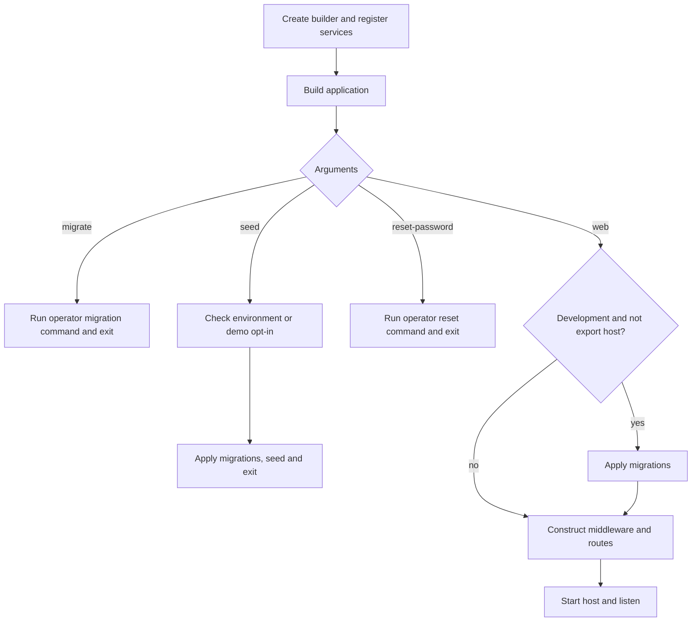

The `migrate` branch delegates to `MigrateCommand`. The `seed` branch first checks `SeedGate`: Development and Testing allow it, while Production requires the demo option. The seed path then applies migrations and runs the seed command. The reset-password branch requires process arguments for the target email and replacement password and delegates to its operator command. Each returns before `app.Run()`; starting a web listener is not part of these CLI operations.

For normal web execution, Development applies migrations unless the process is the OpenAPI generator. Production does not auto-migrate at web startup. The local production stack has a separate one-shot migration job, making database ownership credentials unnecessary in the steady-state application container. This separation is both an operational boundary and a database privilege boundary.

## 5.3 Pipeline construction and why it is explicit

Trusted forwarded headers run first, so later code sees the validated forwarded scheme and address. Production HSTS and security headers come next. Correlation, request logging, exception handling and status pages surround subsequent request work. Static SPA files run before explicit routing. This order prevents routing from selecting a fallback endpoint before a real asset has had the opportunity to be served.

Authentication runs after routing, followed by actor translation, authorization and rate limiting. The `/api` group carries the antiforgery filter. The application registers system, auth, academic, staff, audit and settings endpoints on that group. Unknown `/api` paths return Problem Details rather than the SPA. Browser deep links can fall back to the built SPA shell. A final anonymous fallback handles everything else, including missing file-looking paths, without converting an unknown resource into an authentication challenge.

The final `app.Run()` starts hosted behaviour and listening. Options configured with `ValidateOnStart` are checked during host startup. This is a different event from calling `builder.Build()`: the builder can create a service provider before all hosted startup validation has executed. Database configuration is also used during CLI resolution, so a process that exits before normal web startup still needs the configuration required by the particular command it resolves.

## 5.4 Frontend bootstrap

`frontend/index.html` loads `frontend/src/main.tsx`. The module imports language initialization and CSS, creates the router with the shared query client in its context, installs the login redirect callback, checks that `#root` exists and mounts the providers. `QueryClientProvider` makes the cache available to hooks; `RouterProvider` renders the matching route tree. Importing the generated route tree connects file definitions to runtime matching. The development plugin and build tooling produce that tree; it is not a manually maintained second list of routes.

The HTML shell is not the authenticated user session. The browser can receive and render that shell before any protected API data is available. The protected layout asks the session query for current user data and redirects when needed. This is why serving `index.html` anonymously is compatible with protecting data on the API. The JavaScript can describe a protected screen without carrying permission to read the records that screen would show.

# 6. Concepts and Patterns

Every concept is taught from first principles, contrasts a missing mechanism with the implementation, identifies current source and traces execution. Explicit anchors keep learning links stable while the numbered concept catalogue grows.

- [6.1 Clean Architecture, dependency inversion, and the composition root](#backend-architecture)
- [6.2 Dependency injection, lifetimes, and shared scope ownership](#backend-di)
- [6.3 CQRS and the current dispatcher pipeline](#backend-dispatcher)
- [6.4 Results, expected failures, and exception boundaries](#backend-results)
- [6.5 Validation, invariants, and multiple lines of defense](#backend-validation)
- [6.6 Entities, value objects, aggregates, and historical state](#backend-domain)
- [6.7 Unit of work, transaction-local tenancy, and cleanup](#backend-transactions)
- [6.8 Repositories, DTO projections, and EF Core's execution model](#backend-persistence)
- [6.9 Optimistic concurrency, uniqueness, row locks, and advisory locks](#backend-concurrency)
- [6.10 Multi-tenancy through actor scope, EF filters, write guards, and PostgreSQL RLS](#backend-tenancy)
- [6.11 Cookie authentication, antiforgery, revalidation, and password change](#backend-authentication)
- [6.12 Permissions, role freshness, and teacher ownership scope](#backend-permissions)
- [6.13 Transactional auditing, allowlists, masking, and append-only history](#backend-audit)
- [6.14 Academic records, aggregate relationships, and archive workflows](#backend-academics)
- [6.15 Local recurrence, UTC sessions, DST, and exclusion constraints](#backend-scheduling)
- [6.16 C# foundations behind the architecture: contracts, generics, async, records, reflection, and cleanup](#backend-foundations)
- [6.17 HTTP binding, strict JSON, Problem Details, and generated contracts](#backend-http)
- [6.18 Interfaces, abstraction, polymorphism, inheritance and composition](#foundation-interfaces)
- [6.19 Asynchronous work, tasks, cancellation and disposal](#foundation-async)
- [6.20 Generics, records, nullability and pattern matching](#foundation-types)
- [6.21 Exceptions, result values and guaranteed cleanup](#foundation-exceptions)
- [6.22 Attributes, reflection, scanning and generated code](#foundation-metadata)
- [6.23 JSON, parameter binding and the wire contract](#foundation-json)
- [6.24 React, component ownership, server state and the browser entry point](#frontend-react)
- [6.25 OpenAPI, Orval and the contract-derived API client](#frontend-generation)
- [6.26 The fetch boundary, typed failures and CSRF recovery](#frontend-errors)
- [6.27 Sessions, route guards, first-login gates and permission-aware rendering](#frontend-sessions)
- [6.28 React Hook Form, Zod and field-level server errors](#frontend-forms)
- [6.29 Internationalisation, RTL, bidirectional text and self-hosted assets](#frontend-i18n)
- [6.30 URL state, debounced search and cursor pagination](#frontend-pagination)
- [6.31 Parent lookup, conditional registration and stale-response protection](#frontend-parent-lookup)
- [6.32 Versioned edits, archive workflows and the teacher/account boundary](#frontend-versioned-editing)
- [6.33 Enrollment actions, atomic transfer and cache convergence](#frontend-enrollments)
- [6.34 Calendar dates, local times, instants and the centre's time zone](#frontend-centre-time)
- [6.35 Weekly-rule forms, materialized sessions and schedule conflict recovery](#frontend-schedule-actions)
- [6.36 Shared UI primitives, responsive tables and accessible state](#frontend-shared-ui)
- [6.37 Status, demo visibility, audit presentation and derived dashboard data](#frontend-status-dashboard)
- [6.38 Frontend testing: network-level doubles, route integration and real browsers](#frontend-testing)
- [6.39 A complete frontend workflow: establishing a centre and teaching a class](#frontend-system-journey)
- [6.40 Cookie tickets, browser policy and the persistent key ring](#auth-cookie)
- [6.41 Antiforgery token pairs, unsafe methods and one bounded retry](#auth-csrf)
- [6.42 Rate limits, account lockout and enumeration resistance](#auth-rate)
- [6.43 Session revalidation, role freshness and the positive cache](#auth-revalidation)
- [6.44 Identity users, centre memberships and account lifecycle](#auth-identity)
- [6.45 Fail-closed authorization, actor translation and the tenant gate](#auth-authorization)
- [6.46 Testing as a hierarchy of different proofs](#infra-test-strategy)
- [6.47 Test doubles, call records and controllable time](#infra-test-doubles)
- [6.48 Real PostgreSQL fixtures, isolated databases and least privilege](#infra-postgres-fixtures)
- [6.49 In-process HTTP tests and explicit endpoint inventories](#infra-http-tests)
- [6.50 Architecture tests as executable design constraints](#infra-architecture-tests)
- [6.51 Defense-in-depth tests and removing one layer at a time](#infra-isolation-experiments)
- [6.52 Concurrency tests, synchronized starts and invariant assertions](#infra-concurrency-tests)
- [6.53 Typed configuration, startup validation and health probes](#infra-options-health)
- [6.54 Docker images, multi-stage builds and static frontend packaging](#infra-docker-build)
- [6.55 Compose topology, role bootstrap and migrate-before-serve ordering](#infra-compose-roles)
- [6.56 Reverse proxies, forwarded scheme, security headers and SPA fallbacks](#infra-proxy-spa)
- [6.57 Continuous integration, reproducible inputs and drift gates](#infra-ci)
- [6.58 Browser journeys and deployed smoke tests](#infra-playwright)
- [6.59 OpenTelemetry signals, opt-in exporters and correlation](#infra-telemetry)
- [6.60 Deployment design, revision identity, rollback and honest operational status](#infra-cloud-operations)
- [6.61 Cross-tenant attack probes and proving absence of side effects](#infra-cross-tenant-probes)
- [6.62 Structured logging, correlation references and redaction in the current request path](#infra-logging)


This working chapter records implementation evidence inspected during this session. Source references use repository-relative paths and one-based line numbers. Code marked hypothetical teaches an alternative; it is not a quotation from the repository. Where a reason is inferred rather than documented, the distinction is explicit. Runtime results are not implied by the existence of tests.

<a id="backend-architecture"></a>
## 6.1 Clean Architecture, dependency inversion, and the composition root

#### What it means

A dependency is something a piece of code needs to compile or execute. A handler that directly constructs a database context depends on that context's implementation, provider, configuration, and lifetime. Dependency inversion changes ownership of that relationship. The handler's layer declares an interface describing the capability it needs. An outer layer implements that interface. The handler can call the implementation at runtime while its compiled assembly refers only to the interface.

Clean Architecture applies this distinction to whole projects. Business objects describe valid business state. Application handlers coordinate an operation. Infrastructure supplies databases, Identity, and other adapters. The API translates HTTP into application calls and assembles the implementations at process startup. A composition root is that assembly point. It chooses which concrete object fulfills each interface; business handlers do not make that choice.

#### The problem it solves

Consider this hypothetical endpoint:

```csharp
app.MapPost("/students", async (StudentBody body) =>
{
    var db = new AppDbContext(/* connection settings */);
    // Validate names, find parents, create rows, and decide HTTP status here.
    await db.SaveChangesAsync();
    return Results.Ok();
});
```

The endpoint owns HTTP, business rules, persistence, construction, and transaction management. A CLI cannot reuse the operation without also importing HTTP concerns. A unit test must construct a database context merely to check a business decision. Repeating this style across staff, enrollment, and scheduling spreads the same infrastructure decisions through every feature.

The current project instead separates a command, its handler, the domain objects it changes, and interfaces for loading and storing those objects. For example, `EnrollStudentHandler` receives `IGroupRepository`, `IStudentRepository`, and `IEnrollmentRepository`; its constructor contains no EF Core type (`src/TutoringCentre.Application/Academics/Enrollments/Commands/EnrollStudent/EnrollStudentHandler.cs:19`). That is a practical boundary, not just a naming convention.

#### How it works

The compiler knows an interface has particular methods. An object implementing that interface can be passed to any consumer requiring the interface. A call through the interface dispatches to the actual object's implementation. Consequently, the compile-time reference direction and the runtime call direction can differ. Application can compile against its own repository port while the runtime repository object comes from Infrastructure.

Composition happens before requests execute. Registrations tell the container that resolving a repository interface should construct a particular Infrastructure class. Constructor parameters recursively describe the rest of the object graph. The handler does not locate a connection string, build a provider, or decide whether a repository is real or fake.

#### How THIS project implements it

`Program.cs:68` calls `AddApplication().AddInfrastructure(builder.Configuration)`. Infrastructure registers repositories and read services at `DependencyInjection.cs:124` through `:157`, Identity adapters at `:177` through `:179`, and the unit of work at `:122`. Application owns the `IUnitOfWork` port consumed by `Dispatcher`; Infrastructure implements it over EF Core (`src/TutoringCentre.Infrastructure/Persistence/UnitOfWork.cs:14`).

The context's mapping remains outside Domain. `AppDbContext.OnModelCreating` calls `ApplyConfigurationsFromAssembly`, so persistence rules are discovered from Infrastructure configuration classes (`src/TutoringCentre.Infrastructure/Persistence/AppDbContext.cs:43`). Domain entities such as `Enrollment` express state transitions without importing EF Core. Its `End` method accepts an instant and reason and returns a `Result`; it does not open a transaction or execute an update (`src/TutoringCentre.Domain/Academics/Enrollment.cs:70`).

#### Execution example

An enrollment request reaches its API endpoint and is dispatched as `EnrollStudentCommand`. `Dispatcher.SendAsync` validates the command, checks tenant selection and permission, resolves the handler, and opens a transaction (`Dispatcher.cs:41`–`:70`). The resolved handler receives repository implementations constructed from the same scoped context. It loads and locks the group, checks the student, asks the group whether a seat remains, constructs an enrollment, and calls the enrollment repository's `Add` method. That method only attaches the entity to the context (`EnrollmentRepository.cs:44`). The dispatcher then asks the unit of work to save and commit. HTTP mapping runs after the application result returns.

Notice the two directions. The handler calls outward into a repository object, but the source dependency still points inward because the handler names the Application interface. A test can replace the repository object without changing the handler's business orchestration.

#### Why this project needs it

Current features share several mechanisms: tenant isolation, permission checks, optimistic concurrency, transaction management, and auditing. Keeping these mechanisms outside individual domain methods permits pure domain rules and lets one dispatch pipeline wrap many use cases. Staff creation also illustrates why adapters matter: Application requests an account through `IStaffAccountService`, while Infrastructure uses `UserManager<ApplicationUser>` and joins its writes to the existing transaction (`StaffAccountService.cs:9`).

#### Alternatives

A small application can place all code in one project and rely on discipline. A conventional service layer can depend directly on EF Core and expose business methods. A vertical-slice design can put endpoint, handler, persistence, and tests together by feature. These approaches reduce indirection but place different weight on compilation boundaries. The repository's current implementation chooses separate ports and adapters. Do not infer that every alternative would be wrong or untestable; the important comparison is which boundaries the code makes explicit.

#### Important details

An interface alone does not prove decoupling. Its parameters and return types must also avoid exposing the implementation. A port returning `IQueryable<ApplicationUser>` would still expose persistence and Identity decisions. Current read adapters project to application DTOs rather than returning tracked entities. Conversely, an entity's lack of EF imports does not mean EF cannot populate it: persistence uses mapping and materialization separately from its public factory.

The composition root is deliberately allowed to know concrete layers. Removing all Infrastructure knowledge from `Program.cs` would leave no place to choose adapters. The design goal is concentrated knowledge, not the absence of concrete types everywhere.

##### Compiler references are not runtime object ownership

It helps to trace the same enrollment call twice. At compile time, Application knows `IGroupRepository` because that interface belongs to Application. Infrastructure knows the interface because it references Application. The handler source never names `GroupRepository`. At runtime the composition root has registered `IGroupRepository` with `GroupRepository`, so a call made through the interface reaches that Infrastructure object. There is no contradiction: a compile dependency describes which declarations must be available while compiling; an object reference describes which implementation receives a call after composition. A diagram that draws only one of those relationships leaves this project unnecessarily mysterious.

The same distinction explains why Api references Infrastructure at all. An HTTP endpoint should not construct a repository. The executable still needs some place to select concrete implementations, and `Program.cs` is that place. Infrastructure exposes its registration extension so the composition root does not have to list every adapter constructor. Api architecture rules allow that composition reference and the operator CLI while restricting ordinary endpoint dependencies. This is a deliberate exception for construction, not a general permission for transport code to bypass Application.

Feature boundaries add a second dimension. Four assemblies enforce the layer direction, but Academics, Identity, Centres and Audit are not each independent assemblies. Their boundaries therefore require narrower published contracts and architecture checks. The staff directory is a useful example: an academic teacher-account link needs a fact about eligible staff, not unrestricted access to Identity persistence. A published directory capability expresses that need. Copying an identity query into an academic handler would remove the explicit contract and make identity storage assumptions spread across modules.

Without those contracts the runtime might still work. The cost appears when changing account eligibility, adding another delivery mechanism or testing an academic rule without Identity infrastructure. The current arrangement makes those effects visible through an interface and tests. This is why a returning DTO matters: returning `IQueryable<ApplicationUser>` would superficially preserve an interface while allowing the consumer to shape persistence queries and depend on an Infrastructure model. Dependency inversion concerns the meaning of the contract as well as its project location.

The repository documents the four-project choice in ADR 0001. It compares a discipline-only layered monolith, many module assemblies and microservices. Those are documented alternatives, not historical reasons inferred from a filename. The microservice alternative would introduce independent network boundaries and distributed consistency problems that this one-process transaction design does not currently have. A folder named Academics does not mean a separately deployed service exists. Likewise, one process does not mean the boundaries are cosmetic: the compiler and tests enforce meaningful constraints on which code can know which declarations.

Before moving a type, identify both the clients that compile against it and the place that constructs its implementation. Moving a port into Infrastructure would force its Application consumer to depend outward. Moving an EF entity or query type into an Application contract would produce a different leak. Moving only a file without checking namespace-based rules may also evade or violate module checks unexpectedly. These are changes in architectural ownership, even when a method body is unchanged.

A useful review question is whether the proposed change alters a rule, a delivery format or a storage mechanism. Put the change at that responsibility boundary, then trace the dependent contracts outward. A passing build alone cannot answer that ownership question.

#### What I should understand before modifying this code

Follow an existing feature across its boundary before introducing a new abstraction. Put a persistence capability in an Application port when a handler needs it; implement it in Infrastructure; register it once. Keep domain state rules independent of HTTP status and database operations. When a change requires several entities, understand whether the existing dispatch transaction should own all of them. Do not create an independent context inside the handler: doing so breaks the shared transaction, interception, and audit behavior explained below.

<a id="backend-di"></a>
## 6.2 Dependency injection, lifetimes, and shared scope ownership

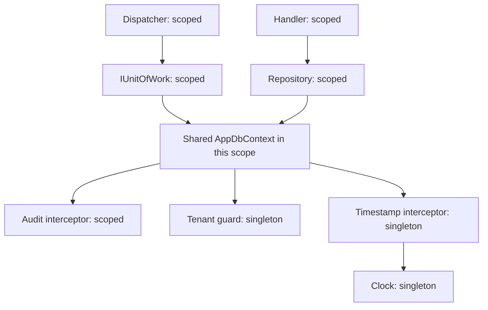

#### What it means

Dependency injection means an object receives its collaborators rather than constructing them. A DI container stores construction recipes and resolves them recursively. A lifetime defines reuse: singleton means one object for the provider's lifetime; scoped means one object within a scope; transient means a new object for each resolution. Disposal follows the ownership established by these registrations.

The essential idea is ordinary constructor injection. A container automates calling constructors; it does not remove those constructors or make dependencies optional. `UnitOfWork(AppDbContext db, ILogger<UnitOfWork> logger)` still states exactly what a unit of work needs (`UnitOfWork.cs:20`). Passing a different context changes the object it operates on.

#### The problem it solves

Without DI, each endpoint could build its own context, repositories, clock, interceptor, and handler. Two repositories might accidentally receive different contexts. Then a transaction opened by one object would not cover the other's write. Hand-written lifetime management could also keep a context alive across requests or dispose it before asynchronous work finishes.

With DI, Infrastructure registers `AppDbContext` once and the adapters receive that scoped registration. The unit of work and repositories therefore cooperate on one tracked set of changes. The lifetime decision is part of correctness, not merely an allocation optimization.

```csharp
// Real registrations, Infrastructure/DependencyInjection.cs:121-125.
services.AddScoped<IUnitOfWork, UnitOfWork>();
services.AddScoped<ICentreRepository, CentreRepository>();
services.AddScoped<ICentreReadService, CentreReadService>();
```

#### How it works

Registration creates service descriptors containing a service type, an implementation or factory, and a lifetime. Building the provider makes those descriptors usable. Resolving a handler finds its registration, selects its constructor, resolves each parameter, constructs the handler, and caches it according to lifetime. A request scope provides a common cache for scoped objects. Resolving the same scoped context several times within that scope returns the same instance.

A singleton must not capture a request-specific collaborator. Such a dependency keeps request state alive for the singleton's lifetime. A context is also not a shared concurrent work queue: using one context across simultaneous requests mixes tracking and transactions. The correct lifetime keeps ownership aligned with one request or explicit operator operation.

#### How THIS project implements it

Infrastructure registers `TimeProvider.System` and `IClock` as singletons (`DependencyInjection.cs:55`–`:57`). Timestamp and tenant-guard interceptors are singleton because their state comes from the context being saved or a thread-safe clock. Audit is scoped because it reads the current actor and correlation context (`:83`–`:88`). These different registrations explain why copying every interceptor registration with one lifetime would be incorrect.

`AddDbContext<AppDbContext>` supplies options through a factory (`:103`). That factory resolves validated database options and the three interceptors. `AppDbContext` separately receives `ICurrentActor`; `CurrentCentreId` reads that actor live rather than caching the centre at construction (`AppDbContext.cs:25`–`:38`). This matters because authentication can resolve infrastructure before login replaces the actor.

The same configuration registers all academic repositories, read services, staff account operations, teacher scope resolution, Identity, and the database-backed Data Protection key ring. The connection available through the registered runtime context is deliberately the runtime connection, while migration construction uses a separate path, as documented at `DependencyInjection.cs:100`.

#### Execution example

A command resolution asks for `ICommandHandler<AddScheduleRuleCommand, AddScheduleRuleResult>`. The container constructs `AddScheduleRuleHandler` with actor, clock, zone provider, group repository, rule repository, and session repository (`AddScheduleRuleHandler.cs:21`). The repositories receive one context. When the session repository takes a transaction-scoped advisory lock, that SQL runs inside the transaction already opened through the unit of work. When the rule repository tracks a rule and the session repository tracks occurrences, the dispatcher's save sees both changes. No handler manually passes the context between these objects; the shared scope establishes that relationship.

#### Why this project needs it

The audit interceptor must observe the same actor as the handler. The tenant query filter must read the same selected centre that the dispatcher checked. Repositories must save through the same transaction that owns row and advisory locks. These guarantees rely on the object graph sharing its scoped dependencies. Singleton clocks and stateless guards avoid unnecessary construction without sharing tenant state.

#### Alternatives

Manual composition can express exactly the same ownership with explicit `new` calls and `using` blocks. It becomes verbose as a feature's graph grows. A service locator lets arbitrary code resolve dependencies late, but hides requirements from constructors. Here `Dispatcher` deliberately resolves the closed generic handler because its type depends on the request. That localized lookup should not become a reason for domain objects to request their own services.

#### Important details

Scoped does not inherently mean HTTP. A CLI can create an explicit scope. Conversely, resolving a scoped graph from the root provider can effectively extend its lifetime and defeat the intended boundary. Shared lifetime also does not permit nested transactions: `UnitOfWork.BeginAsync` rejects an already active transaction (`UnitOfWork.cs:28`). Two handlers independently dispatched inside one scope therefore cannot each own a transaction.

The live actor property protects against early context construction, but it does not make arbitrary actor replacement safe. A scope is still intended to execute as one actor, except for the explicit authentication transition. Never treat the context as something to reuse for several unrelated users.

##### Following an actual resolution graph

Registration does not eagerly call every constructor. `AddScoped<IGroupRepository, GroupRepository>()` stores a descriptor describing a service contract, implementation and lifetime. When the dispatcher requests the closed enrollment handler interface from its scoped provider, resolution selects the registered handler class, discovers its required collaborators and recursively resolves them. The group repository requires `AppDbContext`; the unit of work also requires `AppDbContext`. Because the context registration is scoped and both resolutions use the same scope, they receive the same instance. That shared instance, rather than an unexplained global save operation, connects a handler's tracked changes with the dispatcher's later save.

The Application actor registration demonstrates a factory descriptor. `CurrentActorContext` is registered as a scoped concrete object. `ICurrentActor` is registered using a factory that asks that same provider for `CurrentActorContext`. The factory does not construct a second actor context. Trusted edge code receives the mutable concrete view, while handlers receive a read-only interface view of the same scoped object. Correlation context uses the same arrangement. Changing either factory to `new CurrentActorContext()` would silently create two identities: middleware could populate one while the handler reads the other's anonymous default.

A request scope and a manually created operator scope provide the same ownership idea through different entrances. ASP.NET creates a scope for the request. A CLI operation explicitly creates one using `CreateAsyncScope`. The provider keeps scoped instances alive until that scope ends and disposes its owned resources. Resolving a handler from the root provider would associate it with the wrong ownership boundary. With scope validation, such misuse can fail immediately; without validation it can accidentally retain a context much longer than a request. Do not confuse the absence of an immediate exception with a correct lifetime.

Singletons require a different argument. The clock can be shared because its service does not retain one user's selected centre. The timestamp interceptor uses that clock. The tenant write guard reads the centre from the context passed for each save rather than capturing an actor at singleton construction. The audit interceptor does depend on scoped actor and correlation services and is consequently registered scoped. Making it singleton would retain request-specific collaborators or fail validation. A lifetime is therefore a statement about dependencies and retained state, not a performance decoration selected because a class seems small.

Handler scanning is explicit source code in `HandlerRegistration`. It obtains types from the Application assembly, keeps concrete non-generic classes, finds implementations of the two handler interface definitions and adds scoped descriptors for the closed contracts. FluentValidation scanning explicitly includes internal types. Adding a correctly shaped internal handler does not need a second manual registration. Adding an abstract handler, an open generic implementation or a class in an unscanned assembly is different: the scanner's predicates decide whether it participates. Read the predicates rather than assuming the container discovers every class automatically.

There are two important failure categories. Missing registrations mean a required collaborator cannot be built. Duplicate registrations can make a single-service resolution select an implementation according to container rules, while collection resolution returns multiple descriptors. The architecture test requiring exactly one handler per request protects this project's intended cardinality independently of that container behaviour. Validators intentionally use collection resolution, because several validators can contribute errors for one request. Replacing `GetServices<IValidator<T>>()` with `GetRequiredService<IValidator<T>>()` would change that supported meaning.

Constructor injection keeps mandatory dependencies visible, but it does not validate business preconditions. An enrollment handler can be fully constructible while the actor lacks a centre, which is why the dispatcher checks request prerequisites before invoking it. Conversely, a valid actor cannot compensate for a missing repository registration. Wiring, session state and business invariants fail at different boundaries and need different diagnostic evidence. When returning to a resolution error, first identify the requested closed service type, the implementation selected for it, the failing constructor parameter and the scope used for resolution. That sequence is more effective than adding registrations until an error disappears.

##### Distinguishing DI errors from operation failures

Suppose an enrollment request fails because `IEnrollmentRepository` has no registration. Shape validation and permission checks might pass, but handler construction cannot complete. No amount of changing student data fixes that wiring error. Now suppose construction succeeds but the student is archived. The handler returns an ordinary failure and the dispatcher rolls back. The two failures can occur during the same user action, but their remedies and tests belong at different boundaries. Keeping constructor graphs explicit makes that diagnosis practical.

A scope is also not necessarily synonymous with a browser visit. One browser can make several HTTP requests, each with a new request scope. Conversely, one request may resolve several repositories that share one context. The cookie carries session identity across those requests; a scoped actor is reconstructed for each request. Persisting the actor object as a singleton would confuse session lifetime with request lifetime and risk one caller's state being retained for another.

When a stateless singleton reads request data passed into its method, that does not make its own lifetime scoped. The tenant guard demonstrates the distinction: it receives context event data at invocation and inspects that context, rather than keeping a request context in a field. The audit interceptor instead receives and retains scoped collaborators through its constructor. Read fields and constructor parameters together before classifying lifetime safety.

Finally, tests that manually instantiate a handler are still using dependency injection: the test supplies its dependencies directly. They simply do not use a container. This keeps focused logic tests independent of registration scanning, while integration tests establish that the container supplies the same intended collaborators in the application host.

#### What I should understand before modifying this code

Identify a new service's state and dependencies before choosing its lifetime. Use scoped registration for a service that depends on the context, actor, or correlation context. A singleton interceptor must read per-save context rather than capture one request's identity. If a use case needs multiple persistence adapters, verify that all receive the registered context. If you create a special context outside DI, use the same configurator and supply a deliberately chosen actor; otherwise its guards may differ from runtime behavior.

<a id="backend-dispatcher"></a>
## 6.3 CQRS and the current dispatcher pipeline

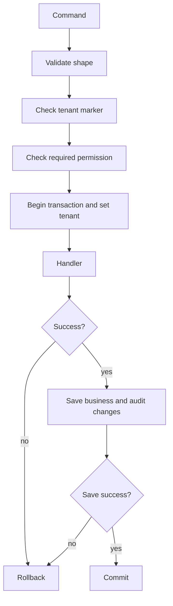

#### What it means

CQRS separates commands that change state from queries that read state. It does not necessarily mean separate databases, separate processes, event sourcing, or a message broker. In this repository it means separate request and handler interfaces and different execution rules. A dispatcher is the common entry point that finds a handler and wraps it with cross-cutting steps.

The distinction gives a query a stronger contract than a method whose name starts with `Get`. Queries execute in read-only database transactions. Commands execute in read-write transactions, may track changes, and are saved once by the dispatcher. A request can additionally declare that it needs a selected tenant and a permission.

#### The problem it solves

Without a common pipeline, every endpoint and CLI operation must remember validation, centre selection, permission checks, transaction start, rollback, save, commit, and logging. Omitting one step may compile successfully while creating a security or consistency defect. Putting the same checks into each handler duplicates their ordering and error behavior.

Hypothetical repeated orchestration would look like `Validate; CheckTenant; CheckPermission; Begin; Handle; Save; Commit`, with a separate catch and rollback at every call site. Current callers instead invoke `SendAsync` or `QueryAsync`. The dispatcher determines the sequence, so adding a feature means supplying its message, handler, validator, and declared capabilities.

#### How it works

Generic request and response parameters identify a closed handler interface. For `EnrollStudentCommand`, the dispatcher resolves `ICommandHandler<EnrollStudentCommand, EnrollStudentResult>`. It need not contain a switch statement listing academic features. Validation obtains every `IValidator<TRequest>`, executes them, groups their failures, and returns a structured validation error before opening a transaction.

The current command pipeline is: validate; check tenant scope; check permission; resolve handler; begin read-write transaction; execute handler; rollback on failed result; save; rollback on failed save result; commit on success; log outcome. The query pipeline has the same first checks, then begins read-only, executes, and commits without a save. Exception cleanup uses a non-cancelled token to preserve rollback even if the request was cancelled.

#### How THIS project implements it

`Dispatcher.cs:35` declares the command method, and `:100` the query method. `CheckTenantScope` only activates for `ITenantScoped` (`:152`). It returns `auth.not_authenticated` for anonymous actors and `tenant.not_selected` when an actor has no centre. `CheckPermission` only activates for `IRequirePermission` (`:174`). System actors pass; staff pass only if `RolePermissions.Holds` returns true; other cases return `auth.permission_denied`.

Save failures are now values too. `IUnitOfWork.SaveChangesAsync` returns a `Result`; the dispatcher checks it at `:78`, rolls back, and converts its error into the command's generic result. This is an important change from a pipeline that assumed every expected failure occurred inside the handler. Concurrency and database uniqueness can fail after the handler already returned success.

```csharp
// Real sequence, Dispatcher.cs:78-88.
var saveResult = await _unitOfWork.SaveChangesAsync(ct);
if (saveResult.IsFailure)
{
    await _unitOfWork.RollbackAsync(ct);
    var failedSave = Result<TResponse>.Failure(saveResult.Error!);
    LogOutcome(CommandKind, typeof(TCommand).Name, failedSave, started);
    return failedSave;
}
await _unitOfWork.CommitAsync(ct);
```

#### Execution example

A staff member requests a schedule write. Shape validation first rejects malformed input. The tenant marker then rejects a signed-in user who has not selected a centre. Permission checking rejects a teacher without `schedule.manage`, before any transaction or business handler lookup is needed. An authorized owner reaches `AddScheduleRuleHandler`, which tracks a rule and generated sessions. A collision may only be discovered during save by PostgreSQL's exclusion constraint. The unit of work translates that failure; the dispatcher rolls back the rule and every generated occurrence. The endpoint receives a conflict result even though the handler's earlier return was success.

#### Why this project needs it

Tenant and permission enforcement now protects real product writes. Scheduling demonstrates atomic multi-row work; transfers demonstrate atomic history plus a new enrollment; staff creation combines Identity and membership changes. One pipeline prevents each feature from inventing a different transaction boundary. Outcome logging records request kind and type, success or failure, error code, and elapsed milliseconds without logging request values (`Dispatcher.cs:263`).

#### Alternatives

MediatR behaviors can package a similar pipeline. Service classes can perform orchestration directly. Endpoint filters can perform HTTP-specific validation, but cannot on their own make CLI calls follow the same rules. A full CQRS deployment with a separate read database adds synchronization concerns absent here. The repository does not explicitly state why every detail of the handwritten dispatcher was chosen; the following is an interpretation based on the implementation: keeping its order in one small class makes the security and transaction mechanics directly inspectable.

#### Important details

Marker-based enforcement is opt-in at the application request type. A request lacking `IRequirePermission` does not receive a permission check merely because its handler changes data. HTTP authentication still applies, but it answers a different question. The tenant check also does not itself prove membership; it checks the trusted actor already built from the validated session. Database RLS and write guards provide further protection.

`BeginAsync` runs before the dispatcher's try block. Setup failures must therefore clean up their own resources where appropriate. Queries commit even when their handler returns a failed `Result`, because they have no application save and are database-read-only. Do not mechanically make command and query failure handling identical without considering that distinction.

##### Why the shared order cannot move into HTTP middleware

A transaction middleware around `/api` could surround an endpoint, but it would not give the seed CLI or a direct application test the same semantics. It would also be unable to infer that a particular Application request is a read-only query simply from its HTTP method. A GET endpoint is transport metadata; `IQuery<T>` is the use-case contract used by every caller. Keeping transaction ownership in the dispatcher lets the read/write distinction remain true when the same request is invoked without an HTTP request at all.

The current command pipeline has more failure positions than the original five-step sketch. Shape validation can reject before actor resolution is needed. The tenant marker can reject an anonymous or unselected actor. The permission marker can reject a role without the required capability. Handler resolution can fail because of a wiring mistake. Beginning a transaction can fail because the database is unavailable. The handler can return an expected refusal or throw. Saving can return a translated persistence failure or throw an untranslated fault. Committing can fail after save. The sequence matters because each position determines whether a transaction exists, whether business code ran and which cleanup path is responsible.

In particular, failed save results must not be mistaken for successful handler results. The handler may have constructed the response identifier before EF sends an insert. A successful handler therefore does not prove that database uniqueness, exclusion or concurrency checks accepted the write. The dispatcher inspects the unit of work's save result and converts that failure into the same response type the caller expects. It rolls back instead of committing the tracked business and audit changes. The response identifier created in memory is not returned as a committed resource when that save fails.

Queries intentionally omit save rather than merely hoping a handler does not mutate. The unit of work asks PostgreSQL for a read-only transaction, which rejects writes reaching the database. A query handler returning a failed result still causes the query transaction to end through commit, because there are no legitimate writes to preserve or undo. An exception uses rollback. These behaviours are concrete pipeline choices and should be compared with their tests, not generalized into a claim that every failed business result in every method always invokes the same transaction operation.

Nested dispatch is another ownership issue. Sending a command from a handler through the same scope would ask the unit of work to begin a second transaction while one is already active. The implementation rejects that. Extract shared domain logic or an appropriate service instead of creating a hidden nested use case. A new requirement for batch operations or nested commands needs an explicit ownership design and new tests; catching the nested-transaction exception would only hide the unsupported composition.

#### What I should understand before modifying this code

Understand all early exits before adding a pipeline step. Put checks requiring no transaction before `BeginAsync`. Do not make a handler dispatch another command in the same scope; nested units of work are rejected. Keep expected save conflicts as results and unexpected persistence faults as exceptions. When adding a tenant feature, inspect the request markers, permission constant, role matrix, handler, repository, entity mapping, migration, and tests together. A missing marker cannot be repaired by a hidden UI button.

<a id="backend-results"></a>
## 6.4 Results, expected failures, and exception boundaries

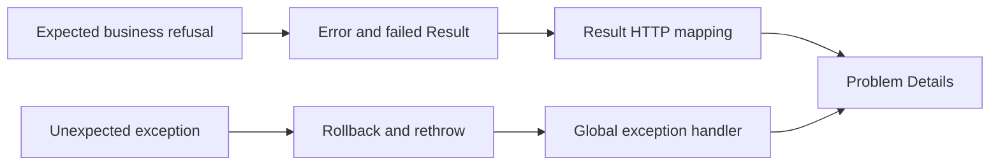

#### What it means

An expected failure is a normal possible outcome: a group is full, a name is taken, a requested row is not visible, or an input field is invalid. An exception describes a programming or infrastructure fault that ordinary business branching cannot resolve. A `Result<T>` represents either a produced value or an error; the caller can inspect that outcome without unwinding the call stack.

The distinction is semantic. A database exception can represent an expected race, and a domain-level method can throw for a programmer error. Location alone does not decide classification. Current persistence translation explicitly identifies a few exception families that belong to normal conflict handling and leaves all other faults loud.

#### The problem it solves

If every business refusal throws an exception, callers must know every exception class and remember its mapping. Forgetting to catch a duplicate-name exception turns a normal user outcome into HTTP 500. If every fault becomes a generic failed result, genuine bugs disappear into ordinary validation messages. The project needs both mechanisms with a clear boundary.

```csharp
// Hypothetical exception-based business branching.
try { await Enroll(); }
catch (GroupFullException) { return Results.Conflict(); }

// Real domain refusal, Group.cs:153-155.
if (activeEnrollmentCount >= Capacity)
{
    return Result.Failure(Error.Conflict("group.full", "This group has no free seats."));
}
```

#### How it works

`Result` enforces two legal states in its constructor: success with no error, or failure with an error. An invalid combination throws immediately (`Result.cs:8`). `Result<T>` adds a value that can only be read on success. Reading a failed value throws an `InvalidOperationException` because the caller violated the API contract (`Result.cs:61`).

`Error` carries a stable machine code, developer message, kind, and optional field dictionary (`Error.cs:14`). The kind chooses an HTTP status; the code lets frontend translation choose a specific message. Field keys connect a failure to an input. A code such as `student.parent_already_linked` is therefore part of a cross-layer contract, not an incidental logging string.

#### How THIS project implements it

Domain factories return `Result<Entity>`. State transitions commonly return non-generic `Result`. Application handlers preserve an error while changing the success value into a feature result. The dispatcher preserves that same error through rollback. The API maps it only at the transport boundary.

The persistence translator recognizes `DbUpdateConcurrencyException` first because it derives from `DbUpdateException` (`PersistenceErrorTranslator.cs:31`). It returns `concurrency.stale`. Unique violations use SQLSTATE `23505` and an exact constraint-name catalogue. Exclusion violations use `23P01`. A foreign-key or CHECK failure remains an exception; the translator deliberately does not normalize every database error into a pleasant conflict.

#### Execution example

Two clients edit a versioned enrollment. The first saves. The second supplies the older version. The repository loads the entity and sets the expected original version (`EnrollmentRepository.cs:25`). The domain transition may still be valid in memory. EF then issues an update whose concurrency condition no longer matches, reports zero affected rows, and raises `DbUpdateConcurrencyException`. The unit of work catches it, receives `concurrency.stale` from the translator, and returns failure. The dispatcher rolls back the whole command and returns a conflict through the standard HTTP mapper. No endpoint needs a dedicated concurrency catch.

#### Why this project needs it

Failures now arise at several depths: shape validation, permission checking, entity rules, relationship checks, row versions, unique constraints, and scheduling exclusions. A uniform error value lets the same rollback and HTTP logic handle them. The distinction also protects observability: violating the one-primary-parent constraint remains an unexpected fault because Domain is supposed to make that state impossible.

#### Alternatives

Custom exception types can express business outcomes but require a mapping convention. Nullable returns lose the reason for failure. Discriminated unions can make success and failure branching more explicit, but C# callers still need a consistent project convention. Libraries such as a Result package can add composition helpers; this implementation keeps a small local type. The repository does not explicitly state why every Result design detail was chosen. The following is an interpretation based on the implementation: simple factories and a small closed kind enum make the transport mapping easy to audit.

#### Important details

The compiler does not force every `Result` to be inspected. A handler can accidentally ignore a failed domain transition. Review early returns and test both success and refusal. `Error.Fields` is optional and can appear on conflicts or rules as well as validation; field attachment and error kind are separate axes. Never infer that every field-keyed response must be HTTP 400.

The database catalogue deliberately excludes `ux_student_parents_one_primary` and `ux_class_sessions_rule_date` (`ConstraintErrorCatalog.cs:62`). An unknown unique constraint has a generic duplicate fallback and warning; an unknown exclusion constraint has no fallback. These are intentional different policies, not equivalent catch-all behavior.

##### A typed failure still needs deliberate consumption

`Result<T>` makes an ordinary failure visible in a return type, but C# does not force a caller to inspect it. The current dispatcher establishes the discipline centrally: after a handler result it checks failure before saving, and after a save result it checks failure before committing. The HTTP mapper then chooses the success shape or the shared problem response. Removing any of those checks can compile while changing correctness. This is a reason to keep tests around the orchestration rather than assuming the generic type alone enforces all control flow.

An error code is a compatibility surface. A user-facing translation can refer to `group.full` without interpreting an English developer message. A client can distinguish stale state from permission denial without guessing from exception text. Changing a code can therefore break consumers even when its C# method signature and HTTP status stay unchanged. Error kind and machine code have different roles: kind selects a broad category and status; code identifies the particular outcome within that category. Several different conflicts can correctly share HTTP409 while needing different recovery or copy.

There is also a difference between preserving a failed result and manufacturing an unrelated one. A handler that propagates a domain failure should retain the relevant code and fields. A persistence translator should identify only known constraint/token failures and let unknown faults escape. Returning a generic validation result for an unrecognized database exception would conceal a fault and tell the caller to fix input that might be perfectly valid. The repository's narrow translation boundary avoids that particular category error.

Tests should assert the semantics they need. A test of a business branch can check the stable code and absence of a write. A test of the HTTP contract can check status, content type, extensions and sanitized response. A test of the result object's invariant can check that reading a failure value throws. Those are separate proofs. Combining every assertion into every test would make failures noisier without making the return type more reliable.

#### What I should understand before modifying this code

Classify a new failure according to whether callers can reasonably encounter it, then choose an existing kind and stable code. Keep exception internals out of `Error.Message`. When introducing a unique or exclusion constraint, decide whether violation is a normal business race or proof of a bug, and update the catalogue accordingly. Add translations for a new public code. Preserve the original error when passing it between generic result types so field keys and specificity survive.

<a id="backend-validation"></a>
## 6.5 Validation, invariants, and multiple lines of defense

#### What it means

Validation determines whether input has an acceptable shape. An invariant determines whether business state remains valid. A state-dependent rule compares a proposed change with other persisted records. A database constraint enforces a condition even when application checks race or a different writer accesses the database. These mechanisms overlap intentionally but answer different questions.

For a group, capacity must be within a supported range, but reducing capacity also requires knowing how many active enrollments exist. The first condition is intrinsic to the proposed value. The second concerns concurrent state in other rows. Treating both as one form-field check hides the synchronization requirement.

#### The problem it solves

Without early shape checks, obviously invalid requests open transactions and consume database resources. Without domain checks, a non-HTTP caller can bypass a form validator and create invalid state. Without database enforcement, two individually valid requests can jointly violate uniqueness or overlap rules.

Hypothetical `if (await Count() < capacity) await Insert()` looks like validation but is unsafe unless competing requests serialize the count and insert. The current enrollment handler first locks the group, then performs the count and decision inside the dispatcher's transaction (`EnrollStudentHandler.cs:32`). Validation alone cannot supply this guarantee.

#### How it works

The dispatcher executes registered FluentValidation validators before tenant and permission checks and before transaction start (`Dispatcher.cs:41`). It collects every failure rather than returning the first, groups messages by camel-cased property names, and removes duplicate messages (`:240`). Domain factories then validate business values before construction. Handlers check existence, active state, and relationships using repositories. Database constraints arbitrate concurrent conflicts at save.

The order gives different failure contracts. A malformed shape may produce `validation.failed` with several fields. A validly shaped request that violates an entity rule may produce a more specific code. Both can be normal outcomes; they are not evidence that one layer duplicated the other's entire responsibility.

#### How THIS project implements it

`ScheduleRule.Create` enforces duration from 30 to 240 minutes in five-minute steps (`ScheduleRule.cs:75`). It checks start-time ticks against a five-minute boundary, which also rejects hidden seconds and fractional precision (`:81`). It trims an optional room and limits it to 40 characters. These rules protect construction regardless of transport.

`Group.ChangeCapacity` checks the supported range and refuses a value below the active enrollment count (`Group.cs:107`). The caller supplies that count because it is not a field on the group. `ChangeGroupCapacityHandler` takes the same lock as enrollment, checks the expected version, and then calls the domain method (`ChangeGroupCapacityHandler.cs:17`). This joins validation with the correct consistency boundary.

#### Execution example

An owner attempts to reduce a group's capacity to ten. The request validator first rejects any malformed ID or unsupported shape. Tenant and permission checks pass. The handler acquires the group lock and reads twelve active enrollments. It confirms that the client's version still matches. `ChangeCapacity(10, 12)` returns `group.capacity_below_enrolled` with a `capacity` field message. The dispatcher rolls back without a save. A concurrent enrollment must wait on the same lock and therefore cannot slip between the count and reduction.

#### Why this project needs it

The product now edits state that other features depend on. Archiving a student affects enrollment rules; assigning a teacher affects future sessions; changing staff roles affects authorization. Keeping intrinsic rules in entities and relational checks in handlers makes the source of each decision visible. Database constraints remain necessary because an earlier friendly check does not guarantee a later insert succeeds.

#### Alternatives

Data annotations can express simple shape checks. Endpoint-only validation provides convenient HTTP errors but leaves CLI or direct dispatcher callers exposed. Domain-only validation can preserve correctness while losing aggregated field feedback and cheap pre-transaction rejection. Database-only validation is authoritative but typically provides lower-level messages. The current system combines mechanisms rather than expecting one to replace all others.

#### Important details

User input normalization is also a business decision. Name cleanup and search normalization are different operations: display text can preserve spelling while a separate normalized field supports matching. Phone parsing creates a canonical value before uniqueness comparison. Do not apply a generic trim or lowercasing function to every value and assume equivalent semantics.

Some rules depend on time or external state. The current scheduling handlers calculate today in the centre's zone, not the server's calendar. Their range decisions therefore need both the injected clock and zone provider. Moving that rule into an HTTP validator without those explicit dependencies changes its meaning and testability.


A valid transport shape is not a valid operation. A nonempty group identifier can refer to an archived group, another tenant's group or no row at all. The handler and scoped repositories establish those meanings after cheap shape checks; the validator should not claim it has proved them merely by parsing a GUID.

#### What I should understand before modifying this code

Write down what fact a rule needs before choosing its layer. Pure input shape belongs before transaction start. An entity's own state transition belongs on the entity. Cross-row rules need a handler and, when concurrent changes can invalidate them, a lock or constraint. Keep field keys aligned with generated request properties and frontend forms. Do not translate every database invariant failure into validation: some indicate broken application guarantees and should remain observable faults.

<a id="backend-domain"></a>
## 6.6 Entities, value objects, aggregates, and historical state

#### What it means

An entity has a stable identity even when its attributes change. A value object is identified by its contents and is typically immutable. An aggregate is a consistency boundary: one root controls a group of related objects and enforces invariants across them. These ideas solve different problems. A student is an entity; a canonical phone number is a value; the student's parent links form a small aggregate managed through the student.

Encapsulation means callers cannot arbitrarily rewrite state. Factories establish valid initial state. Transition methods determine which changes are permitted. Private setters alone are insufficient unless every legitimate mutation flows through methods that preserve the required relationships.

#### The problem it solves

Publicly mutable links could leave a student with no parent, two primary parents, or duplicate links. Mutating an enrollment's group ID would erase where it originally belonged. Editing a recurring rule in place would make already generated sessions appear to come from a rule that no longer describes them.

Hypothetical `enrollment.GroupId = targetId` is shorter than a transfer operation, but destroys history. The current model ends the old enrollment with reason `Transferred` and creates a new enrollment in the destination (`TransferEnrollmentHandler.cs:78`). The extra row preserves the business event rather than overwriting it.

#### How it works

`Entity` assigns a UUIDv7 during construction (`Entity.cs:6`). Domain factories validate before returning an object. The EF materialization constructor is separate: persistence can recreate an existing row without pretending to execute a new business operation. Transition methods accept all needed inputs explicitly and return results for expected refusals.

Value objects normalize once. `PhoneNumber.Create` maps Arabic digits, strips recognized separators, accepts selected local and international spellings, and returns a canonical E.164 representation (`PhoneNumber.cs:36`). Equality uses that canonical string, so different accepted spellings of the same number compare equal. Display masking is a separate representation and does not change identity.

#### How THIS project implements it

`Student` owns a private list and exposes `IReadOnlyCollection<StudentParentLink>` (`Student.cs:20`, `:56`). Its documented rules require one to four parents, no duplicate parent, and exactly one primary link. `LinksRevision` changes on successful parent-link changes (`:53`), ensuring aggregate-level state can participate in concurrency even when child rows change.

`Enrollment` keeps centre, student, and group fixed after start. `End` refuses a second end and an end before its start (`Enrollment.cs:70`). `ScheduleRule` stores local recurrence and can be ended once, but has no ordinary edit method (`ScheduleRule.cs:99`). `ClassSession` stores UTC instants and a teacher snapshot; reassignment affects only future scheduled sessions (`ClassSession.cs:95`). These are concrete examples of preserving historical truth.

#### Execution example

A transfer loads a versioned active enrollment, rejects a destination equal to the source, locks the destination group, verifies the same subject and available capacity, then obtains one `now` instant from the clock. It calls `current.End(now, Transferred)` and `Enrollment.Start(..., now)`. Both objects are tracked in one context. If any subsequent save fails, both changes roll back. If successful, history contains an ended source enrollment and active destination enrollment sharing the transfer instant.

#### Why this project needs it

Tutoring operations have histories that should not be silently rewritten. Staff need to distinguish withdrawal from transfer. A past session must retain the teacher who taught it even if the group's current teacher changes. Parent-link rules must remain valid regardless of which screen initiates a change. Modeling these constraints on domain objects makes them reusable by current handlers and future delivery mechanisms.

#### Alternatives

An anemic model places all rules in services and exposes mutable properties. Event sourcing records every state transition as an event and rebuilds state, adding more machinery than this row-based history. Value objects could also be represented by records, but a private constructor plus factory is useful when canonicalization can fail. A separate parent-link service could manipulate child rows; it would have to reconstruct the same aggregate invariants currently concentrated in `Student`.

#### Important details

Immutability differs by object. `PhoneNumber` has a get-only value; `Enrollment` can transition from active to ended. A record type does not automatically make all nested collections immutable. A read-only collection interface prevents ordinary callers from using mutation methods through that interface, while the root still owns the mutable list internally.

Database restrictions still matter. Domain methods protect ordinary calls, but materialization and direct database access bypass factories. Conversely, database constraints alone cannot express every aggregate rule conveniently. The unit of work includes explicit reconciliation for removed parent links because EF's required relationship with Restrict does not automatically delete those rows (`UnitOfWork.cs:89`).


The factory and transition method also define the supported mutation vocabulary. Setting an enrollment's group directly would rewrite history, while ending the old relationship and starting another preserves it. Encapsulation is useful here because callers must choose that explicit domain operation rather than bypassing its timestamps, reasons and state checks with public setters.

#### What I should understand before modifying this code

Identify whether a field describes current configuration or historical fact. Prefer a new transition or history row when overwriting would erase meaning. Do not expose setters to simplify a form submission. For aggregate child changes, update the root's revision consistently and preserve minimum, maximum, duplicate, and primary constraints. Treat canonical phone values as values; use their masked form only for output requiring privacy, never as a uniqueness key or change comparison.

<a id="backend-transactions"></a>
## 6.7 Unit of work, transaction-local tenancy, and cleanup

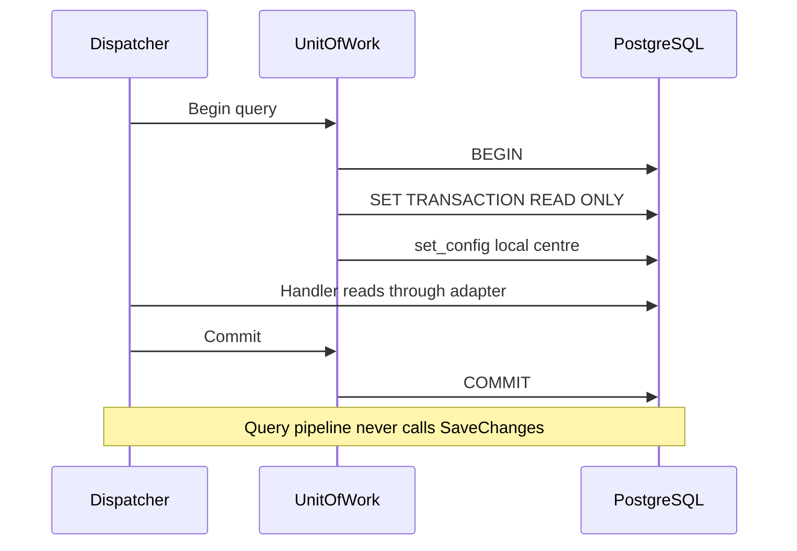

#### What it means

A database transaction groups work into a commit or rollback boundary. Atomicity means its writes either persist together or are discarded together. A unit of work collects tracked object changes and saves them as one operation. EF already supplies change tracking; this project's port exposes explicit transaction control to Application without exposing EF types.

Transactions also own locks and session-local settings. That ownership is crucial here: enrollment capacity locks, schedule advisory locks, and the PostgreSQL current-centre setting must apply to all reads and writes in one use case, then disappear before a pooled connection serves another request.

#### The problem it solves

Wrapping only `SaveChanges` leaves earlier reads and locks outside the use-case transaction. A transfer could end the source enrollment and fail to create the destination. Staff creation could leave a user without the requested membership. Audit rows could describe changes that were never committed.

Without transaction-local tenant configuration, a pooled connection could retain a previous request's centre setting. The current implementation explicitly sets the value for every transaction and scopes it locally, including an empty value when there is no centre (`UnitOfWork.cs:54`). It never assumes a freshly borrowed connection is already correct.

#### How it works

The dispatcher opens the transaction before calling the handler. The unit of work first rejects nested use. For a query, it issues `SET TRANSACTION READ ONLY` before any other SQL, because PostgreSQL requires that ordering. It then executes parameterized `set_config('app.current_centre', centreId, true)`. The third argument makes the setting transaction-local.

Command save runs EF interception and SQL generation inside that open transaction. Commit persists writes and releases locks. Rollback discards database changes, disposes the transaction, and clears tracked objects so failed in-memory state cannot be accidentally saved later. Exception rollback uses `CancellationToken.None` from the dispatcher so cancellation does not prevent cleanup.

#### How THIS project implements it

`UnitOfWork.BeginAsync` contains the nested check at `:30`, opens at `:36`, configures query read-only at `:45`, and applies tenant state at `:60`. `SaveChangesAsync` first reconciles removed student-parent links, then calls EF and translates expected database failures (`:66`). Commit disposes its transaction in `finally` (`:133`). Rollback takes the current transaction, clears its field, rolls back, disposes, and clears the tracker (`:147`).

```csharp
// Real tenant assignment, UnitOfWork.cs:59-63.
var centreId = _db.CurrentCentreId?.ToString() ?? string.Empty;
await _db.Database.ExecuteSqlRawAsync(
    "SELECT set_config('app.current_centre', {0}, true)",
    [centreId],
    ct);
```

The placeholder is a database parameter, not string concatenation. A centre ID never becomes SQL source. This explicit transaction exists on both query and command paths, so RLS sees the selected centre even when a read adapter contains no handwritten centre predicate.

#### Execution example

An owner adds a schedule rule producing several sessions. The dispatcher starts a write transaction and sets its centre. The handler locks the teacher schedule, tracks the rule, and tracks occurrences. Timestamp and audit interceptors run during save. PostgreSQL finds one generated session overlaps an existing teacher session. Save returns the mapped conflict. The dispatcher rolls back: no rule, no generated sessions, and no audit descriptions of those attempted changes survive. The advisory lock and current-centre setting end with the transaction.

#### Why this project needs it

Real features now change multiple rows and sometimes multiple aggregates. Data isolation is also implemented in PostgreSQL rather than only C#. The transaction provides one boundary for both consistency and tenant settings. Identity account creation uses the same scoped context and existing transaction, despite `UserManager` saving its own changes during the handler (`StaffAccountService.cs:9`). The user row remains provisional until commit.

#### Alternatives

EF's implicit save transaction is adequate when all relevant work occurs in one save and no earlier transaction-local settings or locks are needed. `TransactionScope` supplies an ambient transaction but introduces different lifetime and propagation rules. Distributed sagas coordinate work across independent stores; this application instead uses one context and one database transaction. A transaction per repository call would be smaller but could not guarantee all-or-nothing transfer or creation flows.

#### Important details

Read-only does not mean no transaction. The query path explicitly starts one and commits to end it. PostgreSQL is the backstop against accidental writes, including raw SQL. A transaction also holds resources while the handler awaits; do not put long external network calls inside it without considering connection and lock duration.

Removed parent links require special handling. `ReconcileOrphanedStudentParentLinks` temporarily disables automatic change detection while comparing each tracked student's current link IDs to tracked link entities. It marks missing links Deleted before ordinary detection can report a severed required relationship. A `finally` restores the previous detection setting (`UnitOfWork.cs:106`). This is narrow persistence adaptation, not permission to call global detection switches casually.

##### The database transaction and tracker have separate state

A rollback removes uncommitted database effects; it does not by itself reset every .NET object's properties. The context can still hold an entity marked Added or a modified collection after the database transaction ends. That is why rollback cleanup clears tracking. Without that cleanup, reusing the same scope could later save changes from the refused operation. A database assertion showing zero rows after rollback and a scope assertion showing no retained pending state address different halves of the failure.

The student-parent reconciliation runs before save for another tracker-specific reason. The Domain removes a link from its own collection, but the persistence relationship deliberately uses restrictive deletion behaviour. Automatic detection can observe a required relationship being severed before the unit of work explicitly marks the removed link Deleted. The reconciliation temporarily disables detection while comparing current collection membership with tracked link identities, marks the removed links and restores the previous setting in `finally`. This does not make restrictive database foreign keys unnecessary. It translates aggregate intent into the explicit delete operations that those keys require.

One save can therefore involve more than the objects visibly added in a handler. Reconciliation changes tracked link states, timestamp interception sets persistence metadata and audit interception adds history entries. All of them belong to the same transaction and the tenant guard sees the final tracked writes, including audit rows. Moving audit recording after commit would change the atomic guarantee, while moving a required read outside the transaction would change locking and tenant-setting coverage.

#### What I should understand before modifying this code

Know which transaction owns every read, write, lock, and audit row. Never open a second independent context to perform part of an atomic operation. Preserve the first-statement requirement for query read-only setup. Use transaction-local settings rather than persistent connection settings. If a new child-collection mutation changes EF relationship behavior, test actual persistence rather than assuming an in-memory collection change deletes the row. Keep rollback idempotent and clear failed tracking state.

<a id="backend-persistence"></a>
## 6.8 Repositories, DTO projections, and EF Core's execution model

#### What it means

A repository presents domain persistence capabilities such as finding an entity, taking a business lock, or tracking a new aggregate. A read service answers a query with a DTO shaped for its caller. An ORM translates between relational rows and objects. EF's context contains mapping metadata and a change tracker; its provider translates supported LINQ expressions into database operations.

An `IQueryable` is a query description, not the results. Building `Where` and `Select` calls constructs an expression. A terminal asynchronous operation such as `ToListAsync`, `SingleOrDefaultAsync`, or `AnyAsync` executes it. Tracked entity queries support subsequent mutation; `AsNoTracking` projections avoid that mutation machinery when the result is read-only data.

#### The problem it solves

If handlers return entities directly, transport consumers learn private domain and persistence details. If read handlers load full aggregates solely to show a table, unnecessary objects and tracking consume resources. If repositories save independently, the common transaction loses ownership. The current separation lets write handlers call entity methods while read handlers obtain exact display data without exposing EF interfaces to Application.

Without understanding deferred execution, a developer can accidentally load a whole table before filtering. Without understanding tracking, a developer can expect a detached DTO edit to become an update. These are mechanism errors, not merely style disagreements.

#### How it works

`AppDbContext.OnModelCreating` applies mapping classes, an extension point, then the tenant-filter convention (`AppDbContext.cs:43`). EF uses that model to translate queries and map rows. Write repositories return tracked entities; an entity's state change becomes an update during save. New entities become Added when `Add` is called; no insert is sent until save.

Read services select DTO fields and use no-tracking queries. Joins are expressed in LINQ and executed in the database where supported. Some operations deliberately materialize a limited set before computing a value EF cannot translate; those exceptions must be understood from source rather than assumed to be database-side.

#### How THIS project implements it

`EnrollmentRepository.Add` calls `db.Set<Enrollment>().Add` and never saves (`EnrollmentRepository.cs:44`). Its versioned load sets the shadow Version property's original value from the client (`:25`). `GroupReadService.Project` joins groups, subjects, and teachers, returns names, capacity, active enrollment count, status, and version (`GroupReadService.cs:72`). The count comes from enrollment rows, not a second stored counter.

`StudentReadService` builds a filtered and ordered query, takes one extra row for pagination, then loads primary parents for only the page IDs (`StudentReadService.cs:53`). Its phone-fragment search is a documented exception: converted phone properties could not support the attempted SQL LIKE translation, so it loads tenant-scoped phone projections and matches their canonical values in memory (`:118`). This code should not be described as an indexed database substring search.

#### Execution example

A student list query begins as `Set<Student>().AsNoTracking`. If archived rows are excluded, the adapter adds a status predicate. A name search normalizes and escapes the term and adds SQL LIKE. A cursor adds a lexicographic predicate on search name and ID. Ordering and `Take(pageSize + 1)` execute in PostgreSQL. The adapter trims the extra row, fetches primary parent information for page IDs, projects DTOs, and encodes the next cursor. The dispatcher commits its read-only transaction and the endpoint serializes that page.

#### Why this project needs it

The UI now shows joined data: group subject and teacher names, roster student names, student parent contact information, and session history. DTO projections keep those screen requirements out of domain aggregates. Write repositories expose operations with consistency meaning, such as locking a group for enrollment. The common context still allows all adapters to participate in one transaction.

#### Alternatives

Handlers can directly depend on EF, reducing files while weakening the boundary. Generic CRUD repositories reduce repeated code but may hide important operations such as lock-before-count. Dapper or raw SQL gives explicit query control at the cost of manual mapping. Database views can centralize complex read projections. The current approach uses use-case-specific ports and EF implementations, with raw SQL reserved for operations lacking a suitable LINQ representation.

#### Important details

Projection alone does not prove every expression executes server-side. Inspect where `ToListAsync` occurs. `StudentReadService` intentionally performs phone matching after materialization. Likewise, the absence of a manual centre predicate does not mean a query is unscoped: global filters and RLS add isolation outside the local expression. Conversely, bypassing filters or using privileged raw SQL deserves explicit review.

EF mappings include shadow properties such as Version and timestamps. Those fields can appear in DTOs through `EF.Property` without a public domain property. A domain object being free of persistence metadata therefore does not mean the table lacks concurrency or audit support.

##### Query translation, materialization and tracking are different operations

`db.Set<Group>()` obtains an entity set; it is not itself a list of all groups. A LINQ chain composes an expression describing selection, joins and projection. A terminal operation such as `SingleOrDefaultAsync`, `AnyAsync` or `ToListAsync` asks the provider to execute that description. Npgsql translates supported expressions into parameterized PostgreSQL operations. Awaiting the returned task observes completion. Describing all SQL as starting only because `await` appears would confuse asynchronous completion with the provider's terminal call.

The shape selected by the query determines what has to be materialized. `AnyAsync` returns a boolean and need not construct a whole entity. A DTO projection can select only the values the response needs. A tracked entity load constructs an entity and registers it with the context's tracker so later property changes can be compared and saved. An `AsNoTracking` read deliberately avoids that entity tracking overhead when the caller only needs transfer data. Returning DTOs through read-service ports also prevents the Application query handler from deciding later to save an entity it unexpectedly obtained from a read.

The context's model is another object altogether. `OnModelCreating` calls Identity's base configuration, applies the project's mapping classes, invokes the narrow model extension used by tests and applies the tenant query convention last. Mapping describes table/schema names, properties, converters, keys, concurrency metadata and relationships. It is not a new database query each time a repository method runs. The mappings are used to translate queries and saves, and migrations describe how the database schema should be brought into agreement with that model.

Consider the group version. The API receives a version value read earlier by the client. `GroupRepository.GetByIdAsync` loads the current entity and assigns the caller's expected value to the tracked property's original version. It does not merely compare two values at lookup time and declare the next write safe. EF includes the original token in the eventual update condition. A different writer can modify the row between lookup and save; the database-side token check still detects that stale update. The translator then turns the recognized concurrency exception into the stable failure understood by the client.

The locking enrollment load deliberately has different mechanics. Its raw SQL selects the group row `FOR UPDATE` and explicitly includes `xmin`, because a plain `SELECT *` does not return PostgreSQL system columns. EF still needs that mapped version column to materialize the entity correctly. The query remains tracked because some count-dependent commands can modify the group. The adapter then performs the active enrollment count only after the row lock is granted. Both query filter composition and database RLS remain relevant to that raw SQL path; raw SQL does not mean tenant safety becomes the handler's responsibility to recreate ad hoc.

Value converters bridge meanings, not just spelling. A Domain enum can be stored as a lower-case string constrained by a database check. The converter needs both write and read directions. Adding an enum member without adding its database representation, check constraint and migration can make a valid-looking C# value impossible to persist. A phone value object similarly needs a persistence conversion that preserves its normalized meaning. The Domain type should not know EF's storage APIs merely to make that mapping convenient.

Shadow properties are persistence values without matching public Domain properties. Timestamp metadata and concurrency version can live in the EF model/tracker. Interceptors obtain entries and their metadata during save, update the appropriate properties and allow SQL generation to proceed. This is how the timestamp interceptor can stamp an academic record without forcing every entity method to call a clock or every handler to assign database metadata. The absence of a visible property in an entity class therefore does not prove that no corresponding database column or EF property exists.

Migrations and the snapshot serve different readers. A migration contains forward and reverse operations representing a schema transition. The snapshot represents the last scaffolded model for comparison when generating the next migration. Designers hold generated model metadata for particular migrations. The migration history table records what was applied to a database. A current source snapshot is not proof that a particular developer or production database has applied every migration; system-info reads applied and pending migrations to answer that runtime question.

For a write, the entity can acquire its application-generated identifier before any SQL has been sent. `Add` marks it Added. Saving performs tracker processing and registered interception, generates writes, executes them in the existing transaction and updates tracked state on success. The dispatcher still has to commit the explicit transaction afterward. A successful save inside an open transaction is not durability outside that transaction until commit succeeds. This distinction is why integration tests deliberately write inside a handler and then fail: they prove that physically executed SQL still rolls back at the surrounding boundary.

The repository does not make EF a perfect abstraction over arbitrary databases. Row versions, read-only SQLSTATE, RLS policies, exclusion constraints and `FOR UPDATE` rely on PostgreSQL behaviour. Replacing Npgsql with an in-memory provider would change the correctness properties being tested, not merely the connection string. The port boundary keeps those details out of Application signatures; it does not claim the complete system can switch database engines without redesigning its persistence guarantees.

Before changing an EF query, identify whether it returns a tracked entity or projected data, when execution occurs, which tenant predicate applies, which concurrency value is original, whether a lock is required and which transaction is active. Before changing a mapping, identify the matching migration, snapshot, converter, constraints and generated API representation if the value crosses HTTP. Those questions expose the actual cost and ownership of an ORM operation instead of attributing the whole path to unexplained framework magic.

#### What I should understand before modifying this code

Locate terminal query operations and identify which work runs in SQL versus memory. Preserve no-tracking projections on read paths unless mutation is intended. Never add `SaveChanges` to an ordinary repository method. Keep version ownership explicit: a client's expected version belongs in EF's original value, not merely a comparison against a DTO. When optimizing a query, preserve tenant and teacher scope predicates and verify that any new raw SQL stays within the dispatch transaction.

<a id="backend-concurrency"></a>
## 6.9 Optimistic concurrency, uniqueness, row locks, and advisory locks

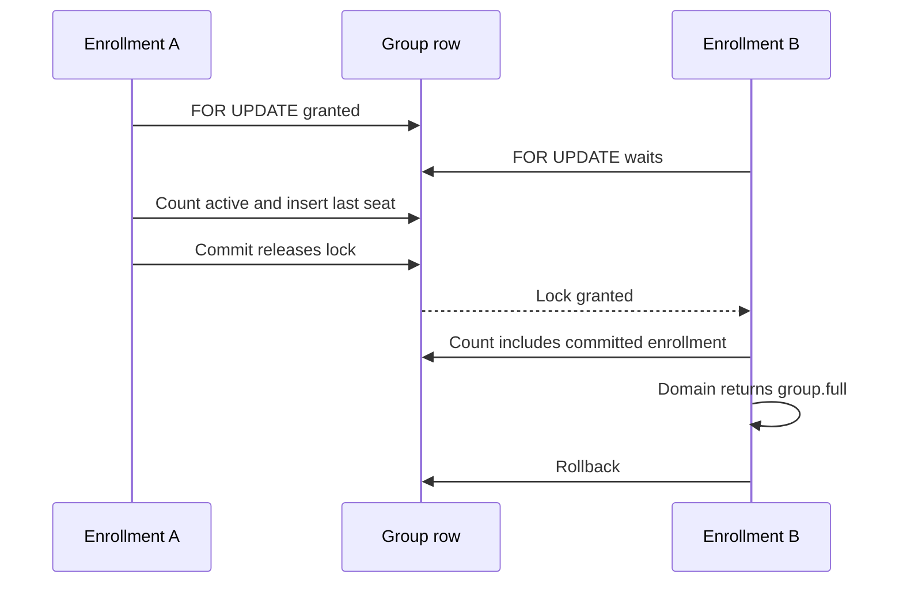

#### What it means

Concurrency means several operations can overlap in time. A race occurs when their interleaving changes the outcome. Four mechanisms in this repository solve different concurrency problems. Optimistic concurrency rejects an update based on an outdated version. Unique constraints reject duplicate keys. Row locks serialize decisions based on a shared record. Advisory locks serialize an application-defined resource, such as a teacher's schedule, even when no single row is the whole resource.

These mechanisms are complementary. A version token cannot enforce a group capacity count if enrollment inserts do not update the same group row. A row lock does not replace a unique index for duplicate enrollment pairs. A friendly pre-check cannot make a later insert immune to races. Understanding which invariant each mechanism protects is more useful than saying that a feature is simply thread-safe.

#### The problem it solves

Imagine two users reading the same group. One changes its capacity while the other changes its name using an old form. An unconditional update can overwrite a newer value. Optimistic concurrency requires the update to match the version originally read. Separately, two staff members can both see one free seat and each enroll a different student. Their enrollment rows have different IDs, so entity row versions alone do not prevent overbooking.

The unsafe hypothetical enrollment sequence is: count seats, see one free, insert. Both transactions can honestly pass the count before either commits. The current handler starts by taking the group lock, so the second transaction waits and reads a count that includes the first committed enrollment. The invariant is enforced across the decision window, not merely checked before it.

#### How it works

Optimistic concurrency stores a version in the data returned to the client. The client submits that expected version with a mutation. EF includes it in the update condition; zero matching rows means another writer changed the row. PostgreSQL's `xmin` system column supplies the underlying token. The project maps it as a shadow `uint` named `Version` so domain objects do not expose database-specific system columns.

A unique constraint checks the database's final state. The handler may first query for a friendly error, but simultaneous writers still rely on the constraint. Row locks instead make competitors wait while one transaction checks and changes shared state. Advisory locks use an arbitrary key agreed upon by application code; they do not themselves validate an overlap, but make conflicting writers acquire resources in a controlled order before exclusion constraints arbitrate.

#### How THIS project implements it

`RowVersionConfiguration.HasRowVersion` maps `Version` to `xmin`, type `xid`, generated on add or update, and marks it as a row version (`src/TutoringCentre.Infrastructure/Persistence/Configurations/RowVersionConfiguration.cs:16`). Versioned repository loads assign the client's token to `OriginalValue`, not to the current stored value. For example, `ClassSessionRepository.cs:27` establishes the expected update version after loading a session.

`PersistenceErrorTranslator` returns `concurrency.stale` for EF concurrency failures. Exact unique names map to feature conflicts: centre slug, subject name, membership pair, parent phone, student-parent pair, teacher account, group name, and active enrollment pair (`ConstraintErrorCatalog.cs:14`). The one-primary-parent and rule-date unique indexes remain deliberately untranslated because the application treats their violation as a broken invariant, not an ordinary conflict.

Teacher schedule writes call `LockTeacherSchedulesAsync`. It de-duplicates teacher IDs, sorts them, creates a namespaced string key, and executes `pg_advisory_xact_lock(hashtextextended(key, 0))` once per teacher (`ClassSessionRepository.cs:60`). Sorting means operations that need several teachers acquire locks in the same order. The transaction owns the lock, so commit or rollback releases it.

```csharp
// Real advisory lock acquisition, ClassSessionRepository.cs:69-73.
foreach (var teacherId in teacherIds.Distinct().Order())
{
    var key = $"teacher-schedule:{teacherId}";
    await db.Database.ExecuteSqlAsync($"SELECT pg_advisory_xact_lock(hashtextextended({key}, 0))", ct);
}
```

#### Execution example

Two commands attempt to fill the final seat. The first acquires the target group's enrollment lock and counts active rows. It passes `EnsureCanEnroll`, tracks a new enrollment, saves, and commits. The second has been waiting on that group. Once released, it counts again and finds capacity reached. `Group.EnsureCanEnroll` returns `group.full`, which propagates through rollback and HTTP conflict mapping. There is no persistent enrolled-count field to increment or repair.

A different race occurs when two users edit one session. Both forms carry the same Version. The first cancellation updates the row. The second command may still load current state but sets the original concurrency token from its stale form. If it produces an update, save affects zero matching versions and becomes `concurrency.stale`. These two examples use different tools because one invariant concerns a collection count and the other concerns a specific edited record.

#### Why this project needs it

Staff management must preserve an active owner. Enrollment must preserve capacity. Group edits must not overwrite one another. Scheduling must prevent teacher and group overlap. Each is a real multi-user operation. A single application process would still need database enforcement because requests overlap, and database constraints remain valid even if another process writes through the same permitted account.

#### Alternatives

Serializable isolation can detect some conflicting transaction histories, but callers must handle retries. A stored counter on groups can make seat updates atomic but introduces a second source of truth. `INSERT ... ON CONFLICT` can be useful for idempotent inserts, but does not directly express every business refusal here. Distributed locks add another infrastructure dependency and do not replace relational constraints. An in-process mutex only coordinates one process and would fail across multiple instances.

The repository explicitly documents why teacher locks use sorted IDs and transaction scope in `ClassSessionRepository.cs:64`. It does not explicitly state every reason for choosing `xmin` over an application-managed token. The following is an interpretation based on the implementation: using PostgreSQL's existing version value avoids maintaining a separate domain field while still providing a client-visible stale-write contract.

#### Important details

An optimistic token only matters when an update or delete checks it. A mutation that becomes a true no-op may produce no SQL update, so understanding the entity transition is necessary before predicting a stale response. The capacity handler therefore performs an explicit `IsAtVersion` check after its locked load (`ChangeGroupCapacityHandler.cs:23`). Do not assume every command detects staleness at the same line.

Advisory-lock hash collisions reduce concurrency by making unrelated teachers wait; they do not grant access or disable constraints. Conversely, acquiring the advisory lock is not the overlap check. Exclusion constraints remain the final arbiter. Error classification uses SQLSTATE and constraint names, never localized database message text, which avoids coupling to server wording.

#### What I should understand before modifying this code

State the invariant precisely. For one-record lost updates, preserve the version contract. For counts, identify the row every competing operation must lock before counting. For uniqueness, keep the database constraint even if a pre-check exists. For scheduling, preserve sorted teacher lock acquisition and the exclusion constraints. Review transfer operations for lock cycles: the current transfer locks only its destination because the source only loses a seat (`TransferEnrollmentHandler.cs:15`). Adding an unnecessary source lock changes deadlock behavior.

<a id="backend-tenancy"></a>
## 6.10 Multi-tenancy through actor scope, EF filters, write guards, and PostgreSQL RLS

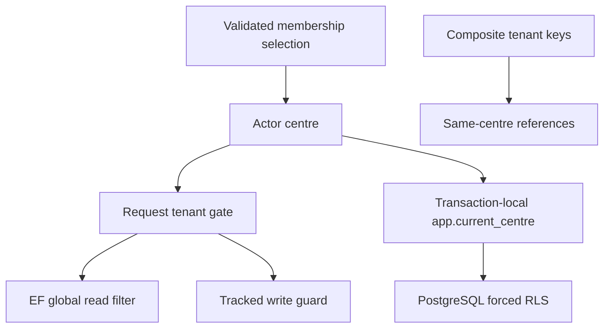

#### What it means

A tenant is one customer's data boundary. Here the tenant is a centre. Multi-tenancy means one running application and database hold data for several centres while ensuring an operation can only see or change the selected centre's records. Authentication identifies the person. Centre selection determines the current tenant. Permission checking determines which capabilities that person has there. Tenant isolation then constrains which rows those capabilities can reach.

The current design uses several independent checks. The dispatcher requires a selected centre for tenant-scoped requests. EF automatically adds read filters. A save interceptor checks tracked writes. PostgreSQL row-level security applies the boundary inside the database. Composite foreign keys prevent a child in one centre from referring to a parent row belonging to another centre. None of these layers should be described as a substitute for the others.

#### The problem it solves

The dangerous hypothetical query is `db.Students.Where(s => s.CentreId == request.CentreId)`. The caller chooses a centre ID, so every endpoint must separately prove that the ID is permitted. Even if most handlers add the correct predicate, one forgotten filter leaks data. Raw SQL and direct writes may bypass ORM-level checks entirely.

The project instead takes the active centre from trusted actor state created from a validated session. Tenant-owned entities have a fixed `CentreId`. A repository can query by entity ID without a local centre predicate because the context and database both add the tenant boundary. A foreign ID appears absent rather than returning another centre's data.

#### How it works

At the HTTP edge, cookie claims become `StaffActor(userId, centreId, role)` only after authentication. The dispatcher examines `ITenantScoped`. A missing tenant fails before a transaction. The context's `CurrentCentreId` reads the actor live. During model construction, the filter convention finds every mapped `ITenantOwned` type and builds `entity.CentreId == context.CurrentCentreId`. During save, the guard examines Added, Modified, and Deleted tenant entries and refuses absent or mismatched centre ownership and attempted centre changes.

During transaction start, the unit of work sets `app.current_centre` transaction-locally. RLS policies compare each row's `centre_id` to that setting. `USING` restricts visible or mutable existing rows; `WITH CHECK` restricts newly written row values. An absent or empty setting resolves to no matching tenant. `FORCE ROW LEVEL SECURITY` also binds the table owner except for PostgreSQL bypass privileges described by the helper's documentation.

#### How THIS project implements it

`TenantQueryFilterConvention.Apply` iterates every mapped type and recognizes `ITenantOwned` (`TenantQueryFilterConvention.cs:19`). It refuses owned or keyless mappings because those cannot carry this filter (`:26`). Its expression reads `CurrentCentreId` from the context rather than capturing a centre value at model creation (`:44`). `AppDbContext.OnModelCreating` runs it after all ordinary mappings and the test extension point (`AppDbContext.cs:55`), so a later configuration cannot overwrite the filter in that method.

`TenantWriteGuardInterceptor` checks audit immutability first, then tenant write ownership (`TenantWriteGuardInterceptor.cs:43`). An actor with a centre is not sufficient if the entity belongs to a different centre. A Modified entry whose CentreId property is marked modified is rejected even if the current value happens to match the actor (`:65`). Tenant identity is not an editable business field.

The migration helper emits three statements: enable RLS, force RLS, and create the `tenant_isolation` policy. Its policy expression is exact:

```sql
centre_id = nullif(current_setting('app.current_centre', true), '')::uuid
```

`TenantRowLevelSecurity.cs:19` defines that expression once. Table and schema identifiers are validated against a safe unquoted-identifier pattern before interpolation (`:65`). This validation is distinct from value parameterization: SQL identifiers cannot use ordinary value parameters, while centre values can and do.

#### Execution example

A user selects Nile through the membership gate. The next group query has a StaffActor carrying Nile's ID. The dispatcher accepts its tenant marker. The unit of work begins read-only and sets that ID in the database transaction. The EF global filter restricts groups, subjects, and teachers to Nile. The read projection joins those already scoped sets. PostgreSQL applies RLS again as SQL executes. A group ID copied from Maadi yields no visible group. If a buggy handler constructs a new entity with Maadi's centre, the write guard throws before save; if a direct SQL statement bypasses EF, the RLS `WITH CHECK` still rejects the foreign tenant row on the runtime role.

#### Why this project needs it

Subjects, teachers, parents, students, groups, enrollments, rules, sessions, and audit records now carry tenant data. The original groundwork is therefore a real security boundary. A central convention lowers the chance that adding a new query omits a filter. Database enforcement protects paths that do not execute ordinary LINQ. Composite relationships keep tenant ownership consistent across graphs as well as individual rows.

#### Alternatives

One database per tenant provides stronger operational separation but adds provisioning and migration complexity. A schema per tenant separates names but also complicates schema evolution. Handwritten predicates are explicit but omission-prone. EF filters alone cannot protect raw SQL or external writers. RLS alone does not provide early friendly errors and requires correct runtime privileges and tenant settings. The current system intentionally combines application and database layers.

#### Important details

Membership is deliberately not `ITenantOwned` because it must be read before a centre is selected. It is queried through explicit user and centre predicates (`MembershipReadService.cs:31`). Centre itself is the tenant rather than a tenant-owned child. Platform Data Protection keys are also not tenant-owned (`AppDbContext.cs:40`). These exceptions are part of the design, not evidence that every table should receive the same filter.

`ConfigureTenantOwned` adds a required centre field, Restrict foreign key to centres, and alternate key `(centre_id, id)` (`TenantOwnedConfiguration.cs:17`). Child composite foreign keys reference that key so they prove parent and child share a centre. A foreign key on parent ID alone proves only that the parent exists somewhere. Runtime credentials must also lack superuser and BYPASSRLS privileges; otherwise database isolation is bypassable. Infrastructure registers a readiness tripwire specifically for that condition (`DependencyInjection.cs:75`).

#### What I should understand before modifying this code

For a new tenant table, implement `ITenantOwned`, apply tenant mapping, add the migration's RLS and runtime grants, declare request scope and permission, and test cross-centre reads and writes. Do not copy centre IDs from the request body into actor state. Do not add `IgnoreQueryFilters`, raw SQL, or bulk updates casually. A bulk operation can bypass the change tracker and therefore auditing and the write guard, even while RLS still applies. Preserve transaction-local settings on every dispatch and keep privileged migration connections separate from runtime DI.

<a id="backend-authentication"></a>
## 6.11 Cookie authentication, antiforgery, revalidation, and password change

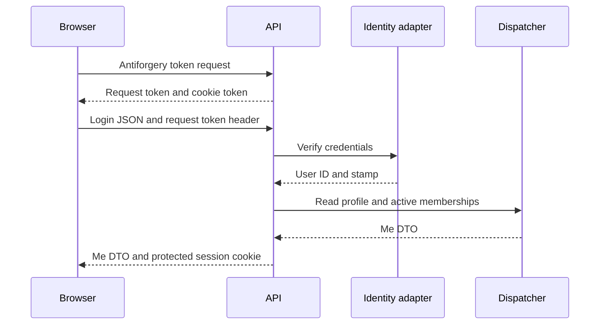

#### What it means

HTTP does not remember a user between requests. A session mechanism supplies a credential that can be returned on each request. This application uses an encrypted and signed authentication ticket in a browser cookie. The browser sends the cookie automatically. The server authenticates the ticket, revalidates its current account and membership facts, then builds Application actor state.

Because browsers send cookies automatically, authentication alone cannot prove a state-changing request came from the application's own script. Antiforgery requires a separate request token tied to a cookie token. Password verification is a different concern again: Identity hashes credentials, tracks lockout, and updates the security stamp. A changed stamp makes older tickets fail revalidation.

#### The problem it solves

Without a server-issued credential, a client could claim a user ID in a header and impersonate anyone. Without antiforgery, another origin could try to make a browser issue authenticated actions. Without revalidation, a self-contained ticket could continue carrying a revoked membership or old role until expiry. Without a password-change gate, a temporary password would remain a normal long-term credential.

The hypothetical `LoadUser(request.Headers["X-User-Id"])` trusts client data as identity. The actual login endpoint verifies credentials through `IAuthenticationService`, reads the profile, and only then issues a principal (`AuthEndpoints.cs:97`). This order ensures a failed profile read does not leave a newly issued session cookie.

#### How it works

Sign-in asks ASP.NET Core's cookie handler to serialize the principal into a protected ticket. Cookie authentication later decrypts the ticket, checks expiry, and invokes `OnValidatePrincipal`. This application's revalidation hook asks whether the stored stamp, membership activity, and role still match. A valid answer can be cached briefly; an invalid answer rejects the principal and sends cookie deletion.

Antiforgery token issue is a public GET returning the request token while the framework writes the cookie half. An endpoint filter on the `/api` group validates unsafe methods before the handler. Password changes call Identity's password operations, clear the pending-change flag, rotate the security stamp, and issue a new session with no selected centre. The current browser must select a centre again; other tickets now carry the old stamp.

#### How THIS project implements it

`AuthenticationSetup.cs:23` names the cookie `__Host-tcm.session`. It is HttpOnly, Secure always, SameSite=Lax, and Path `/`. The ticket lifetime is eight hours with sliding expiration (`:29`). Login and access-denied redirects are replaced with 401 and 403 statuses so the SPA receives an API response rather than HTML navigation. The fallback policy requires an authenticated user unless an endpoint explicitly allows anonymous access (`:48`).

The Data Protection key ring is persisted through `PersistKeysToDbContext<AppDbContext>` in Infrastructure (`DependencyInjection.cs:119`). This corrects an earlier local-key-ring limitation. Application name remains `TutoringCentre`; the registration comment explains that changing the name invalidates existing cookies. Keys are platform-level data rather than tenant rows.

`SessionRevalidationHandler` includes role in its cache key and query (`SessionRevalidationHandler.cs:43`). `MembershipReadService.GetSessionStateAsync` returns the stored stamp, activity, and current role (`MembershipReadService.cs:49`). Do not repeat the older claim that only membership activity and stamp are checked while role remains stale indefinitely. The current query receives the role as an explicit input.

#### Execution example

A newly created staff account logs in with its temporary password. Credentials verify, and `Reauthenticate` establishes a staff actor without a centre. The profile includes `MustChangePassword=true`. Login deliberately disables single-membership auto-selection in that case (`AuthEndpoints.cs:116`). The browser receives a session without centre and role, so tenant-scoped commands fail with `tenant.not_selected`. Attempting centre selection also checks `MustChangePasswordAsync` and returns `auth.password_change_required` (`GetActiveMembershipHandler.cs:24`).

The user submits current and new passwords to `/api/auth/change-password`. Request validation and the dedicated rate-limit policy apply. The authentication adapter rejects an equal old and new password, calls `UserManager.ChangePasswordAsync`, distinguishes password mismatch from policy failure, clears `MustChangePassword`, and updates the stamp (`IdentityAuthenticationService.cs:50`). The endpoint issues a new ticket without centre (`AuthEndpoints.cs:196`). Centre selection can now proceed through the ordinary membership gate.

#### Why this project needs it

Staff membership can now be changed or deactivated through product operations. Sessions therefore need current authorization facts rather than only cryptographic validity. Staff creation returns a temporary password once and sets a pending-change flag; the gate turns that flag into enforced behavior. Persisted keys allow tickets to remain decryptable across the deployment lifecycle described by the registration, while still requiring the same application name and database availability.

#### Alternatives

A server-side session store keeps a small random ID in the cookie and revokes by deleting a row. JWT bearer tokens can suit independent API clients but require explicit storage and revocation design. A JWT stored in a cookie still needs CSRF protection. An external identity provider can own credentials but does not replace per-centre memberships. These alternatives change credential mechanics; the centre and permission model would still need enforcement.

#### Important details

The cookie is a self-contained ticket, not a session row. Persisting Data Protection keys does not create a server-side session store. Logout calls `SignOutAsync` and removes the browser's cookie (`AuthEndpoints.cs:138`); it does not itself rotate the security stamp. A copied ticket can therefore remain valid until expiry or revalidation detects a changed account or membership fact. This is a direct implication of the current logout code and ticket design, not proof of an observed attack.

The authentication service's dummy hash prevents a trivially cheap unknown-account path, but its comment should not be promoted into a measured timing guarantee. Locked-out users follow a different branch before password verification. The source proves uniform error codes and deliberate dummy work; only timing measurement could establish the actual response-time distributions.

The password-change adapter performs more than one Identity save. The repository code explicitly clears the flag and rotates through `UpdateSecurityStampAsync` after the initial password operation. Its return status is not checked in the shown code (`IdentityAuthenticationService.cs:77`). That behavior deserves separate review rather than an unsupported claim that the entire method is one explicit transaction.

#### What I should understand before modifying this code

Keep session-changing actions synchronized with frontend CSRF refresh and session-cache updates. Preserve centre and role pairing in claims. Revisit the validation query whenever a new authorization fact is placed in a ticket. A password operation must consider other sessions, current ticket issuance, pending-change state, rate limiting, and error privacy. Never log the request body or a temporary password. Do not confuse key persistence with ticket revocation; they solve independent problems.

<a id="backend-permissions"></a>
## 6.12 Permissions, role freshness, and teacher ownership scope

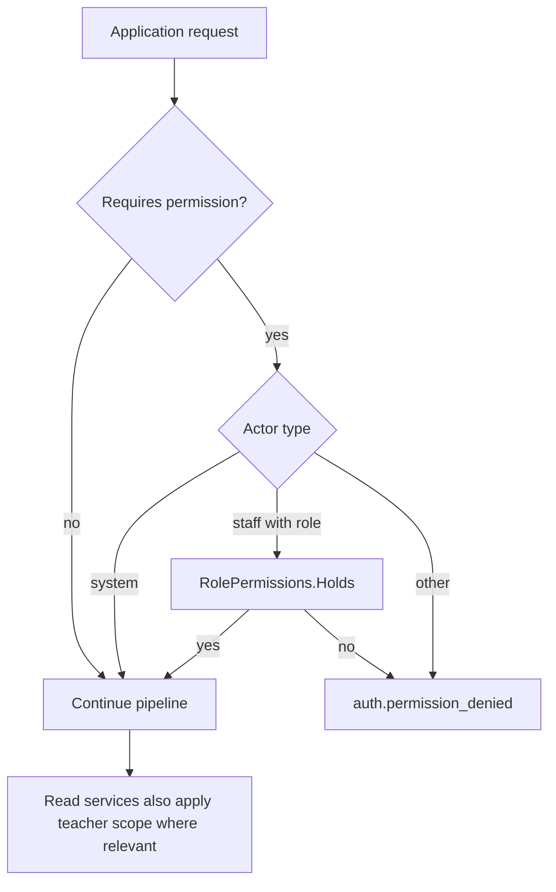

#### What it means

Authentication proves identity. Authorization decides whether that identity can perform a capability. Ownership scope narrows which records an otherwise permitted read can return. A role groups permissions; a permission names an action such as `groups.manage`; a teacher scope describes whether the current caller can see every group, one teacher's groups, or none.

These layers answer different questions. A teacher can possess `schedule.view` while only seeing sessions assigned to that teacher. An owner can view the whole centre but cannot view another centre. Hiding a button communicates these rules in the frontend, but the API and application pipeline remain the security boundary.

#### The problem it solves

Role comparisons scattered through handlers duplicate policy and drift. One handler might treat Secretary as a manager while another treats it as read-only. A simple permission check is also insufficient for teachers because a successful `groups.view` decision must not expose every group's roster. Conversely, silently returning all data when no teacher link exists turns incomplete setup into a data leak.

Hypothetical `if (actor.Role == Teacher) ...` inside each feature repeats role meaning. Current dispatch permission checking delegates to `RolePermissions`, and ownership resolution delegates to `TeacherScopeProvider`. Features receive an explicit scope that fails closed for missing or unknown cases.

#### How it works

Each permission-requiring request declares its required key. The dispatcher reads the role already carried by trusted actor state and consults the central map. It makes that decision before a database transaction begins. Revalidation ensures a ticket's role still corresponds to membership state, subject to the configured positive-cache window.

Read handlers that require ownership ask `ITeacherScopeProvider`. Owners and secretaries get All because `RoleScopes.IsLimitedToOwnGroups` only returns true for Teacher. A teacher's linked active teacher record produces Own(teacherId). Missing or archived teacher links produce None. Read adapters apply the teacher predicate in SQL rather than loading all centre rows and filtering them afterward.

#### How THIS project implements it

`Permissions.cs:6` through `:21` defines keys for subjects, staff, audit, centre settings, students, teachers, groups, enrollments, and schedule. `RolePermissions` grants Owner every listed capability. Secretary receives subject, student, group, enrollment, and schedule management plus teacher view, but not staff management, audit view, centre settings management, or teacher management (`RolePermissions.cs:27`). Teacher receives subject view, group view, enrollment view, and schedule view (`:41`). Unknown roles and keys are denied by the lookup behavior.

`TeacherScopeProvider` caches its resolved result in the scoped instance (`TeacherScopeProvider.cs:20`). It returns All for system actors and staff roles not limited to own groups, None for other unknown cases, and resolves teachers through `FindIdByUserAsync` (`:34`). `GroupReadService.Scoped` chooses either every tenant-filtered group, a teacher-ID predicate, or no query (`GroupReadService.cs:60`).

Schedule scope is intentionally historical. Rules belong to a group and use the group's current teacher. Timetable sessions carry their own teacher and are scoped by that session field (`ScheduleReadService.cs:11`). A past session can therefore remain visible to its historical teacher after the group's teacher changes.

#### Execution example

A teacher requests the timetable. The dispatcher first sees a selected centre and verifies `schedule.view`. The query handler obtains Own(linkedTeacherId). `ScheduleReadService.GetTimetableAsync` applies `session.TeacherId == ownTeacherId`, then filters the requested local-date week and any optional group or teacher filters. A teacher-supplied filter for someone else intersects with the ownership predicate; it does not replace it. The returned projection joins group, subject, and the session's teacher. Every join is also tenant-filtered and subject to RLS.

If the account has no active teacher link, scope is None and the read adapter returns an empty collection without asking for all timetable rows. If the teacher tries a write, `schedule.manage` is absent and the dispatcher rejects before transaction start.

#### Why this project needs it

The product distinguishes owner administration, secretary operations, and teacher read access. Staff can work in multiple centres and have a different role in each. Teachers have both login accounts and business teacher records, which are not interchangeable identifiers. The scope provider is the bridge between authenticated account identity and the academic teacher record that owns groups or sessions.

#### Alternatives

ASP.NET named policies can enforce HTTP capabilities but do not automatically cover direct application or CLI dispatch. Resource-based authorization can evaluate each row separately but may be expensive for lists and can leak data if filtering happens too late. A claims-only list of permissions becomes stale unless renewed or revalidated. A database permission table supports configurable roles but adds schema and administration complexity absent from the current static matrix.

The repository does not explicitly state why every capability grouping was chosen. The following is an interpretation based on the implementation: stable capability keys allow the UI to present available actions without duplicating the role matrix, while keeping the actual decision on the server.

#### Important details

Permission and ownership scope are not identical types of filter. `RolePermissions` is a synchronous map requiring no lookup. Teacher scope requires an active linked academic record and is therefore resolved asynchronously. Caching that result once per request avoids repeated identical lookup, but it is not a cross-request authorization cache.

Session revalidation has its own positive cache. A role change can therefore take effect after that cache expires rather than at the exact write instant. Returning fresh permissions from `/api/me` does not itself change an already issued ticket. Understand both the current profile projection and cookie validation when predicting what a concurrent demotion does.

#### What I should understand before modifying this code

Add a new capability to the key set, matrix, application request, UI presentation, and tests together. Decide whether a read needs ownership scope as well as permission. Preserve All/Own/None semantics and default to None on unknown input. Do not accept a teacher ID from the request as proof of ownership. When a feature displays historical data, choose deliberately whether scope follows the current group teacher or the teacher recorded on each historical row.

<a id="backend-audit"></a>
## 6.13 Transactional auditing, allowlists, masking, and append-only history

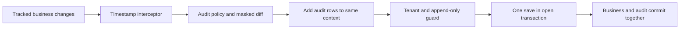

#### What it means

An audit log records business changes with enough context to answer who changed which record and what changed. It differs from operational logging, which records process behavior and failures. Audit entries should correspond to committed state changes, preserve history, and avoid turning sensitive data into a second uncontrolled copy.

An allowlist says which fields may enter the audit document. Masking changes how an allowed sensitive field is represented. Append-only means existing audit rows cannot be edited or deleted through ordinary application behavior. These are separate policies: an allowlist limits content, masking limits exposure, and append-only rules protect integrity.

#### The problem it solves

If every handler writes its own audit row, one handler eventually forgets, writes the wrong actor, or records the event before the business transaction fails. Logging entire entity objects may leak passwords, tokens, or personal contact details. Auditing every EF property automatically also records technical noise and makes newly added sensitive fields visible without an explicit decision.

Hypothetical `logger.LogInformation("Updated {@Student}", student)` is neither transactional nor safely minimized. Current auditing runs at save, examines known audited types and allowed fields, and adds an audit entity to the same context. If the transaction rolls back, that audit entity rolls back too.

#### How it works

A save interceptor runs before EF generates its write commands. It inspects the tracked entity states and their original and current property values. A policy chooses eligible entity types, actions, fields, and tenant ownership. A pure diff builder constructs a JSON document. The interceptor adds an audit entry containing the actor, tenant, timestamp, entity identity, action, changes, and correlation ID.

The interceptor snapshots the changed entries before adding audit entities, avoiding collection mutation while enumerating. A later tenant write guard checks the newly added audit entries as well as business entries. Modifying or deleting an existing audit row is rejected independently of whether its centre matches the actor.

#### How THIS project implements it

`AuditInterceptor` is scoped because it receives `IClock`, `ICurrentActor`, and `ICorrelationContext` (`AuditInterceptor.cs:22`). It runs after timestamp stamping and before the tenant write guard, as stated in its class documentation. Platform bootstrap with no actor centre is deliberately logged rather than audited (`:64`). For an actor with a centre, it resolves Staff or System actor type and optional user ID, captures one timestamp and correlation ID, and snapshots tracked changes (`:78`).

Each changed object must appear in `AuditPolicy.Entries`. The entity's resolved centre must match the actor centre. State maps to Created, Updated, or Deleted. Policy can exclude particular actions. The interceptor then passes property names, original values, current values, and `IsModified` flags to `AuditDiffBuilder` (`:114`). A null diff skips the audit row entirely.

`AuditDiffBuilder.Build` iterates only allowed fields (`AuditDiffBuilder.cs:37`). Created actions write null-before/current-after; Deleted writes original-before/null-after; Updated writes only fields marked modified whose real values differ. The output field names are camelCase. Masking happens after the real-value comparison, so two phone numbers sharing a visible suffix still produce a change (`:75`). Phone values are written through `PhoneNumber.Masked`, not canonical full digits.

#### Execution example

An owner updates a parent's phone. The handler validates and canonicalizes the new number, loads the versioned parent, and calls its domain update. During save, EF identifies the modified phone property. Timestamp interception updates technical time metadata. Audit interception finds the parent policy, compares actual old and new phone objects, and builds before/after masked values for the allowed field. It adds an audit row with centre, actor ID, timestamp, entity ID, and correlation ID. The tenant guard then verifies both rows belong to the acting centre. Save and commit persist them together. A unique-phone conflict instead rolls back both the attempted update and audit row.

#### Why this project needs it

Staff and academic records now have meaningful administrative changes. A centre needs a history of role changes, archives, contact edits, enrollments, and schedule modifications. A centralized interception point avoids asking each feature author to remember audit plumbing. An allowlist ensures adding a new entity property does not silently expand data collection.

#### Alternatives

Domain events can describe higher-level business actions and be persisted transactionally, but require deliberate emission and dispatch mechanics. Database triggers can guarantee coverage for every SQL writer but have less direct access to application actor and correlation context unless these are supplied through connection settings. An external event stream can preserve immutable history but introduces delivery guarantees and infrastructure. Ordinary structured logs are useful for troubleshooting but are not a replacement for the transactionally stored audit table.

The repository explicitly states the allowlist and save-interception contract in the inspected classes. It does not explicitly state every tradeoff against these alternatives. The following is an interpretation based on the implementation: using tracked property changes gives broad coverage with minimal handler code, while policy and masking limit the information captured.

#### Important details

Auditing only sees tracked operations. A bulk SQL update or EF `ExecuteUpdate` does not produce ordinary tracked property changes. `ClassSessionRepository` explicitly avoids bulk updates for that reason (`ClassSessionRepository.cs:9`). RLS may still protect those writes, but audit and tenant-interceptor coverage would differ.

No-op changes should not produce misleading history. Updated actions with no actual allowed-field differences return null (`AuditDiffBuilder.cs:66`). A row might change only technical fields without an audit record if policy does not allow them. Conversely, Created and Deleted representations include allowed fields even when a value is null, because the action describes the whole allowed snapshot.

The guard prevents Modified or Deleted audit entities (`TenantWriteGuardInterceptor.cs:43`). Database access grants add another layer through migration helpers; application interception alone does not make a table immutable to privileged operators. Keep those scopes distinct when explaining append-only behavior.

#### What I should understand before modifying this code

Choose audited fields deliberately and review privacy before adding them. Compare real values before masking. Do not add an audit save independent of the business transaction. Preserve interceptor ordering so audit rows are created before the guard runs. When adding bulk persistence, explicitly address the auditing gap. Treat changes to policy, JSON representation, action names, and entity names as changes to the stored historical contract, because existing rows remain after code changes.

<a id="backend-academics"></a>
## 6.14 Academic records, aggregate relationships, and archive workflows

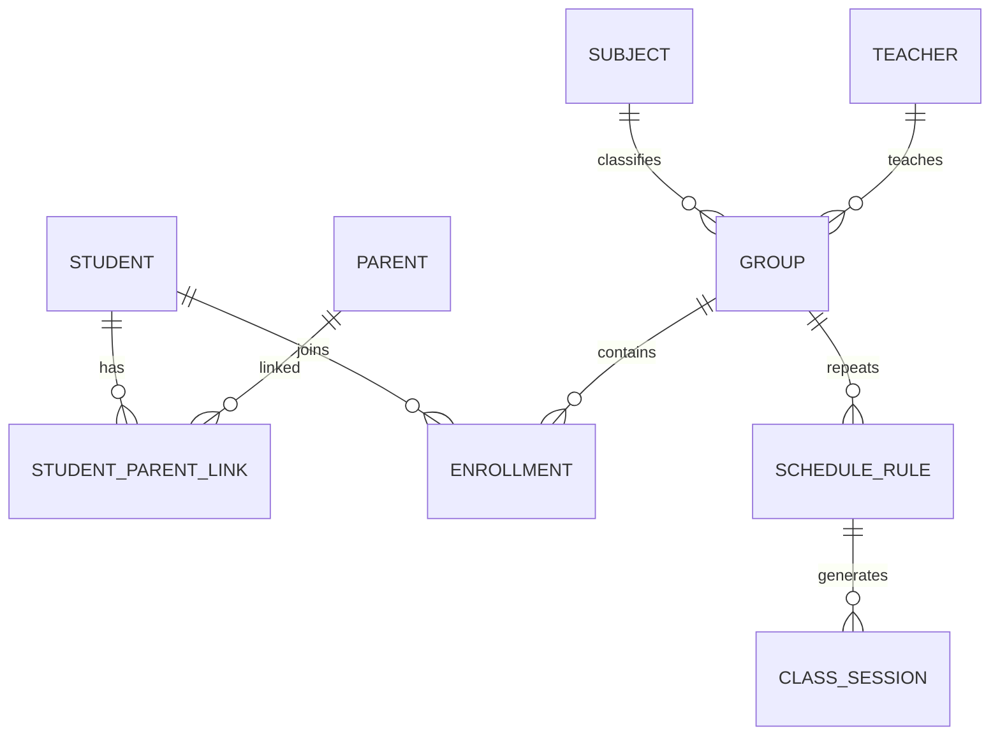

#### What it means

The academic model describes the centre's operational records rather than just its sign-in infrastructure. A subject is something the centre teaches. A teacher is a teaching record, optionally linked to a login account. A parent is a contact shared by linked students. A student owns its parent relationships. A group joins a subject and teacher with a capacity. An enrollment records a student's seat in a group over time. Schedule rules and sessions then describe when that group meets.

These distinctions prevent misleading shortcuts. A teacher is not necessarily a staff account. A parent is not a student-owned copy of a phone number. An enrollment is not just membership in a mutable list. An archive is not deletion. Each concept has a different identity, lifecycle, and set of references, which determines where changes belong.

#### The problem it solves

Combining teacher and staff records would require every listed teacher to have a login and would make account role changes erase academic identity. Copying parent contacts onto each student would create inconsistent phone numbers when siblings share a contact. Deleting archived records would break historical enrollments and sessions. Storing a group's enrollment count would duplicate information already present in active enrollment rows.

The unsafe hypothetical student registration writes a parent, saves, then writes a student in a second transaction. If student validation fails, an unwanted parent remains. Current registration resolves or constructs the parent and student in one dispatch transaction. The common save commits both aggregates and the link or rolls everything back (`RegisterStudentHandler.cs:10`).

#### How it works

Domain entities own intrinsic rules and transitions. Handlers load related records through tenant-scoped repositories and verify cross-aggregate conditions. Database foreign keys prevent invalid references, including cross-tenant composite relationships. Archiving changes status while retaining identity. Read adapters can exclude archived rows by default and expose them only when requested.

Account linking uses an explicit contract across functional areas. The academic handler asks `IStaffDirectory` whether a user is an active Teacher-role member of the current centre. It does not load `ApplicationUser` or parse password and claim data. A separate uniqueness check ensures one account is not linked to another teacher in the centre, with database translation covering a concurrent race.

#### How THIS project implements it

`Teacher.cs:6` explains that teachers can exist without signing in, and role changes do not remove the teaching record. `UserId` is optional. `LinkUser` and `UnlinkUser` succeed without change when already at the requested link state; both refuse editing archived teachers through the shared archived check. Archive retains the account link so restoration can restore ownership scope (`Teacher.cs:115`).

`SetTeacherAccountHandler` first loads the versioned teacher. A null UserId means unlink. A non-null ID must pass `IsActiveMemberWithRoleAsync(centreId, userId, Teacher)` and the account-linked uniqueness check (`SetTeacherAccountHandler.cs:36`). Unknown users, foreign-centre users, wrong roles, and inactive memberships all produce the same eligibility refusal, limiting information disclosure.

`Subject` cleans internal whitespace and uppercases its normalized name (`Subject.cs:91`). By contrast, student, parent, teacher, and group search fields use `SearchText.Normalize`. These are not the same algorithm. `SearchText` removes selected Arabic diacritics and tatweel, lowercases, normalizes selected Arabic letters, and maps Arabic digit sets (`SearchText.cs:12`). Display names remain distinct from those matching fields.

Student registration accepts either an existing parent ID or nested parent details. `RegisterStudentHandler` canonicalizes an optional student phone, resolves the existing parent or validates a new parent's phone and uniqueness, constructs the parent if needed, then registers the student and primary link (`RegisterStudentHandler.cs:25`). It tracks a new parent before `Student.Register`; if that later factory fails, the dispatcher rollback clears the provisional tracked parent. Therefore its summary comment that nothing is added before every failing check has passed is broader than the actual statement order.

#### Execution example

An authorized secretary registers a learner whose parent is already known. The request supplies an existing parent ID, student details, and relationship. The dispatcher validates shape and permission, starts a tenant transaction, and invokes the handler. An optional student phone is parsed into the canonical value object. The repository finds the parent only within the actor's centre. `Student.Register` validates the learner's name and school year, allocates its ID, and creates exactly one primary link to the resolved parent. Tracking the student graph prepares both student and link writes. Timestamp, audit, and tenant guard processing runs at save. Composite foreign keys enforce that the link refers to records in the same centre. On commit, the result returns student and parent IDs.

#### Why this project needs it

The product now has real relationships that staff must maintain over time. Parents can be reused across students without copying contact data. Teachers can be managed independently of login provisioning. Enrollment history supports transfer and withdrawal. Archive rules prevent removing operational records while dependents remain active. These are business mechanisms visible in source, not future features inferred from file names.

#### Alternatives

Hard deletion makes cleanup easy but loses identity and historical references. A separate table of arbitrary person roles can unify people but introduces more generality than these focused records. Embedding parent contacts under each student simplifies one form while making shared updates difficult. Storing counters or denormalized names can speed reads but requires synchronization rules. The current joins and historical rows choose explicit relationships and source-of-truth data.

The repository does not explicitly state why every normalization difference was chosen. The following is an interpretation based on the implementation: subject names use a simpler case-and-spacing uniqueness rule, while people and groups receive Arabic-friendly matching suited to search. Do not silently unify those behaviors as a cleanup without deciding whether uniqueness contracts should change.

#### Important details

Archive refusals belong to specific features. `ArchiveTeacherHandler` refuses a teacher with active groups (`ArchiveTeacherHandler.cs:20`). `ArchiveStudentHandler` refuses a student with an active enrollment (`ArchiveStudentHandler.cs:21`). `ArchiveGroupHandler` locks the group, checks the expected version and no active enrollments, then checks no schedule rule remains active from the centre's today (`ArchiveGroupHandler.cs:26`). Parent entities have no archive status in the inspected model (`Parent.cs:6`). Describing a universal archive implementation would therefore be inaccurate.

Student-parent changes increment `LinksRevision` only on success. Removing the last parent is refused. Removing the primary parent requires making another link primary first. Setting primary clears the old link and marks the new one in one aggregate operation (`Student.cs:177`). These details matter when building forms: an arbitrary sequence of unlink and relink calls is not equivalent to the provided primary-change operation.

#### What I should understand before modifying this code

Follow the identity and lifecycle of the specific record. Use teacher business IDs for groups and sessions, user IDs for login linkage, and membership IDs for staff lifecycle. Preserve parent reuse and aggregate rules. Before adding an archive path, identify every active dependent relationship and whether it needs a lock. When modifying search normalization, consider persisted normalized values and migration or backfill needs. Never assume changing display text automatically updates independently stored matching fields outside the entity's own methods.

<a id="backend-scheduling"></a>
## 6.15 Local recurrence, UTC sessions, DST, and exclusion constraints

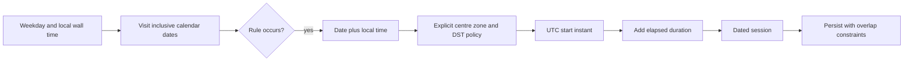

#### What it means

A wall-clock time answers what a person sees on a clock, such as Saturday at 18:00 in Cairo. An instant identifies one point on the global timeline. They are not interchangeable because a time zone's offset can change with daylight saving. A recurrence rule describes local intent. A dated session records the resulting instants for one occurrence.

The current model deliberately separates these representations. `ScheduleRule` stores weekday, local `TimeOnly`, duration, room, and effective local dates. It stores no UTC offset or time zone; the centre owns the zone. `ClassSession` stores UTC start and end, the local date it was generated for, and a teacher snapshot. The local date can differ from the UTC date near midnight.

#### The problem it solves

If recurring sessions are generated by taking one UTC instant and repeatedly adding seven days, the local start time shifts when the zone offset changes. If duration is calculated by subtracting local clock readings across a backward transition, a session's elapsed length can be wrong. If the timetable filters by UTC midnight boundaries, an early Cairo session can appear in the wrong day or disappear from the intended week.

Hypothetical `nextStart = firstStart.AddDays(7)` preserves a global interval but not necessarily the intended wall-clock hour. Current generation reconstructs each occurrence's local date and start time separately, converts that wall-clock value through the centre's zone, then adds duration to the UTC instant (`SessionGenerator.cs:34`). This preserves local scheduling intent and elapsed duration as separate requirements.

#### How it works

`ScheduleRule.OccursOn` accepts a date when its weekday matches and it lies within inclusive effective bounds. The generator iterates the requested inclusive date range and skips non-occurrences. It builds an Unspecified-kind local `DateTime`, because the value is neither server-local nor UTC. Conversion then handles normal, skipped, and repeated times explicitly.

For a skipped local time, the generator computes the offset before and after the gap, shifts forward by the gap, and uses the later offset. For a repeated time, it chooses the larger offset, corresponding to the first occurrence. Ordinary times use the zone's offset on that date. End is start plus elapsed minutes. The result becomes a session through an internal factory so ordinary callers cannot invent arbitrary start/end combinations.

#### How THIS project implements it

`SessionGenerator.Generate` receives the rule, teacher ID, `TimeZoneInfo`, and from/to dates (`SessionGenerator.cs:17`). It reads no clock, repository, or machine time zone. `ToUtc` contains the three transition cases (`:50`). `ClassSession.Schedule` is internal and copies centre, group, rule, room, and teacher into the occurrence (`ClassSession.cs:68`). Teacher identity is therefore a generation snapshot, later mutable only under the future-session reassignment rule.

`CentreCalendar.Today` converts `IClock.UtcNow` into the supplied centre zone before extracting a date (`CentreCalendar.cs:12`). `ScheduleHorizon.Days` is 28, so adding a rule generates through today plus 27 days. New rules can take effect at most 366 days ahead, while explicit extension can reach at most 92 days ahead (`ScheduleHorizon.cs:7`). A valid rule outside the initial 28-day horizon may initially create no sessions; that follows from separate accepted-start and generation-window limits.

PostgreSQL supplies the overlap guarantee. `20261024105240_AddSchedule.cs` installs `btree_gist`, creates rules and sessions, then adds GiST exclusion constraints for group and teacher overlap. Each compares centre, resource ID, and `tstzrange(starts_at, ends_at, '[)')`. The half-open interval means a session ending at 19:00 does not overlap one starting at 19:00. Constraints apply only to rows whose status is `scheduled`, so cancellation frees a slot. Centre ID participates, so one centre's schedule cannot block another's.

#### Execution example

An owner adds a Saturday rule at 18:00 for 90 minutes. The handler loads the visible group and refuses archived groups. It resolves the centre zone and today, rejects an effective date too far ahead, constructs the rule, and takes the teacher's advisory schedule lock (`AddScheduleRuleHandler.cs:35`). The generation range starts at the later of today and effective-from and ends at today plus 27 days. Each matching Saturday becomes a UTC session using that Saturday's own offset. The handler tracks the rule and sessions and returns their count.

The dispatcher saves. If any occurrence overlaps another scheduled session for the same group or teacher, the exclusion constraint rejects save. `PersistenceErrorTranslator` maps a known constraint to `schedule.group_double_booked` or `schedule.teacher_double_booked`. Rollback removes the entire rule and batch. There is no partial success list that silently drops collisions.

#### Why this project needs it

The application's centres carry IANA zones, and scheduling is expressed by people in local dates and times. Accurate instants are necessary for overlap checks, future-only cancellation, and historical teacher assignment. Explicit DST handling removes a class of bugs that ordinary weekly date arithmetic hides. Database overlap enforcement remains authoritative when two requests generate or reassign sessions concurrently.

#### Alternatives

Storing only UTC is adequate for one-off appointments but loses recurrence intent. Storing only local time requires resolving ambiguity on every comparison and cannot directly enforce absolute overlap. A recurrence library could implement richer calendars, but its DST policy would still need to match the product contract. Application overlap pre-checks can improve previews but cannot replace database exclusion constraints under concurrency. A room-overlap constraint is a separate policy; the inspected migration defines teacher and group constraints, not a room resource constraint.

The migration comments explicitly explain half-open ranges, partial scheduled status, and group-constraint creation before teacher. It states the group-first order aims to return the more precise group collision when both could fail. The repository does not establish a universal room-booking policy from the presence of the optional room string; do not claim room uniqueness merely because sessions record rooms.

#### Important details

Extension is explicit and idempotent for existing rule/date occurrences. `ExtendScheduleHandler` lists active rules for active groups, resolves their current teachers, acquires all relevant teacher locks, obtains existing local dates per rule, and adds only missing dates (`ExtendScheduleHandler.cs:37`). Existing dates include occurrences regardless of whether regenerating them would be desirable; a cancelled occurrence still occupies the rule/date identity. The unique index `ux_class_sessions_rule_date` is deliberately untranslated because duplicate generation is treated as a bug.

Ending a rule does not delete generated rows. The handler sets its inclusive last date and cancels later sessions only if still scheduled and not started (`EndScheduleRuleHandler.cs:26`). Sessions on or before the last date remain unchanged. Reassigning a group's teacher locks both teachers and moves only future scheduled sessions, preserving past and cancelled history (`AssignGroupTeacherHandler.cs:45`). A conflict on the new teacher rolls back the group and session changes together.

#### What I should understand before modifying this code

Keep local date, wall-clock time, zone, and instant distinct in names and types. Do not use server `DateTime.Today` for centre rules. Preserve explicit skipped and repeated-time policy when changing generation. Do not edit a rule in place to alter history; end it and add a replacement through the existing model. Before adding room scheduling, holidays, exceptions, or background extension, define their collision, identity, and audit contracts. Retain teacher lock ordering and database constraints when optimizing batch generation.

<a id="backend-foundations"></a>
## 6.16 C# foundations behind the architecture: contracts, generics, async, records, reflection, and cleanup

#### What it means

Professional architectural vocabulary rests on language mechanisms. An interface declares callable members without selecting an implementation. Polymorphism lets the same interface call execute different implementations. Composition means an object holds collaborators. Inheritance means a type derives behavior or identity from a base type. Generics parameterize types while retaining compile-time relationships. Async methods represent incomplete work through tasks. Records provide generated value-oriented behavior. Reflection inspects type metadata at runtime. None of these is magic; each has a concrete role in the inspected code.

The repository uses interfaces for ports, composition for handlers and adapters, small inheritance relationships for entities and framework integration, and generic request/handler pairs for dispatch. Reading those constructs fluently makes the architecture much easier to follow than memorizing folder names alone.

#### The problem it solves

Without interfaces, `EnrollStudentHandler` would name concrete EF repositories and unit tests would need those implementations. Without generics, the dispatcher might accept `object`, switch on runtime types, and cast results, moving errors from compile time to runtime. Without async I/O, every database wait would block a thread. Without deterministic disposal, failed requests could leave transactions or connections alive. Without reflection or generated registration, every new handler would require another explicit dispatcher branch.

Hypothetical `object Send(object message)` permits passing a request whose result is cast to the wrong type. The actual `SendAsync<TCommand,TResponse>` constrains the command to `ICommand<TResponse>` (`Dispatcher.cs:35`). That relationship tells the compiler which result type belongs to the request and which closed handler interface must resolve.

#### How it works

An interface reference stores an object whose runtime type implements the contract. Calling its method selects that implementation. Generics let one dispatcher algorithm operate on many request types while retaining typed results. `Result<EnrollStudentResult>` and `Result<AddScheduleRuleResult>` use the same result implementation but expose different success types. Nullable annotations mark references that may be absent; they do not themselves add runtime checks.

An async method returns a `Task` that represents eventual completion. At an incomplete `await`, the compiler-generated state machine records the continuation and returns control instead of blocking the caller's thread. The continuation resumes after completion. A cancellation token is cooperative: every layer must pass or observe it. Throwing an exception unwinds calls to a matching catch while `finally` and disposal code execute. `throw;` rethrows the same failure without deliberately replacing its original location.

#### How THIS project implements it

`Dispatcher` depends on `IServiceProvider`, `IUnitOfWork`, and `ILogger<Dispatcher>` through its constructor (`Dispatcher.cs:24`). The generic method constraint enforces request/result pairing. Repository methods return `Task<Entity?>` when a visible row may be absent, and handlers explicitly branch on null before reading the entity. The actor check uses pattern matching to capture a staff actor only when its type matches (`GetMyMembershipsHandler.cs:19`).

`AuditInterceptor` uses a switch expression to choose actor metadata and entity-state action (`AuditInterceptor.cs:71`). `TeacherScopeProvider` uses property patterns and nullable values to distinguish cached, all, own, and none states. `Program.cs` uses list patterns to recognize exact CLI argument shapes (`Program.cs:123`, `:131`, `:148`). The reset-password branch only matches the three-element command shape; its values come from the matched positions rather than general string parsing.

The source also uses attributes with distinct readers. `GeneratedRegex` requests compile-time generated regex code, while `LoggerMessage` requests generated typed logging methods. EF migration attributes and configuration discovery are framework metadata mechanisms. An attribute does nothing merely because it is written; a compiler component or runtime consumer must read it. Partial classes and methods allow generated code to complete the declared type.

#### Execution example

Follow one `await` through enrollment. The endpoint awaits `SendAsync`, which awaits the handler, which awaits `groups.GetForEnrollmentAsync`. The repository asynchronously sends the locking query. While waiting for a competing transaction, application execution is suspended rather than a C# busy loop polling the database. When the database returns the group, execution resumes, performs the count, checks the student and capacity, then returns a typed result. The dispatcher awaits save and commit. If any await throws, its catch awaits rollback with `CancellationToken.None` and rethrows (`Dispatcher.cs:91`). The API's outer exception machinery can then translate unexpected faults.

The cancellation token follows that call chain into EF operations. Identity's `UserManager` methods in the credential adapter do not take the adapter's cancellation-token parameter in the shown calls (`IdentityAuthenticationService.cs:23`). Therefore a method accepting a token is not proof that every internal operation observes cancellation. Read actual calls before claiming end-to-end cancellation coverage.

#### Why this project needs it

The same handler shape appears across many features. Generics remove a type switch; interfaces make adapters replaceable; async operations make database waits scalable; nullable checks make absent tenant-visible rows explicit; pattern matching makes the actor and command variants readable. Deterministic cleanup protects transaction ownership. Source-generated logging and regex keep repeated infrastructure behavior typed without hand-writing its boilerplate.

#### Alternatives

Concrete classes and manual composition can be simpler for a small program. Delegates can replace some single-method interfaces. Callbacks or reactive streams can represent asynchronous work but change the execution style. Runtime reflection can replace some source generation at the cost of later validation. A discriminated union language can make variant handling more exhaustive than ordinary nullable references and classes. These are language and design choices, not necessarily competing application architectures.

The repository does not explicitly state why every modern C# syntax choice was selected. The following is an interpretation based on the implementation: primary constructors, records, patterns, and generic interfaces reduce boilerplate while leaving the transaction and authorization algorithm in ordinary readable methods.

#### Important details

`!` is a compile-time nullability suppression, not a runtime non-null check. The handler's `currentActor.Actor.CentreId!.Value` relies on the dispatcher having enforced the tenant marker. Calling that handler directly with an unselected actor can violate its precondition. A record's generated equality does not recursively make mutable dictionary contents value-equal; an immutable-looking error can still contain a reference to a collection.

`async` does not mean a new thread is created, nor that work is automatically parallel. Two sequential awaits remain sequential. `Task.WhenAll` would overlap operations but is not automatically safe when they share one EF context or have ordered locking requirements. Avoid parallelizing repository calls merely to reduce wall-clock time without checking context and transaction constraints.

`finally` establishes cleanup even on failure, but code within cleanup can itself throw. The inspected unit of work disposes and clears state deliberately; this does not prove every external failure mode has been tested. Keep language mechanism, source intention, and executed verification distinct when reporting behavior.

#### What I should understand before modifying this code

Trace types before tracing frameworks. Determine which interface is requested, which implementation is registered, which scope owns it, and which terminal await executes I/O. Preserve generic response pairing and explicit null branches. Do not use `.Result` or `.Wait()` to simplify an async method. Pass cancellation where supported and retain non-cancelled rollback. Understand who reads an attribute before copying it. Keep business operation sequencing explicit when introducing parallelism, because lock ordering and one-context ownership are correctness constraints.

<a id="backend-http"></a>
## 6.17 HTTP binding, strict JSON, Problem Details, and generated contracts

#### What it means

HTTP separates a method, path, headers, and optional body from a response status, headers, and body. Model binding converts those transport values into endpoint parameters. Serialization converts result objects back to JSON. Neither operation should decide domain permission or business state. A stable API contract defines these shapes so frontend generation and clients can agree on the same fields and statuses.

Problem Details provides a common error envelope. This project enriches it with a stable machine code and identifiers linking the response to logs. A field dictionary can associate a refusal with a form input. HTTP status and field detail are independent: a duplicate-name conflict can be 409 and still name the `name` field.

#### The problem it solves

Without strict binding, a client typo such as `teacherId` on a schedule-rule body might be silently ignored, leaving the user believing it selected a teacher. Without a single failure mapper, one endpoint could return `{error:...}`, another plain text, and an unexpected exception HTML. Without explicit time formats, generated TypeScript could accept values that the server interprets differently.

The hypothetical endpoint returns `Results.BadRequest(exception.Message)`, leaking implementation detail and bypassing common enrichment. Actual endpoints dispatch application requests and call shared result mapping. Unexpected exceptions become generic `server.unexpected` responses while the full exception is logged server-side (`GlobalExceptionHandler.cs:27`).

#### How it works

ASP.NET builds endpoint delegates from their parameter types and route metadata. Route values, query parameters, request bodies, services, and cancellation tokens bind from different sources. JSON options reject unknown members and serialize enums as camelCase strings. Required body properties distinguish an omitted value from a legitimate default. Binding failures throw because `ThrowOnBadRequest` is enabled, allowing the common exception handler to produce a consistent malformed-request response.

Endpoint metadata describes success and error schemas for OpenAPI. Custom converters can hide the JSON shape from schema inference, so the application supplies a schema transformer for `TimeOnly` and `DateTimeOffset`. That transformer preserves string formats and nullability. Generation describes compile-time shapes; it does not turn every incoming or outgoing JSON payload into runtime schema validation.

#### How THIS project implements it

`Program.cs:75` rejects unmapped JSON fields, adds camelCase enum conversion, and registers the local-time and UTC-instant converters. `HourMinuteTimeOnlyJsonConverter` accepts exactly `HH:mm` with invariant culture and rejects seconds, offsets, and instants (`HourMinuteTimeOnlyJsonConverter.cs:17`). `UtcInstantJsonConverter` reads through the standard DateTimeOffset reader and writes a normalized UTC string ending in `Z` (`UtcInstantJsonConverter.cs:17`). These directions are asymmetric by design: UTC output normalization does not imply input offsets are forbidden.

`ResultHttpExtensions.ToProblemResult` maps Validation to 400, NotFound to 404, Conflict to 409, Rule to 422, Forbidden to 403, and Unauthenticated to 401 (`ResultHttpExtensions.cs:58`). Any error carrying fields becomes `ValidationProblemDetails` while retaining its mapped status. `ProblemResult.ExecuteAsync` adds trace and correlation IDs, sets status, and writes `application/problem+json` (`ProblemResult.cs:11`). Framework-generated errors use the shared enrichment through configured Problem Details services rather than necessarily instantiating this custom result themselves.

#### Execution example

A client sends a schedule rule with an extra `teacherId`. The route supplies the group ID. The body type contains weekday, local start, duration, optional room, and effective-from only. Global unmapped-member rejection makes the extra field a binding failure before the business handler runs. `ThrowOnBadRequest` exposes that as `BadHttpRequestException`; `GlobalExceptionHandler` logs a malformed-request warning and writes 400 `request.malformed`. No rule or session is tracked.

A validly bound body with an unsupported duration reaches application validation or `ScheduleRule.Create`, producing a normal validation result. An overlapping valid rule instead fails at save with a conflict. These failures share an envelope but retain different causes and statuses, enabling the frontend to show field feedback or a collision message appropriately.

#### Why this project needs it

The API now serves several resource families, versioned state transitions, local date and time input, and UTC session output. Shared conventions keep generated clients and forms consistent. Exact request bodies also prevent callers from supplying authoritative fields such as centre or teacher when those belong to actor or group state. A predictable error shape lets the client centralize translation, field application, and session-expiry handling.

#### Alternatives

Lenient JSON tolerates unknown fields and can improve forward compatibility, but hides mistakes. MVC automatic model validation supplies another binding model, while these endpoints use minimal APIs. Protobuf or GraphQL can define different contracts but require corresponding tooling. Per-endpoint catch blocks can map errors but duplicate the same security and shape decisions. The current design centralizes conversion while keeping feature endpoints short.

#### Important details

Creation does not always mean one Location header contract. Schedule-rule creation returns 201 and points to the group's rule list because the rule has no separate page. Enrollment creation points to the roster. Transfer returns 200 with the new enrollment ID because one request ends an old resource and starts another. Extend returns 200 with a count because it can create many sessions or none (`ScheduleEndpoints.cs` and `EnrollmentEndpoints.cs`).

The common creation helper's comment says Location uses only server-generated result values, yet nested resource endpoints deliberately capture a validated route group ID after the handler succeeds. The endpoint comments explain the narrower security reason: the ID has been resolved inside the tenant, and the route constraint restricts it to a GUID. Document the actual endpoint behavior rather than copying the broader helper comment as universal fact.

#### What I should understand before modifying this code

Choose the source of every field: route, body, actor, database, or server-generated result. Keep authoritative centre and teacher selection out of bodies that do not own them. Add endpoint names and complete response metadata, rebuild the contract, and regenerate the client. Preserve exact local-time and UTC-output formats. Test malformed binding separately from domain validation and save conflicts, because they execute at different points and require different guarantees about side effects.


<a id="foundation-interfaces"></a>
## 6.18 Interfaces, abstraction, polymorphism, inheritance and composition

#### What it means

An interface names capabilities without prescribing their implementation. A class implements that contract. A caller using the interface can remain unaware of whether the work uses a database, memory or another service. That separation is abstraction. When the same interface call selects different concrete behaviour depending on the supplied object, the mechanism is polymorphism. These are language mechanisms; they do not require a dependency injection framework.

Inheritance and composition organize reuse differently. Inheritance says that one type is a specialized form of another. Composition gives an object collaborators and lets it delegate work. `Centre` derives its identity behaviour from `Entity`. `EnrollStudentHandler` instead receives an actor, clock and repositories. It composes those capabilities to run an operation. It does not derive from a large “business service” base class containing every feature.

#### The problem it solves

Without a port, a handler would know its database adapter:

```csharp
// Hypothetical: tightly coupled construction, not repository code.
var repository = new GroupRepository(databaseContext);
var group = await repository.FindAsync(groupId, cancellationToken);
```

That caller must now know the concrete class, how to construct its context and how long the context should live. A test of the handler must also arrange those details. With an interface, construction moves to the composition root and the handler names only the capability it uses.

#### How it works

The compiler checks that an implementation provides the interface members. At runtime the interface variable refers to a concrete object. Calling the member invokes that object's implementation. The type of the variable and the concrete type of the object are therefore different pieces of information. This is the bridge between the inward project dependency and the outward runtime call described in the architecture section.

An interface does not remove coupling entirely. The caller remains coupled to the contract's names, argument meanings, return types and behavioural assumptions. If `GetForEnrollmentAsync` promises a locked group with a count measured after locking, a fake returning an arbitrary count does not establish the database guarantee. Contract tests and real database tests address that difference.

#### How THIS project implements it

`src/TutoringCentre.Application/Academics/Enrollments/Commands/EnrollStudent/EnrollStudentHandler.cs:19` declares collaborators through `ICurrentActor`, `IClock`, `IGroupRepository`, `IStudentRepository` and `IEnrollmentRepository`. The handler's repository dependency is an Application port. `src/TutoringCentre.Infrastructure/Repositories/GroupRepository.cs:14` implements the group port using EF. `Infrastructure/DependencyInjection.cs` registers the port and adapter with a scoped lifetime.

The actual constructor declaration is:

```csharp
internal sealed class EnrollStudentHandler(
    ICurrentActor currentActor,
    IClock clock,
    IGroupRepository groups,
    IStudentRepository students,
    IEnrollmentRepository enrollments)
    : ICommandHandler<EnrollStudentCommand, EnrollStudentResult>
```

The `internal` visibility makes the concrete handler an assembly implementation detail. `sealed` prevents deriving another handler from it. The dispatcher addresses its implemented handler interface instead. Tests can exercise the same handler through supplied collaborators; the container is convenient construction machinery, not an essential property of the language pattern.

#### Execution example

An enrollment endpoint dispatches the command. The dispatcher resolves the closed handler interface. The service provider constructs `EnrollStudentHandler` with registered collaborators. The handler calls `groups.GetForEnrollmentAsync`. The concrete object is the Infrastructure adapter, so its EF query runs. The handler receives the port's result and continues without mentioning `DbContext`, SQL or Npgsql. A test can provide a different object implementing the same port and exercise the decision branches without opening a database.

#### Why this project needs it

Application rules are reused by HTTP, operator commands and test harnesses. Narrow collaborators keep transport and persistence details from spreading into those rules. The group port also gives a meaningful name to an important capability: obtaining a locked group and a capacity count is more specific than a generic `Get` method.

#### Alternatives

Direct concrete calls reduce files and indirection, but make construction and substitution harder. Delegates can represent a small capability without defining an interface. An abstract base class can combine a contract and shared implementation, but then subclasses inherit that implementation's assumptions. The repository does not state a universal reason for every individual interface. The interpretation supported by the project layout is that ports preserve boundaries and allow independent logic tests.

#### Important details

An interface is not a security boundary by itself. A forged actor supplied by trusted edge code would still influence the handler. Likewise, a class being sealed does not prove its dependencies are correct. Visibility, registration, tests and database constraints address different properties. Read them together rather than treating one keyword as the whole design.

#### What I should understand before modifying this code

Define a capability in the layer that needs it. Keep EF and HTTP types out of Application ports. Update every implementation and meaningful fake when a contract changes. Check whether the new method promises merely a value or a stronger condition such as a lock, tenant scope or consistent read. The stronger condition needs proof at the layer that actually provides it.

<a id="foundation-async"></a>
## 6.19 Asynchronous work, tasks, cancellation and disposal

#### What it means

Database and network operations spend time waiting for another process. Blocking code holds a thread during that wait. Asynchronous code represents completion as a `Task` and can suspend the method while the operation is incomplete. The compiler turns an `async` method into a state machine that remembers where to continue. This helps a web server use its threads for other requests while database I/O is pending.

Calling an asynchronous method and awaiting its returned task are separate events. Many methods begin work when called. `await` observes completion and arranges continuation; it does not generally act as a universal start switch. A LINQ expression describes a query until a terminal operation executes it. Calling `AnyAsync` or `ToListAsync` is such an operation; awaiting the returned task receives its eventual result.

#### The problem it solves

```csharp
// Hypothetical blocking call; do not introduce this into the async path.
var count = repository.CountAsync(cancellationToken).Result;

// Asynchronous composition preserves the task chain.
var count = await repository.CountAsync(cancellationToken);
```

Both forms can produce a number, but the blocking version occupies the calling thread while waiting. It can also introduce deadlocks in environments with synchronization contexts. Merely writing `async` does not make CPU work parallel or give a database operation a second independent transaction.

#### How it works

At an incomplete `await`, the method returns an incomplete task to its caller. When the awaited operation completes, the continuation resumes with either a value or an exception. Exceptions propagate through the awaited chain. A `CancellationToken` adds a cooperative signal: code must pass it to operations and those operations must observe it. Cancellation is a request to stop, not an instant thread termination.

Resource ownership remains necessary. A database context, transaction and DI scope must be disposed even when a task faults. `await using` waits for asynchronous disposal at scope exit. A `finally` block runs when normal execution, return or exception unwinding leaves its associated `try`.

#### How THIS project implements it

`Application/Common/Cqrs/Dispatcher.cs:35` and its query method return `Task<Result<TResponse>>`. They await validators, transaction operations and handlers. `Infrastructure/Repositories/GroupRepository.cs:31` awaits the locked group load and then awaits the active enrollment count. That order is part of the capacity guarantee: the count must happen after the row lock is held.

The dispatcher deliberately uses a non-cancelled token for exception cleanup:

```csharp
catch
{
    await _unitOfWork.RollbackAsync(CancellationToken.None);
    throw;
}
```

This is current source. A request cancellation should not prevent the attempt to release its transaction. The normal failure-result path initially passes its existing token to rollback; if cleanup throws, the catch still handles exception cleanup. `UnitOfWork.RollbackAsync` stores and clears the transaction reference before awaiting rollback, then disposes and clears tracking in its `finally` block.

#### Execution example

An enrollment command begins a transaction and calls the handler. The group adapter starts the SQL operation that requests `FOR UPDATE`. If another transaction holds the row, the database waits while the application task remains incomplete. The handler does not count seats yet. After the lock operation completes, execution resumes and counts active enrollment rows. The handler returns a result. The dispatcher saves and commits or rolls back. A cancellation can interrupt an observed operation and propagate to the dispatcher, whose exception cleanup attempts rollback with `CancellationToken.None`.

#### Why this project needs it

HTTP, credential verification, database reads and transaction work already form asynchronous chains. Preserving those chains prevents avoidable thread blocking. Passing a cancellation token through the boundary avoids continuing expensive work after a disconnected client when the provider can stop it. Explicit cleanup keeps a cancelled request from leaving an application-owned transaction object alive in the scope.

#### Alternatives

Synchronous repository methods are easier to follow for small scripts, but tie a waiting request to a thread. Callbacks and events can represent asynchronous completion without `await`, with more manual control-flow management. Parallel tasks can improve independent work, but this context and transaction are not a license to issue concurrent EF operations through the same `DbContext`.

#### Important details

Concurrency means operations overlap in time; parallelism means work executes simultaneously. Two requests waiting for the same row lock are concurrent even though their capacity decisions are serialized. Retrying a cancelled command is also a new business action unless idempotency exists; cancellation alone does not prove the server committed nothing before the client stopped waiting.

#### What I should understand before modifying this code

Pass the request token down to I/O operations. Do not replace awaits with `.Result` or `.Wait()`. Preserve the lock-then-count order. Keep explicit ownership of scopes and transactions. When adding parallel work, first prove that it uses independent resources and does not share a non-thread-safe context or depend on a common transaction order.

<a id="foundation-types"></a>
## 6.20 Generics, records, nullability and pattern matching

#### What it means

Generics define a type or method with type parameters. `Result<T>` is one definition that can carry many different successful values. A generic constraint restricts the legal substitutions. The dispatcher pairs a command type and response type through `where TCommand : ICommand<TResponse>` rather than passing untyped objects and hoping the result can be cast later.

Records provide value-oriented equality and generated members. They are suitable for request messages and response data whose meaning comes from their contents. Entities instead retain identity as state changes. Nullable reference annotations describe where `null` is possible to the compiler. Pattern matching inspects type and structure while optionally binding matched values to local variables.

#### The problem it solves

```csharp
// Hypothetical untyped dispatcher: mismatches become runtime errors.
object response = await SendObjectAsync(command);
var created = (EnrollStudentResult)response;

// Typed dispatch makes the request/response relationship explicit.
Result<EnrollStudentResult> created =
    await dispatcher.SendAsync<EnrollStudentCommand, EnrollStudentResult>(command, ct);
```

The typed form still permits business failure, represented by `Result`. It removes an unrelated class of unsafe casts. Type safety and business correctness are different: the compiler can verify that the result type matches while the domain still has to verify that a group has room.

#### How it works

The compiler substitutes concrete types for generic parameters and checks constraints. Reflection-based registration discovers the handler interfaces and registers closed combinations. The dispatcher asks for the exact interface corresponding to its type parameters. No switch statement listing every feature is required.

Pattern matching can both test and extract. In `StaffActor { Role: { } role }`, the first pattern requires a staff actor, the nested non-null pattern requires a role value, and the variable `role` becomes available in the selected branch. Nullable analysis then understands that branch differently from a path where the value could be absent.

#### How THIS project implements it

`Application/Common/Cqrs/Dispatcher.cs` uses generic handler resolution and result types. Its permission switch distinguishes a trusted `SystemActor`, a `StaffActor` with a role and all other cases:

```csharp
var allowed = actor switch
{
    SystemActor => true,
    StaffActor { Role: { } role } => RolePermissions.Holds(role, permission),
    _ => false,
};
```

`Api/Program.cs` uses list patterns for operator commands: `args is ["migrate"]` matches exactly one argument, while `args is ["reset-password", var resetEmail, var resetPassword]` matches exactly three and captures two values. This is not a substring check or prefix check; additional arguments prevent that branch from matching.

The current actor and result model also contain nullable data intentionally. A staff user can be signed in without a selected centre. An error is absent on a successful result. Callers must establish which state they hold before reading the associated value. Null-forgiving syntax is a compiler assertion by the author, not a runtime validation step.

#### Execution example

At login, credentials produce an authenticated user identifier and stamp. A `StaffActor` is created with null centre and role. The profile query is dispatched using its concrete query and DTO type. If exactly one membership can be selected, the endpoint creates a new principal with a centre and role. Later, a tenant-scoped command reaches `CheckTenantScope`, which refuses the null-centre state before `CheckPermission` uses the actor's role. The optional values model a real intermediate state in the workflow.

#### Why this project needs it

Many requests share one dispatcher without sharing result shapes. Strong type pairs keep that common pipeline reusable. Explicit nullability describes session states that cannot be represented correctly by inventing an empty centre GUID or default owner role. Pattern matching makes those state distinctions visible near the decisions they control.

#### Alternatives

Untyped dictionaries and `object` values move checks to runtime. A separate dispatcher method per request creates repetitive code. Class inheritance can replace some record hierarchies, but does not automatically provide value semantics. Optional-value types can be more explicit than `null`, at the cost of another abstraction. The repository's approach follows the C# features used throughout its current source; motivations for every syntax choice are not independently documented.

#### Important details

A record is not deeply immutable merely because its positional properties are init-only. A collection referenced by a record can still be mutable. Equality of nested reference values also depends on those values' equality implementations. Likewise, nullable warnings are compile-time analysis; deliberately supplying `null` from reflection or external data still requires guards and validation.

#### What I should understand before modifying this code

Preserve request/response generic relationships. Do not give an unselected session a default role just to remove nullable warnings. Update pattern branches when introducing a new actor kind. Inspect the fallback branch: denying unknown actor types is a deliberate security property. Treat `!` as a proof obligation and identify the earlier branch or marker that makes the assertion true.

<a id="foundation-exceptions"></a>
## 6.21 Exceptions, result values and guaranteed cleanup

#### What it means

An exception interrupts normal control flow and searches outward for a matching catch. A result value is ordinary data returned to the caller. This repository uses both because an expected business refusal and an unexpected programming or infrastructure fault have different meanings. A full group is an ordinary conflict; an invalid service registration is a fault. Both require correct transaction cleanup, but they should not necessarily produce the same HTTP response or log severity.

#### The problem it solves

```csharp
// Hypothetical: silently converting every fault destroys the distinction.
try { return await handler.HandleAsync(command, ct); }
catch { return Result<EnrollStudentResult>.Failure(someBusinessError); }
```

This code would turn a database outage or null dereference into a misleading business refusal. At the other extreme, throwing an exception for every full group would force every caller to know and catch that exception class. The current dispatcher branches explicitly on failed results and rethrows unexpected exceptions after cleanup.

#### How it works

An awaited task rethrows its failure into the awaiting method. A bare `throw;` inside a catch preserves the original exception's stack information. `throw exception;` establishes a different throw location and can obscure the useful origin. `finally` runs on both successful and exceptional exit, so it is the proper place to release owned resources whose lifetime must end either way.

Disposal and rollback are related but distinct. Rollback asks the database to undo the transaction. Disposal releases the transaction object and its resources. Clearing EF tracking discards the in-memory pending state. Keeping only one of those actions can leave another part of the scope inconsistent.

#### How THIS project implements it

`Infrastructure/Persistence/UnitOfWork.cs:129` obtains the active transaction before committing. The `finally` disposes it and clears `_transaction`. `RollbackAsync` copies and nulls the field before awaiting rollback and clears the change tracker in its cleanup block. A second call sees no transaction and returns. The dispatcher uses these operations for failed handler results, failed save results and exceptions.

Persistence save exceptions have a narrow translation boundary. `SaveChangesAsync` catches EF update/concurrency exception types, calls `PersistenceErrorTranslator.TryTranslate`, and rethrows when the translator returns null. A known unique or concurrency conflict can therefore become a stable business error; an unrelated foreign-key or check failure is not automatically mislabeled as that same conflict.

#### Execution example

An enrollment handler adds a tracked entity and returns success. Saving reaches PostgreSQL and encounters a recognized conflict. The translator returns a failed `Result`. The unit of work returns it to the dispatcher. The dispatcher rolls back and returns a failed response result. If saving instead throws an untranslated exception, the dispatcher catches it, attempts rollback with a non-cancelled token and rethrows. The HTTP exception boundary then produces the generic unexpected-error contract. The original exception remains available to server-side logging rather than being sent to the browser verbatim.

#### Why this project needs it

Commands may touch several entities and audit rows. Cleanup must apply regardless of whether failure is represented by a value or exception. The translation boundary also protects error semantics: the frontend can react to `group.full` or a stale version without treating every failure as an internal server error, while real faults remain visible to maintainers.

#### Alternatives

Exception-only business APIs reduce result boilerplate but hide ordinary failure possibilities in signatures. Result-only APIs must still decide how to handle runtime faults and cancellation. An ambient `TransactionScope` changes how a transaction is discovered but does not remove the need to understand ownership and cleanup. Database retries are another separate policy; catching an exception does not make replaying a command safe automatically.

#### Important details

Cleanup can itself fail. A rollback exception can obscure an earlier error unless explicitly managed. The current implementation's ordering and idempotent no-transaction branch are concrete source behaviours, not a proof that the network can never fail during rollback. Likewise, a failed HTTP response after commit does not imply the database was rolled back; the transaction might already have succeeded before the response was lost.

#### What I should understand before modifying this code

Do not catch broadly and invent a business code for every exception. Keep known persistence translation centralized. Preserve `throw;` when rethrowing the same fault. Check every early return for resource ownership. When adding a new transactional path, identify the exact begin, save, commit, rollback and disposal operations and prove their behaviour with success and failure tests.

<a id="foundation-metadata"></a>
## 6.22 Attributes, reflection, scanning and generated code

#### What it means

An attribute is metadata attached to a declaration. It has an effect only when a compiler, generator, framework or runtime reader interprets it. Reflection inspects types and members at runtime. A source generator runs while compiling and creates code that becomes part of the build. These are different mechanisms that can look equally “automatic” when reading only a decorated class.

#### The problem it solves

Without scanning, every handler requires a manual registration:

```csharp
// Hypothetical explicit registration style.
services.AddScoped<ICommandHandler<EnrollStudentCommand, EnrollStudentResult>, EnrollStudentHandler>();
```

That is clear but repetitive across many requests, and a forgotten registration fails only when resolution is attempted unless another check catches it. Scanning locates implementations systematically. Tests still need to establish that each request has exactly one valid handler; scanning is not a substitute for that invariant.

#### How it works

The scanner obtains assembly types, filters concrete classes, examines their implemented generic interfaces and registers the closed handler contracts. A container later resolves the selected implementation. The scanner does not execute the handler at registration time. It only records how the object should be built.

Test attributes are read by test discovery. Option-validation attributes are read by validation infrastructure. Generated regex and logging attributes are read by compiler tooling. Endpoint metadata such as operation names and declared responses is consumed by routing and OpenAPI generation. Each apparent annotation therefore needs an identified consumer before its effect is understood.

#### How THIS project implements it

`Application/DependencyInjection.cs` delegates handler registration to `Application/Common/Cqrs/HandlerRegistration.cs`. The dispatcher later resolves `ICommandHandler<TCommand,TResponse>` or `IQueryHandler<TQuery,TResponse>`. `Api/Program.cs` registers OpenAPI document and schema transformers. The schema transformer recognizes `TimeOnly` and `DateTimeOffset` so the contract describes their custom converter output as strings instead of leaving the generator with unknown shapes.

The frontend also has generated source. The route tree connects file routes, and Orval consumes the committed OpenAPI document to generate API types/functions/hooks. Those generated artifacts are not independent design authorities: their inputs and generator configuration explain how they should change.

#### Execution example

A new endpoint declares an operation name and a response DTO. Building the API executes the OpenAPI tooling path. `Program.cs` recognizes the export host, supplies generation configuration and still maps the endpoints. The exporter reads endpoint and schema metadata. Orval then reads the emitted contract and produces TypeScript. A component importing the affected type is checked by TypeScript. The CI drift checks compare generated files with committed artifacts, catching a developer who changes the backend but forgets the matching generated output.

#### Why this project needs it

The repository has many use cases and a substantial client contract. Discovering registrations and generating types reduces repeated manual lists. More importantly, it moves some errors into build or test checks: a changed contract can produce a compiler failure rather than an unnoticed runtime mismatch. The generation path still has startup side effects and configuration requirements, which is why it deserves its own explained branch.

#### Alternatives

Manual composition is explicit and compiler-visible but longer. A mediator library can supply scanning and pipeline behaviours. Source-generated DI can move object graph checks earlier. Handwritten client types remove generation tooling but create another copy of API shapes. None of these alternatives removes the need to keep transport definitions, runtime conversion and consumers consistent.

#### Important details

An attribute does nothing by its name alone. Verify the registration that enables its consumer. Scanning depends on which assembly is supplied and what the filter admits. Generated code can be stale even when it looks correct. A test that scans an empty collection can pass vacuously; architecture tests use non-empty guards to make their scope meaningful.

#### What I should understand before modifying this code

Find the reader of any annotation before changing it. Keep generated source changes tied to their inputs. Add or adjust schema metadata when custom JSON converters change wire shapes. Confirm that a new handler is concrete, implements the expected closed interface and is discoverable in the scanned assembly. Preserve tests that reject duplicate or missing handlers.

<a id="foundation-json"></a>
## 6.23 JSON, parameter binding and the wire contract

#### What it means

Serialization converts values into a transferable representation; deserialization builds values from that representation. HTTP model binding supplies an endpoint's parameters from route segments, query strings, request bodies or registered services. A JSON record is not automatically trusted merely because deserialization succeeded. Shape validation, permission checks and business rules still have work to do.

Dates, times and instants are different kinds of values. A `DateOnly` is a calendar date. A `TimeOnly` is a local time of day. A `DateTimeOffset` identifies an instant with an offset representation. Weekly scheduling needs all three concepts because “Saturday at 18:00 in Cairo” is a recurrence rule, while a particular dated class session has UTC start and end instants.

#### The problem it solves

```json
{"startTime":"18:00","durationMinutes":90}
```

This shape communicates a local time and duration. Sending a machine-local date/time string instead would silently depend on the browser or server zone. Similarly, accepting misspelled JSON members without feedback could leave a DTO property at its default while the user believes it was set. The API configures strict unknown-member handling and explicit time conversion to keep those failures visible.

#### How it works

The endpoint delegate signature identifies its parameter types. The framework selects the binding source according to the route and available services. JSON options control body conversion. If binding fails and `ThrowOnBadRequest` is enabled, the failure reaches the common exception handler instead of becoming an unrelated empty response. A custom converter must be paired with contract schema metadata when the exporter cannot infer its representation.

#### How THIS project implements it

`Api/Program.cs:76` configures `UnmappedMemberHandling.Disallow`, string enum conversion, `HourMinuteTimeOnlyJsonConverter` and `UtcInstantJsonConverter`. It separately enables `RouteHandlerOptions.ThrowOnBadRequest`. The OpenAPI schema transformer later declares string types for the custom converted CLR types, preserving null in nullable non-parameter schemas.

The backend converters and generated client serve complementary roles. The converter determines actual runtime JSON. The contract tells tooling what shape to expect. TypeScript can check compiled consumers of that contract, but a network response is still runtime data. The shared API wrapper validates error payloads through its own runtime guard rather than assuming that a generated interface has checked incoming bytes.

#### Execution example

The schedule form collects a weekday, local time, duration and effective range. The generated function serializes a request body. The endpoint binds the JSON into its request type. A malformed `startTime` is refused by conversion; a well-formed but invalid range reaches request validation or domain checks. A valid rule is passed to the generator with an explicit centre zone. Generated sessions return UTC instants, which the browser formats using the selected centre's time zone. No stage should reinterpret a local time as an already-UTC instant.

#### Why this project needs it

The API and SPA are compiled separately and communicate through JSON. Scheduling adds values whose meaning cannot be recovered from a plain string without a contract. Strict conversion, schema transformation, generated client types and tests cooperate to make the contract both machine-readable and understandable to a maintainer.

#### Alternatives

Lenient unknown-member handling eases some client/server rollout sequences but hides typos. Unix timestamps represent instants compactly but cannot replace recurrence dates and wall times. Protobuf or another schema-driven protocol offers different compatibility rules. Runtime response schemas can validate all successful bodies as well as errors, at the cost of another validation layer; generated TypeScript alone does not provide that runtime proof.

#### Important details

Changing a converter changes the wire contract even if the C# property type stays the same. A schema-only change can also make the client believe a shape that the runtime never emits. Unknown-member rejection has a forward-compatibility cost: a newer client sending a newly introduced field to an older server can fail. Keep the server, contract and generated client updates coordinated.

#### What I should understand before modifying this code

Identify whether a value is a local date, local time or instant. Preserve the configured JSON representation. Update the schema transformer when required. Add endpoint response metadata and regenerate the contract/client. Keep malformed-binding tests distinct from domain validation tests: they demonstrate different layers and may legitimately produce different machine codes.


<!-- Frontend concepts, independently checked against the current frontend files. -->

<a id="frontend-react"></a>
## 6.24 React, component ownership, server state and the browser entry point

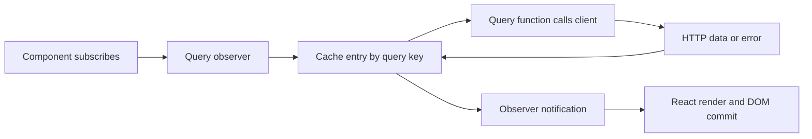

#### What it means

A browser starts with an HTML document. React lets the application describe the changing part of that document as a tree of components. A component is a function that receives inputs, called props, and returns a description of the UI. JSX is the syntax used to write that description; it is transformed by the build tools into JavaScript. Returning JSX does not immediately issue a request or update an element. React renders the component tree, compares its next description with its previous description, then commits the necessary changes to the browser DOM.

Local component state is memory that React associates with a component instance. Calling a state setter schedules another render; it does not rewrite the local variable already captured by the running function. This distinction matters when reading an event handler that calls `setTargetGroupId` and then awaits a request. The running handler belongs to one render and retains that render's values. A later render receives the new state.

Server state is different. Students, groups, session information and timetable sessions belong to the server. The browser has temporary copies that may become stale because another member of staff changed the database. TanStack Query owns those copies, including their request state, cache keys, refetching and subscriptions. A dialog's open state belongs in React state; a roster belongs in the query cache.

#### The problem it solves

Without this separation a component might duplicate server data into local state:

```tsx
// Illustration only: this is not the project's implementation.
const [students, setStudents] = useState<Student[]>([]);
const [loading, setLoading] = useState(true);
useEffect(() => {
  fetch('/api/students').then(r => r.json()).then(setStudents)
    .finally(() => setLoading(false));
}, []);
```

That example omits error handling, stale requests, cache sharing, cancellation and refresh after a mutation. Copy it into three screens and each copy can disagree. The project's components instead subscribe to a query and render its explicit states. Local state remains useful for an archive confirmation, selected target, draft form field or mobile menu.

#### How it works

`frontend/index.html` supplies the root element and loads `src/main.tsx`. At `frontend/src/main.tsx:10`, `createRouter` receives the generated route tree and a context containing the shared query client. At line 23 the entry point finds `#root`; a missing element is an explicit exception. At line 28 `createRoot(...).render(...)` mounts `StrictMode`, `QueryClientProvider` and `RouterProvider`.

The provider makes the query client accessible to hooks underneath it. When `useQuery` or a generated hook subscribes to a cache entry, TanStack Query observes that entry. A completed fetch changes the entry's state; its observer notifies React; React schedules the subscribed component to render again. The component reads the new query result and returns different JSX. This is the mechanism behind a skeleton becoming a student table, rather than an unexplained statement that React updates automatically.

`StrictMode` is a development check around the tree. It can repeat development work to expose impure rendering and missing cleanup. It does not mean that a business mutation should run from a render function. Mutations here originate from submit and click handlers.

#### How THIS project implements it

`frontend/src/app/queryClient.ts:29` exports a factory with the application's real error wiring. Its query defaults are one retry and a 30,000 millisecond stale time. The exported shared client at the end of that file is the one used by `main.tsx`. Route guards use the same client through router context; components use it through `QueryClientProvider`. This avoids a guard checking one session cache while the shell observes another.

`frontend/src/features/dashboard/DashboardOverview.tsx:62` demonstrates server state. `GroupsOverview` calls `useListGroups`, renders a loading state, then an error state, then computes totals from `data.items`. It does not maintain a second local array of groups. `frontend/src/features/shell/AppShell.tsx:31` demonstrates local state: `mobileNavOpen` decides whether the navigation dialog is open. Opening the menu does not change server data and requires no API call.

The separation is also visible in `TransferDialog`: `targetGroupId` and `refusal` are local interaction state, while available groups come from `useListGroups`. The form is allowed to retain a refusal message while the query cache refreshes its latest list.

Verified source excerpt, `frontend/src/main.tsx:23` (quoted directly from the current file):

```tsx
const rootElement = document.getElementById("root");
if (rootElement === null) {
  throw new Error("Root element #root was not found in index.html.");
}

createRoot(rootElement).render(
  <StrictMode>
    <QueryClientProvider client={queryClient}>
      <RouterProvider router={router} />
    </QueryClientProvider>
  </StrictMode>,
);
```

#### Execution example

1. The browser loads `index.html`, then `main.tsx` imports the route tree, styles and i18n setup.
2. The router matches the protected dashboard and runs its parent guard.
3. The guard asks the shared query client for the current session. A signed-in user with a selected centre reaches `AppShell`.
4. The dashboard mounts its group overview only when `groups.view` is held.
5. `useListGroups` subscribes to the generated list key and calls the generated request through `apiFetch` when data must be loaded.
6. The first render displays skeletons. The request resolves and the cache stores its response.
7. The query observer notifies React. `GroupsOverview` renders again and calculates active groups, enrolled seats, open seats and full groups.
8. React commits the resulting tiles and list of groups approaching capacity.

#### Why this project needs it

The same group appears in a list, detail page, roster, timetable filter and dashboard. Shared server state and predictable invalidation are necessary for those views to converge after changes. At the same time, dialogs need independent local drafts. Treating every value as global state would add coupling; treating every value as isolated local state would produce inconsistent copies.

#### Alternatives

Plain `fetch` with effects can work, but the application would own cache and race handling itself. Redux could hold application state, while Redux Toolkit Query could handle requests. SWR is another query cache. A server-rendered application would move some loading and redirects to the server. The repository explicitly selects TanStack Query and Router in `frontend/README.md`; it does not separately document why every competing library was rejected. The following is an interpretation based on the implementation: the current choice gives route guards and rendered components one shared server-state owner.

#### Important details

A stale time is not a security promise. Fresh cached data can still be obsolete after another user changes the server. Query keys are identity: two requests with different search filters need different keys. Components should not mutate cached response objects in place. Rendering must stay free of business side effects. React effects remain appropriate for browser synchronization such as the search debounce; the current repository does use `useEffect`, contrary to v2's earlier claim.

#### What I should understand before modifying this code

Determine who owns a new value before choosing a hook. Keep server results in query state, transient UI state in a component, and shareable navigation state in the URL. Read `StudentsList`, `SearchInput`, `AppShell` and `useEnrollmentMutations` together to see all four ownership cases. Do not introduce a second query client inside a feature. Preserve loading, error, empty and success branches when replacing a screen.

<a id="frontend-generation"></a>
## 6.25 OpenAPI, Orval and the contract-derived API client

#### What it means

An API contract describes routes, methods, parameters, request bodies, response bodies and status codes in a machine-readable form. OpenAPI is the format committed under `frontend/openapi/TutoringCentre.Api.json`. Orval reads it and generates TypeScript interfaces, request functions, query keys and React Query hooks. This is contract-derived client generation: endpoint declarations on the backend produce a document, and that document produces the frontend client. It is more precise to describe this as contract-derived than to imply that an independently authored specification is necessarily the first artifact.

A generated type answers what the client expects. It does not prove that an arbitrary runtime response matches that type. TypeScript types disappear from the running JavaScript. This project checks the minimal shape of failure bodies, but successful JSON is cast to the generated response type in one place.

#### The problem it solves

Without generation, an author might write a second copy of a request shape:

```ts
// Illustration only: a manually maintained client can silently drift.
await fetch(`/api/groups/${id}/capacity`, {
  method: 'POST', body: JSON.stringify({ capacity: 30 })
});
```

The real server could require a version and use another method or path. The generated hook carries the committed request's actual shape. Feature code supplies data to that hook instead of inventing a second protocol. When a field changes, regeneration changes TypeScript types, making incompatible uses visible during typechecking.

#### How it works

`frontend/orval.config.ts:4` defines one generator target. Its input is the committed OpenAPI document. Output uses `client: "react-query"`, `httpClient: "fetch"`, `mode: "single"` and the generated `src/api/generated/tutoring-centre.ts`. The mutator override points to `src/api/apiFetch.ts` and names `apiFetch`. `includeHttpResponseReturnType: false` tells generation that the mutator returns a parsed response body rather than a wrapper containing data, headers and status.

Generated functions build URLs and request options. Generated hooks wrap those functions with TanStack Query. A generated query-key helper produces the same key convention used by the hook. Feature mutations use these helpers when invalidating affected reads. `frontend/package.json:14` exposes generation as `npm run generate:api`.

#### How THIS project implements it

`frontend/src/features/students/StudentsList.tsx:5` imports `listStudents`, `getListStudentsQueryKey` and generated parameter/DTO types. The component needs infinite pagination rather than one page, so it uses the generated plain request function inside a hand-written `useInfiniteQuery`. Generation is therefore a reusable protocol layer, not a requirement to use one particular generated hook for every presentation.

`frontend/src/features/enrollments/useEnrollmentMutations.ts:6` imports generated query-key helpers and mutation hooks. Its transfer call sends one generated `useTransferEnrollment` mutation with an enrollment id, target group id and version. `frontend/src/features/schedule/useScheduleMutations.ts:5` does the same for adding rules, ending rules, extending the schedule and cancelling sessions.

The client contains both numeric and string representations in some generated integer types. Feature code consequently uses `Number(...)` for counts and accepts `number | string` for versions where generated contracts permit either. Do not erase those distinctions by assuming every serialized integer is always a JavaScript number.

Verified source excerpt, `frontend/orval.config.ts:10` (quoted directly from the current file):

```ts
      target: "./src/api/generated/tutoring-centre.ts",
      clean: true,
      override: {
        // Every generated request goes through apiFetch — the single place errors become ApiError.
        mutator: { path: "./src/api/apiFetch.ts", name: "apiFetch" },
        // apiFetch returns the parsed body (not { data, status, headers }), so generated types must describe the body only.
        fetch: { includeHttpResponseReturnType: false },
      },
    },
  },
});
```

#### Execution example

1. A backend contract change alters the shape of `AddScheduleRuleRequest`.
2. The backend document generation updates `frontend/openapi/TutoringCentre.Api.json`.
3. Running `npm run generate:api` updates the generated TypeScript file.
4. `AddScheduleRuleDialog` builds its body with `toAddScheduleRuleRequest`.
5. `useScheduleMutations.addRule` passes that body to `useAddScheduleRule`.
6. The generated request constructs the actual URL and method, then invokes `apiFetch`.
7. If the changed contract requires a field the mapper does not supply, `npm run typecheck` exposes the mismatch before a user opens the dialog.
8. If the runtime server deviates from the committed document, generation alone cannot detect that; integration and browser tests remain necessary.

#### Why this project needs it

The frontend now spans identity, staff, subjects, students, parents, teachers, groups, enrollments and scheduling. A manually duplicated protocol would be large. The generated file is intentionally excluded from normal lint and formatting so regenerated code remains tool-owned. The valuable hand-written boundary is the mutator and the feature-specific data mapping, rather than repetitive URL assembly.

#### Alternatives

`openapi-typescript` plus a smaller fetch client would generate types without all these hooks. Hand-written types reduce generation machinery but increase duplication. A shared TypeScript server/client system such as tRPC would require a different backend arrangement. A GraphQL schema and generator would use a different protocol. The repository documents generated clients as a stack decision in its README and ADR-derived documentation; it does not provide a detailed Orval-versus-every-generator comparison. The following is an interpretation based on the implementation: the selected generator fits the existing TanStack Query ownership model.

#### Important details

The generated `ProblemDetails` interface is distinct from the hand-written runtime `isProblemDetails` guard. Neither the generated enum-like permissions mirror nor the hand-written `ErrorKind` is automatically synchronized just because generation exists. `features/session/permissions.ts` explicitly describes its keys as a hand-maintained backend mirror. Generated file size is not evidence that every operation has a UI. Conversely, a feature can use the plain generated function even when it does not use a generated hook.


##### Following a wire-type change through both builds

The current time converters illustrate a contract change that is not visible merely by checking a C# class. `TimeOnly` values use the project's hour/minute representation and `DateTimeOffset` output uses UTC instant representation. The exporter cannot infer every custom converter's JSON type, so `Program.cs` supplies a schema transformer for those CLR types. The generated client then receives string types rather than an unknown shape. Changing only the converter or only the schema would make runtime bytes and compile-time promises disagree.

The frontend mutator is another contract boundary. Orval is configured to return parsed bodies through `apiFetch`, not a separate response wrapper with data/status/headers. A generator configuration change to response wrapping therefore affects every consumer expecting a DTO directly. It is not cosmetic generated churn. Inspect the mutator signature and a real generated function before changing the generator's HTTP return options.

CI checks two different drift points. The backend build can emit a changed OpenAPI document; comparing that folder catches an uncommitted contract change. Frontend generation can emit a changed TypeScript client; comparing that folder catches uncommitted generated consumers. Either comparison alone leaves the other step stale. A meaningful local workflow builds the backend, regenerates the client, checks frontend types and commits both outputs when the contract changes. Passing TypeScript against yesterday's committed client does not establish agreement with today's endpoint metadata.

#### What I should understand before modifying this code

Change the server contract first, rebuild its document, regenerate, then modify consumers. Never hand-edit generated request paths. Use generated key helpers for invalidation. Search both hook and plain-function usages before declaring an endpoint unused. When interpreting a test fixture, compare its actual object with the current generated DTO; older fixtures can omit newly added information even if a permissive mock still returns them.

<a id="frontend-errors"></a>
## 6.26 The fetch boundary, typed failures and CSRF recovery

#### What it means

`fetch` resolves a response even when its status is 400 or 500. It normally rejects only when the request cannot complete at the network layer or is aborted. An application therefore needs an explicit rule for turning HTTP responses into useful values or useful errors. This project's mutator makes that rule once. A successful JSON body becomes the requested DTO, 204 becomes `undefined`, and a failed response becomes an `ApiRequestError` carrying a stable code, HTTP status, kind and optional field errors and correlation reference.

CSRF protection adds a second responsibility. Browsers attach the session cookie without the script reading it. Unsafe operations also send an antiforgery request token in `X-XSRF-TOKEN`. The token is acquired from the API and cached as an in-memory promise. The framework's antiforgery cookie and request token are a validated pair; they are not assumed to be identical strings.

#### The problem it solves

Without a shared boundary, every form would need to duplicate status checks and token handling:

```ts
// Illustration only: incomplete request handling.
const response = await fetch('/api/session/centre', { method: 'POST', body });
return response.json(); // 204 has no JSON; 403 may be a structured refusal.
```

That code fails on a legitimate empty success and does not attach CSRF proof. The real generated request delegates to `apiFetch`, so response handling remains identical across feature pages.

#### How it works

At `frontend/src/api/apiFetch.ts:13`, `ApiRequestError` extends `Error` while implementing the project's `ApiError` interface. It copies stable fields from a mapped error rather than exposing arbitrary server text as the user-facing message. `kindFromStatus` maps 400, 401, 403, 404, 409 and 422 to the corresponding kinds. Other statuses, including 429, receive `unexpected` unless their stable code is handled more specifically by a screen.

`readBody` reads text first, allowing an empty body, then tries JSON parsing. `sendOnce` attaches `credentials: "same-origin"`, performs the request, handles 204 before parsing, returns successful bodies and throws mapped failures. Its catch converts network-level rejection to `network.unreachable` with status 0. That includes a rejected fetch caused by cancellation; the current wrapper does not preserve an `AbortError` distinction.

`apiFetch` treats every method except GET and HEAD as unsafe. It builds headers, obtains the cached antiforgery token and sends once. Only a 403 with code `auth.csrf_invalid` triggers a refresh and a second attempt. There is no loop; failure of the second attempt escapes. A successful login, logout or centre selection also starts a token refresh. Their callers additionally await a refresh at the session boundary.

#### How THIS project implements it

`frontend/src/api/csrf.ts:5` stores `cachedToken: Promise<string> | null`. Concurrent callers can share one pending token request. A failed fetch resets the cache rather than preserving one rejected promise forever. `refreshCsrfToken` replaces the cached promise with a fresh request. This cache is not persisted in localStorage or sessionStorage.

`frontend/src/api/problemDetails.ts:18` checks only the minimum runtime shape: a non-null object with string `title` and numeric `status`. Optional extension fields are subsequently trusted. `frontend/src/api/errorMessages.ts:7` translates by stable code, then kind, then generic fallback. `showApiError` sends that translated message to Sonner and optionally adds a correlation reference. `fieldErrors.ts` adds translation-aware field placement for newer feature forms.

Verified source excerpt, `frontend/src/api/apiFetch.ts:156` (quoted directly from the current file):

```ts
 * A successful login, logout or centre selection refreshes the token, since it is bound to the signed-in user.
 */
export async function apiFetch<T>(url: string, init?: RequestInit): Promise<T> {
  const method = (init?.method ?? "GET").toUpperCase();
  const isUnsafe = method !== "GET" && method !== "HEAD";

  let result: T;
  try {
    result = await sendOnce<T>(url, init, await buildHeaders(init, isUnsafe));
  } catch (error) {
    if (!isUnsafe || !isCsrfError(error)) {
      throw error;
    }

    await refreshCsrfToken();
    result = await sendOnce<T>(url, init, await buildHeaders(init, isUnsafe));
  }

  if (isUnsafe && SessionChangingPaths.has(url)) {
    void refreshCsrfToken();
  }

  return result;
```

#### Execution example

1. The group-create form calls `useCreateGroup().mutateAsync` with its four request fields.
2. Generated request code invokes `apiFetch` with the proper URL and method.
3. `buildHeaders` adds JSON headers and awaits `getCsrfToken`.
4. A cold token cache issues `GET /api/auth/antiforgery`; the browser receives the cookie half and the script receives the request token.
5. The mutation goes to the API with that token header and same-origin credentials.
6. If the token is stale, a 403 `auth.csrf_invalid` becomes `ApiRequestError`; the mutator obtains a new token and retries exactly once.
7. A real group refusal such as an archived teacher is not retried as a CSRF problem. The form catches the mapped error and places a translated message under its teacher select.
8. A successful create returns its generated response object. The form invalidates group queries and navigates to the new detail page.

#### Why this project needs it

The same security and failure conventions apply to dozens of operations. A missing token on one enrollment action would otherwise be easy to overlook. Code-based translation also separates developer diagnostics from user copy: the API's `detail` is available for diagnosis, while `messageFor` selects the localized text shown to the user.

#### Alternatives

Axios interceptors could centralize the same behavior. Separate wrappers for each feature would duplicate security behavior. Runtime schema validation of every success body would add stronger checks at the cost of schemas and parsing. Retrying every 403 would be wrong because forbidden is often a meaningful authorization refusal. The following is an interpretation based on the implementation: retrying only the explicit CSRF code heals expired proof without replaying unrelated failures.

#### Important details

Successful bodies are trusted with `as T`; malformed success JSON becomes `undefined` and can fail later. The Problem Details guard is deliberately minimal and does not deeply validate `errors`. The token is readable by application JavaScript while in memory; storage avoidance does not make it inaccessible to arbitrary script already executing in the same page. `HttpOnly` protects the session cookie from direct script reads, not from same-origin actions by compromised script. The wrapper's fire-and-forget refresh has no local rejection handler; do not describe all refresh failures as fully handled without examining that behavior.

#### What I should understand before modifying this code

Preserve the one-retry bound. Do not retry arbitrary mutations after ambiguous network failures. Keep error codes stable because screens and translations depend on them. Add a session-changing path to the mutator when appropriate, or explicitly refresh in that operation's handler as password change currently does. Use `asApiError` only for errors from this boundary; arbitrary exceptions intentionally become a generic client error. Inspect optional extension fields before strengthening runtime trust guarantees in documentation.

<a id="frontend-sessions"></a>
## 6.27 Sessions, route guards, first-login gates and permission-aware rendering

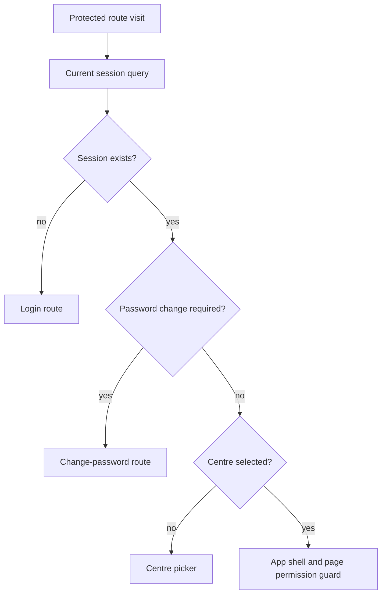

#### What it means

The browser owns a credential cookie that application JavaScript cannot read. The SPA learns the current user's profile by asking `/api/me`. A route guard runs before a matched page is rendered and can redirect it. A permission wrapper controls whether a piece of UI mounts. Both are usability controls: the API must independently enforce authentication, tenancy and permissions because a user controls the browser and can bypass its code.

Authentication, centre selection and first-login password change are separate states. A user can be authenticated without selecting a centre. A user can also be authenticated but required to replace a temporary password. The protected route layout checks these states in an intentional order.

#### The problem it solves

A screen that assumes every visitor is ready for ordinary centre operations will issue requests that predictably fail. Scattering redirects inside each page duplicates logic and can briefly show unusable content. Hard-coded role checks also couple every screen to a policy table:

```tsx
// Illustration only: policy duplicated into a page.
return me.activeRole === 'owner' ? <CreateButton /> : null;
```

The actual helper asks whether the returned permission set includes the required action. A backend policy change can alter the response without teaching every screen new role comparisons.

#### How it works

`frontend/src/features/session/meQueryOptions.ts:10` defines one session query. Its function calls generated `getMe`; a 401 resolves to `null`, while other failures throw. Signed out is data, not a transport error. `retry: false` avoids retrying a meaningful unauthenticated result. `useSession` exposes that data and its loading/error state.

`frontend/src/routes/_authenticated.tsx:15` uses the router's shared query client with `staleTime: "static"`. Its `beforeLoad` redirects null sessions to login, preserving `location.href`; then redirects `mustChangePassword` to `/change-password`; then redirects an absent active centre to `/select-centre`. Only afterward can the shell and child render. The centre-selection route repeats the first-login gate because selecting a centre is not a way around password replacement.

`useCan` checks `me.permissions.includes(permission)`. `Can` renders children only when allowed. `RouteGuard` displays an explicit no-access state and dashboard link otherwise. Protected data hooks belong inside the child content component so denying the wrapper prevents mounting the query, rather than merely hiding already fetched results.

#### How THIS project implements it

The permissions catalog in `frontend/src/features/session/permissions.ts:2` includes sixteen view/manage keys across subjects, staff, audit, centre settings, students, teachers, groups, enrollments and schedule. It is a manual frontend mirror. `frontend/src/features/shell/AppShell.tsx:132` uses these keys to show navigation. Group detail independently gates roster and schedule tabs by their respective view permissions, so a pasted tab search parameter falls back to overview when unavailable.

`frontend/src/app/queryClient.ts:34` handles later unauthenticated errors globally. It clears the client and calls the login redirect unless already on login. Query errors use that handler; mutation errors use it except for the login mutation, whose expected wrong-password 401 belongs to the login form. A permission denial is different: `refetchMeOnPermissionDenied` invalidates `/api/me` only for `auth.permission_denied`, allowing stale button visibility to catch up with the server's new permissions.

Verified source excerpt, `frontend/src/routes/_authenticated.tsx:16` (quoted directly from the current file):

```tsx
    const me = await context.queryClient.query({ ...meQueryOptions, staleTime: "static" });

    if (me === null) {
      throw redirect({ to: "/login", search: { redirect: location.href } });
    }

    // The server-side gate (Day 30) is the real control; this only sends the user to the pleasant form for it
    // instead of letting every other request 403 with auth.password_change_required.
    if (me.mustChangePassword) {
      throw redirect({ to: "/change-password" });
    }

    if (me.activeCentreId === null) {
      throw redirect({ to: "/select-centre" });
    }
  },
  component: AuthenticatedLayout,
```

#### Execution example

1. A newly created member signs in. Login stores the returned `MeDto` in the session cache.
2. Login may navigate to the dashboard or centre picker according to active-centre state.
3. Either protected layout or centre picker sees `mustChangePassword` and redirects to the dedicated form.
4. `change-password.tsx` validates current password, a new password of at least ten characters, a different new value, and matching confirmation.
5. Its generated mutation sends only current and new passwords. Confirmation is local validation, not part of the API body.
6. On success the form awaits CSRF refresh, invalidates the session query, shows confirmation and navigates according to selected-centre state.
7. The updated session allows normal routes to mount.
8. Later, if a group mutation receives `auth.permission_denied`, its feature handler invalidates session permissions. If instead any ordinary request discovers a lost session, global handling clears cache and navigates to login.

#### Why this project needs it

Staff now have different capabilities and can belong to multiple centres. Account creation also introduces temporary credentials. The current UI cannot treat sign-in as a single boolean. Central session state, ordered gates and permission-driven rendering make those server distinctions understandable to a staff member without pretending the browser enforces them.

#### Alternatives

A user context or Redux store could duplicate the current profile, but would need synchronization with the API. Per-page effects could redirect after rendering, with duplicated conditions and potential content flashes. Role-based UI switches could work for a fixed policy, but this repository intentionally chooses permissions. The following is an interpretation based on the implementation: hiding the data-owning child component is also a privacy-conscious way to avoid unnecessary forbidden requests.

#### Important details

The route guard's cached session is not a new server check on every navigation. Revocation may first become visible through the next API call. `useSignOut` awaits logout and CSRF refresh before clearing queries, so a refresh failure can interrupt its later local cleanup. The login page itself has no redirect-away guard for an already signed-in user. Centre selection invalidates session data, but the shown handler does not clear every previous centre's feature query. Because generated query keys primarily describe URLs and parameters, reusing a feature query after centre switching deserves review rather than an assumption that every cache entry includes tenant identity.


The logout sequence has a failure boundary worth preserving in tests. `useSignOut` awaits the logout mutation, awaits token refresh, clears the query client and navigates. If token refresh fails after the server already signed out, the later local cleanup does not execute in that function. That does not mean the server session remained valid; it means the UI can retain stale cached state until another recovery path runs. When changing cleanup, distinguish server action success from subsequent client refresh success and test both phases. Avoid treating every rejected promise as proof that the original state-changing request failed.

#### What I should understand before modifying this code

Put protected routes beneath `_authenticated`. Use permission keys for actions and mount data-owning components inside `RouteGuard`. Keep first-login checks ahead of ordinary centre routes. Distinguish a 401 from a 403 and a password-change refusal from a permission refusal. Audit cached data when adding centre-sensitive pages; server-side isolation and client-side cache isolation are separate requirements. Read the full cache lifecycle before promising that a session or centre transition erases all previous data.

<a id="frontend-forms"></a>
## 6.28 React Hook Form, Zod and field-level server errors

#### What it means

A form needs values, validation state, submission state and error presentation. React Hook Form supplies field registration and orchestration; Zod supplies schemas that accept or reject value shapes; the Zod resolver joins them. This is client-side convenience, not a replacement for backend validation. An attacker can omit the UI entirely. The server remains responsible for allowed operations and valid persisted data.

RHF's `register` connects an ordinary input to form tracking. `Controller` connects components whose value API differs from a native input, such as the shared phone input and Base UI select. `handleSubmit` first runs validation and only calls the mutation handler for valid values. `setError` adds a server or manual refusal to a specific field.

#### The problem it solves

Without a shared form pattern every dialog would manually read inputs, check lengths and maintain separate errors:

```ts
// Illustration only: repetitive manual form validation.
if (!name.trim()) setNameError('Name required');
if (capacity < 1) setCapacityError('Capacity invalid');
if (!teacherId) setTeacherError('Teacher required');
```

The project expresses these checks in schemas, then reuses the same field rendering convention. A client check can save a pointless request, but state-dependent conflicts such as a teacher archived a second ago still come back from the server.

#### How it works

The schema provides both runtime validation and an inferred TypeScript type. `z.infer<typeof schema>` prevents a separately handwritten form-values interface from drifting from validation. Translation keys are stored as schema error messages. Local errors are translated when rendered; errors marked `type: "server"` are already display text and are rendered as supplied by the feature's mapping.

`frontend/src/api/showApiError.ts:18` implements the original `applyFieldErrors`: it ignores unknown field names, uses only the first message and preserves server text. `frontend/src/api/fieldErrors.ts:21` implements `applyTranslatedFieldErrors`: when `errors.json` contains an exact code message, that translated message is applied to each recognized field; otherwise it falls back to field text. It returns whether anything was placed. `setCodedFieldError` handles a coded refusal that has no field dictionary.

#### How THIS project implements it

`frontend/src/routes/login.tsx:32` has a small email/password schema. It checks presence and email syntax but not all backend length limits. `frontend/src/features/auth/changePasswordSchema.ts:7` adds cross-field refinements for different current/new passwords and matching confirmation. A refinement's `path` decides which field displays the error.

`frontend/src/features/groups/CreateGroupDialog.tsx:49` uses a typed schema and default values. Its submit function sends exactly name, subject id, teacher id and capacity. A subject-archived or subject-not-found code lands under `subjectId` and invalidates subject choices; corresponding teacher failures land under `teacherId`. Other field errors use the translation-aware mapper. A successful response invalidates groups, closes the dialog and navigates to the created group's overview.

`RegisterStudentForm` cannot decide whether a new parent's name is required until lookup resolves. Its schema intentionally permits an empty parent name; submit requires it only in the new-parent branch. This is a concrete example of a shape rule depending on another operation's outcome rather than a reason to make every optional field globally required.

Verified source excerpt, `frontend/src/features/auth/changePasswordSchema.ts:7` (quoted directly from the current file):

```ts
export const changePasswordFormSchema = z
  .object({
    currentPassword: z.string().min(1, "validation.currentPasswordRequired"),
    newPassword: z.string().min(MinPasswordLength, "validation.newPasswordTooShort"),
    confirmPassword: z.string().min(1, "validation.confirmPasswordRequired"),
  })
  .refine((data) => data.newPassword !== data.currentPassword, {
    message: "validation.newPasswordSameAsCurrent",
    path: ["newPassword"],
  })
  .refine((data) => data.newPassword === data.confirmPassword, {
    message: "validation.confirmPasswordMismatch",
    path: ["confirmPassword"],
  });

```

#### Execution example

1. A staff member opens Create Group; the form initializes empty name and relationships with capacity twenty.
2. RHF registration connects native inputs; `Controller` connects subject and teacher selects.
3. The user submits. Zod rejects missing required selections before a request.
4. After valid local input, the generated mutation sends its request through the CSRF-aware boundary.
5. If another staff member archived the selected teacher, the server refuses with a stable teacher-related code.
6. The catch branch maps that code under the teacher select, invalidates the teacher list and leaves the form available for correction.
7. A later successful submit receives the created id; the group list is marked stale and navigation opens the new detail page.
8. React re-renders each field's `aria-invalid` and error paragraph from RHF state rather than manually manipulating DOM text.

#### Why this project needs it

The application now contains many related dialogs with both local and state-dependent validation. Sharing the orchestration lets the code focus on business outcomes: duplicate parent, archived subject, stale group version or overlapping schedule. Translated errors are particularly necessary because developer English from a backend validator is not suitable Arabic UI copy.

#### Alternatives

Controlled `useState` inputs work for small forms but require more orchestration. Formik and TanStack Form are alternative state libraries; Yup and Valibot are alternative schema libraries. Native browser validation is useful but cannot express all translated cross-field and server outcome behavior. The repository does not explicitly state why RHF and Zod were chosen over every alternative. The following is an interpretation based on the implementation: schemas plus `Controller` fit repeated dialogs and custom headless UI controls.

#### Important details

Not every server-field path equals the UI path. Schedule errors for `startTime` map to the form's hour/time group. Parent errors use dotted names such as `parent.fullName`. A known-field allowlist avoids silently assigning arbitrary server keys. `noValidate` prevents browser validation bubbles from taking precedence over the project's chosen messages. Disabling submit during pending work improves interaction but does not enforce idempotency; the backend must still handle repeated or racing requests.

#### What I should understand before modifying this code

Update the schema, inferred values, known fields, generated contract and both locale resources together. Keep confirmation-only fields out of request bodies. Put a refusal under the field the user can correct; use a banner for a cross-field scheduling conflict and a toast for a completed operation. Preserve server authority: the client must handle a valid-looking selection becoming invalid after it was loaded. Do not put credentials or parent phones into URLs merely to simplify form state.

<a id="frontend-i18n"></a>
## 6.29 Internationalisation, RTL, bidirectional text and self-hosted assets

#### What it means

Internationalisation separates UI messages from code and provides language-dependent formatting. Localisation supplies the translated resources. Arabic also changes document direction, so translation is not only substituting words. Logical layout properties express start and end rather than fixed left and right. Mixed-direction content introduces a separate problem: a phone number, identifier or time range must remain left-to-right even inside an Arabic sentence.

ICU message syntax lets a message contain placeholders and plural rules. A message such as an enrollment confirmation is one translated sentence with named data, rather than English fragments glued around a student name. Browser `Intl` formatting handles language-specific dates and numbers, with an explicitly supplied time zone where the domain requires one.

#### The problem it solves

Without resources, a page contains literal English strings that never change. Without logical CSS, switching `dir` leaves borders and padding on the wrong side. Without isolation, punctuation and digits can reorder in an Arabic sentence:

```tsx
// Illustration only: physical layout and an unisolated technical value.
<div className="border-r pl-3">Reference: {correlationId}</div>
```

The project's equivalent uses logical classes and either markup isolation such as `<bdi>` or `isolateLtr` for plain-text interpolation. These solve different layers of the same reading problem.

#### How it works

`frontend/src/i18n/index.ts:1` imports i18next, the ICU plugin, the React bridge and all resources. The current resource sets contain fifteen namespaces in each language: common, status, errors, auth, shell, subjects, students, parents, staff, settings, audit, teachers, groups, enrollments and schedule. They are bundled, not fetched at runtime.

`detectInitialLanguage` reads `tcm.lang` if available, otherwise checks browser language, otherwise selects English. Its storage access is wrapped because browser storage can throw. `applyDocumentDirection` sets `document.documentElement.lang` and `dir` before rendering. The language-change listener repeats that operation and attempts to persist the preference. `useTranslation` subscribes rendered components to language changes; when the active language changes, subscribed text is recomputed during render.

#### How THIS project implements it

`frontend/src/features/language/LanguageSwitcher.tsx` calls `changeLanguage` and labels the action in the destination language. The shell uses `border-e`, `start-0` and inline-direction padding. Direction-aware transitions move the mobile navigation from the appropriate side. `frontend/src/lib/bidi.ts:7` wraps technical text in Unicode left-to-right isolate and pop-directional-isolate characters. That works inside translated plain strings where a JSX `<bdi>` cannot be inserted.

`frontend/src/features/audit/auditFormatting.ts:36` translates stored vocabulary before rendering. Roles reuse auth labels, locale uses common labels, and status, relationship, primary-parent flags, enrollment end reason and weekday values use audit translations. Raw user-provided names remain text rather than translation keys. This is important: data supplied by a parent is not a message key and must never be passed to `t` as though it were code-defined vocabulary.

Fonts are imported through local packages and emitted by Vite. `frontend/vite.config.ts:25` sets `assetsInlineLimit: 0`, ensuring even small font assets remain same-origin files rather than data URLs. The stylesheet defines the theme and font stack. The repository's frontend README explains that dependencies must fit the backend CSP instead of requiring an external script CDN or runtime `eval`.

Verified source excerpt, `frontend/src/lib/bidi.ts:7` (quoted directly from the current file):

```ts
 */
export function isolateLtr(value: string): string {
  return `\u2066${value}\u2069`;
```

#### Execution example

1. The user activates the language switcher while viewing a timetable.
2. i18next changes its current language and emits the language-change event.
3. The listener sets the root document to Arabic and RTL and attempts to save `tcm.lang`.
4. React translation subscriptions cause the timetable, navigation, buttons and dialogs to render localized text.
5. Logical layout utilities follow the document's direction; direction variants adjust arrow icons and mobile navigation.
6. Timetable formatters use the centre zone and the new locale to format the same instants. They do not change which instant a session represents.
7. Time containers remain LTR; user names use isolation or automatic direction.
8. An error reference interpolated with `isolateLtr` stays readable even when surrounded by Arabic punctuation.

#### Why this project needs it

Egyptian centre staff need Arabic UI alongside English. The application also displays Latin emails, identifiers, phone numbers and IANA zone names. Direction must be explicit for technical values while natural-language names remain readable in either script. The repeated use of `bdi`, `dir="auto"`, `dir="ltr"` and helper-based isolation shows this is an active implementation concern.

#### Alternatives

Separate RTL stylesheets could mirror physical CSS manually, with more maintenance. `react-intl` is another message system. Lazy-loaded resources could reduce initial loading at the cost of asynchronous language acquisition. External font CDNs would conflict with the project's self-hosting policy. The repository does not explicitly justify every formatting choice. The following is an interpretation based on the implementation: bundled resources and local assets simplify same-origin production hosting and avoid a second availability dependency for basic UI text.

#### Important details

`preferredLocale` returned by `/api/me` is not what `detectInitialLanguage` reads; startup uses storage and browser preference. Resource key parity proves both language files contain matching key structures, not that the translations are correct or visually fit. `showApiError` still hard-codes `Reference:` in one toast path. Audit timestamps use `Intl.DateTimeFormat` without an explicit centre zone, unlike the scheduling formatters; do not claim every timestamp everywhere uses centre time. Generated UI components require their own RTL review even when feature components use logical classes.


The resource parity checker proves matching key structure, not correct translation or layout. Two languages can share every key while one value contains wrong wording, broken ICU parameters or visually clipped text. Component tests establish selected rendering behaviour; a real Arabic workflow and visual inspection address additional properties. Keep technical identifiers directionally isolated and user-provided names auto-directed rather than forcing all text to follow the page's language.

#### What I should understand before modifying this code

Add messages in both language resources, choose the correct namespace and run the parity script. Keep identifiers isolated during interpolation. Use logical CSS for feature layouts. Avoid adding arbitrary user text as translation keys. Verify formatting in Arabic with real mixed text, especially dates, ranges and correlation references. Keep new assets compatible with same-origin CSP and inspect Vite output when introducing a font or image dependency.

<a id="frontend-pagination"></a>
## 6.30 URL state, debounced search and cursor pagination

#### What it means

A useful list screen has at least three different kinds of state. Its current search and filters describe a navigable view, so they belong in the URL. The text currently being typed is an immediate local draft. The pages returned by the server are cached server state. Separating them allows a user to bookmark a filtered list, type without issuing a request on every keystroke, and request more data without replacing the entire list.

Cursor pagination means the server returns an opaque continuation value with a page. The browser sends that value back to request the next page. The browser does not calculate row offsets or interpret the cursor. The cursor belongs to the server's ordering and filtering contract. Changing the search term creates a different query, rather than continuing an old cursor under new filters.

#### The problem it solves

Without URL-owned filters, reloading loses the view and Back cannot restore it. Without debouncing, a five-character search can cause five requests. Without separate pagination state, loading more can replace earlier rows or accidentally append results from another search. A naive version illustrates the coupling:

```ts
// Illustration only: a page number and a local term hide the view from navigation.
const [term, setTerm] = useState('');
const [page, setPage] = useState(1);
fetch(`/api/students?search=${term}&page=${page}`);
```

The actual client does not invent a numbered pagination protocol. It uses the generated cursor parameters, puts search in route state and keys the cache by the current request parameters.

#### How it works

`frontend/src/components/shared/SearchInput.tsx:23` maintains a draft and the last synchronized external value. Input changes update the draft immediately. Its effect starts a timer, defaulting to 300 milliseconds; cleanup cancels that timer if the draft changes before it fires. A ref holds the latest callback. External URL changes reset the draft during render so Back navigation does not first paint obsolete text. Clearing is immediate because it is a deliberate action rather than an incomplete typing sequence.

`frontend/src/features/students/StudentsList.tsx:32` constructs generated list parameters with search, archive visibility and page size twenty-five. At line 43 `useInfiniteQuery` uses the generated list key, passes its `pageParam` as `cursor` and passes the cancellation signal to the generated function. `getNextPageParam` returns the server's `nextCursor` or `undefined`; undefined means there is no next page. Rendering flattens `data.pages` into visible items.

#### How THIS project implements it

`frontend/src/routes/_authenticated/students.index.tsx` owns the route's search parameter interpretation and navigation updates. The shared search input does not know about students or server normalization. Its caller changes route search; a new render passes that search to `StudentsList`; the generated key changes accordingly. Arabic normalization is a server responsibility, as the frontend README states; the input does not normalize a person's name itself.

The audit log follows the same continuation pattern in `frontend/src/features/audit/AuditLog.tsx:32`. Audit filters include entity type, date bounds and page size. `frontend/src/routes/_authenticated/audit.tsx:24` validates known entity types and builds URL state. `LoadMoreButton` is shared by feature lists, while audit currently renders its own load-more control. Both request more through the infinite query rather than assembling an independent fetch queue.

Verified source excerpt, `frontend/src/features/students/StudentsList.tsx:43` (quoted directly from the current file):

```tsx

  const { data, error, isPending, refetch, fetchNextPage, hasNextPage, isFetchingNextPage } = useInfiniteQuery({
    queryKey: getListStudentsQueryKey(params),
    queryFn: ({ pageParam, signal }) => listStudents({ ...params, cursor: pageParam }, { signal }),
    initialPageParam: undefined as string | undefined,
    getNextPageParam: (lastPage) => lastPage.nextCursor ?? undefined,
  });
```

#### Execution example

1. A secretary opens `/students` and the route parses its search state.
2. `StudentsList` asks for the first page with page size twenty-five and no cursor.
3. Typing into `SearchInput` changes the visible input immediately. Earlier timer callbacks are cancelled as typing continues.
4. After the debounce, `onChange` updates route search. The list receives the new term.
5. The generated key now describes that term and filters, so the query loads its own first page rather than appending to the unfiltered cache entry.
6. A response supplies `items` and `nextCursor`. The table renders all pages currently held by that query.
7. Clicking Load More calls `fetchNextPage`; its query function sends the returned cursor with unchanged filters.
8. Back navigation restores previous URL state. The search input synchronizes its local draft, and the query cache can supply the corresponding earlier view.

#### Why this project needs it

Student and audit collections can grow beyond a convenient single response. Office staff also need to return to searches and share precise views. The separation keeps browsing behavior coherent while the backend owns filtering, ordering and continuation semantics. The same design is reused for a smaller student picker with a different page size rather than downloading every contact record into the enrollment dialog.

#### Alternatives

Offset pagination is easier to describe with page numbers but reacts differently to concurrent inserts. Fetching all rows and filtering locally can be acceptable for a tiny fixed dictionary, not a growing student collection. A search term in React context would persist while mounted but still lack browser navigation semantics. The repository does not explicitly compare cursor pagination with every alternative in frontend code. The following is an interpretation based on the implementation: opaque cursors keep ordering knowledge on the server while infinite queries provide a direct load-more UI.

#### Important details

The cursor must not be decoded or edited in the client. Query keys must include filters. A new search must start a new continuation chain. Debouncing is not cancellation: a request already issued still needs the query's signal and correct cache key. A loading-next-page indicator differs from initial loading; earlier visible rows should remain available. Tests should distinguish an empty entire collection from no matches for a search because the user actions differ.

#### What I should understand before modifying this code

Read route parsing, `SearchInput`, list parameters and `getNextPageParam` together. Preserve the external reset path for browser navigation. Do not add a second manual page counter to an infinite query. Use server-provided continuation values and generated URL builders. Keep sensitive data, especially parent lookup phones, out of navigable query parameters when the existing protocol intentionally uses a mutation body.

<a id="frontend-parent-lookup"></a>
## 6.31 Parent lookup, conditional registration and stale-response protection

#### What it means

Registering a student can mean linking an existing parent or creating a new parent. Those are different request shapes. The client first asks the server whether a parent exists for the supplied phone. If found, registration sends an id; otherwise it sends the new parent's name and phone. The lookup result is state-dependent and can become obsolete while the user is still typing or while another secretary registers the same parent.

An asynchronous race occurs when request A starts for one value, the user changes the input, request B starts for the new value, then A finishes later. A result must be associated with the input that produced it. Applying whichever response arrives last is not enough because arrival order is not user-intent order.

#### The problem it solves

Without lookup, siblings can create duplicate parent records or a form might overwrite an existing parent's details. Without response association, a result for one phone can be displayed under a different phone. A naive implementation would contain:

```ts
// Illustration only: this accepts a response without checking the current field.
setFound(await lookupParent({ data: { phone } }));
```

The project records both the latest field value and the value behind the accepted lookup. It deliberately uses a mutation, so the phone does not become a query-cache key.

#### How it works

`frontend/src/components/shared/useParentLookup.ts:20` owns the generated lookup mutation and two refs. `latestPhoneRef` follows current input. `lookedUpPhoneRef` identifies the exact input for the stored result. `onPhoneChange` clears visible result/error state when the new value differs. `ensureLookup` can reuse a result only when its associated phone equals the requested one, unless force is requested.

After awaiting the mutation, the hook compares `latestPhoneRef.current` with the phone used for that request. A mismatch prevents the old result from replacing the current field's panel. Matching success records the phone and result. Matching failure either places a phone field error or shows a common error toast. The hook returns a discriminated outcome so a caller can stop submission when lookup failed.

#### How THIS project implements it

`frontend/src/features/students/RegisterStudentForm.tsx:65` calls `ensureLookup` before constructing the registration request. A found parent becomes `{ id: outcome.parent.id }`. A missing parent requires a trimmed full name and becomes `{ fullName, phone }`. The form sends student name, optional phone, optional school year, relationship and that parent union. It does not send a client-supplied centre id.

The registration schema at `frontend/src/features/students/registerStudentSchema.ts:17` checks shape and lengths. Parent full name is not unconditionally required because an existing parent's id is enough. `ParentLookupField` renders the input and the existing/new branch; `AddParentDialog` reuses the same hook for an existing student. `PhoneInput` accepts raw text and imposes LTR display but leaves real phone normalization and validation to the server.

The submit catch handles `parent.phone_taken` specially: it forces another lookup rather than asserting that the earlier no-match result is still authoritative. That is the expected response to a check-then-create race. The backend's uniqueness rule remains the authority; the client updates its choices to the new state.

Verified source excerpt, `frontend/src/components/shared/useParentLookup.ts:56` (quoted directly from the current file):

```ts
      setFound(result.parent);
      return { ok: true, parent: result.parent };
    } catch (thrown) {
      if (latestPhoneRef.current !== phone) {
        return { ok: false };
      }

      const apiError = asApiError(thrown);
      const message = apiError.fieldErrors?.phone?.at(0);
      if (message !== undefined) {
```

#### Execution example

1. A secretary enters a student name and parent phone.
2. `onPhoneChange` records the current phone and clears any panel associated with an earlier one.
3. Lookup sends the phone in a generated mutation body. While pending, form controls reflect pending state.
4. The server returns an existing parent. The hook accepts it only if the field still contains that exact phone.
5. The form displays the existing parent and submits only its id with the relationship and student details.
6. On successful registration, the student list is invalidated, a localized toast appears and navigation opens the created student detail.
7. In a different execution, lookup returns no parent but another secretary registers that phone first. Registration gets `parent.phone_taken`.
8. The catch forces lookup again; the UI can now offer the existing parent instead of blindly retrying a duplicate create.

#### Why this project needs it

Siblings share a parent. Staff can work concurrently. Parent phone numbers are also sensitive contact data, so the lookup should not automatically become a bookmark, browser history item or reusable query key. The existing pattern addresses both workflow correctness and the placement of sensitive inputs in client state.

#### Alternatives

Always creating parents would rely on later deduplication. A mandatory separate parent-management page would add steps to student registration. A normal GET query with the phone in the URL is cache-friendly but exposes the input in places the current body-based protocol avoids. Debouncing alone would not solve stale response application. The repository describes its mutation choice in the hook comments. The following is an interpretation based on the implementation: keeping lookup state local lets both registration and Add Parent own independent, short-lived interaction state.

#### Important details

Refs preserve identity across renders without triggering renders; state triggers visual updates. Both are needed here. The hook compares exact raw values, so do not silently introduce a different normalization on only one side of that comparison. A result discarded because input moved on returns a distinct outcome; evaluate submit behavior if changing whether the form can be edited while a lookup is pending. The lookup's cache avoidance is not a promise that the browser never holds a phone in memory; the form necessarily does.

#### What I should understand before modifying this code

Keep the existing-parent id branch exclusive from the new-parent data branch. Preserve association between accepted results and their input. Handle server uniqueness conflicts even after a successful lookup. Do not duplicate phone-format rules in the shared input. Test changing the input while a request is pending, lookup failure followed by retry, siblings using the same parent, and registration racing another user's parent creation.

<a id="frontend-versioned-editing"></a>
## 6.32 Versioned edits, archive workflows and the teacher/account boundary

#### What it means

An edit based on an earlier read can overwrite someone else's change. Optimistic concurrency attaches a version to a resource. The client sends the version it actually saw with a mutation; the server decides whether that version still matches. The browser does not mint a new version itself. A conflict is a meaningful outcome: reload the resource and let the user decide again.

Archiving is a lifecycle transition, not deletion. The application retains records and relationships while ordinary lists default to active items. Restore is another transition. Teacher records are also separate from staff accounts: a named teacher can exist as a business record, and an optional link connects that record to an eligible sign-in identity.

#### The problem it solves

Without a version, two staff members can both read a group capacity of twenty, independently edit it, and overwrite one another without noticing. Without an archive lifecycle, removing a teacher could destroy references needed for group and schedule history. Without a separate teacher/account boundary, every teacher record would be forced to possess login credentials even when the office only needs to assign their name to a group.

```ts
// Illustration only: this request omits the read version.
await renameGroup({ id, data: { name: draftName } });
```

The actual edit dialogs carry the loaded DTO's version in request bodies. Subject archive and restore likewise use the version associated with the displayed row.

#### How it works

`frontend/src/features/subjects/SubjectsList.tsx:70` creates an invalidation function for all subject-list variants. Archive confirmation sends the target's id and version. Both success and failure invalidate the list; success reports completion, while failure reports its refusal and refreshes session permissions if required. Restore tracks which row is pending and clears that local state in `finally`.

Group detail uses the same principle at `frontend/src/routes/_authenticated/groups.$groupId.tsx:176`: archive/restore send the resource version and invalidate both detail and list reads. The separate rename, capacity and teacher-assignment dialogs avoid replacing an entire entity from an old form. They express one action with its appropriate fields.

#### How THIS project implements it

`frontend/src/features/teachers/TeacherAccountDialog.tsx:44` loads the staff list only while the account-linking dialog is mounted. `eligibleStaffForTeacher` filters active Teacher members not already linked elsewhere, while allowing the record's current account as appropriate. This role filtering is data eligibility for account linking, not the usual action authorization pattern; action visibility still uses permissions.

The dialog sends `userId` or null plus the teacher version to `useSetTeacherAccount`. `teacher.user_not_eligible` and `teacher.account_taken` become field messages under the account select; the staff choices are refreshed and selection clears. Other failures show a toast, refresh permissions if needed, invalidate teachers and close. The list is advisory: the backend must recheck eligibility because membership can change after loading.

`StaffFormDialog` implements another identity boundary. Its returned temporary password is placed in local `revealed` state for a one-time panel. Closing resets local fields and the mutation. Existing-account handling takes a different result branch. The comment's intention that a password is never retained in the query cache should be read carefully: the generated mutation has its own mutation state until reset; the code does call reset on close, but the underlying mutation still received the response. Avoid documenting stronger guarantees than the actual lifecycle provides.

Verified source excerpt, `frontend/src/features/subjects/SubjectsList.tsx:77` (quoted directly from the current file):

```tsx
      setArchiveTarget(null);
    } catch (thrown) {
      const apiError = asApiError(thrown);
      await invalidate();
      showApiError(apiError);
      refetchMeOnPermissionDenied(apiError, queryClient);
      setArchiveTarget(null);
    }
  };

  const handleRestore = async (subject: SubjectDto) => {
```

#### Execution example

1. An owner opens a group detail and receives a DTO with version V.
2. Another owner changes that group, advancing its version on the server.
3. The first owner submits an action with V. The server refuses stale work.
4. The feature maps the refusal, invalidates detail and list queries, and renders the new data.
5. In a teacher-linking flow, opening the dialog mounts the staff query and filters available accounts.
6. The owner selects a displayed eligible account and sends the teacher version with that user id.
7. If the account became linked elsewhere, the server refuses. The field-level error remains near the choice, and the refreshed options remove obsolete assumptions.
8. A later successful selection invalidates teachers and closes the dialog; group and schedule authorization derive from the server's resulting link, not from a client role toggle.

#### Why this project needs it

Staff share mutable office data. Capacity, teacher assignment and membership all affect later enrollment or schedule behavior. Explicit action requests and version-aware refusals are easier to recover from than a generic save of an entire stale entity. Separating record identity from sign-in identity also matches the practical fact that a centre can track a teacher before granting them account access.

#### Alternatives

Pessimistic locks could prevent editing while another user works, at greater coordination cost. Last-write-wins is simpler but silently loses changes. Hard deletion could be acceptable for ephemeral data but changes history semantics. Automatic retry with a newly fetched version would hide the conflict by overwriting work the user has not reviewed. The following is an interpretation based on the implementation: explicit stale refusals keep business decisions with the user while allowing independent reads without long-lived locks.

#### Important details

Never send a newly invented version to force acceptance. Archive visibility belongs to list search state and does not grant manage rights. A row's colored state also has a written badge. A teacher's eligible account list can contain emails, so mounting only on demand and guarding its use matter. Different mutations invalidate different resource sets; inspect their dependencies rather than invalidating only the screen currently visible.

#### What I should understand before modifying this code

Trace the loaded DTO's version into the generated request. Decide what stale refusal should leave open and what must refetch. Preserve separate teacher records and staff identities. Do not replace server eligibility with client filtering. Keep archive and restore as named actions where they already express business transitions. Review transient credential storage in both local component state and mutation state when changing staff creation.

<a id="frontend-enrollments"></a>
## 6.33 Enrollment actions, atomic transfer and cache convergence

#### What it means

Enrollment connects a student with a group. Viewing a roster, managing enrollments and opening a student's full details are separate capabilities. Capacity shown on a screen is advisory because another secretary can take the last seat before a submit reaches the server. An atomic transfer means ending one enrollment and opening its replacement as one server operation; the client must not implement that business action as two unrelated requests.

Cache convergence means every displayed view of changed data is refreshed after the operation. Enrollment affects more than a roster row: group counts, group detail, lists, dashboard seat totals and the student's enrollment history can all depend on it. One shared mutation layer enumerates those affected reads.

#### The problem it solves

A naive transfer can leave the student without either enrollment if its second request fails:

```ts
// Illustration only: not atomic and not used here.
await withdrawEnrollment(oldEnrollment);
await enrollStudent(newGroup); // target may now be full
```

Likewise, immediately adding an optimistic roster row would imply the client already won a capacity race. The actual workflow waits for the server and treats a full group, an ended enrollment and a stale version as ordinary outcomes that need a clear message and refreshed state.

#### How it works

`frontend/src/features/enrollments/useEnrollmentMutations.ts:23` owns enroll, withdraw and transfer. Its `run` helper awaits the request, returns `{ ok: true }` or `{ ok: false, error }`, and invalidates affected reads in `finally`. That means refresh happens after both success and refusal. A failed last-seat request is evidence that the displayed count may be stale, so failure still requires a reload.

Invalidation includes each touched group's roster and detail, all group-list variants, and the student's enrollment list. Transfer supplies both source and target ids. The transfer request contains enrollment id, target group id and the existing enrollment version. There is no separate withdraw call in that method.

#### How THIS project implements it

`frontend/src/features/enrollments/GroupRosterTab.tsx:27` calls `useGetGroupRoster`. `enrollments.view` allows viewing through its parent tab; `enrollments.manage` adds actions; `students.view` turns names into links. The teacher-facing roster therefore does not need a second component with hidden contact fields. It receives the server's scoped entries and renders available navigation and actions by permission.

`EnrollStudentDialog` searches students through the dedicated picker. It sends `{ studentId }` to the group enrollment action. A 404 closes the dialog with a message, while other business refusals remain inside it so the user can correct a choice. `TransferDialog` filters other active groups of the same subject. Full choices are displayed but disabled by `GroupChoiceList`; the server still rechecks them. If a target becomes full, selection clears while the dialog remains open.

`SeatMeter` at `frontend/src/features/enrollments/SeatMeter.tsx:17` displays server counts with written states: almost full from eighty percent and full at capacity. Its bar is decorative and hidden from assistive technology; count text is LTR-isolated. It never allocates a seat. `StudentEnrollmentsCard` reuses the same mutations and dialogs from the student's perspective, separates active and ended entries, and uses view permissions for links.

Verified source excerpt, `frontend/src/features/enrollments/useEnrollmentMutations.ts:81` (quoted directly from the current file):

```ts
    }) =>
      run(
        () => transferMutation.mutateAsync({ id: enrollmentId, data: { targetGroupId, version } }),
        [sourceGroupId, targetGroupId],
        studentId,
      ),

    isEnrolling: enrollMutation.isPending,
    isWithdrawing: withdrawMutation.isPending,
    isTransferring: transferMutation.isPending,
  };
}
```

#### Execution example

1. A secretary opens a group roster showing nineteen of twenty seats.
2. The enrollment dialog searches for a student and accepts a selection not already marked enrolled.
3. Another secretary takes the final seat before the first submit completes.
4. The first request receives `group.full`. The shared mutation helper refreshes roster, group detail, group lists and the student's enrollment list.
5. The dialog stays open and shows a specific localized refusal. The seat meter converges to twenty of twenty.
6. The user instead opens Transfer on another enrollment and selects an available group of the same subject.
7. One generated transfer request sends source enrollment id, target group id and version. Server success represents both lifecycle changes together.
8. Both rosters and group counts, plus the student's history, invalidate. The dialog reports success only after that outcome, rather than claiming completion after a preliminary withdrawal.

#### Why this project needs it

Capacity and enrollment are concurrent office work. UI counts cannot be treated as locks. The same operation is reachable from the roster and student page, so centralizing request execution and invalidation prevents those two entry points from drifting. Separate view/manage/link capabilities also avoid exposing broader student records merely because a teacher needs names on their own roster.

#### Alternatives

Optimistic updates can feel faster but need rollback and reconciliation for capacity races. Separate transfer requests require compensation and can violate atomic business expectations. A page reload after every operation would converge but lose local interaction state. Invalidating the whole client would be broad and could discard unrelated useful data. The following is an interpretation based on the implementation: the selected targeted invalidation balances correctness and reuse without pretending the client can predict transaction success.

#### Important details

Shared helpers convert thrown transport errors into typed outcomes; callers must inspect `ok`. `finally` invalidation can itself reject, so do not assume every possible infrastructure failure is already reduced to the outcome union. The full/archived disabled button is advice; backend checks remain necessary. Student and group links have their own permissions. Ended enrollment data is retained for history, so filtering it out of the table must not be mistaken for deleting it.

#### What I should understand before modifying this code

Keep transfer one request. Update the affected-query set whenever a new read depends on enrollment counts or status. Test the full target, duplicate enrollment, archived student/group, stale version and missing-resource paths. Ensure a teacher roster remains names-only and lacks management actions. Reuse the common mutation owner from new entry points instead of copying an enrollment request with a smaller invalidation set.

<a id="frontend-centre-time"></a>
## 6.34 Calendar dates, local times, instants and the centre's time zone

#### What it means

Three values that look like time are different domain concepts. A calendar date such as `2027-05-01` names a day and has no clock time or offset. A local time such as `18:00` names a wall-clock position and has no date. An instant such as a UTC timestamp names one point on the global timeline. A weekly schedule rule combines a weekday and local time; a materialized class session has actual start and end instants. Converting between them requires the centre's zone and the relevant date because daylight-saving rules can change the offset.

The browser's time zone describes the user's device. It does not necessarily describe the tutoring centre. A secretary traveling abroad must still see the centre's timetable, not a timetable silently shifted into the laptop's zone. Similarly, the centre's current date near midnight may differ from UTC's date and the device's date.

#### The problem it solves

Without explicit distinctions, a developer might use:

```ts
// Illustration only: these use the device's zone or conflate date-only data.
new Date(session.startsAt).toLocaleTimeString();
new Date('2027-05-01').getDate();
```

The first displays the device's wall clock. The second converts a date-shaped value into an instant-like Date and can shift the visible day under local accessors. Adding twenty-four hours to a local midnight can also behave unexpectedly across daylight-saving transitions. The project keeps pure date arithmetic separate from instant formatting and passes the centre zone explicitly when needed.

#### How it works

`frontend/src/features/schedule/centreTime.ts:15` formats an instant with `Intl.DateTimeFormat(locale, { ...TimeOptions, timeZone: timeZoneId })`. `formatTimeRange` formats two instants in that same zone. `todayIn` uses `formatToParts` with an explicit zone and an English numeric format to construct a stable `YYYY-MM-DD` calendar date; display locale is not allowed to change that protocol shape.

Local-time helpers validate `HH:mm`, convert it to minutes since midnight and add minutes with wraparound. `formatLocalTime` places a wall-clock value on a fixed UTC day and formats in UTC, deliberately preventing any real-world zone from moving it. `formatLocalTimeRange` moves the artificial end day forward if a wrapped end is earlier than its start, allowing a rule crossing midnight to display as a forward range.

`frontend/src/features/schedule/week.ts:12` sets Saturday as the week start. Its date arithmetic parses numeric parts and uses UTC day numbers with exactly 86,400,000 milliseconds per arithmetic day. UTC here is a computational device for date-only arithmetic, not an assertion that the centre's calendar operates in UTC. `isIsoDate` round-trips year, month and day to reject impossible dates such as February 30.

#### How THIS project implements it

`frontend/src/features/session/useCentreTimeZone.ts:10` finds the active centre's membership and reads its `timeZoneId`. It returns null before that information is available and never substitutes the browser zone. This lets any role use the centre calendar without reading owner-only settings.

`frontend/src/features/schedule/TimetablePage.tsx:53` calculates today with that zone, then chooses the URL's week or the current Saturday-start week. `TimetableGrid` groups returned sessions by the server's `localDate`, not by converting `startsAt` with device-local accessors. `SessionCard` formats start/end instants in the response's `timeZoneId`. These are complementary guarantees: the server chooses the centre day and the formatter chooses the centre wall clock.

`scheduleRules.ts` renders undated weekly start times through local-time helpers, not instant helpers. Its rule state compares ISO date strings: a past final date is ended; a non-null future or current final date is ending; otherwise a future first date is upcoming and the remaining case active. It sorts Saturday first and then by local start minute. The API's weekday ordering is not assumed to be the desired UI ordering.

Verified source excerpt, `frontend/src/features/schedule/centreTime.ts:15` (quoted directly from the current file):

```ts
  return new Intl.DateTimeFormat(locale, { ...TimeOptions, timeZone: timeZoneId }).format(new Date(instant));
}

/** Two instants as a time range in `timeZoneId`, e.g. "6:00 – 7:30 PM". */
export function formatTimeRange(startsAt: string, endsAt: string, timeZoneId: string, locale: string): string {
  return new Intl.DateTimeFormat(locale, { ...TimeOptions, timeZone: timeZoneId }).formatRange(new Date(startsAt), new Date(endsAt));
}

```

#### Execution example

1. A teacher opens `/timetable` from a device set to another time zone.
2. `useCentreTimeZone` reads the selected membership's IANA zone.
3. `todayIn` obtains the centre's date, then `startOfWeek` finds its Saturday without using device-local date accessors.
4. The generated timetable request sends that date as `weekStart`; filters remain ids and dates, not browser offsets.
5. The response contains session instants, local dates and the centre's zone.
6. `TimetableGrid` places each session in its `localDate` column. `SessionCard` formats its UTC start and end in the supplied zone.
7. Switching language changes text and number formatting but does not move the session or replace its instant.
8. Opening a group's weekly rule shows the undated local start time. A summer session and winter session can have different UTC starts while the rule still reads the same centre wall-clock time.

#### Why this project needs it

Tutoring schedules are usually promised in the centre's local wall clock: a class is at six in the evening, not at one fixed UTC hour all year. The frontend must preserve that model and must not independently generate sessions using its own device rules. The code comments and the centre-time tests explicitly teach this distinction, making it part of the current implementation rather than a hypothetical future concern.

#### Alternatives

A date library such as Luxon or Temporal-based utilities could model these values. Storing one fixed UTC recurrence would simplify conversion but change the business meaning across offset changes. Formatting everything in the device zone would be appropriate for a global video call application, not automatically for a local centre timetable. The repository states that these helpers use `Intl` and no date library. It does not provide a comprehensive library evaluation. The following is an interpretation based on the implementation: small pure helpers and explicit zone arguments make the limited required operations easy to test without a large abstraction layer.

#### Important details

An offset is not an IANA zone. ISO date string comparison is valid only for the validated fixed-width representation. Date parsing and display formatting have different goals: preserve protocol strings for requests and localize only when showing them. `Date.now()` compares instants and is suitable for a future-session button check, but does not determine a centre's calendar date. Some non-schedule timestamps elsewhere still use the device zone; the centre-time guarantee should be scoped to the code that actually supplies it.

#### What I should understand before modifying this code

Identify whether a field is a date, local time or instant. Use the corresponding helper instead of guessing from its string shape. Never generate the UTC schedule in a component. Test winter/summer offsets, midnight boundaries, cross-midnight durations, impossible dates and Saturday normalization. Keep `dir="ltr"` around ranges in Arabic UI. Do not let a missing zone silently fall back to the device's zone because that turns a visible missing-data state into a plausible wrong timetable.

<a id="frontend-schedule-actions"></a>
## 6.35 Weekly-rule forms, materialized sessions and schedule conflict recovery

#### What it means

A weekly rule describes repeated intent: a weekday, local start time, duration, optional room and first effective date. A class session is one generated occurrence with actual instants. Editing the rule lifecycle and cancelling one session are different actions. Ending a rule does not mean deleting its history; cancelling a session does not mean hiding the occurrence from the timetable.

The frontend treats scheduling conflicts as ordinary business outcomes. Two groups can compete for one teacher's time, or one group can be assigned overlapping sessions. The browser's current view cannot establish that a slot remains free, so it submits intent and displays the server's refusal if a conflict is detected.

#### The problem it solves

Without separate concepts a screen might send a teacher id, centre id and computed UTC offset with every rule, duplicating server authority and time-zone logic. Or it might delete a cancelled session from local state, making staff think it never existed. A naive manual recurrence loop would be particularly dangerous:

```ts
// Illustration only: not the implemented scheduling protocol.
for (let week = 0; week < 8; week++) {
  await createSession({ teacherId, startsAt: addFixedUtcWeek(start, week) });
}
```

That loop can partially succeed and applies the wrong abstraction across offset changes. The real form sends one weekly intent. The server generates sessions under its own rules and transaction boundary.

#### How it works

`frontend/src/features/schedule/scheduleSchemas.ts:37` validates weekday, twelve-hour input parts, five-minute minute steps, duration from thirty through 240 minutes in five-minute increments, room length at most forty and a real first date. The UI's duration choices offer quarter-hour increments; the schema accepts the broader five-minute contract. `toLocalTime` converts twelve-hour inputs to `HH:mm`, and `toAddScheduleRuleRequest` sends exactly weekday, start time, duration, room or null, and effective-from date.

`AddScheduleRuleDialog` maps server `startTime` field errors to the hour/time group. It defaults to four PM, ninety minutes, empty room and the centre's current date, but requires the user to choose a weekday. The effective-date input's upper bound is 366 days ahead, matching its declared server horizon mirror. Double-booking and archived-group refusals remain in the dialog. A successful response reports the number of materialized sessions.

#### How THIS project implements it

`frontend/src/features/schedule/useScheduleMutations.ts:25` owns four writes. `addRule` returns the server's session count as a number; `endRule` sends rule id, last date and version; `extend` sends a through date; `cancelSession` sends session id and version. Its `run` helper converts errors to a discriminated outcome and invalidates relevant rules plus all timetable-week queries in `finally`.

`ExtendScheduleDialog` limits the through date from today to ninety-two days ahead and suggests fifty-six days ahead. It validates the chosen date locally, then reports either newly created sessions or the translated up-to-date result. Teacher and group conflicts receive different explanatory text. The source comment mentions a future nightly job; the present frontend action is an explicit manual trigger and should not be described as a running browser background scheduler.

`CancelSessionDialog` confirms group, centre date and centre time, then sends the loaded session version. `TimetablePage` passes a cancel action only for a scheduled session whose start instant is still in the future and only with schedule-manage permission. `SessionCard` still renders cancelled entries with a written Cancelled badge and struck text. `GroupScheduleTab` shows rules to readers and adds add/end actions for managers.

Verified source excerpt, `frontend/src/features/schedule/useScheduleMutations.ts:47` (quoted directly from the current file):

```ts
  };

  return {
    addRule: (groupId: string, data: AddScheduleRuleRequest) =>
      run(async () => Number((await addMutation.mutateAsync({ groupId, data })).sessionsCreated), groupId),

    endRule: ({ ruleId, groupId, lastDate, version }: { ruleId: string; groupId: string; lastDate: string; version: number | string }) =>
      run(() => endMutation.mutateAsync({ id: ruleId, data: { lastDate, version } }), groupId),

    extend: (through: string) => run(async () => Number((await extendMutation.mutateAsync({ data: { through } })).sessionsCreated)),

    cancelSession: ({ sessionId, version }: { sessionId: string; version: number | string }) =>
      run(() => cancelMutation.mutateAsync({ id: sessionId, data: { version } })),
```

#### Execution example

1. An owner opens a group's Schedule tab. The parent group page already holds the group, and the tab queries its weekly rules.
2. The owner opens Add Weekly Session. The form receives group, current centre date and centre zone.
3. RHF and Zod validate the chosen weekday, time parts, duration, room and first date.
4. Mapping constructs a local-time request without teacher, centre or offset. The group relationship supplies the teacher on the server side.
5. The shared mutation sends one generated request. A teacher conflict returns a specific refusal; rules and timetable queries invalidate even on refusal.
6. The dialog remains open so the owner can choose another time rather than reconstructing all input.
7. After successful creation, a localized toast reports the returned count and the dialog closes. The timetable can now load materialized sessions.
8. Cancelling one future occurrence sends that occurrence's version. On success, refreshed timetable data retains it with cancelled status. The weekly rule is not silently erased by that single-session action.

#### Why this project needs it

The product now has recurring schedules and real session views. Time zones, overlapping work and concurrent staff make local guesses unsafe. Shared mutation invalidation also matters because a rule action from a group page can affect any currently cached week. Invalidating only the visible week's key would leave other navigable weeks stale.

#### Alternatives

A purely recurring calendar that computes occurrences on the client would avoid storing some sessions but move business logic into every reader and make single-session cancellation harder. Full optimistic insertion would require predicting server materialization, conflicts and time-zone resolution. Individual per-session creation would expose partial success unless wrapped by another server operation. The following is an interpretation based on the implementation: weekly intent plus materialized session DTOs keeps the browser a reader and action initiator while the server owns scheduling consistency.

#### Important details

Input constraints improve usability but do not reserve a slot. Five-minute schema acceptance differs from the fifteen-minute duration choices. The form's earliest and latest bounds are hints repeated by server checks, not an authorization boundary. Ending a rule, extending a horizon and cancelling one occurrence need separate invalidation analysis. A browser's current clock can make a cancellation button look available briefly even when the server has already crossed the start instant; the server refusal remains authoritative.

#### What I should understand before modifying this code

Keep local rule time and session instants separate. Do not add client-supplied tenant or teacher authority to a request that intentionally omits them. Preserve distinct group/teacher overlap messages. Retain cancelled sessions visually. Use the shared mutation owner from any new schedule entry point. Test horizon boundaries, stale versions, already-ended rules, already-cancelled sessions and a session becoming past while its confirmation is open.

<a id="frontend-shared-ui"></a>
## 6.36 Shared UI primitives, responsive tables and accessible state

#### What it means

A shared component can encapsulate a reusable interaction without owning business policy. The application has two layers of shared UI. `components/ui` contains headless-library wrappers and styled primitives such as buttons, dialogs, select, tabs, tooltip and radio controls. `components/shared` contains application-level conventions such as page headers, filter bars, empty states, status badges, phone text and responsive data tables.

Headless primitives supply interaction behavior and state while the application supplies styling. A dialog is more than an absolutely positioned div: it has open state, focus behavior, keyboard interaction, accessible naming and a portal. A shared business display such as `SeatMeter` can use primitives but remains in its feature because its eighty-percent threshold and capacity language are enrollment concepts.

#### The problem it solves

Without shared primitives every screen reinvents menu and dialog markup. Without application wrappers, every list invents different loading and empty states, physical spacing and mobile overflow behavior. A narrow phone screen can become unusable if a desktop table only scrolls horizontally and action buttons drift away from the relevant name.

```tsx
// Illustration only: an unstructured clickable div lacks button semantics.
<div onClick={onArchive}>Archive</div>
```

The actual code uses buttons, named menus, confirmation dialogs and written state labels. Colors and icons repeat state; they are not intended to be the only information.

#### How it works

`frontend/src/components/shared/DataTable.tsx:10` wraps a semantic table and exports row, header and cell helpers. It keeps explicit table roles while CSS changes mobile display. Cells carry `data-label` for their mobile label and `data-cell` for primary or action placement. The stylesheet's `.data-table` rules render stacked cards below the desktop breakpoint. On larger screens the wrapper allows horizontal overflow when a table genuinely needs width.

`StatusBadge` maps active/archived to translated words and variants. `PhoneInput` uses `type="tel"` and `dir="ltr"` without inventing phone-format rules. `PhoneText` chooses an isolated span or a `tel:` link. `PageHeader`, `FilterBar`, `StatTile` and `EmptyState` provide consistent composition points, leaving each feature to supply title, description, actions and content.

#### How THIS project implements it

`frontend/src/features/shell/AppShell.tsx:29` uses a Base UI dialog for mobile navigation and a menu for user actions. Desktop navigation is a persistent sidebar. The same translated links are reused in both, and navigation closes the mobile dialog. The shell reads route static data through `useMatches`; timetable sets `layout: "wide"` while ordinary pages use a narrower reading column. This is one shared shell policy rather than a timetable-specific CSS selector reaching into its parent.

Subject, student, staff, teacher and roster lists use the shared table helpers. `SeatMeter` supplies both count text and a badge. Loading states use skeletons with `role="status"` and an accessible label. Failure states use alerts and explicit Retry buttons. Group detail distinguishes a uniform not-found state from a transport failure that can be retried. A missing or foreign group should not be explained differently in the UI if the server intentionally returns the same 404.

Verified source excerpt, `frontend/src/components/shared/DataTable.tsx:10` (quoted directly from the current file):

```tsx
  return (
    <div className="rounded-xl border border-border bg-card sm:overflow-x-auto">
      <table role="table" className={cn("data-table w-full text-start text-sm", className)}>
        {children}
      </table>
    </div>
  );
}

```

#### Execution example

1. A staff member opens a student list on a phone.
2. The route supplies search state; the list query loads and a labeled skeleton appears.
3. The response renders `DataTable` rows. Each cell provides its column label for the mobile representation.
4. CSS presents each row as a card, with name and actions on its first line and labeled values beneath.
5. A phone is rendered LTR even in Arabic. Archived status includes a written badge, not only a muted color.
6. The user opens row actions. The headless menu manages its interaction while feature code supplies the actions allowed by permissions.
7. An archive action opens a named confirmation; the handler waits for the server, invalidates data and reports the outcome.
8. On desktop the same semantic row data becomes a conventional table without a second list implementation.

#### Why this project needs it

Office staff may use phones as well as wider screens. Repeated list-and-dialog patterns now span several features. Shared semantics and state presentation reduce inconsistencies, while keeping authorization and domain decisions in features avoids turning a generic table into an application-wide policy engine.

#### Alternatives

A large packaged design system could own more styling and behavior but reduce source control over the primitives. Feature-specific markup everywhere offers freedom at a maintenance cost. A generic CRUD framework could generate forms and tables but obscure domain-specific actions such as transfer and schedule ending. The repository chooses copied/styled component source and Base UI-backed controls. The following is an interpretation based on the implementation: this balances explicit ownership of visual code with reuse of difficult interaction mechanics.

#### Important details

Accessible labels and translation text are part of browser-test selectors, so changing them changes test expectations. A disabled control should explain why when the reason matters, as full/archived enrollment buttons do. Not all inline styles are absent: `SeatMeter` sets computed inline size, and the frontend README already discusses an inline-style allowance for runtime styling. A source comment promising no inline style anywhere would be stronger than the implementation. Responsive CSS still requires visual checks; semantic roles and unit tests cannot prove every layout fits.

#### What I should understand before modifying this code

Choose the correct layer: primitive, shared application display or feature component. Preserve button semantics, labels, focusable controls and written status. Check both mobile and desktop, both directions and long names. Add layout metadata through the existing static-data mechanism when a route needs width. Avoid copying shared table markup into a new feature unless its data presentation is actually different.

<a id="frontend-status-dashboard"></a>
## 6.37 Status, demo visibility, audit presentation and derived dashboard data

#### What it means

A dashboard can derive useful summaries from returned data without becoming a new source of truth. A status page answers a different question: whether the API can answer and whether its dependencies are healthy. An audit screen presents historical changes rather than editable current entities. Demo mode is deployment metadata displayed globally so a visitor understands the environment's purpose.

These screens demonstrate several distinct kinds of failure. A readiness response of 503 is a meaningful answer that the process is available but its dependency is not. A network error means the page did not obtain a trustworthy answer. An empty audit result is not an error. A missing demo flag is not proof that a request failed; the banner simply stays absent until the server says it is true.

#### The problem it solves

Without clear distinctions, a status page can say the API is unreachable when the API has explicitly reported a database outage. A dashboard might hard-code totals or sum a different client-maintained list. An audit display might expose raw enum values or mask already-masked phone text inconsistently. A demo warning placed in just one route can disappear when a visitor opens login directly.

```ts
// Illustration only: this discards a useful dependency-state answer.
if (!response.ok) throw new Error('API unreachable');
```

The actual readiness adapter handles 200 and 503 separately; the resulting discriminated data drives different UI branches.

#### How it works

`frontend/src/features/status/api.ts:12` requests `/health/ready` directly because this health contract uses status semantics rather than the generated JSON API protocol. A 200 becomes `{ state: "healthy", checkedAt }`; a 503 becomes unavailable data; other statuses throw. `useReadiness` caches under `['health', 'ready']` and polls every fifteen seconds. `StatusCard` renders pending, unreachable, database-unavailable and healthy branches. Retry explicitly calls `refetch`.

`SystemInfoCard` uses generated `useGetSystemInfo`, rendering application version, latest migration and whether the database is up to date. Technical strings remain LTR. `DemoBanner` uses that same generated query and renders only when `demoMode` is true. The root route mounts it before its outlet, so it is present for public and protected routes without repeating it in each page.

#### How THIS project implements it

`frontend/src/features/dashboard/DashboardOverview.tsx:105` filters returned groups to active ones. It sums returned enrollment counts and capacities, counts full groups and selects at most five groups at or above eighty-percent occupancy, sorted by occupancy then name. Quick links are independently gated by students-manage, students-view and groups-view permissions. `GroupsOverview` mounts only when its parent allows group viewing; a teacher sees a summary of whatever rows the server returns for that teacher's scope.

`frontend/src/features/audit/AuditLog.tsx:115` formats each audit entry with actor display name or System, translated action and entity type, timestamp, changed fields and optional correlation-reference copy. `auditFormatting.ts` contains the explicit vocabulary mapping. It does not infer a user's current role from historical text or turn every string into a translation key. The entity filter includes subject, membership, centre, student, parent, student_parent, teacher, group, enrollment, schedule_rule and class_session.

Verified source excerpt, `frontend/src/features/status/api.ts:12` (quoted directly from the current file):

```ts
  const response = await fetch("/health/ready");

  if (response.status === 200) {
    return { state: "healthy", checkedAt: new Date() };
  }

  if (response.status === 503) {
    return { state: "unavailable", checkedAt: new Date() };
  }

  throw new Error(`Unexpected readiness status ${String(response.status)}.`);
}
```

#### Execution example

1. A visitor opens login. The root route mounts `DemoBanner` and starts or shares the system-info query.
2. If the response says demo mode true, the non-dismissible translated warning appears above login.
3. A staff member later opens `/status`; readiness polling and the system-info card share their separate query contracts.
4. Database outage returns 503. The readiness adapter resolves unavailable data, so the UI can accurately distinguish it from no network response.
5. An owner opens the dashboard. The group-list response produces seat tiles and near-full groups using current server counts.
6. After an enrollment mutation invalidates group lists, dashboard subscriptions can refetch those counts.
7. The owner opens audit with an entity filter. Its infinite query loads matching change entries.
8. An entry's role or status values are translated through the audit formatter; its correlation id can be copied to locate the relevant server request.

#### Why this project needs it

The product now includes observable deployment state and operational data rather than only a placeholder dashboard. Derived counts avoid a separate manual dashboard model, while audit presentation connects business changes to server diagnostics. Global demo visibility is particularly useful for a portfolio/demo deployment where users must recognize that the environment is not an ordinary production centre.

#### Alternatives

A dedicated dashboard endpoint could aggregate on the server and avoid relying on list completeness. A monitoring service could own readiness display outside the product. A server-rendered banner could show demo state before JavaScript loads. Audit could display raw JSON, but would be less usable for ordinary staff. The following is an interpretation based on the implementation: current screens favor reuse of existing APIs and shared UI while keeping diagnostic details available through correlation references.

#### Important details

Dashboard totals cover the items returned by `useListGroups`; verify list completeness before calling them unrestricted global totals if pagination is added later. Readiness's `checkedAt` is browser observation time, not a database event timestamp. `StatusCard` uses `toLocaleTimeString` for that local observation, so it is intentionally different from centre-schedule formatting. Audit date formatting currently has no explicit centre zone. A banner failing to render because system info failed does not prove demo mode is false.

#### What I should understand before modifying this code

Keep 503 as meaningful readiness data. Preserve the global root placement for demo warning. State precisely which returned rows a dashboard metric summarizes. Translate code-defined historical vocabulary while rendering user strings as plain text. Do not treat audit history as an editable entity form. Preserve correlation-reference visibility and isolation when changing error or audit layouts.

<a id="frontend-testing"></a>
## 6.38 Frontend testing: network-level doubles, route integration and real browsers

#### What it means

A component test renders real UI code in a simulated browser environment and supplies controlled outside behavior. A route test also runs the real route tree and navigation. An end-to-end test runs a real browser against real servers. These tests answer different questions; a mock API can prove that a form handles a 409 but cannot prove that a real browser stores the API's encrypted cookie through the configured proxy.

MSW intercepts network requests so tests can exercise the real generated client and `apiFetch`. It is more representative than mocking a hook to return arbitrary flags because it leaves serialization, CSRF header handling and failure mapping in the path. jsdom supplies DOM APIs for unit/component tests but is not a complete browser layout engine. Playwright controls Chromium for the system journeys.

#### The problem it solves

Mocking a feature hook can make a screen test pass even when its real request URL or error conversion is wrong:

```ts
// Illustration only: a hook-level stub bypasses the protocol boundary.
mockUseStudents.mockReturnValue({ data: sample, isPending: false });
```

The repository normally overrides an MSW route instead. The component, generated function, fetch wrapper and request-building code still run. Browser journeys then cover the remaining seams: actual cookie rules, proxy forwarding, first-login changes, permissions and persisted data shared across screens.

#### How it works

`frontend/vite.config.ts:42` configures Vitest with jsdom and `src/test/setup.ts`, excluding `e2e/**` so Playwright specs are not mistaken for unit tests. `setup.ts` imports real i18n, stubs missing `matchMedia` behavior needed by the toaster and starts MSW with `onUnhandledRequest: "error"`. After each test it unmounts components and resets per-test handlers; after all tests it closes interception.

`frontend/src/test/render.tsx:6` creates a new `QueryClient` for each helper invocation and disables retries. This prevents one component test's cached data from satisfying another's request and makes expected failures appear promptly. `renderRouter.tsx:12` goes further: it creates the application's real error-wired client, memory history and actual generated route tree, and connects login redirects to that test's router. A global 401 test therefore executes the same cache-clearing/redirect function as the app, rather than a hand-written imitation.

#### How THIS project implements it

The current Vitest suite contains forty-three test files and 278 executed tests in the successful bounded-worker run. Tests cover API mapping, session and route gates, password change, language direction, shared phone/search/status controls, subject/staff/settings/audit pages, student/parent pages, teacher/group pages, enrollment actions, scheduling, calendar helpers, demo banner and dashboard. Pure helpers such as `week`, `centreTime`, schema validation and bidi isolation have focused tests alongside route-level UI tests.

`frontend/src/test/selectOption.ts:10` shows why test events must resemble the component's real interaction. Base UI selection needs pointerdown before click on an option; dispatching only a synthetic click can leave the selection unchanged. The helper opens the labeled combobox, finds its option, sends pointerdown and then click. This is an interaction adaptation, not bypassing the component by setting its internal state.

Playwright configuration at `frontend/playwright.config.ts:17` uses one Chromium project, isolated contexts, fully parallel tests, an HTML reporter and one retry in CI. Its web servers start the API's HTTPS profile and Vite. Readiness probes the HTTP sibling URL, while proxy traffic reaches the API over HTTPS because antiforgery checks the actual backend request's security state.

Nineteen browser test declarations exist across ten spec files. They cover authentication, subject lifecycle/centre switching, first login, restricted staff access, staff role audit, students and siblings, teachers/groups, enrollment, scheduling and a full Arabic centre setup. The first-login and full-centre-setup specs disable trace and video explicitly because they read a temporary password from the screen. That is an actual recording choice in those files, not an inferred property of every test artifact.

Verified source excerpt, `frontend/src/test/setup.ts:25` (quoted directly from the current file):

```ts

afterEach(() => {
  cleanup(); // unmount rendered components (Vitest globals are off, so Testing Library can't do it automatically)
  server.resetHandlers(); // drop per-test overrides
});

afterAll(() => {
  server.close();
});
```

#### Execution example

1. A roster component test installs an MSW handler for a particular group response.
2. `renderWithQueryClient` mounts the real component under a fresh cache.
3. The generated roster hook runs its real URL builder and mutator. MSW intercepts that network request and supplies the fixture.
4. The test asserts a loading state, then the visible roster and permissions-based controls.
5. A mutation override answers `group.full`. The test can assert the dialog stays open and refreshed counts appear, exercising the real error mapping.
6. A browser enrollment journey instead signs in through the real form, creates or selects groups and drives the actual roster actions against the API and database.
7. A teacher context opens the same group view and the spec asserts names-only read access with no management controls.
8. The browser and mocked tests together cover presentation and integration; neither alone proves every server concurrency guarantee, which belongs in backend tests too.

#### Why this project needs it

The expanded frontend now makes business changes rather than only displaying status. Correct forms are insufficient if cookie and permission wiring is broken. Conversely, expensive browser journeys are a poor place to exhaustively test every date helper or field error. The repository keeps those focused cases in Vitest and uses Playwright for cross-layer actions that need real integration.

#### Alternatives

Cypress is another browser tool. Testing hooks through mocks is fast but skips the transport seam. A full browser for every unit case is slower and harder to isolate. Snapshot-only tests can miss whether a button sent the right version or whether a forbidden page issued a request before hiding its content. The following is an interpretation based on the implementation: MSW plus the real route tree gives relatively broad integration coverage without needing the backend for each component case.

#### Important details

Actual check results from this session matter more than historical counts. Typecheck passed, production build passed, key parity passed for fifteen namespaces and ESLint exited successfully with zero errors and forty-two fast-refresh warnings. The first sandboxed default Vitest run hit temporary-file ENOENT errors. An unrestricted default-worker run completed with twenty-four failures, mostly timeouts, and 254 passes. A repeat using `npm run test:ci -- --maxWorkers=2` passed all forty-three files and 278 tests in 127.06 seconds. That difference is evidence of environment/concurrency sensitivity, not proof that the first twenty-four failures were product bugs. jsdom still printed unimplemented `scrollTo` warnings. Browser journeys were read here; their execution result must be reported separately by the process that actually runs the full system.

#### What I should understand before modifying this code

Choose the smallest test layer that can observe the behavior. Mock the network for component behavior, not the feature hook. Use the real route tree for guards and navigation. Keep each test cache fresh and restore MSW handlers. Do not interpret key parity as visual RTL verification or a passed build as runtime correctness. Keep secrets out of browser recordings, preserve isolated contexts for different users and distinguish a failed environmental startup from a failed business assertion when reporting results.

<a id="frontend-system-journey"></a>
## 6.39 A complete frontend workflow: establishing a centre and teaching a class

#### What it means

A feature is not fully understood by recognizing its filename. Its meaning appears when one operation's output becomes the next operation's input. The full-centre browser spec is useful because it connects subjects, identity, teacher records, groups, parents, students, enrollment and schedules into one office workflow. This section explains that chain as frontend orchestration. It does not claim that reading a test proves the entire journey passed in this environment.

The critical ownership rule is that the UI initiates named server operations and uses returned ids and versions. A subject name is not used as a database identity. A staff account is not automatically a teacher record. A weekly rule is not a set of timestamps calculated in the component. Each link is explicit.

#### The problem it solves

Without following the chain, onboarding can stop at labels such as CRUD, permissions and forms without showing why the files exist. A developer might create a teacher account and wonder why it has no groups, or create a weekly rule and assume the timetable reads that rule directly. The workflow reveals the actual relationships and the boundaries that keep these operations separate.

```ts
// Illustration only: these concepts are deliberately not one interchangeable record.
const teacherRecordId = staffUserId; // invalid assumption about identity ownership
```

The implemented flow creates staff identity, creates a teacher business record, then explicitly links them before expecting teacher-scoped access.

#### How it works

`frontend/e2e/full-centre-setup.spec.ts:67` names the journey and uses a 180-second per-test timeout. It signs in an owner of the seeded empty Giza centre, with Arabic browser locale and unique names per run. It computes a future Saturday in `Africa/Cairo`, not the test machine's local zone. This makes the timetable assertions about wholly future centre sessions.

The owner first creates a subject, then a staff member. The staff dialog reveals a temporary password. A separate browser context signs in that member, completes the forced password change and selects its centre. Meanwhile the owner creates a teacher record and links it to that account. This is a real separation between identity lifecycle and teaching identity, represented in UI actions rather than an undocumented setup script.

#### How THIS project implements it

The owner creates a two-seat group with selected subject and teacher. `CreateGroupDialog` sends four fields and navigates with the returned id. Register Student creates the first student with a new parent; registering the second with the same phone uses lookup and sends the existing parent id. Both students are enrolled through the group's roster dialog. Its returned counts produce Full state and a disabled enrollment affordance.

The owner adds Saturday and Tuesday weekly rules at eighteen hundred for ninety minutes. The forms submit local start time and the centre's first date, leaving materialization to the server. Navigating to the future week's timetable displays two sessions in centre time. The teacher's separate context then reads groups, a names-only roster and those sessions, while create/manage controls stay absent according to returned permissions.

The final audit check searches entries since the journey started for one teacher-link update, two enrollment creations and two weekly-rule creations. One stale source comment says the filter offers no entity type for those records, while `AuditEntityTypes` now explicitly contains teacher, enrollment, schedule_rule and class_session. The code's actual filter list is authoritative. This illustrates why even test comments need verification against current implementation.

Verified source excerpt, `frontend/e2e/full-centre-setup.spec.ts:220` (quoted directly from the current file):

```ts
    await expect(roster.getByText(firstStudent)).toBeVisible();
    await expect(roster.getByText(secondStudent)).toBeVisible();
    await expect(roster.getByRole("row")).toHaveCount(3);
    await expect(roster.getByRole("link")).toHaveCount(0);

    await teacherPage.getByRole("navigation").getByRole("link", { name: "جدول الحصص" }).click();
    await expect(teacherPage.getByRole("heading", { name: "جدول الحصص" })).toBeVisible();
    await teacherPage.goto(`/timetable?week=${nextWeek}`);
```

#### Execution example

1. Subject creation returns an id used in the group select; display text remains Arabic user data.
2. Staff creation returns a one-time credential or an existing-account outcome. The new identity uses the password-change route before ordinary work.
3. Teacher creation returns a separate record id. Account linking establishes which signed-in user represents it.
4. Group creation combines subject id, teacher id, name and capacity, then opens its overview.
5. Student registration creates a parent once and reuses that parent's id for the sibling branch.
6. Two enroll operations add the students; shared invalidation refreshes seats, rosters and student histories.
7. Two schedule-rule operations generate actual sessions. Timetable reading uses returned local dates and explicit zone formatting.
8. The teacher opens the same components with fewer server-returned rows and fewer permissions. The audit page shows historical operations with translated vocabulary and retained correlation information.

#### Why this project needs it

This chain demonstrates that current functionality is substantially beyond the v2 foundation. It also gives a new contributor a practical reading path: follow an actual record id from creation through its relationships and read model. The full setup journey intentionally uses an empty seeded centre so its workflow does not depend on the unrelated populated demo data of other centres.

#### Alternatives

A backend seed-only demonstration could prepopulate all relationships, but would not prove staff can establish them through the product. A single enormous setup form would reduce navigation but conflate independent permissions and lifecycle operations. Separate test-only APIs could create fixtures quickly, but would not exercise user-facing forms and their translations. The following is an interpretation based on the implementation: the full UI journey complements focused tests by checking that the product's separate modules form a usable office workflow.

#### Important details

The browser spec has unique data and a separate teacher context, but it still depends on seeded Giza ownership and a matching `SEED_PASSWORD`. Its temporary credentials require trace/video suppression. A test's expected visible text is evidence of intended behavior, while current component code establishes implementation and a run establishes execution. Do not merge those evidence levels. The journey does not cover attendance marking, payment recording or WhatsApp messaging merely because login's decorative marketing panel mentions them.

#### What I should understand before modifying this code

Read this journey alongside the real components before changing cross-feature shapes. Keep account and teacher ids distinct. Preserve sibling lookup, permission-scoped teacher reads, local-time rule submission and materialized timetable reading. Update integration selectors when intentionally changing accessible names. When adding a feature, connect its output to the next real operation rather than adding a disconnected screen that only looks complete.

### Frontend verification record for integration into the overview

| Command | Observed result |
| --- | --- |
| `npm run typecheck` | Exit 0. |
| `npm run build` | Exit 0; Vite 8.3.2 transformed 2,695 modules and emitted production assets. |
| `npm run i18n:check` | Exit 0; fifteen namespaces, matching Arabic/English keys. |
| `npm run lint` | Exit 0; zero errors, forty-two `react-refresh/only-export-components` warnings in route files. |
| `npm run test:ci` in the initial sandbox | Exit 1; temporary-file ENOENT errors prevented forty-two suites from loading and one executed suite had a timeout. |
| `npm run test:ci` outside the sandbox | Exit 1; 254 passed and twenty-four failed, predominantly timeout-related, across forty-three files. |
| `npm run test:ci -- --maxWorkers=2` outside the sandbox | Exit 0; forty-three files and 278 tests passed in 127.06 seconds. jsdom `scrollTo` warnings remained. |

The successful bounded-worker run supersedes a claim that those earlier timeout failures are established product regressions; it does not erase the fact that default parallel execution was unreliable in this environment. No frontend source file was changed for this investigation. All frontend project-owned files were opened by the ledger reader, which recorded hashes and structural extracts in `docs/onboarding-work/frontend-ledger.md`; substantive behavior above was checked against the named source files and tests.


<a id="auth-cookie"></a>
## 6.40 Cookie tickets, browser policy and the persistent key ring

#### What it means

HTTP requests do not intrinsically remember a previous login. A session mechanism lets a later request carry evidence established during authentication. A cookie is a browser-managed header value: a response asks the browser to store it, and the browser later includes it on matching requests. A cookie is a transport/storage mechanism, not automatically a secure identity. Its value must be produced and verified through a trustworthy scheme.

Two common designs put different things in that cookie. A server-side session uses an opaque identifier whose associated identity is stored in a database or cache. A protected-ticket design places the identity facts and ticket metadata in the protected value itself. The current application configures ASP.NET Core cookie authentication, builds a `ClaimsPrincipal` and calls `SignInAsync`. Data Protection supplies the cryptographic protection used by that framework integration. There is no application session table that the logout endpoint deletes.

A claim is a named fact, such as the authenticated user's identifier or selected centre. A principal contains an identity and claims. The principal is not the profile DTO returned to React, and a profile response cannot authenticate the next request merely because it contains the same user identifier. The browser's protected cookie and the server's verification of it carry that authority.

#### The problem it solves

Without verified session evidence, a server might trust a claimed identity from arbitrary input:

```csharp
// Hypothetical insecure design, not current repository code.
var userId = Guid.Parse(httpContext.Request.Headers["X-User-Id"]!);
return Results.Ok(await ReadPrivateRecords(userId));
```

The sender can change that header. Repeating a password on every request is a different undesirable alternative: every action becomes another credential-handling operation, and the browser must retain credentials for later use. A session lets the server authenticate once and issue a different bounded credential for subsequent requests.

Keeping that credential out of JavaScript-readable storage limits extraction through injected script. It does not prevent injected same-origin code from using the signed-in browser to act. The cookie flags, antiforgery mechanism, content policy, authorization and data isolation protect different parts of the threat model. Saying only “cookies are secure” would conceal those dependencies.

#### How it works

At login the endpoint passes a principal to the configured authentication scheme. The framework serializes ticket data, protects it with the configured Data Protection system and writes the scheme's cookie. On a subsequent request, authentication reads the matching cookie, verifies/unprotects the ticket and checks its validity. The configured validation event performs the application's additional database check before the principal is accepted for later middleware.

Browser flags control delivery and script access. HttpOnly prevents ordinary script reads of the cookie value. Secure restricts delivery to secure requests. SameSite changes whether cross-site initiations carry the cookie. Path scopes matching URLs. The `__Host-` prefix has browser requirements, including Secure, root path and no Domain attribute. ASP.NET writes satisfying settings; the browser enforces acceptance/delivery rules.

Sliding expiration allows active sessions to receive renewed tickets according to the framework's renewal policy. It is not a separate refresh-token endpoint and does not remove the need for revocation checks. A ticket can otherwise remain correctly protected while the membership facts that justified its centre or role have changed.

#### How THIS project implements it

`Api/Auth/AuthenticationSetup.cs:18` registers the cookie scheme. The current settings include:

```csharp
options.Cookie.Name = "__Host-tcm.session";
options.Cookie.HttpOnly = true;
options.Cookie.SecurePolicy = CookieSecurePolicy.Always;
options.Cookie.SameSite = SameSiteMode.Lax;
options.Cookie.Path = "/";

options.ExpireTimeSpan = TimeSpan.FromHours(8);
options.SlidingExpiration = true;
```

The same file assigns `OnValidatePrincipal` to `SessionRevalidationHandler.ValidateAsync`. Its login/access-denied redirect events instead set 401/403 statuses. This is a JSON API behind a SPA: silently redirecting a fetch to an HTML login page would hide the status that frontend session recovery needs. Status-code pages can enrich those otherwise empty statuses with the shared error representation.

`Api/Auth/SessionClaims.cs:23` builds the principal. Every ticket receives `sub` and `stamp`. Centre and role are added only together. The factory does not store email, display name or the full permission list in the ticket. The readable profile comes from `/api/me`, and permissions are computed from the current membership role. Minimal claims reduce duplicated profile data and the amount of state whose freshness must be considered.

The persistent key configuration is current source in `Infrastructure/DependencyInjection.cs:119`:

```csharp
services.AddDataProtection().SetApplicationName("TutoringCentre")
    .PersistKeysToDbContext<AppDbContext>();
```

`AppDbContext` implements the required key context and exposes `DataProtectionKeys`. These keys are platform data rather than a tenant-owned academic entity. The key store must remain accessible while issuing and reading tickets, including after a process restart. Keeping the application name stable matters because cryptographic application isolation contributes to which protected data a process can read.

#### Execution example

An owner submits valid login credentials. `AuthEndpoints.LoginAsync` first validates the request and asks the credential port to verify it. The endpoint replaces the request actor with the authenticated staff identity without a centre. It dispatches the profile read and receives active memberships. If there is exactly one and no pending password change, it chooses that membership. The factory builds `sub`, `stamp`, `centre` and `role`, then `SignInAsync` writes the protected cookie. The response also contains the readable `MeDto`.

The browser's next `/api/me` request includes the cookie automatically. Authentication unprotects it and invokes session revalidation. Once accepted, `ActorMiddleware` translates the claims to a scoped `StaffActor`. The profile query uses that actor's user identifier; it does not accept a new user identifier from the browser body. Its response can update displayed names and memberships without the script ever reading the ticket value.

When a teacher selects another active centre, selection verifies the membership before replacing the ticket with that centre and role. A failed selection does not replace the existing cookie. When password change succeeds, the endpoint issues a ticket with the returned stamp and no centre. When logout runs, it asks the scheme to sign out and the browser receives the corresponding cookie-clearing response.

#### Why this project needs it

ADR 0005 records the same-origin staff SPA context and its preference for protected cookies over JavaScript-held bearer tokens. There is no separate third-party API client that requires a browser-managed JWT flow. Centre selection changes session context, making server-issued ticket replacement a natural operation. Database revalidation addresses the limitation that a protected self-contained ticket does not disappear merely because authorization records changed.

The production image also makes key persistence important. A container filesystem is not a durable identity store. A process issuing tickets with one key ring and a restarted process reading another ring would cause avoidable session loss. Persisting the ring through the shared database gives the local production-style stack a concrete persistence mechanism rather than a comment about future storage.

#### Alternatives

An opaque server-side session identifier supports deletion-based revocation but requires a session store and its own availability/scaling policy. A JWT stored in browser local storage is script-readable and brings a different token lifecycle. A JWT in a cookie still needs a CSRF strategy because cookie delivery is automatic. Very short tickets reduce the stale-access window but add renewal traffic and do not by themselves express immediate revocation. An external identity provider changes credential responsibility and requires its own protocol integration; no such integration is registered here.

The repository explicitly explains some alternatives in its authentication ADR. Operational details not stated there should remain interpretations. In particular, persisting key material is not a claim that keys are independently encrypted at rest by a cloud service, that backups are configured or that cloud instances have already been deployed. Those require separate infrastructure evidence.

#### Important details

The cookie lifetime and the positive validation-cache duration are different clocks. The ticket has an eight-hour sliding configuration; the revalidation answer can be reused for sixty seconds by default. A user can therefore have a cryptographically valid ticket whose database authorization has changed, and the cache determines how soon that change is observed.

Logout clears this browser's credential but does not rotate the account stamp. A copied ticket is still governed by expiry and revalidation. The current endpoint therefore implements browser sign-out, not a server-recorded revocation of one particular ticket. Rotating a user's stamp to change that policy could also affect other sessions and should be designed deliberately.

The key ring is sensitive even though it is not the user's password. Access to cryptographic key material and application identity affects who can produce/read protected tickets. Runtime-role grants, database access, backups and operational key retention belong in the review. Sharing the same key store is necessary for compatible instances, but does not by itself establish correct proxy trust, cookie origin, role freshness or tenant isolation.

##### Ticket storage does not make the profile static

The principal factory and the profile query deliberately have different outputs. The cookie can remain the same while a profile query returns a changed display name or a different active membership list. Conversely, receiving a new profile DTO does not update the cookie's centre and role unless the server performs the session transition. This distinction matters during debugging: compare the selected membership returned by the fresh query with the claims used by actor construction instead of assuming both copies changed together.

For the same reason, restart verification must exercise an already-issued ticket. Merely signing in again after a restart proves the new host can issue a ticket; it does not prove that the old ticket survived. A meaningful persistence test obtains the cookie from one host and presents that same cookie to another compatible host using the database key ring. The test's claim is cross-host ticket acceptance, not successful cloud failover or permanent key availability. Those stronger operational conclusions need their own evidence and retention policy.

#### What I should understand before modifying this code

Find every issuer and reader before adding a claim. Update the principal factory, actor translation and revalidation inputs consistently. Keep centre and role paired. Preserve the API's 401/403 behaviour when changing authentication callbacks. Check the browser's `__Host-` requirements before changing flags or path. Verify restart acceptance with the persisted key store rather than relying on a local interactive host's key defaults. Distinguish a successful cookie write from a successful profile read and ensure issuance remains after required authentication/profile work.

<a id="auth-csrf"></a>
## 6.41 Antiforgery token pairs, unsafe methods and one bounded retry

#### What it means

CSRF exploits the browser's automatic credential delivery. A malicious origin can sometimes cause a signed-in browser to make a request to another origin. The target sees the browser's cookies, which identify a user, but the user may not have intended the action. Authentication proves who owns a credential; it does not prove that the current action originated from the application's own interface.

An antiforgery mechanism requires an additional value that the application's script obtains from its own origin and explicitly sends with an unsafe request. A foreign page may induce a request, but ordinary cross-origin restrictions prevent it from simply reading the application's token response. ASP.NET Core provides related cookie and request tokens and validates their relationship. They must not be described as two copies of an identical plaintext secret: the framework generates and validates distinct protected token representations.

Login CSRF matters even before the victim has an existing session. The attack can sign the victim into an attacker-chosen account and cause later data entry in the wrong account. Protecting only endpoints already marked authenticated leaves that variant unaddressed. The current API group includes login in its explicit unsafe-method check.

#### The problem it solves

```csharp
// Hypothetical: a state-changing JSON endpoint with only authentication.
api.MapPost("/session/centre", SelectCentreAsync);
// Cookie verification alone says nothing about the origin's intended action.
```

The repository's group adds a filter that validates the extra proof before calling the endpoint. SameSite cookie policy contributes a browser-level defense, but it is not treated as the sole guarantee. Authentication, same-origin access and antiforgery each establish a different property. A request that is authenticated can still fail antiforgery, and that failure should leave the session and business state untouched.

#### How it works

The application asks `IAntiforgery.GetAndStoreTokens` for a token set. The service writes the cookie side where necessary and returns the request token. The endpoint returns that request token in JSON. The frontend retains its promise/value in memory and attaches it through `X-XSRF-TOKEN` on later unsafe API calls. The browser independently attaches the cookie.

The endpoint filter calls `ValidateRequestAsync`. It either continues the invocation or catches the framework's antiforgery validation exception and returns the stable failure. It does not catch every endpoint fault and relabel it CSRF. Safe methods are exempt according to the filter's explicit set. The mechanism depends on mapping unsafe endpoints through the protected group, not on the endpoint's filename or the mere registration of antiforgery services.

#### How THIS project implements it

`Api/Auth/AntiforgerySetup.cs:15` configures header `X-XSRF-TOKEN` and cookie `__Host-tcm.xsrf`. The cookie is HttpOnly, Secure always, SameSite Strict and root path. `AuthEndpoints.GetAntiforgeryTokenAsync` returns the request token with `Cache-Control: no-store`. That avoids reusing a cached response as though it were a token for whatever identity happens to use the browser next.

`Program.cs` constructs the API group with `AddEndpointFilter<AntiforgeryEndpointFilter>()`. The filter's current safe set is GET, HEAD and OPTIONS. Its failure branch is:

```csharp
catch (AntiforgeryValidationException)
{
    return Error.Forbidden("auth.csrf_invalid",
        "A valid antiforgery token is required for this request.").ToProblemResult();
}
```

The normal call to `next` occurs only after validation succeeds or the method is safe. That position is how the filter prevents side effects rather than checking for an invalid token after a handler has already changed the session.

Frontend implementation belongs to `frontend/src/api/csrf.ts` and `apiFetch.ts`. Generated client functions use the wrapper, so application code does not have to remember the header in every mutation. A recognized `auth.csrf_invalid` response triggers a refresh and exactly one retry. The bounded retry repairs a stale pair without creating an endless request loop. Session-changing flows also refresh the token because the identity context for validation can change.

#### Execution example

The browser loads the login page without a token in memory. Submitting the valid form calls the generated login mutation. The wrapper sees an unsafe method and obtains the antiforgery token, receiving the cookie side and readable request token through their different channels. It sends the JSON login request with the request token header. Rate limiting executes before endpoint filtering; the filter then validates the pair before the credential operation runs.

Successful login changes the session principal. The frontend refreshes the token for subsequent unsafe requests. Later, a stale request token can produce `403 auth.csrf_invalid`. The wrapper fetches a fresh token and repeats the operation once. If the second attempt also fails, the error returns to the caller; it is not silently dismissed as a successful mutation.

The logout failure case is especially useful to reason about. A request missing the header must be refused before `SignOutAsync`. A later `/api/me` should still observe the existing session. Otherwise the API could claim it prevented CSRF while already performing the side effect. The security tests use real token acquisition rather than disabling the filter, so they exercise this order.

#### Why this project needs it

The browser's session credential is automatically attached to requests, and the SPA has several state-changing operations: login/logout, centre selection, password change and academic/admin commands. Group-wide protection makes a newly mapped unsafe API route participate by default. ADR 0005 identifies cookies and login CSRF as the motivation. The repository does not rely on a developer remembering one extra header at every handwritten fetch call.

The API's JSON convention is also relevant. The filter comments explain that JSON minimal endpoints do not receive the same automatic form antiforgery path merely because services were registered. Explicit validation makes the mechanism visible and testable. This is a case where naming a framework feature without identifying the trigger would leave a genuine security gap.

#### Alternatives

A synchronizer token stored with a server-side session uses a different storage model. Origin/Referer checks can add information but need a carefully defined missing-header and proxy policy. A fixed custom header relies on browser cross-origin request restrictions rather than a generated token relationship. SameSite alone does not provide the same explicit proof and has a different navigation/login threat model. Per-endpoint filters are possible but make omission easier than the current group mapping.

#### Important details

CSRF protection assumes the adversary cannot run arbitrary code in the application's own origin. XSS can obtain the same readable request token as the legitimate script and issue requests from that origin. The session cookie remaining HttpOnly limits direct credential reads but does not prevent those actions. Content policy and careful rendering therefore remain relevant.

The antiforgery cookie's Strict setting differs from the session cookie's Lax setting. The former is needed for same-origin script operations, while the session can accompany permitted top-level navigation. Those choices should not be collapsed into one identical option because both names contain cookies. The host prefix and Secure requirement also explain why the API proxy must reach an HTTPS backend in browser workflows.

A retry is safe here only because the recognized failure happens before the endpoint executes. Do not generalize that retry to every network failure: after a lost response, the server may already have committed the action. The wrapper's exact code predicate and one-retry bound are therefore part of correctness, not merely convenience.

##### Promise caching is part of the token lifecycle

`csrf.ts:5` caches a `Promise<string>`, not only the eventual string. Concurrent callers can therefore share the in-flight token acquisition instead of each issuing a separate initial request. `fetchToken` clears that cached reference when acquisition fails, so a rejected promise does not poison every later action forever. `refreshCsrfToken` replaces it with a fresh acquisition. These details explain why tests should distinguish initial concurrent acquisition, failed acquisition, a stale-token retry and a session-changing refresh. They are different states even though each eventually needs a token header.

#### What I should understand before modifying this code

Map unsafe endpoints on the protected group. Keep the header constant, frontend wrapper and test helper consistent. Refresh token state when changing session identity. Preserve the filter's before-side-effects order and test a refusal followed by a read that proves state stayed unchanged. Do not store the session credential or request token in local storage as an incidental workaround for a stale-token error. Diagnose cookie origin, proxy scheme and pair lifecycle first.

<a id="auth-rate"></a>
## 6.42 Rate limits, account lockout and enumeration resistance

#### What it means

Rate limiting bounds operations per source or identity over time. Account lockout limits repeated credential failures for one account. Enumeration resistance avoids revealing whether a submitted account exists. These defenses overlap but do not replace one another. An IP limit slows spraying many accounts from one source. A per-account lockout slows guessing one account from many sources. Uniform responses prevent the failure API from becoming an account directory.

A fixed window grants a configured number of permits per interval. Once no permit remains, the request is rejected rather than queued. Its boundary can permit bursts across adjacent windows, so a ten-per-minute setting is not a promise of evenly spaced attempts. The application chooses this model explicitly through the ASP.NET rate-limiting configuration.

#### The problem it solves

```csharp
// Hypothetical account-disclosing response.
if (user is null) return Results.NotFound("Email does not exist");
if (!passwordMatches) return Results.Unauthorized();
```

That difference lets an unauthenticated caller discover registered addresses. Returning the same message closes the obvious response distinction, but timing and workload differences can remain. The current credential adapter performs a dummy password verification for unknown users. This is a defense intent and additional work, not a measured proof that all failure timings are equal.

Without request limits, an attacker can issue repeated expensive credential checks even if every answer is generic. Without account protection, rotating sources can continue attacking one account. Without careful test partitioning, the application's own parallel test clients can accidentally consume a shared source budget and create unrelated failures.

#### How it works

An endpoint names a rate policy in metadata. The middleware asks that policy for a partition key, obtains the relevant limiter and either grants execution or invokes the rejection handler. Because this happens before endpoint execution, a rejected login does not reach credential verification. The rejection can communicate a wait interval through `Retry-After` while still using the standard Problem Details body.

Identity owns the account failure counter and lockout end. The adapter looks up a user, checks lockout, verifies the password and either increments failures or resets the counter. Those writes must persist even when authentication returns a failed result, which is why credential verification is not placed inside a normal failed-command rollback. Password creation policy and login input validation also differ: a login attempt must be allowed to submit an existing credential even if a future policy becomes stricter.

#### How THIS project implements it

`Api/Auth/LoginRateLimiting.cs:27` defines defaults of ten permits and one minute. Registration reads `Auth:LoginRateLimit:PermitLimit` and `Auth:LoginRateLimit:WindowSeconds`, builds a fixed-window policy with queue limit zero and uses the shared `RateLimitRejection.HandleAsync`. The ordinary key is `HttpContext.Connection.RemoteIpAddress`, falling back to `unknown`. Trusted forwarded-header middleware runs earlier, so that address is now proxy-aware under the configured trust policy; the rate-limiter's old comment saying this is future work is stale.

The Testing environment alone can use `X-Test-RateLimit-Partition` to vary a test's partition. Development and Production do not honor that header. This is a scoped testing escape hatch, not a supported client mechanism for avoiding limits. E2E uses a higher configured permit budget because many real browser fixture logins originate from one runner; that is distinct from the Testing-only header path.

`ChangePasswordRateLimiting.cs:20` defines a separate five-per-minute policy. It partitions by the signed-in user claim rather than source IP, because the authenticated actor is known for that operation. Both policies use the same rejection delegate. A single `OnRejected` setting belongs to the shared options instance, and assigning the same delegate from both registrations does not create two independent rejection pipelines.

Infrastructure Identity registration sets five failed account attempts and a fifteen-minute lockout, permits lockout for new users, requires unique email and uses a password length of ten without composition requirements. `IdentityAuthenticationService.cs:23` uses an unknown-user dummy check, a locked-user branch, a wrong-password counter increment and a successful reset. All credential refusal branches return `auth.invalid_credentials`.

#### Execution example

An unauthenticated client sends wrong passwords from one address. The login policy consumes permits before the antiforgery filter and credential endpoint. Requests admitted by the limiter can still fail CSRF and do no credential work. A request with valid CSRF reaches the adapter. An unknown email performs the dummy check and returns the generic failure; a known wrong password increments that user's failure counter and returns the same code.

After five wrong passwords for an account, Identity's configured lockout applies. A correct password submitted while still locked out receives the ordinary credential refusal rather than an account-specific explanation. After the source's configured permit window is exhausted, another login receives 429 and the retry guidance without calling the endpoint. These are two independent counters: a source can exhaust its budget across several accounts, and an account can be locked by attempts across several sources.

The self-service password endpoint instead uses the authenticated user partition. Changing source address does not reset that user's policy key. A Testing fixture can assign a dedicated partition so a test of password error semantics is not accidentally a test of a previous fixture's exhausted budget.

#### Why this project needs it

Login is intentionally public and performs expensive credential verification. Staff records eventually authorize access to sensitive centre data, so uniform refusal and bounded attempts are relevant before academic authorization even begins. The repository implements the defenses and tests their response behaviour. It does not explicitly document why the default numbers are ten, five and fifteen minutes; those are current configuration decisions, not externally verified optimal values.

The application also has a practical need to distinguish production policy from test workload. Raising a browser-suite budget in CI should not require editing the production defaults, and a test-only partition header must not become an attacker's switch. Environment gating and separate configuration inputs express those differences.

#### Alternatives

A token bucket or sliding window changes burst behaviour. Exponential backoff per account changes the lockout experience. A reverse-proxy limit can reject requests before the app but needs correct client-address trust and a policy consistent with application identity. MFA, challenge flows and risk-based checks add different factors and user interactions. None should be claimed implemented merely because Identity's user table contains a two-factor-related field.

#### Important details

An account lockout can itself be abused to deny a known user access by intentionally failing their password. Rate limiting reduces one source's throughput but does not eliminate that tradeoff. The repository's generic failure policy hides which refusal occurred from the unauthenticated client; support and operators may need safe server-side evidence without exposing personal data.

The dummy password check does not prove constant-time behaviour. User lookup, lockout branches, counter writes and framework password rehash behaviour can have different cost. Tests comparing response bodies establish response uniformity, not statistical timing indistinguishability. Avoid repeating the source comment's strongest timing statement as an observed guarantee.

Proxy trust affects source partitions. If every request appears to come from the same proxy, unrelated users share a login budget. If arbitrary clients can forge a trusted forwarding header, an attacker may rotate apparent addresses. The current known-network policy must therefore be reviewed with the limiter, not as unrelated hosting boilerplate.

##### The rejection body belongs to the common error contract

`RateLimitRejection.cs:17` obtains retry metadata from the lease, falls back to one minute when absent, formats seconds with invariant culture and writes `Retry-After`. It then uses `ProblemResult` with status429 and code `auth.rate_limited`. This preserves trace/correlation enrichment instead of returning an unrelated plaintext error. The same machine code covers both named policies, so a consumer should not assume every429 means exactly ten login attempts. The endpoint and policy identify the operation; the shared body identifies the broad refusal.

#### What I should understand before modifying this code

Keep failure bodies generic and test unknown, wrong and locked paths. Preserve the expensive unknown-user defense without claiming measured equality. Change limits through the intended configuration and update tests/messages if the contract changes. Do not honor the test header outside Testing. Validate the forwarded-address chain in the actual deployment topology. Keep credential-counter writes outside any rollback policy that would erase failed-attempt evidence.

<a id="auth-revalidation"></a>
## 6.43 Session revalidation, role freshness and the positive cache

#### What it means

A protected ticket proves that the issuing application accepted some identity facts when it issued the ticket. It does not prove those facts remain current. A staff member can lose a membership, change role or change credentials while an old ticket is still cryptographically readable. Revalidation compares selected ticket facts with current account and membership state. Revocation is the resulting refusal of access before normal ticket expiry.

The security stamp is one account-level comparison value. Membership status and role are centre-level facts. A positive cache remembers a recently valid comparison to avoid repeated database reads. Caching trades immediate observation for lower read load. The relevant stale-access bound is therefore the configured cache duration, not only the ticket lifetime.

#### The problem it solves

```csharp
// Hypothetical removal: cryptographic ticket validation only.
options.Events = new CookieAuthenticationEvents();
// No OnValidatePrincipal callback checks changed membership or role.
```

An old ticket could keep its selected role until expiry even after the database says otherwise. Merely updating `/api/me` output does not invalidate the principal used by another API request. Conversely, checking the database on every request may be unnecessarily expensive for a staff SPA that fetches several resources together. The current implementation puts the check at the authentication boundary with a short positive cache.

#### How it works

Cookie authentication invokes the configured validation event after reading a ticket. The callback parses the facts it needs, constructs a cache key and either uses a remembered valid answer or asks Application to validate current state. It accepts only a successful true result. An invalid or malformed ticket is rejected and the cookie scheme is signed out. The request then continues with no accepted identity for protected authorization.

The query happens before actor middleware, so it cannot use the normal current staff actor as its input. It accepts the ticket's user, stamp, centre and role explicitly for this narrowly defined pre-actor purpose. That exception does not justify accepting a body-supplied user identifier in ordinary “my data” requests.

#### How THIS project implements it

`SessionRevalidationHandler.cs:20` reads `sub` and `stamp`, refusing missing/unparseable identity. It parses optional centre and role and includes both in the key. The current key is the tuple of the `session-valid` label, user, stamp, centre and role. A cached answer for an unselected session is therefore not the same key as an answer for a selected-centre ticket, and a different role is not the same key either.

On a miss the callback dispatches `ValidateStaffSessionQuery`. The handler's actual decision is:

```csharp
var isValid = state is not null
    && state.SecurityStamp == query.SecurityStamp
    && state.MembershipActive
    && state.CurrentRole == query.Role;
```

`MembershipReadService.GetSessionStateAsync` reads the user's stamp. With no centre it returns membership-active true and current role null, matching an unselected ticket. With a centre it loads that user's membership and reports active status and current role. The query returns success containing a boolean; invalid identity state is not treated as an unexpected database exception.

Only true answers are inserted into `IMemoryCache`, and only for a positive configured duration. `SessionValidationOptions` defaults to sixty seconds. Tests can set zero so the next request observes a changed record immediately instead of requiring a timed wait. Rejecting calls both `RejectPrincipal` and `SignOutAsync`, which prevents the browser from repeatedly presenting the same refused cookie.

#### Execution example

A teacher logs in, selects Nile and receives a ticket carrying Teacher. The first authenticated request misses the cache, compares stamp/membership/role and stores a valid answer. An owner changes the membership role. A request arriving while the positive entry is live may still use that answer. After the entry expires, the callback queries current state, sees a different role and rejects the ticket.

The subsequent actor middleware no longer constructs an accepted staff actor from that ticket. The protected endpoint fails authorization with 401. A normal frontend request receiving an unauthenticated error reaches the shared recovery logic, clears cached data and goes to login. The session query has its own convention: a 401 becomes a signed-out null value, which route guards understand. These client paths expose the same server event through different query semantics.

Membership deactivation follows the same shape through the active-status comparison. Password changes cause a stamp mismatch. An unselected session has no centre membership to compare but still requires the account stamp and null role semantics. All of these cases are distinct from a failed database query: a database fault propagates through normal error handling rather than being deliberately cached as a valid session.

#### Why this project needs it

Staff lifecycle and role-based access now exist as product features. A role change must affect more than labels on the next profile screen. The dispatcher bases capability checks on the actor role, so freshness of that role is part of access correctness. The current validation closes the older implementation's role-staleness gap and works with self-contained tickets without adding a separate session table.

#### Alternatives

A server-side session record can be deleted for per-session revocation. A distributed cache can coordinate validation/invalidation across instances. Shorter ticket expiry limits exposure without the same lookup, but changes user experience and renewal policy. Pushing invalidation events can reduce delay but requires another reliable delivery path. None is automatically present because `IMemoryCache` exists; that cache belongs to one process.

#### Important details

“Invalid is not cached” does not mean revocation is never temporarily hidden. A prior valid answer remains usable until its duration expires. The correct statement is that invalid results do not create an additional negative/valid cache entry and a failed uncached comparison is refused. The cache key including the stamp means a newly issued ticket with another stamp is validated independently.

The duration is an upper bound on ordinary cache reuse, not a promise of synchronized cross-process observation. Several instances can each have a positive entry with different creation times. The database key ring lets them read compatible cookies; it does not share their in-memory cache. Correct multi-instance reasoning needs both mechanisms.

Revalidation also differs from logout. It responds to changed compared facts. The current logout does not change those facts and therefore does not revoke an independent copy of the ticket. Describing all sign-out and revocation cases as identical would obscure that limit.

##### Source comments and the executed predicate need separate review

The callback's summary retains an older cache-key description that omits role. Its actual tuple and query now include role. When adding another freshness input, inspect executable construction and comparison rather than extending only the summary. The state service's no-centre branch is equally important: it reports null role, which must match an unselected ticket. Accidentally assigning a default role there could either reject every unselected session or make a partial identity appear selected to later checks. Test the intermediate state explicitly instead of exercising only fully selected owners.

#### What I should understand before modifying this code

Add new authority-bearing claims only with a freshness policy. If a new permission fact is not derived from the role map, decide whether validation must compare it. Update the cache key when its inputs change. Keep test cache duration explicit. Test role change, membership deactivation, stamp change and malformed claims separately. Do not move this query after actor construction without reconsidering which identity is trusted during the check.

<a id="auth-identity"></a>
## 6.44 Identity users, centre memberships and account lifecycle

#### What it means

An identity account answers who a person is and how credentials are verified. A membership answers which centre the account belongs to, in which role and with which status. Those are separate relationships. A person working at two centres should not require two unrelated credential identities merely to express different access. Removing one membership should not erase the user's identity everywhere.

A relational link table can carry data about the relationship itself. Here membership role and status belong to the user-centre pair. A global role on the user cannot express that meaning. The academic Parent and Teacher records are also distinct concepts: a contact person can exist without a login, and a teacher record can be linked to a staff account through an explicit operation rather than being assumed identical to it.

#### The problem it solves

```csharp
// Hypothetical global authorization model, not this repository's user type.
class User { public Guid CentreId { get; set; } public string Role { get; set; } }
```

That shape gives the user one centre and one role. Duplicating the account for another centre duplicates credentials and profile management. Storing a list of roles without the associated centre still loses which role applies where. The current membership entity gives the relationship its own identity, lifecycle and database constraints.

#### How it works

Infrastructure uses ASP.NET Core Identity's user context and `UserManager` for credential and account storage mechanics. Domain owns membership invariant methods independently of Identity classes. Application ports expose profile, account and membership capabilities through DTOs/results. EF configurations map those two families into the identity schema, including the user-centre foreign keys and unique relationship index.

Memberships are intentionally not filtered by the selected tenant in the same way as academic rows. Login must discover the user's centres before any centre is selected. Those reads therefore use an explicit trusted user identity and active membership predicates. This is a justified platform identity path, not a blanket exemption for every record containing `CentreId`.

#### How THIS project implements it

`Infrastructure/Identity/ApplicationUser.cs:10` derives from `IdentityUser<Guid>`, assigns a UUIDv7 identifier and adds DisplayName, PreferredLocale and MustChangePassword. It is an Infrastructure persistence model. Domain does not depend on Identity password stores to construct a membership.

`Domain/Identity/Membership.cs:11` has private constructors and private setters. `Create` rejects empty user and centre identifiers and initializes Active status. `ChangeRole` refuses an inactive membership or the same role. `Deactivate` and `Activate` refuse repeated target states. These methods return normal domain results, allowing handlers to distinguish expected refusals from storage faults.

The context inherits `IdentityUserContext<ApplicationUser, Guid>`, not the role-table context. Its mapping calls Identity's base setup before the project's configurations. Global Identity roles are not the source of centre permission decisions. `RolePermissions` maps the Domain membership role to capability keys. That is why registering a global Identity role manager would not automatically integrate a new staff role with the existing dispatcher.

`MembershipReadService` uses non-tracking projections. Profile reads select user fields, active memberships and centre name/slug/time zone. Active membership lookup filters the user, centre and Active status. Session-state lookup additionally reports the current role. `GetMyMembershipsHandler` derives permissions from the active membership and returns no permissions when no active selected membership remains.

#### Execution example

The seeded two-centre teacher authenticates once. Profile reads find two active memberships. Login issues an unselected ticket instead of guessing which centre the person intends to manage. The centre picker shows both choices. Selecting one dispatches the gate, which verifies the active relationship and returns the role for that centre. That returned role becomes ticket/actor context for permission decisions.

An owner later changes a staff role through the lifecycle use case. The handler operates on the membership relationship, not a global `ApplicationUser.Role` property. Persistence checks version/conflicts and audit history records permitted changes in the command transaction. Revalidation compares the role in the old ticket with the relationship's new role and eventually rejects the stale session.

A newly created staff account can be marked for password change. Login then withholds automatic centre selection even for one membership. `GetActiveMembershipHandler` checks the flag before allowing selection, so manually posting the selection endpoint does not bypass the UI gate. Successful self-service password handling clears the flag through the Identity path, with the unchecked secondary result noted separately in the findings rather than being described as an explicit all-or-nothing transaction.

#### Why this project needs it

The demo data and UI model staff working in more than one centre. Product authorization is per membership. Teacher ownership also connects the selected centre's teacher record to a staff account. Keeping credential identity separate from academic identity and centre relationships avoids forcing all of those concerns into one user row.

It also improves boundary clarity. A handler requesting a staff-directory fact does not need password hashes or lockout columns. A profile DTO does not expose `UserManager`. A Domain membership test can exercise state transitions without a database or authentication framework. These are concrete capabilities enabled by separating the models.

#### Alternatives

Global Identity roles are useful for application-wide access but do not express this centre-local relationship without additional modelling. Encoding every membership in account claims duplicates relationship data and complicates revocation. Deleting a user to remove centre access affects all memberships and loses identity history. A fully custom credential store would give control but also require owning password/security mechanics that this project delegates to Identity.

#### Important details

The user-centre pair's uniqueness belongs in the database as well as any friendly precheck. Two racing requests can both see no membership before saving. Referential integrity and restrictive deletion protect relationships independently of handlers. Do not assume that an academic teacher's existence implies an active eligible staff account, or that a staff role automatically creates a teacher record.

Private setters protect ordinary application mutation paths, but EF materialization still builds objects from stored rows. Database constraints therefore remain valuable against invalid writes made outside factory methods. Similarly, storing a status enum is not enough to enforce visibility: each read path must apply the appropriate active-status/ownership rule.

The PreferredLocale field and current frontend language preference are related but distinct state. Returning a preference does not establish that every browser applies it. Read language initialization and session handlers before claiming that changing a user profile will immediately change the document direction.

##### Relationship integrity is more than an in-memory list

`MembershipConfiguration.cs:64` creates the unique centre/user index. Its user and centre foreign keys restrict deletion, and its role/status converters correspond to check constraints. The row-version mapping adds stale-update detection to role and status transitions. Each mechanism answers a different question: existence of referenced records, uniqueness of the relationship, permitted stored values and whether the caller edited the version it last read. An entity factory cannot prove all of them without current storage state.

`StaffAccountService` also distinguishes finding an existing account from creating one. Existing identity returns no temporary password. A new identity receives a cryptographically generated sixteen-character password and the pending-change flag. That result then participates in staff-use-case orchestration. Never show or reconstruct a temporary credential for an already-existing account merely because a second membership was added; the service explicitly reports whether creation occurred.

#### What I should understand before modifying this code

Decide whether a new fact belongs to the account, membership or academic record. Keep credential types inside their allowed layer. Add role values consistently across Domain, converters/check constraints, permission map, contract and translations. Use membership methods for transitions. Verify centre-local uniqueness, staff eligibility, version conflicts and revocation effects with separate tests rather than testing only a successful creation.

<a id="auth-authorization"></a>
## 6.45 Fail-closed authorization, actor translation and the tenant gate

#### What it means

Authentication establishes identity. Authorization decides whether that identity may perform an action. Tenant selection establishes which customer's data is in context. Ownership can further restrict which records within that tenant are available. A request can pass one decision and fail another. A signed-in teacher is authenticated; it still lacks staff-management permission and cannot read another teacher's group merely because both belong to one centre.

Fail-closed means missing an explicit opt-in leaves access restricted. The API's fallback policy requires an authenticated principal unless the endpoint allows anonymous access. Application request markers then declare additional prerequisites shared across delivery mechanisms. A fallback HTTP policy is not a substitute for those Application checks because operator/test callers can dispatch requests without passing through HTTP middleware.

#### The problem it solves

```csharp
// Hypothetical: accepting authority from the request body.
var actor = new StaffActor(body.UserId, body.CentreId, StaffRole.Owner);
```

That shape lets the caller choose who they are and what role they hold. The current actor comes from trusted credential/session processing. A centre identifier supplied for selection is a requested transition, not accepted authority. The gate verifies active membership before replacing the ticket. Ordinary tenant requests take the active centre from the actor instead of trusting a separate per-request owner flag.

An omission-prone route scheme has another failure mode: a developer adds an endpoint and forgets to protect it. The fallback policy makes that endpoint authenticated by default. Explicit anonymous fallbacks also matter because an unknown path should return a route error, not unexpectedly expose information about whether a caller is signed in.

#### How it works

Routing selects an endpoint and its metadata. Authentication establishes the principal. `ActorMiddleware` parses a valid claim combination and populates a scoped Application actor. Authorization applies endpoint requirements or the fallback authenticated policy. An Application dispatch then validates shape, checks tenant scope markers and checks required capability markers before creating its transaction.

Tenant/permission markers do not perform record ownership checks by themselves. A request can be allowed to view groups while its read adapter must still narrow records to the linked teacher. RLS enforces centre boundaries at storage, while the teacher-scope path handles the narrower subject. The rules cooperate rather than competing as several names for the same guard.

#### How THIS project implements it

`AuthenticationSetup.cs:48` sets an authenticated fallback policy. Anonymous routes opt out deliberately. `ActorMiddleware.cs:19` acts only when the principal is authenticated and `TryBuildActor` succeeds. The parser requires a user GUID. Neither centre nor role means a valid unselected staff actor; both valid values mean a selected actor. A partial pair fails actor construction. The holder starts anonymous and exposes a read-only view to handlers.

Login is a sanctioned identity replacement within the same request: a request might arrive carrying an older ticket while submitting newly verified credentials. `CurrentActorContext.Reauthenticate` replaces that request actor instead of calling the one-time setter again. This is not a general-purpose handler API for escalating identity.

`GetActiveMembershipHandler.cs:20` refuses non-staff callers. It then checks `MustChangePasswordAsync`; a pending change returns `auth.password_change_required`. Only then does it request the active membership. A missing centre, a foreign membership and an inactive membership share `tenant.no_membership`. This avoids turning centre selection into an existence probe. The endpoint issues no new cookie on those failure results.

The permission decision is current dispatcher source:

```csharp
var allowed = actor switch
{
    SystemActor => true,
    StaffActor { Role: { } role } => RolePermissions.Holds(role, permission),
    _ => false,
};
```

It runs only for requests declaring `IRequirePermission`; architecture rules check declaration conventions in scoped modules. The tenant check independently runs for `ITenantScoped`. Unknown or absent role state does not accidentally become owner access. Denial logs use identifiers, capability and request type rather than dumping profile/credential data.

#### Execution example

A signed-in secretary with Nile selected requests the staff page. Frontend permission guards show no access rather than mounting staff data hooks. If the caller bypasses the frontend and sends the API request, HTTP authentication succeeds but the Application permission check refuses staff capability before a transaction opens. UI and server therefore give different kinds of protection, with the server remaining authoritative.

The same user requests student data. The role holds that capability, the tenant is selected and the command/query reaches persistence with Nile's transaction setting. Supplying a Maadi record identifier does not change the active tenant. The EF filter and RLS restrict visibility, and the handler returns the scoped not-found outcome rather than treating the foreign identifier as an authorized tenant switch.

A teacher requests group data. The role holds GroupsView, but the read service also applies the teacher-scope provider's linked-teacher result. No linked teacher should not silently mean all groups. A valid linked teacher sees the appropriate group subset for this centre. The same staff user choosing another centre can have a different teacher record and group set. Permission names alone do not encode that record list.

#### Why this project needs it

The application has multiple roles, multiple centres per user and teacher-specific academic views. Those requirements cannot be represented safely by one `IsAuthenticated` check or a frontend menu. Central dispatch checks make omission less likely across many handlers, while trusted actor translation keeps Application independent of ASP.NET claim parsing. The first-login gate also reuses the centre-selection boundary instead of adding a loosely coordinated second check to every academic endpoint.

#### Alternatives

Per-endpoint role attributes can work but duplicate policy across callers and leave omissions to review. Framework authorization handlers could evaluate capability policies at the HTTP edge, but non-HTTP callers still need Application rules. Passing trusted identity as an explicit internal parameter is possible, but taking it directly from the public DTO is not the same design. An ambient HTTP context inside handlers would avoid an actor type while coupling use cases to transport and scattering claim interpretation.

#### Important details

A malformed Application actor does not by itself rewrite `HttpContext.User`. The parser's comments express a fail-safe intent, but HTTP authorization evaluates its principal and Application prerequisites evaluate the actor. Review both when adding a new pre-actor or exceptional route; do not claim that every parser failure mechanically causes the same HTTP challenge at that exact line.

System actors are trusted process identities, not an Internet-facing superuser role that a request can name. A system actor with no centre can still fail a tenant-scoped prerequisite before its permission exemption matters. This is why the two checks are separate and why the pipeline order must be read in full.

The frontend's permission array can be fresher than a cached ticket role or vice versa during a transition. A server refusal remains valid even when a button was visible. Recovery should refresh the relevant session/data instead of treating UI visibility as proof that the API is wrong. Centre changes additionally require a cache-identity strategy, as the dedicated finding explains.

##### Permission lists describe capability, not ownership evidence

The current role map gives an owner all sixteen catalogue capabilities. A secretary receives academic management except teacher management and does not receive owner staff/settings/audit capabilities. A teacher receives subject, group, enrollment and schedule views without manage capabilities. These lists explain why some screens disappear while some rows within a visible screen remain restricted. A frontend array containing `groups.view` is not proof that a particular group belongs to the linked teacher. The read service must establish that relationship for the requested record.

Authorization tests therefore need both broad and narrow negatives. A secretary attempting staff management demonstrates capability denial. A teacher requesting another teacher's group demonstrates ownership restriction despite possessing the general view key. A user requesting another centre's identifier demonstrates tenant isolation. Combining them into one test with a caller lacking every prerequisite would let an early denial mask missing checks later in the chain. Independent probes are the reason the test suite exercises these dimensions separately.

#### What I should understand before modifying this code

Identify identity, tenant, capability and ownership requirements separately. Declare the right request markers and keep architecture checks meaningful. Never source a privileged actor from public body fields. Preserve uniform failed centre selection. Test anonymous, unselected, permitted, denied, wrong-centre and wrong-teacher cases independently, including absence of writes/audit rows on refusal. Keep new anonymous routes deliberate and document their rationale.


This material describes the current checked-out repository. Source citations use repository-relative paths and one-based line numbers. The test catalogue and read ledger alongside this file distinguish declarations read from results executed. Comments containing dates, task numbers or future-tense statements are historical context, not proof that a feature remains unimplemented. In particular, several old comments still say there are no tenant entities even though the current model contains an Academics module.

<a id="infra-test-strategy"></a>
## 6.46 Testing as a hierarchy of different proofs

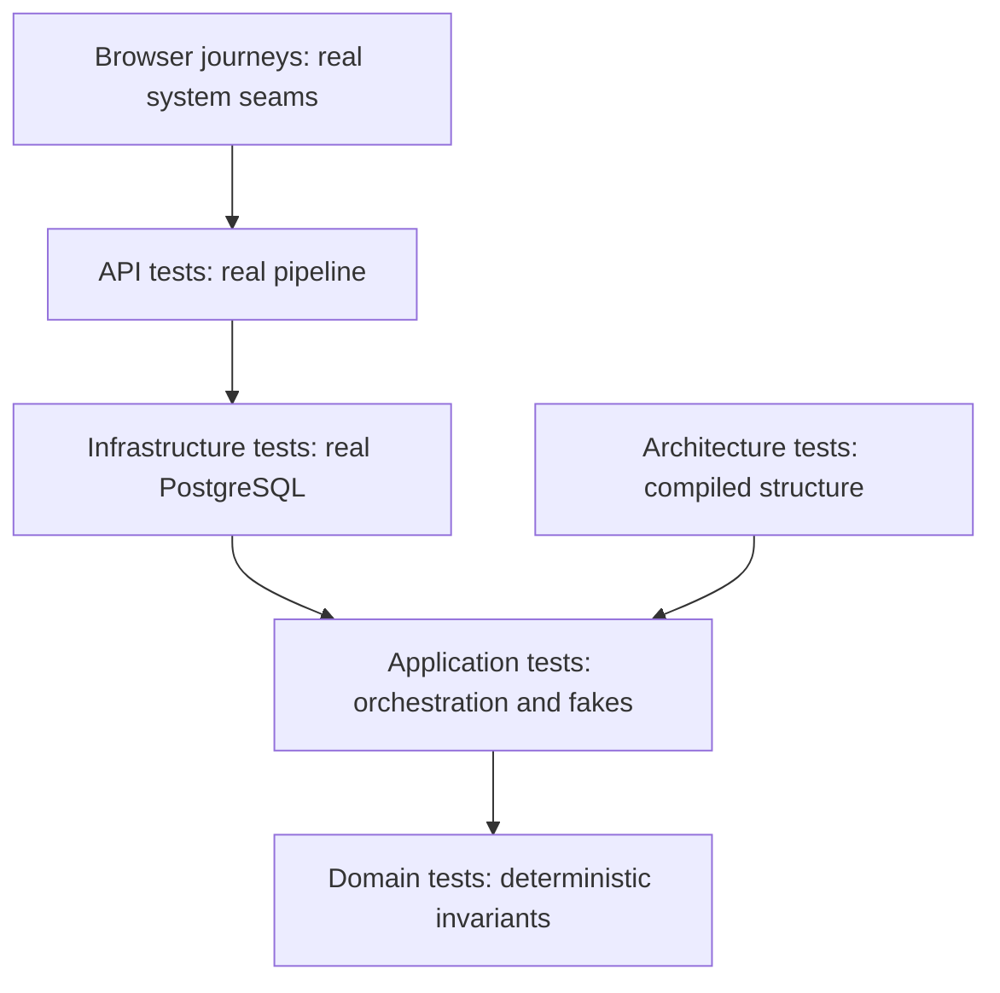

#### What it means

A test is executable evidence for a specific claim. A domain test can prove that an invalid capacity is refused. It cannot prove that two simultaneous HTTP requests never take the same last seat. A browser test can prove that a person can find the enrollment form and use it. It cannot establish every boundary of the capacity rule. These are different questions, and choosing a test means choosing the smallest environment that can answer the question honestly.

The repository has five backend test projects. Domain tests call business objects. Application tests call handlers and the dispatcher with hand-written doubles. Architecture tests inspect project references, compiled types, source text and the EF model. Infrastructure tests use real PostgreSQL. API tests host the real HTTP application in-process. Separate browser projects exercise development journeys and an already-running production-style instance. This separation is visible in the test project files, fixtures and `smoke/playwright.config.ts:14`.

#### The problem it solves

Without this hierarchy, either everything becomes a slow browser test or everything is mocked. The first option makes a one-character rule change expensive to check. The second can report success while a migration omits a unique index or the runtime database role bypasses isolation.

```csharp
// Hypothetical: this proves only the test double returns the value we arranged.
var repository = new FakeRepository { SeatsAvailable = true };
Assert.True(await repository.HasSeatAsync(groupId));
```

The actual last-seat tests instead run competing commands through real transactions and count persisted rows. Their assertions are not inferred from a mock's configured answer.

#### How it works

Arrange the state that matters, execute the operation under the chosen boundary, then assert observable outcomes. Keep unrelated components outside that boundary. A pure name rule needs no HTTP host. A claim that an error is HTTP 409 requires HTTP or a direct test of the mapping. A claim about PostgreSQL SQLSTATE requires PostgreSQL itself.

Tests should also establish that their experiment could detect failure. An independence test removes one defense before checking another. A race test measures whether requests overlap. A model test introduces a synthetic entity to avoid passing merely because its production scan found nothing. These controls make passing tests more informative than broad success banners.

#### How THIS project implements it

`tests/TutoringCentre.Domain.Tests` covers entities, results, phone numbers, search normalization, permissions and scheduling generation. `tests/TutoringCentre.Application.Tests/Fakes` supplies repositories, read services, a clock, actor context and unit of work. `tests/TutoringCentre.Infrastructure.Tests/Fixtures/PostgresFixture.cs:61` creates the database environment. `tests/TutoringCentre.Api.Tests/Fixtures/ApiFactory.cs:43` creates the HTTP environment.

The infrastructure fixture configures the same Application and Infrastructure registration methods used by the real host. This matters: calling a repository directly would not prove the dispatcher opens a transaction, installs the tenant setting or saves audit entries. Conversely, handler tests deliberately build handlers without production infrastructure so a failure points toward business orchestration rather than Docker startup.

#### Execution example

To verify a student's enrollment, the suite asks several questions at different levels. `EnrollmentTests.cs` checks entity behavior. `EnrollStudentHandlerTests.cs` checks handler branches through fakes. `EnrollmentUseCaseTests.cs` dispatches against real storage. `LastSeatConcurrencyTests.cs:33` runs ten contenders for one remaining seat across twenty repetitions. `LastSeatHttpTests.cs` checks the HTTP result. Frontend journeys then exercise the visible enrollment workflow.

These tests are complementary. If a domain test passes and the HTTP test fails, inspect endpoint binding, authorization, transaction wiring and error mapping before rewriting the entity. If only the parallel test fails, inspect locking order and constraint translation rather than form validation.

#### Why this project needs it

This system handles isolated centres, staff privileges and limited seats. Those guarantees cross boundaries: a valid domain object is insufficient if the database stores a cross-centre relationship. The layered suite makes those boundaries explicit and keeps most rule checks fast.

#### Alternatives

A single end-to-end suite has fewer test technologies but weaker failure localization. A suite using only mocks is fast but cannot prove database behavior. SQLite and EF's in-memory provider can test some queries but cannot substitute for PostgreSQL policies, SQLSTATE values or exclusion constraints. The repository's use of PostgreSQL-specific assertions explains why its database tests need PostgreSQL.

#### Important details

A test name is a statement of intent; its assertions are the evidence. Counts of `[Fact]` and `[Theory]` declarations are not counts of executed cases because theories expand. A passing suite is evidence for its current assertions, not proof of absent bugs or production deployment. The run results later in this report use the test runner's totals rather than source declaration counts.

#### What I should understand before modifying this code

Choose the test boundary from the claim. Add a pure test for a rule, a real database test for a constraint, and an HTTP test when status or authorization matters. Preserve the independence and overlap controls. Do not replace a real PostgreSQL assertion with a fake merely to make the suite faster.

<a id="infra-test-doubles"></a>
## 6.47 Test doubles, call records and controllable time

#### What it means

A test double replaces a dependency during an experiment. A stub supplies a prepared answer. A fake supplies a small working implementation, such as an in-memory list. An interaction-recording double records calls so a test can check their sequence. The repository writes these classes directly instead of introducing a mocking library.

The important distinction is between arranging an input and assuming the conclusion. Returning a known membership is a reasonable way to isolate a handler's response to membership data. Returning a known successful transaction is not evidence that PostgreSQL rollback works. Doubles help isolate one responsibility; they do not reproduce every guarantee of the replaced system.

#### The problem it solves

Without substitution, every handler test would need a database, identity users and a running host. Failures would be slower and harder to attribute. Without a controllable clock, a schedule test could change behavior when the calendar crosses a week or daylight-saving transition.

```csharp
// Hypothetical dependency that is difficult to test deterministically.
var today = DateTimeOffset.UtcNow;

// The repository's approach: ask an injected clock or provider.
var clock = new FakeClock();
```

The second form lets a test choose the date that exposes the rule. It also avoids waiting for real calendar events.

#### How it works

A handler accepts an interface in its constructor. Production composition provides the real adapter; the test supplies a fake implementing that same interface. The handler executes unchanged. Assertions inspect the returned result, fake state, or recorded calls.

For pipeline behavior, each dependency appends a recognizable event to a shared list. Comparing that list against an expected sequence detects an extra save, a missing rollback or a transaction that starts before validation. The fake need not implement a database engine because its purpose is to expose the dispatcher's decisions.

#### How THIS project implements it

`tests/TutoringCentre.Application.Tests/Fakes/FakeUnitOfWork.cs:9` records `Begin(ro)`, `Begin(rw)`, `Save`, `Commit` and `Rollback`. `ThrowOnSave` simulates an unexpected save exception. `SaveFailure` simulates an expected persistence error returned as a failed `Result`.

```csharp
// Real code: FakeUnitOfWork.cs, SaveChangesAsync.
Calls.Add("Save");
if (ThrowOnSave)
{
    throw new InvalidOperationException("Simulated SaveChanges failure.");
}
return Task.FromResult(SaveFailure is null ? Result.Success() : Result.Failure(SaveFailure));
```

The distinction matters because the production dispatcher handles failure values and thrown faults through different branches. One fake supports both experiments without pretending they are the same outcome.

`ApiFactory.cs:32` exposes `FixableTimeProvider`. Its test registration replaces `IClock`, while leaving the framework's `TimeProvider` real. The comment at `ApiFactory.cs:111` explains why: fixing the business date must not accidentally expire cookies or invalidate antiforgery infrastructure.

#### Execution example

`ScheduleDoubleBookingHttpTests.cs:28` fixes the business clock at 2027-04-20 08:00 UTC. The test creates a teacher and two groups, then submits overlapping rules. Because the generation horizon starts from a stable date, the winner generates exactly four sessions. The test's disposal restores real time so later tests do not inherit the fixed calendar.

At the Application layer, a dispatcher test sets `SaveFailure`, sends a successful handler result, and checks that the dispatcher returns the persistence failure and rolls back instead of committing. This isolates pipeline behavior from the SQL constraint that might produce the failure in production.

#### Why this project needs it

Scheduling is date-dependent, and commands have a specific transaction protocol. Both would be painful to verify with only live services. Small explicit doubles make the inputs and observations visible to a reader learning the architecture.

#### Alternatives

Moq or NSubstitute could generate configurable substitutes. A test-specific subclass could override behavior but would couple tests to implementation inheritance. Delegates can replace one-method interfaces. The repository does not explicitly state why hand-written fakes were chosen. The following is an interpretation based on the implementation: explicit classes make state and call order easy to inspect and avoid a second configuration language.

#### Important details

The fake's behavior can drift from production. A list does not enforce a PostgreSQL composite foreign key. A completed task does not model cancellation or lock contention. Keep integration tests for those properties. Sharing a mutable fake between tests also creates order dependence, which is why the unit-of-work comment says to use one instance per test.

#### What I should understand before modifying this code

Read the fake together with its interface and production adapter. Extend only the behavior the test needs. Keep `IClock` replacement separate from framework time. When a test changes the clock, restore it. Treat call-list strings as part of the test harness contract when editing dispatcher assertions.

<a id="infra-postgres-fixtures"></a>
## 6.48 Real PostgreSQL fixtures, isolated databases and least privilege

#### What it means

An integration fixture creates and owns expensive shared resources for a group of tests. Here the resource is a throwaway PostgreSQL 17 container. The fixture bootstraps roles, applies the real migrations, builds production services and resets data between tests. Its lifetime is longer than one test method, but each test receives a clean data state.

Least privilege means the application connects with only the permissions needed for normal work. This is also a testing requirement. A test run as a superuser cannot prove that row-level security or denied DDL protects the runtime login, because the superuser has exceptional authority.

#### The problem it solves

Without controlled fixtures, tests could depend on a developer's local database or each other's rows. Without distinct roles, isolation tests could pass for an application predicate while silently failing to exercise PostgreSQL's real security boundary.

```csharp
// Hypothetical weak experiment: the application is tested with administrator credentials.
services.AddInfrastructure(ConfigurationWithSuperuserConnection());

// Actual fixture design: application services receive AppConnectionString.
["ConnectionStrings:Postgres"] = connectionString;
["ConnectionStrings:PostgresMigrations"] = OwnerConnectionString;
```

The final two assignments are from `PostgresFixture.CreateServiceProvider`, starting at line 143. The default `connectionString` is the runtime login.

#### How it works

Testcontainers asks Docker to start a real database on an available port. The fixture executes the repository's own bootstrap script inside that container. It then applies migrations as `tutoring_owner`, while normal application services use `tutoring_app`. A separate superuser connection is retained only for preparation, cleanup and independent assertions.

Respawn discovers relationships and deletes application rows between tests while preserving the migration history. Cleanup deliberately uses the superuser because forced row-level security would hide rows from an owner connection without a tenant setting. This is a controlled exception in the harness, not the application's runtime configuration.

#### How THIS project implements it

`PostgresFixture.cs:61` starts the container and invokes `RoleBootstrap.RunAsync`. Lines 67-68 build services and apply migrations. Lines 75-80 configure Respawn for `platform`, `identity`, `academics`, `probe` and `audit`, ignoring `platform.__ef_migrations_history`. `ResetAsync` at line 222 opens the superuser connection and calls `_respawner.ResetAsync`.

`tests/TutoringCentre.Infrastructure.Tests/Fixtures/RoleBootstrap.cs:15` reads `db/bootstrap-roles.sh`, copies it into the container, makes it executable and invokes it with test-only passwords. The API project has a corresponding harness helper. This reuses the real role setup instead of writing a weaker test-only imitation.

`RuntimeRolePrivilegeTests.cs:22` directly queries `current_user`, `rolsuper` and `rolbypassrls`. Other tests assert SQLSTATE `42501` for forbidden schema changes, centre deletion, migration-history insertion and Data Protection key updates/deletes. These are observations about the actual runtime role.

#### Execution example

A persistence test begins. The collection fixture has already started PostgreSQL, bootstrapped roles and migrated the schema. The test base resets data. Test preparation inserts known rows through the superuser connection. A fresh application scope sets a staff actor and dispatches a query using `tutoring_app`. PostgreSQL applies the transaction's tenant setting and policies. The result is asserted. A separate superuser count confirms what physically remains, even if the application's filters would hide it. The next test resets all application rows again.

#### Why this project needs it

The project relies on PostgreSQL-specific enforcement: read-only transactions, role grants, forced policies, composite foreign keys, partial unique indexes and scheduling exclusion constraints. A different engine or privileged login would change the very properties being tested.

#### Alternatives

A shared permanent test database is faster to start but risks stale rows and accidental use of real data. Recreating a container for every test gives strong isolation but is expensive. An in-memory provider is useful for some object behavior but cannot establish PostgreSQL permissions. The current shared-container/reset approach balances startup cost with clean test state.

#### Important details

`PostgresFixture.ProbeServices` is a separate service provider whose `AppDbContext` resolves to the same scoped `TenantProbeDbContext`. This lets test-only tenant probes pass through the real unit of work. A separate context instance would silently lose the transaction and tenant setting under test.

The API fixture's Respawn schema list differs: `ApiFactory.cs:58` lists `platform`, `identity` and `academics`, whereas the infrastructure fixture explicitly includes `audit` and `probe`. Do not describe those reset configurations as identical. Whether dependent audit rows are cleaned through relationship discovery must be checked against actual fixture behavior rather than inferred from the list alone.

#### What I should understand before modifying this code

Keep the application login unprivileged. Use superuser preparation only to establish independent known state. Add newly owned schemas to the appropriate reset plan. Preserve the migration history table. When a tenant test seems inexplicably empty, inspect actor assignment, transaction setup and database role before changing the query.

<a id="infra-http-tests"></a>
## 6.49 In-process HTTP tests and explicit endpoint inventories

#### What it means

An HTTP integration test sends a request through the real application's binding, middleware, authorization, endpoint filters and response mapping. `WebApplicationFactory<Program>` hosts that application inside the test process, so no public port is required. It is more complete than calling a handler, and narrower than controlling a browser.

An endpoint inventory is a separate security proof: every route the application exposes must be assigned an intentional access category. New endpoints cannot silently escape the test matrix merely because nobody remembered to add an assertion for them.

#### The problem it solves

Calling `HandleAsync` directly never checks whether an invalid JSON body becomes the right HTTP error or whether an endpoint forgot its permission binding. Hand-maintaining a list of protected examples is also insufficient: the list may stay green while a newly added route has no test.

```csharp
// Hypothetical incomplete test: one known endpoint remains protected.
Assert.Equal(HttpStatusCode.Unauthorized, (await client.GetAsync("/api/subjects")).StatusCode);

// Actual inventory design: compare all running routes with all classified routes.
var unclassified = actualRoutes.Except(expectedSet, StringComparer.Ordinal).ToList();
var missing = expectedSet.Except(actualRoutes, StringComparer.Ordinal).ToList();
```

The real comparison is in `EndpointInventoryTests.cs:50`.

#### How it works

The factory starts the real `Program` with environment `Testing` and controlled configuration. It replaces selected test services before host construction. Requests are handled by the in-memory server, but use the normal request and response pipeline. Database-backed tests still talk to real PostgreSQL.

The inventory resolves `EndpointDataSource`, walks route endpoints, reads method metadata and constructs keys such as `GET /api/me`. Routes without a method restriction use `ANY`. It excludes endpoints explicitly hidden from API description, such as fallbacks, then compares the discovered set against explicit anonymous, authenticated and permission-matrix categories.

#### How THIS project implements it

`ApiFactory.cs:100` selects environment `Testing`, supplies both connection strings, sets a throwaway seed password, disables the positive session-validation cache and enables scope/build validation. The controlled environment prevents developer user-secrets from deciding the database under test.

`EndpointInventoryTests.cs:20` begins the anonymous route entries: health, readiness, system info, antiforgery and login. Lines 29-35 list any-authenticated routes: logout, profile, centre selection and password change. Other routes come from `PermissionMatrixTests.MatrixRoutes`. `EveryRunningEndpoint_IsClassifiedExactlyOnce` at line 38 checks duplicate expectations, unclassified routes and expected routes that no longer run.

`AntiforgeryTestHelper.cs` fetches actual token pairs rather than bypassing CSRF. API tests therefore verify that ordinary unsafe requests work through the same token mechanism as the browser.

#### Execution example

A developer adds a new Academics endpoint. The normal host maps it. `EndpointDataSource` now contains its method and raw route pattern. The inventory's actual set grows, but its expected categories do not. The assertion reports the new route as unclassified. The developer must deliberately put it in the right category and extend the permission matrix rather than receiving accidental coverage from a wildcard.

For a protected mutation, a test signs in with a real cookie, fetches an antiforgery token, sends JSON, and observes a concrete status and Problem Details code. That checks the endpoint's contract as well as the underlying use case.

#### Why this project needs it

The API now contains many staff, academic and scheduling operations with different access rules. An inventory prevents growth from weakening the original fail-closed intent. A route that no longer exists also fails the inventory, keeping tests from claiming protection for obsolete names.

#### Alternatives

Static source scanning could inspect mapping calls but would have to understand extension methods and conditionally registered routes. OpenAPI inventory is useful but may omit hidden routes. MVC attribute reflection works for controller systems; this repository uses minimal APIs and runtime route metadata. Wildcard expectations are concise but would conceal the very omissions this test seeks.

#### Important details

The inventory does not itself prove permission behavior; the matrix performs that behavioral work. Hidden fallbacks are excluded deliberately and need their own tests. Development-only OpenAPI is absent under environment `Testing`, so do not describe the inventory as a list of every route in every environment.

#### What I should understand before modifying this code

Add explicit route expectations with the new endpoint. Keep method and raw pattern exact. Do not derive expected permissions from the same role map that the implementation uses, because then a wrong implementation can produce a matching wrong expectation. Preserve real CSRF handling in HTTP tests.

<a id="infra-architecture-tests"></a>
## 6.50 Architecture tests as executable design constraints

#### What it means

An architecture test checks the structure of code rather than one business answer. It can ask which project references which, which namespaces a compiled type uses, whether every request has exactly one handler, or whether every tenant-owned entity has the expected database keys. These constraints become part of the build instead of relying only on diagrams and code review.

Different inspection methods answer different questions. Project XML reveals declared references. Compiled assembly inspection reveals used types. Source scanning can recognize forbidden calls. EF model inspection reveals configured keys and filters. No one method sees all four categories.

#### The problem it solves

Without executable constraints, a hurried endpoint could inject a repository, an Application handler could use EF directly, or a new tenant request could omit its permission declaration. All might compile. A new developer could reasonably mistake a missing convention for an allowed pattern.

```csharp
// Hypothetical structural regression: a query depends on a write repository.
internal sealed class GetSomethingHandler(ICentreRepository centres) { }

// Actual rule intent: query handlers must use read ports instead.
// CqrsRuleTests examines handler interfaces and constructor parameters.
```

The benefit is detection at the point of change, before that coupling spreads.

#### How it works

The tests obtain assemblies through known marker types. They enumerate requests and handlers, inspect generic interface arguments, examine constructor parameters, and use NetArchTest for forbidden dependencies. Source scans read production `.cs` files for calls that compiled type dependencies alone cannot distinguish. EF tests build the model without opening a database connection.

Several rules add non-vacuity guards: a scan finding no types must not silently pass. Synthetic tenant probe entities also prove conventions apply to an unfamiliar type, rather than merely matching today's named entities.

#### How THIS project implements it

`ProjectReferenceTests.cs:8` defines the allowed four-project graph: Domain has no project references; Application references Domain; Infrastructure references Application and Domain; API references Application and Infrastructure. `DependencyRuleTests.cs:15` forbids framework and outer-layer namespaces in inner layers.

`QueryFilterBypassTests.cs:14` forbids calls beginning with `IgnoreQueryFilters`, `FromSqlRaw`, `FromSql`, `SqlQuery`, `ExecuteSqlRaw` and `ExecuteSql`, outside a narrow allow-list and migrations. The pattern also accepts suffixes and generic calls, so `ExecuteSqlRawAsync` is not a loophole.

`TenantScopeRuleTests.cs:22` enumerates tenant Application namespaces. `AuthorizationRuleTests.cs:42` requires tenant requests to implement `IRequirePermission`; another test reads their permission keys and checks the catalogue. `ModuleBoundaryRuleTests.cs:27` defines Platform, Identity, Academics and Audit namespace groups and forbids access to other modules' internal ports and entities while allowing narrow contracts.

#### Execution example

A new Academics query omits `ITenantScoped`. The type compiles and can have a perfectly valid handler. `EveryRequestInATenantModule_DeclaresTenantScoped` identifies its namespace and interface set, then reports the missing marker. If the marker is added but no permission declaration follows, `EveryTenantScopedRequest_AlsoDeclaresIRequirePermission` fails next. A misspelled permission then fails catalogue validation.

This chain protects the dispatcher contract at registration time. It is separate from HTTP tests because the same request can be invoked by a CLI or another trusted front door.

#### Why this project needs it

The repository keeps several functional modules inside four assemblies. Namespace boundaries therefore carry real responsibility that the compiler alone does not enforce. Tests make those boundaries visible and reduce the chance that convenience erases the architecture.

#### Alternatives

Separate assemblies per module give stronger compile-time barriers but increase project count. Roslyn analyzers can show editor diagnostics but require analyzer development. ArchUnitNET offers another dependency-testing library. Human review remains useful but is not repeatable enforcement. The ADRs document the choice of a small project set backed by architecture tests.

#### Important details

Name-based repository detection can miss a differently named port. Regex source scanning can match comments or miss code written in an unexpected style. The current raw-SQL allow-list is a deliberate exception list, not proof that raw SQL is always unsafe. It contains the unit of work, migration support, runtime privilege health check and repositories needing database locking operations.

`TenantModelTests.cs` contains historical comments saying production tenant entities or relationships do not exist. The current test inspects the real model regardless of those comments; do not reproduce their old state as current fact.

#### What I should understand before modifying this code

Treat a rule failure as a design signal. Change the production code first unless the design itself is intentionally changing. Keep exceptions named narrowly. Add new module namespaces to the map and add non-vacuity checks when a rule could otherwise pass on an empty set. Read source, compiled dependency and model tests together.

### Deeper dive: what each architecture experiment actually sees

It helps to trace one change through all the mechanisms rather than treating “architecture tests” as one scanner. Suppose a developer adds an Academics query that looks up a staff account and returns an Identity entity. Several different design mistakes are possible. The query could depend directly on an Identity repository. Its DTO could expose an Infrastructure type. It could omit tenant scoping or permission metadata. Its database entity could have a plain foreign key that ignores centre ownership. No single reflection test sees all those problems, because they live in different representations of the program.

The declared project graph is checked before any such detail. `ProjectReferenceTests` asks `ProjectFiles.ReadProjectReferences` to parse project XML and compare exact sorted project-name arrays. Application's only permitted project reference is Domain. Adding an unused Infrastructure reference still changes the XML and fails this check. That unused reference may not survive as a meaningful compiled type dependency, which is why examining assemblies alone would be insufficient. Conversely, importing a forbidden framework through another permitted dependency can appear in compiled code without adding the exact project reference the XML checker recognizes. Both representations matter.

`DependencyRuleTests` obtains assemblies through marker types, then passes them to NetArchTest. The library examines dependencies of the compiled types against forbidden namespaces. Before asserting absence, the helper checks the scanned type set is nonempty. That small control prevents a renamed or wrong assembly from making a rule pass by inspecting nothing. The failure message names the assembly and failing types. A returning developer should use that list to locate the actual coupling rather than weakening the namespace list until the test turns green.

Handler conventions require more specific discovery. A command is recognized by its implemented closed generic `ICommand<T>` interface, not merely by a class name ending in Command. Handler discovery similarly reads `ICommandHandler<TRequest,TResponse>` or `IQueryHandler<TRequest,TResponse>`. The cardinality rule builds the relationship between each concrete request type and its matching handler types, then requires exactly one. Zero handlers would otherwise fail only when DI resolution occurs at runtime; two handlers could be hidden by the container's last-registration behavior. The test also requires handlers to be sealed and nonpublic, encoding their intended status as implementation details reached through dispatch.

Repository conventions use names in a way generic handler discovery does not. `ArchitectureSupport` identifies an interface beginning `I` and ending Repository, and a concrete class ending Repository. Placement tests then require ports in Application and implementations in Infrastructure. Query-handler constructor inspection refuses repository interfaces as dependencies, directing read logic toward DTO-returning read services. This is useful enforcement, but its name convention is also a limit: an equivalent persistence port named Store would need the classifier updated or could evade this particular rule. Explaining the matching mechanism is more useful than describing the rule as an impenetrable compiler barrier.

The module map adds a second boundary inside the layers. `ModuleBoundaryRuleTests` groups Application namespaces into Platform/Centres, Identity/Staff, Academics and Audit. It computes the other modules' repository interfaces, read-service interfaces, handlers, validators and Domain types, then asserts the current module does not depend on those forbidden types. Shared common namespaces and a small explicitly named set of cross-cutting Domain types are exempt. This is how four projects can still host several modules without making every module's internal persistence interfaces globally acceptable.

Published contracts are checked separately. Types in namespaces ending `.Contracts` must be interfaces or records. The record test looks for the compiler-generated `<Clone>$` method, which is appropriate to the reference-type records used here. A contract must also avoid depending on its own module's repositories, read services or entities. Otherwise a supposedly narrow contract could simply wrap an internal entity and re-export the coupling. The tests require a nonempty contract set so this allowance remains exercised. This is the mechanism behind the explicit Identity directory contract used by academic teacher-account linking.

Tenant markers are discovered from interface membership, then checked against the declared namespace map. `TenantScopeRuleTests` requires requests in tenant modules to implement `ITenantScoped`, while older platform/login queries must remain outside that marker. The second rule also asserts the non-tenant request set is nonempty. `AuthorizationRuleTests` requires every tenant-scoped request to declare `IRequirePermission` and validates each permission key against `Permissions.All`. It obtains that key from an uninitialized request instance because current implementations return constants. This is safe only while the property remains independent of instance state; adding computed permission logic would require revisiting the test mechanism, not merely its expected data.

The role-reference scan addresses a different question. It reads Application command/query source for literal `StaffRole.Owner`, Secretary or Teacher references outside a narrow allow-list. Its intent is that authorization goes through permissions rather than role checks scattered in handlers. Some staff handlers legitimately manipulate roles as data, and teacher-account linking legitimately asks a directory about the Teacher role, so those files are named exceptions. The regex sees text, not semantic intent; comments can match and differently written logic can evade it. That makes code review complementary rather than obsolete.

Finally, `TenantModelTests` builds the actual EF model without connecting. It finds every CLR type implementing `ITenantOwned`, requires a query filter, a nonnullable `CentreId`, a Restrict relationship to Centre and a key containing exactly CentreId and Id. For every relationship whose principal is tenant-owned, it checks CentreId appears on both sides. Synthetic parent and child probes prove the convention applies to unfamiliar types and actually exercises the tenant-to-tenant relationship assertion. These probes remain valuable even though comments dating from before Academics are stale: their purpose is a control against an accidentally vacuous or special-cased convention, not a claim that production still lacks relationships.

When changing architecture, locate which representation the failure concerns: project XML, compiled dependencies, generic interfaces, constructor types, source text or EF metadata. Each assertion proves only what that representation exposes. Together they provide a much stronger fence than any one, while keeping the remaining assumptions visible and reviewable.

<a id="infra-isolation-experiments"></a>
## 6.51 Defense-in-depth tests and removing one layer at a time

#### What it means

Two security controls are independently useful only if either still works when the other is bypassed. A test that leaves both enabled can show the combined system refuses access, but cannot identify which control actually did the refusing. A stronger experiment deliberately disables one control and tests the remaining one.

The repository uses this method for EF tenant query filters and PostgreSQL row-level security. It also tests write guards, database role privileges and composite foreign keys separately. These are different protections: hiding a row, refusing a mismatched write, limiting SQL authority and preventing a cross-centre reference.

#### The problem it solves

Suppose an EF filter is accidentally removed but RLS still hides other-centre rows. An ordinary query test passes. If the RLS policy is later weakened, the supposedly redundant filter is already gone. Testing both layers together never revealed the earlier loss.

```csharp
// Hypothetical incomplete assertion: both controls are enabled.
Assert.All(await NormalQuery(), row => Assert.Equal(nileId, row.CentreId));

// Actual experiment names state which control is bypassed.
// BypassingTheEfFilter_AsNileActor_StillReturnsOnlyNileRows
// EfFilterAlone_WithSuperuserConnectionInPlaceOfApp_StillReturnsOnlyNileRows
```

Those tests are in `TenantIsolationIndependenceTests.cs:17` and line 31.

#### How it works

Seed rows for two centres using a preparation connection independent of the controls under test. For the database-policy experiment, use a query that ignores the EF filter but still connects as `tutoring_app`. For the EF-filter experiment, replace the connection with a superuser, which bypasses database RLS, while leaving the EF model filter enabled. Each result should contain only the actor's centre.

A third experiment runs raw SQL inside a dispatched query. Raw SQL bypasses LINQ filters, but the transaction's tenant setting and PostgreSQL policy remain. This tests a different path from generated ORM SQL.

#### How THIS project implements it

`TenantIsolationIndependenceTests.cs:19` seeds Nile and Maadi probes. `ListProbeCentresIgnoringEfFilterQuery` exercises database isolation alone. The second test constructs services with `appConnectionString: Fixture.SuperuserConnectionString` and a probe context, leaving EF as the only filtering control. The third uses `ListProbeCentresByRawSqlQuery` through the dispatcher.

`TenantModelTests.cs:55` checks that tenant relationships include `CentreId` on both sides of their foreign key. That is a storage invariant independent of read filtering. `AuditImmutabilityTests.cs:21` tests UPDATE, DELETE and TRUNCATE denials as SQLSTATE `42501`; it separately tests cross-centre reads and inserts.

#### Execution example

A Nile actor queries probes after one Nile row and one Maadi row were inserted. The test-only handler bypasses EF filters. The dispatcher begins the transaction and the unit of work establishes `app.current_centre`. PostgreSQL applies the policy as `tutoring_app`, returns only Nile, and the test asserts the exact centre-id list. If that policy were absent, both rows would be visible and the test would fail even though the normal application query remained filtered.

The complementary test uses a superuser database connection. PostgreSQL no longer hides Maadi, so a passing exact-list assertion demonstrates that the EF predicate itself still scopes to Nile.

#### Why this project needs it

The design explicitly invests in multiple tenant controls. Without independent experiments, that investment could degrade into one functioning control and several decorative configurations. The tests make the intended redundancy measurable.

#### Alternatives

Mutation testing could systematically remove predicates and policies to see which tests fail. Manual penetration tests can inspect broader attack surfaces but are harder to repeat for every change. A single access-denied test is cheaper but provides weaker evidence about independence. The repository implements direct controlled experiments for the most important tenant boundaries.

#### Important details

Superuser use is acceptable here only because removing RLS is the explicit experiment. It would invalidate a test claiming to prove RLS. Preparation counts must also be independent: if a query is filtered incorrectly, using that same query to count leaked rows can hide the defect.

#### What I should understand before modifying this code

State which defense each new test isolates. Keep the other layer genuinely bypassed. Seed both allowed and forbidden rows. Assert exact identities or counts rather than merely nonempty results. Preserve the probe context's shared transaction wiring, otherwise a test may exercise a different tenant lifecycle from production.

<a id="infra-concurrency-tests"></a>
## 6.52 Concurrency tests, synchronized starts and invariant assertions

#### What it means

Concurrency means operations overlap in time. A race occurs when their outcome depends on interleaving. A sequential test cannot establish a last-seat or double-booking guarantee because every second request sees the first request's completed state. A meaningful race test must create competing scopes and connections, overlap their critical operations, and inspect the persisted invariant.

The repository's races are bounded experiments, not full load tests. They target specific correctness properties: one last seat, one active enrollment, no capacity underflow, one owner remaining, unique names and no overlapping teacher sessions.

#### The problem it solves

```csharp
// Hypothetical sequential test: useful, but does not exercise a race.
await EnrollAsync(firstStudent);
var second = await EnrollAsync(secondStudent);
Assert.Equal("group.full", second.Error!.Code);
```

Both requests could still oversubscribe if run simultaneously. A parallel test has them wait at a start gate, then releases them together. It checks actual rows after completion, not only successful response counts.

#### How it works

Create independent clients or DI scopes before opening the gate. Build requests and fetch CSRF tokens beforehand so preparation does not serialize the contested interval. Use `TaskCompletionSource` to release contenders. Await every attempt. Assert one winner, expected loser codes and a correct database count. Repeat with fresh entities so state from earlier repetitions cannot force the later outcome.

For HTTP experiments, record start and finish times and verify that the latest start precedes the earliest completion. This establishes actual overlap in the observed request interval. It does not prove every SQL instruction overlaps, but rules out a wholly sequential request execution masquerading as a race.

#### How THIS project implements it

`LastSeatConcurrencyTests.cs:19` declares twenty repetitions and ten last-seat contenders. Line 25 checks the runtime connection pool can support the largest parallelism; a smaller pool would serialize before the database lock. Line 62 tests fifty contenders for a one-seat group over five repetitions. Line 83 tests duplicate enrollment of the same student, and line 106 races enrollment against shrinking capacity.

`ScheduleDoubleBookingHttpTests.cs:38` signs in separate owner and secretary clients, prepares overlapping rules and records each attempt's elapsed interval. It requires one 201 and one 409 with `schedule.teacher_double_booked`, then independently counts exactly one rule and four sessions through the fixture's superuser connection.

#### Execution example

Nineteen students occupy a twenty-seat group. Ten fresh students compete for the final seat. Each command uses its own scope and connection. The repository lock serializes access to the group row. One transaction sees nineteen active enrollments and inserts the twentieth. Later contenders acquire the lock after that commit, see twenty, and return `group.full`. The test requires one successful result, nine specific failures and exactly twenty active rows.

It also counts audit entries for the group. Only the winning enrollment should be audited; losing commands must roll back their associated audit work. This links the seat invariant to atomic transaction behavior rather than checking them in isolation.

#### Why this project needs it

Seat counts and teacher availability are shared resources. Two staff members can act at once. Friendly validation before a write is insufficient because both requests can observe the same earlier state. Tests therefore exercise the database mechanism that arbitrates concurrent work.

#### Alternatives

Deterministic database barriers inside a test-specific adapter can align the exact race window more tightly. Stress tools can increase contention but make failures harder to localize. Model checking can explore interleavings for a simplified model. The repository uses repeated real-database races with explicit gates and invariant checks as practical evidence for its chosen locks and constraints.

#### Important details

Repetition reduces the chance of missing timing-sensitive faults but is not mathematical proof. A failure accepting any exception would be too weak: a loser should receive the expected business outcome, not a random 500. These tests assert concrete error codes and persisted state. Keep the connection pool large enough that contenders reach PostgreSQL simultaneously.

#### What I should understand before modifying this code

Read the lock acquisition order together with every competing mutation. Capacity changes must participate in the same protocol as enrollment. Keep fresh groups or teachers per repetition. Do not relax an exact expected conflict into a broad exception assertion to make a race pass. Confirm both outcome and physical storage state.

<a id="infra-options-health"></a>
## 6.53 Typed configuration, startup validation and health probes

#### What it means

Configuration is input supplied by the environment rather than business users. A connection string, trusted proxy network or telemetry collector address can change between a developer machine and a container without changing compiled source. Typed options turn named settings into objects. Validation checks those objects before the application accepts traffic.

Health probes answer operational questions. Liveness asks whether this process is alive. Readiness asks whether it can safely serve its intended work. A process can be alive while its database is unreachable or while its database credentials are dangerously privileged. Treating those as different states prevents an operator from confusing a restart problem with a dependency or security problem.

#### The problem it solves

```csharp
// Hypothetical: a misspelled key fails only when this request first runs.
var value = configuration["ConnectionStrings:Postgress"];
await OpenDatabaseAsync(value);

// Current composition registers typed options and startup validation.
services.AddOptions<ProxyOptions>()
    .Bind(configuration.GetSection("Proxy"))
    .ValidateOnStart();
```

The second form appears in `ForwardedHeadersSetup.cs:18`. Its validator can reject an empty Production proxy list and malformed CIDR values at startup. A failure is therefore tied to deployment configuration, instead of surfacing later as misleading client behavior.

#### How it works

The host builds configuration from providers. Later providers override earlier values. Options binding reads a section into a class. Registered validators inspect the result; `ValidateOnStart` arranges validation when the host starts. Application code receives the resulting options through DI rather than reconstructing strings everywhere.

Health-check registration is separate. The host associates checks with tags. A mapped health endpoint chooses which checks run. In this application `/health` deliberately selects none, while `/health/ready` selects checks tagged `ready`. Failure responses stay generic because readiness is anonymous.

#### How THIS project implements it

`Program.cs:57` registers proxy options. `ProxyOptionsValidator.cs:20` requires at least one trusted network in Production and parses each configured CIDR. `Program.cs:61` binds demo options and validates on start. Infrastructure validates database options; the runtime and migrations connection strings have different roles in operation.

`Program.cs:204` maps liveness with `Predicate = _ => false`. Readiness follows with `c.Tags.Contains("ready")`. Besides connectivity, `RuntimeRolePrivilegeHealthCheck.cs:18` opens the runtime connection and queries PostgreSQL role metadata. It returns unhealthy when the login is superuser, has `BYPASSRLS`, or is the named owner role.

```sql
-- Real query from RuntimeRolePrivilegeHealthCheck.cs.
select rolsuper or rolbypassrls or rolname = @ownerRole
from pg_roles where rolname = current_user;
```

This is a configuration tripwire. A working connection with the wrong authority is not considered ready merely because `SELECT 1` succeeds.

#### Execution example

A container starts with `ConnectionStrings__Postgres` mistakenly pointing to `tutoring_owner`. The process can bind its HTTP port and liveness can remain healthy. Readiness opens that configured connection, finds the owner role and returns unhealthy. A deployment gate polling readiness refuses to treat that instance as fit to serve. The test family `ReadinessPrivilegeTests.cs` exercises privileged versus ordinary credentials, while `RuntimeRolePrivilegeTests.cs` directly inspects grants.

For a malformed proxy CIDR, the failure happens earlier: options validation rejects it during host startup. There is no need to wait for an incoming forwarded request to discover it.

#### Why this project needs it

Tenant isolation depends on operational choices as well as code. Supplying an owner connection can defeat assumptions beneath otherwise correct handlers. Trusted network configuration also determines whether client addresses and HTTPS scheme are interpreted safely behind Caddy. Explicit startup and readiness checks make those assumptions observable.

#### Alternatives

Direct configuration reads are simple but spread key names and defer errors. `IOptionsMonitor` supports changing settings while running, but a runtime change to security configuration needs careful lifecycle handling. One combined health endpoint is easier to name but cannot distinguish restart from traffic eligibility. An external database probe can check connectivity but would not necessarily use the application's actual configured login.

#### Important details

Readiness does not repair configuration or revoke database privileges. An orchestrator or deployment gate must act on its result. No Azure gate exists yet; CI and local Compose demonstrate parts of the intended process. An options object with a default value does not automatically prove the value is appropriate for production.

The build-time OpenAPI path supplies placeholder options in `Program.cs:33`, but actual execution during this audit still logged a database key-ring access error. Therefore the source comment that nothing connects during generation is stronger than observed behavior. The build completed; its diagnostic side effect remains separately documented.

#### What I should understand before modifying this code

Add settings where their ownership belongs, validate values that would make startup unsafe, and decide whether a failure means dead or merely unready. Keep anonymous probe output generic. Test readiness with the actual runtime role. Preserve the distinction between required runtime settings and owner-only migration settings.

<a id="infra-docker-build"></a>
## 6.54 Docker images, multi-stage builds and static frontend packaging

#### What it means

An image is the packaged filesystem and launch configuration used to create containers. A container is a running process using that image with isolation provided by the container platform. Building and running are different phases: compilers and package managers are needed during the build, but the running service needs only the compiled application and its static assets.

A multi-stage Dockerfile makes that separation explicit. Each `FROM` starts a stage with its own filesystem. Later stages copy selected outputs from earlier stages. The final image can therefore contain the runtime application without containing the SDK, npm dependencies or source tree used to build it.

#### The problem it solves

```dockerfile
# Hypothetical single-stage image: all build tooling remains in production.
FROM mcr.microsoft.com/dotnet/sdk:10.0.401
COPY . /src
WORKDIR /src
RUN dotnet publish -c Release
CMD ["dotnet", "src/TutoringCentre.Api/bin/Release/net10.0/TutoringCentre.Api.dll"]
```

That approach also does not build the React bundle. The repository's actual image builds both toolchains and copies only their outputs into an ASP.NET runtime stage.

#### How it works

Docker caches build instructions and their inputs. Copying manifests before source lets dependency installation reuse a layer when application code changes but dependencies do not. Building React produces static HTML, JavaScript, CSS and fonts. Publishing the API produces assemblies and runtime files. The final stage combines those outputs under `/app`, placing the frontend in `wwwroot` for same-origin serving.

The process runs as a non-root user. That is a different protection from database least privilege: one limits operating-system authority; the other limits SQL authority. Both matter, and neither replaces application authorization.

#### How THIS project implements it

`Dockerfile:7` starts `node:22.12-alpine` as `frontend-build`. It copies `frontend/package.json` and the lockfile, runs `npm ci`, copies frontend source and runs `npm run build`.

`Dockerfile:18` starts the .NET SDK stage pinned to `10.0.401`. It accepts `COMMIT_SHA`, copies solution-wide props and each source project file, restores the API project, then copies source and publishes Release output. `SourceRevisionId` carries the supplied commit into assembly informational versions.

```dockerfile
# Real final-stage structure, Dockerfile.
FROM mcr.microsoft.com/dotnet/aspnet:10.0
WORKDIR /app
COPY --from=backend-build /app/publish .
COPY --from=frontend-build /frontend/dist ./wwwroot
ENV ASPNETCORE_HTTP_PORTS=8080
EXPOSE 8080
USER $APP_UID
CMD ["dotnet", "TutoringCentre.Api.dll"]
```

`.dockerignore` excludes Git metadata, `.env`, build outputs, node_modules, test source, docs and deployment-support files not needed in the image build. This reduces context size and prevents the local environment file from being sent as build context.

#### Execution example

CI supplies the commit SHA and builds `tutoring-centre:ci`. The frontend stage installs the lockfile and produces `dist`. The backend stage restores and publishes. The final image receives the API and `dist` as `wwwroot`. A later `docker run` starts Kestrel on port 8080. Requests to `/` receive the built frontend from the same process that serves `/api`.

The container CI job also invokes the image with `dotnet TutoringCentre.Api.dll migrate`. Because the Dockerfile uses `CMD` rather than an immutable entrypoint, the command can replace normal web hosting for a one-shot operation. The same packaged code therefore performs migration before serving.

#### Why this project needs it

The application has two build systems but one deployment unit. Packaging both outputs together preserves the same-origin cookie design and gives CI an artifact resembling the intended production service. A source-only .NET image would miss the frontend; a separate static host would introduce an additional origin and hosting boundary.

#### Alternatives

Build outside Docker and copy ready outputs into a runtime image; this can be fast but depends more on the external build environment. Host the frontend independently behind a shared reverse proxy; that adds routing and release coordination. Publish a self-contained .NET executable; the repository currently uses a framework-dependent publish and the ASP.NET runtime image. Single-stage builds are easier to sketch but retain unnecessary tooling.

#### Important details

An `EXPOSE` instruction documents a container port; it does not publish that port to the host. Compose or `docker run` decides publication. `USER $APP_UID` affects the final runtime stage, not earlier image-building commands. A non-root process can still misuse a privileged database connection, so runtime SQL credentials remain separately restricted.

Image tags such as `aspnet:10.0` and `postgres:17` identify version lines, not immutable content digests. The repository does not pin every base image by digest. Record that accurately rather than claiming fully immutable builds merely because an npm lockfile exists.

#### What I should understand before modifying this code

Keep restore inputs before source to preserve cache usefulness. Include new required project files in the restore stage. Verify the final `wwwroot` location against SPA hosting. Do not copy local secrets into the image. Preserve command replacement if the same image must keep supporting migrate and seed jobs.

<a id="infra-compose-roles"></a>
## 6.55 Compose topology, role bootstrap and migrate-before-serve ordering

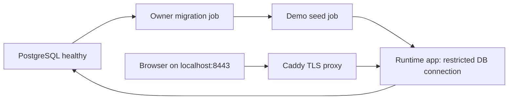

#### What it means

Compose describes several cooperating containers, their environment, networks, volumes and startup dependencies. It is not just a shorter `docker run`: it can express that a database must be healthy before migration starts, migration must complete successfully before seeding, and seeding must succeed before the web app starts.

Database bootstrap is separate from schema migration. Bootstrap creates logins and grants authority to perform future work. Migration evolves application tables. The runtime application should not receive the owner credential merely because someone needs that credential earlier in deployment.

#### The problem it solves

A naive setup starts the web process and asks it to create schema on every startup. Multiple instances can then race, hold locks unexpectedly, or serve code before the schema is ready. Using one superuser login everywhere also erases the authority boundary tenant isolation depends on.

```yaml
# Real ordering from compose.prod.yaml, simplified to the relevant keys.
seed:
  depends_on:
    migrate:
      condition: service_completed_successfully
app:
  depends_on:
    seed:
      condition: service_completed_successfully
```

These conditions express completed work rather than merely created containers.

#### How it works

The base Compose file starts PostgreSQL and mounts `db/` into the image's initialization directory. On a new empty data volume, the Postgres entrypoint runs the bootstrap script. The override file adds migrate, seed, app and Caddy services on a fixed network.

Migrate receives the owner connection and runs one command. Seed is explicitly enabled for the demo environment and runs only after migrate succeeds. App receives the runtime connection and no owner connection. Caddy publishes the HTTPS entry point and forwards requests to app:8080. A named database volume preserves data across ordinary container recreation.

#### How THIS project implements it

`compose.yaml:3` uses `postgres:17`. Its environment requires administrator, owner and app passwords. `db/bootstrap-roles.sh:20` enables strict shell handling and requires the owner/app password variables. It creates missing roles and always resets their attributes to login, no superuser, no createdb, no createrole and no bypassrls.

The script grants database CREATE/CONNECT to the owner and CONNECT to the app. It does not make the app a member of the owner. Existing platform and identity schema objects can be transferred to the owner; identifier formatting uses SQL `format` with `%I` rather than concatenating arbitrary identifiers.

`compose.prod.yaml` separates four application-related roles: migrate, seed, app and Caddy. The `prod` network fixes subnet `172.28.0.0/16`, which matches `Proxy__KnownNetworks__0`. Caddy uses `tls internal` for `localhost:8443` and forwards to `app:8080`.

#### Execution example

On an empty volume, `docker compose -f compose.yaml -f compose.prod.yaml up --build` starts PostgreSQL initialization. The role script creates `tutoring_owner` and `tutoring_app`. Health succeeds. The migrate container applies schema using the owner credential and exits successfully. Seed runs with demo mode enabled, creates the demonstration data and exits. App then starts with only `ConnectionStrings__Postgres`. Caddy accepts browser HTTPS traffic and forwards the request to app over the internal network.

Restarting app alone does not repeat migration or regenerate its database. Persistent Data Protection keys allow a cookie created before the restart to remain readable afterward, provided the same database and application identity are used.

#### Why this project needs it

This is a locally executable production topology. It exercises packaging, TLS termination, forwarded headers, owner/runtime credentials and startup ordering without inventing a cloud deployment that does not exist. It also gives the smoke test a stable HTTPS target.

#### Alternatives

An initialization sidecar could migrate before app startup in another platform. A deployment pipeline could invoke the migration image independently, then release app. A single container running shell scripts plus the web process is simpler initially but conflates lifecycle and credentials. Installing PostgreSQL locally avoids containers but does not prove the packaged topology.

#### Important details

The role script runs automatically only when the database volume is initialized. Editing its passwords in `.env` does not automatically rewrite an existing volume's logins. README explicitly calls out this first-start behavior.

The production override inherits the base database port publication `5432:5432`. Therefore the current local stack publishes PostgreSQL as well as Caddy. The deployment document's claim that only Caddy has a published port is incorrect for this merged configuration. Fixed networks and container dependencies do not themselves remove inherited port mappings.

#### What I should understand before modifying this code

Inspect the merged Compose configuration, not one file in isolation. Keep owner credentials out of app. Preserve success-based job dependencies. Treat volume removal as destructive data deletion, and do not use it as an automatic fix for a configuration mismatch. Update trusted proxy networks if network topology changes.

<a id="infra-proxy-spa"></a>
## 6.56 Reverse proxies, forwarded scheme, security headers and SPA fallbacks

#### What it means

A reverse proxy accepts a client request and sends it to an internal application. TLS can end at the proxy, so the internal hop is HTTP even though the browser used HTTPS. Forwarded headers describe the original scheme and client address. Those headers are claims: the application must decide which immediate peers are allowed to supply them.

Same-origin SPA hosting means HTML, assets and API share the browser's origin. A deep link such as `/groups/...` must return the SPA shell so the client router can render it. A missing JavaScript file must return 404, and an unknown `/api` route must remain JSON. These cases look similar to the server but require different responses.

#### The problem it solves

Without forwarded scheme handling, secure antiforgery checks may see HTTP behind TLS termination. Without client-address handling, a per-IP login limit groups every user behind the proxy together. Without careful fallback ordering, `/api/missing` can receive HTML or `/assets/missing.js` can receive a false-success app shell.

```csharp
// Hypothetical broad fallback: returns HTML for mistakes in API and asset paths.
app.MapFallbackToFile("index.html");

// Current Program.cs first reserves unknown API paths for JSON 404.
app.MapFallback("/api/{**path}", () =>
    Error.NotFound("route.not_found", "The requested route does not exist.").ToProblemResult());
```

The real mapping adds anonymous and description-exclusion metadata.

#### How it works

Forwarded-header processing runs before logic that depends on scheme or client IP. Security-header callbacks register before downstream work and set response headers immediately before sending, including after exception handling clears a response. Static-file middleware runs before route selection so existing files can be served without authentication work.

Explicit routing then selects API, health or fallback endpoints. The SPA fallback exists only if a physical `index.html` is present. Its nonfile constraint excludes paths that look like missing assets. A final unconstrained anonymous fallback returns the uniform JSON 404 for anything remaining.

#### How THIS project implements it

`ForwardedHeadersSetup.cs:38` configures `X-Forwarded-For` and `X-Forwarded-Proto` with `ForwardLimit = 1`, populating known IP networks from options. `Program.cs:162` calls it before HSTS, headers, correlation and logging. `SecurityHeadersSetup.cs:37` uses `OnStarting` to set CSP, nosniff, referrer policy, cross-origin opener policy and permissions policy. API responses receive `Cache-Control: no-store` unless already specified.

`SpaHostingSetup.cs:20` installs static files. `index.html` receives `no-cache`; other static assets receive one year of public immutable caching. The fallback checks for the built index before mapping. `Program.cs` explicitly places `UseRouting` after static files, with a comment explaining why implicit early selection could otherwise choose fallback endpoints before file serving.

#### Execution example

The browser opens `https://localhost:8443/subjects`. Caddy terminates TLS and forwards to app:8080 with forwarding headers. Middleware interprets trusted network information, registers security headers and correlation, then fails to find a physical `/subjects` file. Routing selects the SPA fallback and sends index HTML with no-cache. The browser loads hashed assets, which static files serve with immutable caching. React's router then applies the page guard and fetches protected data.

If JavaScript requests `/api/nope`, the API-specific fallback returns `application/problem+json` with `route.not_found`. If the browser requests `/assets/missing.js`, the nonfile SPA constraint does not match; the last fallback returns 404 rather than HTML.

#### Why this project needs it

The cookie and antiforgery design relies on correct scheme interpretation and a coherent browser origin. The packaged frontend also needs deep links to work after refresh. These deployment details are observable application behavior, not cosmetic infrastructure choices.

#### Alternatives

Caddy could serve static files and proxy only API paths, but cache and fallback rules would then belong partly outside the application. Separate frontend and API origins require CORS and explicit cookie considerations. A backend-rendered app would not need the same client-routing fallback. Per-endpoint header setting is omission-prone compared with one middleware.

#### Important details

The CSP permits inline styles because the repository records a Sonner runtime-style requirement; script sources remain self-only. This relaxation is documented, not an assertion that every inline style is harmless. HSTS is Production-only with an initial five-minute lifetime, and loopback hosts are excluded by framework behavior that the smoke configuration explicitly accounts for.

The empty known-network behavior needs independent verification: the source comment claims no trust when both framework known lists are empty, while existing forwarding tests use a configured `10.0.0.0/8` network. Do not present the empty-list security claim as runtime-proven merely from that comment.

#### What I should understand before modifying this code

Trace middleware order before changing it. Test existing static files, deep links, missing assets, unknown API routes and error responses separately. Keep trusted proxy configuration narrow. Confirm framework behavior for an empty trust list before relying on it in Development or Testing. Preserve no-cache HTML and content-hashed asset assumptions together.

<a id="infra-ci"></a>
## 6.57 Continuous integration, reproducible inputs and drift gates

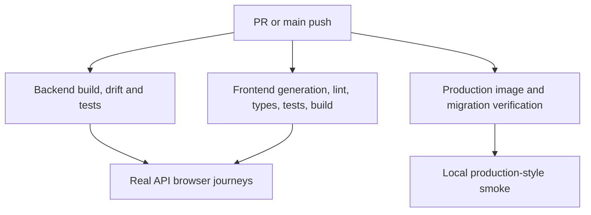

#### What it means

Continuous integration automatically builds and checks a change in a clean runner environment. A workflow defines triggers; a job owns a runner; steps inside that job execute in order. Jobs can run independently or wait for prerequisites. CI is evidence that a particular revision satisfies configured checks. It is not the same as deploying that revision.

A drift gate checks whether a committed generated artifact matches its source. A normal compile can succeed while the OpenAPI document or frontend client is stale. A `git diff --exit-code` after generation makes that mismatch fail explicitly. This treats generated files as reviewed contracts rather than incidental developer output.

#### The problem it solves

Without CI, one developer can build the backend while accidentally breaking TypeScript. Without lockfiles, dependency resolution can change between machines. Without drift checks, a correctly changed API can leave a generated client representing yesterday's endpoint shape.

```yaml
# Real backend gate from .github/workflows/ci.yml.
- name: OpenAPI document is up to date
  run: git diff --exit-code -- frontend/openapi

# Real frontend gate runs generation before comparing committed output.
run: |
  npm run generate:api
  git diff --exit-code -- src/api/generated
```

These checks do not infer freshness from timestamps. They compare actual content.

#### How it works

A pull request or push to main triggers the CI workflow. Backend and frontend jobs run separately. Backend restores packages, builds Release, compares OpenAPI, restores the EF tool, checks model/snapshot agreement and runs tests. Frontend installs exact lockfile dependencies, generates the client, compares it, then runs lint, typecheck, translation-key parity, tests and build.

The e2e, container and smoke jobs depend on backend and frontend. Each creates its own relevant environment. This avoids treating a unit-tested assembly as proof that the production image or TLS-proxied browser workflow works. Concurrency settings cancel superseded runs for the same ref so obsolete revisions do not consume runners indefinitely.

#### How THIS project implements it

`.github/workflows/ci.yml:1` defines the workflow and its five jobs: backend, frontend, e2e, container and smoke. Default token permissions are `contents: read`. The backend uses `global.json` through setup-dotnet. The frontend uses Node LTS and npm caching keyed by `frontend/package-lock.json`.

The container job builds the production Dockerfile, runs migrate from that image with owner credentials, starts app with runtime credentials, polls readiness and checks HTML plus CSP. The smoke job starts the complete local production Compose stack and runs `smoke/` against Caddy HTTPS, then tears down that job's disposable volume.

Separate workflows run CodeQL for C# and JavaScript/TypeScript, and gitleaks across full Git history. Dependabot checks NuGet, frontend npm, GitHub Actions and Docker weekly. These are separate kinds of signals: static analysis, secret scanning, dependency proposals and executable behavior checks.

#### Execution example

A backend developer adds a response property and commits C# but forgets generated OpenAPI. CI's build regenerates the document. The following diff step sees a changed file and fails. After the document is committed, frontend generation may still alter `src/api/generated`, causing the frontend drift gate to fail until that client is regenerated and committed too.

A later image build can still fail independently, for example because the Dockerfile forgot a new project file in its restore stage. That is why the container job exists even though the ordinary Release build already succeeded.

#### Why this project needs it

Two languages and multiple generated contracts increase coordination cost. Security-sensitive storage also needs migration/model agreement. CI puts those checks beside every proposed change rather than leaving them to a developer's memory.

#### Alternatives

GitLab CI, Azure Pipelines or Jenkins could perform the same commands. Generating all contracts only during deployment removes committed drift but makes review harder and moves failure later. One monolithic job reduces setup but gives slower, less specific feedback. The repository's jobs separate concerns while using dependencies for expensive cross-layer gates.

#### Important details

The workflow triggers on pull requests and pushes to main, not every arbitrary branch push. Required branch-protection checks are a GitHub setting; README's protection claim cannot be proven from workflow source. `needs` establishes job ordering, not shared files or shared databases between jobs. Every job must create its own prerequisites.

The `smoke` npm package has its own lockfile but no separate Dependabot npm entry; the npm update entry targets `/frontend`. That is a maintenance gap visible in `.github/dependabot.yml`, not a claim that the smoke dependencies are currently vulnerable.

#### What I should understand before modifying this code

Run the relevant generation before committing. Keep CI's commands consistent with package scripts and project configuration. Add a new independent service to the appropriate job rather than assuming another job's service survives. Distinguish a passing source build from a passing image, browser journey and deployment.

<a id="infra-playwright"></a>
## 6.58 Browser journeys and deployed smoke tests

#### What it means

A browser journey drives a real browser through user-visible behavior. It tests interactions across frontend rendering, routing, API calls, cookies and database persistence. A smoke test is narrower: it asks whether an already-running revision is fit to serve a small essential workflow. It should be quick, low-impact and tied to the expected revision.

The repository has two Playwright projects because those purposes require different setup. `frontend/e2e` starts or reuses development servers and creates test data. `smoke/` starts no server, accepts a target URL and performs five checks against that instance.

#### The problem it solves

Component tests with MSW cannot establish that a real browser accepts the real cookies, that the API sees HTTPS, or that a proxy preserves the contract. An HTTP test cannot establish that translated labels and visible controls let a staff member complete a workflow.

```ts
// Hypothetical narrow component assertion: no real API or cookie is involved.
expect(screen.getByRole("button", { name: "Sign in" })).toBeVisible();

// Real smoke journey, smoke/tests/smoke.spec.ts.
await page.getByLabel("Email").fill(email);
await page.getByLabel("Password").fill(password);
await page.getByRole("button", { name: "Sign in" }).click();
```

The browser's resulting page and later authenticated actions determine success.

#### How it works

Playwright creates browser contexts, locates elements by accessible role or label, waits for observable conditions and asserts rendered outcomes. Its webServer configuration starts the development API and Vite server, waiting for configured URLs before tests run. The API uses the HTTPS profile; the readiness probe uses that profile's plain HTTP sibling to avoid Node certificate trust problems.

The smoke project instead requires `SMOKE_BASE_URL`, `SMOKE_EXPECTED_SHA` and `SMOKE_PASSWORD`. It turns off trace, screenshot and video because its credential can belong to a running demo instance. HSTS expectation defaults on and is explicitly disabled only for the loopback local stack.

#### How THIS project implements it

`frontend/playwright.config.ts:17` enables fully parallel tests, one CI retry, Chromium and HTML reports. It starts API at the `https` launch profile and Vite at port 5173 with `API_TARGET=https://localhost:7197`. Test files require `SEED_PASSWORD` and fail immediately if it is empty.

The ten current spec files declare nineteen journeys: auth, subjects, staff access, staff audit, first login, students, teachers/groups, enrollments, scheduling and full centre setup. The full setup journey uses Arabic locale and begins with an empty Giza centre. Credential-sensitive journeys override trace/video settings. These declarations are source facts; executed results must be reported separately.

`smoke/tests/smoke.spec.ts:29` defines five checks: readiness, HTML/security headers, expected commit plus demo mode, unauthenticated Subjects 401, and owner sign-in/Subjects/sign-out. `smoke/playwright.config.ts:14` sets no retries, serial execution, thirty-second timeout and no media capture.

#### Execution example

CI's e2e job starts a PostgreSQL service, runs the real role bootstrap, generates a development certificate, seeds data, installs Chromium and launches the nineteen journeys. It raises the login permit limit to 100 for that job because repeated UI sign-ins share one runner IP. This is an environment-specific test budget, not the production default.

CI's smoke job builds and starts the Compose production stack, waits for HTTPS readiness on port 8443 and passes the current commit SHA to smoke. The version check requires `applicationVersion` to end with that SHA. A browser can therefore load a working page and still fail smoke if the wrong revision is serving it.

#### Why this project needs it

Authentication, tenant switching and bilingual workflows have seams that isolated tests cannot prove. The smoke project adds a release identity check and packaging/proxy proof, while the broader journeys exercise actual staff tasks.

#### Alternatives

Cypress provides another browser automation stack. Manual walkthroughs reveal usability issues but do not repeat reliably for every change. Reusing all e2e journeys as smoke would create data and slow deployment gates. A health-only smoke test is cheap but cannot catch a broken frontend or sign-in flow.

#### Important details

The smoke Subjects assertion checks the first row is visible; it does not explicitly distinguish a data row from a table header. Therefore describe the assertion literally rather than claiming it proves at least one subject record exists. The project intends read-mostly operation, and its spec performs no explicit creation calls.

Development journeys create uniquely named data and can leave it behind. They should not be aimed at a real production dataset. `reuseExistingServer` is convenient locally but can mean a preexisting API ignores changed test environment settings, which is why README tells readers to stop their own API before relying on the raised login limit.

#### What I should understand before modifying this code

Keep browser assertions tied to accessible names. Preserve credential capture restrictions. Use cross-layer journeys for seams, leaving exhaustive rule matrices in faster tests. Supply the correct seed password and expected revision. Do not report source declarations or historical runbook results as current execution results.

<a id="infra-telemetry"></a>
## 6.59 OpenTelemetry signals, opt-in exporters and correlation

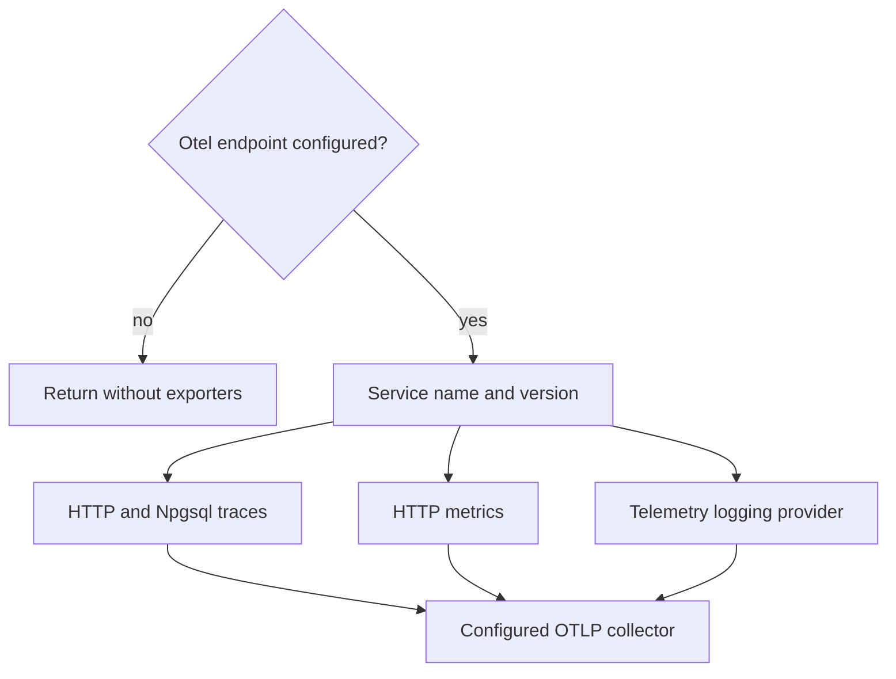

#### What it means

Observability is the ability to investigate behavior from emitted evidence. Logs describe events. Traces describe a chain of timed operations belonging to a request. Metrics aggregate measurements over time. OpenTelemetry supplies a common instrumentation and export model for those signals, so the application can emit them without hard-coding one cloud monitoring product throughout business code.

An exporter sends signals to a collector. A resource identifies the emitting service and version. A span represents one timed operation; tags add searchable context. Correlation connects a client-visible error reference with logs and trace context.

#### The problem it solves

Without correlation, a report that enrollment failed at some time must be matched against many unrelated logs. Without common instrumentation, request timing and database work can be observed through incompatible tools. Hard-coding exporter dependencies in handlers would also couple business logic to monitoring infrastructure.

```csharp
// Hypothetical tight coupling inside a business handler.
cloudMonitor.TrackEvent("EnrollmentCreated", userData);

// Actual setup remains at the API composition edge.
builder.Services.AddApiTelemetry(builder.Configuration);
```

The second line is in `Program.cs:65`; Domain and Application do not receive OpenTelemetry dependencies.

#### How it works

At startup, the setup reads an optional collector endpoint. If absent or whitespace, it returns without registering providers. If present, it registers a service resource, ASP.NET request instrumentation, Npgsql spans, metrics and logging export. The configured OTLP endpoint is the destination.

Request instrumentation observes framework activities. Npgsql instrumentation observes the provider's own activity source. This avoids sprinkling timing code around each repository. Correlation middleware can enrich the current request activity while retaining the existing structured log property and response reference.

#### How THIS project implements it

`TelemetrySetup.cs:30` reads `Otel:Endpoint`; lines 31-34 disable export entirely when unset. Lines 37-39 create the service resource named `tutoring-centre-api` with assembly informational version. Lines 41-48 register ASP.NET tracing, exclude paths under `/health`, add Npgsql instrumentation and configure OTLP. Lines 49-51 register ASP.NET metrics. Lines 53-60 add OpenTelemetry logging with the same resource.

```csharp
// Real trace configuration, TelemetrySetup.cs:41.
.WithTracing(tracing => tracing
    .AddAspNetCoreInstrumentation(options =>
        options.Filter = context => !context.Request.Path.StartsWithSegments("/health"))
    .AddNpgsql()
    .AddOtlpExporter(otlp => otlp.Endpoint = endpointUri))
```

`TelemetrySetupTests.cs:11` checks no endpoint yields no `TracerProvider`; line 23 checks an endpoint yields one. Those tests prove registration behavior, not delivery to an external collector or the full content of emitted telemetry.

#### Execution example

An operator configures `Otel__Endpoint` for a local OTLP viewer and starts the API. A staff action reaches correlation middleware, which associates its request reference with logs and the current activity. ASP.NET instrumentation records request timing. A repository query causes Npgsql instrumentation to emit a database span. Exporters send the collected signals to the configured endpoint. The operator can use a client-visible correlation reference to investigate associated evidence if the collector receives and indexes those fields.

The final collector lookup is not exercised by the two setup tests. The operations documents explicitly mark independent trace lookup as not verified in their historical manual session, so this report retains that limit.

#### Why this project needs it

Commands now contain authorization, database work, auditing and sometimes lock contention. A single elapsed request log can say work was slow but not show which operation dominated. Tracing supplies that additional structure while keeping monitoring ownership at the composition root.

#### Alternatives

Serilog-only logging is simpler and remains useful here, but does not provide a complete timed operation tree. A vendor SDK can integrate deeply but ties code to one backend. Custom `ActivitySource` spans can add business detail; current setup primarily uses framework/provider instrumentation. Azure Monitor is documented as a future destination, not an active cloud service.

#### Important details

The repository comments state that Npgsql records statement text without parameter values, and this setup adds no parameter-enrichment callback. That does not by itself prove every SQL literal is harmless; sensitive values should still be parameters. Export is opt-in, but a malformed nonempty endpoint can fail when constructing its URI.

There is no live cloud telemetry result in this audit. Resource registration and source configuration are established. Delivery, retention, sampling and collector access controls require a running destination and remain operational questions.

#### What I should understand before modifying this code

Keep telemetry packages outside Domain and Application. Preserve body and parameter-value exclusion. Test provider registration when changing the opt-in switch. If adding custom spans, identify exactly which operation they explain and avoid attaching personal data. Verify collector delivery separately from compilation and registration.

<a id="infra-cloud-operations"></a>
## 6.60 Deployment design, revision identity, rollback and honest operational status

#### What it means

Deployment changes the revision serving users. Delivery automation coordinates image creation, schema preparation, traffic eligibility and verification. Rollback changes which application revision serves traffic again; it does not automatically undo database changes. Operational documentation must distinguish an implemented local mechanism from an unprovisioned cloud design.

OIDC federation is an identity design in which GitHub presents a short-lived signed token to Azure, and Azure trusts only an explicitly configured repository/environment identity. It avoids a long-lived client secret stored in GitHub. In this repository that cloud trust is an accepted design, not a provisioned integration.

#### The problem it solves

A successful build can still deploy the wrong image, start before migration or pass health while sign-in is broken. A naive rollback can restore old code that no longer understands a changed schema. A design document written as though resources already exist gives a returning developer false confidence about production state.

```text
Hypothetical unsafe sequence:
  update app image
  hope schema is compatible
  mark deploy complete when process starts

Repository's designed sequence:
  build tagged image
  migrate successfully
  update revision
  wait for readiness
  smoke-test expected revision
  restore previous traffic on smoke failure
```

The latter sequence appears in `docs/architecture/deployment.md` and ADR 0009. Only its local/image/smoke pieces are currently implemented.

#### How it works

The build embeds a source revision in assembly metadata. System info exposes the resulting version string. Smoke compares the suffix with the expected commit. A deployment gate can therefore verify identity as well as functionality.

Migration runs under owner authority before new code serves traffic. Runtime uses the unprivileged login. A previous image can be selected again only if the current schema remains compatible with it. Expand-and-contract schema changes are one way to preserve that compatibility, but this repository has no automated production rollback workflow yet.

#### How THIS project implements it

`Dockerfile:23` accepts `COMMIT_SHA`; the publish command passes it as `SourceRevisionId`. `smoke/tests/smoke.spec.ts` asserts the reported version ends with `+${expectedSha}`. CI builds and tests both an image and the complete local production stack.

`docs/architecture/deployment.md` explicitly states that Azure resources, OIDC trust and `deploy.yml` are not provisioned. Its Month 3 addendum retains that status. ADR 0009 discusses Container Apps, Registry, managed PostgreSQL, Application Insights and Jobs as design choices. No corresponding live environment is inferred from those names.

`docs/operations/runbook.md` labels cloud commands not executed and records historical local drills separately. It explains that Caddy requires the `app` network alias when swapping an image manually, and that database compatibility bounds rollback safety.

#### Execution example

The implemented CI smoke path builds the current image with the commit SHA, starts migrate and seed, launches app behind Caddy, waits for readiness and checks the expected suffix. That establishes a local production-style packaged revision works under the configured checks.

The intended Azure path would additionally authenticate via federated identity, push to a registry, update a Container Apps revision and control traffic rollback. Those steps need actual resource identifiers, permissions and environment protections. This audit does not claim they ran.

#### Why this project needs it

The code now includes deployable packaging and operational commands. A returning developer needs to know those are usable locally while the public deployment remains unfinished. Keeping this distinction precise prevents accidental reliance on a nonexistent release pipeline or cloud backup/rollback capability.

#### Alternatives

Azure App Service offers a simpler web-app footprint but no equivalent first-class one-shot job design in this ADR's comparison. A VM provides control at the cost of patching, TLS and process management. Stored service-principal secrets would authenticate deployment but require storage and rotation. Those alternatives are documented considerations; none is an active deployment in the current repository.

#### Important details

Historical runbook observations are not results from this session. They can explain intended procedures and known caveats, but current execution results are reported separately. README's branch-protection claim and future required reviewers are external settings, not verified repository facts. No live URL is present or tested.

Operator commands also deserve precise scope. The repository's reset-password CLI accepts a password argument; that is an implemented interface, and command-line exposure must be considered when using it. Re-running seed does not necessarily rotate existing passwords; the runbook explicitly explains this distinction.

#### What I should understand before modifying this code

Identify the serving revision through system info, not only a local Git branch. Review schema compatibility before rollback. Keep owner credentials confined to jobs. Label unexecuted cloud work as such. When cloud provisioning happens, verify each documented identifier and gate against actual resource state before changing its status from designed to built.

<a id="infra-cross-tenant-probes"></a>
## 6.61 Cross-tenant attack probes and proving absence of side effects

#### What it means

A negative security test checks that forbidden behavior does not occur. That requires more than seeing an error status. An endpoint could modify a row and then return 404, so a response-only test would pass while data was corrupted. A stronger test snapshots protected state before and after the attempted operation through a connection that can see the real stored row.

There are also two distinct attacks. A direct resource attack targets another centre's URL. A reference attack targets the attacker's own resource but puts another centre's identifier inside the request. A direct 404 test does not establish that the second case is safe, because the attacker's URL itself is valid.

#### The problem it solves

```csharp
// Hypothetical weak test: the endpoint could mutate first, then answer 404.
Assert.Equal(HttpStatusCode.NotFound, response.StatusCode);

// Real CrossTenantProbe.RunAsync checks storage before and after as well.
var before = await snapshotVictimRowAsync();
await SendAndAssertAsync(attackerClient, method, url, body, expectedStatus, expectedCode);
var after = await snapshotVictimRowAsync();
Assert.Equal(before, after);
```

The actual helper is `tests/TutoringCentre.Api.Tests/Fixtures/CrossTenantProbe.cs:18`. Its snapshot callback is required, not optional.

#### How it works

Arrange two centres with known data. Sign in a real attacker client in one centre. Capture the victim's stored state through a fixture SQL snapshot. Send the attempted cross-centre request with an actual antiforgery token when unsafe. Check exact HTTP status and, where required, the stable Problem Details code. Capture the victim state again and compare it.

For a reference attack, snapshot both attacker's and victim's rows. A bad relationship could corrupt the attacker's row without changing the victim at all, so observing only the victim would miss it. After the request, assert neither snapshot changed.

#### How THIS project implements it

`CrossTenantProbe.RunAsync` implements direct attacks. `RunReferenceAsync` starts at line 45 and requires separate attacker and victim snapshot callbacks. Its private request helper serializes optional JSON bodies, fetches CSRF tokens for non-GET requests, sends the request, checks status and parses the `code` property when an expected code was supplied.

Features use dedicated probe test files: subjects, students, parents, staff, teachers, groups, enrollments and schedules have cross-tenant cases under API tests. Infrastructure tests independently check row policies, tenant filters and structural integrity, so the HTTP probe is not the only evidence.

`CrossTenantProbeSelfTests.cs:23` deliberately arranges a supposedly attacking client that is actually in the same centre and expects the probe to fail rather than pass silently. This is a control for the test helper itself: if the probe accepted the legitimate mutation as a successful attack refusal, the security harness would be untrustworthy.

#### Execution example

A Nile owner edits a Nile group but supplies a Maadi teacher identifier. A direct request to a Maadi group would simply be hidden and return 404, which cannot establish reference validation. `RunReferenceAsync` instead targets the Nile group, captures both sides, submits the foreign teacher id, checks the expected refusal, then verifies the Nile group still points to its original teacher and the Maadi teacher remains unchanged.

The guarantee comes from the entire chain: endpoint permission, dispatcher tenant context, scoped lookup and the database's composite relationship. The probe observes behavior without assuming which individual layer blocked the attempt. Independence tests elsewhere establish the separate layers.

#### Why this project needs it

The academic model now has many identifiers in bodies: student, parent, subject, teacher, group and enrollment references. Tenant isolation must protect these links, not only list queries. Before-and-after snapshots make those protection claims concrete.

#### Alternatives

An external security scanner can discover broad classes of issues but may not understand centre-specific relationship invariants. Assertions against a fake repository inspect handler decisions but do not establish storage effects. Transaction logs or direct SQL counts can supplement snapshots when a request affects several rows. The repository's generic helper keeps the common HTTP and side-effect proof reusable while each feature supplies the meaningful snapshot.

#### Important details

Snapshots must include every field whose mutation matters. An unchanged name does not prove an unchanged relationship. Use the owner/superuser assertion connection so tenant filtering cannot hide corrupted data. A refused request may still legitimately emit logs; the invariant is no unauthorized business mutation, not literally no work of any kind.

The helper treats all non-GET methods as needing CSRF in its current implementation. That is appropriate for its mutation probes but is not a complete general model of HTTP safe methods. Do not reuse it for a new HEAD or OPTIONS experiment without understanding that distinction.

#### What I should understand before modifying this code

Add direct and reference attacks separately. Choose independent snapshots for both affected sides. Keep the helper self-test. Assert specific failure codes when information-hiding behavior is part of the contract. Do not conclude a negative security test proves atomicity merely because it received an error response.


<a id="infra-logging"></a>
## 6.62 Structured logging, correlation references and redaction in the current request path

#### What it means

A log event has a message, severity and context. Structured logging preserves the message template separately from its values. Instead of storing only a sentence such as “command EnrollStudentCommand completed in 12 milliseconds,” it can also retain properties named `RequestType` and `ElapsedMs`. A log collector can then filter, group and compare those properties without trying to reconstruct them from punctuation.

Correlation is the relationship between evidence belonging to the same operation. A browser error reference, an HTTP response header, the request log, dispatcher logs, an audit entry and a trace tag can identify the same request. They remain different records, but the shared correlation value makes investigation possible. Redaction is the deliberate replacement or omission of sensitive values before they become retained evidence.

These mechanisms have different jobs. Structured properties make evidence searchable. Correlation connects it. Redaction limits accidental disclosure. None proves the business operation succeeded; they describe what happened and let a developer find the relevant records.

#### The problem it solves

Without structured properties, every investigation becomes a text search whose success depends on wording. Without correlation, two staff members issuing similar requests at the same moment produce interleaved lines that are difficult to separate. Without careful logging boundaries, an otherwise secure login can leak a password into a durable log sink.

```csharp
// Hypothetical: formatting discards separately searchable property names.
logger.LogInformation($"Command {command.GetType().Name} finished in {elapsed} ms");

// Real template from Dispatcher.cs:273.
"{RequestKind} {RequestType} completed with {Outcome} ({ErrorCode}) in {ElapsedMs} ms"
```

The real code supplies values as arguments to the template. It never destructures the request object to obtain those values. A command type name and stable error code explain the outcome without retaining the command's personal data.

#### How it works

Serilog receives an event template and values through the logging abstraction, enriches it with active context properties and sends it to configured sinks. This host uses compact JSON on console. Its `LogContext` enrichment supplies properties pushed around the current asynchronous request path.

Correlation middleware validates a client-provided reference or generates one. It stores that value in HTTP context, in a scoped Application context and in the active log context. It registers an `OnStarting` callback to place the response header just before headers are sent. This callback is important because downstream exception handling may clear an earlier response while replacing it with a standard error body.

A destructuring policy participates only when code asks Serilog to inspect an object using syntax such as `{@Request}`. It can replace selected property values while retaining safe properties. It is not an automatic filter on every possible string sent to a logger, so avoiding sensitive events in the first place remains necessary.

#### How THIS project implements it

`src/TutoringCentre.Api/Program.cs:40` configures Serilog from configuration and DI, enriches from log context, installs `SensitiveDataDestructuringPolicy` and writes compact JSON. `preserveStaticLogger: true` keeps independent test hosts from replacing one global logger and losing each other's test sinks.

`src/TutoringCentre.Api/Http/CorrelationIdMiddleware.cs:19` reads `X-Correlation-Id`. `IsValid` accepts only one through sixty-four ASCII letters/digits or `.`, `_`, `-`. Invalid values are replaced with a new GUID in compact `N` format. The middleware stores the chosen value in `HttpContext.Items`, calls `CorrelationContext.Set`, tags `Activity.Current` as `correlation.id`, registers the response callback and wraps `await next(context)` in `LogContext.PushProperty`.

```csharp
// Real code, CorrelationIdMiddleware.cs:40.
using (LogContext.PushProperty("CorrelationId", correlationId))
{
    await next(context);
}
```

`CorrelationContext` is a scoped holder with a set-once rule. `Set` rejects empty values and a second assignment. Application code can read the correlation through an interface without depending on ASP.NET. Non-HTTP work can retain a null correlation instead of fabricating a request identity.

`ProblemResult.cs:30` adds both `traceId` and `correlationId` to error bodies. The trace identifier comes from the current activity or HTTP trace identifier; the correlation comes from the middleware's item. They are related diagnostic concepts, not interchangeable strings.

`SensitiveDataDestructuringPolicy.cs:17` recognizes names containing Password, Token, Secret or ConnectionString, or beginning Phone, without case sensitivity. It handles readable public instance properties and skips indexers. Strings, dictionaries and collections keep Serilog's default handling. If a matching property exists, the policy builds a structure whose matching values are `***`.

#### Execution example

A secretary submits an enrollment command with `X-Correlation-Id: support-case-17`. The middleware accepts the reference and makes it available before request logging and endpoint work. Authentication and authorization run; the dispatcher logs the request type and result. If a permission is missing, its warning includes the permission, user id and centre id, while the ordinary outcome log records the stable failure code.

Suppose the operation instead throws unexpectedly. The dispatcher rolls back and rethrows. `GlobalExceptionHandler` logs the full exception server-side using a source-generated logging method, then writes a generic 500 Problem Details response. `ProblemResult` attaches the same correlation reference. `OnStarting` restores the `X-Correlation-Id` response header even if the response was cleared. Request logging records the final 500 at Error severity.

The developer can now search the console/collector output for `CorrelationId=support-case-17`, compare the HTTP and dispatcher outcomes and inspect the exception without sending its text back to the user. If telemetry export is enabled, the request activity also carries `correlation.id`; if an audited change commits, the scoped context allows its record to carry the request reference.

#### Why this project needs it

The request path now spans session revalidation, permission checks, tenant setup, business handlers, database locks and audit work. A short user report does not reveal which stage refused or failed. Correlation makes that chain investigable while structured outcomes avoid logging personal request payloads merely to understand which use case ran.

#### Alternatives

Plain console text is easy to read locally but harder to query reliably. Using only the framework trace id removes one identifier but does not preserve a validated client-supplied support reference. OpenTelemetry can collect richer timing information, but it is an opt-in complement here rather than a replacement for request and dispatcher logs. An explicit log context parameter would be more visible but would spread diagnostic arguments through every handler.

The repository does not explicitly state why compact JSON was chosen over another structured format. The following is an interpretation based on the implementation: console JSON is compatible with container log collection and the tests can inspect named Serilog properties without parsing rendered sentences.

#### Important details

The redaction list is intentionally incomplete. `SensitiveDataDestructuringPolicyTests` explicitly proves `Email` remains visible while Password, ApiToken and PhoneNumber are masked. A secret concatenated into a plain string is outside this policy's object-property mechanism. Do not treat its existence as permission to log arbitrary bodies, headers or exceptions containing secrets.

Logging level also affects evidence. Successful dispatcher outcomes use Information, expected failures use Warning, unexpected exceptions use Error, and health request completion is reduced to Verbose. A configured minimum can discard lower-level events. Absence of a console line may therefore mean filtering, not absence of execution.

`LoggingConventionTests.SuccessfulRequest_LogsOneCompletionLineAtInformation` searches for a matching event and asserts non-null. Despite its name, it does not count exactly one completion event. This report describes its actual assertion rather than claiming stronger cardinality coverage. `InMemoryLogSink.WaitForAsync` polls up to five seconds because a completion log can arrive just after the HTTP response returns.

#### What I should understand before modifying this code

Keep the correlation middleware before components that need its context. Preserve deferred response-header registration. Add named scalar properties that explain behavior; do not log request objects or credentials. If a new sensitive value can reach destructuring, extend both policy and tests, while retaining the primary prohibition on logging payloads. Distinguish log configuration, event emission and collector delivery when verifying observability changes.


# 7. Authentication and Authorization

## 7.1 Credentials, tickets and browser state

The staff user model belongs to Infrastructure Identity, while centre membership belongs to Domain. The authentication port returns an authenticated user identifier and security stamp rather than exposing `ApplicationUser`. `AuthEndpoints.LoginAsync` validates the request, calls that port, replaces the request actor and dispatches the profile query. It issues the cookie only after the profile read succeeds. This ordering avoids creating a signed-in ticket for a flow whose membership/profile lookup failed.

`AuthenticationSetup.cs:23` names the cookie `__Host-tcm.session`. Its flags are HttpOnly, Secure always, SameSite Lax and path `/`. Its ticket lifetime is eight hours with sliding expiration. The ticket contains claims, not a session-row identifier. The browser stores and sends the cookie; the SPA obtains readable user/session information through `/api/me`. JavaScript cannot read an HttpOnly cookie through `document.cookie`, but script running in the application's origin can still make authenticated requests. HttpOnly limits credential extraction; it does not make XSS harmless.

Data Protection is now registered in `Infrastructure/DependencyInjection.cs:119` with `PersistKeysToDbContext<AppDbContext>()` and application name `TutoringCentre`. The context implements `IDataProtectionKeyContext` and exposes its required key set. This is a platform-level exception to the context's usual lack of named `DbSet` properties. The purpose is persistence across application restarts and shared ticket decryptability where instances use the same key store and application identity. Database availability and access to key material are therefore operational security concerns.

## 7.2 Login, selection and first-login change

The anonymous login route uses its own rate-limit policy and still belongs to the antiforgery-protected API group. Credentials are verified through Identity, which also owns failed-attempt counters and lockout. Those account-security writes are a deliberate path outside the normal command save pipeline. A failed login must still be able to increase the failed-attempt count; wrapping it in a transaction that rolls back every business refusal would defeat lockout.

After authentication the request actor has no selected centre. Login reads `MeDto`. It auto-selects exactly one membership only when `MustChangePassword` is false. It recomputes the permissions for that selected role because the profile query ran before selection. A first-login account receives a signed-in ticket without a selected centre and proceeds to password change. A multi-centre account proceeds to selection. The selector accepts a centre identifier as a request, verifies active membership and then issues a new ticket using the verified membership's centre and role. It carries the user and stamp forward from the existing trusted session, never from the body.

Password change validates current and new credentials, calls the authentication port and reissues a ticket with the new stamp and no centre. Other tickets with the old stamp fail revalidation after their positive-cache window. This session must also choose a centre again. An operator reset is a separate process command. There is no reason to expose the operator's trusted database access level to a web request merely to reuse the credential adapter.

## 7.3 Revalidation and revocation

`SessionRevalidationHandler.cs:20` runs from the cookie handler's validation event. It parses the user, stamp, centre and role claims. The cache key includes all of those facts. On a miss it dispatches `ValidateStaffSessionQuery` before normal actor construction; that query must receive the identity explicitly because `ActorMiddleware` has not populated the Application actor yet. A valid answer can be cached for `SessionValidationOptions.CacheDuration`, whose default is sixty seconds. Invalid answers are not cached. Rejecting a principal also signs out the cookie scheme.

This is not instant distributed revocation. Each process can retain a positive answer until expiration. Role comparison now participates in session validation, correcting the earlier situation where a demoted user could retain an old role claim without detection. Membership deactivation and credential changes now have actual product/operator paths, so revocation is no longer only a capability exercised by direct test SQL.

Logout still calls `SignOutAsync` and clears the browser's copy. It does not rotate the security stamp. A separately copied valid ticket is therefore not invalidated solely by that logout operation. This is a consequence of the self-contained ticket design and the current logout code, not a claim that the application has observed a stolen-cookie incident. Absolute logout revocation would need a separate policy and server-side invalidation mechanism.

## 7.4 Permission and ownership decisions

The fallback HTTP policy requires an authenticated user unless an endpoint explicitly allows anonymous access. Application requests implementing `IRequirePermission` additionally pass through `Dispatcher.CheckPermission`. A system actor is allowed; a staff actor must carry a role that holds the capability. Unknown roles and keys deny through the catalogue/mapping. The catalogue has sixteen keys, with separate view/manage capabilities for the academic areas and owner-only capabilities for staff, audit and settings.

Teacher scope is a further restriction. The Teacher role holds the group, enrollment and schedule read capabilities, but the corresponding read services narrow records to the teacher linked to the current staff user in the active centre. The same generic permission key does not grant access to all centre groups. Tenant scope, capability and record ownership are separate decisions and need separate test coverage.

The frontend mirrors permission names and consumes the permissions returned with the current session. `Can`, `useCan` and `RouteGuard` shape navigation and control visibility. `RouteGuard` prevents its protected child component from mounting when permission is absent, so the child's data hooks do not fire. This is useful feedback and avoids needless requests. It is not enforcement against a client that manually sends HTTP; the dispatcher remains authoritative.

## 7.5 Authentication configuration as an executable contract

| Setting or input | Current value/meaning | Source owner | Observable consequence |
| --- | --- | --- | --- |
| Authentication scheme | Cookie scheme | AuthenticationSetup | Sign-in and sign-out address the same ticket handler. |
| Session cookie name | `__Host-tcm.session` | AuthenticationSetup | Browser host-prefix requirements apply. |
| Session HttpOnly | true | AuthenticationSetup | Script reads cannot directly obtain the ticket through document.cookie. |
| Session Secure | Always | AuthenticationSetup | Browser delivery and testing require a compatible secure-origin path. |
| Session SameSite | Lax | AuthenticationSetup | Cross-site navigation behaviour differs from the Strict antiforgery cookie. |
| Session Path | `/` | AuthenticationSetup | The credential matches application paths at the origin. |
| Ticket duration | eight hours, sliding | AuthenticationSetup | Ticket renewal and expiry remain separate from validation-cache reuse. |
| User claim | `sub` | SessionClaimNames | Actor construction requires a parseable user identifier. |
| Stamp claim | `stamp` | SessionClaimNames | Revalidation compares the ticket with account state. |
| Centre/role claims | `centre`, `role`, issued together | SessionPrincipalFactory | A signed-in session can remain deliberately unselected. |
| Key persistence | DbContext-backed key ring | Infrastructure registration | Compatible hosts can use the persisted key material. |
| Antiforgery cookie | `__Host-tcm.xsrf`, Strict | AntiforgerySetup | A separate protected token channel accompanies unsafe API requests. |
| Antiforgery request header | `X-XSRF-TOKEN` | AntiforgerySetup and apiFetch | The application's script explicitly supplies the request token. |
| Login rate policy | configurable fixed window; default ten/minute | LoginRateLimiting | Excess source attempts receive the shared429 contract. |
| Password-change policy | five/minute per user | ChangePasswordRateLimiting | An authenticated user has a separate attempt budget. |
| Account lockout | five failures, fifteen minutes | Infrastructure Identity options | Correct credentials can still be refused during lockout. |
| Password creation policy | length ten, no composition requirements | Infrastructure Identity options | Account creation/password replacement and login shape checks have different jobs. |
| Positive session cache | sixty seconds by default | SessionValidationOptions | Role/status/stamp changes can take a cache interval to be observed. |

## 7.6 Login trace with failure boundaries

The login form first runs its client schema. A blank or syntactically invalid input can be shown immediately without consuming a login request. This is a convenience and request-volume improvement, not proof the server can trust the body. A direct client can bypass every browser field check. Server validation therefore independently checks the transport request before credential verification.

The transport wrapper obtains the antiforgery request token and sends the JSON operation. The browser separately supplies its cookie side. Proxy forwarding reaches the backend with the required scheme. Trusted forwarding, request identifiers, security headers and error middleware run in their configured order. The login endpoint is anonymous by design, but anonymity does not exempt it from its rate policy or group antiforgery filter.

If the source limiter has no permit, rejection happens before endpoint execution. If the antiforgery pair is invalid, the filter returns `auth.csrf_invalid` before credential verification. If JSON cannot bind, the common malformed-request path applies. If shape validation fails after binding, field-keyed validation errors are returned. These are distinct refusal points; a test that exercises only wrong passwords does not establish any of them.

Credential verification then looks up the account. Unknown accounts perform the dummy verification and get the generic credential code. Locked accounts get that same refusal. Wrong passwords for known accounts update failure state and get that same refusal. Correct credentials reset failed-attempt state and return the identifier/stamp through the port. The implementation intends to reduce account enumeration, but its tests of identical bodies do not measure equal timing distributions.

Only after credentials succeed does the endpoint replace the request actor. This matters for re-login from a browser already carrying a ticket: the existing actor cannot simply be set a second time through the ordinary one-time setter. Reauthentication is the explicit edge operation for replacing identity after fresh credential proof. The subsequent profile query therefore reads the newly authenticated account rather than whichever account an older cookie identified.

The profile read returns active memberships and the pending-password flag. Login cannot select a centre before that read because the server needs the relationship and its role. An account with one membership can be selected automatically only when no password change is pending. An account with several memberships needs user choice; an account with no active membership has no centre access to grant. The response and ticket both reflect that selected or unselected state.

The endpoint builds the principal and signs it in after those steps. It recomputes the response permission list for an automatically selected role, because the profile query happened while the actor was still unselected. The frontend refreshes antiforgery state, writes the returned session into the query cache and navigates according to the pending-change/selection/redirect rules. An accepted internal redirect is a navigation choice, not authority to read the target page's API data.

## 7.7 Session transitions, one at a time

**Centre selection.** The caller supplies only the requested centre identifier. The user identity comes from the trusted actor. The handler first requires a staff actor, then refuses pending password change, then asks for an active membership. It does not reveal whether a refused centre is absent, foreign or inactive through different machine outcomes. Only the successful result supplies the centre and role written to the new principal. A failed transition leaves the previous ticket intact. The client refreshes its CSRF token and session read; tenant data cache identity is a separate concern documented in the findings.

**First login.** A newly created account's pending flag blocks auto-selection even with one membership. The cookie proves the account authenticated but carries no centre. The password-change screen is reachable in that intermediate state. Manually calling centre selection also encounters the server-side pending-change check. Academic requests need a selected tenant and therefore remain refused. This design expresses the gate through session/tenant state instead of trusting a frontend-only redirect.

**Password change.** The endpoint validates its transport shape and requires authentication. The adapter rejects an unknown user, the same old/new value, an incorrect current password or policy failure. After a successful Identity password operation it clears the pending flag and requests a stamp update. The current unchecked secondary result is a real limitation, so the flow must not be described as an explicitly atomic two-store-operation transaction. The endpoint reissues this browser's ticket without a centre; other tickets are subject to stamp revalidation after their cache window.

**Role change.** A membership edit updates the role relationship under the staff use case's invariants and persistence version checks. Old tickets may still contain the earlier role. Their next uncached validation compares the stored current role with that claim and rejects a mismatch. The frontend permission array is not a substitute for that check, because a caller can make requests without rendering any menu. The bounded freshness window is an intentional consequence of positive caching, not evidence the role change was ignored.

**Membership deactivation.** The account can still exist and can have active memberships elsewhere. The selected centre's inactive membership makes revalidation fail for that selected ticket. A later fresh profile does not offer the inactive centre. This is why deleting the account is not the same operation: the relationship can be revoked independently of the person's other access and identity data.

**Logout.** The endpoint signs the cookie scheme out. The client then refreshes token state, clears query data and navigates. Those later awaits can fail independently of the server's logout; UI cleanup needs its own tests. The server does not rotate a stamp solely for logout and does not delete a per-ticket session record. A copied ticket's remaining validity is therefore governed by expiry and compared account/membership facts. Describing this as immediate revocation of every copy would be false.

**Operator reset.** This process command has a different trust level from the web endpoint and does not require knowing the old password. Its current remove-then-add implementation has a rejected-replacement risk described in the findings. The command being operator-only does not make partial failure harmless; it changes who can invoke it. A future repair should test preservation of the old credential when replacement validation fails, rather than testing only a successful reset.

## 7.8 Threats, defenses and remaining limits

| Situation | Current defense | Limit that should remain explicit |
| --- | --- | --- |
| Client invents a user identifier | Verified cookie principal and trusted actor translation | Ordinary body fields must never become privileged actor facts. |
| Client invents a selected centre | Active membership gate before ticket replacement | Selection does not replace data-level filters and RLS. |
| Signed-in role lacks capability | Dispatcher permission marker and role map | Teacher record ownership remains another check after broad capability. |
| Another origin induces unsafe browser request | Antiforgery pair/header validation and cookie policy | Same-origin injected script can obtain the readable request token. |
| Browser script attempts direct ticket extraction | HttpOnly session cookie | Such script may still act through the browser's authenticated request channel. |
| Stolen ticket outlives browser logout | Normal expiry and revalidation still apply | Logout itself does not revoke an independent copy. |
| Membership or role changes after issue | Stamp/status/role comparison | Positive per-process cache delays observation. |
| Password spraying from one source | Login partition limit | A fixed window permits boundary bursts and source trust depends on proxy setup. |
| Repeated guesses against one account | Identity lockout | Attackers can also cause account lockout; the tradeoff is not eliminated. |
| Unknown email probing | Uniform refusal and dummy verification work | Exact timing equality was not measured. |
| Cookie continuity across restart | Database-persisted Data Protection keys | Shared storage is not proof of cloud deployment, backup or at-rest key encryption policy. |
| Forgotten endpoint authorization metadata | Authenticated fallback policy | Deliberately anonymous endpoints still require review of their own behavior. |
| Error reveals internals | Generic unexpected-error body and common writer | Server logs and audit access need their own appropriate retention/access policy. |
| Browser displays old centre data | Backend still scopes fresh API operations | Existing client cache keys/transitions need the regression described in section14. |

The four identity-related checks should be tested independently. An anonymous caller can be refused before a missing tenant marker matters. An unselected caller can be refused before a missing permission check matters. A role without any read permission cannot demonstrate that teacher ownership is correct, because its broad denial masks the record-level condition. Likewise, a query filter can mask a missing RLS policy during an ordinary EF request. Negative tests gain meaning by isolating one decision at a time and checking that refused requests leave no unintended data or audit effects.

# 8. Routing and Middleware

## 8.1 Actual request chain

The explicit order in `Api/Program.cs:166` onward is trusted forwarding, Production HSTS, security headers, correlation, Serilog request logging, exception handling, status-code pages, SPA static files, routing, authentication, actor translation, authorization and rate limiting. Endpoint execution follows; API endpoint execution includes the group's antiforgery filter.

| Stage | Responsibility | Why the relative order matters |
| --- | --- | --- |
| Trusted forwarding | Accept forwarded scheme/address only from configured networks | Authentication flags, proxy-aware rate partitions and security behaviour must see the validated external request context. |
| HSTS/security headers | Set browser security policy | Apply before static and dynamic responses so serving assets does not omit the policy. |
| Correlation | Choose/request identifier and establish scoped/log context | Later logs, errors and audit rows consume the identifier. |
| Request log | Measure and record final status | Surround the handled response and inherit correlation context. |
| Exception boundary | Translate malformed requests and unexpected faults | Must surround binding, filters and endpoint operations that can throw. |
| Status pages | Enrich otherwise empty error statuses | Surround bare authentication and routing failures. |
| Static files | Serve actual built browser assets | Run before routing selects a fallback for that same path. |
| Explicit routing | Choose endpoint and metadata | Authentication/authorization/rate limiting need the selected endpoint's rules. |
| Authentication | Read/decrypt ticket and revalidate it | Actor construction and authorization depend on the resulting principal. |
| Actor middleware | Translate claims into Application identity | Handlers consume `ICurrentActor`, not HTTP claims. |
| Authorization | Apply endpoint metadata or fail-closed fallback | Stop an unsigned request before executing protected work. |
| Rate limiter | Enforce endpoint policy | Refuse excess attempts before the endpoint's business operation. |
| Antiforgery filter | Validate unsafe API requests | Runs as endpoint execution; absence of a valid token prevents side effects. |

## 8.2 Fallbacks and static hosting

API fallbacks return `route.not_found` in the common Problem Details representation and are excluded from OpenAPI. They are anonymous so a signed-out caller receives the same unknown-route result. A built SPA can receive deep-link GET requests through `MapSpaFallback`. The last fallback also matches file-looking paths that the SPA's nonfile constraint deliberately excludes. This prevents a missing `/assets/...js` file from producing an authentication challenge or an HTML shell disguised as JavaScript.

Explicit `UseRouting` is a substantive change from the older host. Without it, minimal hosting can insert routing before the application's middleware sequence. Selection of a fallback endpoint and the existence of a physical asset are independent facts. The current order gives static files first opportunity to answer before endpoint selection. Do not “simplify” the explicit routing call without preserving that behaviour and its regression tests.

## 8.3 Three failure paths

An unknown API URL reaches the anonymous API fallback and returns a standard 404. A protected URL with no valid ticket fails authorization and returns a 401 that status pages can enrich. A validly authenticated request with insufficient capability passes the HTTP identity check but fails the dispatcher permission step before a transaction begins. These are not interchangeable errors; they answer different questions about routing, identity and access.

A malformed body can fail even before a handler's own validation. Strict JSON conversion throws a bad-request exception, and the global exception handler maps it to `request.malformed`. A valid DTO with a domain conflict instead returns a failed `Result`, which maps through the common result-to-HTTP conversion. The endpoint should remain bind, dispatch and map rather than recreating those categories with local catches.

## 8.4 Complete committed API contract

This catalogue is extracted from the current committed OpenAPI document, opened as JSON during this audit. It contains 48 path templates and 90 schemas. These are contract declarations, not additional runtime routes inferred from names. Health, static files and excluded fallbacks are described separately because they are not part of this document.

| Method and path | Operation | Parameters / request body | Declared responses |
| --- | --- | --- | --- |
| `GET /api/system/info` | `GetSystemInfo` | No declared input | 200: SystemInfoDto; 500: ProblemDetails |
| `GET /api/auth/antiforgery` | `GetAntiforgeryToken` | No declared input | 200: AntiforgeryTokenResponse |
| `POST /api/auth/login` | `Login` | application/json: LoginRequest | 200: MeDto; 400: HttpValidationProblemDetails; 401: ProblemDetails; 429: ProblemDetails |
| `POST /api/auth/logout` | `Logout` | No declared input | 204: no declared body; 401: ProblemDetails |
| `GET /api/me` | `GetMe` | No declared input | 200: MeDto; 401: ProblemDetails |
| `POST /api/session/centre` | `SelectCentre` | application/json: SelectCentreRequest | 204: no declared body; 403: ProblemDetails |
| `POST /api/auth/change-password` | `ChangePassword` | application/json: ChangePasswordRequest | 204: no declared body; 400: HttpValidationProblemDetails; 401: ProblemDetails; 422: ProblemDetails; 429: ProblemDetails |
| `GET /api/subjects` | `ListSubjects` | query: includeArchived | 200: SubjectListResponse; 401: ProblemDetails; 403: ProblemDetails |
| `POST /api/subjects` | `CreateSubject` | application/json: CreateSubjectRequest | 201: CreateSubjectResponse; 400: HttpValidationProblemDetails; 403: ProblemDetails; 409: ProblemDetails |
| `GET /api/subjects/{id}` | `GetSubject` | path: id (required) | 200: SubjectDto; 401: ProblemDetails; 403: ProblemDetails; 404: ProblemDetails |
| `PUT /api/subjects/{id}` | `RenameSubject` | path: id (required); application/json: RenameSubjectRequest | 204: no declared body; 400: HttpValidationProblemDetails; 404: ProblemDetails; 409: ProblemDetails; 422: ProblemDetails |
| `POST /api/subjects/{id}/archive` | `ArchiveSubject` | path: id (required); application/json: SubjectVersionRequest | 204: no declared body; 404: ProblemDetails; 422: ProblemDetails |
| `POST /api/subjects/{id}/restore` | `RestoreSubject` | path: id (required); application/json: SubjectVersionRequest | 204: no declared body; 404: ProblemDetails; 422: ProblemDetails |
| `GET /api/teachers` | `ListTeachers` | query: includeArchived | 200: TeacherListResponse; 401: ProblemDetails; 403: ProblemDetails |
| `POST /api/teachers` | `CreateTeacher` | application/json: CreateTeacherRequest | 201: CreateTeacherResponse; 400: HttpValidationProblemDetails; 403: ProblemDetails |
| `GET /api/teachers/{id}` | `GetTeacher` | path: id (required) | 200: TeacherDto; 401: ProblemDetails; 403: ProblemDetails; 404: ProblemDetails |
| `PUT /api/teachers/{id}` | `UpdateTeacher` | path: id (required); application/json: UpdateTeacherRequest | 204: no declared body; 400: HttpValidationProblemDetails; 404: ProblemDetails; 409: ProblemDetails; 422: ProblemDetails |
| `PUT /api/teachers/{id}/account` | `SetTeacherAccount` | path: id (required); application/json: SetTeacherAccountRequest | 204: no declared body; 400: HttpValidationProblemDetails; 404: ProblemDetails; 409: ProblemDetails; 422: ProblemDetails |
| `POST /api/teachers/{id}/archive` | `ArchiveTeacher` | path: id (required); application/json: TeacherVersionRequest | 204: no declared body; 404: ProblemDetails; 422: ProblemDetails |
| `POST /api/teachers/{id}/restore` | `RestoreTeacher` | path: id (required); application/json: TeacherVersionRequest | 204: no declared body; 404: ProblemDetails; 422: ProblemDetails |
| `GET /api/groups` | `ListGroups` | query: subjectId; query: teacherId; query: includeArchived | 200: GroupListResponse; 401: ProblemDetails; 403: ProblemDetails |
| `POST /api/groups` | `CreateGroup` | application/json: CreateGroupRequest | 201: CreateGroupResponse; 400: HttpValidationProblemDetails; 403: ProblemDetails; 404: ProblemDetails; 409: ProblemDetails; 422: ProblemDetails |
| `GET /api/groups/{id}` | `GetGroup` | path: id (required) | 200: GroupDto; 401: ProblemDetails; 403: ProblemDetails; 404: ProblemDetails |
| `PUT /api/groups/{id}` | `RenameGroup` | path: id (required); application/json: RenameGroupRequest | 204: no declared body; 400: HttpValidationProblemDetails; 404: ProblemDetails; 409: ProblemDetails; 422: ProblemDetails |
| `PUT /api/groups/{id}/capacity` | `ChangeGroupCapacity` | path: id (required); application/json: ChangeGroupCapacityRequest | 204: no declared body; 400: HttpValidationProblemDetails; 404: ProblemDetails; 409: ProblemDetails; 422: ProblemDetails |
| `PUT /api/groups/{id}/teacher` | `AssignGroupTeacher` | path: id (required); application/json: AssignGroupTeacherRequest | 204: no declared body; 400: HttpValidationProblemDetails; 404: ProblemDetails; 409: ProblemDetails; 422: ProblemDetails |
| `POST /api/groups/{id}/archive` | `ArchiveGroup` | path: id (required); application/json: GroupVersionRequest | 204: no declared body; 404: ProblemDetails; 409: ProblemDetails; 422: ProblemDetails |
| `POST /api/groups/{id}/restore` | `RestoreGroup` | path: id (required); application/json: GroupVersionRequest | 204: no declared body; 404: ProblemDetails; 409: ProblemDetails; 422: ProblemDetails |
| `POST /api/groups/{groupId}/enrollments` | `enrollStudent` | path: groupId (required); application/json: EnrollStudentRequest | 201: EnrollStudentResponse; 400: HttpValidationProblemDetails; 403: ProblemDetails; 404: ProblemDetails; 409: ProblemDetails; 422: ProblemDetails |
| `GET /api/groups/{groupId}/roster` | `getGroupRoster` | path: groupId (required) | 200: GroupRosterDto; 401: ProblemDetails; 403: ProblemDetails; 404: ProblemDetails |
| `GET /api/students/{studentId}/enrollments` | `listStudentEnrollments` | path: studentId (required) | 200: StudentEnrollmentListResponse; 401: ProblemDetails; 403: ProblemDetails; 404: ProblemDetails |
| `POST /api/enrollments/{id}/withdraw` | `withdrawEnrollment` | path: id (required); application/json: EnrollmentVersionRequest | 204: no declared body; 400: HttpValidationProblemDetails; 403: ProblemDetails; 404: ProblemDetails; 409: ProblemDetails; 422: ProblemDetails |
| `POST /api/enrollments/{id}/transfer` | `transferEnrollment` | path: id (required); application/json: TransferEnrollmentRequest | 200: TransferEnrollmentResponse; 400: HttpValidationProblemDetails; 403: ProblemDetails; 404: ProblemDetails; 409: ProblemDetails; 422: ProblemDetails |
| `GET /api/groups/{groupId}/schedule-rules` | `listGroupScheduleRules` | path: groupId (required) | 200: ScheduleRuleListResponse; 401: ProblemDetails; 403: ProblemDetails; 404: ProblemDetails |
| `POST /api/groups/{groupId}/schedule-rules` | `addScheduleRule` | path: groupId (required); application/json: AddScheduleRuleRequest | 201: AddScheduleRuleResponse; 400: HttpValidationProblemDetails; 403: ProblemDetails; 404: ProblemDetails; 409: ProblemDetails; 422: ProblemDetails |
| `POST /api/schedule-rules/{id}/end` | `endScheduleRule` | path: id (required); application/json: EndScheduleRuleRequest | 204: no declared body; 400: HttpValidationProblemDetails; 403: ProblemDetails; 404: ProblemDetails; 409: ProblemDetails; 422: ProblemDetails |
| `POST /api/schedule/extend` | `extendSchedule` | application/json: ExtendScheduleRequest | 200: ExtendScheduleResponse; 400: HttpValidationProblemDetails; 403: ProblemDetails; 409: ProblemDetails; 422: ProblemDetails |
| `GET /api/timetable` | `getTimetable` | query: weekStart; query: groupId; query: teacherId | 200: TimetableDto; 400: HttpValidationProblemDetails; 401: ProblemDetails; 403: ProblemDetails |
| `POST /api/sessions/{id}/cancel` | `cancelSession` | path: id (required); application/json: SessionVersionRequest | 204: no declared body; 400: HttpValidationProblemDetails; 403: ProblemDetails; 404: ProblemDetails; 409: ProblemDetails; 422: ProblemDetails |
| `POST /api/parents` | `CreateParent` | application/json: CreateParentRequest | 201: CreateParentResponse; 400: HttpValidationProblemDetails; 403: ProblemDetails; 409: ProblemDetails |
| `GET /api/parents/{id}` | `GetParent` | path: id (required) | 200: ParentDetailDto; 401: ProblemDetails; 403: ProblemDetails; 404: ProblemDetails |
| `PUT /api/parents/{id}` | `UpdateParent` | path: id (required); application/json: UpdateParentRequest | 204: no declared body; 400: HttpValidationProblemDetails; 404: ProblemDetails; 409: ProblemDetails |
| `POST /api/parents/lookup` | `LookupParent` | application/json: LookupParentRequest | 200: ParentLookupDto; 400: HttpValidationProblemDetails; 403: ProblemDetails |
| `GET /api/students` | `listStudents` | query: search; query: includeArchived; query: cursor; query: pageSize | 200: StudentPageDto; 400: HttpValidationProblemDetails; 401: ProblemDetails; 403: ProblemDetails |
| `POST /api/students` | `registerStudent` | application/json: RegisterStudentRequest | 201: RegisterStudentResponse; 400: HttpValidationProblemDetails; 403: ProblemDetails; 404: ProblemDetails; 409: ProblemDetails |
| `GET /api/students/{id}` | `getStudent` | path: id (required) | 200: StudentDetailDto; 401: ProblemDetails; 403: ProblemDetails; 404: ProblemDetails |
| `PUT /api/students/{id}` | `updateStudent` | path: id (required); application/json: UpdateStudentRequest | 204: no declared body; 400: HttpValidationProblemDetails; 404: ProblemDetails; 409: ProblemDetails; 422: ProblemDetails |
| `POST /api/students/{id}/archive` | `archiveStudent` | path: id (required); application/json: StudentVersionRequest | 204: no declared body; 404: ProblemDetails; 409: ProblemDetails; 422: ProblemDetails |
| `POST /api/students/{id}/restore` | `restoreStudent` | path: id (required); application/json: StudentVersionRequest | 204: no declared body; 404: ProblemDetails; 409: ProblemDetails; 422: ProblemDetails |
| `POST /api/students/{id}/parents` | `linkStudentParent` | path: id (required); application/json: LinkStudentParentRequest | 204: no declared body; 400: HttpValidationProblemDetails; 404: ProblemDetails; 409: ProblemDetails; 422: ProblemDetails |
| `POST /api/students/{id}/parents/{parentId}/unlink` | `unlinkStudentParent` | path: id (required); path: parentId (required); application/json: StudentVersionRequest | 204: no declared body; 404: ProblemDetails; 409: ProblemDetails; 422: ProblemDetails |
| `POST /api/students/{id}/parents/{parentId}/make-primary` | `makeStudentParentPrimary` | path: id (required); path: parentId (required); application/json: StudentVersionRequest | 204: no declared body; 404: ProblemDetails; 409: ProblemDetails; 422: ProblemDetails |
| `GET /api/staff` | `ListStaff` | No declared input | 200: StaffListResponse; 401: ProblemDetails; 403: ProblemDetails |
| `POST /api/staff` | `CreateStaff` | application/json: CreateStaffRequest | 201: CreateStaffResponse; 400: HttpValidationProblemDetails; 403: ProblemDetails; 409: ProblemDetails |
| `PUT /api/staff/{membershipId}/role` | `ChangeStaffRole` | path: membershipId (required); application/json: ChangeStaffRoleRequest | 204: no declared body; 400: HttpValidationProblemDetails; 404: ProblemDetails; 409: ProblemDetails; 422: ProblemDetails |
| `POST /api/staff/{membershipId}/deactivate` | `DeactivateStaff` | path: membershipId (required); application/json: StaffVersionRequest | 204: no declared body; 404: ProblemDetails; 409: ProblemDetails; 422: ProblemDetails |
| `POST /api/staff/{membershipId}/reactivate` | `ReactivateStaff` | path: membershipId (required); application/json: StaffVersionRequest | 204: no declared body; 404: ProblemDetails; 409: ProblemDetails; 422: ProblemDetails |
| `GET /api/audit` | `GetAuditLog` | query: entityType; query: entityId; query: actorUserId; query: from; query: to; query: cursor; query: pageSize | 200: AuditPageDto; 400: HttpValidationProblemDetails; 401: ProblemDetails; 403: ProblemDetails |
| `GET /api/centre/settings` | `GetCentreSettings` | No declared input | 200: CentreSettingsDto; 401: ProblemDetails; 403: ProblemDetails |
| `PUT /api/centre/settings` | `UpdateCentreSettings` | application/json: UpdateCentreSettingsRequest | 204: no declared body; 400: HttpValidationProblemDetails; 403: ProblemDetails; 409: ProblemDetails |

The declared response list is not a proof that middleware cannot produce another status. Authentication, rate limiting, conversion, CSRF and unexpected faults can add responses outside an individual operation's listed success and business outcomes. Endpoint metadata and shared pipeline behaviour must both be read.

# 9. Data Layer

## 9.1 Mapping, state and database guarantees

`AppDbContext` remains the shared persistence boundary across modules. It now inherits Identity's user context and implements the Data Protection key interface. It applies all mapping configurations, allows the narrowly defined test-model extension and applies the tenant convention last. `CurrentCentreId` reads the current actor live rather than capturing the actor's centre at context construction. That matters because login can construct the context before replacing the actor.

An entity passed to a repository's `Add` becomes tracked; the database write happens later at save. A repository loading a versioned entity assigns the expected client version to EF's original concurrency value. Saving then detects a stale update when its generated predicate affects no matching row. The context's in-memory state, the caller's expected version and the database's current row version are different pieces of state.

The database adds independent guarantees: required and bounded columns, check constraints, unique indexes, composite tenant foreign keys, row-level security and exclusion constraints. EF interceptors cannot replace those guarantees for a raw SQL writer. Conversely, database constraints do not supply user-facing permission checks or decide which translated message a form should show.

## 9.2 Enrollment as a relational example

`EnrollmentConfiguration.cs:26` maps `academics.enrollments`. Its student and group references use `(centre_id, id)` composite keys. That makes a cross-centre reference invalid even if the supplied UUID exists elsewhere. Both relationships restrict deletion. A partial unique index on centre, student and group applies only when status is active, allowing an ended relationship to remain as history and a later enrollment to be created.

The table checks constrain the status and end reason and keep the ended flag consistent with end time/reason. They also prevent an end timestamp preceding enrollment. These are row-level truths. Capacity is a truth about a count of other rows, so it is enforced by the locked group load and domain decision rather than by pretending a per-row check can count concurrent enrollments safely.

## 9.3 Transactions, audit and reconciliation

Commands begin read-write transactions, run handler reads inside the transaction, save once and commit. Queries begin read-only transactions, set PostgreSQL transaction mode before other SQL and never call save. Both set the transaction-local tenant variable, using a parameterized call and an empty value when no centre exists. Transaction-local scope prevents one pooled connection from carrying a prior request's tenant into the next transaction.

Before saving, the unit of work reconciles removed student-parent links. The student's domain collection can omit a link while the required foreign key still exists in EF tracking. The reconciliation temporarily disables automatic change detection, compares the current collection with tracked links and marks removed links deleted. It restores the previous detection setting in a `finally` block. This is a concrete persistence concern, not a reason to weaken the domain's aggregate API or change database deletion rules silently.

The save pipeline stamps timestamps, builds audited changes and checks tenant writes. Audit rows share the same context and transaction as business changes. The guard also rejects modifications or deletions of tracked audit entries. Database grants/policies provide the corresponding persistence boundary. Auditability is therefore an atomic consistency property, not a later best-effort log message.

## 9.4 Migration and seed ownership

The runtime connection belongs to a restricted application role. Migration contexts use the separately configured owning connection. `DatabaseOptions` requires the runtime string, while the migration runner checks its own optional-at-web-startup migration string when an operator actually asks to migrate. The web process should not need schema ownership just to serve records.

The migration catalogue below names every current migration class and its changed operations. Generated designers and the model snapshot are explicitly inventoried rather than treated as hand-authored domain logic. Their purpose is reproducing and comparing schema state. The seed command has grown beyond two centres: its academic fixtures include subjects, parent/student records, teacher/group relationships, enrollments and schedules. It is gated by environment/demo intent and remains a repeatable development/demo operation, not a public account-creation endpoint.

## 9.5 DTO and request schema catalogue

The following fields come directly from the current API schema. A DTO is a transfer shape, not a second Domain entity. Requiredness here describes the contract; the validator and handler establish additional meaning. Generated client types derive from these definitions.

| Schema | Fields and declared types | Required fields |
| --- | --- | --- |
| `AddScheduleRuleRequest` | dayOfWeek: DayOfWeek; startTime: string (time); durationMinutes: integer or string (int32); room: null or string; effectiveFrom: string (date) | dayOfWeek, startTime, durationMinutes, effectiveFrom |
| `AddScheduleRuleResponse` | id: string (uuid); sessionsCreated: integer or string (int32) | id, sessionsCreated |
| `AntiforgeryTokenResponse` | token: string | token |
| `AssignGroupTeacherRequest` | teacherId: string (uuid); version: integer or string (uint32) | teacherId, version |
| `AuditChangeDto` | field: string; before: null or string; after: null or string | field, before, after |
| `AuditEntryDto` | id: string (uuid); occurredAt: string (date-time); actorType: string; actorUserId: null or string (uuid); actorDisplayName: null or string; action: string; entityType: string; entityId: string (uuid); changes: array of AuditChangeDto; correlationId: null or string | id, occurredAt, actorType, actorUserId, actorDisplayName, action, entityType, entityId, changes, correlationId |
| `AuditPageDto` | items: array of AuditEntryDto; nextCursor: null or string | items, nextCursor |
| `CentreSettingsDto` | name: string; slug: string; timeZoneId: string; defaultLocale: SupportedLocale; version: integer or string (uint32) | name, slug, timeZoneId, defaultLocale, version |
| `ChangeGroupCapacityRequest` | capacity: integer or string (int32); version: integer or string (uint32) | capacity, version |
| `ChangePasswordRequest` | currentPassword: string; newPassword: string | currentPassword, newPassword |
| `ChangeStaffRoleRequest` | role: StaffRole; version: integer or string (uint32) | role, version |
| `ClassSessionStatus` | Enum values: scheduled, cancelled | None declared |
| `CreateGroupRequest` | name: string; subjectId: string (uuid); teacherId: string (uuid); capacity: integer or string (int32) | name, subjectId, teacherId, capacity |
| `CreateGroupResponse` | id: string (uuid) | id |
| `CreateParentRequest` | fullName: string; phone: string | fullName, phone |
| `CreateParentResponse` | id: string (uuid) | id |
| `CreateStaffRequest` | email: string; displayName: string; role: StaffRole; preferredLocale: string | email, displayName, role, preferredLocale |
| `CreateStaffResponse` | membershipId: string (uuid); userId: string (uuid); temporaryPassword: null or string | membershipId, userId, temporaryPassword |
| `CreateSubjectRequest` | name: string | name |
| `CreateSubjectResponse` | id: string (uuid) | id |
| `CreateTeacherRequest` | fullName: string; phone: null or string | fullName, phone |
| `CreateTeacherResponse` | id: string (uuid) | id |
| `DayOfWeek` | Enum values: sunday, monday, tuesday, wednesday, thursday, friday, saturday | None declared |
| `EndScheduleRuleRequest` | lastDate: string (date); version: integer or string (uint32) | lastDate, version |
| `EnrollmentEndReason` | Enum values: withdrawn, transferred, None | None declared |
| `EnrollmentStatus` | Enum values: active, ended | None declared |
| `EnrollmentVersionRequest` | version: integer or string (uint32) | version |
| `EnrollStudentRequest` | studentId: string (uuid) | studentId |
| `EnrollStudentResponse` | id: string (uuid) | id |
| `ExtendScheduleRequest` | through: string (date) | through |
| `ExtendScheduleResponse` | sessionsCreated: integer or string (int32) | sessionsCreated |
| `GroupDto` | id: string (uuid); name: string; subjectId: string (uuid); subjectName: string; teacherId: string (uuid); teacherName: string; capacity: integer or string (int32); enrolledCount: integer or string (int32); status: GroupStatus; version: integer or string (uint32) | id, name, subjectId, subjectName, teacherId, teacherName, capacity, enrolledCount, status, version |
| `GroupListResponse` | items: array of GroupDto | items |
| `GroupRosterDto` | groupId: string (uuid); groupName: string; capacity: integer or string (int32); enrolledCount: integer or string (int32); items: array of RosterEntryDto | groupId, groupName, capacity, enrolledCount, items |
| `GroupStatus` | Enum values: active, archived | None declared |
| `GroupVersionRequest` | version: integer or string (uint32) | version |
| `HttpValidationProblemDetails` | type: null or string; title: null or string; status: null or integer or string (int32); detail: null or string; instance: null or string; errors: object | None declared |
| `LinkStudentParentRequest` | parentId: string (uuid); relationship: ParentRelationship; version: integer or string (uint32) | parentId, relationship, version |
| `LoginRequest` | email: string; password: string | email, password |
| `LookupParentRequest` | phone: string | phone |
| `MeDto` | userId: string (uuid); displayName: string; email: string; preferredLocale: string; mustChangePassword: boolean; activeCentreId: null or string (uuid); activeRole: composed; memberships: array of MembershipDto; permissions: array of string | userId, displayName, email, preferredLocale, mustChangePassword, activeCentreId, activeRole, memberships, permissions |
| `MembershipDto` | centreId: string (uuid); centreName: string; centreSlug: string; role: StaffRole; timeZoneId: string | centreId, centreName, centreSlug, role, timeZoneId |
| `MembershipStatus` | Enum values: active, inactive | None declared |
| `ParentChildDto` | studentId: string (uuid); fullName: string; status: StudentStatus; relationship: ParentRelationship; isPrimary: boolean | studentId, fullName, status, relationship, isPrimary |
| `ParentDetailDto` | id: string (uuid); fullName: string; phone: string; version: integer or string (uint32); children: array of ParentChildDto | id, fullName, phone, version, children |
| `ParentDto` | id: string (uuid); fullName: string; phone: string; version: integer or string (uint32) | id, fullName, phone, version |
| `ParentLookupDto` | parent: composed | parent |
| `ParentRelationship` | Enum values: father, mother, guardian, other | None declared |
| `ProblemDetails` | type: null or string; title: null or string; status: null or integer or string (int32); detail: null or string; instance: null or string | None declared |
| `RegisterStudentRequest` | fullName: string; phone: null or string; schoolYear: null or string; parent: RegisterStudentRequestParent; relationship: ParentRelationship | fullName, parent, relationship |
| `RegisterStudentRequestParent` | id: null or string (uuid); fullName: null or string; phone: null or string | None declared |
| `RegisterStudentResponse` | id: string (uuid); parentId: string (uuid) | id, parentId |
| `RenameGroupRequest` | name: string; version: integer or string (uint32) | name, version |
| `RenameSubjectRequest` | name: string; version: integer or string (uint32) | name, version |
| `RosterEntryDto` | enrollmentId: string (uuid); studentId: string (uuid); studentName: string; enrolledAt: string (date-time); version: integer or string (uint32) | enrollmentId, studentId, studentName, enrolledAt, version |
| `ScheduleRuleDto` | id: string (uuid); dayOfWeek: DayOfWeek; startTime: string (time); durationMinutes: integer or string (int32); room: null or string; effectiveFrom: string (date); effectiveTo: null or string (date); version: integer or string (uint32) | id, dayOfWeek, startTime, durationMinutes, room, effectiveFrom, effectiveTo, version |
| `ScheduleRuleListResponse` | items: array of ScheduleRuleDto | items |
| `SelectCentreRequest` | centreId: string (uuid) | centreId |
| `SessionVersionRequest` | version: integer or string (uint32) | version |
| `SetTeacherAccountRequest` | userId: null or string (uuid); version: integer or string (uint32) | version |
| `StaffListResponse` | items: array of StaffMemberDto | items |
| `StaffMemberDto` | membershipId: string (uuid); userId: string (uuid); displayName: string; email: string; role: StaffRole; status: MembershipStatus; version: integer or string (uint32); isCurrentUser: boolean | membershipId, userId, displayName, email, role, status, version, isCurrentUser |
| `StaffRole` | Enum values: owner, teacher, secretary, None | None declared |
| `StaffVersionRequest` | version: integer or string (uint32) | version |
| `StudentDetailDto` | id: string (uuid); fullName: string; phone: null or string; schoolYear: null or string; status: StudentStatus; version: integer or string (uint32); parents: array of StudentParentDto | id, fullName, phone, schoolYear, status, version, parents |
| `StudentEnrollmentDto` | enrollmentId: string (uuid); groupId: string (uuid); groupName: string; subjectName: string; teacherName: string; status: EnrollmentStatus; enrolledAt: string (date-time); endedAt: null or string (date-time); endReason: composed; version: integer or string (uint32) | enrollmentId, groupId, groupName, subjectName, teacherName, status, enrolledAt, endedAt, endReason, version |
| `StudentEnrollmentListResponse` | items: array of StudentEnrollmentDto | items |
| `StudentListItemDto` | id: string (uuid); fullName: string; schoolYear: null or string; status: StudentStatus; primaryParentName: null or string; primaryParentPhone: null or string | id, fullName, schoolYear, status, primaryParentName, primaryParentPhone |
| `StudentPageDto` | items: array of StudentListItemDto; nextCursor: null or string | items, nextCursor |
| `StudentParentDto` | parentId: string (uuid); fullName: string; phone: string; relationship: ParentRelationship; isPrimary: boolean | parentId, fullName, phone, relationship, isPrimary |
| `StudentStatus` | Enum values: active, archived | None declared |
| `StudentVersionRequest` | version: integer or string (uint32) | version |
| `SubjectDto` | id: string (uuid); name: string; status: SubjectStatus; version: integer or string (uint32) | id, name, status, version |
| `SubjectListResponse` | items: array of SubjectDto | items |
| `SubjectStatus` | Enum values: active, archived | None declared |
| `SubjectVersionRequest` | version: integer or string (uint32) | version |
| `SupportedLocale` | Enum values: ar, en | None declared |
| `SystemInfoDto` | applicationVersion: string; latestMigration: null or string; databaseUpToDate: boolean; demoMode: boolean | applicationVersion, latestMigration, databaseUpToDate, demoMode |
| `TeacherDto` | id: string (uuid); fullName: string; phone: null or string; status: TeacherStatus; userId: null or string (uuid); userDisplayName: null or string; activeGroupCount: integer or string (int32); version: integer or string (uint32) | id, fullName, phone, status, userId, userDisplayName, activeGroupCount, version |
| `TeacherListResponse` | items: array of TeacherDto | items |
| `TeacherStatus` | Enum values: active, archived | None declared |
| `TeacherVersionRequest` | version: integer or string (uint32) | version |
| `TimetableDto` | timeZoneId: string; weekStart: string (date); sessions: array of TimetableSessionDto | timeZoneId, weekStart, sessions |
| `TimetableSessionDto` | id: string (uuid); groupId: string (uuid); groupName: string; subjectName: string; teacherId: string (uuid); teacherName: string; localDate: string (date); startsAt: string (date-time); endsAt: string (date-time); room: null or string; status: ClassSessionStatus; version: integer or string (uint32) | id, groupId, groupName, subjectName, teacherId, teacherName, localDate, startsAt, endsAt, room, status, version |
| `TransferEnrollmentRequest` | targetGroupId: string (uuid); version: integer or string (uint32) | targetGroupId, version |
| `TransferEnrollmentResponse` | id: string (uuid) | id |
| `UpdateCentreSettingsRequest` | name: string; defaultLocale: SupportedLocale; version: integer or string (uint32) | name, defaultLocale, version |
| `UpdateParentRequest` | fullName: string; phone: string; version: integer or string (uint32) | fullName, phone, version |
| `UpdateStudentRequest` | fullName: string; phone: null or string; schoolYear: null or string; version: integer or string (uint32) | fullName, version |
| `UpdateTeacherRequest` | fullName: string; phone: null or string; version: integer or string (uint32) | fullName, version |

## 9.6 Migration catalogue

| Source migration | Operations visible in Up/Down source |
| --- | --- |
| `src/TutoringCentre.Infrastructure/Persistence/Migrations/20261002222404_InitialPlatform.cs` | L14: migrationBuilder.EnsureSchema(; L17: migrationBuilder.CreateTable(; L36: migrationBuilder.CreateIndex(; L47: migrationBuilder.DropTable( |
| `src/TutoringCentre.Infrastructure/Persistence/Migrations/20261004112858_AddIdentityAndMemberships.cs` | L15: migrationBuilder.EnsureSchema(; L18: migrationBuilder.CreateTable(; L48: migrationBuilder.CreateTable(; L82: migrationBuilder.CreateTable(; L105: migrationBuilder.CreateTable(; L127: migrationBuilder.CreateTable(; L149: migrationBuilder.CreateIndex(; L155: migrationBuilder.CreateIndex(; L162: migrationBuilder.CreateIndex(; L168: migrationBuilder.CreateIndex(; L174: migrationBuilder.CreateIndex(; L181: migrationBuilder.CreateIndex(; L192: migrationBuilder.DropTable(; L196: migrationBuilder.DropTable(; L200: migrationBuilder.DropTable(; L204: migrationBuilder.DropTable(; L208: migrationBuilder.DropTable( |
| `src/TutoringCentre.Infrastructure/Persistence/Migrations/20261005101209_AddRuntimeRoleGrants.cs` | L17: migrationBuilder.Sql($"""; L33: migrationBuilder.Sql($"grant select, insert, update on {Schemas.Platform}.centres to {DatabaseRoles.App};");; L34: migrationBuilder.Sql($"grant select on {Schemas.Platform}.__ef_migrations_history to {DatabaseRoles.App};");; L36: migrationBuilder.Sql($"""; L41: migrationBuilder.Sql($"grant select, insert, update on {Schemas.Identity}.memberships to {DatabaseRoles.App};");; L47: migrationBuilder.Sql($"revoke select, insert, update on {Schemas.Identity}.memberships from {DatabaseRoles.App};");; L48: migrationBuilder.Sql($"""; L54: migrationBuilder.Sql($"revoke select on {Schemas.Platform}.__ef_migrations_history from {DatabaseRoles.App};");; L55: migrationBuilder.Sql($"revoke select, insert, update on {Schemas.Platform}.centres from {DatabaseRoles.App};"); |
| `src/TutoringCentre.Infrastructure/Persistence/Migrations/20261008190450_AddSubjects.cs` | L14: migrationBuilder.EnsureSchema(; L17: migrationBuilder.CreateTable(; L48: migrationBuilder.CreateIndex(; L60: migrationBuilder.Sql($"grant select, insert, update, delete on {Schemas.Academics}.subjects to {DatabaseRoles.App};");; L61: migrationBuilder.Sql($"revoke delete on {Schemas.Academics}.subjects from {DatabaseRoles.App};");; L62: migrationBuilder.EnableTenantRowLevelSecurity(Schemas.Academics, "subjects");; L68: migrationBuilder.DisableTenantRowLevelSecurity(Schemas.Academics, "subjects");; L69: migrationBuilder.Sql($"revoke select, insert, update on {Schemas.Academics}.subjects from {DatabaseRoles.App};");; L72: migrationBuilder.DropTable( |
| `src/TutoringCentre.Infrastructure/Persistence/Migrations/20261009092027_AddMembershipRowVersion.cs` |  |
| `src/TutoringCentre.Infrastructure/Persistence/Migrations/20261009210855_AddAuditLog.cs` | L14: migrationBuilder.EnsureSchema(; L17: migrationBuilder.CreateTable(; L56: migrationBuilder.CreateIndex(; L62: migrationBuilder.CreateIndex(; L69: migrationBuilder.CreateIndex(; L80: migrationBuilder.EnableTenantRowLevelSecurity(Schemas.Audit, "audit_entries");; L86: migrationBuilder.DisableTenantRowLevelSecurity(Schemas.Audit, "audit_entries");; L89: migrationBuilder.DropTable( |
| `src/TutoringCentre.Infrastructure/Persistence/Migrations/20261010052343_AddCentreRowVersion.cs` |  |
| `src/TutoringCentre.Infrastructure/Persistence/Migrations/20261010163013_AddDataProtectionKeys.cs` | L14: migrationBuilder.CreateTable(; L35: migrationBuilder.Sql($"revoke update on platform.data_protection_keys from {DatabaseRoles.App};");; L41: migrationBuilder.Sql($"grant update on platform.data_protection_keys to {DatabaseRoles.App};");; L43: migrationBuilder.DropTable( |
| `src/TutoringCentre.Infrastructure/Persistence/Migrations/20261012053358_AddStudentsAndParents.cs` | L14: migrationBuilder.CreateTable(; L42: migrationBuilder.CreateTable(; L74: migrationBuilder.CreateTable(; L115: migrationBuilder.CreateIndex(; L121: migrationBuilder.CreateIndex(; L128: migrationBuilder.CreateIndex(; L134: migrationBuilder.CreateIndex(; L142: migrationBuilder.CreateIndex(; L149: migrationBuilder.CreateIndex(; L159: migrationBuilder.Sql($"grant select, insert, update, delete on {Schemas.Academics}.parents to {DatabaseRoles.App};");; L160: migrationBuilder.Sql($"revoke delete on {Schemas.Academics}.parents from {DatabaseRoles.App};");; L161: migrationBuilder.Sql($"grant select, insert, update, delete on {Schemas.Academics}.students to {DatabaseRoles.App};");; L162: migrationBuilder.Sql($"revoke delete on {Schemas.Academics}.students from {DatabaseRoles.App};");; L163: migrationBuilder.Sql($"grant select, insert, update, delete on {Schemas.Academics}.student_parents to {DatabaseRoles.App};");; L165: migrationBuilder.EnableTenantRowLevelSecurity(Schemas.Academics, "parents");; L166: migrationBuilder.EnableTenantRowLevelSecurity(Schemas.Academics, "students");; L167: migrationBuilder.EnableTenantRowLevelSecurity(Schemas.Academics, "student_parents");; L173: migrationBuilder.DisableTenantRowLevelSecurity(Schemas.Academics, "student_parents");; L174: migrationBuilder.DisableTenantRowLevelSecurity(Schemas.Academics, "students");; L175: migrationBuilder.DisableTenantRowLevelSecurity(Schemas.Academics, "parents");; L177: migrationBuilder.Sql($"revoke select, insert, update, delete on {Schemas.Academics}.student_parents from {DatabaseRoles.App};");; L178: migrationBuilder.Sql($"revoke select, insert, update on {Schemas.Academics}.students from {DatabaseRoles.App};");; L179: migrationBuilder.Sql($"revoke select, insert, update on {Schemas.Academics}.parents from {DatabaseRoles.App};");; L181: migrationBuilder.DropTable(; L185: migrationBuilder.DropTable(; L189: migrationBuilder.DropTable( |
| `src/TutoringCentre.Infrastructure/Persistence/Migrations/20261017042944_AddTeachers.cs` | L14: migrationBuilder.CreateTable(; L45: migrationBuilder.CreateIndex(; L51: migrationBuilder.CreateIndex(; L64: migrationBuilder.AddForeignKey(; L76: migrationBuilder.Sql($"grant select, insert, update, delete on {Schemas.Academics}.teachers to {DatabaseRoles.App};");; L77: migrationBuilder.Sql($"revoke delete on {Schemas.Academics}.teachers from {DatabaseRoles.App};");; L78: migrationBuilder.EnableTenantRowLevelSecurity(Schemas.Academics, "teachers");; L84: migrationBuilder.DisableTenantRowLevelSecurity(Schemas.Academics, "teachers");; L85: migrationBuilder.Sql($"revoke select, insert, update on {Schemas.Academics}.teachers from {DatabaseRoles.App};");; L87: migrationBuilder.DropTable( |
| `src/TutoringCentre.Infrastructure/Persistence/Migrations/20261018053631_AddGroups.cs` | L14: migrationBuilder.CreateTable(; L60: migrationBuilder.CreateIndex(; L66: migrationBuilder.CreateIndex(; L72: migrationBuilder.CreateIndex(; L82: migrationBuilder.Sql($"grant select, insert, update on {Schemas.Academics}.groups to {DatabaseRoles.App};");; L83: migrationBuilder.EnableTenantRowLevelSecurity(Schemas.Academics, "groups");; L89: migrationBuilder.DisableTenantRowLevelSecurity(Schemas.Academics, "groups");; L90: migrationBuilder.Sql($"revoke select, insert, update on {Schemas.Academics}.groups from {DatabaseRoles.App};");; L92: migrationBuilder.DropTable( |
| `src/TutoringCentre.Infrastructure/Persistence/Migrations/20261023174541_AddEnrollments.cs` | L14: migrationBuilder.CreateTable(; L62: migrationBuilder.CreateIndex(; L68: migrationBuilder.CreateIndex(; L74: migrationBuilder.CreateIndex(; L84: migrationBuilder.Sql($"grant select, insert, update on {Schemas.Academics}.enrollments to {DatabaseRoles.App};");; L85: migrationBuilder.EnableTenantRowLevelSecurity(Schemas.Academics, "enrollments");; L91: migrationBuilder.DisableTenantRowLevelSecurity(Schemas.Academics, "enrollments");; L92: migrationBuilder.Sql($"revoke select, insert, update on {Schemas.Academics}.enrollments from {DatabaseRoles.App};");; L94: migrationBuilder.DropTable( |
| `src/TutoringCentre.Infrastructure/Persistence/Migrations/20261024105240_AddSchedule.cs` | L18: migrationBuilder.Sql("create extension if not exists btree_gist;");; L20: migrationBuilder.CreateTable(; L61: migrationBuilder.CreateTable(; L116: migrationBuilder.CreateIndex(; L122: migrationBuilder.CreateIndex(; L128: migrationBuilder.CreateIndex(; L134: migrationBuilder.CreateIndex(; L141: migrationBuilder.CreateIndex(; L154: migrationBuilder.Sql(; L158: migrationBuilder.Sql(; L165: migrationBuilder.Sql($"grant select, insert, update on {Schemas.Academics}.schedule_rules to {DatabaseRoles.App};");; L166: migrationBuilder.Sql($"revoke delete on {Schemas.Academics}.schedule_rules from {DatabaseRoles.App};");; L167: migrationBuilder.Sql($"grant select, insert, update on {Schemas.Academics}.class_sessions to {DatabaseRoles.App};");; L168: migrationBuilder.Sql($"revoke delete on {Schemas.Academics}.class_sessions from {DatabaseRoles.App};");; L169: migrationBuilder.EnableTenantRowLevelSecurity(Schemas.Academics, "schedule_rules");; L170: migrationBuilder.EnableTenantRowLevelSecurity(Schemas.Academics, "class_sessions");; L176: migrationBuilder.DisableTenantRowLevelSecurity(Schemas.Academics, "class_sessions");; L177: migrationBuilder.DisableTenantRowLevelSecurity(Schemas.Academics, "schedule_rules");; L178: migrationBuilder.Sql($"revoke select, insert, update on {Schemas.Academics}.class_sessions from {DatabaseRoles.App};");; L179: migrationBuilder.Sql($"revoke select, insert, update on {Schemas.Academics}.schedule_rules from {DatabaseRoles.App};");; L180: migrationBuilder.Sql($"alter table {Schemas.Academics}.class_sessions drop constraint ex_class_sessions_teacher_overlap;");; L181: migrationBuilder.Sql($"alter table {Schemas.Academics}.class_sessions drop constraint ex_class_sessions_group_overlap;");; L185: migrationBuilder.DropTable(; L189: migrationBuilder.DropTable( |

The operations include both forward and reverse methods; their presence does not prove that a production rollback has been rehearsed. Designers and the model snapshot are separately indexed. SQL helpers centralize grants and tenant policy expressions, so review those helpers as well as a migration that calls them.

# 10. Business Logic and Services

## 10.1 Where decisions belong

Endpoints translate HTTP values into application requests. Handlers orchestrate operations that need multiple collaborators or state-dependent checks. Domain entities/value objects enforce invariants that should remain true regardless of delivery mechanism. Infrastructure decides how to load, lock, project and persist. That division explains why enrollment capacity is split across a repository operation and a domain method: the repository establishes a trustworthy count under a lock; the group decides whether the count permits enrollment.

Some services represent technical capabilities, such as credentials or the clock. Others are published feature contracts, such as a staff directory or centre time-zone lookup. They exist to expose a narrow need across feature boundaries. Returning a DTO instead of an EF query object prevents the caller from silently adding persistence-specific operations outside the intended adapter.

## 10.2 Trace: enroll one student

1. The roster dialog selects a student and sends the generated enrollment mutation. Its input contains the student identifier; the group comes from the endpoint route and the tenant comes from the actor.
2. The API's unsafe-request filter validates the antiforgery pair. Binding and shape validation refuse malformed or missing fields.
3. `EnrollmentEndpoints.EnrollStudentAsync` constructs `EnrollStudentCommand` and sends it through the dispatcher.
4. Validation, tenant scope and permission checks run before opening the transaction.
5. The unit of work begins and sets the tenant setting. `EnrollStudentHandler` asks for the locking group load.
6. `GroupRepository.GetForEnrollmentAsync` selects the group with `FOR UPDATE`. After the lock is granted, it counts active enrollments.
7. The handler resolves the student inside the same tenant scope, refuses an archived student, checks an existing active enrollment and calls the group's capacity rule.
8. `Enrollment.Start` creates the domain relationship at `IClock.UtcNow`. The repository tracks it.
9. Save creates persistence timestamps and applicable audit history; database constraints remain the final defense against duplicates and invalid relationships.
10. Commit releases the group lock. HTTP mapping returns 201 with the new identifier and a location pointing to the group roster.
11. The client invalidates relevant reads and presents the server's new roster/seat state. A concurrent refusal stays a normal business result, not an optimistic assumption that the seat was obtained.

The order of group lookup before student lookup is intentional in the handler comments: a foreign group identifier produces the scoped group-not-found outcome before disclosing student information. The lock covers the decision and the write. Merely putting the eventual insert inside a transaction would not serialize the earlier count.

## 10.3 Trace: transfer without losing history

`TransferEnrollmentHandler` loads the current enrollment with the caller's expected version. It refuses an already-ended relationship or the same target group. It locks only the target group and counts target seats. The source is read without a lock because removing a student cannot exceed the source's capacity. Subject matching and duplicate-target checks run before changing state. The handler ends the old enrollment with reason Transferred and starts a new one, using one captured time value. Both changes are saved in one transaction.

The old relationship's group identifier is never rewritten. That preserves where the student previously studied. Locking only one group also avoids an opposite-transfer lock cycle: A-to-B and B-to-A do not each hold one lock while asking for the other's second lock. This is the implemented decision, which supersedes the earlier draft expectation of two ordered group locks.

## 10.4 Trace: recurring wall time to dated class session

`SessionGenerator.Generate` receives a schedule rule, teacher identifier, explicit time zone and inclusive date range. It visits dates in order, selects dates on which the rule occurs, constructs that date's local start and converts it into an instant. It calculates the end by adding elapsed duration to the start instant. It does not generate all future sessions by adding seven UTC days to the first occurrence; that would shift local class time across daylight-saving changes.

An invalid local time in a forward clock gap is shifted by the gap. An ambiguous repeated time uses the larger offset, selecting the first occurrence. These policies are implemented once in the generator's conversion method. The caller controls what “today” means, which dates need generation and which sessions already exist. Persistence separately arbitrates collisions through exclusion constraints. Pure generation, orchestration and concurrent persistence are separate jobs.


## 10.5 Additional complete action traces


These walkthroughs follow current implementation paths. They are source-derived executions, not claims that a live server was exercised during this subtask. Their purpose is to make the concepts above concrete enough that a returning developer can set breakpoints and verify each transition.

### Registering a student with a new parent

The important inputs are the student's display details, optional student phone, relationship, and either a known parent or new parent details. The active centre does not come from the request. The dispatcher has already checked the tenant marker before `RegisterStudentHandler` reads `currentActor.Actor.CentreId!.Value` (`RegisterStudentHandler.cs:22`). That null-forgiving expression is a documented precondition, not a second authorization check.

The handler first attempts student-phone conversion only when a nonblank string was supplied. `PhoneNumber.Create` can reject input or produce the canonical value. A failure is wrapped with the student field context rather than allowing a persistence converter to fail later. For new-parent input, the handler separately parses the parent phone, checks uniqueness in the current tenant, and constructs `Parent` with the actor centre. The parent factory cleans its display name and builds a search field (`Parent.cs:40`). A matching phone produces a field-specific refusal before tracking a second parent.

The newly constructed parent receives its UUID immediately through the entity base constructor. Therefore the student can reference the parent ID before any SQL insert. `parents.Add` tracks the parent without saving. `Student.Register` then validates the learner and constructs exactly one primary link using that parent ID. `students.Add` tracks the student graph. The handler returns student and parent IDs as success data, but that success is provisional until the dispatcher completes save and commit.

At save, timestamps are applied, audited changes are converted to allowed documents, and the tenant guard checks every tracked tenant object. The parent's centre, student's centre, and link centre must agree with actor state. Composite foreign keys additionally require the link's referenced parent and student to exist in that same centre. EF writes the tracked graph in an order satisfying its relationships. A duplicate-parent-phone race can still lose at the unique index; the catalogue translates it into the expected parent conflict. Rollback discards parent, learner, link, and audit entries together.

One subtle source-reading lesson appears here. The handler summary says nothing is added before every potentially failing check. The actual code tracks the parent before `Student.Register`. Tracking is not a committed insert, so transaction behavior remains safe, but the comment's literal statement order is inaccurate. The correct explanation is that no provisional tracked parent survives a failed registration because dispatcher rollback clears the tracker and transaction. This distinction helps avoid treating comments as stronger evidence than executable statements.

To modify this operation safely, decide whether a new field belongs to student identity, parent identity, or the relationship. Relationship-specific facts belong on the link rather than duplicated on parent. New input validation must match the correct nested field names. Additional writes must use the same context. Do not implement nested parent creation by dispatching `CreateParentCommand`; the nested transaction guard would reject that pattern and it would obscure the intended one-operation consistency boundary.

### Creating staff and enforcing the first-password transition

Staff creation coordinates a login identity and centre membership. `CreateStaffHandler` obtains the current centre from actor state, then asks `IStaffAccountService.EnsureAccountAsync` for an account (`CreateStaffHandler.cs:23`). The handler never depends directly on Identity's user type. Infrastructure checks email through `UserManager`. If the account already exists, it returns the user ID with no temporary password. It does not overwrite that person's existing display name or locale in the inspected existing-account branch (`StaffAccountService.cs:26`).

For a new account, Infrastructure generates 16 characters using `RandomNumberGenerator.GetString` over its fixed password alphabet. It sets username and email, confirms email in this provisioning path, sets display name and preferred locale, and marks `MustChangePassword=true`. `UserManager.CreateAsync` performs the credential creation and can return errors. Those errors are converted to a field-bearing `staff.email_invalid` result. The plaintext temporary password is returned only as the creation result and is not a field stored on `ApplicationUser` by this code.

The handler then checks whether any membership already exists for that user and centre, including an inactive membership. Existing membership returns `staff.already_member`; reactivation is a distinct operation. If no row exists, `Membership.Create` constructs the active membership and the repository tracks it. The result includes membership ID, user ID, and a temporary password only when the account adapter created one. A concurrent membership race receives the same error through `ux_memberships_centre_user` translation.

Although `UserManager` saves during account creation, its store uses the same scoped context and the already open dispatch transaction. The account is provisional until the whole command commits. If membership creation or the final save fails, a newly created identity row does not become an orphaned permanent account. This is why replacing the account adapter with a separately constructed context would change business correctness, even if every individual Identity call still appeared to succeed.

The first login verifies the temporary credential normally, builds the profile, and sees the pending-change flag. Single-centre auto-selection is suppressed. The resulting ticket proves the user identity but carries no centre or role. That permits the password-change flow while keeping tenant feature dispatches blocked. Centre selection explicitly checks the flag too, so posting a centre ID directly does not bypass the UI gate.

Password replacement validates the old and new values, rejects reusing the current password, and invokes Identity's change operation. Successful code clears the flag and updates the security stamp, then returns the new stamp to the endpoint. The endpoint issues a fresh centreless ticket. The user chooses a centre again through active-membership verification. Other tickets fail stamp validation after their positive cache windows expire. Thus the transition spans identity persistence, ticket contents, membership gate, application tenant marker, and frontend navigation; a flag alone would not establish it.

### Protecting the last owner during staff changes

Changing a role and deactivating staff follow parallel orchestration, but they do not directly edit a global user role. The target is the membership row inside the current centre. The handler loads that target with an expected version and explicit centre (`ChangeStaffRoleHandler.cs:22`). If no visible row exists, the operation returns a not-found error. This ordering prevents a foreign membership ID from reaching owner-count logic and revealing another centre's administrative state.

Next, the handler refuses changes to the caller's own membership. It compares user identity after loading the target rather than trusting a submitted user ID (`:28`). A system actor does not match that staff self-check, which reflects the trusted operator model. For an active owner losing the Owner role, the handler calls `LockActiveOwnersAsync`. It then refuses if the count is at most one. Deactivation uses the same owner protection when the target is an active owner, rather than applying the expensive lock to every secretary or teacher change.

The lock is necessary because two administrators could each observe two owners and simultaneously demote a different one. An unlocked count allows both requests to conclude that another owner remains, leaving none. The repository's locking operation is the coordination point, while the domain method handles the membership's own status and role rules. `Membership.ChangeRole` refuses inactive memberships and an unchanged role. `Deactivate` refuses a second deactivation. Neither domain method can independently count other owner rows, so that state-dependent invariant belongs in the handler and repository.

After a successful transition, the ordinary unit of work saves the membership versioned update, and audit interception records allowed changes. No login account is deleted. Other memberships held by the same person are untouched by these handler statements. A deactivated membership will no longer pass session revalidation for its centre. A changed role is now part of revalidation input, correcting the earlier design where role claims could remain stale while only activity was compared.

The practical modification boundary is therefore broader than the membership method. Adding another privileged role requires defining whether it can satisfy the last-administrator invariant, updating permission policy, and deciding how role freshness affects existing tickets. Removing the self-check or moving it before a tenant-scoped load changes both business behavior and disclosure order. Keep these checks as an ordered decision sequence rather than a collection of interchangeable `if` statements.

### Enrolling, withdrawing, and transferring without rewriting history

Enrollment creation is nested under a group route. The request body contains only the student ID; the group comes from the route and the centre from actor state (`EnrollmentEndpoints.cs`, `EnrollStudentRequest`). This transport shape prevents conflicting body and route group IDs. The handler does not accept an enrolled-count or capacity value from the client. It obtains both group state and count through the locking repository operation.

`GroupRepository.GetForEnrollmentAsync` uses parameterized `SELECT *, xmin ... FOR UPDATE`, allowing EF to compose its tenant filter and map the shadow version (`GroupRepository.cs:34`). Naming xmin explicitly matters because `SELECT *` omits PostgreSQL system columns. Only after the row lock is held does it count active enrollments. That count is then the input to `Group.EnsureCanEnroll`, whose `>=` comparison refuses a completely full group.

The handler resolves the student after the group. An unknown or foreign group therefore returns the group not-found outcome before anything about the student is disclosed. A visible archived student is refused. An existing active enrollment of that student in the group returns `enrollment.already_enrolled`. A unique partial index remains the race backstop for that same pair. If all checks pass, `Enrollment.Start` records the injected clock's current instant and active state. The endpoint returns 201 and points Location to the roster, since an individual enrollment has no separate read page in this route design.

Withdrawal and transfer are actions rather than deletion. The enrolled row remains, with an end instant and reason. A transfer first loads the versioned enrollment, verifies it is still active, and rejects a destination equal to its current group. It locks only the target group. The source only loses a seat, so locking it as well would add an unnecessary opportunity for opposing transfers to wait in a cycle. The handler requires the source and target to share a subject and checks the target duplicate and capacity rules.

One `now` value ends the old enrollment as Transferred and starts the new destination enrollment. If a stale version is detected during save, the new row also rolls back. If the destination fills before the command owns its lock, the command refuses without ending the source. A successful transfer returns 200 with the new enrollment ID, not a redirect or a mutated source ID. History can therefore show both stages rather than a row whose group mysteriously changed.

Teacher read access uses a separate scope. Roster reads first establish a visible owned group, then project active students and enrollment versions. Student enrollment history joins scoped groups, so a teacher sees only enrollments belonging to permitted groups. Being able to view enrollment history does not grant `students.view` or enrollment management. Keep permission and ownership checks distinct when adding links between student and group screens.

### Reassigning a teacher while preserving old sessions

A group's current teacher and a session's historical teacher can diverge intentionally. `AssignGroupTeacherHandler` loads a versioned group, resolves a visible teacher, and refuses an archived teacher (`AssignGroupTeacherHandler.cs:28`). Before changing either teacher's schedule, it acquires advisory locks for old and new teacher IDs. The repository sorts and de-duplicates those IDs, which gives concurrent operations a shared acquisition order.

The group transition changes its current TeacherId if the group is editable. The handler captures one current instant and asks for future scheduled sessions of that group. Every returned entity passes through `ReassignTeacher`; that domain method only changes a session when it is Scheduled and StartsAt is strictly after now (`ClassSession.cs:102`). Started or cancelled sessions preserve their prior teacher. No bulk update skips the tracked entities, so audit and version checks still run for each affected session.

The new teacher may already be scheduled at one of those times. The handler does not perform a potentially stale overlap pre-check. PostgreSQL's exclusion constraint rejects the save. Translation produces the teacher collision code, and rollback restores the group's old teacher and every session assignment. On success, future sessions move together while historical rows keep their original teaching identity.

This has a visible authorization consequence. Group detail scope follows the group's current teacher. Timetable history scope follows the teacher stored on each session. After reassignment, the new teacher can see the group's future work, while past sessions remain associated with the former teacher. A query that joins current group TeacherId to filter all sessions would silently rewrite visibility history, even if the underlying session rows remained untouched.

To add replacement teachers for a single session, define a separate transition rather than broadening group reassignment casually. Decide whether the group should change, whether old sessions remain fixed, which advisory resources must be locked, and which ownership scope should follow the one-off substitution. The current code supplies a coherent group-wide future reassignment contract; it does not imply every possible substitution workflow already exists.

### Applying migrations without giving the web process owner privileges

The long-running runtime context is registered from `ConnectionStrings:Postgres`. Migration configuration uses `ConnectionStrings:PostgresMigrations`. `MigrationRunner` deliberately constructs a separate short-lived context rather than resolving the runtime context (`MigrationRunner.cs:10`). It requires a nonblank migrations string, configures the context through the shared configurator, supplies an anonymous actor, applies pending migrations, and disposes the context asynchronously.

`Program.cs` recognizes an exact `migrate` CLI argument before building the HTTP pipeline. `MigrateCommand.RunAsync` applies migrations, logs a successful up-to-date result, and returns zero; an exception is logged and returns one (`MigrateCommand.cs:20`). Normal Development startup also applies migrations. Normal Production web startup does not. The source comment on `MigrationRunner` still says it is called by Development and seed only, although `MigrateCommand` now calls it too; treat that comment as an incomplete caller list.

The privilege split matters to RLS. Runtime readiness checks detect a connection running as a superuser, BYPASSRLS, or owner role because those privileges can undermine intended isolation. Migration operations need broader schema rights, extension installation, grants, and policy creation. Keeping those credentials out of the runtime DI context reduces the set of request paths capable of performing schema work. The code constructs owner access only in short-lived migration or operator tooling paths.

The schedule migration illustrates why reviewing generated files matters. EF creates the rule and session tables, ordinary keys, indexes, and CHECK constraints. Handwritten SQL installs `btree_gist` and creates exclusion constraints because those are not ordinary EF model declarations in the inspected implementation. It then grants runtime select/insert/update, revokes delete, and enables tenant RLS on both tables. The Down path removes those policies and constraints before dropping tables but intentionally leaves the extension installed because other objects might depend on it.

Do not regenerate a migration and assume the snapshot tells the whole story. The snapshot describes EF's model, while custom SQL contains operational security and exclusion behavior that model comparison cannot fully represent. When adding a new tenant table, review grants and RLS explicitly. When adding a custom constraint, connect its name to error translation. When planning rollback, inspect dependency order and whether historical data would be destroyed; a Down method existing in source is not proof that rollback is operationally safe for a populated production database.

### Following student and audit cursors through keyset pagination

Pagination divides a potentially large result into bounded pages. Offset pagination asks the database to skip an increasing number of rows. Keyset pagination instead remembers the ordered key of the last returned row and asks for rows after that key. The key must fully define order; a timestamp or name alone is insufficient when several rows have the same value. Current student pages order by normalized search name then ID, while audit pages order by occurrence time then ID, both descending for audit (`StudentReadService.cs:53`; `AuditReadService.cs:65`).

The student cursor encodes a fixed-width GUID, separator, and search name as UTF-8, then Base64 with URL-safe replacements and padding removal (`StudentCursor.cs:15`). The fixed ID position means a separator inside the search name does not confuse decoding. The cursor is opaque as an API convention: clients should carry it back rather than constructing their own. It is not encrypted, signed, or proof of authorization. Tenant filtering and permissions still apply to every page, even when a caller modifies the token.

For a student page, the read service first applies archive and search criteria, then decodes the cursor and adds a lexicographic predicate: search name greater than the cursor name, or equal name and greater ID. It orders by those same fields and takes `pageSize + 1`. The extra row tells the adapter whether another page exists without a separate total count. If extra data exists, it returns only `pageSize` rows and encodes the final returned row as the next cursor. Using the extra row itself as the next cursor would skip that row on the following request.

Primary parent information is loaded after the student page has been bounded. The service extracts page student IDs, queries primary links and parents for those IDs, and builds a dictionary. This avoids performing an individual parent query inside a loop for every returned student. The resulting list item includes the primary parent's name and canonical phone, while the full detail path returns all linked parents. This is one concrete reason to keep list DTOs separate from aggregate or detail DTOs: the query can fetch only what the table needs.

Audit cursor encoding uses UTC ticks plus a GUID (`AuditCursor.cs:15`). On the next page, the adapter selects entries with an earlier timestamp, or the same timestamp and smaller ID. The two comparisons match the descending ordering exactly. Actor filtering, entity filtering, and occurrence range predicates are applied before cursor paging. The user display name is obtained through a left join, allowing system or missing-user cases to retain the audit record rather than disappearing through an inner join. The projection intentionally does not return the actor's email (`AuditReadService.cs:11`).

Audit storage and API output have different shapes. The stored Changes document is an object keyed by field with before and after values. `ParseChanges` turns that object into a list of `AuditChangeDto` entries. Null stays null; booleans become lowercase text; numbers use their raw JSON text; strings use their text value (`AuditReadService.cs:95`). That conversion means a frontend display can receive one consistent before/after representation even though stored JSON contains several primitive kinds. It also means a new structured object value would require deliberate adaptation; the current fallback expects a string for kinds not handled explicitly.

A cursor decoder must treat its token as untrusted input. `TryDecode` restores Base64 characters and padding, catches format errors, checks its structural fields, and returns a parsed key. The name of a Try method does not itself guarantee every malformed value returns false. In the inspected audit decoder, a parsed `long` is passed to `new DateTimeOffset(ticks, TimeSpan.Zero)` without a date-range guard (`AuditCursor.cs:56`). Unsupported tick values can therefore throw after numeric parsing succeeds. This is a source-level boundary worth checking through the validator and HTTP tests rather than assuming the method's name proves total parsing safety.

Keyset paging is stable relative to its keys, but it is not a snapshot spanning several HTTP requests. If a student's name changes between pages, its sort position changes and a client may see movement. Audit entries are append-only and use occurrence-plus-ID order, giving a different practical behavior from mutable student names. No source here establishes a repeatable-read snapshot persisted across page requests. Explain that limit instead of promising a frozen result set.

When modifying either list, keep order, cursor encoding, and comparison direction synchronized. Adding a new sort mode requires a cursor capable of identifying that mode's complete key. Changing page size must not alter which row supplies the next cursor. Preserve tenant and ownership predicates before materialization. If a UI needs an exact total count, treat it as a new query and cost decision rather than assuming the existing cursor response already contains one.

# 11. Frontend

The browser is a client-rendered React application. File routes determine navigation, feature components own workflows, generated functions provide typed HTTP operations and TanStack Query owns reusable server data. Local state owns transient UI such as an open dialog or a currently selected form target. Keeping those owners distinct prevents a stale component copy from silently becoming the authoritative version of a database row.

Protected layout logic checks the session and the pending password-change state before rendering the shell. Permission-aware navigation exposes appropriate pages, and route-level guards prevent missing-capability screens from issuing their protected data requests. The backend remains authoritative for tenant, permission and teacher ownership checks. A stale UI permission can cause a refused request; it must never be accepted as evidence of authority by the endpoint.

Forms combine React Hook Form and Zod. Translation keys are used for client validation copy; the shared API layer handles Problem Details and known machine codes. A new field must remain consistent across DTO, validator, generated contract, form schema, field-error mapping and paired language resources. A generated request type does not replace a runtime input check, and a client-side check does not replace the domain rule.

The academic interface includes students and parents, subject/teacher management, groups with roster and schedule tabs, enrollment actions and a weekly timetable. Administrative pages include staff, centre settings and audit history. The dashboard summarizes current centre data rather than remaining the old placeholder. The detailed frontend concepts above trace each area's cache keys, mutations, error recovery and component boundaries from current files.

Dates shown in the timetable are formatted using the centre's time zone. Phone fields also distinguish editable input from a formatted identifier display, and bidirectional isolation protects technical identifiers inside Arabic text. These details matter because translating labels alone does not establish correct internationalization. Direction, number/phone presentation, local-date calculations and user-provided text are separate concerns.

# 12. Testing

## 12.1 Evidence hierarchy

The five backend test projects separate domain rules, application orchestration, compiled architecture, persistence and HTTP. Pure logic tests use collaborators that can be supplied without a real database. Integration tests use PostgreSQL because RLS, transaction-local settings, exclusion constraints, `FOR UPDATE`, system row versions and provider SQL behaviour cannot be proved by a dictionary fake.

Frontend component tests use a real component tree with controlled HTTP responses. The MSW boundary prevents unrecognized network requests from being silently ignored. Router tests exercise the route tree and guards. Playwright journeys exercise the actual browser/API seams that mocked responses cannot establish, including cookies, antiforgery, proxy forwarding and complete workflows. Smoke tests target the production-style serving topology rather than the Vite development environment.

## 12.2 Actual checks from this session

| Check executed in this session | Actual result |
| --- | --- |
| `dotnet build -c Release --no-restore` | Passed; zero compiler warnings/errors. OpenAPI generation logged a Data Protection database-read error, documented separately. |
| `dotnet test TutoringCentre.slnx --no-build -c Release` | Passed: 1,873 cases; Domain 289, Application 489, Architecture 28, Infrastructure 433, API 634; zero failed/skipped. |
| `dotnet ef migrations has-pending-model-changes ... --no-build --configuration Release` | Passed; no pending model changes. Local tool 10.0.12 reports it is older than runtime 10.0.13. |
| Frontend `npm run typecheck` | Passed. |
| Frontend `npm run build` | Passed; Vite 8.3.2 compiled 2,695 modules. |
| Frontend `npm run i18n:check` | Passed for fifteen namespaces. |
| Frontend `npm run lint` | Exited successfully: zero errors, forty-two fast-refresh warnings. |
| Frontend `npm run test:ci` with default worker concurrency | 254 passed, 24 failed; failures included timeouts. This is recorded as an unsuccessful run, not hidden by the rerun. |
| Frontend `npm run test:ci -- --maxWorkers=2` | Passed: 43 files, 278 cases; 127.06 seconds. |
| Frontend `npm run test:e2e -- --workers=2 --reporter=line` | Passed: nineteen Chromium journeys in 1.6 minutes, isolated disposable database and test-owned servers; no failed/retried case reported. |
| Markdown target/anchor/source-line validation | Passed for the assembled overview and all per-file guides; exact final counts are in the validation report. |
| Mermaid parsing | All twenty overview diagrams parsed with the installed Mermaid parser in a DOM-capable Node environment. |

Backend integration checks used disposable Testcontainers databases with Docker access. They did not reset the user's development database. The exact backend command record is [retained here](onboarding-work/backend-check-results.md). Frontend rerun settings are material to interpreting its result: the bounded-worker pass does not turn the earlier default-concurrency run into a pass. Browser journey execution is tracked separately in the browser verification record when available. Production image/cloud smoke execution is not implied by the successful application build.


The source catalogue names tests and fixtures separately from execution totals. A `[Theory]` declaration can produce several runtime cases; adding declaration counts is not the same as counting executed cases. Likewise, a file containing a test proves an intended assertion exists, not that its environment was available or that its latest execution passed.

The nineteen Chromium browser journeys also passed in this session, using two workers, a disposable PostgreSQL database and test-owned API/Vite processes. Setup, command, cleanup and coverage limits are recorded in [the browser check record](onboarding-work/browser-check-results.md). No production-image/Caddy smoke or cloud deployment run is implied.

## 12.3 Coverage boundaries

The integration suite contains explicit independence probes: database RLS can be exercised through raw SQL while the application query filter is bypassed or absent, and EF query filters can be checked through an elevated connection where RLS is not doing the work. Controls matter because otherwise two protections can mask a missing third. Capacity races and exclusion conflicts likewise require overlapping operations and assertions about the resulting invariant rather than a favorable single-threaded sequence.

No test can prove all possible concurrent executions or every future use case. The lock protocol is only as strong as the paths that use it, and the architectural naming rules are only as strong as their scope and selectors. Treat regression tests as concrete executable claims. Read the setup, the intentional bypass, the asserted failure and the success control before deciding what the test guarantees.


## 12.4 What each backend project actually verifies

The Domain project tests data rules without HTTP or PostgreSQL. `Common` covers entity identifiers, Result/Error invariants, Egyptian phone normalization and search normalization. `Identity` covers membership changes, the permission catalogue, the role-permission table and teacher-scope decisions. `Academics` covers subjects, students, parents, teachers, groups, enrollments and scheduling objects. Scheduling tests include generated occurrences and daylight-saving boundaries. These tests establish deterministic rule behavior; they do not prove ORM mapping or API binding.

The Application project tests orchestration. Academics handler tests control read answers and repository state to explore missing records, invalid transitions and allowed operations. Dispatcher-focused files check authorization and tenant prerequisites independently of entity rules. Staff tests cover creation, listing, role changes, deactivation, reactivation and validators. Centre tests cover settings and centre-local calendar behavior. Audit tests cover query validation and authorization. Security tests cover actor/correlation state and teacher scope. Fakes are per-interface adapters whose state is visible in the test rather than generated through a mocking DSL.

The Architecture project has structural coverage beyond references. It inspects handler cardinality and visibility, query-handler dependencies, repository placement, API-layer use of Infrastructure, Identity containment, raw-SQL/filter bypass, tenant model keys and filters, request tenant markers, permission declarations and module boundaries. It is executable documentation of where a new feature may place each concern. Its tests cannot prove algorithmic correctness or production settings.

The Infrastructure project exercises storage with real PostgreSQL and real migrations. Tenant tests isolate EF filters, write guards, transaction-local settings, RLS and composite references. Persistence tests cover read-only commands, transactions, migration state, expected error translation, options and role grants. Academics tests cover rows, use-case dispatch, audit trails, cross-centre behavior, teacher scope, races, stale versions, last-seat capacity, transfers, schedule exclusions and DST persistence. Staff tests exercise account and membership interactions, including owner-related races. Audit tests verify diff/masking policy, reads and immutability. Time tests use a fake time provider for conversion behavior.

The API project exercises the real HTTP host with PostgreSQL where required. It covers authentication, CSRF, rate limits, password change, centre settings, staff, audit and the full Academics surface. Newer suites verify runtime endpoint classification, literal permission matrices, forwarded headers, proxy validation, security headers, static SPA behavior, persistent Data Protection keys and telemetry registration. CLI suites cover migrate, seed and reset-password. Cross-tenant probes assert both refusal and unchanged storage.

This division is intentional. A module feature should not need to reproduce its entire test matrix in each layer. Instead, each layer adds the proof available only at that boundary: rules, orchestration, storage semantics, HTTP semantics and browser behavior.

## 12.5 Coverage limits that remain after reading the tests

The suite contains targeted concurrency tests, but that is not a broad performance or capacity benchmark. Ten or fifty contenders for a seat reveal a correctness race; they do not establish throughput under a sustained mixed workload. There is no evidence in these test files of a production workload model, latency objective or long-running soak test. A returning developer should keep those claims separate.

PostgreSQL integration tests establish behavior for the configured `postgres:17` test image and the test roles. They do not prove a managed cloud database has identical extension availability, network rules, certificates, backups or connection limits. In particular, the AddSchedule migration's PostgreSQL extension needs must be accounted for when cloud provisioning eventually happens.

Persistent-key tests establish that a cookie issued by one host is accepted by another sharing its database. They do not test every operational lifecycle: backup restoration, lost key rows, key encryption at rest, disaster recovery or a mixed-version rolling deployment. Those remain infrastructure questions even though the basic cross-host ticket proof is now present.

Telemetry tests establish whether a provider is registered for a configured endpoint. They do not verify collector delivery, a correlation query in a real viewer, retention, access control or whether a cloud exporter is configured. Historical operation notes explicitly mark trace lookup as unfinished. Avoid turning a registration test into a claim that observability is fully operational.

HTTP security tests verify chosen cases of roles, tenant references and session changes. A passing matrix is meaningful because expected cells are explicit, but it is not a formal proof that all combinations of malformed inputs and concurrent identity changes are safe. The inventory helps ensure new routes are classified; it does not enumerate every request payload.

The browser project uses Chromium. The configuration does not include Firefox or WebKit projects. Logical CSS and Arabic flows are exercised, but semantic assertions and `dir` checks do not replace a full visual regression suite across screen sizes, fonts and browser engines. A screenshot-free credential-sensitive journey also intentionally trades diagnostic media for reduced credential retention.

The smoke test targets an already-running instance and verifies only its essential path. It does not create or edit academic records, intentionally. Its first-row visibility check can succeed on a header row. A successful smoke run therefore means its five explicit assertions passed; it should not be described as exhaustive feature validation.

## 12.6 How to select tests when returning to a feature

For a domain-rule edit, start with the entity test class. Read its boundary cases before changing the factory or transition method. If the rule changes a stored invariant, inspect the matching configuration and migration tests next. Changing only a domain error code can still require API translation and bilingual frontend updates because codes are contract keys.

For a handler edit, start with its handler tests and the corresponding dispatcher permission/tenant tests. Check whether a fake supplies answers that the real read service can produce. If the handler relies on a database lock or optimistic version, run the actual use-case/race tests; a fake cannot validate the SQL protocol.

For a relationship edit, inspect both structural and access tests. Composite keys protect references at rest, while query filters and RLS protect access. Add a reference-attack HTTP probe in addition to direct foreign-resource access. Use snapshots that include the relationship fields so a 404 cannot hide mutation.

For a new endpoint, add operation metadata, inventory classification and permission-matrix coverage. Then choose focused HTTP assertions for binding, success and stable failure codes. Do not copy the whole authentication test suite into every endpoint class; rely on shared middleware tests while proving the new route is wired to them.

For a migration or grant edit, run real PostgreSQL tests under the runtime login. Review the Down method as code even when rollback is not executed. Verify model/snapshot agreement through the EF tool. If the change affects production images, run the image migration gate as well as the ordinary source build.

For a deployment or proxy edit, run static-file, forwarding, security-header and readiness tests, then exercise the local production stack smoke path. The development Vite proxy is not a substitute for Caddy's TLS termination and forwarded headers. Preserve distinct checks for loopback HSTS behavior and real-hostname requirements.


# 13. Infrastructure

The repository contains an actual production application Dockerfile, a local production Compose overlay, a TLS-terminating Caddy configuration, a migration CLI and smoke tooling. It also contains cloud deployment decisions and operational documents. The README explicitly states that no live instance has yet been deployed. Building a local image and documenting Azure Container Apps do not prove cloud resources or a public URL exist.

The production-style application receives the restricted runtime database connection. One-shot migration and seed containers receive the configuration needed for their operator work. The app starts only after seed completes, which in turn waits for migration and database health. The proxy network is fixed so `Proxy:KnownNetworks` can name the actual source network. Trusting arbitrary forwarded headers would make the external scheme and client address attacker-controlled; the configured trust list is part of the security boundary.

Configuration values have separate owners. Compose reads `.env` substitution values; ASP.NET reads its configuration providers and uses double underscores for hierarchical environment keys. A local `.env` is not automatically loaded into the .NET process. Secrets are not reproduced in this document or the file index. The tracked template shows expected key names, while the actual development values remain local metadata only.

OpenTelemetry registration supplies optional observability export. Structured logs, correlation identifiers and database traces answer related but different questions. A trace can relate timed operations, a log records an event and its structured properties, and an audit row records an authorized business change under transactional ownership. Do not substitute one for another: a successful request log is not immutable audit history, and an audit row is not a complete performance trace.

GitHub Actions defines backend/frontend gates, browser journeys and production-container verification alongside security analysis and secret scanning. The workflow files establish what is configured to run. Whether branch protection requires a particular check is a remote repository setting and remains unverified by these files. No pull request or remote CI wait is part of this documentation task.


## 13.1 File map and ownership

| Path | Type | Responsibility | Inputs | Consumers |
| --- | --- | --- | --- | --- |
| `global.json` | configuration | SDK feature line and roll-forward policy | SDK installation | local CLI, CI, Docker SDK stage |
| `Directory.Build.props` | configuration | net10.0, nullability, implicit usings, warnings-as-errors, analyzer level | MSBuild | all .NET projects |
| `Directory.Packages.props` | configuration | central NuGet versions | package choices | source and test projects |
| `.config/dotnet-tools.json` | configuration | local dotnet-ef version | tool restore | developers, CI model check |
| `Dockerfile` | Docker/infrastructure | frontend and backend build, runtime image | source, manifests, commit SHA | container and smoke jobs, local production stack |
| `.dockerignore` | configuration | build-context exclusions | repository layout | Docker build |
| `compose.yaml` | Docker/infrastructure | local PostgreSQL, bootstrap mount, persistent volume | `.env` variables | ordinary development and production override |
| `compose.prod.yaml` | Docker/infrastructure | ordered jobs, runtime app and Caddy, fixed network | base Compose, image build, secrets | local production-style stack and CI smoke |
| `Caddyfile` | Docker/infrastructure | localhost TLS termination and app proxy | Caddy internal CA, app network alias | browser requests to port 8443 |
| `db/bootstrap-roles.sh` | script | create/converge owner/runtime roles | administrator connection, role passwords | fresh Compose DB, integration fixtures, CI service DB |
| `database/demos/week4-rls.sql` | database/schema demonstration | manual demonstration material for RLS | a suitable database | developer learning; not app startup |
| `.github/workflows/ci.yml` | CI/CD | five correctness and packaging jobs | Git revision, pinned manifests | pull requests and main pushes |
| `.github/workflows/codeql.yml` | CI/CD | C# and JS/TS static analysis | source build | GitHub security findings |
| `.github/workflows/secret-scan.yml` | CI/CD | full-history secret scan | Git history | pull requests and main pushes |
| `.github/dependabot.yml` | configuration | scheduled dependency update proposals | NuGet, frontend npm, Actions, Docker | repository maintenance |
| `smoke/package.json` | configuration | smoke test commands and range dependency | npm | deployed/local stack smoke runner |
| `smoke/package-lock.json` | lockfile | exact smoke Playwright dependency graph | npm resolution | `npm ci` |
| `smoke/playwright.config.ts` | configuration | target-only Chromium smoke, no media capture | `SMOKE_*` environment | smoke tests |
| `smoke/tests/smoke.spec.ts` | test | five essential instance checks | target, expected SHA, demo credential | CI smoke and future release gate |
| `docs/architecture/deployment.md` | documentation | built-versus-designed topology and secrets inventory | implementation and planned cloud design | returning developers and operators |
| `docs/operations/runbook.md` | documentation | operational procedures with execution status | local mechanisms and future cloud resources | operators |

## 13.2 Configuration keys and the boundary that reads them

`POSTGRES_DB`, `POSTGRES_USER` and `POSTGRES_PASSWORD` belong to Compose/PostgreSQL initialization. `TUTORING_OWNER_PASSWORD` and `TUTORING_APP_PASSWORD` are passed to the bootstrap script. They do not become .NET connection strings automatically. README instructs the developer to provide both .NET strings separately through user-secrets. The local `.env` file is not automatically an ASP.NET configuration provider.

`ConnectionStrings:Postgres` is the runtime SQL login. Its environment form is `ConnectionStrings__Postgres`. `ConnectionStrings:PostgresMigrations` is the owner connection, passed only where schema operations are needed. Keeping these names distinct is essential: a healthy connection as owner is still the wrong runtime configuration. Readiness checks that assumption.

`Seed:Password` supplies the development/demo password used to create missing staff accounts. `Demo:Enabled` opts Production into demo seeding and is also surfaced by system info for the frontend banner. `DEMO_SEED_PASSWORD` is Compose's external value for the seed job; it is not the name the .NET service reads directly. `SEED_PASSWORD` is the browser suite's own input. The two test layers need matching values because they are different processes with different readers.

`Proxy:KnownNetworks` binds a collection of trusted CIDR networks. Compose supplies element zero through `Proxy__KnownNetworks__0`. Production validation requires a nonempty list; every element must parse. This key concerns the immediate reverse-proxy network, not a list of every allowed browser address. Client IP derivation then reads one forwarded hop.

`SessionValidation:CacheDuration` controls positive session-check caching and defaults in the options class. API fixtures set it to zero to avoid a sixty-second timing window in revocation tests. This does not change cookie lifetime. The cookie handler's own framework time remains real even when scheduling tests replace `IClock`.

`Auth:LoginRateLimit:PermitLimit` is configurable and CI e2e raises it to 100 for repeated logins from one runner. `Otel:Endpoint` enables OTLP telemetry only when nonempty. `API_TARGET` belongs to the Vite Node process and selects the development proxy destination; it is not a browser-bundle secret. `ASPNETCORE_HTTP_PORTS=8080` belongs to the runtime image's listening configuration.

`SMOKE_BASE_URL` selects the already-running instance. `SMOKE_EXPECTED_SHA` binds success to a revision. `SMOKE_PASSWORD` is read into the sign-in field without capture media. `SMOKE_EXPECT_HSTS` defaults true; the local loopback stack explicitly sets false. These keys are not ordinary application runtime settings; they configure the checker.

## 13.3 Current versions verified from configuration

The SDK pin is 10.0.401 with `latestFeature` roll-forward. The shared target is net10.0. Central Microsoft EF/Identity/OpenAPI/Data Protection and related extension packages are 10.0.13 in `Directory.Packages.props`; dotnet-ef remains 10.0.12 in the tool manifest. Npgsql EF provider is 10.0.3, naming conventions 10.0.1, FluentValidation 12.1.1, Serilog.AspNetCore 10.0.0, Testcontainers.PostgreSql 4.15.0, Respawn 7.0.0, xUnit 2.9.3 and runner 4.0.0. These are configured package versions, not a claim that every transitive dependency has the same line.

OpenTelemetry hosting/export packages are 1.15.3, ASP.NET instrumentation 1.16.0, and Npgsql.OpenTelemetry 10.0.1. The health-check package remains 9.0.0. Their differing version lines do not by themselves prove incompatibility; actual build/test outcomes are a separate observation.

The Docker frontend build image is Node 22.12 Alpine. The backend build image pins SDK 10.0.401, while the final runtime image uses the ASP.NET 10.0 tag. PostgreSQL uses major tag 17, and Caddy uses 2.9-alpine. Smoke's package range is `@playwright/test ^1.63.0`, while its lockfile resolves 1.64.0 with matching Playwright/core 1.64.0. CI Node configuration uses `lts/*`, so do not infer its exact future runtime version from that moving selector.

## 13.4 Changes from the v2 infrastructure and test account

The old overview described no Dockerfile, app container, reverse proxy or deployment packaging. Those claims are now false: the repository has a multi-stage image, local TLS stack, migration/seed job ordering, SPA hosting and image/smoke CI gates. Cloud deployment still remains unprovisioned, so replacing the old absence claim with an unqualified claim of deployed production would be another error.

The old overview described Data Protection persistence as future work. The current repository persists keys in PostgreSQL and includes a two-host cookie-acceptance test. The old overview described forwarded headers and security headers as missing; setup and HTTP tests now exist. The old overview also described only a connectivity readiness probe; current readiness checks runtime-role privilege as well.

The architecture suite has grown from layer/reference checks into tenant-model, marker, raw-SQL, permission and module-boundary rules. Source comments retaining the old no-tenant-entity state are stale; they must be read beside the current model. The test suite now contains academic and scheduling families rather than only centre/identity foundations.

The browser suite grows from three authentication journeys to nineteen declarations across ten files. The separate five-check smoke project now targets a built running instance. Current execution results belong in the test-run record; no historical count or past runbook pass is reused as if it were observed today.

ADR 0003 now explicitly gives reasons for the hand-written dispatcher, including visible pipeline ownership and its comparison with MediatR. The old overview's statement that the repository does not say why is no longer accurate. ADR 0004 has an addendum explaining `SaveChangesAsync` returning `Result`, closing the earlier inability to represent expected persistence conflicts as ordinary failure values.

## 13.5 Verified findings and operational questions

1. `docs/architecture/deployment.md` claims Caddy is the only published container and PostgreSQL is internal-only. `compose.yaml` publishes `5432:5432`, and `compose.prod.yaml` does not remove that inherited mapping. The claim is false for the merged local production stack. This is a documentation inconsistency and a real local exposure choice; no network exploit is inferred.
2. `Program.cs:29` says no connection occurs during OpenAPI generation. The observed Release build logged a failed PostgreSQL Data Protection key-ring read against placeholder database `openapi_generation`, then generated the document and completed successfully. The generation guard therefore does not suppress every startup side effect. The run's final MSBuild summary had zero warnings and errors; log errors and build diagnostics are different signals.
3. `TenantModelTests.cs` and ADR 0006 retain comments saying no production tenant-owned entities or relationships exist. Current Academics mappings and tests contradict that historical state. Keep their design explanations, but do not reuse those statements as current inventory.
4. `.github/dependabot.yml` has an npm update entry only for `/frontend`, although `smoke/` owns another manifest and lockfile. Smoke dependency updates are not covered by that npm entry. This is a maintenance coverage observation, not a vulnerability assertion.
5. `smoke/tests/smoke.spec.ts` asserts visibility of the first table row after opening Subjects. A header row can satisfy that assertion. The current test therefore does not explicitly establish that a subject data record rendered, despite prose describing that intent.
6. `ApiFactory.cs:58` and `PostgresFixture.cs:78` use different Respawn schema lists. The API list omits audit while the infrastructure list includes it. The difference is verified; a claim of leaked audit rows requires an additional behavior experiment, so this report does not label that effect proven.
7. Forwarded-header setup's empty-list comment needs framework/runtime verification. Existing trusted/untrusted tests configure a nonempty network. This is an open question here until a direct empty-list experiment or inspected framework implementation establishes behavior.
8. Cloud resource state, GitHub branch protection, required reviewers, live telemetry delivery, public TLS/DNS, cloud backups and actual production rollback cannot be established from local repository files. Deployment documentation explicitly marks the cloud work unprovisioned; no external state is fabricated.

# 14. Code Quality Findings

Only verified current observations appear here. This task documents them and does not change runtime behaviour.

## 14.1 Tenant changes leave unrelated client cache entries intact

`frontend/src/routes/select-centre.tsx:88` posts the selection, refreshes CSRF, invalidates only `meQueryOptions.queryKey` and navigates to the dashboard. `frontend/src/app/queryClient.ts:49` makes normal query data fresh for thirty seconds. `frontend/src/api/generated/tutoring-centre.ts:1401` defines the subject-list key from `/api/subjects` plus list parameters, without a selected-centre identifier. `features/subjects/SubjectsList.tsx:59` uses that generated query directly.

Consequently the same signed-in browser can retain centre A's fresh subject result after changing its session to centre B and reuse that result on revisiting the same list parameters. This is a source-derived risk; a browser reproduction was not executed in this documentation task. Server-side tenant enforcement still controls API reads and writes. Recommended fix: scope tenant query keys to centre identity, or remove/invalidate tenant data as part of centre transition. Add a regression that visits a populated list before switching and verifies no prior-centre rows render afterward.

## 14.2 Local production topology still publishes the database port

`compose.yaml:11` publishes `5432:5432`. `compose.prod.yaml:9` adds networks to the inherited PostgreSQL service without removing that port. The deployment architecture text's “only Caddy publishes a port” description therefore overstates the merged local topology. The application container itself has no published port in the overlay, but PostgreSQL retains the base publication. Recommended fix: update the documentation or explicitly override/remove/bind the database publication for the intended production-style topology.

## 14.3 Missing-database comment contradicts fail-fast validation

`Infrastructure/DependencyInjection.cs:63` says missing configuration must not crash startup and registers an always-unhealthy probe. The same registration configures `DatabaseOptions` with data-annotation validation and `ValidateOnStart`; `Persistence/DatabaseOptions.cs:12` requires a nonempty runtime connection string. A normally started host therefore fails validation instead of serving that degraded readiness state. The code supports fail-fast startup, and the fallback comment still describes a different policy. Recommended fix: remove the obsolete branch/comment or document a deliberately supported host mode where that branch is reachable.

## 14.4 Logout does not revoke an independently copied ticket

`Api/Auth/AuthEndpoints.cs:140` calls `SignOutAsync` and returns no content. It does not change a user stamp or maintain a server session row. Revalidation checks stamp/membership/role; it does not learn that this particular ticket was signed out in another browser. A copy remains subject to normal ticket expiry and revalidation, rather than becoming invalid solely because logout cleared the original browser. Decide whether browser-local sign-out is the intended policy before changing it; rotating a user's stamp would also affect other sessions.

## 14.5 Build-time export can log database key-ring initialization errors

The OpenAPI generation branch supplies a placeholder runtime connection and skips Development migration. Infrastructure nevertheless registers a database-backed Data Protection key ring. The actual Release build completed successfully with zero compiler warnings/errors while its export host logged a password-required error for that placeholder database connection. This is observed build output, not a compiler failure. Recommended fix: isolate key-ring startup side effects in the export host or supply an explicit generation-only key repository without changing normal production registration. Verify that generated contracts remain identical.

## 14.6 Lint signal and resource-sensitive test runs

The frontend lint command exits successfully with zero errors and forty-two fast-refresh warnings. A default-concurrency component run produced timeout failures; a bounded-worker rerun passed all 278 cases. These observations do not prove forty-two application bugs or twenty-four deterministic test defects. They show noisy lint output and an environment-sensitive test workload. Keep the command and worker setting with the recorded result, and avoid claiming that either unsuccessful run proves a product regression without a focused reproduction.

## 14.7 Rejected operator reset can remove the existing password first

`Api/Cli/ResetPasswordCommand.cs:42` calls `RemovePasswordAsync` before `AddPasswordAsync` at line 51. If the replacement is rejected, lines 52–56 log the failure and return exit code 1. The command contains no transaction spanning the two store operations. The source-supported risk is that an invalid replacement leaves the previous password removed rather than preserving it. This was not reproduced against a real account during the documentation task. Validate the replacement before destructive credential mutation or use an atomic reset operation; add a test asserting the old credential remains usable after a rejected replacement.

## 14.8 Self-service password change ignores its second Identity result

`Infrastructure/Identity/IdentityAuthenticationService.cs:77` awaits `UpdateSecurityStampAsync(user)` after setting `MustChangePassword = false` but does not inspect its `IdentityResult`. The method then returns success. The preceding password-change result is checked correctly; the second persistence outcome is not. A failed second update could therefore be reported as full success without proving the flag/stamp update was saved. Check that result and define recovery for this two-operation boundary. Do not describe these separate calls as one explicit transaction merely because the comment says the tracked entity is saved together.

# 15. Recommended Learning Path

| Step | Learn | Where in this document | Why it matters here | Where to see it in the repo | What to understand before moving on |
| --- | --- | --- | --- | --- | --- |
| 1 | Interfaces and composition | [Interfaces](#foundation-interfaces) | Handlers use ports rather than constructing adapters | Enrollment handler and group repository | Difference between contract type and concrete runtime object |
| 2 | Tasks and cancellation | [Async](#foundation-async) | Every database request and transaction operation composes asynchronous work | Dispatcher and UnitOfWork | Calls start work; awaits observe completion; cleanup still owns resources |
| 3 | Generic types and optional state | [Types](#foundation-types) | One dispatcher supports many typed requests and session states | Handler interfaces and actor records | Why a signed-in user can have no centre or role |
| 4 | Results and exceptions | [Cleanup](#foundation-exceptions) | Expected refusal and unexpected fault share cleanup but different error meaning | Result and persistence translator | When to return failure and when to rethrow |
| 5 | Metadata and generated code | [Metadata](#foundation-metadata) | Registrations, tests, OpenAPI and the frontend contain automated discovery | HandlerRegistration and Orval config | Identify what reads each annotation or input |
| 6 | HTTP and wire shapes | [JSON](#foundation-json) | Strict JSON and scheduling types cross the backend/frontend boundary | Program JSON options and converters | Distinguish malformed input, invalid business input and forbidden actions |
| 7 | Project and request boundaries | [Architecture](#3-architecture) | One operation crosses projects without reversing dependency direction | Four source project files | Trace compile dependency separately from runtime call |
| 8 | Composition and startup | [Startup](#5-startup--bootstrapping) | Web, tooling and operator commands share an entry point | Program and CLI classes | Which branches listen, migrate, seed or exit |
| 9 | Cookies and permission decisions | [Authentication](#7-authentication-and-authorization) | User identity, selected tenant and capability are different facts | AuthEndpoints, RolePermissions and Dispatcher | Why an authenticated user can still be refused |
| 10 | Middleware and endpoint filters | [Routing](#8-routing-and-middleware) | Order controls error mapping, static hosting and security | Program and HTTP setup helpers | Explain a request's inward and outward path |
| 11 | Relational invariants and EF tracking | [Data](#9-data-layer) | Tenant foreign keys, versions and constraints survive adapter mistakes | Entity configurations and migrations | What is checked before SQL versus by PostgreSQL |
| 12 | Locks and concurrent operations | [Feature traces](#10-business-logic-and-services) | Last-seat and transfer correctness depend on ordering | Enrollment handlers and GroupRepository | Why transaction alone does not protect a read/count/insert decision |
| 13 | Browser cache ownership | [Frontend](#11-frontend) | Current UI depends on Query keys, invalidation and session transitions | Generated client and feature mutations | Which state belongs to server, form and URL |
| 14 | Independent regression proof | [Testing](#12-testing) | Filters, RLS and locks need controls that do not mask each other | Infrastructure probes and API matrix | Explain exactly what a test setup bypasses and what its assertion proves |
| 15 | Serving and operations | [Infrastructure](#13-infrastructure) | Production-style hosting differs from Vite development | Dockerfile, Compose overlay and Caddyfile | Which credentials and ports belong to each process |
| 16 | Modification risks | [Findings](#14-code-quality-findings) | Some current boundaries have documented operational or cache limits | Cited source and runtime output | Separate verified observation, interpretation and reproduced failure |

# 16. Changes Since v2

## 16.1 Historical baseline and measured scope

The last commit modifying `PROJECT_OVERVIEW2.md` is `9d638ceb46099a4fd87ba8bc901b10e947c1f737`. The starting HEAD for this audit is `ef486f9`. Git reports 893 changed files, 90,595 insertions and 771 deletions across that interval. This comparison is a repository change history, not an assertion that every insertion is new product logic; migrations, generated contract/client data and tests contribute substantial volume.

The older document has 4,018 lines, 57,697 whitespace-separated words, fifteen numbered top-level sections and thirty-five concept subsections. Its eighteen level-one headings include the document title and two appendices. It has forty-eight labelled fenced blocks and twenty Mermaid diagrams. The benchmark JSON records the exact heading structure and size of every old concept, making comparison reproducible rather than relying on an impression of depth.

## 16.2 Corrected historical claims

| Earlier claim or uncertainty | Current correction | Current evidence |
| --- | --- | --- |
| Product is only a foundation with no students or groups | Academic records and workflows now exist | Academic entities/use cases, endpoint registrations and frontend feature routes |
| Only centre creation writes business data | Academic, staff, settings and schedule commands write data | Dispatcher consumers and repositories |
| Centre creation is the only real use case | Many command/query pairs now implement product workflows | Application feature folders and handler catalogue |
| Roles are carried but never enforced | Code-defined permissions are checked before a transaction | Dispatcher.CheckPermission and RolePermissions |
| No tenant data filtering exists | EF filter convention applies to tenant-owned mapped entities | TenantQueryFilterConvention and AppDbContext |
| `ITenantOwned` has no implementers | Academic entities and audit infrastructure use tenant ownership | Current entity definitions and EF model |
| RLS is a future comment | Forced policies enforce transaction-local tenant setting | TenantRowLevelSecurity and tenant migrations |
| Tenant/permission steps in Dispatcher are placeholders | Both execute after validation and before handler resolution/BEGIN | Current command and query pipelines |
| Staff only exist through development seeding | Staff lifecycle use cases/endpoints and UI now exist | Staff endpoint group and account service |
| `MustChangePassword` is stored but not read | Login and password-change routing enforce the first-login flow | AuthEndpoints and frontend change-password route |
| No password-change path exists | Auth change endpoint and operator reset CLI exist | MapAuthEndpoints and Program CLI patterns |
| No product operation changes revocation inputs | Staff role/status and password operations affect validated facts | Staff commands, authentication adapter and session validation |
| Session validation ignores changed roles | Role is parsed, included in cache key and sent for validation | SessionRevalidationHandler and query handler |
| Key ring persistence is future work | Key ring persists through the database context | Infrastructure DI and IDataProtectionKeyContext |
| No app Dockerfile exists | Multi-stage production build is present | Root Dockerfile |
| Compose runs only PostgreSQL in all scenarios | Production overlay adds operator jobs, app and proxy | compose.prod.yaml |
| No static SPA serving exists | Built assets and deep links are served by API hosting helpers | SpaHostingSetup and Program |
| No forwarded-header handling exists | Known-network validated forwarding runs first | ForwardedHeadersSetup and ProxyOptionsValidator |
| No security headers or HSTS exist | Header setup and Production HSTS are registered | SecurityHeadersSetup and Program |
| Production migration execution is undefined | Dedicated migrate command and one-shot container job exist | MigrateCommand and Compose overlay |
| Dashboard is a placeholder | DashboardOverview composes current data summaries | Frontend dashboard feature |
| Frontend has only four feature areas | Academic and administrative feature areas have been added | Current frontend inventory |
| There are only three E2E journeys | Additional staff, academic, enrollment, schedule and full-setup journeys exist | frontend/e2e files and actual collected test declarations |
| Only two database migrations exist | Later migrations add tenancy, audit, key ring and academic schema | Current migration catalogue |
| No DTO response includes time-zone contract for selected centres | Centre time zone is published and consumed for schedule display | Membership/session DTOs and useCentreTimeZone |
| Slug race is only rethrown pending 409 translation | Recognized persistence conflicts have a shared translation boundary | PersistenceErrorTranslator and save result handling |
| Unit is unused / contradictory usage description | Unit is used as the response type of commands with no body | Enrollment withdrawal endpoint and corresponding command |
| Hand-written dispatcher motivation is unstated | ADR 0003 explicitly discusses ownership/learning, implicit behaviours and changed library licensing | Current ADR 0003 alternatives |
| Missing DB configuration degrades readiness | Required options still cause normal startup validation failure | DatabaseOptions and registration; obsolete comment remains a finding |
| Backend SDK could not be run | SDK exists here; actual build/test outcomes are recorded for this session | Session check output |
| Frontend lint has six warnings | Current lint run reports forty-two warnings | Executed frontend lint |
| Five translation namespaces | Current parity check covers fifteen namespaces | Executed i18n check and bundled resources |
| API contract contains six paths/nine schemas | Contract has grown with all mapped feature groups | Current OpenAPI catalogue below |
| No telemetry export setup exists | Optional OpenTelemetry setup is present | Api/Telemetry/TelemetrySetup.cs |
| No deployed smoke tooling exists | Smoke project and production-style verification job exist | smoke inventory and CI |
| Cloud deployment is not established | Still true: documented design is not a provisioned live instance | Current README and deployment documentation |

Unchanged mechanisms are taught again in this document rather than delegated to the older overview. Cookie flags, Result semantics, DI lifetimes, read-only query transactions, CSRF, log correlation, translation and generated-client principles remain relevant, but their surrounding feature set and execution paths have changed.

## 16.3 Added, removed, renamed and rewritten files

The committed change catalogue records Git's name-status result with rename detection. It is the exact file-level answer rather than an estimate based on folder names. New feature families include tenant isolation and permissions; audit; staff lifecycle and settings; students/parents; teachers/groups; enrollments; weekly scheduling; application hosting and observability. Substantial rewrites include `Program.cs`, dispatcher transaction/security plumbing, the database fixture, seed command, API contract/client and frontend route tree. Generated artifact changes must be reviewed through their source inputs as well as their diffs.


[Complete Git name-status catalogue](onboarding-work/changes-since-v2.md).

# 17. Glossary and Open Questions

| Term | Meaning in this repository |
| --- | --- |
| Centre / tenant | The customer boundary chosen through an active staff membership. |
| Actor | Application's trusted description of the current caller. |
| Staff membership | A user-centre relationship carrying role and active/inactive status. |
| Permission | A named capability from the closed code-defined catalogue. |
| Teacher scope | Record restriction connecting a staff user to the teacher's groups within one tenant. |
| Port / adapter | Inner-layer capability contract and its outer implementation. |
| Dispatcher | Shared validation, tenant, permission and transaction orchestration. |
| Command / query | A request allowed to change state / a read-only request. |
| Result | Expected success/failure represented as a value. |
| Problem Details | Shared HTTP error representation enriched with stable code and request identifiers. |
| Unit of work | Ownership boundary for tracked changes and a database transaction. |
| RLS | PostgreSQL row-level policies enforcing the tenant predicate. |
| Composite tenant foreign key | A relationship that includes centre identity as well as the related entity identifier. |
| Concurrency version | Expected row version checked during a write to detect stale changes. |
| Pessimistic lock | Lock acquired before reading the state used for a decision, such as the remaining capacity count. |
| Exclusion constraint | Database rule preventing conflicting ranges such as simultaneous active class sessions. |
| Aggregate | Domain boundary protecting related state changes, such as a student's parent links. |
| Value object | Value-defined data with invariants, such as a normalized phone number. |
| Schedule rule | Recurrence described in centre-local calendar/time terms. |
| Class session | One dated occurrence with definite UTC instants. |
| Security stamp | Account fact compared against tickets to reject outdated credentials/sessions. |
| Data Protection key ring | Cryptographic material used to protect session/antiforgery ticket data. |
| Antiforgery pair | Related cookie and request tokens validated together; not two identical plaintext values. |
| Query key | Address used by the browser's server-state cache; must account for relevant data identity. |
| Audit row | Policy-selected business change written atomically with the operation it describes. |
| Read ledger | File paths/hashes proving bytes were opened; not proof every branch executed. |
| Smoke test | Small whole-serving check of a production-style application URL. |

Open questions remain explicit. Remote branch-protection settings are not established by workflow YAML. The cloud subscription, managed resources, external URL and production telemetry collector are not provisioned by the files inspected here. Actual runtime dependency defaults must not be confused with repository configuration. The centre-switch cache finding needs a dedicated browser regression before its exact visible duration is claimed. A full-default-worker timeout pattern needs focused resource/test isolation investigation before being classified as a deterministic defect. Deployment documentation's port statement needs reconciliation with the merged Compose topology.

The final verification report records whether Markdown links, line references and Mermaid diagrams passed their checks. Successful local build/test execution is reported with the exact commands and limits; checks not executed remain unverified. Historical documents remain historical, and no unsupported claim of complete deployed production readiness is made.
