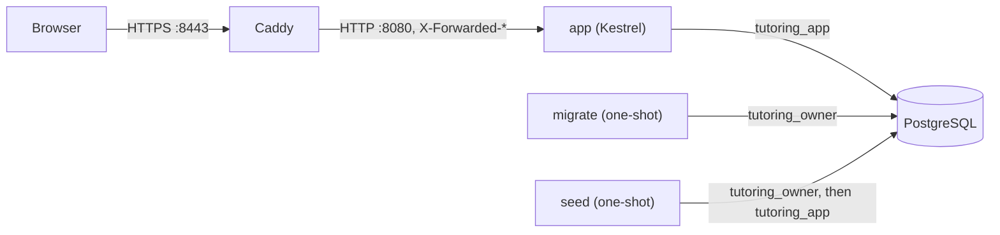
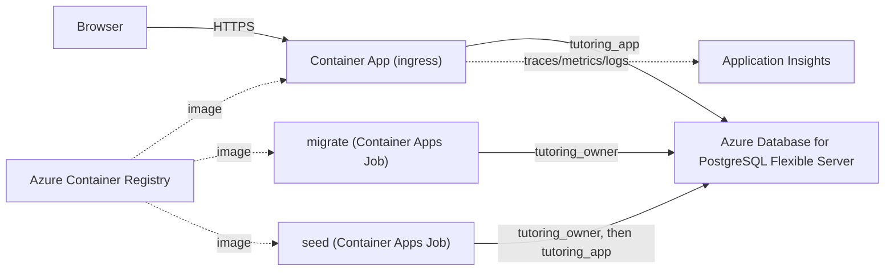

# Deployment

How the system is built, proxied, and run, and the pipeline designed to put it on a public URL. Written from
the implementation, with one exception called out up front.

**Status (2026-10-11).** No Azure subscription exists for this project yet. Tasks 35.1–35.5 (provisioning
script, cloud database, GitHub↔Azure OIDC trust, `deploy.yml`, runtime configuration) and the Azure-dependent
parts of 35.6/35.7/35.8/35.9 are therefore not done — not "done against a different target," genuinely not
done. What follows is split accordingly: sections marked **(built)** describe what runs today, locally and in
CI, on the local production stack from Day 34. Sections marked **(designed, not provisioned)** describe the
Azure topology and pipeline the manual specifies, documented so the work that remains is exactly these
sections, done for real, once a subscription exists.

**Status at the end of Month 3 (2026-10-26).** Unchanged: cloud deployment is still not set up, and Month 3 added
none. No Azure (or other cloud) resource exists, `deploy.yml` does not exist, and Month 2's Days 35–36 remain open
(`later.md`). Everything Month 3 built (students, parents, teachers, groups, enrollments, the schedule, and five
migrations ending with `AddSchedule`, which needs the `btree_gist` extension) runs locally, in CI and on the local
production stack only; the Month 3 verification was walked on a freshly seeded local instance
(`docs/operations/month3-local-verification.md`), not on a deployed one.

## Topology

**(built)** — the local production stack, `compose.prod.yaml`:



Caddy terminates TLS and is the only container with a published port; `app`, `migrate`, `seed` and `postgres`
are reachable only on the Compose-internal `prod` network. `migrate` and `seed` run once, in that order, before
`app` starts (`depends_on: condition: service_completed_successfully`); `app` never receives the owner
connection string, only the runtime one.

**(designed, not provisioned)** — the same shape, the manual's Azure interpretation:



Azure Container Apps for the app and its jobs, Azure Container Registry for images, Azure Database for
PostgreSQL Flexible Server, Application Insights for telemetry — Task 35.1's scope note. None of these
resources exist yet.

## The six-step deployment flow

**(designed, not provisioned)** — from the manual, unchanged by this slice:

1. Azure login with OIDC (`id-token: write`, no stored client secret).
2. Build and push the image, tagged with the commit SHA.
3. Run the migrate job with that image and the owner connection; wait for success; fail the run if it fails.
4. Update the container app to the new image; wait for the revision to become ready.
5. Run the deployed smoke test (Task 35.8 — built, see below) against the new revision.
6. On smoke failure, activate the previous revision and fail the run.

`deploy.yml` is not written in this slice: every step above depends on a resource (the registry, the jobs, the
container app, the OIDC trust) that does not exist yet. Writing the workflow before the resources it operates
on would mean a file that cannot be validated against anything real.

**(built)** — the same ordering question, proven without Azure: CI's `container` job (Task 34.9) builds the
image and applies migrations with it; CI's `smoke` job (Task 35.8/35.9) then builds and starts the full local
production stack — image, migrate, seed, app, Caddy — and runs the deployed smoke test against it, on every
pull request. This is not the live pipeline; it is the same migrate-before-serve, smoke-gates-the-revision
shape, exercised continuously against a real (if local) target instead of not at all.

## Secrets inventory

Names and where each one lives — never values. A secret not on this list is a finding.

| Secret | Where it lives | Who can read it |
| --- | --- | --- |
| `POSTGRES_PASSWORD`, `TUTORING_OWNER_PASSWORD`, `TUTORING_APP_PASSWORD`, `DEMO_SEED_PASSWORD` | `.env` (git-ignored, local only) | Whoever has a shell on that machine |
| `ConnectionStrings:Postgres`, `ConnectionStrings:PostgresMigrations`, `Seed:Password` | `dotnet user-secrets` (local machine's user-secrets store, outside the repository) | Whoever has a shell on that machine |
| `ci-only-throwaway-*` passwords (Postgres roles, seed) | Literal strings in `.github/workflows/ci.yml` | Public (by design — a GitHub Actions service container that never leaves the job; not a real credential) |
| Owner/app Postgres role passwords, `Seed:Password`, `APPLICATIONINSIGHTS_CONNECTION_STRING` | **Not yet created** — would be Azure Container Apps secrets (Task 35.1/35.2/35.5) | N/A |
| Azure deployment identity's federated credential | **Not yet created** — would need no client secret at all (OIDC, Task 35.3) | N/A |
| `AZURE_CLIENT_ID`/`AZURE_TENANT_ID`/`AZURE_SUBSCRIPTION_ID` | **Not yet created** — would be GitHub `production` environment variables (identifiers, not secrets, Task 35.3) | N/A |
| PostgreSQL Flexible Server administrator login | **Not yet created** — would be used once, interactively, for the Day 19 role-bootstrap script (Task 35.2), then never stored anywhere the pipeline can read, and the firewall rule allowing it closed again | N/A |

## The proxy network value

**(built)** `Proxy:KnownNetworks` is `172.28.0.0/16` (`compose.prod.yaml`'s `app` service). It is a **fixed**
subnet, not Compose's dynamic default: the custom `prod` network declares `ipam.config.subnet: 172.28.0.0/16`
explicitly, specifically so this value could be named in the app's configuration before the stack ever starts
— a dynamically-assigned subnet can't be known in advance (Task 34.8).

**(designed, not provisioned)** the Azure equivalent would be the Container Apps environment's internal
infrastructure subnet CIDR, read back with `az containerapp env show` once that environment exists (Task
35.5) — not yet obtained, since the environment does not exist.

## Content-Security-Policy and its one relaxation

**(built)**, `SecurityHeadersSetup.cs`:

```
default-src 'self'; script-src 'self'; style-src 'self' 'unsafe-inline'; img-src 'self' data:;
font-src 'self'; connect-src 'self'; frame-ancestors 'none'; base-uri 'self'; form-action 'self';
object-src 'none'
```

`script-src` is never relaxed. `style-src` carries `'unsafe-inline'`, confirmed necessary against the local
production stack behind Caddy (Task 34.8): Sonner's `Toaster` (`frontend/src/routes/__root.tsx`, mounted on
every route) sets its own runtime-computed offsets as inline styles on its container. The SPA is a pre-built
static `index.html` with no per-request templating, so no CSP nonce is available, and the offsets vary at
runtime so a fixed style hash can't cover them either. Recorded in `later.md` (2026-10-11) as the next thing
to revisit if Sonner is ever replaced with a CSP-strict alternative.

## Telemetry

**(built)** OpenTelemetry (traces, metrics and logs), wired only in `TutoringCentre.Api`'s composition root
(`Telemetry/TelemetrySetup.cs`) — Domain and Application carry no telemetry dependency. Off entirely unless
configuration key `Otel:Endpoint` is set, so Development and the test suite export nothing. The request's
correlation ID (the same reference shown in a toast on failure) is set as a tag on the request's trace span in
`CorrelationIdMiddleware`; health-probe requests are excluded from tracing; Npgsql's own tracing records SQL
statement text, never parameter values.

**(designed, not provisioned)** the manual's target exporter is the Azure Monitor OpenTelemetry distro, which
needs an Application Insights connection string — not available without Azure. Until then, `Otel:Endpoint`
points at a plain OTLP endpoint: any local viewer, such as the .NET Aspire Dashboard —

```bash
docker run -d --name aspire-dashboard -p 18888:18888 -p 18889:18889 \
  -e DOTNET_DASHBOARD_UNSECURED_ALLOW_ANONYMOUS=true \
  mcr.microsoft.com/dotnet/aspire-dashboard:9.0
# then run the Api with Otel__Endpoint=http://localhost:18889 and open http://localhost:18888
```

— exercises the exact same instrumentation (resource attributes, the correlation tag, probe exclusion, no
parameter values) that the Azure Monitor exporter would receive; only the exporter's destination changes.

## The demo banner and demo mode

**(built)** `GET /api/system/info` reports `demoMode: true` when configuration key `Demo:Enabled` is set — the
same flag Task 34.7's seed gate already reads. The flag reaches the Application layer through a port
(`IDemoModeProvider`), implemented in the Api project (where options binding lives), never by Application
reading configuration types directly. The frontend's `DemoBanner` (`frontend/src/features/status/DemoBanner.tsx`)
renders nothing while the query is loading or `demoMode` is false; otherwise a non-dismissible bar, translated,
above the layout on every route including `/login` (`frontend/src/routes/__root.tsx`).

**(designed, not provisioned)** the one-time cloud seed run (Task 35.7's remaining piece) needs a deployed
instance to seed.

## Running migrate and seed by hand

**(built)** against the local production stack (`migrate` and `seed` already run automatically on `up`; these
re-run them on demand, e.g. after a schema or seed-data change without rebuilding the whole stack):

```bash
docker compose -f compose.yaml -f compose.prod.yaml run --rm migrate
docker compose -f compose.yaml -f compose.prod.yaml run --rm seed
```

**(designed, not provisioned)** against Azure, once the jobs exist: `az containerapp job start --name
<migrate-or-seed-job> --resource-group <group>`.

## The deployed smoke test

**(built, Task 35.8)** `smoke/` is a separate Playwright project, parameterised entirely by environment
(`SMOKE_BASE_URL`, `SMOKE_EXPECTED_SHA`, `SMOKE_PASSWORD`, `SMOKE_EXPECT_HSTS`) — see `smoke/README.md`. It
starts no local server. Checks: `/health/ready` is 200; `/` returns HTML with the security headers;
`/api/system/info` reports the expected commit SHA and `demoMode: true`; an unauthenticated `GET /api/subjects`
is 401; the demo Nile owner can sign in, see at least one Subjects row, and sign out. It creates no data and
runs in a few seconds. CI's `smoke` job runs it against a freshly built local production stack on every pull
request — the closest available proof of the live pipeline's step 5 until a deployed instance exists to point
it at for real.

## What remains

Everything under **(designed, not provisioned)** above, in task order: 35.1 (provisioning script) → 35.2
(cloud database roles) → 35.3 (OIDC trust) → 35.4 (`deploy.yml`) → 35.5 (runtime config and probes) → the
Azure-exporter half of 35.6 → the cloud seed run (35.7) → pointing 35.8 at a real URL → this document's
**(designed, not provisioned)** sections turning into **(built)**, read back from Azure and GitHub rather than
from the manual, the first time a subscription exists.
