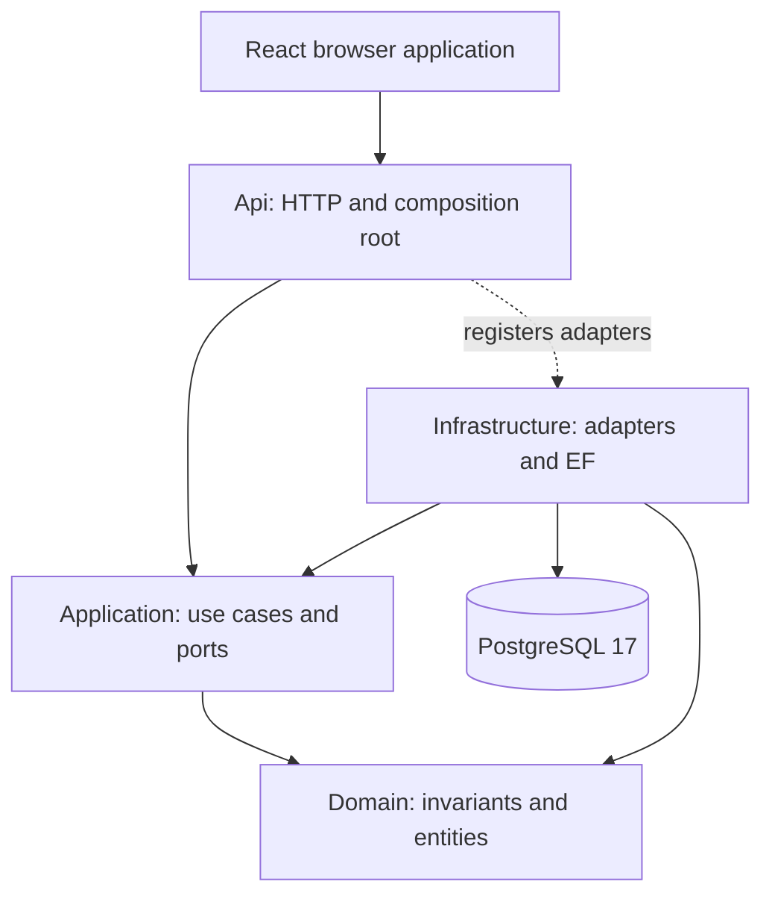
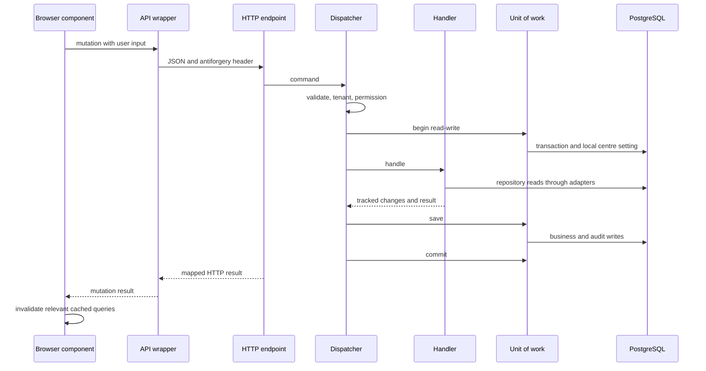
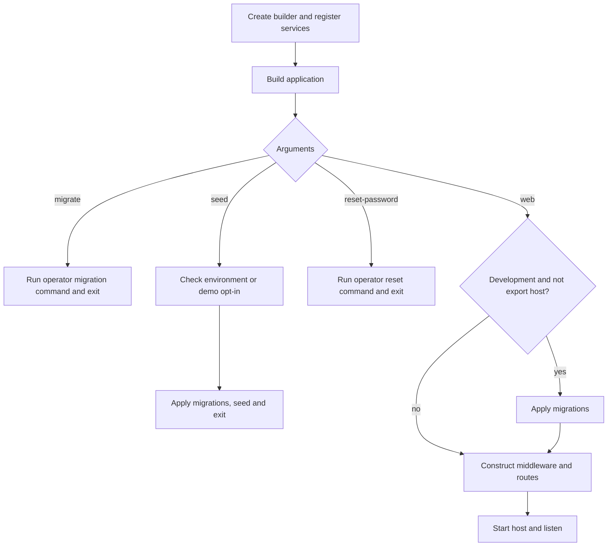

# Tutoring Centre Manager — Current Repository Re-onboarding

This is a fresh account of the repository at the starting revision `ef486f9`, prepared on 27 October 2026. Source files, configuration, migrations, tests and documentation are evidence; old overview statements are not evidence of current behaviour. An implemented feature is not automatically a deployed or independently exercised feature. Test outcomes below distinguish those meanings.

The intended reader knows basic programming and needs to understand why one user action crosses several files. Read the execution examples with the corresponding source open. A path and line number identify the implementation, while the discussion explains ownership, mechanisms and consequences. The [file index](file-explanations/INDEX.md) covers the complete application inventory and links to per-file guides. The historical overview documents remain unchanged.

Contents: [Project](#1-project-overview) · [Stack](#2-technology-stack) · [Architecture](#3-architecture) · [File map](#4-folder-and-file-architecture) · [Startup](#5-startup--bootstrapping) · [Concepts](#6-concepts-and-patterns) · [Authentication](#7-authentication-and-authorization) · [Routing](#8-routing-and-middleware) · [Data](#9-data-layer) · [Use cases](#10-business-logic-and-services) · [Frontend](#11-frontend) · [Tests](#12-testing) · [Infrastructure](#13-infrastructure) · [Findings](#14-code-quality-findings) · [Learning path](#15-recommended-learning-path) · [Changes](#16-changes-since-v2) · [Glossary](#17-glossary-and-open-questions).

When this document discusses a language or framework mechanism, it explains the mechanism required to read the implementation. That is distinct from observing every internal instruction of the framework at runtime. Where the repository does not state a design motivation, the following convention applies: **The repository does not explicitly state why this approach was chosen. The following is an interpretation based on the implementation.** Interpretations must not be read as historical decisions by the author.

# 1. Project Overview

## 1.1 Product purpose and users

The README describes a management platform for Egyptian tutoring centres. Its intended scope includes students, parents, groups, schedules, attendance, fees, payments and a WhatsApp assistant. The implementation now supports substantial administrative and academic workflows. Attendance, payments and a WhatsApp delivery channel must not be inferred from that product description. The implementation reference is the registered endpoint groups in `src/TutoringCentre.Api/Program.cs`, the use cases in Application, and the rendered frontend routes.

A **centre** is the tenant: the customer whose records must remain isolated. A staff account can have memberships in multiple centres. Each membership carries its own role. The same person can therefore have different access depending on the centre selected for the session. The staff roles are Owner, Secretary and Teacher; the UI can call the Secretary an Assistant. The role names, permission keys and mapping are defined in `src/TutoringCentre.Domain/Identity/StaffRole.cs`, `Permissions.cs` and `RolePermissions.cs`. A parent contact record is academic data, not a parent login. These are separate concepts even when the word “parent” appears in the product vision.

The operator is another actor. Operator actions such as migrations, seed data and resetting a password run through process commands. They do not become public HTTP endpoints merely because they are implemented. The CLI branches in `Program.cs` separate `migrate`, `seed` and `reset-password` from starting the web server. Trusted process execution and staff HTTP authorization therefore have different entry conditions.

## 1.2 Current implementation state

The states below concern repository implementation. “Complete” means the described slice has implementation and supporting checks, not that the entire eventual product is finished. Actual execution results appear in the testing section.

| Feature | State | Implementation evidence and boundary |
| --- | --- | --- |
| Four backend projects with inward dependencies | Complete | The solution, project references, Application ports and architecture rules implement the layering. |
| Commands and queries through a common dispatcher | Complete | `Application/Common/Cqrs/Dispatcher.cs` validates, checks tenant scope and permission, then controls the transaction. |
| Staff login and encrypted cookie sessions | Complete | `Api/Auth/AuthEndpoints.cs`, `AuthenticationSetup.cs`, Infrastructure identity adapters and frontend login routes. |
| Centre selection | Complete | `SelectCentreAsync` dispatches the membership check before replacing the cookie. |
| First-login password change | Complete | Login prevents auto-selection when `MustChangePassword` is true; password change replaces the ticket without a selected centre. |
| Code-defined permission checks | Complete | Sixteen keys in `Domain/Identity/Permissions.cs`; `Dispatcher.CheckPermission` reads the current role mapping. |
| Tenant isolation | Complete for mapped tenant entities | Request marker, EF query convention, save guard, transaction-local PostgreSQL setting and forced RLS work together. This is not a claim that every future table is automatically safe without its migration. |
| Subject management | Implemented | Subject commands, read service, endpoints and frontend page. |
| Student and parent records | Implemented | Academic entities, registration and link operations, read services, endpoints and detail pages. |
| Teacher records and staff links | Implemented | Teacher entity and commands, staff-directory contract, teacher scope and frontend account dialog. |
| Groups | Implemented | Subject/teacher relationships, capacity, status and versioned edit operations. |
| Enrollment, withdrawal and transfer | Implemented | Enrollment handlers and group row locking; roster and student enrollment screens. |
| Weekly schedules and dated sessions | Implemented | Schedule rules, pure session generator, repository locks, exclusion constraints, schedule tab and timetable. |
| Audit history | Implemented | Save interceptor builds audit rows in the command transaction; read permission and audit page expose history. |
| Centre settings and staff lifecycle | Implemented | Dedicated endpoint groups, use cases and owner-facing pages. |
| English and Arabic interface | Implemented | Bundled resources, i18next setup, logical layout utilities and translation tests. A resource file is not proof of visual QA for every screen. |
| Production application image and local TLS stack | Implemented; local execution results reported separately | `Dockerfile`, `compose.prod.yaml`, `Caddyfile`, static SPA hosting and trusted forwarding. |
| Azure deployment | Design documented; live deployment unverified | README explicitly says no Azure subscription has been provisioned. Deployment ADRs and runbooks are plans and operational instructions. |
| Attendance, QR, money flows and WhatsApp bot | Outside the currently mapped feature set | They are intended scope; no corresponding registered feature group appears in the current composition root. |

## 1.3 Major user journeys

**Sign in and choose a centre.** The browser loads the SPA and the protected route asks for the current session. A signed-out result leads to the login form. Client validation checks input before the request. The HTTP wrapper obtains the request-side antiforgery token, sends the login request and processes the result. The API validates shape, verifies credentials, replaces the request actor and reads the current profile. A single active membership is selected automatically only when the account does not require a password change. Otherwise the browser goes through password change or centre selection. The cookie holds the authenticated ticket; the UI reads profile data from `/api/me`.

**Set up a centre.** An owner creates subjects and teacher records, optionally links teachers to staff accounts, and creates groups referring to those records. Students are registered with parent contacts. Enrollment puts students into groups. Weekly rules generate dated sessions, and the timetable presents those sessions in the centre's time zone. These steps cross different aggregates because the invariant for one record is not necessarily the invariant for a whole academic workflow. A group's capacity is enforced by a lock-and-count operation, while schedule overlap is enforced by database exclusion constraints.

**Work as a teacher.** The role mapping allows subject, group, enrollment and schedule reads. Teacher ownership narrows relevant reads to groups taught by the linked teacher in the selected centre. Permission and ownership answer different questions: the permission allows the capability; the ownership scope decides which records that capability can see. Hiding other navigation items improves usability, but the server's request checks and read scope remain the boundary.

**Review a change.** A successful command can produce both business changes and audit rows. The save interceptor participates in the same unit of work. A rollback must remove both; otherwise history could describe a change that never happened. Owners read audit history through a separately authorized query. The frontend renders structured audit fields instead of receiving raw database entities.

## 1.4 How to interpret evidence

There are three different levels of confidence. Source proves that a branch or mapping is present. A test definition proves that an intended behaviour has a regression specification. A test execution proves that the behaviour passed in the environment used for that run. The test section records the last level explicitly. Neither a passing local test nor a deployment document proves that a cloud instance is running.

The repository also contains historical semantic documentation and older overview files. Treat them as time-specific artifacts. The current code already contradicts several statements in those files, especially that Application is empty, that tenant isolation is only a plan, or that there is no production application image. The changes section records the corrected claims rather than rewriting those historical documents.

# 2. Technology Stack

## 2.1 Reading versions correctly

`global.json` pins the SDK selection policy. `Directory.Build.props` supplies project-wide compiler settings, while `Directory.Packages.props` holds NuGet dependency versions. The frontend manifest specifies ranges; `frontend/package-lock.json` supplies resolved package versions. A version range is not an installed version, and the fact that a binary exists on the current machine does not change the repository's declared requirements.

| Technology | Version source | Where used | What it does in this project |
| --- | --- | --- | --- |
| .NET SDK | `10.0.401`, `rollForward: latestFeature`, `global.json` | Backend build | Selects a compatible compiler and SDK feature band. |
| C# and target framework | `net10.0`, `Directory.Build.props` | Four source projects and five test projects | Language, runtime, nullable analysis and common warnings policy. |
| ASP.NET Core | .NET 10 shared framework | Api | Minimal hosting, routing, cookies, authorization, antiforgery, rate limits and health endpoints. |
| Entity Framework Core | `10.0.13` | Infrastructure | Entity mapping, LINQ translation, change tracking, migrations and concurrency tokens. |
| Local dotnet-ef tool | `10.0.12`, `.config/dotnet-tools.json` | Migration tooling | Compares the current model with its snapshot; its patch version differs from the current runtime packages. |
| Npgsql EF provider | `10.0.3` | Infrastructure | PostgreSQL implementation of EF operations. |
| PostgreSQL | `postgres:17` image | Compose and disposable test databases | Constraints, transactions, row-level security and explicit locks. |
| Naming conventions | `EFCore.NamingConventions 10.0.1` | DbContext options | Converts model names to database naming conventions. |
| FluentValidation | `12.1.1` | Application and transport validation | Runs shape checks and produces field-keyed failures. |
| ASP.NET Core Identity EF | `10.0.13` | Infrastructure identity | User persistence, password hashing, lockout and security stamps. |
| Data Protection EF | `10.0.13` | Infrastructure registration | Persists cookie encryption key material through the database context. |
| ASP.NET OpenAPI and build exporter | `10.0.13` | Api build | Derives the machine-readable contract from endpoint metadata. |
| Serilog.AspNetCore | `10.0.0` | Api | Structured request and application logs. |
| OpenTelemetry hosting and OTLP exporter | `1.15.3` | Api telemetry | Optional tracing and metric export. |
| ASP.NET telemetry instrumentation | `1.16.0` | Api telemetry | Instruments incoming requests. |
| Npgsql telemetry | `10.0.1` | Infrastructure/Api telemetry wiring | Adds database activity instrumentation. |
| xUnit / runner | `2.9.3` / `4.0.0` | Backend tests | Test discovery, assertions and parameterized cases. |
| Testcontainers.PostgreSql | `4.15.0` | Integration tests | Creates disposable PostgreSQL instances through Docker. |
| Respawn | `7.0.0` | Database fixtures | Resets row data between tests. |
| NetArchTest.Rules | `1.3.2` | Architecture tests | Checks compiled dependency usage. |
| Microsoft.NET.Test.Sdk / coverlet | `18.10.1` / `10.1.0` | Test projects | Test host and coverage collector integration. |
| React / React DOM | Manifest `^19.2.8`; exact resolution in lockfile | Frontend | Declarative components and browser mounting. |
| TypeScript | Manifest `~6.0.2`; exact resolution in lockfile | Frontend and Node-side tooling | Static checking and compilation. |
| Vite | Manifest `^8.3.0` | Frontend | Development server, API proxy and production assets. |
| TanStack Query | Manifest `^5.104.1` | Frontend | Server-state cache, observers and mutation lifecycle. |
| TanStack Router | Manifest `^1.170.41` | Frontend | File route definitions, guards and typed navigation. |
| Orval | Manifest `^8.39.0` | Frontend tooling | Generates typed API functions and Query hooks. |
| React Hook Form / Zod | `^7.89.0` / `^4.6.5` | Forms | Input registration, validation and submit handling. |
| i18next / react-i18next | `^26.4.2` / `^17.0.15` | Frontend resources and components | Language selection and reactive translation. |
| Tailwind / Base UI | `^4.3.3` / `^1.8.0` | Styling and UI primitives | Utility classes and interactive accessible controls. |
| Vitest / Testing Library / MSW | `^5.0.3` / `^16.3.3` / `^2.15.0` | Frontend tests | Component execution, DOM assertions and HTTP interception. |
| Playwright | Manifest `^1.63.0` | E2E and smoke tooling | Real browser journeys across serving, API and persistence. |
| npm | Lockfile format and package scripts | Frontend and smoke | Reproducible package installation and command entry points. |
| Docker Compose / Caddy | Service configuration and image tags | Local production topology | Process isolation, TLS termination and reverse proxying. |
| GitHub Actions | Workflow action tags | `.github/workflows` | Builds, tests, contract drift checks and local container verification. |

The exact frontend resolution table and command results are retained with the frontend evidence. No production Node process is implied by this stack: the production browser assets are built in the image and served by the API. Node is used during development, testing and asset compilation.

# 3. Architecture

## 3.1 Compile-time boundaries versus runtime calls

The backend is one deployable process with four source projects. Domain owns business state and invariant methods. Application owns requests, handlers and ports. Infrastructure implements persistence, credential and other technical ports. Api is the HTTP edge and composition root. An interface being declared in Application allows a handler to call an Infrastructure object at runtime without compiling against that implementation.

This is a **modular monolith**, not independently deployed services. Feature folders divide academics, identity, centres and audit inside the layers. Published contracts such as the staff directory and centre time-zone provider let one feature consume a narrow capability without copying persistence logic into another feature. Architecture tests inspect these boundaries; they are not merely a diagram in documentation.

## 3.2 Main command and data flow

The primary user-action path is a browser event, a frontend mutation, a generated API function, the shared transport wrapper, the HTTP pipeline, an endpoint, the dispatcher, a handler and one or more ports. Infrastructure translates those port calls into reads or tracked changes. The dispatcher owns the final save and commit. The result returns through HTTP mapping, the transport wrapper and cache invalidation to a component render.

The drawing intentionally does not turn every read into a direct handler-to-database dependency. The runtime request passes through ports; the database arrows represent adapter work. A business failure returns a value and causes rollback. An unexpected exception causes rollback and propagates to the HTTP exception handler. Read-only queries have a separate pipeline and never perform the dispatcher's save.

## 3.3 Isolation is several guarantees

The selected centre is not accepted as an arbitrary trusted field from every request. Authentication supplies a staff actor, and centre selection checks the membership before issuing the session claim. Tenant-scoped requests require a centre before a transaction opens. EF adds centre predicates to mapped tenant entities. The save guard checks tracked writes. The transaction sets `app.current_centre`, and PostgreSQL policies enforce the same boundary even for allow-listed raw SQL. Composite foreign keys prevent a record in one centre from referring to a record in another centre.

These mechanisms protect different failure modes. A query filter alone does not protect direct SQL. RLS alone does not make a forged application actor trustworthy. A permission alone does not identify which tenant is active. A foreign key alone does not decide which staff role may read the row. The useful question before changing any one mechanism is therefore: which bypass remains covered by the other layers, and which guarantee would be lost?

# 4. Folder and File Architecture

## 4.1 Navigating by ownership

| Path | Type | Purpose | Depends on | Used by |
| --- | --- | --- | --- | --- |
| `src/TutoringCentre.Domain` | Source | Business state, value objects, errors and role catalogue | Language/runtime primitives | Application and Infrastructure |
| `src/TutoringCentre.Application` | Source | Use cases, DTOs, request markers and ports | Domain and selected abstractions | Api and Infrastructure |
| `src/TutoringCentre.Infrastructure` | Source | EF models, migrations, repositories, read services and Identity adapters | Application, Domain and persistence packages | Composition root and tests |
| `src/TutoringCentre.Api` | Source | Hosting, transport, auth, telemetry and operator commands | Application and composition registrations | HTTP clients and CLI |
| `tests/TutoringCentre.Domain.Tests` | Test | Pure invariant and value-object specifications | Domain | Test runner |
| `tests/TutoringCentre.Application.Tests` | Test | Handler and pipeline behaviour with fakes | Application and Domain | Test runner |
| `tests/TutoringCentre.Infrastructure.Tests` | Test | PostgreSQL constraints, scopes, races and persistence | Infrastructure and disposable database | Test runner |
| `tests/TutoringCentre.Api.Tests` | Test | HTTP, identity, permission and tenant probes | Api test hosts and database fixtures | Test runner |
| `tests/TutoringCentre.Architecture.Tests` | Test | Dependency, module and convention rules | Built assemblies and project metadata | Test runner |
| `frontend/src/routes` | Source | File routes, parameters, guards and route integration | Feature components and Query | Generated route tree |
| `frontend/src/features` | Source | Academic and administrative UI workflows | Generated client, shared controls and session helpers | Routes |
| `frontend/src/api` | Source/generated | Shared transport, error mapping, CSRF and generated contract client | Browser HTTP and OpenAPI | Feature hooks |
| `frontend/src/i18n` | Source/resources | Language setup and paired resources | i18next integrations | UI |
| `frontend/src/components` | Source | Shared controls, tables and copied primitives | React and UI packages | Features |
| `frontend/e2e` | Test | Complete browser journeys | Running browser, API and database | Playwright |
| `smoke` | Test/configuration | Browser checks against a production-style URL | Container stack or configured target | Smoke job |
| `database/demos` | Database/schema | Demonstrations of database isolation | SQL session roles and schema | Developer verification |
| `db/bootstrap-roles.sh` | Database/script | Creates distinct database roles and grants | PostgreSQL bootstrap environment | Initial database startup |
| `docs/adr` | Documentation | Decisions and alternatives | Implemented design evidence | Maintainers |
| `docs/architecture` | Documentation | Feature and infrastructure architecture | Current source | Maintainers |
| `docs/operations` | Documentation | Verification instructions and operational recovery | Deployment configuration | Operators |
| `.github` | CI/CD | Workflow jobs and dependency maintenance | Build/test entry points | GitHub runners |

The complete per-file table follows in the generated file map and [index](file-explanations/INDEX.md). It includes small declarations, generated artifacts, lockfiles and media rather than dropping them because they contain little business logic. Generated migrations, snapshots, API client code and route trees are important to understand even though they should not usually be edited manually.

## 4.2 How to follow one feature

Start with the route or endpoint, not with a similarly named entity. For enrollment, the endpoint binds the request and sends `EnrollStudentCommand`. The command's implemented interfaces reveal tenant and permission requirements. Its handler shows orchestration order. The repository port states required storage capabilities. The Infrastructure repository shows the `FOR UPDATE` load and subsequent count. The Domain group decides whether the count permits another student. The enrollment entity records the relationship. Finally, EF configuration and migrations state what survives outside the application process.

Reading only the frontend would miss the lock. Reading only the entity would miss the count. Reading only the migration would miss the permission requirement. Reading every layer in the same operation is how the architecture stops being a list of labels and becomes a concrete execution path.

# 5. Startup / Bootstrapping

## 5.1 The composition root

The executable entry point is `src/TutoringCentre.Api/Program.cs`. `WebApplication.CreateBuilder(args)` creates the hosting builder and layered configuration. The entry point detects the OpenAPI export host, supplies placeholder configuration needed for build-time generation, configures structured logging and registers the application's services. It does not create every service instance immediately: most registrations describe how the container will construct instances when requested.

Application registration supplies the actor context, handler scanning and dispatcher. Infrastructure registration supplies the database context and adapters. Api registration supplies HTTP error mapping, authentication, antiforgery, rate limits, proxy validation, telemetry and JSON conversion. The database context is scoped; repositories and the unit of work in a single request therefore share its tracking state and current transaction. A singleton timestamp interceptor does not capture a request actor; the scoped audit interceptor does require scoped actor and correlation information.

## 5.2 Three startup branches

The `migrate` branch delegates to `MigrateCommand`. The `seed` branch first checks `SeedGate`: Development and Testing allow it, while Production requires the demo option. The seed path then applies migrations and runs the seed command. The reset-password branch requires process arguments for the target email and replacement password and delegates to its operator command. Each returns before `app.Run()`; starting a web listener is not part of these CLI operations.

For normal web execution, Development applies migrations unless the process is the OpenAPI generator. Production does not auto-migrate at web startup. The local production stack has a separate one-shot migration job, making database ownership credentials unnecessary in the steady-state application container. This separation is both an operational boundary and a database privilege boundary.

## 5.3 Pipeline construction and why it is explicit

Trusted forwarded headers run first, so later code sees the validated forwarded scheme and address. Production HSTS and security headers come next. Correlation, request logging, exception handling and status pages surround subsequent request work. Static SPA files run before explicit routing. This order prevents routing from selecting a fallback endpoint before a real asset has had the opportunity to be served.

Authentication runs after routing, followed by actor translation, authorization and rate limiting. The `/api` group carries the antiforgery filter. The application registers system, auth, academic, staff, audit and settings endpoints on that group. Unknown `/api` paths return Problem Details rather than the SPA. Browser deep links can fall back to the built SPA shell. A final anonymous fallback handles everything else, including missing file-looking paths, without converting an unknown resource into an authentication challenge.

The final `app.Run()` starts hosted behaviour and listening. Options configured with `ValidateOnStart` are checked during host startup. This is a different event from calling `builder.Build()`: the builder can create a service provider before all hosted startup validation has executed. Database configuration is also used during CLI resolution, so a process that exits before normal web startup still needs the configuration required by the particular command it resolves.

## 5.4 Frontend bootstrap

`frontend/index.html` loads `frontend/src/main.tsx`. The module imports language initialization and CSS, creates the router with the shared query client in its context, installs the login redirect callback, checks that `#root` exists and mounts the providers. `QueryClientProvider` makes the cache available to hooks; `RouterProvider` renders the matching route tree. Importing the generated route tree connects file definitions to runtime matching. The development plugin and build tooling produce that tree; it is not a manually maintained second list of routes.

The HTML shell is not the authenticated user session. The browser can receive and render that shell before any protected API data is available. The protected layout asks the session query for current user data and redirects when needed. This is why serving `index.html` anonymously is compatible with protecting data on the API. The JavaScript can describe a protected screen without carrying permission to read the records that screen would show.
